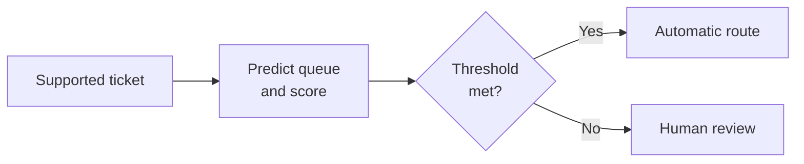

A customer writes to a hypothetical support assistant: “My package is late. Please refund the delivery fee.” The system can classify the request, find the shipment record, draft a reply, and propose a refund. Each step requires different evidence. The message describes the customer's concern, the shipment database records the delivery status, and an application policy determines whether a refund is allowed.

A fluent response alone establishes none of those facts. To decide where AI belongs, specify the task, the information available, the allowed actions, and the consequences of an error.

This section builds on [Training, Inference, and Deployment](/ai/training-inference-and-deployment/). It assumes binary predictions, fractions, and the distinction between fitting and evaluation. By the end, you should be able to:

- Turn a broad AI request into tasks with observable inputs and checkable outputs.
- Recognize limits caused by missing information, changed conditions, and unsupported causal claims.
- Calculate automatic coverage, error among accepted predictions, and a simple review cost.
- Design a workflow that handles uncertainty without treating model confidence as permission.

## Match a capability to a defined task

AI methods support several kinds of computation. **Classification** assigns a category, such as billing or delivery. **Regression** predicts a numerical value, such as remaining delivery time. **Generation** produces an output sequence, such as a reply or program. Search and planning methods select steps using a representation of possible states, actions, or goals.

The useful unit of evaluation is a task under stated conditions. “Handle customer support” contains routing, record access, policy decisions, language generation, and external actions. An application can combine learned models with database queries, explicit rules, and human decisions. Each component needs its own acceptance criteria.

<div class="table-scroll" role="region" aria-label="AI task families and evidence needed for evaluation" tabindex="0">

| Task | Available input | Checkable output | Evidence needed |
| --- | --- | --- | --- |
| Route a support ticket | Message and supported categories | Assigned queue | Independently labeled tickets and error costs |
| Estimate delivery time | Current shipment events and historical records | Time estimate | Later outcomes, uncertainty, and conditions of use |
| Draft a reply | Message, verified records, and current policy | Proposed text | Factual agreement, useful content, and required disclosures |
| Plan a resolution | Current state, permitted tools, and stopping conditions | Proposed steps | Valid transitions, authorization, and confirmed results |

</div>

Successful execution of one task supplies limited evidence about another. A classifier's routing accuracy does not establish whether a generated refund explanation follows policy. A tool call that completes successfully establishes an operation's result; its authorization and appropriateness require separate checks.

An effective comparison also needs a **baseline**, an existing approach evaluated under the same conditions. Possible baselines include a rule, a search interface, or manual handling. If explicit eligibility rules already determine a refund, applying those rules directly gives a specification to test. A language model can still help extract a request or explain an outcome.

## Some limits come from the available information

Suppose two customers submit the same message and the assistant receives no account or shipment data. One customer's package is delayed; the other's package arrived earlier that day. The assistant sees identical inputs. A deterministic procedure must produce the same output for both, while a randomized procedure has the same output distribution. Neither can reliably distinguish these cases using that message alone.

Adding authenticated access to the shipment record changes the information available. Retrieval still requires the correct record, sufficient freshness, and an accurate interpretation. If the database is unavailable, inventing a delivery status creates an unsupported claim. The application needs an explicit unavailable-data response or a review path.

Other limits arise from changed conditions. A classifier evaluated on one language or product line has supplied evidence for those conditions. Performance on another language, new category, or different time period requires investigation. **Distribution shift** means that the inputs or their relationship to the desired outputs differ from the evaluation setting. Familiar-looking wording can accompany an unfamiliar case.

Prediction also differs from estimating the effect of an action. Historical customers who received refunds might return more often because support staff selected particular cases. That association alone cannot determine what would happen if every late delivery received a refund. A causal estimate needs suitable experimental evidence or explicit assumptions that justify inference from observational data. Shpitser and Pearl's [work on the causal hierarchy](https://jmlr.csail.mit.edu/papers/v9/shpitser08a.html) formalizes differences between observational, intervention, and counterfactual questions. A predictive system can participate in a causal analysis when those additional requirements are met.

## Confidence needs its own evidence

A classifier can report a number between zero and one for each category. **Calibration** concerns how these reported probabilities agree with observed frequencies. For a calibrated billing probability near 0.8, approximately 80% of comparable cases receiving that probability should be billing cases. This is a population-level property; it does not certify a particular ticket. The [scikit-learn calibration guide](https://scikit-learn.org/stable/modules/calibration.html) explains this interpretation and how to assess it.

A high score can accompany a wrong answer. Guo and colleagues' [calibration study](https://proceedings.mlr.press/v70/guo17a.html) documents miscalibration in the neural-network settings they examined. It does not establish that every model is miscalibrated or that one correction works in every deployment. A language model's sentence “I am certain” also needs validation before it can serve as an error estimate.

**Abstention** means withholding an automatic prediction and requesting another process, such as additional evidence or review. It changes the set of cases handled automatically. That creates two quantities to measure: the fraction handled and the error rate within that fraction.

## Work through a routing decision

Consider eight synthetic tickets with fixed, invented classifier outputs. Billing is label 1 and delivery is label 0. The table is an arithmetic example, with no trained model or real service behind it. A model would see ticket inputs; reference labels are used afterward for evaluation.

Let `p_i` be ticket `i`'s reported billing probability. Predict billing when it is at least one half, using billing to break a tie. Define the reported confidence `c_i` as the larger category probability and accept a prediction when it reaches a threshold `τ`:

```math
\hat y_i=\mathbf{1}[p_i\geq 1/2],\qquad
c_i=\max(p_i,1-p_i),\qquad
a_i=\mathbf{1}[c_i\geq\tau].
```

The indicator is 1 when its condition holds and 0 otherwise. The scalar `a_i` records whether the system accepts the prediction automatically. We assume two exhaustive categories, `p_i` between zero and one, and `τ` between one half and one. All quantities are scalars; there are no matrix dimensions to track. A system with additional categories would need a different probability representation.

<div class="table-scroll" role="region" aria-label="Synthetic ticket scores and automatic routing decisions" tabindex="0">

| Ticket | Billing score | Predicted label | Reference label | Confidence | Accept at 0.8? |
| --- | ---: | ---: | ---: | ---: | --- |
| T1 | 0.95 | 1 | 1 | 0.95 | Yes |
| T2 | 0.85 | 1 | 1 | 0.85 | Yes |
| T3 | 0.70 | 1 | 0 | 0.70 | No |
| T4 | 0.55 | 1 | 1 | 0.55 | No |
| T5 | 0.45 | 0 | 0 | 0.55 | No |
| T6 | 0.30 | 0 | 1 | 0.70 | No |
| T7 | 0.15 | 0 | 0 | 0.85 | Yes |
| T8 | 0.05 | 0 | 1 | 0.95 | Yes |

</div>

Accepting every prediction makes three errors: T3, T6, and T8. With threshold 0.8, four predictions are accepted, four tickets are deferred, and T8 remains wrong. Its high score survives the gate.

For `n` evaluated tickets, define coverage `C` and the error rate among accepted predictions `R`:

```math
C=\frac{\sum_{i=1}^{n}a_i}{n},\qquad
R=\frac{\sum_{i=1}^{n}a_i\mathbf{1}[\hat y_i\ne y_i]}
{\sum_{i=1}^{n}a_i}.
```

Here `y_i` is the reference label and `n` must be positive. Coverage divides the accepted count by the total. The numerator of `R` counts mistakes among accepted cases; its denominator excludes deferred cases. At threshold 0.8, `C = 4/8 = 50%` and `R = 1/4 = 25%`. Accepting everything gives coverage 100% and error `3/8 = 37.5%`. If nothing is accepted, `R` is undefined, rather than zero. These are calculations on the supplied examples, not performance estimates for a real classifier.



*Figure 1. After input checks, the threshold controls automatic routing. Unsupported or incomplete inputs go directly to review. Auditing must include accepted cases because high-confidence errors can pass the gate. Any separate refund action still requires application authorization.*

## Compare policies under explicit costs

Assume, solely for this calculation, that each wrong automatic route costs three units, each reviewed ticket costs one unit, and review always finds the correct route. Ignore other costs temporarily. With automatic error count `E`, deferred count `D`, error cost `c_E`, and review cost `c_R`, total cost is:

```math
J=c_E E+c_R D.
```

Both costs are nonnegative scalar values in the same hypothetical unit; `J` covers this batch. Full automation costs `3 × 3 = 9`. Selective routing costs `3 × 1 + 1 × 4 = 7`. Reviewing everything costs `1 × 8 = 8`. Selective routing wins this comparison under these assumptions. Different error costs or reviewer behavior can change the ranking.

The following Python 3.9+ program uses only the standard library. It evaluates the fixed scores, trains no model, and calls no external service. Labels are consulted only to count errors. The thresholds and costs are specified before comparing the example's outcomes.

```python
import math


def evaluate_policy(scores, labels, threshold, error_cost=3, review_cost=1):
    if not scores or len(scores) != len(labels):
        raise ValueError("Expected matching nonempty score and label lists")
    for value in [threshold, error_cost, review_cost, *scores]:
        if type(value) not in (int, float) or not math.isfinite(value):
            raise ValueError("Expected finite numeric inputs")
    if not 0.5 <= threshold <= 1 or error_cost < 0 or review_cost < 0:
        raise ValueError("Invalid threshold or costs")
    if any(not 0 <= score <= 1 for score in scores):
        raise ValueError("Scores must lie between zero and one")
    if any(type(label) is not int or label not in (0, 1) for label in labels):
        raise ValueError("Expected binary integer labels")

    accepted = errors = 0
    for score, label in zip(scores, labels):
        prediction = int(score >= 0.5)
        if max(score, 1 - score) >= threshold:
            accepted += 1
            errors += int(prediction != label)
    deferred = len(scores) - accepted
    return {
        "coverage": accepted / len(scores),
        "error_rate": errors / accepted if accepted else None,
        "errors": errors,
        "deferred": deferred,
        "cost": error_cost * errors + review_cost * deferred,
    }


def main():
    scores = [0.95, 0.85, 0.70, 0.55, 0.45, 0.30, 0.15, 0.05]
    labels = [1, 1, 0, 1, 0, 1, 0, 1]
    for name, threshold in [("all automatic", 0.5), ("selective", 0.8)]:
        result = evaluate_policy(scores, labels, threshold)
        print(f"{name}: coverage={result['coverage']:.1%}, "
              f"accepted error={result['error_rate']:.1%}, "
              f"deferred={result['deferred']}, cost={result['cost']}")
    print(f"all review: coverage=0.0%, accepted error=n/a, cost={len(scores)}")


if __name__ == "__main__":
    main()
```

The verified output is:

```text
all automatic: coverage=100.0%, accepted error=37.5%, deferred=0, cost=9
selective: coverage=50.0%, accepted error=25.0%, deferred=4, cost=7
all review: coverage=0.0%, accepted error=n/a, cost=8
```

This program verifies policy arithmetic. It supplies no evidence that a real classifier would produce these scores, remain calibrated, or achieve this cost. Eight examples also cannot establish reliable subgroup performance. Real review has errors, delay, limited capacity, and its own cost distribution.

## Build a boundary that survives use

Define supported languages, input completeness, categories, and actions before measuring success. Evaluate representative cases and inspect important groups separately. Choose thresholds using development data, then check the chosen policy on independent examples. Repeatedly selecting thresholds after reading final test results makes that test part of development.

Monitor accepted decisions as well as deferred work. Reviewing only rejected cases hides confident mistakes such as T8. Track changing inputs, reviewer corrections, queue delays, and the versions of models and policies in use. Human reviewers need the evidence, time, and ability to override an output; a required click alone does not establish effective oversight.

For refund execution, enforce identity, record access, eligibility, and transaction limits in application code. Retrieved documents and generated tool arguments can contain errors or hostile instructions. Treat them as untrusted inputs and validate operations before execution. If the necessary evidence or permission is absent, return a defined failure or escalation outcome. A confidence threshold grants no additional authority.

High-consequence applications require domain-specific validation, qualified oversight, and a recovery plan proportionate to the possible harm. The [NIST AI Risk Management Framework](https://www.nist.gov/publications/artificial-intelligence-risk-management-framework-ai-rmf-10) provides a context-sensitive approach to assessing AI systems. It does not certify an application merely because a checklist was completed. The appropriate level of automation depends on the task's measured behavior and the consequences of failure.

## References consulted

- [scikit-learn: Probability calibration](https://scikit-learn.org/stable/modules/calibration.html) — interpreting probabilities and comparing them with observed frequencies.
- [Guo et al.: On Calibration of Modern Neural Networks](https://proceedings.mlr.press/v70/guo17a.html) — empirical evidence about calibration in the studied neural networks.
- [Shpitser and Pearl: Complete Identification Methods for the Causal Hierarchy](https://jmlr.csail.mit.edu/papers/v9/shpitser08a.html) — information required for observational, intervention, and counterfactual queries.
- [NIST: Artificial Intelligence Risk Management Framework (AI RMF 1.0)](https://www.nist.gov/publications/artificial-intelligence-risk-management-framework-ai-rmf-10) — assessing risks in the context of a system's use.

## Takeaways

- Evaluate a defined task, input setting, and allowed action against a relevant baseline.
- Additional computation cannot recover a case-specific fact missing from otherwise indistinguishable inputs.
- Reported confidence needs validation and does not guarantee correctness or authorize an action.
- Abstention changes both automatic coverage and the error rate among accepted cases; measure both.
- Compare complete workflows using explicit error, review, delay, and recovery assumptions.

## Exercises

1. Keep the eight scores and threshold 0.8. Increase the cost of a wrong automatic route to five units while review still costs one and is assumed correct. Calculate the cost of full automation, selective routing, and reviewing everything. Identify the cheapest policy under those assumptions.
2. Set the threshold to 1.0 for the supplied scores. Calculate coverage, deferred count, cost under the original assumptions, and error among accepted predictions. Explain why reporting zero error would misdescribe the result.
3. The assistant receives identical messages from two customers, but only one is eligible for a refund. List the additional evidence and application checks needed before execution. Explain why a confident generated answer or a correlation between past refunds and customer retention does not settle the decision.

## Answer guidance

1. Full automation costs `5 × 3 = 15`; selective routing costs `5 × 1 + 4 = 9`; reviewing everything costs 8. Manual review is cheapest in this revised comparison. These are conditional costs, not a measured universal ranking.
2. None of the reported confidences reaches one. Coverage is 0%, all eight tickets are deferred, and cost is eight units. Error among accepted predictions is undefined because its denominator is zero. No automatic decisions were tested by that conditional metric.
3. Obtain authenticated identity, the correct order and shipment records, and the applicable policy and transaction state. Check access and refund eligibility in application code, including any limits or duplicate-refund protection. Confidence supplies neither missing facts nor authority. Historical retention associations also leave open selection effects; an intervention estimate needs additional evidence or justified causal assumptions.
