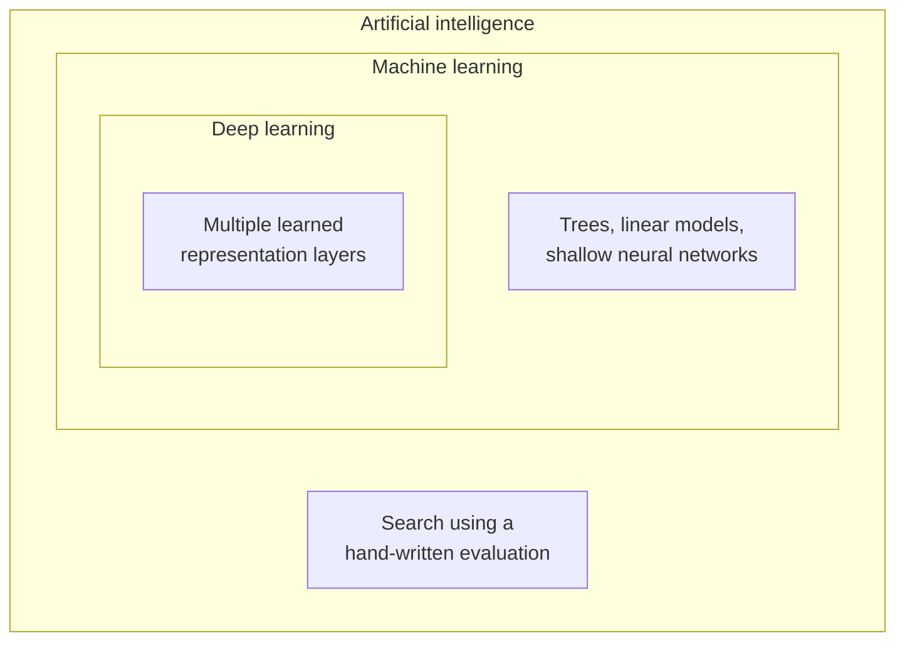
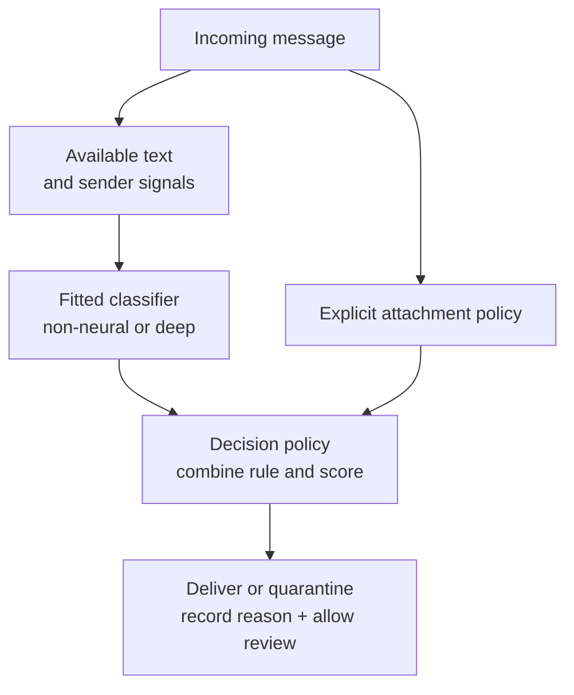

An email service blocks suspicious attachments, predicts which messages are spam, and lets users restore mail that was classified incorrectly. Its product page calls this an AI filter. Its developers describe a machine-learning classifier. A model specialist proposes replacing part of that classifier with a deep neural network. All three descriptions can refer to the same service, while describing different aspects of it.

The distinction affects concrete decisions: which component needs training data, which behavior belongs in an explicit policy, and which claims require testing. This section builds on the features, labels, training, and inference introduced in [From Rule-Based Systems to Machine Learning](/ai/from-rules-to-machine-learning/). No additional mathematics or programming is required. By the end, you should be able to:

- Explain how artificial intelligence, machine learning, and deep learning relate.
- Distinguish a learned prediction rule from a learned input representation.
- Classify the components of a mixed system without assigning one method to every component.
- Compare candidate approaches using data, error costs, and operating constraints.

## AI describes a broad field

**Artificial intelligence**, or **AI**, studies computational systems that perform tasks involving capabilities such as perception, reasoning, planning, language, and decision-making. One established formulation studies agents that select actions in an environment according to goals and constraints; see Poole and Mackworth's [introduction to AI](https://artint.info/3e/html/ArtInt3e.Ch1.S1.html).

An **agent** receives information and acts within an environment. A chess-playing program observes a board and chooses a move; an email-filtering service observes messages and chooses how to handle them. Neither example requires a claim about human-like thought or consciousness. A useful engineering description specifies the task, inputs, possible actions, and evaluation criteria.

AI includes methods that work without learning from data. Consider a hypothetical chess program that searches legal move sequences and scores positions using a hand-written evaluation function. The developer supplies its rules and scoring procedure. Search can produce a move without fitting model parameters to examples.

Ordinary software also contains rules, so the presence of an `if` statement does not establish an AI capability. In a larger application, authentication, storage, and file-size checks remain software components with their own specifications. Calling the whole application AI does not tell us how each component works or how well it performs.

## Machine learning obtains behavior from experience

**Machine learning**, or **ML**, is a family of methods that use data or other experience to fit behavior under a chosen objective. A developer specifies a model family and training procedure. For the models discussed here, training selects parameter values. Evaluation then checks how useful the resulting model is on the intended task. Improvement is something to measure, and a particular training run can fail to produce it.

In the previous section, training selected a spam threshold of two from labeled examples. That threshold is a learned parameter even though inference performs a short comparison. A decision tree can likewise learn its splitting conditions from examples and later execute a sequence of ordinary tests. Complicated prediction code is not a requirement for learning.

Supervised learning uses reference answers, such as spam labels. Other learning settings can fit patterns without those same labels or use feedback from actions. These settings still require assumptions about the data and the objective. This section uses supervised classification throughout; Poole and Mackworth discuss the broader [issues that define a learning task](https://artint.info/3e/html/ArtInt3e.Ch7.S1.html).

ML belongs within the usual organization of AI methods, but the same algorithms also appear in statistics and scientific data analysis. The practical question is which behavior was fitted, from which evidence, and how it was evaluated. A field label alone supplies none of that information.

## Deep learning learns through layered representations

A **representation** is the form in which information is made available to a model. The flagged-word count from the first section is one representation of an email. It retains a count while discarding word order, most vocabulary, and sender context. Every model working from that count inherits those information limits.

**Representation learning** fits transformations of inputs that make information useful for a task. **Deep learning**, or **DL**, uses multiple successive learned transformations, commonly implemented with neural networks. In this book, DL is a family within ML, and ML is part of AI. The relationship is consistent with the organization described in the [introduction to *Deep Learning*](https://www.deeplearningbook.org/contents/intro.html).

*Figure 1. Nested groups show inclusion among method families. They do not indicate a required development sequence or a ranking of system quality. AI also contains approaches outside ML, and ML contains approaches outside DL.*

A **neural network** is a model with adjustable parameters built from connected computational units. In a typical feedforward layer, each incoming value is multiplied by a weight, the results are added, and an offset is included. An **activation function** then transforms that result. For example, replacing negative values with zero makes the calculation nonlinear: it can no longer be expressed as one weighted sum plus an offset. Hidden layers are intermediate computations between the supplied input and the output. The [scikit-learn neural-network guide](https://scikit-learn.org/stable/modules/neural_networks_supervised.html) illustrates this structure.

Successive layers let later computations use transformed information from earlier ones. Training can adjust both these intermediate transformations and the final prediction mapping. If every stage only forms weighted sums and adds offsets, the whole stack can be combined into one calculation of the same form. Nonlinear activations prevent that collapse. [D2L's discussion of multilayer perceptrons](https://d2l.ai/chapter_multilayer-perceptrons/mlp.html) develops this mechanism in detail.

A shallow neural network can have learned hidden features, so representation learning extends beyond DL. There is no universal layer-count boundary used consistently across architectures. Here, “deep” describes a model with several successive learned representation stages. It does not mean that the model has been trained for a long time, contains many examples, or reasons carefully.

The stages also need not correspond to neat human concepts. A trained network can encode useful combinations of signals or rely on accidental correlations. Layered representations describe a computational structure; they do not establish what a particular model has learned or whether its predictions are dependable.

## Trace one filtering task through the three descriptions

Consider four synthetic messages. The labels follow a hypothetical policy based on whether the mail is legitimate or unwanted. They are illustrative examples, not a measured email dataset. The flagged-word vocabulary is fixed, and each row represents a different message.

| Message | Context | Flagged-word count | Reference label | Prediction with threshold 2 |
| --- | --- | ---: | ---: | ---: |
| M1 | A newsletter the user requested | 4 | 0, legitimate | 1, spam |
| M2 | An unsolicited prize claim | 2 | 1, spam | 1, spam |
| M3 | An expected purchase receipt | 0 | 0, legitimate | 0, legitimate |
| M4 | A short unsolicited scam | 1 | 1, spam | 0, legitimate |

Applying the previously fitted threshold produces predictions 1, 1, 0, 0. M1 is blocked incorrectly, and M4 is missed. These four rows expose two failure cases; they do not estimate production accuracy.

### A conventional ML component

The count-only classifier has no access to the contextual descriptions in the table. Supplying more messages with the same representation cannot reveal whether a newsletter was requested. The first investigation should identify missing or incorrect information.

A revised classifier could receive the count, an established sender relationship, and other signals available when the message arrives. A tree might learn different decisions for different combinations. A linear classifier could learn how supplied features contribute to a prediction. Both would remain ML approaches without requiring a deep network. Any sender signal also needs careful definition: a familiar display name alone does not prove a trusted relationship.

### A deep-learning component

A candidate text network could receive the message text encoded as **tokens**, the units into which a text-processing procedure divides it. Tokens are represented numerically; learned layers transform those representations before a prediction component produces a spam score. If trained jointly for classification, the intermediate representations and prediction parameters can both change to reduce the chosen loss.

This approach may retain information that a single count discards, including patterns involving word combinations and context. It still depends on tokenization, architecture, training evidence, and evaluation. Its intermediate values cannot be assumed to mean “legitimate newsletter” simply because the input came from one. No prediction from such a network has been computed for this example, so there is no basis here for claiming that it fixes M1 or M4.

A fair comparison must also control the available information. Giving sender context only to the deep model would confound a change in model family with a change in input features. Both neural and non-neural classifiers can use sender signals. To investigate the effect of the model family, compare candidates with the same permitted information and report any remaining differences in preprocessing and prior training.

### The surrounding AI application

The application must turn scores into actions, keep records, and support user correction. An explicit policy might require quarantine for a prohibited attachment even when the spam classifier gives a low score. That policy can coexist with either classifier.

*Figure 2. This hypothetical application combines policy and prediction. The classifier's model family can change while attachment restrictions and user-review responsibilities remain explicit.*

The policy checks use direct conditions. The classifier uses learned parameters. If that classifier uses a deep model, the service contains a DL component within its ML functionality. The entire service still requires reliable conventional software around those components.

## Compare methods under the same operating constraints

| Component | What is specified or fitted? | Evidence needed for a decision |
| --- | --- | --- |
| Explicit policy | Developers specify permitted and required actions | Tests against the policy, including exceptions and conflicting conditions |
| Non-deep ML model | Training fits parameters in a selected family and representation | Representative data, an independent evaluation, and errors broken down by their costs |
| Deep-learning model | Training fits multiple representation stages and an output mapping | The same evaluation controls, plus examination of prior training, compute, and input coverage |

Start with the task and a baseline. For the filter, compare missed spam and incorrectly blocked legitimate mail, then inspect the groups of messages responsible for each. Use training data for fitting, validation data for design choices, and an independent test for the selected candidates, following the procedure in the first section.

Data availability and operating costs can change which approach is useful. With a small labeled dataset of structured sender and message statistics, a compact model is a reasonable baseline. With varied text and suitable training resources, a learned text representation is a candidate to test. Neither condition proves a winner. Measure prediction quality, latency, memory, labeling effort, and the consequences of errors in the intended workflow.

Using a pretrained deep model moves some training work to an earlier stage performed elsewhere. It does not remove the need to check its fit for this service. A model can be used with fixed parameters during inference and remain a product of deep learning. Reading user feedback into a log does not automatically update those parameters; any retraining or adaptation needs a defined process and subsequent evaluation.

The same distinctions apply beyond email. A system can combine a learned perception component with a planner and explicit operating constraints. Classifying each component by its inputs, training process, and responsibility gives a more useful account than treating the application name as a guarantee of capability.

## References consulted

- [Poole and Mackworth: What Is Artificial Intelligence?](https://artint.info/3e/html/ArtInt3e.Ch1.S1.html) — agents, goals, and the scope of AI.
- [Poole and Mackworth: Learning Issues](https://artint.info/3e/html/ArtInt3e.Ch7.S1.html) — the experience, knowledge, and feedback involved in learning tasks.
- [Goodfellow, Bengio, and Courville: *Deep Learning*, Introduction](https://www.deeplearningbook.org/contents/intro.html) — the relationship between AI, ML, representation learning, and DL.
- [scikit-learn: Neural Network Models](https://scikit-learn.org/stable/modules/neural_networks_supervised.html) — weights, activations, and hidden layers in multilayer perceptrons.
- [D2L: Multilayer Perceptrons](https://d2l.ai/chapter_multilayer-perceptrons/mlp.html) — layered computation and the role of nonlinear transformations.

## Takeaways

- AI covers a broad field; ML provides learning methods within it, and DL provides methods with several learned representation stages within ML.
- A small fitted threshold is an ML model. A neural network's depth describes its computation, and inference can use its parameters without updating them.
- Deep models still depend on input design, training evidence, and evaluation. A family name cannot establish performance on a particular task.
- Mixed applications need separate specifications for learned predictions, explicit policies, and the software that carries out decisions.

## Exercises

1. Classify these components: a chess search using hand-written evaluation rules; the spam threshold fitted in the first section; a trained network with several hidden representation layers; and a fixed attachment-size limit. For each, state whether learning is involved and whether there is enough information to identify DL. Distinguish a component from its surrounding application.
2. Apply the threshold of two to M1–M4. Identify the incorrectly blocked message and the missed spam message. If blocking legitimate mail costs five units and missing spam costs one unit, calculate the total cost. Does this calculation tell you how a deep model would perform?
3. A team compares a tree trained on 500 labeled messages with a pretrained deep network given text and sender-history features unavailable to the tree. The network has fewer errors on a small sample, so the team attributes the improvement to depth. Identify the comparison problems and propose a better evaluation.

## Answer guidance

1. The specified chess search is an AI approach without model fitting. The fitted threshold uses ML and has no layered representation. The trained multilayer representation model is a DL component and therefore also uses ML. A fixed size limit is an ordinary policy rule; it can belong to an AI application without being a learned model itself.
2. Predictions are 1, 1, 0, 0. M1 is incorrectly blocked, costing five units; M4 is missed, costing one. Total cost is six units. The calculation evaluates this threshold on these synthetic rows and supplies no predictions or performance evidence for a deep model.
3. The candidates differ in available inputs and prior training as well as architecture; a small evaluation sample also leaves substantial uncertainty. Define the permitted information, give both candidates access to it where applicable, document prior training and preprocessing, use validation data for selection, and test on independent representative messages. Report error costs and operating requirements. Any remaining difference must be interpreted with those controls in view.
