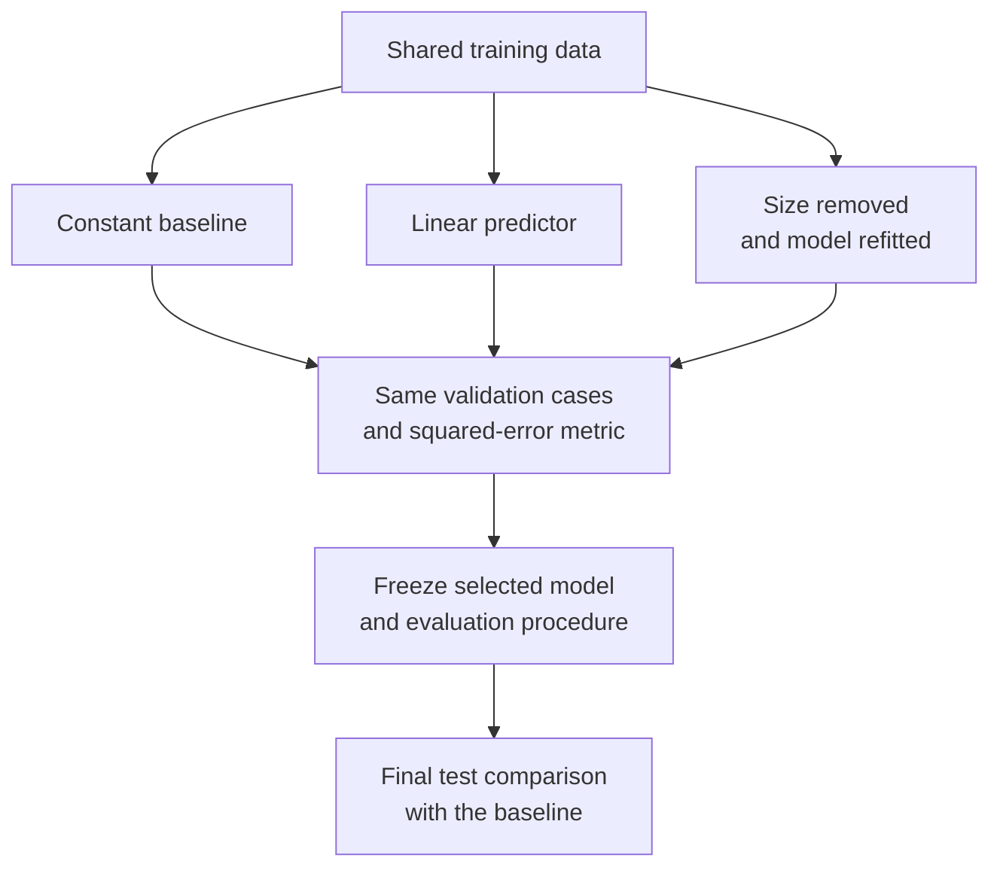

A build service estimates how many minutes a submitted job will take. A new predictor misses by two minutes on average. That number sounds useful until the team discovers that its existing estimate misses by one minute. An error score needs a reference and a measurement procedure before it can support a decision.

A **baseline** supplies that reference. A **controlled experiment** makes a comparison interpretable by specifying which factor changes and which conditions remain fixed. Together they help answer whether an added feature or method earns its complexity.

This section follows [Training, Validation, and Test Sets](/ai/training-validation-and-test-sets/) and [Why Data Leakage Distorts Evaluation](/ai/why-data-leakage-distorts-evaluation/). It assumes familiarity with features, labels, and the three data roles. By the end, you should be able to:

- Choose a baseline that matches the task and error measure.
- Keep comparisons fair while testing one stated change.
- Reproduce a feature ablation and interpret its limits.
- Separate measured improvement from evidence sufficient for deployment.

## Choose a reference that answers a useful question

A constant prediction tests whether a model adds information beyond the training labels' overall pattern. For classification, predicting the most frequent training class gives a useful first check. For regression, a training mean is appropriate for squared error; a training median minimizes absolute error among constant predictions. These are different objectives. [Scikit-learn's dummy regressor documentation](https://scikit-learn.org/stable/modules/generated/sklearn.dummy.DummyRegressor.html) describes both reference strategies.

A weak reference can make a small contribution look large. If ninety-nine of a hundred examples are negative, always predicting negative gets ninety-nine percent accuracy while finding no positives. Keep a metric that measures the required behavior, such as recall of urgent incidents, alongside overall accuracy. Choose that metric before inspecting candidate scores.

Use a small set of references with distinct purposes: a constant for checking the evaluation, a practical rule for capturing domain knowledge, and the current system for assessing replacement value. A build service might already estimate duration from the previous successful run of the same job. That information must have existed when the new job arrived. Missing-history cases need an explicit fallback shared by the comparison.

An existing rule may be the strongest baseline. Training a model is not a prerequisite for useful improvement. [Google's Rules of Machine Learning](https://developers.google.com/machine-learning/guides/rules-of-ml) recommends simple initial models and careful infrastructure work. Establish a working reference before adding experimental machinery.

## Write down what changes

An experiment starts with a claim narrow enough to test: adding submitted job size reduces prediction error compared with a constant estimate. Freeze the data version, prediction time, train/validation/test membership, target definition, evaluation metric, and information available to each method.

When testing a new learning algorithm, keep the feature set and preprocessing fixed. When testing a feature, keep the learning procedure fixed. Changing features, algorithm, and data together may establish that one whole system scores better, but cannot identify which change produced the difference.

An **ablation** removes a component from an otherwise specified procedure and measures the result. Retrain after removing a training feature so the reduced model can adapt to the available inputs. Masking a feature only at inference asks a different question: how the already trained model behaves when that input changes or disappears.

Control effort as well as inputs. If one method receives many tuning attempts and another uses arbitrary defaults, disclose that imbalance. For a deployment comparison, record the tuning budget and inference constraints; a lower error may come with unacceptable memory or latency. Equal compute is appropriate when that is the experimental constraint, but it is not a universal requirement for comparing finished systems.

The protocol below shares training data and validation cases across all variants. The test set is consulted after the comparison rule has selected a model.



## Work through a small build-duration experiment

Reuse the deliberately synthetic sequence from the earlier split example. Each row is a separate completed build, ordered by submission time. Size is known at submission and measured in arbitrary workload units. Duration is measured in minutes. Assume training outcomes are available before validation begins, and validation outcomes before final testing. The fixture illustrates arithmetic; it contains no measurements from a production service.

<div class="table-scroll" role="region" aria-label="Synthetic build sizes, durations, and fixed evaluation partitions" tabindex="0">

| Partition | Build sizes | Observed durations, minutes | Permitted use |
| --- | --- | --- | --- |
| Training | 1, 2, 3, 4, 5, 6 | 3, 5, 7, 9, 11, 13 | Fit all variants |
| Validation | 7, 8 | 15, 18 | Compare variants and select |
| Final test | 9, 10 | 21, 22 | Assess the frozen selection |

</div>

Use **mean squared error**, abbreviated MSE:

```math
\operatorname{MSE}(y,\widehat y)
=\frac{1}{m}\sum_{i=1}^{m}(y_i-\widehat y_i)^2.
```

Here `y` and its prediction are length-`m` vectors, with `m > 0`. Each entry is a scalar duration in minutes, so MSE has units of minutes squared. Squaring makes larger errors more costly. MSE does not directly represent asymmetric costs such as underestimating a deadline. [Scikit-learn's scoring guide](https://scikit-learn.org/stable/modules/model_evaluation.html#which-scoring-function-should-i-use) explains why the scoring rule should match the prediction goal.

For a constant prediction `c`, the best training MSE occurs at the training mean. To see why, let the training set contain `n > 0` labels and let their mean be `ȳ`. Expand the squared differences:

```math
\overline y=\frac{1}{n}\sum_{i=1}^{n}y_i,
\qquad
\frac{1}{n}\sum_{i=1}^{n}(y_i-c)^2
=\frac{1}{n}\sum_{i=1}^{n}(y_i-\overline y)^2
+(c-\overline y)^2.
```

The cross term disappears because the deviations from the mean sum to zero. Only the final nonnegative term depends on `c`; it reaches zero at `c = ȳ`. This is a guarantee about fitting a constant on these training labels. It does not guarantee that the training mean is the best constant for future data.

Here the training labels sum to forty-eight, giving `48/6 = 8` minutes. Validation predictions are `[8, 8]`, so baseline MSE is `((15−8)² + (18−8)²)/2 = (49+100)/2 = 74.5`.

The candidate fits a straight line: predicted duration equals intercept plus slope times size. Least squares chooses the coefficients to minimize training squared error:

```math
A=\begin{bmatrix}1&x_1\\ \vdots&\vdots\\1&x_n\end{bmatrix},
\quad
\theta=\begin{bmatrix}b\\w\end{bmatrix},
\quad
\widehat\theta\in\underset{\theta}{\operatorname{argmin}}\;
\lVert A\theta-y\rVert_2^2.
```

The design matrix `A` has shape `(n, 2)`, the coefficient vector has shape `(2,)`, and labels and predictions have shape `(n,)`. The intercept `b` is in minutes; slope `w` is in minutes per workload unit. For these six training rows, `b = 1` and `w = 2` fit exactly. Validation predictions become `[15, 17]`, giving `(0²+1²)/2 = 0.5`.

For the ablation, replace size with zero in both fitting and evaluation, retaining the intercept and least-squares procedure. All predictions must then be constant. Refitting yields eight minutes, recovering baseline MSE. The ablation supports a limited claim: allowing size to vary explains this procedure's advantage on these cases. It does not establish that increasing workload causes a particular duration increase in an operational system.

## Reproduce the comparison

The complete example requires Python 3.9+ and NumPy (`python -m pip install numpy`), with no files or credentials. The fitting function accepts any matching, nonempty finite vectors. [NumPy's least-squares solver](https://numpy.org/doc/stable/reference/generated/numpy.linalg.lstsq.html) also handles the ablation's rank-deficient matrix: among equally fitting solutions, it returns the one with smallest coefficient norm. With a zero size column, that sets the slope to zero.

```python
import numpy as np


def fit_line(sizes, durations):
    x = np.asarray(sizes, dtype=float)
    y = np.asarray(durations, dtype=float)
    if (x.ndim != 1 or x.size == 0 or y.shape != x.shape
            or not np.isfinite(x).all() or not np.isfinite(y).all()):
        raise ValueError("Expected matching nonempty finite vectors")
    design = np.column_stack((np.ones(x.size), x))
    return np.linalg.lstsq(design, y, rcond=None)[0]


def predict(coefficients, sizes):
    theta = np.asarray(coefficients, dtype=float)
    x = np.asarray(sizes, dtype=float)
    if (theta.shape != (2,) or x.ndim != 1
            or not np.isfinite(theta).all() or not np.isfinite(x).all()):
        raise ValueError("Expected two finite coefficients and a finite vector")
    return theta[0] + theta[1] * x


def mse(actual, predicted):
    y = np.asarray(actual, dtype=float)
    p = np.asarray(predicted, dtype=float)
    if (y.ndim != 1 or y.size == 0 or p.shape != y.shape
            or not np.isfinite(y).all() or not np.isfinite(p).all()):
        raise ValueError("Expected matching nonempty finite vectors")
    return float(np.mean((y - p) ** 2))


def main():
    sizes = np.arange(1, 11, dtype=float)
    durations = np.array([3, 5, 7, 9, 11, 13, 15, 18, 21, 22], dtype=float)
    train_end, validation_end = 6, 8
    x_train, y_train = sizes[:train_end], durations[:train_end]
    x_val = sizes[train_end:validation_end]
    y_val = durations[train_end:validation_end]

    # Fit exclusively on training rows, including the refitted ablation.
    models = {
        "mean": np.array([y_train.mean(), 0.0]),
        "linear": fit_line(x_train, y_train),
        "without_size": fit_line(np.zeros_like(x_train), y_train),
    }
    validation_scores = {}
    for name, coefficients in models.items():
        inputs = np.zeros_like(x_val) if name == "without_size" else x_val
        validation_scores[name] = mse(y_val, predict(coefficients, inputs))
        print(f"validation {name}: MSE={validation_scores[name]:.2f}")

    # Prespecified candidates; ties favor the simpler constant baseline.
    selected = min(("mean", "linear"), key=validation_scores.get)
    print(f"selected: {selected}")

    # No refitting or selection uses these final test labels.
    x_test, y_test = sizes[validation_end:], durations[validation_end:]
    for name in dict.fromkeys(("mean", selected)):
        score = mse(y_test, predict(models[name], x_test))
        print(f"test {name}: MSE={score:.2f}")


if __name__ == "__main__":
    main()
```

Output verified by running the example:

```text
validation mean: MSE=74.50
validation linear: MSE=0.50
validation without_size: MSE=74.50
selected: linear
test mean: MSE=182.50
test linear: MSE=2.50
```

The ablation is diagnostic; candidate selection compares the baseline with the full linear model. Both remain fitted on training rows for the final test. The code uses a deterministic solver and fixed inputs, so a random seed is unnecessary. Floating-point coefficients may differ slightly across numerical libraries; displayed errors are rounded to two decimals.

<div class="table-scroll" role="region" aria-label="Validation results and final frozen-model test comparison" tabindex="0">

| Variant | Validation predictions | Validation MSE, min² | Final test MSE, min² |
| --- | --- | ---: | ---: |
| Training mean | 8, 8 | 74.50 | 182.50 |
| Linear predictor | 15, 17 | 0.50 | 2.50 |
| Size removed and refitted | 8, 8 | 74.50 | Not evaluated |

</div>

## Interpret the difference without overstating it

Compare errors on the same final examples. The baseline's squared errors are `[169, 196]`; the selected model's are `[4, 1]`. Their paired improvement is:

```math
d_i=(y_i-\widehat y_i^{\mathrm{base}})^2
    -(y_i-\widehat y_i^{\mathrm{candidate}})^2,
\qquad
\overline d=\frac{165+195}{2}=180\;\mathrm{min}^2.
```

Each `d_i` compares two predictions for the same case; positive values favor the candidate. The mean equals `182.5−2.5`. Pairing avoids confusing performance differences with different evaluation cases. It does not make two synthetic examples representative of future builds.

The training rows follow an exact line, and test sizes exceed the training range. That extrapolation is favorable by construction. Real build duration also depends on worker type, cache state, and queue contention. Evaluate across relevant job families and later time windows before accepting the feature's benefit. Correlated runs from the same repository should not be treated as independent evidence about new repositories.

For stochastic training, repeat a declared set of seeds with the same permitted data splits and report every run or their distribution. Keep data-split randomness separate from model-training randomness. Reusing one seed can reproduce one run, but does not measure variability; identical seeds also need not produce identical random operations across different algorithms. [Scikit-learn's randomness guide](https://scikit-learn.org/stable/common_pitfalls.html#controlling-randomness) documents these distinctions. A confidence interval, when used, must respect the independence unit and sampling design; seed variation alone does not capture data uncertainty.

If a candidate loses, inspect errors, feature availability, and preprocessing before spending more compute. If it wins, inspect failure slices and operating cost. Repeatedly redesigning against the final test turns it into development data; obtain fresh evidence for a final claim. This offline comparison also cannot establish that showing predictions improves user outcomes. A live randomized experiment would require its own assignment, measurement, and safety design. For clinical or other high-risk uses, require domain-specific external validation and qualified human oversight before predictions affect decisions.

## References consulted

- [Scikit-learn: DummyRegressor](https://scikit-learn.org/stable/modules/generated/sklearn.dummy.DummyRegressor.html) — constant reference strategies.
- [Scikit-learn: Choosing a scoring function](https://scikit-learn.org/stable/modules/model_evaluation.html#which-scoring-function-should-i-use) — matching evaluation to the prediction goal.
- [Google: Rules of Machine Learning](https://developers.google.com/machine-learning/guides/rules-of-ml) — simple initial systems and engineering controls.
- [NumPy: numpy.linalg.lstsq](https://numpy.org/doc/stable/reference/generated/numpy.linalg.lstsq.html) — least-squares solutions and nonunique coefficients.
- [Scikit-learn: Controlling randomness](https://scikit-learn.org/stable/common_pitfalls.html#controlling-randomness) — estimator and split randomness.

## Takeaways

- A baseline gives an error score a reference; include the current practical method when assessing replacement value.
- Freeze evaluation cases, information boundaries, metrics, and budgets appropriate to the comparison.
- Retrained feature ablations measure a component's contribution within the stated procedure.
- Fit and select without final test feedback, then compare frozen predictions on shared cases.
- A measured gain still needs uncertainty assessment, operational checks, and evidence from the intended use.

## Exercises

1. An existing rule predicts `[20, 23]` on the two final test cases with labels `[21, 22]`. Calculate its MSE and compare it with the selected linear model. What deployment claim changes?
2. Replace size with zero only during inference while keeping the fitted coefficients `[1, 2]`. Calculate validation MSE. Explain why it differs from the retrained ablation.
3. A team runs twenty seeds, publishes the best score, and then changes features after reading final test errors. Identify two problems and specify a repair for each.

## Answer guidance

1. The rule's MSE is `(1²+(−1)²)/2 = 1`. It beats the linear model's `2.5` on these two cases. The linear model improves over the constant baseline but has not shown replacement value against the existing rule. Such a tiny test still cannot settle a production decision.
2. Predictions become `[1, 1]`, giving `(14²+17²)/2 = 242.5`. The inference-only change leaves the original intercept in place. Retraining without size learns an intercept of eight and gives `74.5`; the two procedures test different questions.
3. Selecting the best seed hides training variability. Declare the repeat protocol and report all outcomes or their distribution with a fixed selection policy. Feature changes informed by test errors compromise the test's independence. Treat those cases as development evidence and assess the revised, frozen procedure on fresh held-out data.
