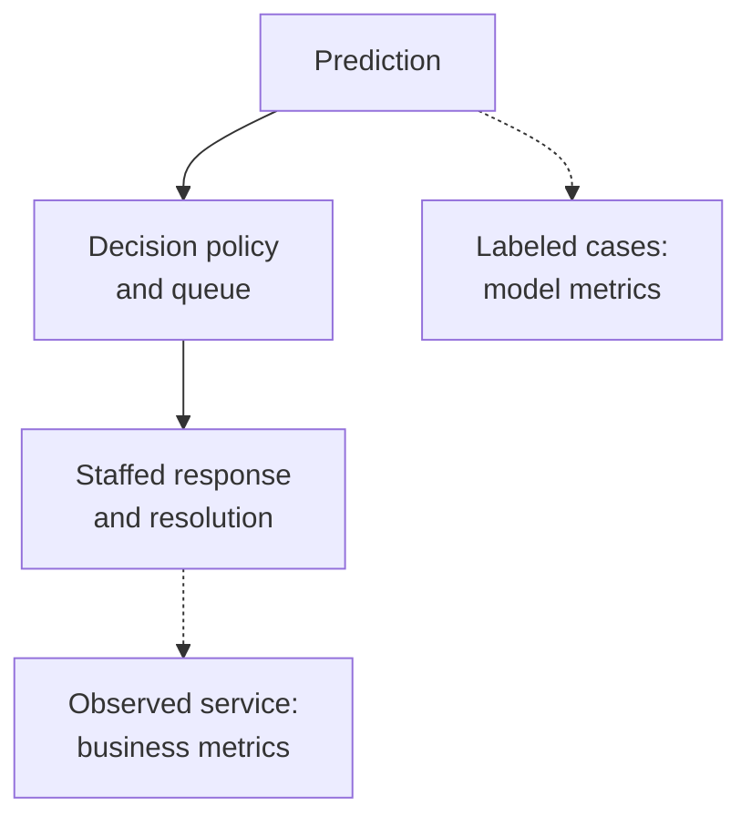

A support team compares two classifiers for escalating urgent incidents. On the same labeled cases, model A reaches 95% accuracy and model B reaches 94%. A appears better until the team separates the mistakes: A misses 40 urgent incidents, while B misses 10. B also sends more routine incidents to specialists. Choosing between them requires understanding the service, its staffing, and the consequences of each error.

Accuracy describes agreement with labels. The team's goal is that urgent incidents receive timely, useful attention without overwhelming the people handling them. The connection between those two measurements depends on the decisions and work that follow a prediction.

This section follows [When You Don't Need Machine Learning](/ai/when-you-dont-need-machine-learning/). It assumes binary classification, comparison baselines, and basic fractions. By the end, you should be able to:

- Distinguish prediction measurements from product and operational outcomes.
- Calculate how different errors affect a decision under stated assumptions.
- Specify a primary outcome, capacity constraints, and supporting measurements.
- Explain what offline evaluation can establish and what needs live evidence.

## Define the outcome before selecting the score

A **business metric** measures an outcome that matters to the organization or the people it serves. Revenue, completed tasks, support costs, and timely incident responses are examples. In a public service or research application, the relevant outcome might involve access, time saved, or scientific usefulness. A metric needs a defined population, observation period, and measurement procedure.

A **model metric** measures some property of predictions or generated outputs against an evaluation criterion. Classification accuracy, prediction error, and assessments of answer correctness belong here. Some are measured on historical labeled data; others can be calculated from production predictions after reference outcomes become available. The distinction concerns what is measured, rather than whether the calculation happens offline or online.

Google's [Measuring success](https://developers.google.com/machine-learning/managing-ml-projects/success) separates these categories and explains that good model scores do not guarantee improved business results. A team needs evidence connecting the prediction to the desired outcome.

For incident support, a possible primary service metric is the fraction of eligible urgent incidents receiving a qualified first response within 30 minutes of arrival. Eligibility and urgency must follow a fixed review policy applied independently of the model's prediction, covering ordinary and escalated queues. Otherwise, changing which cases get called urgent can change the denominator and create an artificial improvement.

<div class="table-scroll" role="region" aria-label="Business outcomes, model metrics, and operating constraints for incident support" tabindex="0">

| Measurement | Definition for this application | What it helps establish |
| --- | --- | --- |
| Primary service outcome | Qualified response within 30 minutes, divided by all eligible urgent incidents | Whether the service reaches urgent users promptly |
| Model recall | Correct urgent predictions, divided by all labeled urgent cases | How many urgent cases the classifier identifies |
| Model precision | Correct urgent predictions, divided by all predicted urgent cases | How much of the escalated queue is urgent |
| Capacity constraint | Escalations within the staffed limit for the period | Whether the planned workflow is feasible |
| Quality guardrail | Incidents reopened within seven days of first closure, divided by all first-closed incidents | Whether faster handling sacrifices resolution quality |

</div>

A **guardrail** is a measurement with an agreed acceptable range that can block a release despite an improved primary outcome. Define its limit, denominator, and observation window before comparing candidates. A small decrease in average response time cannot compensate automatically for unacceptable reopen rates or failures affecting a vulnerable group.

## Trace how a prediction changes the work

The classifier produces a label or a score. A decision policy uses it to choose an action: escalate, keep the ordinary queue, or request review. Staff availability, queue order, response quality, and system reliability then affect the user's experience.



*Figure 1. Predictions affect outcomes through an operating process. Each measurement observes a different part of that process.*

If specialists are unavailable, identifying every urgent case will not ensure a timely response. If the interface hides the escalation, a useful prediction may never affect an action. A model improvement can also increase queue volume enough to delay everyone. These are reasons to evaluate the deployed decision policy and its workload alongside the classifier.

For a score-based classifier, a threshold determines which scores trigger escalation. Lowering it can admit additional urgent cases and additional routine cases. It changes model metrics and workload without changing the trained model. Select the operating threshold using validation data and an agreed policy; preserve a separate test set for final evaluation.

## Compare two candidates on the same cases

Consider a synthetic batch containing 1,000 incidents: 100 labeled urgent and 900 labeled routine. All counts below are supplied for teaching; no model was trained and no support experiment was performed. Each candidate has a fixed decision policy, and the reference labels are assumed correct for this calculation.

A **true positive**, or TP, is an urgent case escalated correctly. A **false positive**, or FP, is a routine case escalated unnecessarily. A **false negative**, or FN, is an urgent case left in the ordinary queue. A **true negative**, or TN, is a routine case kept there correctly.

<div class="table-scroll" role="region" aria-label="Synthetic incident classification counts for two candidate policies" tabindex="0">

| Candidate | TP | FP | FN | TN | Total escalations |
| --- | ---: | ---: | ---: | ---: | ---: |
| A | 60 | 10 | 40 | 890 | 70 |
| B | 90 | 50 | 10 | 850 | 140 |

</div>

The four counts are scalars. Let `N = TP + FP + FN + TN` be the number of cases. The following ratios are dimensionless:

```math
\begin{aligned}
\text{accuracy} &= \frac{TP+TN}{N},\\
\text{precision} &= \frac{TP}{TP+FP},\\
\text{recall} &= \frac{TP}{TP+FN}.
\end{aligned}
```

For A, accuracy is `(60 + 890)/1,000 = 95%`, precision is `60/70 ≈ 85.7%`, and recall is `60/100 = 60%`. For B, accuracy is `(90 + 850)/1,000 = 94%`, precision is `90/140 ≈ 64.3%`, and recall is `90/100 = 90%`.

A makes fewer total mistakes. B catches more urgent cases while requiring twice as many escalations. Neither statement specifies the better operating choice. [Google's classification guide](https://developers.google.com/machine-learning/crash-course/classification/accuracy-precision-recall) defines these metrics and discusses their dependence on error costs, class balance, and the decision threshold.

An always-routine baseline would reach 90% accuracy on this batch while missing all 100 urgent cases. Reporting class counts exposes that limitation. Precision is undefined if nothing is escalated, and recall is undefined if the evaluated batch has no urgent cases. Report those missing denominators explicitly rather than presenting an undefined fraction as a successful score.

## Use a cost model without confusing it with measured impact

Suppose the team assigns a missed urgent case a penalty of 20 hypothetical units and an unnecessary escalation a penalty of one. Then:

```math
J=c_{\mathrm{miss}}FN+c_{\mathrm{false}}FP.
```

Here `J` is total error penalty for the batch, measured in the same units as the scalar penalties `c_miss` and `c_false`. The calculation assumes additive penalties, constant severity within each error type, and zero error penalty for correct decisions. It excludes ordinary handling costs, queue delays, infrastructure, and downstream resolution failures. It serves as a decision proxy. Observed spending and the complete business outcome require separate measurements.

A has penalty `20 × 40 + 1 × 10 = 810`. B has penalty `20 × 10 + 1 × 50 = 250`. Under these assumptions, B reduces the penalty by 560 units despite its lower accuracy. Each missed urgent case avoided offsets several additional false alarms at these chosen weights.

Assume a separately established capacity limit of 150 escalations per batch. Both candidates fit. If capacity falls to 100, B fails that constraint; the lower penalty alone cannot authorize its release. Even at 150, arrival bursts and different handling times may cause delays. Counts over a period are only an initial capacity check.

The relative costs can change the ranking. If a miss costs one unit and an unnecessary escalation costs two, A has penalty `40 + 2 × 10 = 60`, while B has `10 + 2 × 50 = 110`. Agree on costs with the people responsible for the service, examine their uncertainty, and inspect individual failure cases before relying on one weighted total.

## Reproduce the scorecard

This Python 3.9+ example uses only the standard library. It calculates metrics from aggregate counts, so it needs no files, credentials, or model downloads. The supplied capacity and penalties are inputs rather than properties of classification itself.

```python
import math


def evaluate_counts(tp, fp, fn, tn, miss_cost, false_cost, capacity):
    counts = (tp, fp, fn, tn)
    if any(type(value) is not int or value < 0 for value in counts):
        raise ValueError("Counts must be nonnegative integers")
    if type(capacity) is not int or capacity < 0:
        raise ValueError("Capacity must be a nonnegative integer")
    for cost in (miss_cost, false_cost):
        if type(cost) not in (int, float) or not math.isfinite(cost) or cost < 0:
            raise ValueError("Costs must be finite nonnegative numbers")
    total = sum(counts)
    if total == 0:
        raise ValueError("At least one evaluated case is required")
    escalations = tp + fp
    return {
        "accuracy": (tp + tn) / total,
        "precision": tp / escalations if escalations else None,
        "recall": tp / (tp + fn) if tp + fn else None,
        "penalty": miss_cost * fn + false_cost * fp,
        "escalations": escalations,
        "within_capacity": escalations <= capacity,
    }


def main():
    candidates = {"A": (60, 10, 40, 890), "B": (90, 50, 10, 850)}
    for name, counts in candidates.items():
        result = evaluate_counts(*counts, miss_cost=20, false_cost=1, capacity=150)
        print(f"{name}: accuracy={result['accuracy']:.1%}, "
              f"precision={result['precision']:.1%}, recall={result['recall']:.1%}, "
              f"penalty={result['penalty']}, escalations={result['escalations']}, "
              f"within_capacity={result['within_capacity']}")
    limited = evaluate_counts(*candidates["B"], miss_cost=20, false_cost=1, capacity=100)
    print(f"B with capacity 100: within_capacity={limited['within_capacity']}")


if __name__ == "__main__":
    main()
```

The verified output is:

```text
A: accuracy=95.0%, precision=85.7%, recall=60.0%, penalty=810, escalations=70, within_capacity=True
B: accuracy=94.0%, precision=64.3%, recall=90.0%, penalty=250, escalations=140, within_capacity=True
B with capacity 100: within_capacity=False
```

The code returns `None` for an undefined precision or recall. It reports feasibility separately from penalty so a favorable score cannot conceal a capacity violation.

## Measure the effect after decisions change

An offline comparison estimates agreement with historical labels under the evaluated conditions. It cannot establish that a new policy causes faster responses, higher revenue, or better retention. Historical data may omit unreviewed incidents, contain labels influenced by previous routing, or differ from tomorrow's traffic. Inspect these problems before treating a test set as representative.

Keep repeated incidents or related customer records from crossing evaluation boundaries when that would leak information. Fit learned preprocessing on training data and keep test data out of model and threshold selection. The [scikit-learn common-pitfalls guide](https://scikit-learn.org/stable/common_pitfalls.html#data-leakage) explains why information leakage produces optimistic estimates.

For the support example, instrument qualified first-response timestamps, incident eligibility, independently assigned urgency, queue workload, and later reopen events. Define the primary rate as:

```math
S=\frac{\text{eligible urgent incidents with a qualified response within 30 minutes}}
        {\text{all eligible urgent incidents in the evaluation cohort}}.
```

Both counts refer to the same arrival cohort. Allow every included incident its full 30-minute observation period. Define missing timestamps as failures or report them separately under a fixed rule; do not silently drop them. A cohort with no urgent incidents has an undefined rate. For the reopen guardrail, follow every first-closed incident for seven days after that closure; also track incidents that remain open so delaying closure cannot conceal poor service.

A live comparison needs an explicit hypothesis and a stable baseline. A randomized experiment can estimate the effect of assigning the new policy when assignment, logging, and analysis are valid. Shared specialist queues can let one variant delay the other, weakening a simple incident-level comparison. Choose an appropriate assignment unit, account for shared resources and uncertainty, and avoid treating a before-and-after change as causal proof. Microsoft's [pre-experiment guidance](https://www.microsoft.com/en-us/research/articles/patterns-of-trustworthy-experimentation-pre-experiment-stage/) discusses hypotheses, guardrails, randomization units, and shared infrastructure.

Faster initial responses may coexist with more reopened cases. Higher automation may hide unresolved requests. Examine quality, workload, and relevant user groups alongside the primary rate. In consequential applications, domain specialists must approve acceptable risks, review failures, and define when to suspend automated decisions. A benchmark score cannot supply those permissions.

## References consulted

- [Google: Measuring success](https://developers.google.com/machine-learning/managing-ml-projects/success) — business outcomes and model evaluation measure different aspects of a project.
- [Google: Accuracy, recall, precision, and related metrics](https://developers.google.com/machine-learning/crash-course/classification/accuracy-precision-recall) — classification definitions, thresholds, and error trade-offs.
- [scikit-learn: Common pitfalls](https://scikit-learn.org/stable/common_pitfalls.html#data-leakage) — evaluation leakage and separation of training from test data.
- [Microsoft Research: Patterns of Trustworthy Experimentation: Pre-Experiment Stage](https://www.microsoft.com/en-us/research/articles/patterns-of-trustworthy-experimentation-pre-experiment-stage/) — experiment hypotheses, measurement safeguards, and assignment choices.

## Takeaways

- Define business metrics by outcomes, populations, and observation windows; define model metrics by the prediction properties they measure.
- Inspect error types and class counts before comparing aggregate scores.
- Use explicit costs as a decision aid and keep mandatory capacity and quality limits separate.
- Trace predictions through decisions, queues, and human work to the observed outcome.
- Treat offline results as evidence for a live evaluation, with appropriate controls and uncertainty.

## Exercises

1. Set the missed-urgent penalty to three units and the false-alarm penalty to two. Calculate both candidates' penalties. Find the missed-urgent penalty at which A and B tie when false alarms cost two units, keeping all counts fixed.
2. Capacity is now 100 escalations per batch. Explain why B's 250-unit penalty does not establish that it is deployable. Give two changes the team could investigate and explain what would need reevaluation.
3. In a hypothetical completed cohort, A has 100 independently labeled urgent incidents with 80 qualified responses within 30 minutes. B has 100 with 86 timely responses, but its seven-day reopen guardrail fails. Calculate the rate difference in percentage points and relative percent. Explain why these counts alone do not justify release or prove a causal improvement.

## Answer guidance

1. A has `3 × 40 + 2 × 10 = 140`; B has `3 × 10 + 2 × 50 = 130`. At a missed-urgent penalty `c`, equality requires `40c + 20 = 10c + 100`, so `30c = 80` and `c = 8/3` units. B has lower penalty above that value, A below it, under this fixed calculation.
2. B produces 140 escalations, exceeding the limit by 40. The team could adjust the decision threshold or add staffed capacity. A new threshold changes errors and queue volume and needs independent evaluation; staffing changes require cost and response-time checks. Routing overflow elsewhere also needs an explicitly evaluated policy.
3. The rates are 80% and 86%, a gain of six percentage points or `6/80 = 7.5%` relative. The failed guardrail blocks release under the agreed rule. Assignment validity, comparable populations, shared queues, sampling uncertainty, and complete quality measurements still need investigation; two aggregate counts do not establish causality.
