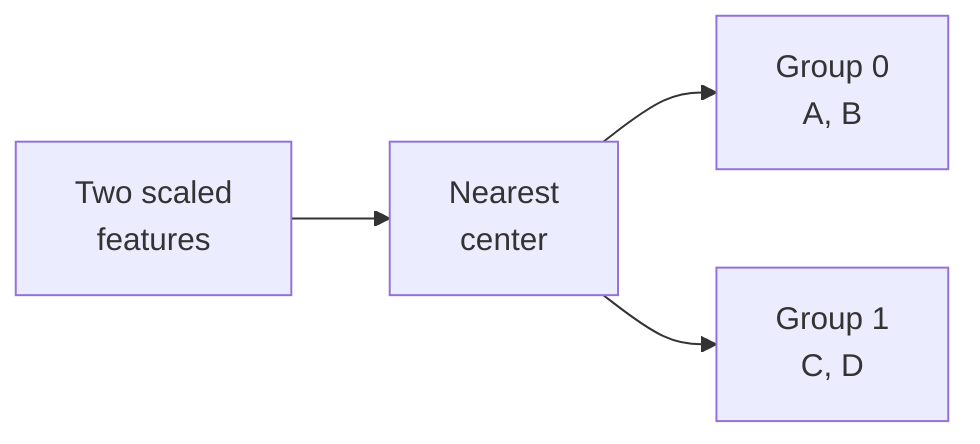

A support team wants help with incoming tickets. It needs to send each ticket to a department, estimate the work involved, decide which tickets a supervisor should inspect first, and discover recurring patterns in historical requests. These requirements share data, but they ask for four different outputs: a category, a quantity, an ordered list, and a grouping.

Choosing the task determines what evidence must be collected and what a useful result looks like. A model that assigns departments accurately may still put low-priority tickets at the top of a review list. A compact grouping may have little connection to department ownership.

This section continues [Defining Goals, Inputs, Outputs, and Constraints](/ai/defining-goals-inputs-outputs-and-constraints/). It assumes basic fractions and the distinction between inputs, reference outcomes, and predictions. By the end, you should be able to:

- Match a decision to classification, regression, ranking, or clustering.
- Identify the reference information and evaluation needed for each task.
- Calculate a small classification, regression, and ranking comparison.
- Explain why similarity groups depend on features and do not automatically become named classes.

## Start with the required output

In **supervised learning**, training examples supply inputs and reference targets. Classification uses a predefined set of categories; regression predicts a numerical quantity. The [scikit-learn introductory guide](https://scikit-learn.org/stable/getting_started.html) describes these target types and the convention of storing examples as rows of an input matrix.

Ranking orders candidates for a particular request or decision context. It may use relevance judgments, preferences, or other training signals. Clustering groups examples according to a chosen representation and similarity rule without requiring the desired class label for each example. Both the task and its evaluation need more detail than the name of an algorithm.

<div class="table-scroll" role="region" aria-label="Four task types and their support-desk outputs" tabindex="0">

| Task | Support-desk output | Reference information | Evaluation question |
| --- | --- | --- | --- |
| Classification | Billing or Technical | Correct department for each ticket | Which categories are confused, and at what cost? |
| Regression | Estimated handling minutes | Observed handling time under a defined process | How large are errors, in minutes? |
| Ranking | Tickets ordered for one supervisor's review batch | Priority judgments within that batch | Are useful tickets near the top? |
| Clustering | Groups of similar historical tickets | Features and a chosen notion of similarity | Are groups stable, interpretable, and useful for the intended analysis? |

</div>

## Classification assigns a defined category

Our routing task assigns exactly one department to each ticket. The class set is agreed before training. Numeric codes such as `0 = Billing` and `1 = Technical` identify categories; averaging those codes would not produce a meaningful department.

A classifier can also produce scores for its categories, followed by a decision rule. A probability interpretation needs separate evidence. If a ticket can concern several departments simultaneously, the specification must allow multiple labels or define a primary owner. Unsupported categories and missing information require explicit handling.

Use accuracy when counting correct decisions answers the evaluation question. Also inspect errors by category and consequences: routing an urgent technical failure to Billing may cost more than another kind of mistake. A system that predicts the commonest department can score well when one category dominates. Compare with such a baseline on the same held-out tickets.

## Regression estimates a quantity with units

For workload planning, define handling time as active agent minutes recorded for the ticket under a specified process. Waiting time in a queue is a separate quantity. The target must say which intervals are included, how multiple agents are counted, and how incomplete tickets are handled.

One evaluation measure is **mean absolute error**, or MAE: average the absolute difference between each prediction and its reference value. It retains the target's units, as the [MAE documentation](https://scikit-learn.org/stable/modules/generated/sklearn.metrics.mean_absolute_error.html) specifies. An error of four minutes has a direct interpretation for workload estimates. It does not state how often deadlines are missed or how uncertain one prediction is.

Changing minutes to seconds multiplies MAE by sixty without changing which prediction is closer. Squared-error objectives give large deviations more weight. Choose a measure that reflects the decision, and inspect severe errors separately. If the action only needs “more than thirty minutes,” classification is another formulation, but it discards distinctions among times on the same side of that boundary.

## Ranking compares candidates within a context

For supervisor review, the unit of output is a list for a particular batch. A scoring function can assign one number to each ticket, and sorting those numbers yields the order. Training a classifier or regressor and sorting its outputs can implement a ranking policy, but the policy still needs evaluation as a list.

Specify the candidates, priority meaning, list length, and tie rule. Scores from different batches need not share a common scale. A strictly increasing transformation preserves an ordering while changing the score values, so a useful ordering alone cannot establish probability accuracy.

Suppose supervisors label priority from 0 to 3 and consider grades 2 and 3 useful for immediate review. **Precision at k** is the fraction of useful candidates among the first `k` positions. It ignores differences between those two useful grades and their order within that prefix. Graded measures such as NDCG can account for relevance and position; the [NDCG documentation](https://scikit-learn.org/stable/modules/generated/sklearn.metrics.ndcg_score.html) explains that comparison. Neither measure proves that an intervention helps customers.

Evaluate separate lists in their own contexts before aggregating. Combining unrelated queues into one global list can reward comparisons the application never makes. If outcomes come from historical clicks or reviews, remember that the old ordering influenced which items people saw.

## Work through the same four tickets

The following four tickets, targets, and model outputs are synthetic. Departments and active handling times supply references for two supervised tasks. Priority grades belong to one review batch. Predictions and scores are supplied values, with no trained model or real performance experiment behind them.

<div class="table-scroll" role="region" aria-label="Synthetic ticket targets and supplied outputs for three tasks" tabindex="0">

| Ticket | Department | Predicted department | Handling minutes | Estimated minutes | Priority grade | Ranking score |
| --- | --- | --- | ---: | ---: | ---: | ---: |
| A | Billing | Billing | 12 | 10 | 3 | 0.70 |
| B | Technical | Technical | 40 | 35 | 0 | 0.90 |
| C | Billing | Technical | 8 | 10 | 2 | 0.60 |
| D | Technical | Technical | 20 | 25 | 1 | 0.80 |

</div>

For `n` examples, let `y_i` and `ŷ_i` be reference and predicted departments. Let `t_i` and `t̂_i` be reference and estimated handling minutes. Each collection is a length-`n` vector. Accuracy and MAE are:

```math
\mathrm{Accuracy}=\frac{1}{n}\sum_{i=1}^{n}\mathbf{1}[\hat y_i=y_i],
\qquad
\mathrm{MAE}=\frac{1}{n}\sum_{i=1}^{n}|\hat t_i-t_i|.
```

The indicator contributes one for a correct category. A, B, and D are correct, giving `3/4 = 75%`. Absolute time errors are `2, 5, 2, 5`, whose sum is fourteen: MAE is `14/4 = 3.5 minutes`. For comparison, two illustrative baselines fixed in advance are always choosing Billing and always predicting twenty minutes. They obtain accuracy `2/4 = 50%` and MAE `(8 + 20 + 12 + 0)/4 = 10 minutes`. These tiny examples cannot establish general performance.

Let `π_j` be the ticket index at position `j` in descending score order, and `r_i` its priority grade. With usefulness defined by grade at least two:

```math
\mathrm{Precision@}k=\frac{1}{k}\sum_{j=1}^{k}\mathbf{1}[r_{\pi_j}\geq 2].
```

Here `π` is a permutation of the `n` candidates, grades are scalar judgments, and `1 ≤ k ≤ n`. Scores order the tickets as B, D, A, C. For `k = 2`, neither B nor D is useful by the stated rule, giving `0/2 = 0%`. The original first-in-first-out order A, B, C, D gives `1/2 = 50%`. Better department accuracy and time estimates have supplied no guarantee about review priority.

## Clustering discovers groups under chosen assumptions

For exploratory analysis, represent each ticket by two features: message length divided by a fixed reference length, and attachment count divided by a fixed reference count. These dimensionless scales are specified before this example. The four feature pairs are A `(0.10, 0.20)`, B `(0.20, 0.10)`, C `(0.80, 0.90)`, and D `(0.90, 0.80)`. The input matrix `X` has shape `4 × 2`.

Consider a k-means assignment step with two initial centers, `(0, 0)` and `(1, 1)`. A center is a point in the same feature space. Assign each ticket to the nearest center using squared Euclidean distance. For `d` features and `K` centers:

```math
D_{ik}=\sum_{j=1}^{d}(X_{ij}-\mu_{kj})^2,
\qquad c_i=\operatorname*{arg\,min}_{1\leq k\leq K}D_{ik}.
```

`X` has shape `n × d`, center matrix `μ` has shape `K × d`, and distance matrix `D` has shape `n × K`. The scalar `c_i` selects a center; ties need a fixed convention. A has squared distances `0.10² + 0.20² = 0.05` and `0.90² + 0.80² = 1.45`, so it joins the first center. B joins it; C and D join the second.



*Figure 1. The groups reflect message length and attachment count. Each contains a Billing ticket and a Technical ticket; department targets were not used to form the groups.*

Updating each nonempty center to its members' coordinate-wise mean gives `(0.15, 0.15)` and `(0.85, 0.85)`. Each member contributes squared distance `0.05² + 0.05² = 0.005`; the total is `0.02`. Repeated assignment and update steps form the basic k-means procedure. Initialization and feature scaling affect results, and the method does not guarantee a global optimum, as described in the [k-means guide](https://scikit-learn.org/stable/modules/clustering.html#k-means).

Cluster numbers are arbitrary identifiers. Swapping 0 and 1 leaves the grouping unchanged. A human can inspect a group and suggest a description, but that description needs evidence. Examine stability, unusual members, and downstream usefulness. A distance-based quality score can favor compact groups even when they do not answer the intended business question. The [clustering overview](https://scikit-learn.org/stable/modules/clustering.html) discusses evaluation and the dependence on cluster structure.

## Reproduce the calculations

This Python 3.9+ example requires NumPy 1.24 or later (`pip install numpy`). It downloads no data and needs no credentials. It evaluates supplied outputs and performs one assignment/update step on the synthetic feature matrix. It does not train the classifier, regressor, or ranker, and is not a complete k-means implementation.

```python
import numpy as np


def rank_candidates(scores, k):
    scores = np.asarray(scores, dtype=float)
    if scores.ndim != 1 or scores.size == 0 or not np.isfinite(scores).all():
        raise ValueError("Expected nonempty finite one-dimensional scores")
    if type(k) is not int or not 1 <= k <= scores.size:
        raise ValueError("k must be an integer between one and the candidate count")
    # Descending scores; equal scores retain input order.
    return np.argsort(-scores, kind="stable")[:k]


def assign_clusters(points, centers):
    points = np.asarray(points, dtype=float)
    centers = np.asarray(centers, dtype=float)
    if (points.ndim != 2 or centers.ndim != 2
            or 0 in points.shape or 0 in centers.shape
            or points.shape[1] != centers.shape[1]
            or not np.isfinite(points).all() or not np.isfinite(centers).all()):
        raise ValueError("Expected finite nonempty matrices with matching feature counts")
    # Differences: (n, K, d); distances: (n, K).
    distances = np.sum((points[:, None, :] - centers[None, :, :]) ** 2, axis=2)
    return distances.argmin(axis=1)  # First center wins an exact tie.


def main():
    ids = np.array(["A", "B", "C", "D"])
    departments = np.array(["Billing", "Technical", "Billing", "Technical"])
    predicted = np.array(["Billing", "Technical", "Technical", "Technical"])
    minutes = np.array([12, 40, 8, 20], dtype=float)
    estimates = np.array([10, 35, 10, 25], dtype=float)
    grades = np.array([3, 0, 2, 1])
    scores = np.array([0.70, 0.90, 0.60, 0.80])
    k = 2
    order = rank_candidates(scores, len(ids))
    print(f"classification accuracy: {np.mean(departments == predicted):.0%}")
    print(f"handling-time MAE: {np.mean(np.abs(minutes - estimates)):.1f} minutes")
    print("ranked tickets: " + ", ".join(ids[order]))
    print(f"precision@{k}: {np.mean(grades[order[:k]] >= 2):.0%}")
    print(f"FIFO precision@{k}: {np.mean(grades[:k] >= 2):.0%}")

    points = np.array([[0.10, 0.20], [0.20, 0.10], [0.80, 0.90], [0.90, 0.80]])
    centers = np.array([[0.0, 0.0], [1.0, 1.0]])
    groups = assign_clusters(points, centers)
    # Each center in this example has members. A full algorithm must handle empty groups.
    updated = np.vstack([points[groups == j].mean(axis=0) for j in range(len(centers))])
    squared_error = np.sum((points - updated[groups]) ** 2)
    print("cluster assignments: " + ", ".join(str(int(group)) for group in groups))
    for j, center in enumerate(updated):
        print(f"updated center {j}: ({center[0]:.2f}, {center[1]:.2f})")
    print(f"within-group squared distance: {squared_error:.2f}")


if __name__ == "__main__":
    main()
```

The verified output is:

```text
classification accuracy: 75%
handling-time MAE: 3.5 minutes
ranked tickets: B, D, A, C
precision@2: 0%
FIFO precision@2: 50%
cluster assignments: 0, 0, 1, 1
updated center 0: (0.15, 0.15)
updated center 1: (0.85, 0.85)
within-group squared distance: 0.02
```

## Preserve the task when moving to real data

Choose baselines and evaluation rules before examining held-out outcomes. Fit any learned preprocessing on training data only; the [common-pitfalls guide](https://scikit-learn.org/stable/common_pitfalls.html#data-leakage) explains how information from evaluation data can leak through preprocessing. Our fixed scaling example does not fit a transformation on held-out tickets.

For deployment, retain the prediction-time input cutoff, target definitions, review capacity, and failure behavior. Assess new dates, queues, and conditions relevant to intended use. If errors affect health, access, or other consequential decisions, domain review and validation must accompany the task-specific metrics. Classification, regression, ranking, and clustering each supply evidence for a defined output; their scores need interpretation within the application.

## References consulted

- [scikit-learn: Getting Started](https://scikit-learn.org/stable/getting_started.html) — supervised targets and input shapes.
- [scikit-learn: Mean absolute error](https://scikit-learn.org/stable/modules/generated/sklearn.metrics.mean_absolute_error.html) — regression error measurement.
- [scikit-learn: NDCG score](https://scikit-learn.org/stable/modules/generated/sklearn.metrics.ndcg_score.html) — relevance judgments and ranking evaluation.
- [scikit-learn: K-means](https://scikit-learn.org/stable/modules/clustering.html#k-means) — nearest-center assignments, updates, and limitations.
- [scikit-learn: Clustering](https://scikit-learn.org/stable/modules/clustering.html) — group evaluation and arbitrary label identifiers.
- [scikit-learn: Common pitfalls](https://scikit-learn.org/stable/common_pitfalls.html#data-leakage) — independent evaluation and preprocessing leakage.

## Takeaways

- Classification assigns categories; regression estimates quantities whose units must be defined.
- Ranking evaluates an ordered candidate set within a context, often with special attention to the first few positions.
- Clustering groups inputs under chosen features and similarity assumptions; the groups need interpretation.
- Success on one task supplies limited evidence about another, even when the same records are used.
- Compare against task-appropriate baselines and preserve independent evaluation when changing models or preprocessing.

## Exercises

1. Change ticket C's predicted department to Billing and its estimated handling time to eight minutes. Recalculate classification accuracy and handling-time MAE. Keep ranking scores unchanged and explain what happens to precision at two.
2. Produce an order with the best possible precision at two using the supplied priority grades. Then swap the first two tickets within that prefix. Explain what precision at two can and cannot distinguish, and why this label-derived order is not a deployable baseline.
3. Swap the initial centers in the clustering example. State the new group identifiers and whether memberships change. Then explain how using raw character counts alongside unscaled attachment counts could change the distance calculation.

## Answer guidance

1. Every department becomes correct: accuracy is 100%. Time errors become `2, 5, 0, 5`, so MAE is `12/4 = 3 minutes`. Ranking remains B, D, A, C, and precision at two stays 0%; the changed outputs belong to different tasks.
2. An order beginning A, C selects both useful tickets, giving 100%. C, A also gives 100%. Precision at two ignores their internal order and their different grades. This ordering uses reference judgments unavailable to the candidate at prediction time, so it is an evaluation reference rather than an operational baseline.
3. Assignments become `1, 1, 0, 0`; the groups still contain A with B and C with D. Raw character differences can dominate squared distances because of their numerical scale. Choose feature scaling to match the intended similarity; any scale learned from data must be fitted within the appropriate training process.
