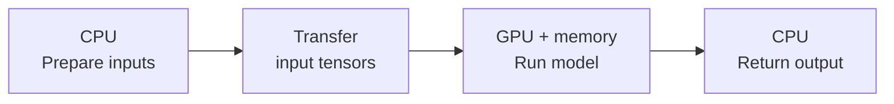

A team wants to serve a hypothetical language model with three billion parameters on a GPU with 16 GiB of memory. Storing each parameter in two bytes takes about 5.59 GiB. The model loads successfully. Later, several users submit long documents at once, and the process runs out of memory. Buying a faster processor would not explain which allocation failed or how much capacity the service needs.

An AI workload has several budgets: operations to execute, bytes to store and move, time users can wait, and money spent while resources are running. This section connects those budgets through one worked deployment example. It builds on [Training, Inference, and Deployment](/ai/training-inference-and-deployment/) and assumes multiplication, fractions, and the idea that a model stores learned numerical parameters.

By the end, you should be able to:

- Explain how CPU work, GPU work, and data transfers interact.
- Estimate weight and inference-cache memory under explicit assumptions.
- Distinguish latency, throughput, and cost per completed request.
- Choose measurements that can explain a slow or memory-limited workload.

## Follow the computation across the machine

The **CPU**, or central processing unit, runs application logic, prepares inputs, and coordinates work. A **GPU**, or graphics processing unit, executes many operations in parallel. In a common discrete-GPU server, system RAM holds CPU-side data and separate device memory holds GPU-side tensors. A tensor is an array of numbers with a specified shape and numerical format. The CPU launches GPU functions called kernels, and data may need copying between memory spaces. Integrated and unified-memory systems have different placement rules; shared addressing does not remove data-access costs. NVIDIA's [CUDA programming model](https://docs.nvidia.com/cuda/cuda-programming-guide/01-introduction/programming-model.html) describes these relationships.



*Figure 1. A simplified request flow on a discrete-GPU server. Weights can remain in device memory across requests. Preparation, transfers, execution, and output handling all contribute to response time; implementations can overlap some of this work.*

Neural networks contain matrix multiplications. Suppose a batch supplies `B` rows of `d` input values and a layer produces `h` values per row. Its input matrix `X` has shape `B × d`, its weights `W` have shape `d × h`, and the output `Y` has shape `B × h`:

```math
Y=XW,\qquad Y_{ij}=\sum_{k=1}^{d}X_{ik}W_{kj}.
```

Each output combines one input row and one weight column. There are `B × h` outputs, each requiring `d` multiplications and approximately `d` additions, or about `2Bdh` arithmetic operations. GPUs can distribute these calculations across many execution units. Small operations, irregular control flow, and transfer overhead can limit the benefit. A CPU implementation can be suitable when the workload is small enough or already meets its response-time target.

**Memory capacity** measures how many bytes fit. **Memory bandwidth** measures how quickly bytes can move. A workload can fit in memory while spending much of its time reading values. Reusing weights across a batch can increase the arithmetic performed per byte fetched. NVIDIA's [matrix multiplication guide](https://docs.nvidia.com/deeplearning/performance/dl-performance-matrix-multiplication/index.html) explains this relationship between operation count, memory traffic, and achieved throughput. Advertised peak arithmetic rates alone cannot predict application speed.

## Account for more than the weights

A numerical format determines the representation of each stored value. FP32 uses four bytes; FP16 and BF16 each use two, with different ranges and precision. If `P` is the number of stored parameters and `s` is bytes per parameter, weight storage is:

```math
M_{\mathrm{weights}}=Ps,\qquad
M_{\mathrm{weights,GiB}}=\frac{Ps}{2^{30}}.
```

Both inputs are scalars, and the first result is bytes. One GB is one billion bytes; one GiB is `2^30 = 1,073,741,824` bytes. Our example therefore needs `3,000,000,000 × 2 = 6,000,000,000` bytes, or approximately 5.59 GiB. Comparing decimal GB directly with binary GiB can produce a misleading capacity estimate.

Training also stores gradients, which describe how parameters affect the loss, and optimizer state used for updates. Intermediate layer outputs, called activations, may be retained for gradient computation. Temporary operation buffers add peak memory. The [Transformers memory guide](https://huggingface.co/docs/transformers/main/en/model_memory_anatomy) lists these categories. Their sizes depend on the implementation and training configuration.

For a separate illustrative full-training configuration, assume FP32 weights, FP32 gradients, and two FP32 Adam state values per parameter, all resident together. That is `4 + 4 + 8 = 16` bytes per parameter: 48 billion bytes, or 44.70 GiB for this model, before activations and temporary buffers. This is a conditional accounting example. Mixed precision, additional weight copies, sharding, and different optimizers change it. Successful two-byte inference loading supplies insufficient information to budget full training.

Autoregressive inference generates successive tokens, small units of text. A **key-value cache**, or KV cache, stores attention keys and values for earlier tokens so later steps can reuse them. The cache grows with retained context and active sequences. It is separate from the fixed model weights. The [Transformers cache explanation](https://huggingface.co/docs/transformers/en/cache_explanation) describes how these tensors accumulate during generation.

## Work through a serving memory budget

Keep the hypothetical three-billion-parameter model and assume 24 attention layers, eight key-value heads per layer, and 128 values per head. Each cache value occupies two bytes. These are invented architecture inputs for the calculation, with no claim about a particular released model.

For batch size `B`, retained tokens per sequence `T`, layer count `L`, key-value head count `H`, head dimension `D`, and bytes per cache value `s_c`, an uncompressed full-context cache requires:

```math
M_{\mathrm{KV}}=2BLTHDs_c.
```

The leading two counts the key and value tensors. For each layer, each has shape `B × H × T × D`; summing both over `L` layers gives the expression. All counts are positive integers. This assumes equal retained lengths, no cache sharing, and no sliding window. Padding, allocation blocks, and other cache strategies can change physical storage. Use key-value heads here; a model can have a different number of query heads.

For one sequence with 2,048 retained tokens, the multiplication is `2 × 1 × 24 × 2,048 × 8 × 128 × 2 = 201,326,592` bytes, exactly 0.1875 GiB. Four sequences require 0.75 GiB. At 8,192 tokens, one sequence requires 0.75 GiB instead.

Assume a further 2 GiB allowance for activations, runtime allocations, and temporary work, plus a separate 2 GiB safety margin. This leaves a 14 GiB planning budget on the 16 GiB device. The working allowance is a simplifying assumption that must be checked at the target batch and context sizes.

<div class="table-scroll" role="region" aria-label="Hypothetical inference memory budget by batch and context length" tabindex="0">

| Active sequences | Retained tokens each | Weights | KV cache | Working allowance | Estimated total | Within 14 GiB budget? |
| ---: | ---: | ---: | ---: | ---: | ---: | --- |
| 4 | 2,048 | 5.59 GiB | 0.75 GiB | 2 GiB | 8.34 GiB | Yes |
| 8 | 8,192 | 5.59 GiB | 6 GiB | 2 GiB | 13.59 GiB | Yes |
| 12 | 8,192 | 5.59 GiB | 9 GiB | 2 GiB | 16.59 GiB | No |

</div>

The third case exceeds even physical capacity under these assumptions. The second passes this estimate but still requires a peak-memory test. Prompt processing can create temporary allocations that differ from later generation steps. Reserve for the maximum permitted retained length, including generated tokens; the original prompt length alone understates future cache growth.

This Python 3.9+ program reproduces the budget using only the standard library. It allocates no model, requires no GPU, and performs no timing experiment. Its maximum batch is an arithmetic ceiling under the supplied allowances.

```python
import math


def memory_budget(*, parameters, weight_bytes, layers, kv_heads, head_dim,
                  context_tokens, batch, cache_bytes, workspace_gib,
                  capacity_gib, safety_gib):
    counts = [parameters, layers, kv_heads, head_dim, context_tokens, batch]
    if any(type(value) is not int or value <= 0 for value in counts):
        raise ValueError("Counts must be positive integers")
    sizes = [weight_bytes, cache_bytes, workspace_gib, capacity_gib, safety_gib]
    if any(type(value) not in (int, float) or not math.isfinite(value)
           for value in sizes):
        raise ValueError("Sizes must be finite numbers")
    if (weight_bytes <= 0 or cache_bytes <= 0 or workspace_gib < 0
            or capacity_gib <= 0 or not 0 <= safety_gib < capacity_gib):
        raise ValueError("Invalid size or safety margin")

    gib = 2 ** 30
    weights = parameters * weight_bytes / gib
    per_sequence = 2 * layers * context_tokens * kv_heads * head_dim * cache_bytes / gib
    usable = capacity_gib - safety_gib
    total = weights + workspace_gib + batch * per_sequence
    max_batch = max(0, math.floor((usable - weights - workspace_gib) / per_sequence))
    return total, total <= usable, max_batch


def cost_per_million(hourly_rate, full_rate, utilization):
    values = [hourly_rate, full_rate, utilization]
    if any(type(value) not in (int, float) or not math.isfinite(value)
           for value in values):
        raise ValueError("Rates must be finite numbers")
    if hourly_rate < 0 or full_rate <= 0 or not 0 < utilization <= 1:
        raise ValueError("Invalid rate or utilization")
    return hourly_rate * 1_000_000 / (3600 * full_rate * utilization)


def main():
    config = dict(parameters=3_000_000_000, weight_bytes=2, layers=24,
                  kv_heads=8, head_dim=128, cache_bytes=2,
                  workspace_gib=2, capacity_gib=16, safety_gib=2)
    for batch, tokens in [(4, 2048), (8, 8192), (12, 8192)]:
        total, fits, limit = memory_budget(**config, batch=batch, context_tokens=tokens)
        print(f"batch={batch}, tokens={tokens}: {total:.2f} GiB, "
              f"within budget={fits}, max batch={limit}")
    for utilization in [1.0, 0.25]:
        cost = cost_per_million(2, 40, utilization)
        print(f"utilization={utilization:.0%}: ${cost:.2f} per million requests")


if __name__ == "__main__":
    main()
```

The verified output is:

```text
batch=4, tokens=2048: 8.34 GiB, within budget=True, max batch=34
batch=8, tokens=8192: 13.59 GiB, within budget=True, max batch=8
batch=12, tokens=8192: 16.59 GiB, within budget=False, max batch=8
utilization=100%: $13.89 per million requests
utilization=25%: $55.56 per million requests
```

Changing `weight_bytes` estimates raw storage for another representation. Four-bit weights have an ideal packed size of half a byte per parameter, but actual formats also store metadata and may retain some tensors at higher precision. Any change requires output-quality checks and measurements with supported kernels. The calculator cannot establish a speedup or a safe deployment configuration.

## Connect throughput to the bill

**Latency** is the time a request takes; **throughput** is completed work per unit time. Batching can improve weight reuse and throughput while adding waiting time and memory demand. For text generation, also distinguish time to first token from time between later tokens. Compare configurations using the same input/output lengths, quality requirements, and latency limits.

Assume one continuously billed serving instance costs a hypothetical $2 per hour and can complete 40 requests per second at the required latency and quality. These are invented inputs, not a price quote or measured benchmark. Let `r` be hourly cost, `q` be this full-load completion rate, and `u` be actual average completion rate divided by `q`. Then:

```math
C_{\mathrm{million}}=\frac{10^6r}{3600qu}.
```

The denominator is completed requests per billed hour; multiplying the per-request cost by one million gives dollars per million requests. For `u = 1`, one hour completes `40 × 3,600 = 144,000` requests, costing $13.89 per million. At `u = 0.25`, it completes 36,000 requests, costing $55.56 per million. Here utilization is a workload ratio, distinct from a GPU activity percentage. At zero completions, cost per completed request is undefined.

This calculation excludes storage, network, additional CPU services, and retries. It also assumes the same continuously billed instance; autoscaling changes billed time and cold-start behavior. For a training run, track total billed device-hours across runs, including failed experiments, alongside the quality achieved. A lower hourly rate can still produce a higher total bill if the work takes longer.

## Measure before changing the configuration

Record model version, numerical formats, batch size, input/output lengths, software versions, peak memory, latency distribution, and completed throughput. Separate model loading and warm-up from steady operation, then include them in an end-to-end test when users experience cold starts. Change one factor at a time and retain a CPU baseline when it is feasible.

PyTorch GPU operations normally execute asynchronously. A CPU timer around a launch can finish before device work completes; use appropriate synchronization or CUDA events for device timing. Its caching allocator also distinguishes live tensor memory from reserved memory. `empty_cache()` releases unused cached blocks while live tensors remain allocated. These behaviors are documented in [PyTorch CUDA semantics](https://docs.pytorch.org/docs/stable/notes/cuda.html#asynchronous-execution). Measure application latency separately, including queues and transfers.

When memory fails, identify the largest live categories and the peak phase. Reducing active sequences or retained context directly reduces the cache term in our example. Training may need smaller batches or fewer retained activations. Moving data to host RAM adds transfer work; splitting work across devices adds communication and changes per-device accounting. Each adjustment needs a new memory, latency, quality, and cost comparison under the intended workload.

## References consulted

- [NVIDIA: CUDA programming model](https://docs.nvidia.com/cuda/cuda-programming-guide/01-introduction/programming-model.html) — CPU/device execution and memory spaces.
- [NVIDIA: Matrix Multiplication Background User's Guide](https://docs.nvidia.com/deeplearning/performance/dl-performance-matrix-multiplication/index.html) — matrix operations, data reuse, and performance limits.
- [Hugging Face Transformers: GPU memory usage](https://huggingface.co/docs/transformers/main/en/model_memory_anatomy) — training tensors and temporary allocations.
- [Hugging Face Transformers: How caching works](https://huggingface.co/docs/transformers/en/cache_explanation) — attention keys and values retained during generation.
- [PyTorch: CUDA semantics](https://docs.pytorch.org/docs/stable/notes/cuda.html) — asynchronous timing and allocator accounting.

## Takeaways

- Weight size is one part of peak memory; training state and inference caches require separate accounting.
- In the stated full-context cache, memory grows with both active sequences and retained tokens.
- Batch size affects memory, waiting time, and throughput; fitting a budget alone cannot establish acceptable latency.
- Cost per completed request depends on billed time and useful completions, including periods of low demand.
- Record workload conditions and measure completed GPU work before comparing hardware or configurations.

## Exercises

1. Keep every assumption in the serving example, but use eight sequences with 4,096 retained tokens each. Calculate cache memory, total memory, and the arithmetic maximum batch within the 14 GiB planning budget.
2. A hypothetical instance costs $3 per hour and completes 60 requests per second at full load. It averages 20% of that rate while continuously billed. Calculate cost per million completed requests. State two conditions needed for comparison with our $2 instance.
3. A developer reports that the model's two-byte weights need only 5.59 GiB, `empty_cache()` did not prevent an error during long-context generation, and a timer around a GPU launch showed almost no time. Explain three separate problems with this diagnosis and name a measurement for each.

## Answer guidance

1. Cache per sequence is 0.375 GiB, so eight sequences use 3 GiB. Total memory is `5.587935… + 2 + 3 = 10.587935…`, or 10.59 GiB. The remaining budget for cache is approximately 6.4121 GiB; dividing by 0.375 and rounding down gives 17 sequences. This ceiling still depends on the working allowance and actual peak allocations.
2. Average throughput is `60 × 0.2 = 12` requests per second, or 43,200 per billed hour. Cost is `3 × 1,000,000 / 43,200 = $69.44` per million. Compare the same workload lengths and output quality, and require both configurations to meet the same latency limits. Include any additional billed components consistently.
3. Weight-only accounting excludes growing cache and temporary allocations: measure peak memory at the failing context and concurrency. Cached unused blocks differ from live tensors: compare allocated and reserved memory and inspect live allocations. Asynchronous launches can return early: measure completed device work with synchronization or events, and measure end-to-end response time separately.
