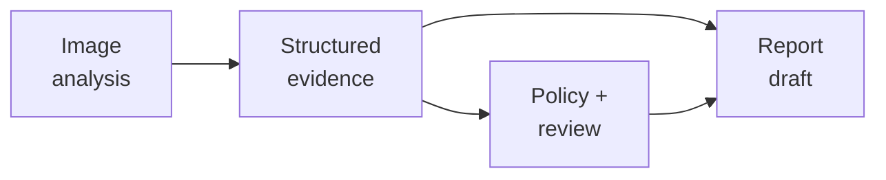

A parcel inspection station receives a photograph. The application must locate the parcel, mark visible damage, prepare a report, and recommend whether to release, hold, or review it. A fluent report cannot establish where the damage is. A precise parcel boundary cannot establish that its contents are intact. Each requirement needs its own output and evidence.

This section continues [Classification, Regression, Ranking, and Clustering](/ai/classification-regression-ranking-and-clustering/). It assumes the distinction between model outputs and application actions, basic fractions, and probabilities between zero and one. By the end, you should be able to:

- Distinguish object detection, semantic segmentation, instance segmentation, and content generation.
- Calculate overlap for a box or mask and identify what that measure leaves out.
- Compare permitted actions using explicit outcome probabilities and losses.
- Design a workflow in which generated text remains traceable to evidence and cannot grant permission to act.

## Specify four different outputs

**Object detection** identifies objects and their locations. A typical result contains a class, a bounding box, and a score for each detected object. An image may contain no objects, one object, or several. The output therefore has a variable number of entries. Detection commonly combines category prediction with coordinate prediction; a separate image-level category supplies no location.

**Segmentation** describes regions at pixel resolution. In semantic segmentation, each pixel receives a class such as background, parcel surface, or visible damage. Instance segmentation also distinguishes individual objects, so two adjacent parcels can have separate identities. The [TorchVision detection tutorial](https://docs.pytorch.org/tutorials/intermediate/torchvision_tutorial.html) illustrates boxes and per-object masks. The [TensorFlow segmentation tutorial](https://www.tensorflow.org/tutorials/images/segmentation) explains pixel-level class assignment.

**Generation** produces content, such as a report, image, or audio sequence. The inspection application generates a draft from image observations and supplied records. **Decision-making** selects an action under objectives and constraints. It can use predictions, explicit rules, optimization, or learned policies. A system does not need reinforcement learning merely because it chooses an action.

<div class="table-scroll" role="region" aria-label="Parcel inspection outputs and their evaluation boundaries" tabindex="0">

| Task | Output in this application | Reference or check | Remaining uncertainty |
| --- | --- | --- | --- |
| Detection | Parcel boxes, classes, and scores | Annotated objects and matching rules | A box does not describe internal condition |
| Segmentation | Pixels marked as visible damage | Pixel annotations and boundary checks | Visible area does not establish severity |
| Generation | Evidence-linked report draft | Factual agreement, required fields, and reviewer checks | Natural wording can contain unsupported claims |
| Decision-making | Release, hold, or review recommendation | Outcome costs, restrictions, and operational results | The action's effects need separate validation |

</div>

## Detection needs a coordinate convention and a matching rule

Let an image have height `H`, width `W`, and three color channels. Its array can have shape `H × W × 3`. Represent a box by four numbers `(x_min, y_min, x_max, y_max)`, using horizontal `x` and vertical `y` coordinates measured from the upper-left corner. We use half-open bounds: the left and top edges are included, while the right and bottom edges are excluded. The area is width times height, with no extra one added to either dimension.

For `N` detections, a box array has shape `N × 4`; class and score arrays each have length `N`. Coordinates must remain aligned with the image after resizing or cropping. A coordinate error can move every predicted location even if category predictions remain correct.

For two regions `A` and `B`, **intersection over union**, or IoU, compares their common area with their combined area:

```math
\mathrm{IoU}(A,B)=\frac{|A\cap B|}{|A\cup B|}
=\frac{|A\cap B|}{|A|+|B|-|A\cap B|}.
```

The vertical bars denote area for boxes or foreground-pixel count for masks. IoU is a scalar between zero and one when the union is positive. A value of one means identical regions; disjoint regions give zero. An empty union requires an explicit reporting convention.

Suppose a synthetic `6 × 8` image has reference parcel box `(2, 1, 6, 5)` and supplied prediction `(3, 1, 7, 5)`. Both have area `4 × 4 = 16`. Their intersection has width three and height four, giving twelve. The union is `16 + 16 − 12 = 20`, so box IoU is `12/20 = 0.60`.

This evaluates one supplied pair. For multiple detections, define category agreement, score filtering, and one-to-one matching to reference objects. Duplicate predictions and missed objects must count appropriately. A favorable IoU for one pair is insufficient to establish detection precision, recall, or performance across images.

## Segmentation changes the unit of prediction

Consider a separate reference mask for visible damage in the same image. This mask marks damage rather than the whole parcel. A binary mask has shape `H × W`, with one for marked pixels and zero for background. A semantic model with `C` classes may produce `H × W × C` scores before selecting labels; other libraries can arrange those axes differently.

Use row-column indexing `(y, x)`, starting at zero. The reference damage pixels are `(1,2), (1,3), (2,2), (2,3), (3,3), (4,3)`. The supplied prediction marks `(1,3), (1,4), (2,3), (2,4), (3,3), (4,3)`. Each mask contains six foreground pixels; four overlap. The union has `6 + 6 − 4 = 8` pixels, so damage-mask IoU is `4/8 = 0.50`.

<div class="table-scroll" role="region" aria-label="Reference, prediction, and overlap masks" tabindex="0">


</div>

*Figure 1. Row labels run downward and column labels run rightward. The final grid separates shared foreground from missed and extra regions; all other pixels are shared background. On narrow screens, scroll the figure to compare panels.*

There are forty shared background pixels and four shared foreground pixels. Pixel accuracy is therefore `44/48 = 91.7%`, despite the foreground mismatch. An always-background baseline would already obtain `42/48 = 87.5%`. Background frequency explains why accuracy can hide errors in a small damage region. Inspect class-specific overlap and boundaries, and specify how unknown or unannotated pixels are excluded.

For two all-background masks, the code below returns undefined IoU as `None` while reporting pixel accuracy. Other evaluation systems may adopt a different convention. State it before aggregating scores across images; silently inserting perfect foreground scores changes the meaning of the average.

Image pixels also lack a fixed physical scale here. Six marked pixels do not establish a damaged area in square centimeters or a probability of severe damage. Those quantities need additional measurements, definitions, and validation.

## Generation produces a draft that needs evidence checks

A conditional generator uses supplied context to produce content. An autoregressive text model predicts successive tokens, small pieces of text, from the context and preceding tokens. A decoding method selects the next token, for example by choosing a highest-scoring option or sampling. The [Transformers generation guide](https://huggingface.co/docs/transformers/en/generation_strategies) describes these selection strategies. Changing the selection method changes the text produced; it cannot supply a missing inspection measurement.

For this application, the input can contain an image identifier, predicted regions, model versions, and approved status fields. An illustrative draft could say: “Image IMG-001 has a predicted visible-damage region awaiting confirmation.” It should not add a cause, assert that contents are broken, or claim that a reviewer has already approved release.

Evaluate the draft against its supplied evidence and the report specification. Check identifiers, numerical statements, uncertainty wording, omissions, and unsupported additions. Several phrasings can be acceptable, so exact wording alone is an incomplete test. A fixed template is a useful baseline when the report contains only structured facts.

Generated assertions can be false even when the prose is coherent. NIST's [Generative AI Profile](https://www.nist.gov/publications/artificial-intelligence-risk-management-framework-generative-artificial-intelligence) addresses risks associated with generative systems. Preserve provenance and require review where an incorrect statement could affect a consequential decision. Human reviewers also need the original evidence and sufficient time to check it.

## Decisions compare consequences within permitted actions

Define severe damage as a separate outcome requiring inspection under an agreed procedure. Assume an independently validated assessment supplies probability `p` for that outcome. The following calculation uses hypothetical inputs; the box and mask IoUs above do not produce `p`.

Let `L(a,0)` be the loss of action `a` when severe damage is absent, and `L(a,1)` its loss when severe damage is present. Conditional expected loss is:

```math
R(a)=(1-p)L(a,0)+pL(a,1),\qquad
a^*=\operatorname*{arg\,min}_{a\in\mathcal A}R(a).
```

All losses are scalar values in the same hypothetical unit. The permitted set `A` must be nonempty. Multiply each possible outcome's loss by its probability, then add the contributions. This comparison assumes the outcome probabilities, conditional losses, and available actions adequately describe the decision. Missing consequences or poor probability estimates can change the preferred action.

<div class="table-scroll" role="region" aria-label="Hypothetical parcel action losses and expectations at probability 0.10" tabindex="0">

| Action | No severe damage | Severe damage | Expected loss at p = 0.10 |
| --- | ---: | ---: | ---: |
| Release | 0 | 40 | 4.0 |
| Hold | 6 | 2 | 5.6 |
| Review | 2 | 3 | 2.1 |

</div>

Review has the smallest supplied expectation: `0.9 × 2 + 0.1 × 3 = 2.1`. The review losses represent total conditional costs, including handling and residual errors; they do not assume a perfect reviewer. These figures are illustrative preferences, not measured operating costs or evidence that review is always preferable.

Capacity, required inspections, and authorization restrict which actions are available. Expected loss does not waive those restrictions. The [NIST AI RMF Core](https://airc.nist.gov/airmf-resources/airmf/5-sec-core/) discusses intended use, limits, and oversight. For safety-critical inspection, qualified specialists must validate the outcome definition, acceptable errors, and human responsibilities before deployment.



*Figure 2. The report can describe evidence and an authorized status. The decision process does not take instructions from generated prose. The underlying image and assessment records remain available to reviewers.*

## Reproduce the overlap and decision calculations

This Python 3.9+ example requires NumPy 1.24 or later (`pip install numpy`). It downloads no models or data and needs no credentials. It evaluates supplied regions and costs; it trains no model, generates no report, and executes no parcel action.

```python
import numpy as np


def box_iou(first, second):
    boxes = np.asarray([first, second], dtype=float)
    if (boxes.shape != (2, 4) or not np.isfinite(boxes).all()
            or np.any(boxes[:, 2:] <= boxes[:, :2])):
        raise ValueError("Expected finite positive-area xyxy boxes")
    overlap = np.maximum(0, np.minimum(boxes[0, 2:], boxes[1, 2:])
                         - np.maximum(boxes[0, :2], boxes[1, :2]))
    intersection = np.prod(overlap)
    areas = np.prod(boxes[:, 2:] - boxes[:, :2], axis=1)
    return float(intersection / (areas.sum() - intersection))


def mask_scores(reference, prediction):
    reference, prediction = np.asarray(reference), np.asarray(prediction)
    if (reference.ndim != 2 or reference.size == 0
            or reference.shape != prediction.shape
            or not np.isin(reference, [0, 1]).all()
            or not np.isin(prediction, [0, 1]).all()):
        raise ValueError("Expected matching nonempty binary image masks")
    reference, prediction = reference.astype(bool), prediction.astype(bool)
    intersection = np.logical_and(reference, prediction).sum()
    union = np.logical_or(reference, prediction).sum()
    iou = float(intersection / union) if union else None
    return iou, float(np.mean(reference == prediction))


def expected_losses(probabilities, costs):
    probabilities = np.asarray(probabilities, dtype=float)
    costs = np.asarray(costs, dtype=float)
    if (probabilities.ndim != 1 or probabilities.size == 0
            or not np.isfinite(probabilities).all() or np.any(probabilities < 0)
            or not np.isclose(probabilities.sum(), 1, rtol=0, atol=1e-12)
            or costs.ndim != 2 or costs.shape[0] == 0
            or costs.shape[1] != probabilities.size
            or not np.isfinite(costs).all() or np.any(costs < 0)):
        raise ValueError("Expected a probability vector and nonnegative action-by-state costs")
    return costs @ probabilities


def main():
    height, width = 6, 8
    reference = np.zeros((height, width), dtype=bool)
    prediction = np.zeros_like(reference)
    for row, col in [(1, 2), (1, 3), (2, 2), (2, 3), (3, 3), (4, 3)]:
        reference[row, col] = True
    for row, col in [(1, 3), (1, 4), (2, 3), (2, 4), (3, 3), (4, 3)]:
        prediction[row, col] = True
    iou, accuracy = mask_scores(reference, prediction)
    print(f"parcel box IoU: {box_iou([2, 1, 6, 5], [3, 1, 7, 5]):.2f}")
    print(f"damage-mask IoU: {iou:.2f}")
    print(f"pixel accuracy: {accuracy:.1%}")
    print(f"always-background accuracy: {np.mean(~reference):.1%}")

    actions = ["release", "hold", "review"]
    costs = np.array([[0, 40], [6, 2], [2, 3]], dtype=float)
    p = 0.10  # Hypothetical severe-damage probability, independent of the IoUs.
    losses = expected_losses([1 - p, p], costs)
    for action, loss in zip(actions, losses):
        print(f"{action} expected loss: {loss:.1f}")
    print("recommendation: " + actions[int(losses.argmin())])


if __name__ == "__main__":
    main()
```

The verified output is:

```text
parcel box IoU: 0.60
damage-mask IoU: 0.50
pixel accuracy: 91.7%
always-background accuracy: 87.5%
release expected loss: 4.0
hold expected loss: 5.6
review expected loss: 2.1
recommendation: review
```

The general loss function accepts a state-probability vector of length `S` and a cost matrix of shape `M × S` for `M` permitted actions. Each matrix row supplies one action's losses. The example uses two states and three actions. If expectations tie, `argmin` chooses the first action in the supplied order; a real policy must specify its tie handling deliberately.

## Validate the connected workflow

Evaluate perception against independent annotations and test reports against their evidence. Split related parcel views together so evaluation does not reuse near-identical training images. Test low light, occlusion, empty scenes, missing assessments, and unsupported damage types. Record image transformations and model versions so downstream consumers can interpret coordinates correctly.

Measure errors and operational outcomes at each stage, including review workload and decision delays. Compare with appropriate baselines, such as manual inspection and a fixed report template. Generated wording must preserve uncertainty when an upstream result is uncertain. An unavailable assessment requires an explicit fallback rather than an invented probability. Validate the complete workflow under its intended conditions before any automatic external action is enabled.

## References consulted

- [PyTorch: TorchVision Object Detection Finetuning Tutorial](https://docs.pytorch.org/tutorials/intermediate/torchvision_tutorial.html) — bounding boxes, class labels, and instance masks.
- [TensorFlow: Image segmentation](https://www.tensorflow.org/tutorials/images/segmentation) — pixel-level class assignment and imbalanced regions.
- [Hugging Face Transformers: Generation strategies](https://huggingface.co/docs/transformers/en/generation_strategies) — token selection during text generation.
- [NIST: Generative Artificial Intelligence Profile](https://www.nist.gov/publications/artificial-intelligence-risk-management-framework-generative-artificial-intelligence) — risks and evaluation considerations for generative systems.
- [NIST: AI RMF Core](https://airc.nist.gov/airmf-resources/airmf/5-sec-core/) — use context, limitations, and oversight.

## Takeaways

- Detection locates objects; segmentation describes pixels or individual object regions.
- Box overlap, foreground overlap, and pixel accuracy measure different aspects of a prediction.
- A generated draft needs factual checks against supplied evidence and cannot authorize an action.
- Decision-making requires outcome probabilities, consequences, and a permitted action set.
- Validate component outputs and the full workflow, including missing-data and human-review behavior.

## Exercises

1. Keep the reference parcel box and move the predicted box to `(4, 1, 8, 5)`. Calculate its intersection area, union area, and IoU. Explain why this box calculation does not determine the visible-damage mask's accuracy.
2. Use an all-background prediction for the six-pixel damage reference. Calculate damage IoU and pixel accuracy. Then state the code's result when both masks contain only background and explain the need for a documented convention.
3. Keep the loss table and compare all three actions at severe-damage probabilities 0.02 and 0.90. A generated draft additionally says “approved for release,” but no authorized decision record exists. State the expected-loss recommendations and how the application should handle that sentence.

## Answer guidance

1. Intersection width is two and height is four, giving eight. Union is `16 + 16 − 8 = 24`, so IoU is `8/24 = 1/3`. The boxes describe the parcel's location, while the damage mask has its own reference pixels and prediction.
2. Foreground intersection is zero and union is six, giving IoU zero. Forty-two of forty-eight pixels are correct: accuracy is 87.5%. For two empty foregrounds the function returns `(None, 1.0)`. Foreground IoU is undefined under this convention; averaging it requires an explicit exclusion or replacement policy.
3. At 0.02, release, hold, and review losses are `0.8, 5.92, 2.02`, so release minimizes the supplied loss. At 0.90 they are `36, 2.4, 2.9`, so hold does. These recommendations remain subject to authorization and operating rules. Reject or flag the unsupported approval statement; the generated report cannot create an authorized release record.
