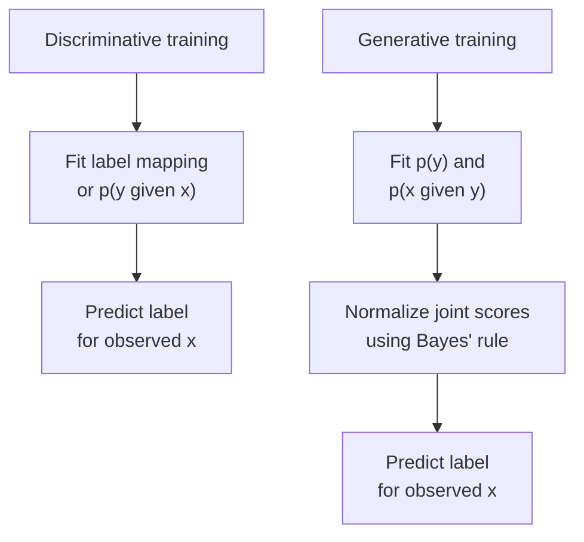
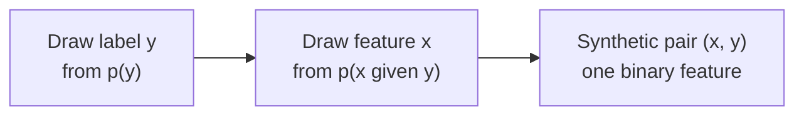

An email service needs to decide whether a message is spam. One model learns to predict the label directly. Another learns how message features are distributed within legitimate mail and within spam, then compares how well each explanation fits an incoming message. Both can classify the same email, although they model different quantities.

The second approach can also describe a process for producing synthetic feature values. That connection explains why a generative model can be a classifier and why generating data involves more than choosing a label.

This section follows [How AI, Machine Learning, and Deep Learning Fit Together](/ai/ai-machine-learning-deep-learning/). It assumes features, labels, and independent evaluation, plus counting and fractions. Probability notation is introduced below. By the end, you should be able to:

- Identify the quantity a discriminative or generative model represents.
- Use a small joint probability table to classify an observation.
- Explain how the same table supports sampling and where its representation limits apply.
- Separate a model's training objective from the task for which it is used.

## Start with the quantity being modeled

Let `x` denote an observation or its features and `y` its label. A probability assigns a number between zero and one to a possible event. For mutually exclusive possibilities that cover all outcomes, the probabilities sum to one. The worked example uses discrete variables, so its probabilities refer to individual values. The notation `p(y | x)` means the probability assigned to a label given the observed input; the vertical bar means “given.”

A **discriminative classifier** fits a mapping from features to labels, or directly fits a conditional distribution such as `p(y | x)`. Logistic regression is a probabilistic example. A classifier can also learn a decision function without returning probabilities. Neither approach needs a model of how often each possible input occurs.

A **generative model** represents a distribution over observations, such as `p(x)`, or a joint distribution over observations and labels, `p(x, y)`. A joint distribution assigns probability to combinations. For labeled data, one useful construction combines the **class prior**, `p(y)`, with the distribution of observations within that class, `p(x | y)`:

```math
p(x,y) = p(y)\,p(x \mid y).
```

The prior is the probability of the class before this particular feature is observed. The conditional factor describes which feature values the model expects within that class. Multiplying them gives the probability of their combination. This factorization is a probability identity; the assumptions used to estimate its factors determine the model's limitations. Ng and Jordan use this distinction in their [comparison of generative and discriminative classifiers](https://www.cs.cmu.edu/~guestrin/Class/10701-F07/readings/ng-jordan-2001.pdf).

The distinction concerns modeled quantities and fitting objectives. Either family can use neural networks or simpler statistical models. The word “generative” does not imply a deep architecture or a requirement to produce text.

## A generative classifier can predict labels

Suppose the generative model assigns probability to each possible combination of an observed feature and a class. To classify a known `x`, keep only combinations consistent with that observation, then normalize their probabilities across the labels.

This gives **Bayes' rule**. For our binary labels, the calculation is:

```math
p(y \mid x) =
\frac{p(y)\,p(x \mid y)}
{\sum_{c\in\{0,1\}}p(c)\,p(x \mid c)}.
```

Here, `c` runs over the two possible class values. The numerator is the joint probability for the requested class and observation. The denominator adds that quantity across both classes, giving the probability of the observation itself, `p(x)`. Division makes the two resulting label probabilities sum to one. The denominator must be positive; a model assigning zero probability to an observation cannot use this expression there without an additional policy or revised model.

The resulting `p(y | x)` is the **posterior**, the class probability after incorporating the observation. A discriminative model can target this conditional distribution directly. A generative classifier derives it from its joint model.



*Figure 1. Two fitting routes support classification. Matching predictions alone do not establish which distribution or objective was used during training.*

## Fit a complete model of one binary feature

Reuse the six synthetic training messages from [the first section](/ai/from-rules-to-machine-learning/). Their counts and labels are unchanged. For this illustration, fix a new binary feature: `x` is one when the flagged-word count is at least two, and zero otherwise. Here `x` denotes this indicator rather than the original count. Labels remain zero for legitimate mail and one for spam.

<div class="table-scroll" role="region" aria-label="Synthetic training messages for a binary generative model" tabindex="0">

| Message | Original count | Binary feature x | Label y |
| --- | ---: | ---: | ---: |
| T1 | 0 | 0 | 0 |
| T2 | 1 | 0 | 0 |
| T3 | 2 | 1 | 1 |
| T4 | 3 | 1 | 1 |
| T5 | 4 | 1 | 0 |
| T6 | 5 | 1 | 1 |

</div>

Three messages belong to each class, so estimate both class priors as three divided by six, or 0.5. Within spam, all three feature values are one. Within legitimate mail, one of three is one.

Using those raw proportions would assign zero probability to `x=0` within spam. A small dataset does not justify certainty that such spam cannot occur. Apply **Laplace smoothing** to the conditional feature probabilities: add one count to each possible feature outcome, zero and one. The denominator therefore increases by two:

```math
\begin{aligned}
p(x=1\mid y=1)&=\frac{3+1}{3+2}=0.8,\\
p(x=1\mid y=0)&=\frac{1+1}{3+2}=0.4.
\end{aligned}
```

The complementary probabilities are 0.2 and 0.6. We smooth the feature distributions and leave the class priors at their empirical values. Smoothing is an estimation choice that avoids extreme estimates here; it does not establish the true frequencies of future emails. The [scikit-learn guide to naive Bayes](https://scikit-learn.org/stable/modules/naive_bayes.html) discusses smoothing and binary-valued feature models.

Multiplying each conditional probability by its class prior produces the complete joint table:

<div class="table-scroll" role="region" aria-label="Fitted joint probabilities for class and feature" tabindex="0">

| Class y | p(x=0, y) | p(x=1, y) | Row sum: p(y) |
| --- | ---: | ---: | ---: |
| 0, legitimate | 0.30 | 0.20 | 0.50 |
| 1, spam | 0.10 | 0.40 | 0.50 |
| Column sum: p(x) | 0.40 | 0.60 | 1.00 |

</div>

All four entries are nonnegative and sum to one. They are fitted model probabilities, which differ from raw training frequencies because of smoothing. Every variable in these equations is scalar; the table simply enumerates their possible combinations.

For a new message with feature one, the relevant entries are 0.20 and 0.40. For feature zero, they are 0.30 and 0.10. Bayes' rule gives:

```math
\begin{aligned}
p(y=1\mid x=1)&=\frac{0.40}{0.20+0.40}=\frac{2}{3},\\
p(y=1\mid x=0)&=\frac{0.10}{0.30+0.10}=0.25.
\end{aligned}
```

With equal error costs and a decision threshold of 0.5, this model predicts spam for feature one and legitimate mail for feature zero. The fractions are exact consequences of the fitted table. They are not measured accuracy or evidence that real messages receiving a score near two-thirds are spam that often.

## Verify the calculation with NumPy

The example requires Python and NumPy, installed with `python -m pip install numpy`. It reads no files or external services. `fit_joint` accepts matching, nonempty, one-dimensional arrays of binary features and labels, with both classes represented. The smoothing parameter must be positive and finite.

Rows of the returned `2 × 2` array correspond to labels zero and one; columns correspond to feature values zero and one. Summing a column gives the probability of that feature value. Dividing that column by its sum gives the posterior over classes for that observation. The code divides each conditional ratio's numerator and denominator by the same positive scale before addition, preserving the result while avoiding overflow from very large smoothing values.

```python
import numpy as np


def fit_joint(x, y, alpha=1.0):
    x, y = np.asarray(x), np.asarray(y)
    if x.ndim != 1 or y.ndim != 1 or x.size == 0 or x.size != y.size:
        raise ValueError("Expected matching, nonempty one-dimensional arrays")
    if not np.isin(x, [0, 1]).all() or not np.isin(y, [0, 1]).all():
        raise ValueError("Features and labels must be binary")
    if not np.isfinite(alpha) or alpha <= 0:
        raise ValueError("Smoothing must be positive and finite")

    # Rows are labels; columns are feature outcomes.
    counts = np.zeros((2, 2), dtype=float)
    np.add.at(counts, (y.astype(int), x.astype(int)), 1)
    class_counts = counts.sum(axis=1)
    if np.any(class_counts == 0):
        raise ValueError("Both classes must appear in the training examples")

    priors = class_counts / class_counts.sum()
    # Rescale the smoothing ratio before addition to avoid overflow.
    scale = np.maximum(class_counts, alpha)
    pseudo = alpha / scale
    conditionals = (counts / scale[:, None] + pseudo[:, None]) / (
        class_counts / scale + 2 * pseudo
    )[:, None]
    return priors[:, None] * conditionals


def main():
    # Fixed synthetic inputs from the first section; each has shape (6,).
    word_counts = np.array([0, 1, 2, 3, 4, 5])
    labels = np.array([0, 0, 1, 1, 0, 1])
    feature_threshold = 2
    features = (word_counts >= feature_threshold).astype(int)
    joint = fit_joint(features, labels)

    # Normalize each column over the two class labels.
    posterior = joint / joint.sum(axis=0, keepdims=True)
    print("Joint rows [legitimate, spam]:", joint.round(4).tolist())
    print(f"P(spam | x=0): {posterior[1, 0]:.3f}")
    print(f"P(spam | x=1): {posterior[1, 1]:.3f}")
    print("Predicted labels for x=[0, 1]:", posterior.argmax(axis=0).tolist())


if __name__ == "__main__":
    main()
```

Verified output for these fixed synthetic inputs:

```text
Joint rows [legitimate, spam]: [[0.3, 0.2], [0.1, 0.4]]
P(spam | x=0): 0.250
P(spam | x=1): 0.667
Predicted labels for x=[0, 1]: [0, 1]
```

This checks the arithmetic and normalization. It does not compare predictive performance against a fitted discriminative model. Such a comparison requires consistent inputs, training and validation procedures, and an independent test set. If the feature transformation or smoothing strength is selected from data, that selection belongs in model development before the final test.

## Sampling uses the same joint model differently

To draw a synthetic example, first choose a label using the class priors. Then choose a feature value from the conditional distribution for that label. For example, after choosing spam, feature one has probability 0.8. After choosing legitimate mail, it has probability 0.4. A short run of draws need not reproduce these fractions exactly.



*Figure 2. Sampling draws both variables. Classification fixes the observed feature and infers its label.*

The generated object is a pair containing a binary feature and a label. It contains no words, grammar, sender, or message body. Producing coherent emails would require a model of those observations. A generative model's output is limited by the variables and relationships it represents.

A discriminative classifier can also sample a label from `p(y | x)`. That operation does not supply a distribution over the email features themselves. Different input distributions can share the same conditional label probabilities, so the conditional alone does not determine the joint.

## Conditional generation and classification are compatible

Some generative models produce observations given a context, such as text continuations given a prompt. A distribution over possible continuations is conditional, just as `p(y | x)` is conditional. Identify the modeled variables and their role in the task: the email classifier assigns probabilities to labels for an observed email; the text generator models possible text sequences given a context. The presence of a vertical bar alone cannot distinguish these uses. Google's [generative-model overview](https://developers.google.com/machine-learning/gan/generative) discusses both data distributions and sequence prediction.

A generative language model can be asked to return a class name, so a generatively trained component can serve a classification task. Returning a label does not reveal its training objective. Likewise, a classifier returning a probability is not automatically a model of how its inputs are generated.

Explicit probability tables are only one implementation. Some generative models define a sampling procedure without providing a tractable probability calculation for every observation. The original [generative adversarial network paper](https://proceedings.nips.cc/paper_files/paper/2014/file/f033ed80deb0234979a61f95710dbe25-Paper.pdf) describes such a generator. Its training mechanism can wait for a later treatment; the relevant point here is that sampling and evaluating a probability are different computational capabilities.

## Evaluate the intended use

For classification, compare errors, their costs, and probability calibration: whether predicted probabilities match observed frequencies on appropriate held-out data. Modeling more of the input distribution can impose assumptions irrelevant to the decision or introduce estimation errors. It can also support additional tasks, such as sampling. Neither family has a universal advantage across data regimes and model choices.

Our model has one binary feature and no independence assumption across multiple features. Extending it by multiplying many feature probabilities would introduce a conditional-independence assumption, as in naive Bayes; correlated words can violate that assumption. Additional data cannot automatically repair a misspecified model family.

For generation, inspect the properties required of the generated observations. Plausible text does not establish factual correctness, and a synthetic sample can still reproduce sensitive training material. Evaluate those risks separately from classification accuracy. The six-message calculation demonstrates a fitted distribution and its uses; it supplies no evidence for deploying a real email service.

## References consulted

- [Ng and Jordan: On Discriminative vs. Generative Classifiers](https://www.cs.cmu.edu/~guestrin/Class/10701-F07/readings/ng-jordan-2001.pdf) — joint and conditional modeling, with analysis of particular classifier pairs.
- [scikit-learn: Naive Bayes](https://scikit-learn.org/stable/modules/naive_bayes.html) — smoothing, binary-valued features, and modeling assumptions.
- [Google: Background—What Is a Generative Model?](https://developers.google.com/machine-learning/gan/generative) — data distributions, classification, and generation.
- [Goodfellow and colleagues: Generative Adversarial Nets](https://proceedings.nips.cc/paper_files/paper/2014/file/f033ed80deb0234979a61f95710dbe25-Paper.pdf) — a generative procedure without an explicit representation of its data probability.

## Takeaways

- Discriminative classifiers target label predictions; a generative classifier models a joint distribution and obtains label probabilities through Bayes' rule.
- The same fitted joint table supports classification and sampling, but generated objects contain only the variables represented by that model.
- Conditional generation can model text or images given context. Classification use and the presence of conditional notation do not determine a component's training objective.
- Correct probability arithmetic and smoothing do not establish real-world accuracy, calibration, or sample quality.

## Exercises

1. Keep the fitted feature probabilities unchanged, but suppose the spam prior becomes 0.1 and the legitimate prior becomes 0.9. Calculate `p(y=1 | x=1)`. With a threshold of 0.5, which class is predicted? State the assumption that makes changing only the priors appropriate.
2. The sampler chooses `y=0`. What is the probability that it next chooses `x=1`? Explain why its output is not a generated legitimate email, and identify information the model lacks.
3. A pretrained text generator is instructed to return either `SPAM` or `LEGITIMATE`. Does this output format establish that it was trained discriminatively? Describe what you would inspect and how you would evaluate its classification use.

## Answer guidance

1. The spam joint score is `0.1 × 0.8 = 0.08`; the legitimate score is `0.9 × 0.4 = 0.36`. The posterior is `0.08 / 0.44 = 2/11`, approximately 0.182, so the decision is legitimate. Updating only priors assumes that the class-conditional feature distributions remain applicable; changes within each class would require further investigation.
2. The probability is 0.4. The output contains only a label and one indicator. It specifies no sequence of words or other email content, so it cannot establish a coherent or legitimate message.
3. The format specifies a task interface. Inspect the modeled variables, original training objective, and any classification-specific adaptation. Compare the component with a fixed baseline using consistent information, validation for development, and an independent representative test. Report errors and their costs; evaluate confidence estimates if they will affect decisions.
