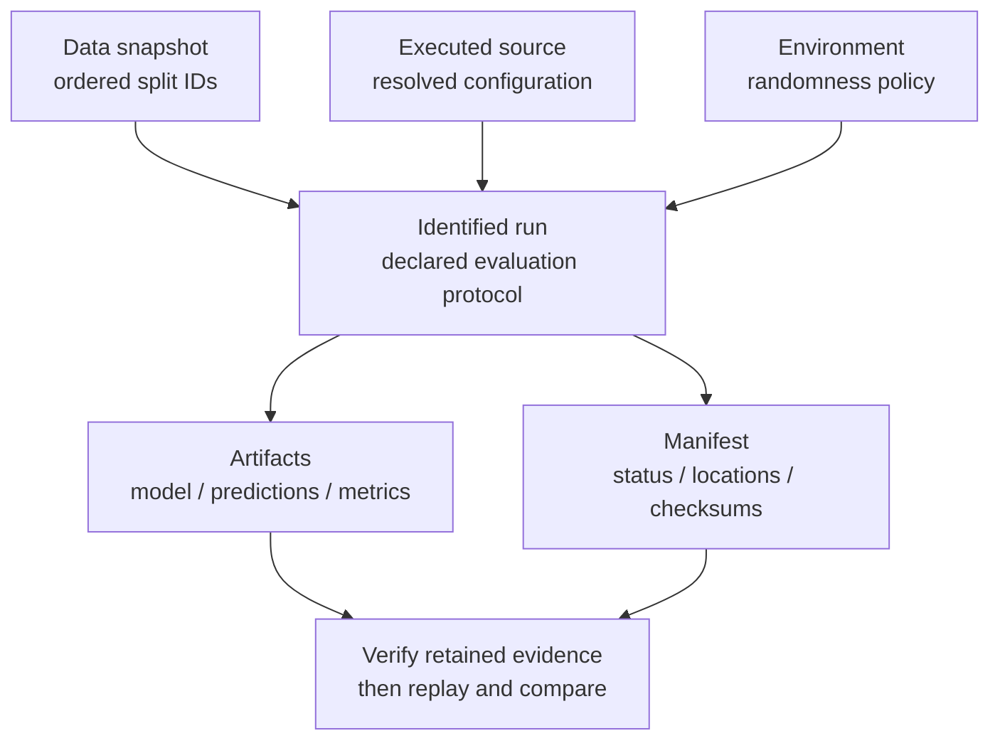

A teammate reports that a build-duration predictor has a validation error of zero minutes. A week later, you run the notebook and obtain a different score. The notebook's filename is unchanged, but its cells were edited, the dataset was replaced, and nobody saved which rows belonged to validation. The score alone cannot tell you which experiment happened.

This section follows [Randomness, Repeated Experiments, and Result Variation](/ai/randomness-repeated-experiments-and-variation/). It assumes familiarity with training and validation data, mean absolute error (MAE), and fitting a constant or a line. By the end, you should be able to:

- Specify the evidence needed to reconstruct an experimental run.
- Connect code versions, data identities, and configuration to saved outputs.
- Verify artifacts and replay a small experiment without overwriting its record.
- Investigate a mismatch while separating computational agreement from scientific evidence.

## Give each result an identifiable run

An **experiment** states a question and comparison protocol. A **run** is one execution of a specified procedure. An **artifact** is a retained output or input, such as predictions, a checkpoint, a configuration file, or a dataset snapshot. **Provenance** records how those artifacts were produced and which inputs they depend on.

Assign a unique run ID before execution. Record the question, baseline, evaluation population, metric and units, selection rule, and permitted data use. Then preserve the execution details. “Try a better model” leaves too much unspecified to reconstruct or interpret.

Use distinct descriptions for three checks. Integrity verification tests whether retained bytes match their recorded identities. Computational replay runs a recorded procedure again and compares outputs under stated conditions. Independent replication tests the substantive finding with additional evidence, possibly using different data or an independent implementation. Matching files or scores does not establish that a model generalizes.

## Preserve a connected record

<div class="table-scroll" role="region" aria-label="Minimum experimental run record and its purpose" tabindex="0">

| Record | Preserve | What it explains |
| --- | --- | --- |
| Question and protocol | Baseline, metric, units, selection and failure rules | What the result can support |
| Data and split | Immutable data identity, schema, ordered row IDs for each split | Which cases were available for fitting and evaluation |
| Code | Commit identity and actual executed source, including local changes | Which transformations and fitting procedure ran |
| Configuration | Resolved values, preprocessing choices, random-stream specification | Which defaults and random choices affected execution |
| Environment | Interpreter, dependencies, numerical backend, relevant hardware and settings | Which execution differences might change outputs |
| Outputs | Model state, per-case predictions, metrics, logs and status | What happened and whether the run completed |
| Artifact locations | Checksums, storage references, retention and access rules | Whether the evidence can still be retrieved and checked |

</div>

A **manifest** is a machine-readable inventory linking one run to these records. Preserve the resolved configuration after defaults and overrides have been applied. A command-line argument that selects a configuration file is insufficient if that file changes later. Store split membership explicitly when exact membership matters; a split seed alone depends on data order and the sampling implementation.



*Figure 1. A result is connected to its inputs and execution conditions. Replay requires both the artifacts and a procedure for interpreting them.*

## Version code, data, and the execution environment

Git records staged snapshots of tracked files. A commit does not automatically include untracked data, unstaged edits, or notebook variables remaining in memory. The [Git documentation on recording changes](https://git-scm.com/book/en/v2/Git-Basics-Recording-Changes-to-the-Repository) explains the distinction between the working tree, staging area, and committed snapshot.

Before a serious run, inspect the working tree and preferably execute a clean committed version. If local edits are allowed, archive the actual executed source and relevant patches, and label the run accordingly. Restart notebooks and execute them from a documented entry point. A commit ID cannot describe an earlier cell execution whose in-memory state no longer matches the saved notebook.

In an existing Git checkout, these read-only commands show the current commit and working-tree changes, including untracked files. The status output distinguishes staged changes from other edits. Record the commit after preparing the version you intend to execute; resolve or archive every relevant change before claiming that the commit fully identifies the source.

```bash
git rev-parse HEAD
git status --short --untracked-files=all
```

Keep small source and configuration files in version control. Large datasets and checkpoints often belong in access-controlled artifact storage, with immutable object versions and checksums recorded in the manifest. A checksum identifies bytes under the assumed hash properties; it does not store those bytes. Retain the actual object and the means to access it. Two CSV files with equivalent rows but different line endings can have different byte identities.

[Python's `hashlib`](https://docs.python.org/3/library/hashlib.html) supplies SHA-256 for this example. Checksums detect changes relative to a trusted manifest. Someone who can replace both an artifact and its manifest can replace their checksums too. Sensitive or adversarial workflows need separate access controls and, where appropriate, authenticated records.

Record the interpreter and package versions actually used. Pinned dependencies and package hashes reduce installation ambiguity; the [pip repeatable-install guidance](https://pip.pypa.io/en/stable/topics/repeatable-installs/) also discusses retaining installation artifacts and platform limits. A package list does not capture every driver, compiled library, environment variable, or remote service. Record the factors relevant to the claim, and mark unavailable details honestly.

## Work through a complete, synthetic example

Consider four training builds with sizes `1, 2, 3, 4` and durations `2, 4, 6, 8` minutes. Three validation builds have sizes `5, 6, 7` and durations `10, 12, 14`. Size is measured in arbitrary workload units. Every value is a deliberately synthetic teaching fixture.

The reference predicts the training mean, `(2 + 4 + 6 + 8) / 4 = 5`. Its validation absolute errors are `5, 7, 9`, so MAE is `7` minutes. A fitted line has intercept zero and slope two, predicting `10, 12, 14` and producing MAE zero. The fixture demonstrates record keeping and replay; it supplies no evidence about real build workloads.

Both runs use identical data and ordered split IDs. Only the declared model choice changes. Validation labels are used for reporting, never for fitting. There is no randomness or final test set in this example. Conclusions about selection or future performance require a separate evaluation plan.

Save the following program as `recorded_experiment.py` and run `python recorded_experiment.py`. It requires Python 3.9+ and only the standard library, with no downloads, credentials, or hidden inputs. The two fitted coefficients form a length-two vector; predictions contain one identified scalar per validation row. The fitting code is intentionally small so the recording mechanism remains visible.

```python
import csv
import hashlib
import io
import json
import math
import platform
import sys
from datetime import datetime, timezone
from pathlib import Path
from tempfile import TemporaryDirectory


def evaluate(data, split, config):
    reader = csv.DictReader(io.StringIO(data.decode("utf-8")))
    if reader.fieldnames != ["id", "size", "minutes"]:
        raise ValueError("Unexpected data schema")
    rows = {}
    for row in reader:
        if (None in row or any(value is None for value in row.values())
                or not row["id"] or row["id"] in rows):
            raise ValueError("Invalid or duplicate row")
        pair = (float(row["size"]), float(row["minutes"]))
        if not all(math.isfinite(value) for value in pair):
            raise ValueError("Data must be finite")
        rows[row["id"]] = pair
    if (set(split) != {"train", "validation"}
            or any(not isinstance(part, list) or not part for part in split.values())):
        raise ValueError("Provide nonempty train and validation ID lists")
    ids = split["train"] + split["validation"]
    if (any(not isinstance(item, str) or item not in rows for item in ids)
            or len(set(ids)) != len(ids)):
        raise ValueError("Split IDs must exist, be unique, and not overlap")
    if set(config) != {"model"} or config["model"] not in ("mean", "line"):
        raise ValueError("Choose the mean or line model")

    # Fit using only the declared training rows, in their recorded order.
    train = [rows[item] for item in split["train"]]
    mx = sum(x for x, _ in train) / len(train)
    my = sum(y for _, y in train) / len(train)
    slope = 0.0
    if config["model"] == "line":
        denominator = sum((x - mx) ** 2 for x, _ in train)
        if denominator == 0:
            raise ValueError("Line fitting requires varied training sizes")
        slope = sum((x - mx) * (y - my) for x, y in train) / denominator
    intercept = my - slope * mx
    predictions = [{"id": item, "prediction": intercept + slope * rows[item][0]}
                   for item in split["validation"]]
    mae = sum(abs(row["prediction"] - rows[row["id"]][1])
              for row in predictions) / len(predictions)
    if not all(math.isfinite(v) for v in
               [intercept, slope, mae] + [row["prediction"] for row in predictions]):
        raise ValueError("Nonfinite fitted result")
    return {"coefficients": [intercept, slope], "predictions": predictions,
            "mae_minutes": mae, "validation_count": len(predictions)}


def record_run(directory, data, split, config):
    directory = Path(directory)
    directory.mkdir(parents=True, exist_ok=False)
    started = datetime.now(timezone.utc).isoformat()
    encode = lambda value: (json.dumps(value, sort_keys=True, allow_nan=False)
                            + "\n").encode("utf-8")
    artifacts = {"data.csv": data, "split.json": encode(split),
                 "config.json": encode(config),
                 "source.py": Path(__file__).read_bytes(),
                 "environment.json": encode({"python": sys.version,
                     "implementation": platform.python_implementation(),
                     "platform": platform.platform(), "randomness": "none"})}
    failure = None
    try:
        artifacts["result.json"] = encode(evaluate(data, split, config))
    except Exception as error:
        failure = error
        artifacts["failure.json"] = encode({"error_type": type(error).__name__,
                                             "message": str(error)})
    for name, payload in artifacts.items():
        with (directory / name).open("xb") as stream:
            stream.write(payload)
    manifest = {"schema_version": 1, "protocol": "build-duration-mae-v1",
                "status": "failed" if failure is not None else "complete",
                "started_at": started,
                "finished_at": datetime.now(timezone.utc).isoformat(),
                "files": {name: hashlib.sha256(payload).hexdigest()
                          for name, payload in artifacts.items()}}
    # Publish completion only after the listed artifacts have been written.
    with (directory / "manifest.json").open("xb") as stream:
        stream.write(encode(manifest))
    if failure is not None:
        raise failure
    return directory


def replay_run(directory):
    directory = Path(directory)
    manifest = json.loads((directory / "manifest.json").read_bytes())
    required = {"data.csv", "split.json", "config.json", "source.py",
                "environment.json", "result.json"}
    if (manifest.get("schema_version") != 1
            or manifest.get("protocol") != "build-duration-mae-v1"
            or manifest.get("status") != "complete"
            or set(manifest.get("files", {})) != required):
        raise ValueError("Unsupported or incomplete run record")
    artifacts = {name: (directory / name).read_bytes() for name in required}
    for name, payload in artifacts.items():
        if hashlib.sha256(payload).hexdigest() != manifest["files"][name]:
            raise ValueError("Artifact checksum mismatch: " + name)
    if artifacts["source.py"] != Path(__file__).read_bytes():
        raise ValueError("Replay runner differs from recorded source")
    actual = evaluate(artifacts["data.csv"], json.loads(artifacts["split.json"]),
                      json.loads(artifacts["config.json"]))
    if actual != json.loads(artifacts["result.json"]):
        raise ValueError("Replayed result differs from recorded result")
    return actual


def main():
    data = (b"id,size,minutes\nt1,1,2\nt2,2,4\nt3,3,6\nt4,4,8\n"
            b"v1,5,10\nv2,6,12\nv3,7,14\n")
    split = {"train": ["t1", "t2", "t3", "t4"],
             "validation": ["v1", "v2", "v3"]}
    # Private temporary storage keeps this teaching example self-contained.
    with TemporaryDirectory() as temporary:
        root = Path(temporary)
        reference = record_run(root / "reference", data, split, {"model": "mean"})
        candidate = record_run(root / "candidate", data, split, {"model": "line"})
        print(f"reference MAE: {replay_run(reference)['mae_minutes']:.3f} minutes")
        print(f"candidate MAE: {replay_run(candidate)['mae_minutes']:.3f} minutes")
        print("replay matches recorded result:", replay_run(candidate)["mae_minutes"] == 0)

        # A changed retained input must fail verification before fitting.
        (candidate / "data.csv").write_bytes(data.replace(b"t1,1,2", b"t1,1,3"))
        try:
            replay_run(candidate)
        except ValueError as error:
            print("changed data rejected:", "checksum mismatch" in str(error))


if __name__ == "__main__":
    main()
```

The following output was verified by running the program with Python 3.11.4:

```text
reference MAE: 7.000 minutes
candidate MAE: 0.000 minutes
replay matches recorded result: True
changed data rejected: True
```

`record_run` refuses to reuse a directory. An evaluation failure records its exception type and marks the manifest failed, then raises the exception. Replay accepts only a complete record with the expected artifact inventory. Interrupted writes can leave an incomplete directory; a production artifact store also needs suitable durability, atomic publication, retention, and recovery rules.

JSON keys are sorted for consistent serialization, and `allow_nan=False` rejects nonfinite output values; see [Python's JSON documentation](https://docs.python.org/3/library/json.html). This encoding is a local format choice, not a universal canonical-JSON standard. The verifier checks retained bytes, then requires the current source to match and compares the entire parsed result, including identified predictions. It never executes a downloaded source file.

The example stores environment information without reconstructing that environment. Replay uses your current interpreter. It neither compares every environment detail nor certifies the original hardware. The temporary directories disappear when the program exits; use `record_run` with a new directory in retained, access-controlled storage for a lasting record. Handle only small bundles you control.

## Diagnose agreement and disagreement

Inspect mismatches in dependency order: data bytes and schema, split membership and order, resolved configuration, executed code, environment, then outputs. Matching one aggregate score can conceal different per-case predictions or swapped identifiers. Retain enough intermediate evidence to locate the divergence without logging secrets or unnecessary personal data.

Exact numerical equality is suitable for this tiny deterministic fixture. Larger numerical programs may need a tolerance defined before examining the replay:

```math
|E_{\mathrm{replay}}-E_{\mathrm{recorded}}|
\leq \epsilon_{\mathrm{abs}}+\epsilon_{\mathrm{rel}}|E_{\mathrm{recorded}}|.
```

Both `E` values are finite scalar errors in minutes. The nonnegative absolute tolerance has units of minutes; the nonnegative relative tolerance is dimensionless. At a recorded error of `0.25`, tolerances `0.000001` and `0.00001` allow a difference of `0.0000035` minutes. A replay error of `0.2500002` differs by `0.0000002` and passes. At recorded error zero, the absolute term controls the permitted difference. Apply appropriate checks to each aligned prediction as well.

[PyTorch's reproducibility guidance](https://docs.pytorch.org/docs/2.15/notes/randomness.html) describes limits across releases, platforms, and nondeterministic operations. Numerical agreement within a tolerance, byte-identical checkpoints, and statistical agreement across repeated training runs are separate claims. Save a replay as a new attempt with its own environment and comparison outcome; preserve the original evidence.

<div class="table-scroll" role="region" aria-label="Replay mismatches and appropriate interpretations" tabindex="0">

| Observation | Next investigation |
| --- | --- |
| Missing object, known checksum | Recover the retained bytes and permissions; the checksum cannot recreate them |
| Changed data or split | Establish which evaluation population and ordering each run used |
| Same commit, different predictions | Inspect local edits, preprocessing, configuration, randomness and environment |
| Same MAE, different predictions | Compare by row ID and inspect error slices before claiming equivalence |
| Failed run has no score | Preserve its failure status and apply the declared reporting rule |
| Faithful replay, poor future performance | Investigate evaluation design, leakage and population change |

</div>

Reproducible leakage remains leakage. Do not choose seeds or configurations using final-test results, silently replace datasets, or remove failed attempts from a comparison. For high-risk decisions, a retained run record supports review alongside external validation, relevant subgroup checks, and qualified human oversight. It cannot by itself establish safety or authorize deployment.

## References consulted

- [Git: Recording changes](https://git-scm.com/book/en/v2/Git-Basics-Recording-Changes-to-the-Repository) — staged, tracked, and uncommitted state.
- [Python: hashlib](https://docs.python.org/3/library/hashlib.html) — byte digests and SHA-256.
- [Python: JSON](https://docs.python.org/3/library/json.html) — serialization settings and nonfinite values.
- [pip: Repeatable installs](https://pip.pypa.io/en/stable/topics/repeatable-installs/) — version pins, package hashes, and retained installation artifacts.
- [PyTorch: Reproducibility](https://docs.pytorch.org/docs/2.15/notes/randomness.html) — environment-dependent numerical behavior and repeatability limits.

## Takeaways

- Link every score to a run, its question, resolved inputs, and saved per-case outputs.
- Preserve actual code and data alongside their identities; a commit or checksum cannot supply missing artifacts.
- Verify integrity before replay, and define the numerical or statistical comparison being claimed.
- Keep failed attempts and replay records separate from the original; successful replay does not establish generalization.

## Exercises

1. A manifest records a Git commit and a dataset checksum, but the training script used an untracked preprocessing file and the object store has deleted the data. Identify the missing evidence and explain what can still be verified.
2. Run the program, then change the candidate's saved validation prediction for `v1` from `10` to `11` while leaving the original manifest untouched. Predict the first failing check. Then consider a deliberately updated checksum for that result file and explain which check should fail next.
3. An experiment reports only its best completed run. Two attempts failed, and a replay produces the same MAE with different per-case predictions. Describe a corrected run record and comparison policy. Explain whether either replay result establishes performance on future data.

## Answer guidance

1. The commit omits the untracked preprocessing source, and the checksum cannot reconstruct deleted data. Retain the actual preprocessing version, an accessible immutable data snapshot, ordered splits, configuration, environment, and outputs. Available files can still be checked against their recorded identities, but the complete computation cannot be reconstructed from those two identifiers alone.
2. The result-file checksum fails before fitting. If someone changes that checksum too, the recomputed prediction for `v1` is still `10`, so the full parsed-result comparison fails. Replacing all relevant evidence coherently can defeat an unauthenticated manifest; trusted storage and authenticated provenance address a different threat.
3. Preserve every declared attempt's identity, status and failure information, and apply a reporting policy fixed before selecting favorable results. Compare aligned predictions and the declared metric, with justified tolerances where appropriate. Investigate differing predictions even when MAE agrees. Future-data claims require valid independent evaluation beyond either replay.
