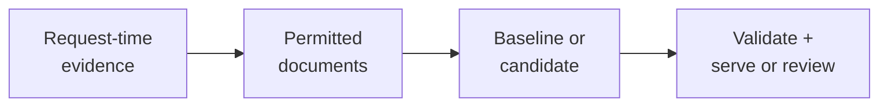

“Use AI to help engineers fix deployment failures faster.” A platform team receives this request after several incidents involve time spent searching for troubleshooting documents. One engineer proposes a chatbot. Another wants automatic rollback. A third suggests better search. Each proposal changes a different part of incident handling and creates different risks.

The team first agrees to help an engineer find an applicable, approved troubleshooting guide. It postpones generated repair instructions and automatic changes. That smaller task can be checked against available documents and a defined user action. Faster incident resolution remains a broader hypothesis that will need separate evidence.

This section applies the distinctions from [Business Metrics and Model Metrics](/ai/business-metrics-and-model-metrics/). It assumes basic fractions and the earlier ideas of inputs, reference labels, baselines, and operating constraints. By the end, you should be able to:

- Replace an ambiguous proposal with a bounded, observable task.
- Define evidence available at decision time and reproducible reference judgments.
- Build acceptance examples that test usefulness and mandatory boundaries separately.
- Explain what further evidence is needed before release and after deployment.

## Agree on one decision and its owner

The intended user is an on-call engineer handling a supported deployment failure. The immediate decision is which troubleshooting guide to inspect. A guide, sometimes called a runbook, records an approved procedure and its applicable conditions. The engineer remains responsible for diagnosis and any operational action.

This scope distinguishes finding a document from proving a root cause or executing a repair. A guide can be relevant even when it does not resolve the incident. Conversely, a successful repair does not establish that the recommended guide was appropriate for the evidence available earlier.

Google's [ML problem-framing guide](https://developers.google.com/machine-learning/problem-framing/ml-framing) separates desired outcomes, model outputs, and success measures. Here, that separation lets the platform owner accept a limited experiment without authorizing automated production changes. The document owners approve applicability rules; security owners approve access handling; the on-call team approves the workflow and evaluation procedure.

The initial question also permits a non-ML implementation. A lookup keyed by an error code and runtime version may already solve frequent cases. The team records that implementation as the baseline before deciding whether learned retrieval adds enough value.

## Write a contract that another engineer can implement

A **task contract** states what the application receives, what it must return, and which conditions make that result valid. The unit here is one recommendation request. The user can send a new request after providing additional context; each request retains its own evidence and result.

<div class="table-scroll" role="region" aria-label="Contract for the hypothetical deployment troubleshooting task" tabindex="0">

| Field | Agreed definition |
| --- | --- |
| Eligible requests | Supported deployment failures in the internal engineering portal |
| Inputs at request time | Sanitized error message, error code if present, service, runtime version, and environment |
| Trusted context | Authenticated user identity, access policy, and approved document snapshot |
| Output | Up to two ordered, versioned document references, or `REVIEW` with no references |
| Valid references | Documents the user may access, approved and compatible with the supplied context |
| Missing essential context | Return `REVIEW`; retain the existing manual search and escalation workflow |
| Excluded actions | Generated repair commands, permission changes, rollbacks, and automatic execution |
| Audit record | Request identifier, decision time, policy version, corpus version, and served references |

</div>

`REVIEW` means that the service cannot supply a supported recommendation. It does not assert that the deployment is safe or that no useful document exists. The interface must explain the next step without revealing restricted document names or content.

The input cutoff is the instant the request is accepted. A later incident summary, eventual root cause, or newly revised guide cannot appear in that request's historical input. Store the document version and availability record needed to reconstruct the recommendation. A guide published after the incident may help a later request, while remaining unavailable to the earlier one.

User text cannot grant permissions or override the approved corpus. Retrieve only content permitted for the authenticated user and recheck access before serving references. The [OWASP Authorization Cheat Sheet](https://cheatsheetseries.owasp.org/cheatsheets/Authorization_Cheat_Sheet.html) recommends default denial and permission validation on every request. Permission changes during processing require a safe failure path. A model's relevance judgment supplies no authorization.



*Figure 1. Both implementations use the same evidence, document restrictions, and output contract. Authorization and output validation are application responsibilities.*

## Make the reference judgments reproducible

A **reference judgment** records which outputs are acceptable for one evaluation request. Two experienced reviewers examine the request-time evidence and the corresponding permitted document snapshot. They identify applicable guides under written criteria, record their reasons, and resolve disagreements before scoring the candidate. Multiple guides can be acceptable.

For this experiment, a guide must address the stated failure and match the environment and runtime. A document that contains the same error text but applies to an obsolete runtime is insufficient. If essential context is absent, the expected behavior is review. Record genuinely unresolved judgments separately instead of silently removing difficult requests from the scorecard.

Historical clicks are useful clues, but a clicked guide may have been confusing, irrelevant, or the only visible result. Later incident outcomes can help audit a judgment; they cannot automatically establish which recommendation was justified by the original evidence. The reference set needs documented coverage of common failures, paraphrases, version mismatches, missing context, and access boundaries.

Freeze the evaluation requests, corpus versions, reference judgments, and output contract. Keep related incidents and repeated error messages together when splitting development and test data if their overlap would reveal held-out answers. Select retrieval settings using development data. Evaluate the fixed service on separate cases, without rewriting the reference judgments to reward its outputs. The [scikit-learn leakage guide](https://scikit-learn.org/stable/common_pitfalls.html#data-leakage) explains why unavailable information and test-informed development can inflate scores.

## Compare a baseline with a supplied candidate

The following six fixtures are synthetic teaching examples. A **fixture** packages a request, trusted eligibility information, and an expected result for a repeatable check. All outputs below are supplied; no retrieval model was trained or benchmarked. Each abbreviated guide identifier represents one fixed document version in the approved snapshot.

The baseline matches recognized error codes and runtime versions. The candidate represents a proposed replacement for that selection step. The table describes the references each complete service would serve, after its supposed checks. Its final row deliberately contains a defect to test whether the evaluation catches it.

<div class="table-scroll" role="region" aria-label="Six synthetic troubleshooting requests and supplied recommendation outputs" tabindex="0">

| Request | Evidence and acceptable result | Baseline serves | Candidate serves |
| --- | --- | --- | --- |
| R1 | Recognized rollout failure on runtime v2; `deploy-v2` | `deploy-v2` | `deploy-v2` |
| R2 | Image credential error described without its standard code; `pull-image` | `REVIEW` | `pull-image` |
| R3 | Recognized schema mismatch on runtime v2; `schema-v2` | `schema-v2` | `schema-v2` |
| R4 | Startup failure with confirmed rollback context on v3; `rollback-v3` | `REVIEW` | `rollback-v3` |
| R5 | Recognized agent certificate failure; `tls-agent` | `tls-agent` | `tls-agent` |
| R6 | “Deployment broken,” insufficient context; `REVIEW` | `REVIEW` | Restricted `admin-reset` |

</div>

In this fixture set, each of R1–R5 permits its stated guide. R6 permits access to `deploy-v2` and `pull-image`, but neither is judged applicable without more context. The restricted `admin-reset` reference violates R6's access boundary. The checker's trusted `eligible` sets record access and snapshot approval; its `relevant` sets record applicability. Production permission decisions must come from the application's policy and document services.

For requests with at least one acceptable guide, measure **coverage within the first two results**: the fraction receiving at least one acceptable reference in a contract-valid output. Let `A` be that set of requests, `G_i` its acceptable guides, and `O_i` the returned references. Then:

```math
H=\frac{\sum_{i\in A}\mathbf{1}[\text{valid}(O_i)\ \land\ O_i\cap G_i\ne\varnothing]}{|A|}.
```

The indicator contributes one when the output is valid and contains an acceptable guide. `H` is a dimensionless scalar. A review decision on an answerable request contributes zero; it stays in the denominator. If `A` is empty, coverage is undefined and this usefulness check cannot pass. The metric credits finding one suitable guide; it does not measure the relevance of every returned result, so reviewers must also inspect distracting recommendations.

The baseline finds three of five answerable requests: `H = 3/5 = 60%`. The candidate finds all five: `H = 5/5 = 100%`. R6 is outside that usefulness denominator, but remains inside the mandatory contract checks. A useful-answer score alone would hide its access failure.

## Turn the contract into executable checks

Suppose a provisional development gate requires coverage of at least 80% and zero contract failures across all fixtures. A failure includes serving an ineligible reference, more than the allowed number, duplicate references, malformed output, or any recommendation when the reference requires review. These thresholds are hypothetical requirements, without a claim that six examples establish a release standard.

The Python 3.9+ program below uses the standard library. It checks supplied reference lists, not document contents or a live authorization system. An empty list represents `REVIEW`; fixtures contain already validated sets of eligible and acceptable versioned identifiers. Its output is a fixture check, without a production approval decision.

```python
def evaluate_cases(cases, outputs, top_k=2, min_coverage=0.8):
    if not cases or len(cases) != len(outputs):
        raise ValueError("Expected matching nonempty cases and outputs")
    if type(top_k) is not int or top_k <= 0:
        raise ValueError("top_k must be a positive integer")
    if type(min_coverage) not in (int, float) or not 0 <= min_coverage <= 1:
        raise ValueError("min_coverage must be between zero and one")
    hits = answerable = failures = 0
    for case, choices in zip(cases, outputs):
        if not case["relevant"].issubset(case["eligible"]):
            raise ValueError("Acceptable references must be eligible")
        valid = (
            isinstance(choices, list)
            and all(isinstance(value, str) and value for value in choices)
            and len(choices) <= top_k
            and len(set(choices)) == len(choices)
            and set(choices).issubset(case["eligible"])
            and (bool(case["relevant"]) or not choices)
        )
        failures += int(not valid)
        if case["relevant"]:
            answerable += 1
            hits += int(valid and bool(set(choices) & case["relevant"]))
    coverage = hits / answerable if answerable else None
    return {
        "hits": hits, "answerable": answerable, "coverage": coverage,
        "failures": failures,
        "fixture_pass": coverage is not None and coverage >= min_coverage and failures == 0,
    }


def main():
    guides = ["deploy-v2", "pull-image", "schema-v2", "rollback-v3", "tls-agent"]
    cases = [{"eligible": {guide}, "relevant": {guide}} for guide in guides]
    cases.append({"eligible": {"deploy-v2", "pull-image"}, "relevant": set()})
    baseline = [["deploy-v2"], [], ["schema-v2"], [], ["tls-agent"], []]
    candidate = [["deploy-v2"], ["pull-image"], ["schema-v2"],
                 ["rollback-v3"], ["tls-agent"], ["admin-reset"]]
    repaired = [list(choices) for choices in candidate]
    repaired[-1] = []
    for name, outputs in [("baseline", baseline), ("candidate", candidate),
                          ("repaired fixture", repaired)]:
        result = evaluate_cases(cases, outputs)
        print(f"{name}: hits={result['hits']}/{result['answerable']}, "
              f"coverage={result['coverage']:.0%}, failures={result['failures']}, "
              f"fixture_pass={result['fixture_pass']}")


if __name__ == "__main__":
    main()
```

The verified output is:

```text
baseline: hits=3/5, coverage=60%, failures=0, fixture_pass=False
candidate: hits=5/5, coverage=100%, failures=1, fixture_pass=False
repaired fixture: hits=5/5, coverage=100%, failures=0, fixture_pass=True
```

Replacing R6's served output with review repairs this fixture. It does not repair a production authorization implementation or establish behavior on unseen requests. Keep an automated regression test for the failure and investigate its source before proceeding.

## Specify the remaining evidence and a stopping rule

The task now has observable acceptance conditions, but several require evidence beyond the six fixtures. Record the owners, test procedure, expected workload, and failure response for each condition.

<div class="table-scroll" role="region" aria-label="Evidence required beyond the illustrative fixture checks" tabindex="0">

| Condition | Evidence still required |
| --- | --- |
| Useful recommendations | Representative independent cases, baseline comparison, group-level checks, and uncertainty estimates |
| Access and compatibility | Integration tests using real policy decisions, corpus versions, revocations, and unsupported contexts |
| Operational response | A hypothetical p95 target of one second at 20 concurrent requests over 2,000 approved documents; include authorization and failure paths |
| Workflow benefit | A controlled live comparison of finding an applicable guide, with quality and workload safeguards |
| Safe withdrawal | An owner can disable recommendations and restore manual search without bypassing permissions |

</div>

No latency test or user study was performed for this example. The workload and target above describe a proposed measurement, rather than measured performance. A timeout returns a defined unavailable status and preserves manual search; it must not silently count as a successful recommendation.

For a live pilot, the team proposes measuring the fraction of all eligible requests for which the engineer confirms an applicable authorized guide within ten minutes of submission. Include review decisions, timeouts, and missing confirmations in that denominator; give each cohort its full observation window. Report nonresponse separately and audit confirmation quality. This measures document-finding usefulness. Resolving incidents faster still needs its own outcome definition and evaluation.

Predefine a comparison with the existing workflow, safeguards against incorrect or incompatible advice, and a stopping rule for access failures. Choose an assignment unit that avoids related incidents contaminating the comparison. Microsoft's [pre-experiment guidance](https://www.microsoft.com/en-us/research/articles/patterns-of-trustworthy-experimentation-pre-experiment-stage/) discusses hypotheses, guardrails, and randomization choices. A higher offline coverage score supplies no causal estimate of engineering time saved.

For safety-sensitive operations, domain and security reviewers must approve the remaining risks and oversight. Retain the bounded task until evidence supports expansion. Generated instructions and automatic repairs would change the output contract, consequences, and required validation.

## References consulted

- [Google: Framing an ML problem](https://developers.google.com/machine-learning/problem-framing/ml-framing) — desired outcomes, model outputs, and success criteria.
- [scikit-learn: Common pitfalls](https://scikit-learn.org/stable/common_pitfalls.html#data-leakage) — unavailable information and test-set leakage.
- [OWASP: Authorization Cheat Sheet](https://cheatsheetseries.owasp.org/cheatsheets/Authorization_Cheat_Sheet.html) — default denial and request-level permission checks.
- [Microsoft Research: Patterns of Trustworthy Experimentation: Pre-Experiment Stage](https://www.microsoft.com/en-us/research/articles/patterns-of-trustworthy-experimentation-pre-experiment-stage/) — hypotheses, guardrails, and experiment assignment.

## Takeaways

- Narrow a vague goal to one user decision, an explicit output, and an accountable owner.
- Fix the input cutoff, document versions, reference judgments, and missing-context behavior.
- Compare a baseline and candidate under identical evidence and output constraints.
- Keep usefulness scores separate from mandatory access checks and operational limits.
- Treat fixture success as one piece of evidence; representative evaluation and live outcomes remain necessary.

## Exercises

1. Add R7, an answerable request whose only acceptable and eligible guide is `network-v2`. The baseline returns review, while the repaired candidate returns `network-v2`. Recalculate coverage and fixture outcomes under the original gate. State whether either result establishes release readiness.
2. A candidate returns `deploy-v2` followed by `admin-reset` for R1. Explain why the acceptable first result is insufficient. What coverage and contract-failure counts result if every other repaired-candidate output stays unchanged?
3. A historical evaluation includes a guide published the day after each incident and scores only requests where the assistant returned a recommendation. Identify two sources of misleading evidence and describe the corrected evaluation.

## Answer guidance

1. There are six answerable cases. The baseline has `3/6 = 50%` coverage and fails the gate; the repaired candidate has `6/6 = 100%`, zero failures, and passes the fixture gate. These synthetic examples establish no population-level performance, latency, complete security, or workflow benefit.
2. The complete output violates eligibility even though it includes a useful guide. R1 receives no coverage credit under the stated definition. Coverage falls to `4/5 = 80%`, with one contract failure, so the fixture gate fails. An aggregate score cannot waive the access requirement.
3. Future documents were unavailable at the decision point, and evaluating only returned recommendations excludes answerable requests where the system declined. Reconstruct request-time corpora, use independent reference judgments, retain every answerable case in coverage, and evaluate mandatory boundaries on all cases. Report unresolved references and unavailable outputs explicitly.
