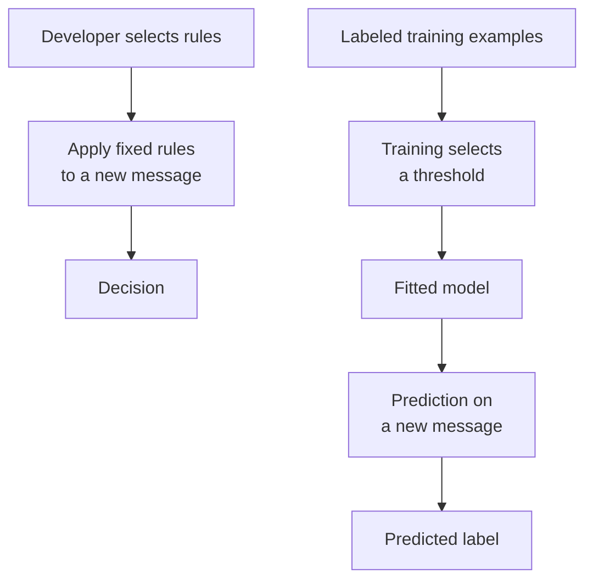

An email filter begins with a rule: if a message contains at least three words from a fixed list of suspicious terms, send it to the spam folder. The rule catches some unwanted messages. It also blocks a legitimate newsletter and misses a short scam. Each correction adds another exception, and some exceptions conflict.

Suppose people have already labeled a collection of messages as legitimate or spam. We can use those examples to choose a threshold, then check its predictions on different messages. This small change introduces the central idea of machine learning: a program selects part of its behavior from data under a specified objective.

This section assumes only comparisons, counting, and fractions. The Python example also uses arrays; their shapes are explained where they matter. By the end, you should be able to:

- Distinguish a hand-written rule from a rule fitted to examples.
- Identify features, labels, model parameters, training, and prediction.
- Calculate training error and explain why it does not establish performance on new data.
- Choose a useful baseline and recognize when rules and learned components should work together.

## Rules encode decisions directly

A rule-based system applies explicit conditions and actions. In the email example, a developer chooses the list of terms, the threshold of three, and the action taken when the threshold is reached. Given those inputs and rules, the program's decision is specified in advance.

Rules work well when the desired behavior is clear and stable. A file-size limit, an access-control condition, or a requirement for human approval should usually be expressed directly. Such constraints can be tested against a specification. Passing those tests still depends on whether the specification captures the intended policy.

For tasks such as spam detection, people may recognize many examples without being able to write a compact set of conditions that covers them. Language changes, senders adapt, and the same word can appear in both legitimate and unwanted messages. Maintaining rules can become expensive as interactions and exceptions accumulate.

Machine learning changes how some decision rules are obtained. Developers still choose the task, data representation, model family, and training procedure. Data helps choose values inside that family. The resulting model can remain as small and readable as a single threshold.

## Specify what can be learned

A **feature** is an input representation used by the model. Here, the feature is the count of flagged words in a message, using a vocabulary fixed before this experiment. A **label** is the reference answer associated with an example: use 0 for legitimate mail and 1 for spam. These labels are supplied by people under a stated labeling policy.

Learning from examples with reference answers is called **supervised learning**. Other forms of learning use different signals, but the threshold experiment is entirely supervised. Artificial intelligence is a broader field that also includes approaches such as search and rule-based reasoning.

A **model** maps inputs to outputs. Our model predicts spam when the count reaches a threshold. Let the scalar input count be `x`, the threshold be `t`, and the prediction be `ŷ_t(x)`:

```math
\hat{y}_t(x) = \begin{cases}
1 & \text{if } x \geq t, \\
0 & \text{if } x < t.
\end{cases}
```

The threshold is the model's **parameter**, a value selected during training. The rule family is fixed: every candidate compares the count with one threshold. Training selects a parameter using labeled examples and an objective. **Inference**, also called prediction, applies the fitted model to an input without consulting its answer.



*Figure 1. Both paths execute software. In the learning path, a training procedure first selects a threshold from examples; prediction then uses that fixed threshold.*

## Fit a threshold to six messages

The following dataset is synthetic and deliberately small. It illustrates a calculation, with no claim about a real email service. Each row represents a different message.

<div class="table-scroll" role="region" aria-label="Synthetic email training examples" tabindex="0">

| Message | Flagged-word count | Reference label | Meaning |
| --- | ---: | ---: | --- |
| T1 | 0 | 0 | Legitimate |
| T2 | 1 | 0 | Legitimate |
| T3 | 2 | 1 | Spam |
| T4 | 3 | 1 | Spam |
| T5 | 4 | 0 | Legitimate newsletter |
| T6 | 5 | 1 | Spam |

</div>

Keep the existing threshold of three as the **baseline**, the reference approach used for comparison. It makes two mistakes: it misses T3 and blocks T5. Its training error is therefore two divided by six, approximately 0.333.

To train a model, count each candidate threshold's mistakes. Give every message equal weight and treat both error types as equally costly for now. For a training set containing `n` examples, write the input and label of example `i` as `x_i` and `y_i`. The error rate is:

```math
L(t) = \frac{1}{n}\sum_{i=1}^{n}
\mathbf{1}\!\left[\hat{y}_t(x_i) \ne y_i\right].
```

Here, `L(t)` is the **loss**, the quantity minimized during training. The indicator, written as a bold 1 followed by a condition, contributes 1 for a mistake and 0 otherwise. Adding those contributions counts mistakes; dividing by `n` gives their fraction. All inputs and labels in this example are scalars, so no matrix multiplication is needed.

The counts are nonnegative integers. Thresholds from zero through one above the largest training count cover every distinct prediction pattern available on these training examples. Zero predicts spam for all six; six predicts legitimate for all six. Enumerating these candidates gives:

<div class="table-scroll" role="region" aria-label="Threshold training calculations" tabindex="0">

| Threshold | Training mistakes | Training error |
| ---: | ---: | ---: |
| 0 | 3 | 3/6 |
| 1 | 2 | 2/6 |
| 2 | 1 | 1/6 |
| 3 | 2 | 2/6 |
| 4 | 3 | 3/6 |
| 5 | 2 | 2/6 |
| 6 | 3 | 3/6 |

</div>

Threshold two is the unique best candidate under this objective. Its predictions are 0, 0, 1, 1, 1, 1, so only T5 is wrong. The calculation proves that it minimizes training error within the chosen threshold family. It provides no guarantee about future messages or other model families.

The remaining mistake also reveals a representation limit. A legitimate message with count four lies among spam messages with lower and higher counts. A single threshold cannot express that exception. More examples can help estimate which threshold is useful, but cannot supply information absent from the input. Sender context or other features may help; they would need their own validation.

## Test the fitted rule on different messages

**Generalization** means performing usefully on examples outside the training data. Reserve a **test set** for evaluating the fitted model. These four synthetic test messages are different from the training messages, although their counts can coincide:

<div class="table-scroll" role="region" aria-label="Independent synthetic email test examples" tabindex="0">

| Message | Count | Reference label | Prediction with threshold 3 | Prediction with threshold 2 |
| --- | ---: | ---: | ---: | ---: |
| E1 | 1 | 0 | 0 | 0 |
| E2 | 2 | 1 | 0 | 1 |
| E3 | 2 | 0 | 0 | 1 |
| E4 | 4 | 1 | 1 | 1 |

</div>

Both approaches make one mistake out of four. The learned threshold has lower training error, but this test provides no improvement over the baseline. E2 and E3 have identical features and different labels. Any deterministic classifier using only this count must give them the same prediction and therefore get at least one wrong.

Four examples are too few to estimate real operating performance reliably. A useful evaluation needs sufficient data representing intended users, message sources, and time periods. If future messages differ from the training distribution, a random split of historical mail can be misleading. A time-based split can better match a deployment that predicts later messages, provided duplicated messages and related campaigns are handled appropriately.

When comparing features or model families, use a separate **validation set** for those choices, then evaluate the selected approach on the reserved test set. Repeatedly changing the model after inspecting test results makes those results part of development. The test is no longer an independent check. The [Google Machine Learning Crash Course](https://developers.google.com/machine-learning/crash-course/overfitting/dividing-datasets) explains these distinct roles.

**Data leakage** occurs when model development uses information that would be unavailable for the intended prediction. Examples include allowing copies of one email into both splits or constructing a feature from the recipient's later spam report. Any vocabulary or preprocessing statistics learned from data must be fitted using training data only, then applied unchanged to evaluation data. See the [scikit-learn guidance on leakage](https://scikit-learn.org/stable/common_pitfalls.html#data-leakage).

## Reproduce the calculation with NumPy

This code requires Python and NumPy, installed with `python -m pip install numpy`. It reads no files and uses no external service. The question is whether fitting a threshold improves the baseline on the fixed examples under the same error measure.

The input contract is a nonempty one-dimensional array of bounded, nonnegative integer counts and a matching array of binary labels. With `k` candidate thresholds and `n` training messages, broadcasting forms a `k × n` prediction array. Summing across its columns gives one mistake count per threshold. Exhaustive enumeration is appropriate for this tiny illustration; a large feature range would need a different search implementation.

```python
import numpy as np


def fit_threshold(x, y):
    x, y = np.asarray(x), np.asarray(y)
    if x.ndim != 1 or y.ndim != 1 or x.size == 0 or x.size != y.size:
        raise ValueError("Expected matching, nonempty one-dimensional arrays")
    if not np.issubdtype(x.dtype, np.integer) or np.any(x < 0):
        raise ValueError("Counts must be nonnegative integers")
    if not np.isin(y, [0, 1]).all():
        raise ValueError("Labels must be zero or one")

    thresholds = np.arange(int(x.max()) + 2)
    predictions = x[None, :] >= thresholds[:, None]  # Shape: (k, n).
    mistakes = np.sum(predictions != y[None, :], axis=1)
    best = int(np.argmin(mistakes))  # First minimum: smaller threshold wins ties.
    return int(thresholds[best]), thresholds, mistakes


def main():
    # Six synthetic training messages; each array has shape (6,).
    train_x = np.array([0, 1, 2, 3, 4, 5])
    train_y = np.array([0, 0, 1, 1, 0, 1])

    # Four different messages, fixed before comparing the two approaches.
    test_x = np.array([1, 2, 2, 4])
    test_y = np.array([0, 1, 0, 1])
    threshold, candidates, mistakes = fit_threshold(train_x, train_y)
    print("Candidate thresholds:", candidates.tolist())
    print("Training mistakes:", mistakes.tolist())
    print("Learned threshold:", threshold)

    # Evaluate the existing rule and the fitted rule without retraining.
    for name, value in [("Manual", 3), ("Learned", threshold)]:
        train_error = np.mean((train_x >= value) != train_y)
        test_error = np.mean((test_x >= value) != test_y)
        print(f"{name}: train_error={train_error:.3f}, test_error={test_error:.3f}")


if __name__ == "__main__":
    main()
```

The verified output for these fixed synthetic inputs is:

```text
Candidate thresholds: [0, 1, 2, 3, 4, 5, 6]
Training mistakes: [3, 2, 1, 2, 3, 2, 3]
Learned threshold: 2
Manual: train_error=0.333, test_error=0.250
Learned: train_error=0.167, test_error=0.250
```

There is no randomness in this calculation. The tie rule is stated in the code and matches [NumPy's first-minimum behavior](https://numpy.org/doc/stable/reference/generated/numpy.argmin.html). Keep the vocabulary, split, labels, candidate family, and error measure fixed when reproducing the comparison. Trying additional features after reading these test results would require another independent evaluation.

## Choose a method by its constraints

Rules are a useful starting point when conditions are explicit, labels are scarce, or incorrect exceptions are unacceptable. Learning becomes useful when representative examples are available and patterns are difficult to specify or maintain manually. A small model can offer inexpensive predictions; its data collection, labeling, evaluation, and monitoring still have costs.

Many systems combine both approaches. An email model can propose a spam score while explicit policy requires suspicious attachments to enter quarantine and gives users a way to restore legitimate mail. Separate mandatory constraints from uncertain predictions so that retraining does not silently change policy.

Our equal-cost loss is also a choice. Blocking an essential legitimate message may be more costly than allowing an unwanted advertisement. Inspect false positives and false negatives separately, involve affected users when setting policy, and test candidate behavior under the actual costs. For medical or other high-risk decisions, this toy classification exercise supplies no evidence of fitness; evaluation must match the intended population and workflow, with qualified review and a defined way to override or stop automated decisions.

After deployment, compare new input patterns, reviewed errors, and outcomes with the evaluation data. Changing language or sender behavior can cause **distribution shift**, a change in the data encountered by the system. Investigate feature extraction, labels, and source coverage before assuming that a larger model will fix the problem. A fitted rule remains dependent on the information and objective used to obtain it.

## References consulted

- [Google Machine Learning Crash Course: Dividing datasets](https://developers.google.com/machine-learning/crash-course/overfitting/dividing-datasets) — training, validation, test sets, and repeated test-set use.
- [scikit-learn: Common pitfalls and recommended practices](https://scikit-learn.org/stable/common_pitfalls.html#data-leakage) — preprocessing consistency and data leakage.
- [NumPy: `argmin`](https://numpy.org/doc/stable/reference/generated/numpy.argmin.html) — minimum-index selection and tie behavior used in the example.

## Takeaways

- Training selects parameters within a model family chosen by developers; inference applies the resulting model to an input.
- The best threshold on six labeled messages is a training result whose guarantee is limited to those examples and that candidate family.
- Identical features can conceal different reference answers. Better fitting cannot recover information the input omits.
- Independent evaluation, a fixed baseline, and explicit error costs determine whether a learned component is useful.

## Exercises

1. Suppose blocking a legitimate message costs five units and missing spam costs one unit. Using the six training messages, calculate total cost for thresholds two and five. Which of these two thresholds should the new objective prefer?
2. A colleague adds the recipient's spam-report status as an input feature, then randomly splits messages, leaving copies of the same email in both sets. Explain the two evaluation problems and describe repairs appropriate for filtering mail at arrival.
3. E2 and E3 have the same count but different labels. Can any deterministic rule using only that count classify both correctly? Propose one additional feature and describe how you would evaluate it without reusing the test set for model selection.

## Answer guidance

1. Threshold two blocks T5, costing five units. Threshold five misses T3 and T4, costing two units. The new objective prefers five among these two candidates, although it has more unweighted mistakes. This does not establish a cost-optimal threshold for future mail.
2. The later report is unavailable at arrival, so using it leaks future information. Duplicate emails across splits let evaluation reuse training content. Remove the unavailable feature, group or deduplicate related messages before splitting, and choose a split that matches later deployment. Fit any data-dependent preprocessing on training data only.
3. The same scalar input forces the same deterministic output, so at least one prediction must be wrong. An authenticated sender relationship might distinguish the examples, if available at arrival. Compare the revised model with the fixed baseline using training and validation data, then obtain an independent test for the selected design.
