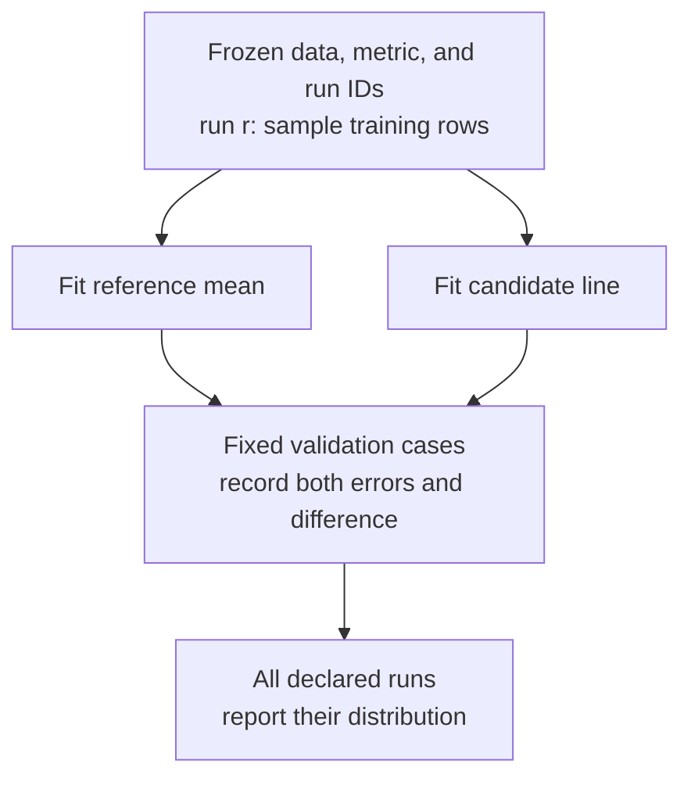

A team trains a build-duration predictor and records an average error of 0.10 minutes. Another run produces 0.40 minutes with the same model configuration. Publishing the first result would make the method look substantially better than publishing the second. Neither number explains how the procedure usually behaves.

This section follows [Baseline Models and Controlled Experiments](/ai/baseline-models-and-controlled-experiments/). It assumes familiarity with training and validation sets, a constant predictor, and fitting a line. By the end, you should be able to:

- Identify which sources of randomness an experiment varies or holds fixed.
- Reproduce a run without confusing repeatability with stable performance.
- Calculate and interpret run means, standard deviations, and paired differences.
- Design a repeat protocol that preserves an untouched final evaluation.

## Specify what changes between runs

Training can involve random initial parameters, shuffled example order, sampled training rows, or random transformations of inputs. A random train/validation split changes the evidence available for fitting and evaluation. These mechanisms can produce different scores for different reasons.

Hardware and software introduce another source of variation. Parallel floating-point reductions can add values in different orders; limited precision can then change subsequent calculations. A pseudorandom seed does not necessarily control that ordering. [PyTorch's reproducibility guidance](https://docs.pytorch.org/docs/2.15/notes/randomness.html) distinguishes random generators from nondeterministic operations and describes limits across releases and platforms. Deterministic settings can also carry performance costs.

Before repeating anything, state the experimental question. Holding the validation cases fixed while varying training randomness measures sensitivity to that training procedure on those cases. Changing the split measures sensitivity to data allocation as well. Combining both changes without recording them makes the explanation ambiguous.

Repeating training on one fixed dataset does not simulate future customers, new repositories, or a change in workload. Even a perfectly stable score can be consistently misleading if the evaluation leaks information or omits important cases. The safeguards from [Why Data Leakage Distorts Evaluation](/ai/why-data-leakage-distorts-evaluation/) still apply.

## A seed identifies a random stream

A pseudorandom number generator produces a sequence of values from internal state. A seed initializes that state. Drawing values advances it. Recreating the generator with the same seed and making the same calls can reproduce the sequence under the required environment conditions.

Record the generator type, seed, library versions, data and code versions, and call protocol. [NumPy's compatibility policy](https://numpy.org/doc/stable/reference/random/compatibility.html) makes these conditions explicit; a seed alone is insufficient for a universal cross-version guarantee. Store sampled row IDs or split membership when those exact choices matter.

One replay answers whether the run can be reconstructed. Distinct, predeclared runs answer how sensitive the outcome is to the varied factor. Repeating the identical seeded run ten times provides no new draws from training randomness.

Keep random streams separate by purpose. A data split should not change because model initialization consumed another random value. NumPy's [SeedSequence documentation](https://numpy.org/doc/stable/reference/random/parallel.html) describes constructing separate streams from structured identifiers. The example below uses a run ID and a sampling-stream identifier. Across methods, it shares the actual sampled rows explicitly. Passing the same integer to unrelated algorithms does not ensure that they make matching random choices; [scikit-learn's randomness guide](https://scikit-learn.org/stable/common_pitfalls.html#controlling-randomness) explains why generator state and API behavior matter.

## Describe a distribution of outcomes

Use **mean absolute error**, or MAE, so errors remain in minutes:

```math
E_r=\frac{1}{m}\sum_{i=1}^{m}\left|y_i-\widehat y_{r,i}\right|.
```

Here `m > 0` is the number of validation cases, `y` is a length-`m` vector of observed durations, and the prediction vector for run `r` has the same shape. Each `E_r` is one scalar score. Lower is better. This section uses MAE for reporting; the line-fitting example retains the previous section's least-squares fitting procedure. A training objective and a reporting metric can differ when their roles are declared.

The following four-run example is hypothetical arithmetic, separate from the executable dataset below. Both methods use matching conditions within each row.

<div class="table-scroll" role="region" aria-label="Illustrative paired run errors and candidate improvements" tabindex="0">

| Run | Reference MAE, minutes | Candidate MAE, minutes | Reference minus candidate |
| --- | ---: | ---: | ---: |
| 1 | 0.25 | 0.20 | 0.05 |
| 2 | 0.30 | 0.40 | −0.10 |
| 3 | 0.20 | 0.10 | 0.10 |
| 4 | 0.25 | 0.30 | −0.05 |

</div>

Both methods average 0.25 minutes, despite the candidate's attractive best run. For `R` runs, summarize scores using their mean and sample standard deviation:

```math
\overline E=\frac{1}{R}\sum_{r=1}^{R}E_r,
\qquad
s_E=\sqrt{\frac{\sum_{r=1}^{R}(E_r-\overline E)^2}{R-1}}.
```

The mean describes average observed error. Standard deviation describes spread across runs in the same units. It requires `R > 1`; one run cannot estimate it. For the candidate, squared deviations are `0.0025, 0.0225, 0.0225, 0.0025`. Their sum is `0.05`, giving `s_E = sqrt(0.05/3) ≈ 0.1291` minutes. The reference's standard deviation is about `0.0408` minutes. [NumPy's `std` documentation](https://numpy.org/doc/stable/reference/generated/numpy.std.html) explains the `ddof=1` divisor used here; the variance estimate, rather than its square root, has the usual unbiasedness property under independent, identically distributed sampling.

Report the run count, metric, varied factor, and every score when practical. “Mean ± standard deviation” must be labeled; it is not automatically a confidence interval or a range containing all outcomes. Include failures under a declared rule. Dropping diverged or timed-out runs can make an unreliable procedure appear better.

## Pair comparisons and separate spread from precision

For each repeat, compare methods under matching data conditions:

```math
d_r=E_r^{\mathrm{reference}}-E_r^{\mathrm{candidate}},
\qquad
\operatorname{SE}(\overline d)\approx\frac{s_d}{\sqrt R}.
```

Each `d_r` is a scalar improvement in minutes; positive values favor the candidate. Calculate `s_d` with the preceding sample-standard-deviation formula applied to the length-`R` difference vector. Pairing can remove variation shared by both methods; its benefit depends on their covariance.

In the table, the differences sum to zero. Their squared deviations sum to `0.025`, so `s_d ≈ 0.0913` and the estimated standard error is `0.0913/2 ≈ 0.0456` minutes. Standard error describes the precision of a mean under an independent-repeat model. It does not describe the spread of individual runs. See [NIST's explanation of uncertainty in a mean](https://www.itl.nist.gov/div898/handbook/eda/section3/eda352.htm) for the additional assumptions involved in interval estimates.

Here independence concerns the random repeat draws, conditional on the fixed data. Distinct seed identifiers support separate pseudorandom streams but do not certify independent observations from the world. Reusing the same validation cases leaves uncertainty about those cases' representativeness. Overlapping cross-validation folds or repeated observations from one customer need a different dependence analysis. Four illustrative runs provide little evidence for a deployment decision.

## Repeat one controlled source of randomness

The executable experiment asks how randomly selecting four training rows changes a reference mean and a fitted line. Both methods receive the same sampled rows in each run and are scored on the same five validation cases. All inputs are deliberately synthetic, with duration in minutes and size in arbitrary workload units. They are independent teaching fixtures, not additional measurements from the earlier section.

The source of variation is training-row subsampling. There is no random initialization or stochastic optimizer. Using all training rows removes this source of variation. The reference minimizes training squared error among constants; the candidate uses [NumPy's least-squares solver](https://numpy.org/doc/stable/reference/generated/numpy.linalg.lstsq.html) for the intercept and slope.



The complete code requires Python 3.9+ and NumPy (`python -m pip install numpy`), with no files, credentials, or downloaded dataset. Training vectors have shape `(n,)`; validation vectors have shape `(m,)`. The sampled design matrix has shape `(sample_size, 2)`, its coefficients have shape `(2,)`, and the returned score matrix has shape `(R, 2)`. Columns are reference and candidate MAE.

```python
import numpy as np


def run_experiment(x_train, y_train, x_val, y_val, run_ids, sample_size):
    x, y, xv, yv = [np.asarray(v, dtype=float)
                    for v in (x_train, y_train, x_val, y_val)]
    if (x.ndim != 1 or x.size < 2 or y.shape != x.shape
            or xv.ndim != 1 or xv.size == 0 or yv.shape != xv.shape
            or any(not np.isfinite(v).all() for v in (x, y, xv, yv))):
        raise ValueError("Expected matching, nonempty finite data vectors")
    ids = list(run_ids)
    if (len(ids) < 2
            or any(isinstance(s, (bool, np.bool_))
                   or not isinstance(s, (int, np.integer)) or s < 0 for s in ids)
            or len(set(ids)) != len(ids)):
        raise ValueError("Provide at least two distinct nonnegative run IDs")
    if (isinstance(sample_size, (bool, np.bool_))
            or not isinstance(sample_size, (int, np.integer))
            or not 2 <= sample_size <= x.size):
        raise ValueError("Sample size must be an integer from 2 to training size")

    scores = np.empty((len(ids), 2))
    selected = np.empty((len(ids), sample_size), dtype=int)
    for r, run_id in enumerate(ids):
        # Stream 0 is reserved for row sampling in this experiment protocol.
        state = np.random.SeedSequence([int(run_id), 0])
        rng = np.random.Generator(np.random.PCG64(state))
        rows = np.sort(rng.choice(x.size, sample_size, replace=False))
        selected[r] = rows

        # Both methods share these exact training rows and validation cases.
        reference = np.full(xv.shape, y[rows].mean())
        design = np.column_stack((np.ones(sample_size), x[rows]))
        intercept, slope = np.linalg.lstsq(design, y[rows], rcond=None)[0]
        candidate = intercept + slope * xv
        scores[r] = (np.abs(yv - reference).mean(),
                     np.abs(yv - candidate).mean())
        if not np.isfinite(scores[r]).all():
            raise FloatingPointError(f"Nonfinite score in run {run_id}")
    return scores, selected


def summarize(values):
    values = np.asarray(values, dtype=float)
    if (values.ndim != 1 or values.size < 2
            or not np.isfinite(values).all()):
        raise ValueError("Expected at least two finite scores")
    sd = float(values.std(ddof=1))
    return float(values.mean()), sd, sd / np.sqrt(values.size)


def main():
    x_train = np.arange(1, 13, dtype=float)
    residuals = np.array([0, 5, -4, 1, -3, 4, 0, -5, 3, -1, 2, -2])
    y_train = 1 + 2 * x_train + residuals
    x_val = np.array([2.5, 4.5, 6.5, 8.5, 10.5])
    y_val = np.array([7, 9, 15, 16, 23], dtype=float)
    run_ids = [11, 23, 37, 41, 53, 67, 79, 83]
    scores, rows = run_experiment(
        x_train, y_train, x_val, y_val, run_ids, sample_size=4)

    for run_id, indices, (reference, candidate) in zip(run_ids, rows, scores):
        print(f"run {run_id}: rows={indices.tolist()}, "
              f"reference={reference:.3f}, candidate={candidate:.3f}")
    for name, values in [("reference", scores[:, 0]),
                         ("candidate", scores[:, 1]),
                         ("paired gain", scores[:, 0] - scores[:, 1])]:
        mean, sd, se = summarize(values)
        print(f"{name}: mean={mean:.3f}, SD={sd:.3f}, SE={se:.3f}")


if __name__ == "__main__":
    main()
```

The row indices are zero-based and saved alongside the scores. Sorting sampled indices gives both fits a consistent row order. No validation label enters fitting, and no repeat is selected as the winner. This is a development comparison; a final test set is deliberately absent. Freeze the eventual selection and training policy before assessing it on reserved final data.

The following output was verified by executing this code with Python 3.11.4 and NumPy 2.0.2. Values are rounded to three decimals. Preserve the environment and selected rows for exact replay; small floating-point differences can occur with other numerical-library builds.

```text
run 11: rows=[1, 5, 8, 9], reference=5.550, candidate=3.100
run 23: rows=[0, 4, 6, 7], reference=5.700, candidate=2.565
run 37: rows=[1, 6, 7, 11], reference=4.600, candidate=2.062
run 41: rows=[5, 9, 10, 11], reference=7.950, candidate=3.801
run 53: rows=[0, 6, 7, 8], reference=5.000, candidate=1.301
run 67: rows=[1, 4, 6, 7], reference=5.350, candidate=3.679
run 79: rows=[0, 9, 10, 11], reference=5.850, candidate=1.232
run 83: rows=[0, 3, 6, 10], reference=4.950, candidate=1.230
reference: mean=5.619, SD=1.031, SE=0.364
candidate: mean=2.371, SD=1.080, SE=0.382
paired gain: mean=3.248, SD=0.982, SE=0.347
```

## Interpret results within the experiment's boundary

The candidate's average error is `2.371` minutes, with run standard deviation `1.080`. Its average paired gain is `3.248` minutes on these fixed validation cases. The line benefits from size while still varying across selected rows. These synthetic results establish neither performance on a new population nor a guarantee about every possible subset.

Inspect the sampled rows and residuals when a run performs poorly. Increasing the subset size changes the learning procedure; investigate it as a separate declared experiment. Adding repeats estimates the current procedure more precisely without improving an individual fitted model. This script stops on numerical errors. A runner that continues should retain a failed-run record and apply its predeclared reporting rule.

Eight runs demonstrate the workflow rather than establishing a sufficient production budget. There is no universal seed count. Choose a repeat budget before inspecting results, considering compute cost and the smallest practically meaningful gain. If adapting that budget, use a planned sequential analysis rather than repeatedly checking an ordinary interval until it favors the candidate.

Keep test data out of seed selection. If deployment chooses the best validation run, define that selection as part of the procedure and evaluate the whole procedure independently. Averaging predictions from several models creates an ensemble with its own inference cost; averaging their scores only summarizes separate runs. For high-risk decisions, seed stability also needs external validation, relevant failure-slice analysis, and qualified human oversight.

## References consulted

- [NumPy: Random-stream compatibility](https://numpy.org/doc/stable/reference/random/compatibility.html) — conditions required to replay generated values.
- [NumPy: Parallel random number generation](https://numpy.org/doc/stable/reference/random/parallel.html) — separate streams and structured seed identifiers.
- [NumPy: Standard deviation](https://numpy.org/doc/stable/reference/generated/numpy.std.html) — divisor conventions and the limits of the unbiasedness claim.
- [NumPy: Least squares](https://numpy.org/doc/stable/reference/generated/numpy.linalg.lstsq.html) — fitting the example's two coefficients.
- [Scikit-learn: Controlling randomness](https://scikit-learn.org/stable/common_pitfalls.html#controlling-randomness) — how estimator calls consume or reset generator state.
- [PyTorch: Reproducibility](https://docs.pytorch.org/docs/2.15/notes/randomness.html) — nondeterministic operations and environment-dependent repeatability.
- [NIST: Confidence limits for the mean](https://www.itl.nist.gov/div898/handbook/eda/section3/eda352.htm) — standard-error scaling and assumptions behind interval estimates.

## Takeaways

- Record the varied factor; changing training randomness and changing evaluation data answer different questions.
- A fixed seed helps reconstruct a run, while declared distinct repeats reveal sensitivity to the chosen random mechanism.
- Standard deviation describes run spread; standard error concerns precision of a mean under stated assumptions.
- Compare paired outcomes, report failures and repeat budgets, and preserve independent evidence for the final procedure.

## Exercises

1. Using the four-run table, calculate the candidate's mean, sample standard deviation, and mean paired improvement. Explain why publishing only run 3 changes the interpretation.
2. A loop constructs `np.random.default_rng(17)` at the beginning of every repeat, then samples training rows. Explain why the scores can be identical. Contrast this with sampling every training row in the published experiment.
3. A team tries fifty seeds, chooses the seed with the lowest final-test error, and reports that error. Describe a valid repair. Explain why increasing the seed count cannot by itself measure uncertainty about a new population.

## Answer guidance

1. The candidate mean is `0.25` minutes, its sample standard deviation is approximately `0.1291`, and mean paired improvement is zero. Run 3's `0.10` favors the candidate on a selected repeat and conceals both losses and variability; it does not describe the whole declared procedure.
2. Recreating the same generator resets its state, so matching calls select the same rows. Use distinct declared run IDs to vary sampling, or advance a separately recorded generator deliberately. With all training rows selected and sorted, different run IDs still fit the same two models. Zero observed variation then reflects the absence of the varied sampling choice, not certainty about future performance.
3. Test-guided selection makes those test cases development data. Freeze the model-selection policy, choose using permitted development evidence, and assess the resulting procedure on fresh reserved data. Seed repeats hold the dataset fixed; new populations and correlated observations require additional appropriately designed data evaluation.
