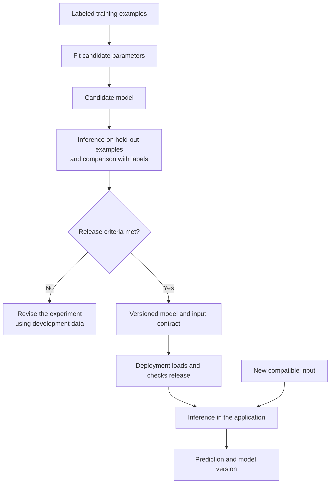
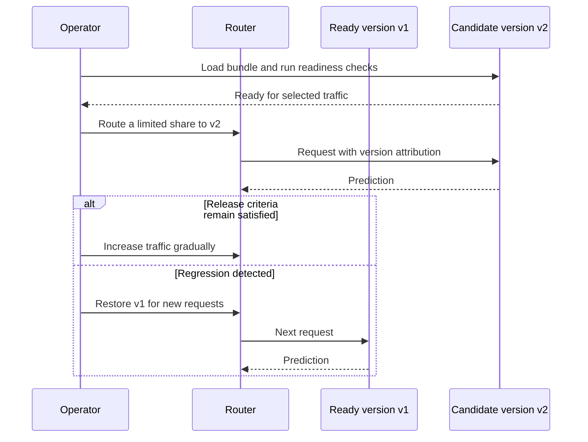

In a hypothetical email service, a team fits a classifier that marks a message as spam when its flagged-word count reaches two. The experiment produces the expected predictions. After release, the application begins allowing messages that the experiment blocked. The deployed code counts repeated words differently, so the same message reaches the model with a different input.

The fitted threshold has survived the release unchanged. The complete prediction procedure has changed. Understanding that distinction requires separating training, inference, and deployment while tracking the information that connects them.

This section assumes comparisons, fractions, and basic Python functions. It reuses the synthetic classifier from [From Rule-Based Systems to Machine Learning](/ai/from-rules-to-machine-learning/) and connects it to [Large Language Models and Agents](/ai/large-language-models-and-agents/). By the end, you should be able to:

- Identify what each stage receives, changes, and produces.
- Trace one fitted model from an experiment into a prediction service.
- Detect mismatched preprocessing and distinguish prediction quality from service health.
- Explain the evidence needed to release, monitor, or roll back a model.

## Three activities with different responsibilities

**Training** selects model parameters using data and an objective. A parameter is a value inside the model that the learning procedure can change. Our classifier has one parameter: its count threshold. A neural network can have many parameters arranged in vectors and matrices. Training procedures vary; trying candidate thresholds is sufficient for this small example.

**Inference** applies a model to an input to compute an output. A spam label, an estimated delivery time, and a generated token are examples. In the ordinary fixed-model setting used here, inference leaves the learned parameters unchanged. The application may still update a conversation history, cache, or request counter. These updates have separate purposes from learning model parameters.

**Deployment** makes a chosen model and its supporting software available in a target application. It includes packaging, loading, compatibility checks, resource configuration, and deciding which requests use the release. Deployment can target a server, a scheduled batch job, or a user's device. An HTTP endpoint is one possible interface.

<div class="table-scroll" role="region" aria-label="Responsibilities of training, inference, and deployment" tabindex="0">

| Activity | Main inputs | What changes | Main result |
| --- | --- | --- | --- |
| Training | Training examples, model family, objective | Learned parameters | A fitted model and experiment records |
| Inference | Compatible input and a loaded model | Request-specific computation and optional application state | Predictions or generated output |
| Deployment | A selected model, dependencies, input contract, release policy | The version available to an application | A checked release ready to receive work |

</div>

These activities can overlap in time. One worker can train tomorrow's candidate while another serves today's version. Evaluation also uses inference: compute predictions on held-out examples, then compare them with their labels. Computing these predictions does not itself fit the model. Using their outcomes to choose parameters or a model makes those examples part of development, so they cannot also serve as an untouched final test.

## Follow the fitted threshold

Let the scalar `x` be a nonnegative integer count, `t` an integer threshold, and `ŷ_t(x)` the predicted label. Label 1 means spam; label 0 means legitimate mail:

```math
\hat{y}_t(x)=\mathbf{1}[x\geq t],
\qquad
L(t)=\frac{1}{n}\sum_{i=1}^{n}\mathbf{1}[\hat{y}_t(x_i)\ne y_i].
```

The indicator contributes 1 when its condition holds and 0 otherwise. Here, `n` is the number of training messages, `x_i` is message `i`'s count, and `y_i` is its reference label. The scalar loss `L(t)` is the fraction misclassified. Every quantity is scalar; no vector or matrix operations are required. We weight both error types equally and require a nonempty training set.

Reuse six synthetic training counts `0, 1, 2, 3, 4, 5` with labels `0, 0, 1, 1, 0, 1`. The existing threshold three makes two mistakes. Threshold two predicts `0, 0, 1, 1, 1, 1`, making one mistake: the legitimate message with count four. Its training loss is `1/6`, approximately `0.167`, compared with `2/6`, approximately `0.333`, for the baseline.

Checking thresholds zero through six establishes that two is the unique minimum on these examples. This is a statement about the specified training set and model family. It establishes no future accuracy guarantee. Real spam classification also depends on information this single count omits.

At inference, a new message with count three produces label 1 through the comparison `3 >= 2`. Its reference label is unnecessary for that computation. If feedback arrives later, it can contribute to a separately controlled evaluation or future training run. Automatically adjusting parameters after each request would introduce an online-learning procedure, with additional validation and recovery requirements.



*Figure 1. Evaluation uses prediction before a release is selected. Test results should remain independent of development choices; live feedback enters later experiments through an explicit process.*

## Preserve the meaning of the inputs

A **model artifact** is a saved representation needed to reconstruct the fitted model. The threshold alone cannot describe how to process raw email. The release must also identify its feature definition, label meanings, prediction code, and required software. These can be packaged together or referenced through a versioned manifest that identifies compatible components.

For this example, assume a fixed vocabulary and a feature definition that counts matching word occurrences after a specified tokenizer and case conversion. If a word appears three times, it contributes three. A serving implementation that counts distinct matching words would produce one for that same repeated word. Both implementations return integers, so checking the input's type would miss the disagreement.

Assign the feature definition an identifier such as `flagged-count-v1`. Requests carrying a different identifier must be rejected or routed to a compatible model. An identifier detects declared incompatibility; it cannot prove that an upstream producer implemented the definition correctly. Keep shared preprocessing code and test raw-message fixtures with known counts.

Any preprocessing learned from examples also carries fitted state. A vocabulary learned from training text, for instance, must be preserved for inference. Rebuilding it independently on evaluation or live data changes the representation. Fitting preprocessing on held-out data also contaminates evaluation. The [scikit-learn guidance on inconsistent preprocessing and leakage](https://scikit-learn.org/stable/common_pitfalls.html) explains these boundaries.

## Reproduce fitting, loading, and prediction

The following Python 3.9+ program uses only the standard library. It has no downloads, credentials, third-party dependencies, or hidden files. JSON held in memory represents the saved artifact. The service is an in-process simulation; it starts no server and deploys nothing to this website. The training function accepts a nonempty list of count-label pairs and breaks equal-loss ties by choosing the smallest threshold.

The experiment compares the existing threshold three with the fitted candidate on four different synthetic messages: counts `1, 2, 2, 4`, labels `0, 1, 0, 1`. Each makes one mistake. The candidate's smaller training loss therefore supplies no held-out improvement here. This tiny check illustrates a release decision's inputs; it does not justify a production release.

```python
import json
from dataclasses import asdict, dataclass


FEATURE_VERSION = "flagged-count-v1"


@dataclass(frozen=True)
class Model:
    model_version: str
    feature_version: str
    threshold: int


def fit_model(examples, model_version):
    if not examples:
        raise ValueError("Training examples must be nonempty")
    if any(type(x) is not int or x < 0 or type(y) is not int
           or y not in (0, 1) for x, y in examples):
        raise ValueError("Expected nonnegative integer counts and binary labels")

    # These bounded toy counts permit exhaustive threshold search.
    candidates = range(max(x for x, _ in examples) + 2)
    threshold = min(candidates, key=lambda t: (
        sum(int(x >= t) != y for x, y in examples), t
    ))
    return Model(model_version, FEATURE_VERSION, threshold)


class EmailService:
    def __init__(self, artifact):
        # Load the locally produced bundle; never execute artifact contents.
        model = Model(**json.loads(artifact))
        if (not isinstance(model.model_version, str) or not model.model_version
                or model.feature_version != FEATURE_VERSION
                or type(model.threshold) is not int or model.threshold < 0):
            raise ValueError("Incompatible model artifact")
        self.model = model

    def predict(self, request):
        if not isinstance(request, dict) or set(request) != {"flagged_count", "feature_version"}:
            raise ValueError("Unexpected request fields")
        if request["feature_version"] != self.model.feature_version:
            raise ValueError("Incompatible feature version")
        count = request["flagged_count"]
        if type(count) is not int or count < 0:
            raise ValueError("Expected a nonnegative integer count")
        return {
            "model_version": self.model.model_version,
            "prediction": int(count >= self.model.threshold),
        }


def main():
    training = [(0, 0), (1, 0), (2, 1), (3, 1), (4, 0), (5, 1)]
    held_out = [(1, 0), (2, 1), (2, 0), (4, 1)]
    model = fit_model(training, "email-v1")
    mistakes = sum(int(x >= model.threshold) != y for x, y in training)
    print(f"threshold={model.threshold}, training mistakes={mistakes}/{len(training)}")

    # Compare both fixed candidates using the same held-out examples.
    baseline_errors = sum(int(x >= 3) != y for x, y in held_out)
    candidate_errors = sum(int(x >= model.threshold) != y for x, y in held_out)
    total = len(held_out)
    print(f"held-out mistakes: baseline={baseline_errors}/{total}, "
          f"candidate={candidate_errors}/{total}")

    # The serving object reconstructs the model from its serialized artifact.
    artifact = json.dumps(asdict(model))
    service = EmailService(artifact)
    before = asdict(service.model)
    result = service.predict({"flagged_count": 3, "feature_version": FEATURE_VERSION})
    print("served:", result)
    assert asdict(service.model) == before

    # A different input contract must not silently reach this model.
    try:
        service.predict({"flagged_count": 3, "feature_version": "distinct-count-v2"})
    except ValueError:
        print("mismatched features: rejected")
    else:
        raise AssertionError("The incompatible request was accepted")


if __name__ == "__main__":
    main()
```

The verified output is:

```text
threshold=2, training mistakes=1/6
held-out mistakes: baseline=1/4, candidate=1/4
served: {'model_version': 'email-v1', 'prediction': 1}
mismatched features: rejected
```

Training chooses a threshold. Serialization preserves the chosen values and their identifiers. Loading reconstructs the serving object, and prediction consumes no labels or training examples. The assertion checks that this request leaves the model fields unchanged. The example does not implement artifact authentication, concurrency, durable storage, or a release approval system.

## Release readiness includes the surrounding software

A production worker should load an identified release, check its supported inputs and outputs, and run representative predictions before receiving traffic. A process that has started may still be loading parameters or waiting for a dependency. A **readiness check** answers whether it can handle its intended work.

For a hypothetical later version, keep the working release available while checking the candidate. A **canary release** sends a limited selected share of traffic to the new version under predefined acceptance criteria. Version identifiers make outputs attributable. **Rollback** restores routing to a previously checked release. [TensorFlow Serving's architecture](https://www.tensorflow.org/tfx/serving/architecture) provides a concrete example of loading model versions and managing their availability.



*Figure 2. This is an illustrative release flow. Keeping two loaded versions may require extra memory. Redirecting future requests does not undo actions already taken or cancel every in-flight request.*

One expensive input can occupy a worker and delay other requests. Batching can improve throughput while adding waiting time. Local-device deployment avoids a prediction network round trip but introduces device resource and update constraints. Choose an arrangement against actual workload measurements and acceptable delay; the threshold example supplies no hardware benchmark.

## Check service health and prediction behavior separately

Operational monitoring records failures, response times, resource use, and the model version used. A fast, available service can still classify mail poorly. Prediction-quality checks need representative outcomes and appropriate labels, which may arrive late or be missing for some users. Track wrongly blocked legitimate mail separately from missed spam when their costs differ.

Compare the same raw-message fixtures in the experiment and serving implementation. A disagreement in feature values indicates a preprocessing problem before model accuracy is considered. Changing input patterns can also expose stale assumptions even when implementations agree. Google's [Rules of Machine Learning](https://developers.google.com/machine-learning/guides/rules-of-ml#training-serving_skew) discusses shared preprocessing, serving observations, and monitoring these discrepancies. Feedback collection must respect privacy and avoid retaining raw messages without a justified need.

Keep a validation set for development choices and reserve a final test for an independent assessment. Repeatedly changing a candidate after reading test outcomes turns that test into development information. In a high-consequence application, release criteria also need domain-specific validation, qualified review, and a defined path for human intervention. Merely completing deployment provides no evidence that those requirements are met.

For neural networks, another distinction appears inside the runtime. PyTorch's `model.eval()` changes the behavior of layers that distinguish training from evaluation, such as dropout. It does not disable gradient recording; `no_grad()` or `inference_mode()` handles that separately. The [PyTorch autograd documentation](https://docs.pytorch.org/docs/stable/notes/autograd.html#evaluation-mode-nn-module-eval) explains the separation. Ordinary inference code also omits the optimizer step that would update learned parameters.

For a language model, extending the context or caching intermediate computations can change later outputs while weights stay fixed. Fine-tuning changes parameters through another training procedure. Deploying either a new checkpoint or new preprocessing requires evaluating the resulting application behavior, even when the public interface stays the same.

## References consulted

- [scikit-learn: Common pitfalls and recommended practices](https://scikit-learn.org/stable/common_pitfalls.html) — consistent preprocessing and separation of fitting from held-out evaluation.
- [TensorFlow Serving: Architecture](https://www.tensorflow.org/tfx/serving/architecture) — versioned models, loading, readiness, and availability policies.
- [Google: Rules of Machine Learning](https://developers.google.com/machine-learning/guides/rules-of-ml#training-serving_skew) — differences between experimental and serving behavior.
- [PyTorch: Autograd mechanics](https://docs.pytorch.org/docs/stable/notes/autograd.html#evaluation-mode-nn-module-eval) — evaluation mode and gradient recording have separate controls.

## Takeaways

- Training chooses parameters under a specified objective; fixed-model inference applies them to compatible inputs.
- Evaluation uses inference plus reference outcomes, with data kept separate from fitting and selection as appropriate.
- A deployable release identifies preprocessing, label meanings, prediction code, and dependencies alongside learned values.
- Readiness, gradual rollout, monitoring, and rollback address failures beyond the training calculation.
- Service availability and speed require separate evidence from prediction quality and acceptable error costs.

## Exercises

1. A message has flagged-word count two under `flagged-count-v1`. Calculate its prediction with threshold two and with the baseline threshold three. If its reference label is 0, which prediction is a mistake? Does observing that label require the live service to update its threshold?
2. Training counts every matching occurrence. For a message containing one flagged word three times, a new serving implementation counts distinct matching words. Calculate both feature values and predictions with threshold two. Propose two release checks that could catch this error, including one that still works when the producer incorrectly claims the old feature version.
3. A candidate starts successfully but has not loaded its model. After loading, it meets latency requirements while wrongly blocked legitimate mail increases on a labeled review sample. Identify the readiness failure, the separate quality concern, and what rollback can and cannot restore. Explain why repeatedly tuning on that review sample changes its evaluation role.

## Answer guidance

1. Threshold two gives 1; threshold three gives 0. With label 0, the threshold-two prediction is wrong. The comparison requires no parameter update. The label can inform controlled evaluation or a later training run.
2. Counting occurrences gives three and predicts 1; counting distinct words gives one and predicts 0. Reject incompatible feature identifiers. Also run the same raw-message fixtures through both feature producers and compare exact counts, since an incorrect identifier can pass metadata checks.
3. Keep a worker out of traffic until the model and required dependencies are ready. Increased false positives are a prediction-quality concern even with acceptable latency; examine sampling uncertainty and relevant user groups against predefined release criteria. Rollback routes future work to the previous checked release, but cannot reverse all prior actions or guarantee that an older model still fits changed data. Repeated adjustment against the review sample makes it development data; a fresh independent assessment is needed.
