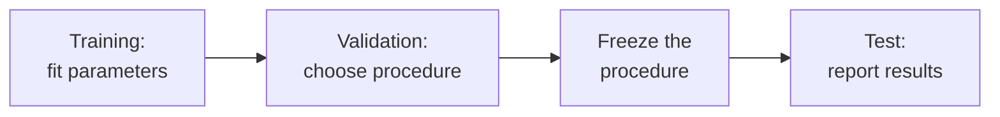

A team predicts how long a software build will take. It fits a model on historical builds, measures error on those same builds, and announces that predictions are accurate to the minute. The result says little about the next build: the model has already used the evaluated answers to adjust its behavior. A second team tries dozens of settings against a supposedly separate test set. Its final score has a similar problem because those test answers guided the selection.

An evaluation needs a defined information boundary. Training, validation, and test sets assign different responsibilities to data so that learning and selection do not quietly consume the evidence intended for a final check.

This section begins **Building Good Experimental Habits** after the [case study on defining a verifiable task](/ai/from-a-vague-request-to-a-verifiable-task/). It assumes inputs, labels, prediction error, and basic arithmetic. The example introduces its own small numerical model. By the end, you should be able to:

- Explain which decisions belong to training, validation, and final testing.
- Choose a split that matches the intended population and prediction time.
- Keep preprocessing and model selection from learning from held-out evidence.
- Reproduce a comparison and describe what its test result does and does not establish.

## Assign three roles before fitting anything

A **training set** supplies examples used to fit a model's learned quantities, called parameters. For a duration predictor, these might include an average duration or an adjustment to a workload-based estimate. The labels are observed build durations. Fitting chooses parameter values using those labels.

A **validation set** supplies examples used to choose among candidate procedures. That choice can involve a model family, an input feature, a decision threshold, a training duration, or a setting fixed outside parameter fitting. Such a setting is often called a **hyperparameter**. Validation labels influence the eventual system through these choices even when an optimizer never receives them directly.

A **test set** supplies a final evaluation of the procedure selected without its answers. The estimate is useful only in relation to its sampling conditions, task, and metric. It cannot establish that the system is safe, useful to users, or accurate under an unrelated workload.

<div class="table-scroll" role="region" aria-label="Roles of training, validation, and test data" tabindex="0">

| Data role | Permitted use in this protocol | A misuse to watch for |
| --- | --- | --- |
| Training | Fit parameters and learned preprocessing | Reporting training error as evidence of future accuracy |
| Validation | Compare procedures and choose settings | Treating the best of many trials as an independent final result |
| Test | Evaluate the frozen procedure | Changing settings after seeing test results and reporting the improved score as independent |

</div>

[Google's dataset guide](https://developers.google.com/machine-learning/crash-course/overfitting/dividing-datasets) describes the three roles and warns against repeatedly consulting a test set. A validation set can also be overused. Extensive searching can select a procedure that happens to match its particular cases. Keep a record of the comparisons and preserve separate final evidence.



*Figure 1. The arrows show the order of decisions. The data rows remain in separate sets; they do not travel through these stages.*

## Split according to the prediction you intend to make

A random split can be appropriate when examples are sufficiently independent and the evaluated population resembles future use. Keeping class proportions similar, called stratification, can help a classification split contain rare labels. It does not prevent duplicate records, shared customers, or future information from crossing boundaries.

For predictions about later builds, a chronological split answers a more relevant question: how the procedure performs on a subsequent operating period. All training outcomes must have become available before the corresponding validation decision. Validation outcomes must likewise be available before final selection and test prediction. Ordering by submission time alone is insufficient when builds finish late or labels arrive with delays.

Repeated retries of one build, near-duplicate logs, or several records from the same incident can make nominally separate sets dependent. Group related records together when that is necessary for the target question. Predicting for existing customers and predicting for previously unseen customers require different evidence. A group split and a time split may both be needed, with explicit handling of groups that span the cutoff.

No fixed percentage creates a trustworthy experiment. Set sizes must support fitting and provide enough evaluation cases for relevant conditions and errors. Small samples produce uncertain estimates; rare but consequential failures may need targeted investigation in addition to ordinary evaluation. [Scikit-learn's cross-validation guide](https://scikit-learn.org/stable/modules/cross_validation.html) discusses group-aware, chronological, and repeated-partition evaluation methods.

## Keep learned preprocessing inside the boundary

**Data leakage** occurs when information that should be unavailable influences development or evaluation. It can enter through labels, but also through feature construction and selection. Computing an average from all examples before splitting allows held-out inputs to influence a transformation intended to be learned from training data.

Fit normalization statistics, missing-value replacements, feature selection, and other learned preprocessing using training data. Apply those already fitted transformations unchanged to validation and test inputs. Predetermined transformations, such as converting seconds to minutes, need no estimated statistics. The distinction depends on whether the operation learns from data.

The [scikit-learn common-pitfalls guide](https://scikit-learn.org/stable/common_pitfalls.html#data-leakage) explains this separation and how pipelines help preserve it. A pipeline cannot fix a feature containing an eventual root cause or a duration recorded after the prediction point. Check when each source value became available, including corrections and ingestion delays.

## Work through a complete numerical comparison

Consider ten synthetic, independent builds in chronological order. Their input `x` is a workload quantity available at submission, measured in hypothetical work units; their label `y` is elapsed minutes. Assume the training labels are complete before validation begins and validation labels are complete before testing begins. The perfectly regular early values were constructed to make the arithmetic visible. They provide no empirical evidence about build systems.

<div class="table-scroll" role="region" aria-label="Synthetic build data with fixed chronological partitions" tabindex="0">

| Build | Work units, x | Duration in minutes, y | Assigned role |
| --- | ---: | ---: | --- |
| B1 | 1 | 3 | Training |
| B2 | 2 | 5 | Training |
| B3 | 3 | 7 | Training |
| B4 | 4 | 9 | Training |
| B5 | 5 | 11 | Training |
| B6 | 6 | 13 | Training |
| B7 | 7 | 15 | Validation |
| B8 | 8 | 18 | Validation |
| B9 | 9 | 21 | Test |
| B10 | 10 | 22 | Test |

</div>

Before comparing results, declare two procedures: a constant baseline and a workload-based predictor. Represent each as `prediction = a × x + b`, with candidate slopes `a = 0` and `a = 2` fixed for this demonstration. The slope is a model-selection setting here. Other regression procedures learn the slope from training data; its role depends on the fitting procedure. Fit the offset `b` by averaging training residuals, the observed durations minus the slope's initial estimates:

```math
b_a=\frac{1}{n_{\mathrm{train}}}
\sum_{i\in\mathrm{train}}(y_i-a x_i),
\qquad \widehat y=a x+b_a.
```

All individual quantities are scalars. The slope has units of minutes per work unit, and the offset has units of minutes. Adding the mean residual makes the average training residual after adjustment zero. This defines the fitting rule; it does not claim to minimize every possible evaluation metric.

For slope zero, the six residuals are the labels themselves, so `b_0 = (3 + 5 + 7 + 9 + 11 + 13)/6 = 8`. The baseline always predicts eight minutes. For slope two, every training residual is one minute, so `b_2 = 1` and the predictor becomes `2x + 1`.

Compare the fitted procedures using **mean absolute error**, or MAE, on validation data:

```math
\operatorname{MAE}(S)=\frac{1}{|S|}
\sum_{i\in S}|y_i-\widehat y_i|.
```

`S` is a nonempty evaluation set and `|S|` is its number of builds. MAE averages absolute prediction errors and is measured in minutes. It gives each build equal weight; it does not encode the potentially different consequences of underestimating and overestimating duration. An empty evaluation set has no defined MAE.

On validation builds, the baseline predicts `[8, 8]` against `[15, 18]`. Its MAE is `(7 + 10)/2 = 8.5` minutes. The workload procedure predicts `[15, 17]`, giving `(0 + 1)/2 = 0.5` minutes. Select it using that declared metric. Its zero training error did not determine the selection.

For this protocol, freeze the selected procedure without refitting. On test builds it predicts `[19, 21]` against `[21, 22]`. The test MAE is `(2 + 1)/2 = 1.5` minutes. It differs from validation MAE because these are different examples. Two test cases cannot support a precise claim about future accuracy or explain the difference by themselves.

## Reproduce the information flow

This Python 3.9+ program requires NumPy, installable with `python -m pip install numpy`. It uses no downloads, credentials, or hidden files. The code fits offsets with training arrays, selects using validation error, and evaluates only the selected procedure on test labels. All values are synthetic; the printed arithmetic was verified by running this example.

```python
import numpy as np


def fit_candidates(train_x, train_y, slopes):
    x = np.asarray(train_x, dtype=float)
    y = np.asarray(train_y, dtype=float)
    a = np.asarray(slopes, dtype=float)
    if (x.ndim != 1 or y.shape != x.shape or x.size == 0
            or not np.isfinite(x).all() or not np.isfinite(y).all()):
        raise ValueError("Expected matching nonempty finite training vectors")
    if a.ndim != 1 or a.size == 0 or not np.isfinite(a).all():
        raise ValueError("Expected a nonempty finite vector of candidate slopes")
    return [(float(slope), float(np.mean(y - slope * x))) for slope in a]


def mean_absolute_error(actual, predicted):
    actual = np.asarray(actual, dtype=float)
    predicted = np.asarray(predicted, dtype=float)
    if (actual.ndim != 1 or actual.size == 0 or predicted.shape != actual.shape
            or not np.isfinite(actual).all() or not np.isfinite(predicted).all()):
        raise ValueError("Expected matching nonempty finite evaluation vectors")
    return float(np.mean(np.abs(actual - predicted)))


def main():
    x = np.arange(1, 11, dtype=float)
    y = np.array([3, 5, 7, 9, 11, 13, 15, 18, 21, 22], dtype=float)
    train_end, validation_end = 6, 8
    train_x, train_y = x[:train_end], y[:train_end]
    validation_x, validation_y = x[train_end:validation_end], y[train_end:validation_end]
    models = fit_candidates(train_x, train_y, slopes=[0.0, 2.0])
    validation_errors = []
    for slope, offset in models:
        train_error = mean_absolute_error(train_y, slope * train_x + offset)
        validation_error = mean_absolute_error(validation_y, slope * validation_x + offset)
        validation_errors.append(validation_error)
        print(f"slope={slope:.1f}, offset={offset:.1f}: "
              f"train MAE={train_error:.3f}, validation MAE={validation_error:.3f}")
    # Ties retain the first candidate, a rule fixed before test evaluation.
    selected = min(range(len(models)), key=lambda index: validation_errors[index])
    slope, offset = models[selected]
    print(f"selected slope={slope:.1f}, offset={offset:.1f}")
    test_x, test_y = x[validation_end:], y[validation_end:]
    predictions = slope * test_x + offset
    print(f"test predictions: {predictions.tolist()}")
    print(f"test MAE={mean_absolute_error(test_y, predictions):.3f} minutes")


if __name__ == "__main__":
    main()
```

The verified output is:

```text
slope=0.0, offset=8.0: train MAE=3.000, validation MAE=8.500
slope=2.0, offset=1.0: train MAE=0.000, validation MAE=0.500
selected slope=2.0, offset=1.0
test predictions: [19.0, 21.0]
test MAE=1.500 minutes
```

The training vectors have shape `(6,)`; validation and test vectors each have shape `(2,)`. The two candidate offsets are fitted independently from the same training observations. No scaling or other learned preprocessing is needed here. Although the complete toy data are visible for reproduction, the code's selection path never consults test error. A real experiment needs procedural controls that enforce the same separation.

## Decide how evaluation can lead to further work

Refitting a selected procedure on training plus validation data can be appropriate when that refit is specified before opening the test set. Fit its preprocessing again using only the combined development data, then evaluate that resulting artifact on test data. The procedure evaluated in the example deliberately keeps its original training-only fit. Its reported score does not describe a later refitted model.

If test performance is disappointing, report it and investigate. Once test evidence guides a change, that evidence becomes part of development. A new independent evaluation is needed for a fresh final claim. Recording the first result does not prevent iteration; it keeps later claims consistent with how decisions were made.

Cross-validation repeatedly assigns development examples to fitting and validation roles and combines the resulting measurements. Each fitted transformation must respect its fold's boundary. It can help use limited data, but searching against those measurements still performs selection. Group and time restrictions remain applicable. Nested evaluation is one way to separate a selection process from its assessment; its mechanics belong to a later treatment.

Keep stable record identifiers, split membership, source versions, feature definitions, code and dependency versions, and the selected procedure. A random seed helps reproduce a randomized split, but cannot make dependent samples independent or remove future information. Before a consequential deployment, add appropriate domain review, relevant group evaluations, operational checks, and monitoring. A held-out score estimates a particular measured behavior under particular data conditions.

## References consulted

- [Google: Datasets — Dividing the original dataset](https://developers.google.com/machine-learning/crash-course/overfitting/dividing-datasets) — training, validation, and test roles and repeated test consultation.
- [scikit-learn: Common pitfalls](https://scikit-learn.org/stable/common_pitfalls.html#data-leakage) — training-only fitting of preprocessing and prevention of leakage.
- [scikit-learn: Cross-validation](https://scikit-learn.org/stable/modules/cross_validation.html) — validation, group and temporal splits, and nested evaluation.

## Takeaways

- Fit learned quantities on training data and select procedures with validation data.
- Freeze the complete evaluation procedure before consulting test results.
- Match split boundaries to future use, related records, and label availability.
- Fit preprocessing inside each training boundary and apply it unchanged to held-out inputs.
- Preserve the first test result and obtain fresh independent evidence when it guides further changes.

## Exercises

1. Recalculate the workload predictor's validation and test MAE. Then suppose a refit on training plus validation was declared before testing. Keeping slope two, calculate the new offset from all eight development builds and its test MAE. Explain which artifact each score describes.
2. A dataset has three retries per incident, a final root-cause field, and labels that arrive a day after submission. Describe a split and input policy for predicting later independent incidents. Explain why a random seed alone does not address these issues.
3. A team learns a missing-value average from the full dataset, compares 40 settings using test MAE, and reports only the best test result. Identify two distinct violations and state how a new evaluation should be organized.

## Answer guidance

1. The original validation MAE is `(0 + 1)/2 = 0.5`; test MAE is `(2 + 1)/2 = 1.5`. For the predeclared refit, seven development residuals are one and B8's residual is two, giving offset `9/8 = 1.125`. Test predictions become `[19.125, 21.125]`, giving `(1.875 + 0.875)/2 = 1.375` minutes. The original score describes the training-only fit; the second describes the combined-data refit. This toy calculation does not justify selecting the refit after inspecting test results.
2. Keep retries from the same incident together and use chronological boundaries appropriate to later incidents, with explicit treatment of groups spanning those boundaries. Include only features available at prediction time; exclude the final root cause. Allow labels to become available before fitting or selection, and reconstruct source availability. A seed reproduces a partition without fixing dependencies or timing errors.
3. The preprocessing statistic used held-out observations, and test results guided model selection. Fit the statistic on training data, compare settings using development validation or suitable cross-validation, freeze the complete procedure, and evaluate on new independent evidence. The old test set has already influenced development and cannot supply an untouched final comparison.
