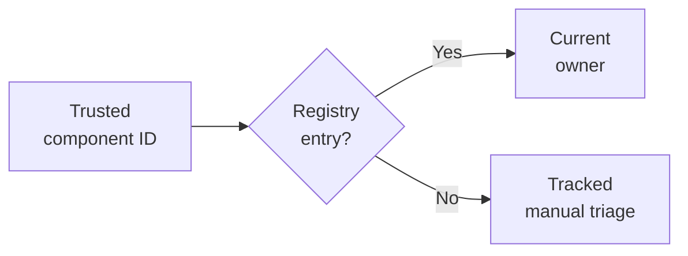

A platform team wants to route failed builds to the correct engineering team. Someone proposes training a classifier on old incident messages. The build system already emits a component identifier, and an ownership registry records the team responsible for each component. The routing requirement is to contact that current owner. Reading the identifier and querying the registry directly implements the requirement.

A classifier could predict a historically common owner while missing yesterday's ownership transfer. Before building one, specify which uncertainty the model would resolve and why a direct implementation is insufficient.

This section follows [Detection, Segmentation, Generation, and Decision-Making](/ai/detection-segmentation-generation-and-decision-making/). It assumes the distinction between a prediction and an application action, basic fractions, and the idea of a comparison baseline. By the end, you should be able to:

- Identify requirements that can be implemented from explicit rules or available records.
- Distinguish an authoritative policy from an empirical heuristic.
- Compare a model with simpler alternatives under error costs and operating constraints.
- Define the evidence that would justify adding learning later.

## Separate a specified answer from an unknown outcome

Machine learning estimates relationships from data. It is useful when those relationships help produce an output that the application cannot otherwise determine adequately. An ownership lookup has a different structure: the registry defines the answer for the routing task. Historical examples can help find defects in the registry or suggest changes, but past assignments do not replace the current ownership specification.

An **authoritative rule** states how the application must behave under specified inputs. A **heuristic** is a practical rule chosen because it appears useful, such as investigating the longest build first. The lookup can be checked against a specification. The heuristic needs evidence that it improves the intended outcome. Deterministic execution alone supplies no guarantee about business usefulness.

Google's [Rules of Machine Learning](https://developers.google.com/machine-learning/guides/rules-of-ml) advises that a product can launch without ML and discusses starting with heuristics. Its [problem-framing guidance](https://developers.google.com/machine-learning/problem-framing/problem) recommends a goal and non-ML comparison before committing to a learning approach. These are engineering starting points; a growing collection of fragile rules can also become expensive to maintain.

## Match the requirement to an available method

A database query can retrieve an existing fact. Explicit calculations can implement a defined fee or capacity formula. Search can retrieve documents using identifiers or terms. Optimization can choose an assignment under a stated objective and constraints, although large instances can still be computationally expensive. Human review can resolve exceptions when volume and response-time requirements permit it.

<div class="table-scroll" role="region" aria-label="Requirements and alternatives to training a machine learning model" tabindex="0">

| Requirement | Initial implementation to examine | Reason to reconsider |
| --- | --- | --- |
| Find the current component owner | Versioned registry lookup | Metadata is absent or ownership itself needs investigation |
| Apply a documented eligibility rule | Tested policy code | Required facts are uncertain and need estimation |
| Retrieve a known document | Identifier lookup or term search | Users' requests require semantic matching beyond the baseline |
| Produce a report from fixed fields | Template with explicit missing values | Variable language or summarization adds measurable value |
| Assign work under known constraints | Search, optimization, or a scheduling heuristic | Important inputs must be predicted or the solver misses its operating target |
| Handle a few unusual cases | A staffed review queue | Measured volume, delay, or error costs justify additional automation |

</div>

Each alternative needs testing and maintenance. Search can miss relevant documents, a template can repeat an incorrect database field, and reviewers can make mistakes. A small implementation has an advantage only when it meets the requirement with acceptable total cost and risk.

Some systems combine methods. A learned arrival-time estimate can feed a conventional scheduler. A text model can suggest an incident component, while the current registry determines ownership. Keep those responsibilities explicit so an estimated field cannot silently become policy authority.

## Keep mandatory controls in a defined enforcement path

Authorization specifies what a user or service is permitted to do. A prediction that someone resembles previously approved users cannot itself establish permission. The [OWASP Authorization Cheat Sheet](https://cheatsheetseries.owasp.org/cheatsheets/Authorization_Cheat_Sheet.html) recommends denying access by default and validating permissions on every request.

For incident routing, authenticated producer metadata and a current registry are assumptions that require implementation. Free-form log text is not a trusted substitute for a component identifier. A missing identifier should enter an explicit exception workflow. Production code also needs registry availability handling, ownership-version records, retries, and dispatch permissions. The example below performs no authentication or dispatch.

An ML detector can supply a risk signal within a broader security design. Its false positives, false negatives, and failure modes require validation. Mandatory permission checks remain part of the application contract, including when the model is unavailable.

## Work through a routing specification

Assume a hypothetical build system supplies trusted component identifiers and an approved registry maps `catalog` to Catalog, `checkout` to Payments, and `auth` to Identity. The task is routing by the emitted component, rather than discovering the underlying cause of a failure. An incident involving several components would need a separate ownership rule.

Unknown or absent components require manual triage. Review is an explicit unresolved state, with staffing and tracking, rather than a guessed owner. The following six records and classifier proposals are synthetic. They illustrate a comparison; no classifier has been trained or benchmarked.

<div class="table-scroll" role="region" aria-label="Synthetic build incidents and ownership routing proposals" tabindex="0">

| Incident | Component | Registry result | Supplied classifier proposal | Classifier after unknown-component fallback |
| --- | --- | --- | --- | --- |
| B1 | catalog | Catalog | Catalog | Catalog |
| B2 | checkout | Payments | Payments | Payments |
| B3 | auth | Identity | Identity | Identity |
| B4 | catalog | Catalog | Payments | Payments |
| B5 | checkout | Payments | Payments | Payments |
| B6 | Missing | Manual triage | Catalog | Manual triage |

</div>

The lookup routes five records to their specified owners and defers B6. The classifier with the same fallback misroutes B4 and defers B6. Its B4 output violates the ownership requirement and blocks release under this specification. The comparison does not become acceptable merely because a monetary penalty can be assigned to that mistake.

For arithmetic, let `E` count wrong automatic routes and `R` count records sent to review. Suppose a wrong automatic route costs five hypothetical units and opening a review costs one:

```math
J=5E+R.
```

These are scalar counts and costs in a common unit; `J` covers this batch. Correct automatic routes contribute zero in this simplified calculation. Review errors, waiting time, and implementation costs are omitted and would need separate measurement. The calculation does not assume that review resolves every incident correctly.

<div class="table-scroll" role="region" aria-label="Illustrative routing errors and review costs for three approaches" tabindex="0">

| Approach | Automatic routes | Wrong automatic routes | Reviews | Batch cost |
| --- | ---: | ---: | ---: | ---: |
| Registry lookup | 5 | 0 | 1 | 1 |
| Supplied classifier with fallback | 5 | 1 | 1 | 6 |
| Review every incident | 0 | 0 | 6 | 6 |

</div>

The lookup wins this supplied comparison because its inputs already determine the requested output. This is a conditional specification argument: incorrect metadata, stale ownership, or a changed task can invalidate it. The six examples establish no general performance estimate for classifiers on incident text.



*Figure 1. The registry supplies the specified owner. Missing metadata or an unavailable registry needs an explicit failure path; successful routing still requires the application's dispatch controls.*

## Reproduce the comparison without fitting a model

This Python 3.9+ program uses the standard library. It downloads no data, requires no credentials, and sends no incidents. `None` represents a review decision. The registry is an already validated mapping of nonempty component identifiers to team names; authentication and registry management are outside this example.

```python
import math


def route_incident(component, owners):
    if component is not None and (not isinstance(component, str) or not component):
        raise ValueError("Expected a nonempty component identifier or None")
    return owners.get(component) if component is not None else None


def evaluate_routes(decisions, expected, wrong_cost=5, review_cost=1):
    if not expected or len(decisions) != len(expected):
        raise ValueError("Expected matching nonempty decisions and reference lists")
    if any(value is not None and (not isinstance(value, str) or not value)
           for value in [*decisions, *expected]):
        raise ValueError("Expected team names or None")
    for cost in [wrong_cost, review_cost]:
        if type(cost) not in (int, float) or not math.isfinite(cost) or cost < 0:
            raise ValueError("Costs must be finite nonnegative numbers")
    reviews = sum(decision is None for decision in decisions)
    wrong = sum(decision is not None and decision != target
                for decision, target in zip(decisions, expected))
    return len(decisions) - reviews, wrong, reviews, wrong_cost * wrong + review_cost * reviews


def main():
    owners = {"catalog": "Catalog", "checkout": "Payments", "auth": "Identity"}
    components = ["catalog", "checkout", "auth", "catalog", "checkout", None]
    expected = ["Catalog", "Payments", "Identity", "Catalog", "Payments", None]
    proposals = ["Catalog", "Payments", "Identity", "Payments", "Payments", "Catalog"]
    lookup = [route_incident(component, owners) for component in components]
    candidate = [proposal if component in owners else None
                 for component, proposal in zip(components, proposals)]
    for name, decisions in [("registry", lookup), ("classifier", candidate),
                            ("all review", [None] * len(components))]:
        automatic, wrong, reviews, cost = evaluate_routes(decisions, expected)
        print(f"{name}: automatic={automatic}, wrong={wrong}, reviews={reviews}, cost={cost}")
    owners["catalog"] = "Commerce"
    print("after ownership update: " + route_incident("catalog", owners))


if __name__ == "__main__":
    main()
```

The verified output is:

```text
registry: automatic=5, wrong=0, reviews=1, cost=1
classifier: automatic=5, wrong=1, reviews=1, cost=6
all review: automatic=0, wrong=0, reviews=6, cost=6
after ownership update: Commerce
```

Changing the registry changes the routing result without retraining. That behavior is appropriate because ownership comes from the approved registry. A system that predicts likely root causes from unstructured logs has a different target and needs its own evaluation.

## Account for adoption costs even when predictions improve

Consider a separate hypothetical monthly comparison, unrelated to the six-record batch. Assume error and handling losses average 0.10 units per case for a baseline and 0.08 for a candidate, with equal per-case infrastructure costs and an additional fixed monthly operating cost `F = 600` for the candidate. With monthly volume `N`, the candidate's net saving is:

```math
\Delta=N(\ell_0-\ell_1)-F.
```

Here `ℓ_0` and `ℓ_1` are losses per case in the same unit, and `F` is cost per month. At `N = 20,000`, gross savings are `20,000 × 0.02 = 400`; subtracting 600 gives a net loss of 200. Break-even volume is `600/0.02 = 30,000` cases per month. Above that volume the arithmetic favors the candidate under these assumptions, but capacity, quality, and mandatory controls still need validation. If the loss difference is zero or negative, increasing volume cannot recover a positive fixed cost in this model.

Include data collection, annotation, deployment, monitoring, retraining, rollback, review work, and failures in a real comparison. An existing pretrained model can reduce some development work, but using it still requires task-specific evaluation and operational controls.

## Identify the evidence that would change the choice

Few labeled examples alone do not prove that ML is unsuitable: pretrained systems, unsupervised methods, and different task formulations may help. The practical question is whether available evidence supports the intended use. A poorly defined outcome, unobservable inputs, or an unusable action path can block a useful experiment regardless of model size.

Start by measuring the current approach's errors and exceptions. Use constant or majority-class predictors as weak reference points where appropriate; [scikit-learn's DummyClassifier](https://scikit-learn.org/stable/modules/generated/sklearn.dummy.DummyClassifier.html) documents such strategies. They help interpret a result, although the production comparison should include the strongest practical existing alternative.

If unstructured incident text remains unresolved after improving metadata, collect representative examples for that distinct prediction task. Define an independent evaluation set and relevant time or component splits. Fit learned preprocessing only on training data, as described in the [scikit-learn common-pitfalls guide](https://scikit-learn.org/stable/common_pitfalls.html#data-leakage). Compare costs, uncertainty handling, and failure behavior under the same conditions.

Adopt the learned component when evidence supports a useful improvement and an owner can maintain it. Retain direct queries, policy enforcement, and exception handling wherever they remain part of the specification. In consequential settings, domain specialists must also validate acceptable errors and oversight.

## References consulted

- [Google: Rules of Machine Learning](https://developers.google.com/machine-learning/guides/rules-of-ml) — launching without ML and starting from simpler approaches.
- [Google: Understand the problem](https://developers.google.com/machine-learning/problem-framing/problem) — goals, actionable outputs, data, and non-ML comparisons.
- [OWASP: Authorization Cheat Sheet](https://cheatsheetseries.owasp.org/cheatsheets/Authorization_Cheat_Sheet.html) — default denial and permission validation.
- [scikit-learn: DummyClassifier](https://scikit-learn.org/stable/modules/generated/sklearn.dummy.DummyClassifier.html) — simple predictive reference strategies.
- [scikit-learn: Common pitfalls](https://scikit-learn.org/stable/common_pitfalls.html#data-leakage) — independent evaluation and preprocessing leakage.

## Takeaways

- Implement explicit specifications from trusted inputs and current records when they determine the answer.
- Test empirical heuristics against outcomes; deterministic code can still make poor decisions.
- Compare learning with queries, search, templates, optimization, and staffed review under the same requirements.
- Count operational costs and enforce mandatory constraints alongside predictive performance.
- Revisit the choice when measured failures reveal a useful, evaluable prediction task.

## Exercises

1. Add an incident with component `inventory`, which is absent from the registry, and assume a classifier proposes Catalog. State the lookup and gated-classifier outputs. Calculate the new batch costs using the original six records and costs. What additional step is required before dispatching a new inventory incident automatically?
2. In the monthly comparison, use 50,000 cases while retaining losses 0.10 and 0.08 and fixed cost 600. Calculate net savings. Then assume the candidate also costs an extra 0.01 per case to run. Recalculate net savings and break-even volume.
3. The registry lookup meets its routing specification, but engineers now want likely root-cause suggestions for incidents without component metadata. Explain how the target, baseline, evidence, and permission boundary change.

## Answer guidance

1. Both outputs are manual triage, represented by `None`. Adding one review gives lookup cost two and gated-classifier cost seven. An authorized registry update must establish the component's current owner, and normal metadata validation and dispatch controls must still apply.
2. Initial net savings are `50,000 × 0.02 − 600 = 400`. With the additional per-case cost, the gain per case falls to 0.01, giving `50,000 × 0.01 − 600 = −100`. Break-even volume rises to 60,000 cases per month. These calculations do not waive other release criteria.
3. The new target is a likely cause or component inferred from incomplete evidence, rather than a defined owner lookup. Compare with existing log search and manual triage on representative independent cases. Preserve uncertainty and review paths. A suggestion does not itself update the approved registry or authorize dispatch.
