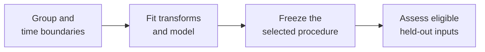

A team predicts whether a newly reported software incident will become severe. Its dataset contains several snapshots of each incident. The team distributes rows between training and testing, obtains perfect accuracy, and prepares to deploy. Every test incident, however, also has a labeled snapshot in training. The experiment rewards recognition of resolved incidents, while deployment requires decisions about new ones.

**Data leakage** occurs when information crosses a boundary that the intended prediction or evaluation requires. An apparently separate test file can still carry familiar answers through shared incidents, derived features, or development decisions. The resulting score describes an easier information setting than the one being claimed.

This section follows [Training, Validation, and Test Sets](/ai/training-validation-and-test-sets/). It assumes familiarity with inputs, labels, and those three data roles. By the end, you should be able to:

- Identify which information was available at a prediction's decision time.
- Detect leakage through related records and learned transformations.
- Reproduce a misleading score and explain the claim it fails to support.
- Repair an evaluation without treating previously inspected evidence as untouched.

## Define the information boundary

A feature is an input used to make a prediction; a label is the outcome used for learning or assessment. A valid historical label often becomes available after its example's prediction time. Training on completed historical outcomes is normal. Using that same example's later outcome as an input for its earlier prediction is leakage.

Consider an incident submitted at 10:00. Its initial error count may be available then. Its final root cause and eventual escalation status are recorded after resolution. Copying those later fields into an offline input table gives the model evidence that a live system could not have supplied at 10:00. Renaming a revealing field does not change its origin.

Distinguish this from ordinary overfitting, where a model fits quirks in permitted training data, and from distribution shift, where future examples differ from historical ones. All three can cause disappointing deployment results, and they can coexist. A lower live score alone does not identify which occurred. Leakage here concerns experimental evidence; it is separate from the security question of exposing confidential data.

## Audit when a value became usable

A timestamp attached to an observation can describe when the event happened without describing when the system could read it. Suppose an error occurred at 09:58 but was ingested at 10:04. A reconstructed 10:00 prediction must exclude it even though its event timestamp precedes the prediction.

For an observed historical measurement, use this eligibility condition:

```math
t_{\mathrm{event}}\leq t_{\mathrm{prediction}},
\qquad
t_{\mathrm{available}}\leq t_{\mathrm{prediction}}.
```

These are scalar times expressed on a consistent clock. The first condition excludes later events; the second excludes late arrivals and corrections unavailable at the decision. Neither condition establishes that the feature is otherwise appropriate. A calendar date known in advance has a different availability rule from an observed measurement.

Reconstruct aggregates with the same boundary. A seven-day failure count must end at the prediction time and include only eligible records. Training labels must also have matured before the model's historical fitting time. A chronological row split alone does not enforce either restriction.

[Feast's historical retrieval documentation](https://docs.feast.dev/getting-started/concepts/point-in-time-joins) illustrates the distinction: event-time matching and filtering by creation time are separate controls. An availability filter still depends on the recorded timestamp representing actual availability and on support in the chosen data source. Audit that meaning before trusting an automated join.

## Separate related cases before assessing new ones

Two rows need not be identical to carry the same answer. Repeated scans of one patient, retries of one build, and snapshots of one incident can share identifying information. When the intended use involves previously unseen cases, keep those related rows in the same partition. [Scikit-learn's grouped-evaluation guide](https://scikit-learn.org/stable/modules/cross_validation.html#cross-validation-iterators-for-grouped-data) explains how group separation changes the generalization question.

The grouping unit follows the claim. Predicting later activity for established customers may legitimately use those customers' earlier information. That overlap does not establish performance for new customers. Likewise, removing a literal incident ID may leave a unique log signature that identifies the same incident.

### A perfect score from four familiar incidents

Use this deliberately synthetic dataset. Each incident has two distinct snapshot rows, one fixed binary severity label, and an identifier with no transferable predictive meaning. Label `1` means severe; label `0` means non-severe. All historical incidents are resolved before this demonstration is fitted. The intended claim concerns a different, newly reported incident.

<div class="table-scroll" role="region" aria-label="Synthetic incident snapshots and their partition assignments" tabindex="0">

| Incident | Snapshot rows | Label | Row-based training / evaluation | Group-based training / evaluation |
| --- | --- | ---: | --- | --- |
| A | A1, A2 | 0 | A1 / A2 | A1, A2 / none |
| B | B1, B2 | 1 | B1 / B2 | B1, B2 / none |
| C | C1, C2 | 0 | C1 / C2 | none / C1, C2 |
| D | D1, D2 | 1 | D1 / D2 | none / D1, D2 |

</div>

Both protocols use four training rows and four evaluation rows. Define one fixed prediction rule: remember each training incident's majority label. For an unfamiliar identifier, predict the training set's majority label. Resolve every tie as zero. This rule intentionally isolates memorization; it is not a proposed incident classifier.

In the row-based split, training reveals labels for A, B, C, and D. Evaluation visits those same incidents and receives predictions `[0, 1, 0, 1]`. Every answer is correct. The rows are disjoint, but the incident-level evidence overlaps.

In the group-based split, training contains only A and B. Their labels balance, so the default is zero. Evaluation contains C and D, producing predictions `[0, 0, 0, 0]` against `[0, 0, 1, 1]`. Two answers are correct. A constant training-majority baseline also scores two out of four in both protocols.

Accuracy is the fraction of correct predictions:

```math
\operatorname{accuracy}
=\frac{1}{m}\sum_{i=1}^{m}\mathbf{1}[\widehat y_i=y_i].
```

Here `m` is the nonzero number of evaluated rows, `y_i` and its prediction are scalar binary labels, and the indicator contributes one for a match and zero otherwise. The row-based result is `4/4 = 100%`; the group-based result is `2/4 = 50%`. The labels and predictions are length-four vectors.

The difference exposes the unsupported new-incident claim. It does not estimate a real model's expected decline or establish that future accuracy must be fifty percent. Only two distinct incidents appear in the group-held-out evaluation; repeated snapshots do not provide four independent incidents.

## Reproduce the experiment

This Python 3.9+ example requires NumPy (`python -m pip install numpy`) and no external data. Identifiers and labels are one-dimensional arrays of length eight. The predictor receives only selected training labels; evaluation labels enter only the final comparison. The invalid protocol therefore demonstrates that correct fitting code cannot compensate for the wrong split.

```python
import numpy as np


def fit_lookup(train_ids, train_labels):
    ids = np.asarray(train_ids)
    labels = np.asarray(train_labels)
    if (ids.ndim != 1 or labels.shape != ids.shape or ids.size == 0
            or ids.dtype.kind not in "US"
            or not np.isin(labels, [0, 1]).all()):
        raise ValueError("Expected matching nonempty string IDs and binary labels")

    # A strict majority selects one; every tie selects zero.
    default = int(np.count_nonzero(labels == 1) > labels.size / 2)
    lookup = {}
    for incident in np.unique(ids):
        values = labels[ids == incident]
        lookup[str(incident)] = int(np.count_nonzero(values == 1) > values.size / 2)
    return lookup, default


def predict(model, query_ids):
    ids = np.asarray(query_ids)
    if ids.ndim != 1 or ids.dtype.kind not in "US":
        raise ValueError("Expected a one-dimensional vector of string IDs")
    lookup, default = model
    return np.array([lookup.get(str(incident), default) for incident in ids], dtype=int)


def main():
    ids = np.array(["A", "A", "B", "B", "C", "C", "D", "D"])
    labels = np.array([0, 0, 1, 1, 0, 0, 1, 1])
    protocols = [
        ("Row split", np.array([0, 2, 4, 6]), np.array([1, 3, 5, 7])),
        ("Group split", np.array([0, 1, 2, 3]), np.array([4, 5, 6, 7])),
    ]
    for name, train, held_out in protocols:
        # Disjoint row indices alone do not guarantee independent cases.
        assert np.intersect1d(train, held_out).size == 0
        model = fit_lookup(ids[train], labels[train])
        predictions = predict(model, ids[held_out])
        accuracy = np.mean(predictions == labels[held_out])
        baseline = np.mean(model[1] == labels[held_out])
        overlap = sorted(set(ids[train].tolist()) & set(ids[held_out].tolist()))
        print(f"{name}: shared incidents={overlap}")
        print(f"predictions={predictions.tolist()}, "
              f"accuracy={accuracy:.0%}, baseline={baseline:.0%}")


if __name__ == "__main__":
    main()
```

The output below was verified by running this example:

```text
Row split: shared incidents=['A', 'B', 'C', 'D']
predictions=[0, 1, 0, 1], accuracy=100%, baseline=50%
Group split: shared incidents=[]
predictions=[0, 0, 0, 0], accuracy=50%, baseline=50%
```

These two protocols are fixed in advance. A separate validation stage is unnecessary because no candidate is selected. A real model search still requires development evidence followed by an independent final evaluation. Use larger, appropriately grouped samples to assess uncertainty and rare failures.

## Keep preprocessing inside each fitting boundary

Leakage can occur before a model receives its inputs. Filling missing values, choosing features, and estimating normalization statistics all learn something from data. For example, training values `[2, 4]` have mean three. Including a held-out value of `100` changes the mean to `106/3`, about `35.33`. Any missing training value filled with that second mean now depends on the held-out population.

The change in the fitted mean shows that held-out inputs influence training. The effect on a particular score can be positive, negative, or negligible. Fit learned transformations on training data and reuse the fitted state unchanged for validation and testing. A predefined conversion from seconds to minutes needs no estimated statistic. The [scikit-learn pitfalls guide](https://scikit-learn.org/stable/common_pitfalls.html#data-leakage) demonstrates why feature selection and other fitted transformations belong inside this boundary.

A pipeline packages preprocessing with the estimator so each cross-validation fold can fit its own transformation. It cannot remove a future field or choose a valid grouping automatically. Transformations that use labels need additional care: replacing categories with their average target can let a row's own answer influence its training representation. [Scikit-learn's target encoder](https://scikit-learn.org/stable/modules/generated/sklearn.preprocessing.TargetEncoder.html) uses cross-fitting during training transformation to address this problem. Cross-fitting constructs a row's encoding from a separate training subset; it still must respect any group and time restrictions required by the task.



*Figure 1. Validation may guide selection before freezing. Every fitted step needs the same boundary, including steps hidden inside feature preparation.*

## Treat test feedback as development information

A team can preserve every row boundary and still repeatedly choose features after reading test scores. Those answers guide the final procedure through human decisions. [Google's dataset guide](https://developers.google.com/machine-learning/crash-course/overfitting/dividing-datasets) warns that repeated consultation can wear out evaluation sets. A random seed reproduces the sequence; it does not restore independence.

If leakage is discovered, preserve the affected result and record the invalid claim. Reconstruct eligible features, repair partitions, and rerun the complete development process. Once inspection has influenced design, previously inspected test cases cannot supply fresh final evidence for the revised procedure. Fixing a preprocessing call does not erase that history.

## Audit the full path before accepting a score

<div class="table-scroll" role="region" aria-label="Leakage audit checks and their limitations" tabindex="0">

| Check | Evidence to inspect | Remaining limitation |
| --- | --- | --- |
| Feature availability | Event, arrival, correction, and prediction times | An inaccurate arrival timestamp can hide future information |
| Case separation | Incident IDs, duplicates, and related groups | Different IDs can still describe the same underlying case |
| Fitted transformations | Inputs used for each fold's fitting steps | A pipeline cannot repair an invalid feature definition |
| Decision history | Experiments, inspected metrics, and chosen settings | Renaming an inspected test set does not make it independent |

</div>

Compare an unexpectedly high score against a simple baseline, inspect unusually predictive fields, and test whether performance depends on case overlap. Shuffling labels can expose some contaminated paths, but chance-level performance after shuffling does not certify an experiment. Diagnose the particular dependency rather than using one diagnostic as a universal test.

Retain split manifests, data versions, feature lineage, and fitting logs. Grouping and time restrictions may reduce usable data and widen uncertainty; report that cost instead of recovering a larger score through an invalid split. In high-risk uses, leakage checks accompany domain review, subgroup assessment, and human oversight. Even a carefully independent score establishes only the behavior measured under its stated conditions.

## References consulted

- [scikit-learn: Common pitfalls and data leakage](https://scikit-learn.org/stable/common_pitfalls.html#data-leakage) — fitted preprocessing, feature selection, and pipelines.
- [scikit-learn: Cross-validation with grouped data](https://scikit-learn.org/stable/modules/cross_validation.html#cross-validation-iterators-for-grouped-data) — dependent observations and assessment on unseen groups.
- [Feast: Point-in-time joins](https://docs.feast.dev/getting-started/concepts/point-in-time-joins) — event-time reconstruction and the separate availability-time condition.
- [scikit-learn: TargetEncoder](https://scikit-learn.org/stable/modules/generated/sklearn.preprocessing.TargetEncoder.html) — cross-fitting for label-based category representations.
- [Google: Dividing the original dataset](https://developers.google.com/machine-learning/crash-course/overfitting/dividing-datasets) — separate evaluation roles and the effect of repeated test consultation.

## Takeaways

- Define the prediction time and evaluation claim before constructing inputs or partitions.
- Separate related cases when the claim concerns previously unseen cases.
- Fit transformations within the training boundary and audit label-dependent features separately.
- Track feature availability and development decisions as carefully as row membership.
- Repair the full protocol and obtain fresh final evidence after test-informed changes.

## Exercises

1. In the synthetic experiment, change both snapshots of incident D to label zero. Recompute the lookup accuracy and constant-baseline accuracy for both fixed splits. Explain why the grouped score alone still cannot establish reliable future performance.
2. At 10:00, an incident predictor uses an error count with event time 09:58 and arrival time 10:04, a deployment flag published at 09:50, and a root-cause label written at 12:00. Which inputs are eligible, assuming the flag remains available? State how to reconstruct the historical input.
3. A team fits a missing-value mean on all rows, separates snapshots of the same incidents across folds, and chooses twenty feature sets by test accuracy. Describe three repairs and explain whether rerunning on the same inspected test data provides fresh final evidence.

## Answer guidance

1. Row-split lookup predictions become `[0, 1, 0, 0]`, so lookup accuracy stays `4/4 = 100%`; the training-majority baseline becomes zero and scores `3/4 = 75%`. Group-split training remains A and B, so both rules predict zero and score `4/4 = 100%` on C and D. Only two held-out incidents are present, and a constant rule succeeds because this small partition contains no severe incident. Independence prevents one source of distortion without guaranteeing representative coverage.
2. The deployment flag is eligible. The error count arrived too late, and the final root cause did not exist at 10:00. Reconstruct the input from versions actually available by that time; represent an unavailable measurement according to a training-defined missing-data policy. Keep the eventual outcome separately as a label.
3. Fit the mean only on each training partition, keep incident groups together where required by the new-incident claim, and choose features using development validation. Freeze the repaired procedure and assess it on independent evidence that has not guided those decisions. The old test data remain useful for diagnosis, but their prior role must be recorded.
