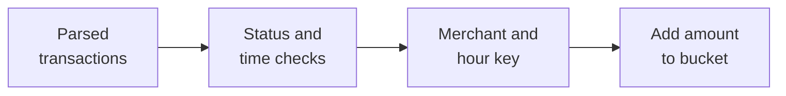

Several CSV files have already been parsed into a list of transactions. The task is to produce a small report: for each merchant, how much completed transaction value belongs to each recent-hour bucket? File parsing is outside the problem. The main work is translating the filters and grouping rules into one scan without changing the supplied time calculation.

## Problem

You receive a list of `Transaction` objects, a fixed `currentTime`, and a provided function that returns the integer hour difference between `currentTime` and a transaction's `startTime`. Each transaction contains `amount`, `merchantId`, `status`, `userId`, and `startTime`. Use the provided status enum and hour-difference function.

Return this Java type, or its Python dictionary equivalent:

```text
Map<String, Map<String, Integer>>
merchantId -> hourDiff as a string -> total amount
```

Include a transaction only when its status is `COMPLETED`, its timestamp is not in the future, and the provided hour difference satisfies `0 <= hourDiff < windowHours`. The original requirement uses `windowHours = 24`. The implementations take that positive window length as an argument, so the same algorithm also handles other windows.

For example, if the helper assigns hour difference one to two completed transactions for `m1`, with amounts 100 and 50, their bucket is `"1": 150`. A completed transaction for `m2` with hour difference five and amount 30 produces `"5": 30`. A pending transaction contributes nothing:

```text
{
  "m1": {"1": 150},
  "m2": {"5": 30}
}
```

Use these explicit assumptions:

- Amounts are signed integer minor units in one currency. Zero and negative adjustments are allowed because no positive-amount filter was specified. If the supplied contract restricts amounts, apply that restriction before aggregation.
- Individual amounts fit a Java `int`. Final totals must also fit the required `Integer` output. Overflow is reported instead of silently wrapping.
- Include only occupied merchant/bucket pairs. Preserve an occupied bucket whose sum becomes zero. Empty input or an entirely filtered list returns an empty map.
- Count every qualifying list entry. There is no transaction identifier or deduplication rule in this input contract. `userId` does not change the grouping.
- Inputs remain unchanged. Output iteration order is unspecified. Eligible records have nonempty merchant IDs.

The description alludes to another possible filter without defining it. This solution implements the stated rules. A confirmed additional predicate belongs before the bucket update; guessing one could discard valid transactions.

## Fix the time semantics before choosing a data structure

An hour difference is more than subtracting the displayed hour numbers. Dates, midnight, fractional hours, and time-zone conventions affect that calculation. Call the supplied function with the original timestamp values. Capture the report's `currentTime` once and use it for every row.

The boundaries come from the helper's contract: difference zero is eligible; difference `windowHours` is excluded. If the helper floors elapsed nonnegative hours, a difference of 23 can include an age of 23 hours and 59 minutes in a 24-hour report. A calendar-hour helper can define different boundaries. Follow the supplied semantics rather than replacing them with a new calculation.

Also compare the original timestamps to reject future records. A helper that truncates a small negative duration toward zero could otherwise assign a transaction one millisecond in the future to bucket zero. This comparison is only an ordering check; the aggregation still delegates hour calculation to the given API. The code assumes both timestamps use the same absolute time scale and unit.

The time field is `startTime`, even when completion happens later. Substituting completion time would answer a different question.

## Algorithm: filter, group, and add

Maintain a nested hash map. Its outer key is the merchant ID, and its inner key is the string form of the provided hour difference.

For each transaction, first skip non-completed and future records. Call the supplied helper once for each remaining record. Skip negative differences and differences outside the window. Only then create the merchant and bucket entries and add the amount.



*Figure 1. Each eligible record changes exactly one bucket. Filtering before map creation avoids empty merchant entries.*

For Java, accumulate in `long` values and convert each final bucket with `Math.toIntExact`. This avoids an unnecessary rejection when a temporary total exceeds the 32-bit range but a later negative adjustment brings the final result back into range. The accumulation also uses checked addition. Python has arbitrary-precision integers and checks the final 32-bit output range explicitly. These are representation limits, independent of the configurable window length.

The [Java Math documentation](https://docs.oracle.com/en/java/javase/21/docs/api/java.base/java/lang/Math.html) specifies the checked arithmetic methods; the [Python numeric-type documentation](https://docs.python.org/3/library/stdtypes.html#numeric-types-int-float-complex) describes integer precision.

## Walkthrough

For a 24-hour window, suppose the provided helper returns the differences below:

<div class="table-scroll" role="region" aria-label="Transaction filtering and merchant bucket updates" tabindex="0">

| Merchant | Status | Hour difference | Amount | Action |
| --- | --- | ---: | ---: | --- |
| m1 | COMPLETED | 1 | 100 | Create `m1["1"] = 100` |
| m1 | COMPLETED | 1 | 50 | Update `m1["1"] = 150` |
| m1 | PENDING | Not needed | 70 | Skip without calling the helper |
| m2 | COMPLETED | 5 | 30 | Create `m2["5"] = 30` |
| m2 | COMPLETED | 26 | 40 | Skip; outside the window |

</div>

The second m1 transaction may have a different user ID; its contribution still belongs to the same merchant/hour pair. A completed transaction exactly 24 hours old is excluded under the elapsed-hour interpretation. A merchant with only excluded records never appears in the result.

## Why it works

After processing any prefix of the list, each stored bucket equals the sum of amounts from exactly the qualifying records in that prefix with the corresponding merchant and helper-produced hour difference.

Initially, no records have been processed and the map is empty. An excluded record leaves every bucket unchanged. An included record passes all filters and adds its amount to its unique merchant/hour pair, preserving the invariant. No other bucket changes. After the final record, the invariant describes the required aggregation over the full list.

Converting representable final sums to the required output type preserves their values. No sorting is required to establish the invariant or compute the answer.

## Java solution

Save as `TransactionAggregator.java`; Java 17 or later is sufficient. `Status`, `Transaction`, and `HourDifference` below make the example self-contained. In the interview, reuse the actual supplied enum, model, and time function. The production algorithm is the `aggregate` method; its time dependency is injected through the interface.

The `main` method uses a lookup table of known helper responses as a **test double**. It implements no hour-difference arithmetic. Millisecond constants there only construct test timestamps. Wire the real provided helper into `aggregate` in the actual task.

```java
import java.util.*;

public class TransactionAggregator {
    public enum Status { COMPLETED, PENDING, FAILED, CANCELLED }

    public record Transaction(int amount, String merchantId, Status status,
                              String userId, long startTime) {}

    @FunctionalInterface
    public interface HourDifference {
        long between(long currentTime, long startTime);
    }

    public Map<String, Map<String, Integer>> aggregate(
            List<Transaction> transactions, long currentTime, int windowHours,
            HourDifference hourDifference) {
        Objects.requireNonNull(transactions, "Transactions must not be null");
        Objects.requireNonNull(hourDifference, "A provided time helper is required");
        if (windowHours <= 0) {
            throw new IllegalArgumentException("windowHours must be positive");
        }
        Map<String, Map<String, Long>> sums = new HashMap<>();

        // Filter first, then update exactly one merchant/hour bucket.
        for (Transaction transaction : transactions) {
            Objects.requireNonNull(transaction, "A transaction must not be null");
            if (transaction.status() != Status.COMPLETED
                    || transaction.startTime() > currentTime) {
                continue;
            }
            long hourDiff = hourDifference.between(currentTime, transaction.startTime());
            if (hourDiff < 0 || hourDiff >= windowHours) {
                continue;
            }
            String merchant = transaction.merchantId();
            if (merchant == null || merchant.isEmpty()) {
                throw new IllegalArgumentException("An eligible merchant ID must be nonempty");
            }
            Map<String, Long> buckets = sums.computeIfAbsent(merchant, key -> new HashMap<>());
            String hourKey = Long.toString(hourDiff);
            long total = Math.addExact(buckets.getOrDefault(hourKey, 0L),
                                      (long) transaction.amount());
            buckets.put(hourKey, total);
        }

        // Check the required output range after all signed adjustments.
        Map<String, Map<String, Integer>> result = new HashMap<>();
        for (var merchant : sums.entrySet()) {
            Map<String, Integer> buckets = new HashMap<>();
            for (var bucket : merchant.getValue().entrySet()) {
                buckets.put(bucket.getKey(), Math.toIntExact(bucket.getValue()));
            }
            result.put(merchant.getKey(), buckets);
        }
        return result;
    }

    public static void main(String[] args) {
        TransactionAggregator aggregator = new TransactionAggregator();
        long now = 200_000_000L;
        long hour = 3_600_000L;
        int windowHours = 24;
        Map<Long, Long> knownHours = Map.of(
            now, 0L, now - hour, 1L, now - 2 * hour, 2L,
            now - 3 * hour, 3L, now - 5 * hour, 5L,
            now - 23 * hour, 23L, now - 24 * hour, 24L,
            now - 26 * hour, 26L, now + 1, 0L);
        HourDifference provided = (current, start) -> knownHours.get(start);
        record Example(String name, List<Transaction> rows, int window) {}
        List<Example> examples = List.of(
            // Original example: sum one bucket and ignore pending and old rows.
            new Example("Original", List.of(
                new Transaction(100, "m1", Status.COMPLETED, "u1", now - hour),
                new Transaction(50, "m1", Status.COMPLETED, "u2", now - hour),
                new Transaction(70, "m1", Status.PENDING, "u3", now - 2 * hour),
                new Transaction(30, "m2", Status.COMPLETED, "u1", now - 5 * hour),
                new Transaction(40, "m2", Status.COMPLETED, "u2", now - 26 * hour)), windowHours),
            // Keep ages zero and 23; exclude age 24, a future row, and other statuses.
            new Example("Boundaries", List.of(
                new Transaction(10, "m1", Status.COMPLETED, "u1", now),
                new Transaction(20, "m1", Status.COMPLETED, "u1", now - 23 * hour),
                new Transaction(300, "m1", Status.COMPLETED, "u1", now - 24 * hour),
                new Transaction(999, "m1", Status.COMPLETED, "u1", now + 1),
                new Transaction(777, "m3", Status.FAILED, "u1", now),
                new Transaction(888, "m3", Status.CANCELLED, "u1", now)), windowHours),
            // Signed adjustments and zero-value entries preserve occupied buckets.
            new Example("Zero totals", List.of(
                new Transaction(100, "m1", Status.COMPLETED, "u1", now - hour),
                new Transaction(-100, "m1", Status.COMPLETED, "u1", now - hour),
                new Transaction(0, "m2", Status.COMPLETED, "u1", now - 5 * hour)), windowHours),
            // A different window uses the same aggregation method.
            new Example("Three-hour window", List.of(
                new Transaction(5, "m1", Status.COMPLETED, "u1", now),
                new Transaction(7, "m1", Status.COMPLETED, "u1", now - 2 * hour),
                new Transaction(9, "m1", Status.COMPLETED, "u1", now - 3 * hour)), 3),
            // The final total fits int even though an intermediate total does not.
            new Example("Cancellation before conversion", List.of(
                new Transaction(Integer.MAX_VALUE, "m1", Status.COMPLETED, "u1", now),
                new Transaction(1, "m1", Status.COMPLETED, "u1", now),
                new Transaction(-1, "m1", Status.COMPLETED, "u1", now)), windowHours),
            // No records produce an empty map.
            new Example("Empty input", List.of(), windowHours),
            // Excluded records do not create an empty merchant entry.
            new Example("All filtered", List.of(
                new Transaction(8, "m1", Status.PENDING, "u1", now),
                new Transaction(9, "m2", Status.COMPLETED, "u1", now - 26 * hour)), windowHours)
        );
        for (Example example : examples) {
            System.out.println(example.name() + ":");
            var result = aggregator.aggregate(example.rows(), now, example.window(), provided);
            if (result.isEmpty()) System.out.println("(empty)");
            for (String merchant : new TreeSet<>(result.keySet())) {
                List<String> keys = new ArrayList<>(result.get(merchant).keySet());
                keys.sort(Comparator.comparingLong(Long::parseLong));
                for (String key : keys) {
                    System.out.println(merchant + "[" + key + "] = " + result.get(merchant).get(key));
                }
            }
        }
        // A final total outside the required Integer range must be rejected.
        try {
            aggregator.aggregate(List.of(
                new Transaction(Integer.MAX_VALUE, "m1", Status.COMPLETED, "u1", now),
                new Transaction(1, "m1", Status.COMPLETED, "u1", now)), now, windowHours, provided);
            throw new AssertionError("Expected overflow rejection");
        } catch (ArithmeticException expected) {
            System.out.println("Overflow: rejected");
        }
    }
}
```

Run with `javac TransactionAggregator.java` and `java TransactionAggregator`. There is one aggregation method and one `main`; the remaining declarations represent supplied types and test data.

## Python solution

The Python version uses the same enum check, filtering order, helper signature, and string bucket keys. It requires Python 3.9+ and only the standard library. The `Transaction` dataclass and `Status` enum stand in for the supplied objects. Type hints do not replace upstream parsing and validation.

```python
from dataclasses import dataclass
from enum import Enum, auto
from typing import Callable


class Status(Enum):
    COMPLETED = auto()
    PENDING = auto()
    FAILED = auto()
    CANCELLED = auto()


@dataclass(frozen=True)
class Transaction:
    amount: int
    merchant_id: str
    status: Status
    user_id: str
    start_time: int


class TransactionAggregator:
    INT_MIN = -(1 << 31)
    INT_MAX = (1 << 31) - 1

    def aggregate(self, transactions: list[Transaction], current_time: int,
                  window_hours: int, hour_difference: Callable[[int, int], int]
                  ) -> dict[str, dict[str, int]]:
        if transactions is None or not callable(hour_difference):
            raise ValueError("Transactions and a provided time helper are required")
        if type(window_hours) is not int or window_hours <= 0:
            raise ValueError("window_hours must be a positive integer")
        result: dict[str, dict[str, int]] = {}

        # Filter first, then update exactly one merchant/hour bucket.
        for transaction in transactions:
            if transaction is None:
                raise ValueError("A transaction must not be None")
            if (transaction.status is not Status.COMPLETED
                    or transaction.start_time > current_time):
                continue
            hour_diff = hour_difference(current_time, transaction.start_time)
            if type(hour_diff) is not int:
                raise ValueError("The provided helper must return an integer")
            if hour_diff < 0 or hour_diff >= window_hours:
                continue
            merchant = transaction.merchant_id
            if not isinstance(merchant, str) or not merchant:
                raise ValueError("An eligible merchant ID must be nonempty")
            if (type(transaction.amount) is not int
                    or not self.INT_MIN <= transaction.amount <= self.INT_MAX):
                raise ValueError("An eligible amount must fit a signed 32-bit integer")
            buckets = result.setdefault(merchant, {})
            key = str(hour_diff)
            buckets[key] = buckets.get(key, 0) + transaction.amount

        # Check final totals after all signed adjustments.
        for buckets in result.values():
            for total in buckets.values():
                if not self.INT_MIN <= total <= self.INT_MAX:
                    raise OverflowError("A final bucket total does not fit a signed 32-bit integer")
        return result


def main():
    aggregator = TransactionAggregator()
    now = 200_000_000
    hour = 3_600_000
    window_hours = 24
    known_hours = {
        now: 0, now - hour: 1, now - 2 * hour: 2,
        now - 3 * hour: 3, now - 5 * hour: 5,
        now - 23 * hour: 23, now - 24 * hour: 24,
        now - 26 * hour: 26, now + 1: 0,
    }
    provided = lambda current, start: known_hours[start]
    examples = [
        # Original example: sum one bucket and ignore pending and old rows.
        ("Original", [
            Transaction(100, "m1", Status.COMPLETED, "u1", now - hour),
            Transaction(50, "m1", Status.COMPLETED, "u2", now - hour),
            Transaction(70, "m1", Status.PENDING, "u3", now - 2 * hour),
            Transaction(30, "m2", Status.COMPLETED, "u1", now - 5 * hour),
            Transaction(40, "m2", Status.COMPLETED, "u2", now - 26 * hour)], window_hours),
        # Keep ages zero and 23; exclude age 24, a future row, and other statuses.
        ("Boundaries", [
            Transaction(10, "m1", Status.COMPLETED, "u1", now),
            Transaction(20, "m1", Status.COMPLETED, "u1", now - 23 * hour),
            Transaction(300, "m1", Status.COMPLETED, "u1", now - 24 * hour),
            Transaction(999, "m1", Status.COMPLETED, "u1", now + 1),
            Transaction(777, "m3", Status.FAILED, "u1", now),
            Transaction(888, "m3", Status.CANCELLED, "u1", now)], window_hours),
        # Signed adjustments and zero-value entries preserve occupied buckets.
        ("Zero totals", [
            Transaction(100, "m1", Status.COMPLETED, "u1", now - hour),
            Transaction(-100, "m1", Status.COMPLETED, "u1", now - hour),
            Transaction(0, "m2", Status.COMPLETED, "u1", now - 5 * hour)], window_hours),
        # A different window uses the same aggregation method.
        ("Three-hour window", [
            Transaction(5, "m1", Status.COMPLETED, "u1", now),
            Transaction(7, "m1", Status.COMPLETED, "u1", now - 2 * hour),
            Transaction(9, "m1", Status.COMPLETED, "u1", now - 3 * hour)], 3),
        # The final total fits int even though an intermediate total does not.
        ("Cancellation before conversion", [
            Transaction(aggregator.INT_MAX, "m1", Status.COMPLETED, "u1", now),
            Transaction(1, "m1", Status.COMPLETED, "u1", now),
            Transaction(-1, "m1", Status.COMPLETED, "u1", now)], window_hours),
        # No records produce an empty map.
        ("Empty input", [], window_hours),
        # Excluded records do not create an empty merchant entry.
        ("All filtered", [
            Transaction(8, "m1", Status.PENDING, "u1", now),
            Transaction(9, "m2", Status.COMPLETED, "u1", now - 26 * hour)], window_hours),
    ]
    for name, rows, window in examples:
        print(f"{name}:")
        result = aggregator.aggregate(rows, now, window, provided)
        if not result:
            print("(empty)")
        for merchant in sorted(result):
            for key in sorted(result[merchant], key=int):
                print(f"{merchant}[{key}] = {result[merchant][key]}")

    # A final total outside the required Integer range must be rejected.
    try:
        aggregator.aggregate([
            Transaction(aggregator.INT_MAX, "m1", Status.COMPLETED, "u1", now),
            Transaction(1, "m1", Status.COMPLETED, "u1", now)], now, window_hours, provided)
        raise AssertionError("Expected overflow rejection")
    except OverflowError:
        print("Overflow: rejected")


if __name__ == "__main__":
    main()
```

## Expected output

Both `main` methods instantiate the class, call its aggregation method, and print the results below. Their output was verified by compiling and running Java and executing Python. Only the demonstration sorts keys for display; aggregation itself is unsorted.

```text
Original:
m1[1] = 150
m2[5] = 30
Boundaries:
m1[0] = 10
m1[23] = 20
Zero totals:
m1[1] = 0
m2[5] = 0
Three-hour window:
m1[0] = 5
m1[2] = 7
Cancellation before conversion:
m1[0] = 2147483647
Empty input:
(empty)
All filtered:
(empty)
Overflow: rejected
```

## Time and space complexity

Let `n` be the number of input transactions, `M` the number of included merchants, `H = windowHours`, and `K` the number of occupied merchant/hour pairs. Then `K <= min(n, M × H)`.

Expected time is **O(n + K) = O(n)** when the supplied helper and ordinary hash-map operations take constant time. Each record is inspected once; only occupied buckets are visited during final range checking or conversion. Any unsorted record could change the answer, so an exact solution requires inspecting all `n` records in the worst case. This is asymptotically optimal under that input model. The [Java HashMap documentation](https://docs.oracle.com/en/java/javase/21/docs/api/java.base/java/util/HashMap.html) states the hash-dispersion assumption behind constant-time operations.

More explicitly, if `c` records reach the helper and one helper call costs `T`, time is **O(n + cT + K)**. The headline bound assumes machine-sized timestamps and amounts, and bounded-size identifiers; arbitrary-length identifiers or arbitrary-precision arithmetic add their own processing costs. Java reports any 64-bit accumulation overflow as well as an out-of-range final `Integer` result.

The maps use **O(K)** space, excluding the already supplied input list. Java temporarily holds wide sums and the converted result; two maps of size proportional to `K` still use O(K) space. A dense `H`-element array per merchant would instead require O(MH) space even when most buckets are empty. With the original fixed 24-hour window, O(MH) simplifies to O(M), but retaining `H` in the analysis makes the general case explicit.

## Production follow-up: optimize the actual reporting contract

**Read incrementally when the input grows.** The interview begins with a completed list. In a production batch job, a parser can feed records directly into an accumulator, avoiding an extra O(n) in-memory copy of all input records. The bucket state still needs O(K) memory; high merchant cardinality can require partitioned aggregation or spill to disk. Small batches do not need a distributed system.

**Choose storage according to density.** For a bounded, dense window, numeric bucket keys and per-merchant arrays can reduce object overhead. Convert to string keys at the API boundary. An array is a constant-factor engineering choice, with O(MH) allocation and materialization costs. Sparse maps remain useful when the window is large or activity is sparse. Measure throughput and allocation costs rather than claiming an unmeasured speedup.

**Preserve window alignment.** If the helper uses elapsed hours relative to each query's `currentTime`, bucket zero at 08:30 covers ages below one hour, with a boundary at 07:30. Calendar-hour totals for 07:00–08:00 cannot reconstruct that exact bucket without additional detail. A simple ring of 24 calendar-hour sums is exact only for a compatible, fixed alignment. For arbitrary query times, retain sufficient timestamp detail, maintain the required finer-grained state, or explicitly change the reporting precision. Relative hour-difference keys also shift as time advances; persisting yesterday's `"0"` bucket unchanged is incorrect.

**Define updates, expiry, and late data.** A time-window service must expire old contributions, handle out-of-order arrivals, and state when a result is final. If a transaction changes from pending to completed, or a completed record is corrected or reversed, apply the appropriate state transition or delta once. Reprocessing a completed snapshot must not add its amount again. Deduplication needs a real transaction identity and version policy, with retained state appropriate to the replay horizon. A TTL-only deduplication cache does not guarantee correctness after it expires. [Flink's window documentation](https://nightlies.apache.org/flink/flink-docs-stable/docs/dev/datastream/operators/windows/) describes event-time progress and allowed lateness; those settings determine handling of delayed records rather than making missing events arrive sooner.

**Partition ownership and make reports consistent.** Partitioning by merchant allows one owner to update that merchant's state without a shared global map. Hot merchants may need partial aggregation and merging at the same report cutoff. Recovery then needs coordinated checkpoints or another idempotent state/output protocol. Replacing a map with concurrent counters alone does not provide a consistent report snapshot: Java's [`LongAdder.sum()`](https://docs.oracle.com/en/java/javase/21/docs/api/java.base/java/util/concurrent/atomic/LongAdder.html#sum()) is not an atomic snapshot during concurrent updates. Define whether a report is approximate, tied to a cutoff, or transactionally consistent.

**Keep money and operations explicit.** Widen the public value type when legitimate totals exceed `Integer`; use integer minor units or an agreed decimal representation, and separate currencies. Monitor rejected inputs, duplicate suppression, late arrivals, processing lag, occupied bucket counts, hot merchants, and overflow errors. These checks protect the aggregation's meaning while its implementation scales.

## Interview explanation

“I keep a nested hash map keyed by merchant and the supplied integer hour difference, converted to a string. I skip non-completed records, future timestamps, and differences outside the parameterized window. Every accepted transaction adds to one bucket. I scan the input once, check the final integer ranges, and return only occupied buckets. Expected time is O(n) and space is O(K), assuming constant-time helper calls and hash operations.”
