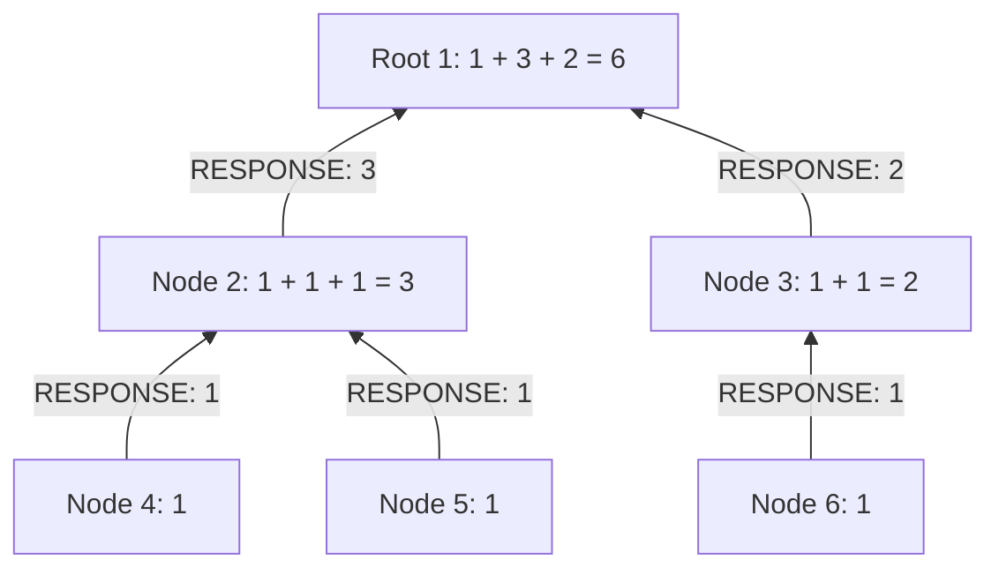

## Problem

A network is organized as a rooted tree. Each node represents a machine and knows only its own ID and the IDs of its direct children. You are given a root and an asynchronous message API:

```text
sendAsyncMessage(nodeId, message)
```

Implement `receiveMessage(fromNodeId, message)` so the root eventually obtains the number of nodes in its subtree, including itself. A node cannot read another machine's child list or call its methods directly. All communication must go through messages.

The follow-ups ask you to report the topology, handle failures and retries, support concurrent requests, and implement the asynchronous transport for runnable tests.

The count solution assumes a finite, static tree with unique node IDs. A query from an internal node counts that node's subtree. A single node returns one. If the root reaches every node, the subtree count is also the entire network count; disconnected machines require additional roots or membership information.

The implementations accept arbitrary integer IDs and caller-supplied topology, timeout, retry interval, and concurrency settings. The example's six nodes are test data. They are not built into the algorithm.

## The algorithm: requests down, totals up

Each node calculates:

```text
subtreeCount = 1 + sum(childSubtreeCounts)
```

An internal node sends a request to every child, then waits for their responses. A leaf immediately responds with one. Once an internal node has received all its child totals, it sends its own total to the caller. The root returns that total to the client.

For the example below, node 2 receives two ones and returns three. Node 3 receives one and returns two. The root calculates `1 + 3 + 2 = 6`.



Requests travel down those same edges before the illustrated responses travel up. The procedure is a distributed postorder traversal. Child responses can arrive in any order because addition does not depend on their arrival order.

## Protocol and state

There are three message kinds:

- `REQUEST(requestId)`: calculate this subtree.
- `RESPONSE(requestId, count)`: return an exact subtree count.
- `FAILED(requestId)`: this subtree could not complete within its deadline. Any attached partial count is ignored.

A node keeps two maps:

```text
active[requestId] = {
    caller,
    pendingChildren,
    partialCount = 1,
    localDeadline
}

completed[requestId] = cached response or failure
```

Initialize the entire pending-child set before sending requests. Otherwise, a fast response might arrive before the parent has recorded the child it is waiting for.

On a response, check that the sender is still pending, remove it, and add its count. Duplicate or unexpected senders have no effect. Complete only when the pending set is empty.

A duplicate request has two cases. If the calculation is active, leave its state intact. If it has completed, resend the cached result. Merely dropping a completed duplicate would prevent recovery when the original response was lost.

Request IDs identify a logical operation, including its selected root. Retries reuse the ID; independent queries use different IDs. In a service, generate these IDs at the client, for example with a UUID. This article uses descriptive IDs in tests.

## Concurrency and failures

Two queries can overlap at node 2: one asks for the entire tree, while another asks for node 2's subtree. The first result goes to node 1; the second goes directly to the client. The node has one structural parent but different callers in different request contexts.

A map keyed by request ID prevents those operations from overwriting each other. It does not prevent two child responses for the same request from racing. In Java, the complete state transition is synchronized per node. In Python, every handler runs on one event loop and contains no `await`, so callbacks cannot interrupt a state transition.

Timeouts retry only missing children. Each node uses a local monotonic deadline, and the client also limits its total wait. If a message is temporarily lost, a retry can recover the cached response. If communication remains unavailable, the query reports a timeout or a propagated failure.

A timeout establishes that the operation did not finish. It does not establish that the missing subtree is empty. Counting all configured nodes and counting only currently reachable nodes are different requirements; define which result the interviewer expects.

## Java solution

Save this as `DistributedTreeCount.java` and run it with Java 17 or newer:

```text
javac DistributedTreeCount.java
java DistributedTreeCount
```

The `Node` class has three core methods: receiving messages, finishing an operation, and retrying pending children. The `Network` class supplies a local test transport, using a configurable worker pool for deferred delivery. Nodes never wait for a child inside a worker thread.

The transport supplies the sender ID explicitly. In a real implementation of the original two-argument API, the sender is provided by the current node's connection or mailbox.

```java
import java.util.*;
import java.util.concurrent.*;
import java.util.concurrent.atomic.AtomicBoolean;

public class DistributedTreeCount {
    enum Kind { REQUEST, RESPONSE, FAILED }

    record Message(String requestId, Kind kind, long count) {}

    interface DropRule {
        boolean drop(Integer from, Integer to, Message message);
    }

    static final class State {
        final Integer parent;
        final Set<Integer> pending;
        final long deadline;
        long count = 1;

        State(Integer parent, List<Integer> children, long timeoutMillis) {
            this.parent = parent;
            this.pending = new HashSet<>(children);
            this.deadline = System.nanoTime()
                    + TimeUnit.MILLISECONDS.toNanos(timeoutMillis);
        }
    }

    static final class Node {
        final int id;
        final List<Integer> children;
        final Network network;
        final Map<String, State> active = new HashMap<>();
        final Map<String, Message> completed = new HashMap<>();

        Node(int id, List<Integer> children, Network network) {
            this.id = id;
            this.children = List.copyOf(children);
            this.network = network;
        }

        synchronized void receiveMessage(Integer from, Message message) {
            if (network.closed) {
                return;
            }
            String requestId = message.requestId();
            State state;

            if (message.kind() == Kind.REQUEST) {
                // A completed retry gets the original response.
                Message cached = completed.get(requestId);
                if (cached != null) {
                    network.sendAsyncMessage(id, from, cached);
                    return;
                }
                if (active.containsKey(requestId)) {
                    return;
                }

                // Install all pending children before sending any request.
                state = new State(from, children, network.timeoutMillis);
                active.put(requestId, state);
                for (int child : children) {
                    network.sendAsyncMessage(id, child, message);
                }
                if (!state.pending.isEmpty()) {
                    network.timer.schedule(() -> retryPending(requestId),
                            network.retryMillis, TimeUnit.MILLISECONDS);
                }
            } else {
                state = active.get(requestId);
                // Removing the sender also deduplicates its response.
                if (state == null || !state.pending.remove(from)) {
                    return;
                }
                if (message.kind() == Kind.FAILED) {
                    finish(requestId, state, Kind.FAILED);
                    return;
                }
                state.count = Math.addExact(state.count, message.count());
            }

            // Leaves finish immediately; internal nodes finish after all replies.
            if (state.pending.isEmpty()) {
                finish(requestId, state, Kind.RESPONSE);
            }
        }

        void finish(String requestId, State state, Kind kind) {
            // Called only while holding this node's monitor.
            Message response = new Message(requestId, kind, state.count);
            active.remove(requestId);
            completed.put(requestId, response);
            network.sendAsyncMessage(id, state.parent, response);
        }

        synchronized void retryPending(String requestId) {
            State state = active.get(requestId);
            if (state == null || network.closed) {
                return;
            }
            if (System.nanoTime() >= state.deadline) {
                finish(requestId, state, Kind.FAILED);
                return;
            }
            // Retry only missing children, keeping the same logical request ID.
            Message request = new Message(requestId, Kind.REQUEST, 0);
            for (int child : state.pending) {
                network.sendAsyncMessage(id, child, request);
            }
            network.timer.schedule(() -> retryPending(requestId),
                    network.retryMillis, TimeUnit.MILLISECONDS);
        }
    }

    record Query(int rootId, CompletableFuture<Long> future) {}

    static final class Network implements AutoCloseable {
        final Map<Integer, Node> nodes = new HashMap<>();
        final ConcurrentMap<String, Query> queries = new ConcurrentHashMap<>();
        final ExecutorService workers;
        final ScheduledExecutorService timer;
        final long timeoutMillis;
        final long retryMillis;
        final int deliveryCopies;
        final DropRule dropRule;
        volatile boolean closed;

        Network(Map<Integer, List<Integer>> topology, int workerCount,
                long timeoutMillis, long retryMillis, int deliveryCopies,
                DropRule dropRule) {
            if (workerCount <= 0 || timeoutMillis <= 0 || retryMillis <= 0
                    || deliveryCopies <= 0) {
                throw new IllegalArgumentException("Configuration must be positive");
            }
            // Validate registration; the input is assumed to be a static tree/forest.
            for (List<Integer> children : topology.values()) {
                if (new HashSet<>(children).size() != children.size()
                        || !topology.keySet().containsAll(children)) {
                    throw new IllegalArgumentException("Invalid child list");
                }
            }
            this.timeoutMillis = timeoutMillis;
            this.retryMillis = retryMillis;
            this.deliveryCopies = deliveryCopies;
            this.dropRule = dropRule;
            workers = Executors.newFixedThreadPool(workerCount);
            timer = Executors.newSingleThreadScheduledExecutor();
            topology.forEach((id, children) ->
                    nodes.put(id, new Node(id, children, this)));
        }

        void sendAsyncMessage(Integer from, Integer to, Message message) {
            if (closed || dropRule.drop(from, to, message)) {
                return;
            }
            // Enqueue delivery; never invoke another node inline.
            for (int copy = 0; copy < deliveryCopies; copy++) {
                workers.execute(() -> {
                    if (closed) {
                        return;
                    }
                    if (to == null) {
                        Query query = queries.get(message.requestId());
                        if (query != null) {
                            if (message.kind() == Kind.FAILED) {
                                query.future().completeExceptionally(
                                        new TimeoutException("Subtree did not finish"));
                            } else {
                                query.future().complete(message.count());
                            }
                        }
                    } else {
                        nodes.get(to).receiveMessage(from, message);
                    }
                });
            }
        }

        CompletableFuture<Long> countNodes(int rootId, String requestId) {
            if (closed || !nodes.containsKey(rootId) || requestId == null
                    || requestId.isBlank()) {
                throw new IllegalArgumentException("Invalid query");
            }
            Query fresh = new Query(rootId, new CompletableFuture<>());
            Query existing = queries.putIfAbsent(requestId, fresh);
            if (existing != null) {
                if (existing.rootId() != rootId) {
                    throw new IllegalArgumentException("Request ID belongs to another root");
                }
                return existing.future();
            }
            fresh.future().orTimeout(timeoutMillis, TimeUnit.MILLISECONDS);
            sendAsyncMessage(null, rootId, new Message(requestId, Kind.REQUEST, 0));
            return fresh.future();
        }

        public void close() {
            closed = true;
            // Let in-progress node transitions finish before stopping their timers.
            for (Node node : nodes.values()) {
                synchronized (node) {
                    node.active.clear();
                }
            }
            timer.shutdownNow();
            workers.shutdownNow();
            queries.values().forEach(query -> query.future().cancel(false));
        }
    }

    public static void main(String[] args) throws Exception {
        int workerCount = 4;
        long timeoutMillis = 2000;
        long retryMillis = 20;
        DropRule noLoss = (from, to, message) -> false;
        Map<Integer, List<Integer>> tree = Map.of(
                1, List.of(2, 3), 2, List.of(4, 5), 3, List.of(6),
                4, List.of(), 5, List.of(), 6, List.of());

        try (Network network = new Network(tree, workerCount,
                timeoutMillis, retryMillis, 1, noLoss)) {
            // Test 1: The entire example tree contains six nodes.
            System.out.println("Whole tree: " + network.countNodes(1, "whole").get());

            // Test 2: Node 2 and its two children form a three-node subtree.
            System.out.println("Subtree: " + network.countNodes(2, "subtree").get());

            // Test 3: A leaf counts itself.
            System.out.println("Leaf: " + network.countNodes(4, "leaf").get());

            // Test 4: Start both queries before waiting; node 2 participates in both.
            CompletableFuture<Long> whole = network.countNodes(1, "overlap-whole");
            CompletableFuture<Long> subtree = network.countNodes(2, "overlap-subtree");
            System.out.println("Overlapping requests: " + whole.get() + ", " + subtree.get());
        }

        // Test 5: Drop one leaf reply and duplicate all delivered messages.
        AtomicBoolean dropped = new AtomicBoolean();
        DropRule loseFirstReply = (from, to, message) ->
                message.kind() == Kind.RESPONSE
                && Objects.equals(from, 4) && Objects.equals(to, 2)
                && dropped.compareAndSet(false, true);
        int deliveryCopies = 2;
        try (Network network = new Network(tree, workerCount,
                timeoutMillis, retryMillis, deliveryCopies, loseFirstReply)) {
            System.out.println("Retry + duplicates: " + network.countNodes(1, "retry").get());
            if (!dropped.get()) {
                throw new AssertionError("The loss injection did not run");
            }

            // Test 6: Replay a completed request through the message transport.
            network.sendAsyncMessage(null, 1, new Message("retry", Kind.REQUEST, 0));
            System.out.println("Replay completed request: "
                    + network.countNodes(1, "retry").get());
        }

        // Test 7: Negative IDs are valid; null identifies the external client.
        try (Network network = new Network(Map.of(-7, List.of()), workerCount,
                timeoutMillis, retryMillis, 1, noLoss)) {
            System.out.println("Single node with a negative ID: "
                    + network.countNodes(-7, "single").get());
        }

        // Test 8: Chain length is an input variable, not part of the algorithm.
        int chainLength = 40;
        Map<Integer, List<Integer>> chain = new HashMap<>();
        for (int id = 0; id < chainLength; id++) {
            chain.put(id, id + 1 < chainLength ? List.of(id + 1) : List.of());
        }
        try (Network network = new Network(chain, workerCount,
                timeoutMillis, retryMillis, 1, noLoss)) {
            System.out.println("Chain of " + chainLength + " nodes: "
                    + network.countNodes(0, "chain").get());
        }

        // Test 9: A permanently unreachable subtree cannot yield an exact count.
        long failureTimeoutMillis = 150;
        DropRule loseChildRequests = (from, to, message) ->
                message.kind() == Kind.REQUEST && Objects.equals(to, 2);
        try (Network network = new Network(tree, workerCount,
                failureTimeoutMillis, retryMillis, 1, loseChildRequests)) {
            try {
                network.countNodes(1, "failure").get();
                throw new AssertionError("Expected a timeout");
            } catch (ExecutionException error) {
                if (!(error.getCause() instanceof TimeoutException)) {
                    throw error;
                }
                System.out.println("Permanent failure: timeout");
            }
        }
    }
}
```

The client deadline uses [Java's `CompletableFuture.orTimeout`](https://docs.oracle.com/en/java/javase/17/docs/api/java.base/java/util/concurrent/CompletableFuture.html). Completed query futures remain cached for this test session, so repeating the same root and request ID returns the original outcome.

## Python solution

This version runs on Python 3.9 or newer. It uses `asyncio` to enqueue message callbacks and schedule retries. [`loop.call_soon`](https://docs.python.org/3/library/asyncio-eventloop.html#asyncio.loop.call_soon) defers execution until a later event-loop iteration. This gives asynchronous delivery without creating a thread for every node.

The client-completion check happens inside the delivery callback. Checking before enqueueing would let two duplicate replies both schedule completion of the same future.

```python
from __future__ import annotations

import asyncio
from dataclasses import dataclass, field


@dataclass(frozen=True)
class Message:
    request_id: str
    kind: str
    count: int = 0


@dataclass
class State:
    parent: int | None
    pending: set[int]
    deadline: float
    count: int = 1
    timer: asyncio.TimerHandle | None = field(default=None, repr=False)


class Node:
    def __init__(self, node_id, children, network):
        self.node_id = node_id
        self.children = tuple(children)
        self.network = network
        self.active = {}
        self.completed = {}

    def receiveMessage(self, from_node_id, message):
        request_id = message.request_id
        if message.kind == "REQUEST":
            # Replays after completion return the cached response.
            if request_id in self.completed:
                self.network.sendAsyncMessage(
                    self.node_id, from_node_id, self.completed[request_id]
                )
                return
            if request_id in self.active:
                return

            # Install every pending child before any asynchronous delivery.
            state = State(
                from_node_id, set(self.children),
                self.network.loop.time() + self.network.timeout
            )
            self.active[request_id] = state
            for child in self.children:
                self.network.sendAsyncMessage(self.node_id, child, message)
            if state.pending:
                state.timer = self.network.loop.call_later(
                    self.network.retry_interval, self.retryPending, request_id
                )
        else:
            state = self.active.get(request_id)
            if state is None or from_node_id not in state.pending:
                return
            state.pending.remove(from_node_id)
            if message.kind == "FAILED":
                self.finish(request_id, state, "FAILED")
                return
            state.count += message.count

        if not state.pending:
            self.finish(request_id, state, "RESPONSE")

    def finish(self, request_id, state, kind):
        # All handlers run serially on the same event loop without await.
        response = Message(request_id, kind, state.count)
        del self.active[request_id]
        if state.timer is not None:
            state.timer.cancel()
        self.completed[request_id] = response
        self.network.sendAsyncMessage(self.node_id, state.parent, response)

    def retryPending(self, request_id):
        state = self.active.get(request_id)
        if state is None or self.network.closed:
            return
        if self.network.loop.time() >= state.deadline:
            self.finish(request_id, state, "FAILED")
            return
        request = Message(request_id, "REQUEST")
        for child in state.pending:
            self.network.sendAsyncMessage(self.node_id, child, request)
        state.timer = self.network.loop.call_later(
            self.network.retry_interval, self.retryPending, request_id
        )


class Network:
    def __init__(self, topology, timeout, retry_interval,
                 delivery_copies=1, drop_rule=None):
        if timeout <= 0 or retry_interval <= 0 or delivery_copies <= 0:
            raise ValueError("Configuration must be positive")
        # Registration checks; a static tree/forest is an input precondition.
        for children in topology.values():
            if len(set(children)) != len(children) or any(
                child not in topology for child in children
            ):
                raise ValueError("Invalid child list")
        self.loop = asyncio.get_running_loop()
        self.timeout = timeout
        self.retry_interval = retry_interval
        self.delivery_copies = delivery_copies
        self.drop_rule = drop_rule
        self.closed = False
        self.queries = {}
        self.nodes = {
            node_id: Node(node_id, children, self)
            for node_id, children in topology.items()
        }

    def sendAsyncMessage(self, from_node_id, to_node_id, message):
        if self.closed or (
            self.drop_rule and self.drop_rule(from_node_id, to_node_id, message)
        ):
            return
        # Queue a callback; its completion check runs at delivery time.
        def deliver():
            if self.closed:
                return
            if to_node_id is None:
                query = self.queries.get(message.request_id)
                if query is not None and not query[1].done():
                    if message.kind == "FAILED":
                        query[1].set_exception(TimeoutError("Subtree did not finish"))
                    else:
                        query[1].set_result(message.count)
            else:
                self.nodes[to_node_id].receiveMessage(from_node_id, message)

        for _ in range(self.delivery_copies):
            self.loop.call_soon(deliver)

    def countNodes(self, root_id, request_id):
        if self.closed or root_id not in self.nodes or not isinstance(
            request_id, str
        ) or not request_id.strip():
            raise ValueError("Invalid query")
        if request_id in self.queries:
            original_root, future, _ = self.queries[request_id]
            if original_root != root_id:
                raise ValueError("Request ID belongs to another root")
            return future

        future = self.loop.create_future()
        # An expired deadline is an explicit failure, never a partial count.
        deadline = self.loop.call_later(
            self.timeout,
            lambda: None if future.done() else future.set_exception(
                TimeoutError("Query deadline expired")
            )
        )
        future.add_done_callback(lambda _: deadline.cancel())
        self.queries[request_id] = (root_id, future, deadline)
        self.sendAsyncMessage(None, root_id, Message(request_id, "REQUEST"))
        return future

    def close(self):
        self.closed = True
        for _, future, deadline in self.queries.values():
            deadline.cancel()
            if not future.done():
                future.cancel()
        for node in self.nodes.values():
            for state in node.active.values():
                if state.timer is not None:
                    state.timer.cancel()


async def main():
    timeout = 2.0
    retry_interval = 0.02
    tree = {1: [2, 3], 2: [4, 5], 3: [6], 4: [], 5: [], 6: []}
    network = Network(tree, timeout, retry_interval)
    try:
        # Test 1: Count all six nodes in the example tree.
        print("Whole tree:", await network.countNodes(1, "whole"))

        # Test 2: Count node 2 and its two children.
        print("Subtree:", await network.countNodes(2, "subtree"))

        # Test 3: A leaf counts itself.
        print("Leaf:", await network.countNodes(4, "leaf"))

        # Test 4: Both queries start before either is awaited.
        whole = network.countNodes(1, "overlap-whole")
        subtree = network.countNodes(2, "overlap-subtree")
        first, second = await asyncio.gather(whole, subtree)
        print(f"Overlapping requests: {first}, {second}")
    finally:
        network.close()

    # Test 5: Drop one reply and duplicate every delivered message.
    dropped = False

    def lose_first_reply(from_id, to_id, message):
        nonlocal dropped
        if not dropped and message.kind == "RESPONSE" and from_id == 4 and to_id == 2:
            dropped = True
            return True
        return False

    delivery_copies = 2
    network = Network(tree, timeout, retry_interval, delivery_copies, lose_first_reply)
    try:
        print("Retry + duplicates:", await network.countNodes(1, "retry"))
        assert dropped, "The loss injection did not run"

        # Test 6: Replay the completed request through the transport.
        network.sendAsyncMessage(None, 1, Message("retry", "REQUEST"))
        print("Replay completed request:", await network.countNodes(1, "retry"))
        await asyncio.sleep(0)
    finally:
        network.close()

    # Test 7: None identifies the client, so a negative node ID is valid.
    network = Network({-7: []}, timeout, retry_interval)
    try:
        print("Single node with a negative ID:", await network.countNodes(-7, "single"))
    finally:
        network.close()

    # Test 8: Build a chain using a caller-chosen length.
    chain_length = 40
    chain = {
        node_id: [node_id + 1] if node_id + 1 < chain_length else []
        for node_id in range(chain_length)
    }
    network = Network(chain, timeout, retry_interval)
    try:
        print(f"Chain of {chain_length} nodes:", await network.countNodes(0, "chain"))
    finally:
        network.close()

    # Test 9: Permanently dropped child requests yield no exact result.
    failure_timeout = 0.15
    network = Network(
        tree, failure_timeout, retry_interval,
        drop_rule=lambda from_id, to_id, message:
            message.kind == "REQUEST" and to_id == 2
    )
    try:
        try:
            await network.countNodes(1, "failure")
            raise AssertionError("Expected a timeout")
        except TimeoutError:
            print("Permanent failure: timeout")
    finally:
        network.close()


if __name__ == "__main__":
    asyncio.run(main())
```

## Expected test output

Both programs instantiate the network, invoke its methods, and print:

```text
Whole tree: 6
Subtree: 3
Leaf: 1
Overlapping requests: 6, 3
Retry + duplicates: 6
Replay completed request: 6
Single node with a negative ID: 1
Chain of 40 nodes: 40
Permanent failure: timeout
```

The loss-and-duplication test removes one leaf response and delivers two copies of every remaining message. A retry with the same ID obtains the cached leaf result. Its parent still accepts that child's contribution only once.

The simulator knows the topology to register machines. The counting protocol does not inspect that global configuration; each node communicates using only its own direct child IDs.

## Time, messages, and space

Let `N` be the number of nodes reachable from the selected root and `H` the tree height.

Without retries or duplicate delivery:

- **Total processing: O(N).** Each node initializes its state once, and each child contribution is accepted once. The sum of all child-list lengths is `N − 1`.
- **Tree messages: 2(N − 1).** Each edge carries one request down and one response up, plus constant client communication.
- **Ideal communication depth: O(H).** Children proceed in parallel. If a message takes `L` time and processing is negligible, the longest dependency path is approximately `2HL`. A finite worker pool, contention, or unequal delays can increase elapsed time.
- **Aggregate protocol state: O(N) per query.** Each node stores a small result and a pending-child set. The total number of pending-child entries is at most `N − 1`. One node with `d` children needs O(d + 1) state for that query.

For a first exact count with no precomputed subtree sizes, every reachable node can change the answer. Linear total work is therefore asymptotically optimal.

If `M` counts all message delivery attempts, including retries and duplicates, protocol work becomes O(N + M), under constant-time hash operations and bounded-size IDs and count values. There is no fixed completion-time bound under an indefinitely delayed network; configured deadlines bound the client's wait.

Both demos retain completion records until the network object is discarded. If `Q` full-tree queries have been processed, retained protocol caches can occupy O(QN) space. Transport queues add their own memory usage. A production implementation needs admission limits, backpressure, and a retention policy covering the permitted retry interval. Evicting cached results too soon can turn a late retry into a second computation.

## Follow-up: return the topology

The same coordination can produce an ordered representation:

```text
1(2(4,5),3(6))
```

A leaf contributes its ID. An internal node stores each child's result under that child's ID, then combines them in its original child-list order. A faster response from node 3 must not move it ahead of node 2.

There is a cost to repeatedly forwarding complete subtree strings. A descendant's text is copied once per ancestor. Total serialization and transmitted characters can be O(NH), and a chain can require O(N²) work when IDs have bounded length. The linear message count alone does not make this string version linear.

If the interviewer asks for an asymptotically efficient topology export and any node can address the root through the given API, add a separate `ADJACENCY` report:

1. Include the original root ID in the request. Each visited node reports its own ID and ordered direct-child list to that root.
2. Keep the count aggregation unchanged. The root deduplicates adjacency reports by sender ID.
3. Wait for both the final count `N` and exactly `N` distinct reports, including the root's own report. Reports can arrive after the count.
4. Serialize the collected adjacency map with an iterative traversal, collecting fragments and joining them once.

For a tree, the reports contain `N` IDs and `N − 1` child references. This approach uses O(N) logical messages, O(N) identifier entries, and O(N + K) root-side processing, where `K` is the output length. Physical routing can add hops if the transport does not provide direct addressing.

For reliable export, acknowledge each report and retry it independently with the same request ID. A root that has received the final count but is missing a report must keep waiting or fail explicitly.

## Follow-up: crashes and changing topology

The implementations model delayed, lost, and duplicated messages. Their state is in memory. They do not provide recovery after a process loses that state.

For a crash-restart requirement, persist enough information to recover the request context, accepted child responses, and final response, or recompute under a retained immutable topology version. Persist state before acknowledging the corresponding progress. A restarted child can then replay its result, and a parent can still reject duplicate contributions.

A permanent failure creates a different limit. If a subtree's membership is unknown and its machine never returns, an exact current count cannot be inferred from silence. The API can report failure, or expose a partial count together with the unresolved branches. It must identify which result it is returning.

If nodes can be added or removed during a query, specify a topology version or consistent snapshot. Otherwise, the traversal can observe different generations of the tree and return a result that never described a single moment.

## Follow-up: a DAG or general graph

A shared descendant can be counted twice by subtree summation. A cycle can leave nodes waiting on one another. Request IDs alone do not solve either case.

For a tree question, state the tree assumption and use the linear aggregation above. For a graph follow-up, first define how a spanning tree is discovered, which request owns a newly visited node, and how already-visited edges acknowledge completion. Distributed discovery also needs a termination rule. Once ownership gives each reachable node exactly one counting parent, the same aggregation can run over that spanning tree.
