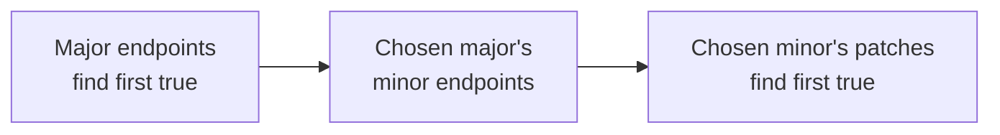

## Problem

A project depends on a library with a catalog of published versions. An expensive black-box API tells you whether a particular version supports a fixed feature or workload:

```text
isSupported(version) -> boolean
```

Return the numerically earliest supported version in the catalog, or `null` in Java and `None` in Python if none works. Minimize calls to the black box. Local parsing and indexing are much cheaper than compiling, deploying, or running a compatibility test for every release.

The interesting follow-up allows support to reset when a new minor or major starts. The guarantees concern the hierarchy of existing releases:

1. Within one `(major, minor)` group, support is a false prefix followed by a true suffix. Either part can be empty.
2. Within one major, the predicate “this minor contains at least one supported version” is false-to-true across the existing minor groups.
3. Across existing major groups, the predicate “this major contains at least one supported version” is false-to-true.

These are input guarantees. They cannot be established by observing a few successful tests, and they are not consequences of the version numbers themselves. Without sufficient monotonicity guarantees, an untested earlier release can still be the answer.

### Version format and input contract

The catalog is already strictly increasing by numeric `(major, minor, patch)` order. Missing release numbers are allowed: `3.2.8` can follow `3.2.0`, and major `8` can follow major `3`. Search the supplied releases; do not invent intermediate versions to probe.

The implementations include the attachment's optional abbreviated-input variant: `12` means `12.0.0`, and `12.3` means `12.3.0`. Leading zeros are accepted and normalized, so `001.002.003` means `1.2.3`. Each component is an ASCII nonnegative integer that fits in a signed 64-bit value. This shared implementation bound avoids silent numeric overflow; arbitrary-precision components would need a different representation.

This is a project-specific numeric format. [SemVer 2.0.0](https://semver.org/spec/v2.0.0.html) requires three components for a normal version and disallows leading zeros; it also defines prerelease and build-metadata syntax. Those suffixes are outside this exercise. The search guarantees must be supplied separately even when a catalog follows strict SemVer.

Reject malformed strings, out-of-order input, and duplicate normalized triples before making API calls. In particular, `12` and `12.0.0` cannot appear as two separate catalog entries under this contract. Pass the **original supplied string** to the checker, but return a canonical three-component result. Support results must be deterministic for the duration of one call, with a fixed catalog, workload, and artifact interpretation.

## Why one binary search is not enough

A linear scan checks versions in numeric order and returns the first supported one. It is correct for any support pattern, but can require `N` expensive calls.

If support is globally monotone, a single boundary binary search reduces that cost to `O(log N)` calls. For example, it works for:

```text
F F F T T T T
```

The hierarchical problem permits this different pattern:

<div class="table-scroll" role="region" aria-label="Library version support with group resets" tabindex="0">

| Version | Supported | Group |
| --- | --- | --- |
| `1.0.0` | false | major 1, minor 0 |
| `1.0.1` | true | major 1, minor 0 |
| `1.1.0` | false | major 1, minor 1 |
| `1.1.1` | false | major 1, minor 1 |
| `1.1.2` | true | major 1, minor 1 |
| `2.0.0` | false | major 2, minor 0 |
| `2.0.1` | true | major 2, minor 0 |

</div>

The flat sequence is `F T F F T F T`. A conventional flat binary search first probes `1.1.1`, sees false, and discards everything through that index. It can eventually return `2.0.1` while missing the correct answer, `1.0.1`.

Each patch group is monotone, however. Both minors in major 1 contain support, and both majors contain support. All three hierarchical guarantees hold.

## A group's last release answers an existence question

For one minor, patch monotonicity gives:

```text
minor contains support <=> its last existing patch is supported
```

If the last patch is false, every earlier patch in that minor is false. If it is true, the group contains a supported member.

For a major, use the guarantees in sequence. If any minor contains support, every later existing minor also contains support. Therefore the last minor does. Within that last minor, the final patch is supported. Thus:

```text
major contains support <=> its last existing version is supported
```

The first release of a group cannot serve as this representative. A group can start with false and become true later.

This proof is the reason the algorithm can discard whole groups. Patch monotonicity alone would not justify binary-searching majors: a supported earlier minor could otherwise be followed by an entirely unsupported last minor. Both levels of the existence guarantee matter.

## Three boundary searches, performed in sequence

Parse the input and maintain a half-open candidate range `[start, end)` in the sorted catalog. At each level, record the last index of every group within that range. These indices form the representative list for the next binary search.



*The searches run one after another. Their probe counts add; they are not three nested binary-search loops over every combination.*

Search major endpoints first. Keep the first major with a true representative. Search its minor endpoints next. Finally search the actual releases of the selected minor. At the patch level, every distinct patch is its own group.

Cache checker results by catalog index within this search. The same version can be the representative of a major, a minor, and a patch. A cached false result must be reused just as a cached true result is. If the checker raises an exception, propagate it; a timeout is not evidence that a version is unsupported.

The implementations construct endpoint lists only for the current range. No explicit tree or dictionary of every possible version number is necessary. At most three passes over progressively smaller ranges keep local preprocessing linear.

### Walk through the reset example

<div class="table-scroll" role="region" aria-label="Hierarchical library version search walkthrough" tabindex="0">

| Stage | Representatives | Support | Retained range |
| --- | --- | --- | --- |
| Major | `1.1.2`, `2.0.1` | `T T` | All of major 1 |
| Minor within major 1 | `1.0.1`, `1.1.2` | `T T` | Minor 1.0 |
| Patch within minor 1.0 | `1.0.0`, `1.0.1` | `F T` | Version `1.0.1` |

</div>

With the midpoint convention used below, the actual new API probes are `2.0.1`, `1.1.2`, `1.0.1`, and `1.0.0`: four calls. Later stages reuse previously observed representatives. Caching reduces calls without changing which ranges are discarded.

## Why the returned version is the earliest

The first search finds the smallest major that contains any supported version. Every smaller major can therefore be excluded. Within the chosen major, the second search finds the smallest minor containing support, excluding all smaller minors in that major. The last search finds the first supported patch in that minor.

Version order compares major first, then minor, then patch. The selected release is therefore the earliest supported triple in the entire catalog. If the major search finds no true representative, the representative equivalence proves that no version works.

Once a supported parent has been selected, its child search must succeed under the guarantees. The code still handles a missing boundary, but that is not a full validation of monotonicity. Verifying an arbitrary black box over the whole catalog would require additional calls.

## Java solution

Save as `EarliestSupportedVersion.java` and run with Java 17 or later. There are two core methods: `findEarliestSupported` and `firstTrue`. `Version` handles the input representation, while `MockChecker` supplies observable tests for the expensive API.

```java
import java.util.*;
import java.util.function.Predicate;

public class EarliestSupportedVersion {
    public record Version(String original, List<Long> parts) implements Comparable<Version> {
        static Version parse(String text) {
            if (text == null || !text.matches("[0-9]+(?:\\.[0-9]+){0,2}")) {
                throw new IllegalArgumentException("Invalid numeric version");
            }
            List<Long> parts = new ArrayList<>();
            for (String part : text.split("\\.")) {
                parts.add(Long.parseLong(part));
            }
            // Three fields are part of the version format, not an input-size limit.
            while (parts.size() < 3) parts.add(0L);
            return new Version(text, List.copyOf(parts));
        }

        @Override
        public int compareTo(Version other) {
            for (int i = 0; i < parts.size(); i++) {
                int comparison = Long.compare(parts.get(i), other.parts.get(i));
                if (comparison != 0) return comparison;
            }
            return 0;
        }

        String canonical() {
            StringJoiner result = new StringJoiner(".");
            for (long part : parts) result.add(Long.toString(part));
            return result.toString();
        }
    }

    public String findEarliestSupported(List<String> catalog, Predicate<String> checker) {
        Objects.requireNonNull(catalog);
        Objects.requireNonNull(checker);

        // Validate and parse everything before spending any API calls.
        List<Version> versions = new ArrayList<>();
        for (String text : catalog) {
            Version version = Version.parse(text);
            if (!versions.isEmpty() && versions.get(versions.size() - 1).compareTo(version) >= 0) {
                throw new IllegalArgumentException("Catalog must be strictly increasing after normalization");
            }
            versions.add(version);
        }
        if (versions.isEmpty()) return null;

        // Each selected parent range contains complete child groups.
        Map<Integer, Boolean> cache = new HashMap<>();
        int start = 0, end = versions.size();
        for (int level = 0; level < versions.get(0).parts.size(); level++) {
            List<Integer> endpoints = new ArrayList<>();
            for (int i = start; i < end; i++) {
                if (i + 1 == end || !versions.get(i).parts.get(level)
                        .equals(versions.get(i + 1).parts.get(level))) {
                    endpoints.add(i);
                }
            }
            int group = firstTrue(endpoints, versions, checker, cache);
            if (group == endpoints.size()) return null;
            start = group == 0 ? start : endpoints.get(group - 1) + 1;
            end = endpoints.get(group) + 1;
        }
        return versions.get(start).canonical();
    }

    private int firstTrue(List<Integer> endpoints, List<Version> versions,
                          Predicate<String> checker, Map<Integer, Boolean> cache) {
        int left = 0, right = endpoints.size();
        while (left < right) {
            int middle = left + (right - left) / 2;
            int index = endpoints.get(middle);
            Boolean supported = cache.get(index);
            if (supported == null) {
                supported = checker.test(versions.get(index).original);
                cache.put(index, supported);
            }
            if (supported) right = middle;
            else left = middle + 1;
        }
        return left;
    }

    public static final class MockChecker implements Predicate<String> {
        private final Set<String> supported;
        private int calls;

        public MockChecker(Set<String> supported) {
            this.supported = Set.copyOf(supported);
        }

        @Override
        public boolean test(String version) {
            calls++;
            return supported.contains(version);
        }

        public int getCalls() {
            return calls;
        }
    }

    public static void main(String[] args) {
        EarliestSupportedVersion solver = new EarliestSupportedVersion();
        List<List<String>> catalogs = new ArrayList<>();
        List<Set<String>> supported = new ArrayList<>();
        List<String> labels = new ArrayList<>();

        // Test 1: Support resets at new minors and majors; flat binary search fails.
        labels.add("Group resets");
        catalogs.add(List.of("1.0.0", "1.0.1", "1.1.0", "1.1.1", "1.1.2", "2.0.0", "2.0.1"));
        supported.add(Set.of("1.0.1", "1.1.2", "2.0.1"));

        // Test 2: Skip an unsupported major and minor; release numbers have gaps.
        labels.add("Sparse releases");
        catalogs.add(List.of("1.0.0", "1.0.5", "3.2.0", "3.2.8", "3.9.1", "3.9.7", "8.0.2", "8.0.4"));
        supported.add(Set.of("3.9.7", "8.0.4"));

        // Test 3: No major contains support; a false last-major representative suffices.
        labels.add("No support");
        catalogs.add(List.of("1.0.0", "1.0.1", "2.0.0"));
        supported.add(Set.of());

        // Test 4: Every release works, so return the first catalog entry.
        labels.add("All supported");
        catalogs.add(List.of("1.0.0", "1.0.1", "2.0.0"));
        supported.add(Set.of("1.0.0", "1.0.1", "2.0.0"));

        // Test 5: Missing fields default to zero; the checker receives original strings.
        labels.add("Abbreviated forms");
        catalogs.add(List.of("11.9.9", "12", "12.0.9", "12.3", "12.3.1", "13"));
        supported.add(Set.of("12", "12.0.9", "12.3.1", "13"));

        // Test 6: Leading zeros are allowed by this numeric-format variant.
        labels.add("Leading zeros");
        catalogs.add(List.of("001.002.000", "001.002.001", "001.003.000", "001.003.002"));
        supported.add(Set.of("001.002.001", "001.003.002"));

        // Test 7: Numeric minor ordering puts 12.10 after 12.9.
        labels.add("Numeric ordering");
        catalogs.add(List.of("12.9.4", "12.10.0", "12.10.1", "13.0.0", "13.0.2"));
        supported.add(Set.of("12.10.1", "13.0.2"));

        // Test 8: One release needs only one probe, despite three search levels.
        labels.add("Single release");
        catalogs.add(List.of("7"));
        supported.add(Set.of("7"));

        // Test 9: An empty catalog needs no API call.
        labels.add("Empty catalog");
        catalogs.add(List.of());
        supported.add(Set.of());

        for (int i = 0; i < catalogs.size(); i++) {
            MockChecker checker = new MockChecker(supported.get(i));
            String result = solver.findEarliestSupported(catalogs.get(i), checker);
            System.out.println(labels.get(i) + ": " + result + " (API calls: " + checker.getCalls() + ")");
        }

        // Test 10: Normalized aliases are rejected before the checker is invoked.
        MockChecker checker = new MockChecker(Set.of());
        try {
            solver.findEarliestSupported(List.of("12", "12.0.0"), checker);
        } catch (IllegalArgumentException expected) {
            System.out.println("Duplicate aliases: rejected (API calls: " + checker.getCalls() + ")");
        }
    }
}
```

## Python solution

This version runs on Python 3.9 or later. Components use the same signed-64-bit upper bound as Java. Normalize leading zeros before conversion, and reject an oversized significant component before calling `int`; this also avoids depending on the interpreter's long-decimal conversion limit.

```python
from dataclasses import dataclass
import re
from typing import Callable, Dict, List, Optional, Sequence, Set, Tuple


@dataclass(frozen=True)
class Version:
    original: str
    parts: Tuple[int, int, int]

    @staticmethod
    def parse(text: str) -> "Version":
        if not isinstance(text, str) or re.fullmatch(r"[0-9]+(?:\.[0-9]+){0,2}", text) is None:
            raise ValueError("Invalid numeric version")
        maximum = (1 << 63) - 1
        parts = []
        for part in text.split("."):
            digits = part.lstrip("0") or "0"
            if len(digits) > len(str(maximum)) or int(digits) > maximum:
                raise ValueError("Version component exceeds the supported integer range")
            parts.append(int(digits))
        # Three fields are part of the version format, not an input-size limit.
        parts.extend([0] * (3 - len(parts)))
        return Version(text, tuple(parts))

    def canonical(self) -> str:
        return ".".join(str(part) for part in self.parts)


class EarliestSupportedVersion:
    def find_earliest_supported(self, catalog: Sequence[str],
                                checker: Callable[[str], bool]) -> Optional[str]:
        if catalog is None or not callable(checker):
            raise ValueError("Catalog and callable checker are required")

        # Validate and parse everything before spending any API calls.
        versions = []
        for text in catalog:
            version = Version.parse(text)
            if versions and versions[-1].parts >= version.parts:
                raise ValueError("Catalog must be strictly increasing after normalization")
            versions.append(version)
        if not versions:
            return None

        # Each selected parent range contains complete child groups.
        cache: Dict[int, bool] = {}
        start, end = 0, len(versions)
        for level in range(len(versions[0].parts)):
            endpoints = [index for index in range(start, end)
                         if index + 1 == end
                         or versions[index].parts[level] != versions[index + 1].parts[level]]
            group = self._first_true(endpoints, versions, checker, cache)
            if group == len(endpoints):
                return None
            start = start if group == 0 else endpoints[group - 1] + 1
            end = endpoints[group] + 1
        return versions[start].canonical()

    def _first_true(self, endpoints: List[int], versions: List[Version],
                    checker: Callable[[str], bool], cache: Dict[int, bool]) -> int:
        left, right = 0, len(endpoints)
        while left < right:
            middle = left + (right - left) // 2
            index = endpoints[middle]
            if index not in cache:
                cache[index] = checker(versions[index].original)
            if cache[index]:
                right = middle
            else:
                left = middle + 1
        return left


class MockChecker:
    def __init__(self, supported: Set[str]):
        self.supported = set(supported)
        self.calls = 0

    def __call__(self, version: str) -> bool:
        self.calls += 1
        return version in self.supported


def main():
    solver = EarliestSupportedVersion()
    cases = []

    # Test 1: Support resets at new minors and majors; flat binary search fails.
    cases.append(("Group resets",
                  ["1.0.0", "1.0.1", "1.1.0", "1.1.1", "1.1.2", "2.0.0", "2.0.1"],
                  {"1.0.1", "1.1.2", "2.0.1"}))

    # Test 2: Skip an unsupported major and minor; release numbers have gaps.
    cases.append(("Sparse releases",
                  ["1.0.0", "1.0.5", "3.2.0", "3.2.8", "3.9.1", "3.9.7", "8.0.2", "8.0.4"],
                  {"3.9.7", "8.0.4"}))

    # Test 3: No major contains support; a false last-major representative suffices.
    cases.append(("No support", ["1.0.0", "1.0.1", "2.0.0"], set()))

    # Test 4: Every release works, so return the first catalog entry.
    cases.append(("All supported", ["1.0.0", "1.0.1", "2.0.0"], {"1.0.0", "1.0.1", "2.0.0"}))

    # Test 5: Missing fields default to zero; the checker receives original strings.
    cases.append(("Abbreviated forms", ["11.9.9", "12", "12.0.9", "12.3", "12.3.1", "13"],
                  {"12", "12.0.9", "12.3.1", "13"}))

    # Test 6: Leading zeros are allowed by this numeric-format variant.
    cases.append(("Leading zeros", ["001.002.000", "001.002.001", "001.003.000", "001.003.002"],
                  {"001.002.001", "001.003.002"}))

    # Test 7: Numeric minor ordering puts 12.10 after 12.9.
    cases.append(("Numeric ordering", ["12.9.4", "12.10.0", "12.10.1", "13.0.0", "13.0.2"],
                  {"12.10.1", "13.0.2"}))

    # Test 8: One release needs only one probe, despite three search levels.
    cases.append(("Single release", ["7"], {"7"}))

    # Test 9: An empty catalog needs no API call.
    cases.append(("Empty catalog", [], set()))

    for label, catalog, supported in cases:
        checker = MockChecker(supported)
        result = solver.find_earliest_supported(catalog, checker)
        print(f"{label}: {'null' if result is None else result} (API calls: {checker.calls})")

    # Test 10: Normalized aliases are rejected before the checker is invoked.
    checker = MockChecker(set())
    try:
        solver.find_earliest_supported(["12", "12.0.0"], checker)
    except ValueError:
        print(f"Duplicate aliases: rejected (API calls: {checker.calls})")


if __name__ == "__main__":
    main()
```

## Expected output

Both complete programs print:

```text
Group resets: 1.0.1 (API calls: 4)
Sparse releases: 3.9.7 (API calls: 4)
No support: null (API calls: 1)
All supported: 1.0.0 (API calls: 3)
Abbreviated forms: 12.0.0 (API calls: 4)
Leading zeros: 1.2.1 (API calls: 3)
Numeric ordering: 12.10.1 (API calls: 4)
Single release: 7.0.0 (API calls: 1)
Empty catalog: null (API calls: 0)
Duplicate aliases: rejected (API calls: 0)
```

## Complexity

Let `N` be the number of catalog entries, `C` the total number of characters in their supplied strings, `M` the number of major groups, `m` the number of minors in the selected major, and `p` the number of patches in the selected minor.

**Expensive API calls:** `O(log(M + 1) + log(m + 1) + log(p + 1))`. Each stage halves an ordered list of representatives. Its number of midpoint evaluations is at most `ceil(log2(group_count + 1))`. The cache can eliminate repeated evaluations of the same version across stages. If no major works, the algorithm stops after the major search; an empty catalog requires zero calls.

The `+1` makes the notation meaningful for a group containing a single release. That release still needs a probe unless a previous stage cached it.

With three fixed hierarchy levels and every group count at most `N`, the query bound is also `O(log(N + 1))`. It is asymptotically optimal in the worst case: even the globally monotone special case admits `N + 1` different answers, consisting of each possible first-supported release and “none.” A Boolean probe supplies at most one bit of information, requiring `Omega(log(N + 1))` probes in the worst case. This is an asymptotic claim, not a claim that the implementation uses the fewest possible calls on every individual instance.

**Local time:** `O(C + N)` expected, excluding checker execution time. Parsing and validation scan the strings; comparing the three bounded integer components is constant work. Endpoint construction scans the full catalog once, then only the selected major, then only the selected minor: at most three catalog-length scans. Binary-search and expected hash-cache work fit within the same bound. No sorting is performed. For bounded-size version strings, this is `O(N)` local time.

**Additional space:** `O(N)` retained state for parsed versions and representative indices, plus `O(L)` temporary parsing space for the longest supplied string of length `L`. The per-search cache contains at most the number of distinct probes. Original strings are referenced without rebuilding the catalog's text. With bounded-size strings, the total auxiliary bound is `O(N)`.

The local linear work is intentional: the optimization targets expensive support checks. A catalog that already exposes indexed hierarchy boundaries could avoid rebuilding them for each search.

## Interpretations to clarify before coding

If the interviewer guarantees global monotonicity, use a single first-true binary search over the numeric ordering. If only patches are monotone and minor or major existence can alternate arbitrarily, the hierarchical binary searches above are not justified. Checking group endpoints in order can still help, but searching all groups may require linear calls. With no structure at all, worst-case exact search requires `N` probes because any skipped release could be the sole supported one.

If the catalog arrives unsorted, parse and sort it before grouping, adding `O(N log N)` comparisons. Sorting numeric triples does not create monotonic support. If aliases or metadata variants represent distinct artifacts with potentially different results, define their tie-breaking and representative rules first; the normalized-unique contract used here deliberately avoids that ambiguity.

For a real remote checker, include timeout, retry, and rate-limit policy outside the search logic. Count retries separately from logical probes. Pin the workload and artifact inputs before caching, and leave failed calls distinguishable from valid false responses. The group representative is a proof-backed shortcut only while its promised support structure holds.
