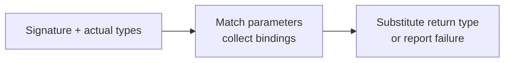

## Problem

Represent a small type system, print its types and function signatures, and infer a function's concrete return type from the types of its actual arguments.

A type is either a named leaf or a tuple of types:

```text
int
T1
[int,string]
[T1,[int,T2]]
```

A function has an ordered list of parameter types and one return type. For example:

```text
(T1,[int,T2]) -> [T2,T1]
```

Calling this function with argument types `(string,[int,float])` binds `T1` to `string` and `T2` to `float`. The inferred return type is `[float,string]`.

The input consists of type objects that have already been constructed. Building a parser for source text and evaluating instructions such as `x = 5` are separate problems. This exercise operates on type information.

### Contract and boundary cases

- A generic name is exactly `T` followed by zero or more ASCII digits: `T`, `T1`, and `T27` are generic. `Tree`, `T_value`, and `T1x` are concrete names. Generic names are case-sensitive; `T01` and `T1` are distinct.
- Other names are concrete identifiers. Equality is exact: `str` and `string` are distinct unless the problem explicitly defines aliases. There are no implicit conversions, subtyping, or numeric widening.
- A generic can bind to a concrete leaf or an entire nested tuple. Every occurrence of the same generic must have the same structural type throughout one call.
- Actual argument types must be **ground**: they contain no generics, even inside a tuple. The function signature may contain generics.
- Tuples preserve order and length. An empty tuple `[]` is valid and differs from a function with zero arguments. There is no fixed tuple width, argument count, or generic count.
- A valid call must bind every generic used in the return type. A mismatch, unresolved return generic, or non-ground actual argument returns Java `null` or Python `None`.
- Constructors reject malformed type objects, such as a node with both a name and children. Such objects differ from well-formed types that simply do not match a signature.

This contract includes bare `T` as well as numbered generics. If an interview supplies a different generic naming rule, change that rule in the type model; the inference algorithm stays the same.

## Represent types as immutable trees

A leaf stores its name. A tuple stores an ordered sequence of children. The distinction is explicit: a leaf has no child sequence, while an empty tuple has an empty child sequence.

```text
[T1,[int,T2]]

tuple
  T1
  tuple
    int
    T2
```

Printing follows this structure. A leaf prints its name. A tuple prints `[` followed by comma-separated children and `]`. A function prints its comma-separated parameters in parentheses, followed by ` -> ` and its return type.

Immutability matters when a generic binds to a large tuple. The binding map can retain a reference to that tuple, and the result can reuse it safely. No deep copy is necessary. Both implementations defensively copy child sequences and parameter sequences into immutable containers.

The type formatter uses an explicit stack and one output buffer. Recursively constructing a new string for every parent can repeatedly copy the same nested content. Appending tokens to one buffer avoids that cost.

## The algorithm: match, bind, substitute

Maintain a fresh hash map from generic names to concrete type trees for each inference call. First validate that all actual arguments are ground. Then match each parameter against its corresponding argument.

There are three matching cases:

1. **Generic parameter:** record its actual type on the first occurrence. On a later occurrence, structurally compare the actual type with the saved binding.
2. **Concrete leaf:** the actual type must be a leaf with exactly the same name.
3. **Tuple parameter:** the actual type must be a tuple of the same length. Match their corresponding children recursively.

After every parameter matches, walk the return template. Keep concrete leaves, replace generics with their saved bindings, and construct tuples from their substituted children. If a generic has no binding, the concrete result cannot be determined.



*The bindings belong to one call. A failed call cannot leave state behind for the next call.*

### A worked example

```text
Signature: (T1,T2,int,T1) -> [T1,T2]
Arguments: (int,char,int,int)
```

<div class="table-scroll" role="region" aria-label="Generic inference walkthrough" tabindex="0">

| Position | Parameter | Actual | Action |
| --- | --- | --- | --- |
| First | `T1` | `int` | Bind `T1 = int` |
| Second | `T2` | `char` | Bind `T2 = char` |
| Third | `int` | `int` | Concrete types match |
| Fourth | `T1` | `int` | Confirm the existing `T1 = int` binding |
| Return | `[T1,T2]` | — | Substitute to get `[int,char]` |

</div>

Changing the last argument to `char` makes the call fail. Replacing the first binding at that point would erase a constraint that an earlier parameter already imposed.

A generic can also absorb an entire tuple:

```text
Signature: (int,T1,[T2,int]) -> T1
Arguments: (int,[int,string],[float,int])
Bindings:  T1 = [int,string], T2 = float
Result:    [int,string]
```

For `(T) -> [T,T]` with argument `[int,string]`, the result is `[[int,string],[int,string]]`. A tuple's children are not additional function arguments: there is one argument here.

### Why this is correct

After each successful match, the binding map satisfies every constraint examined so far. A new generic records the only possible binding at that position. A repeated generic succeeds only when that same binding fits again. Concrete leaves and tuple shapes are checked directly; matching tuple children preserves the invariant recursively.

Therefore, if parameter matching succeeds, all parameter constraints hold simultaneously. Substitution then visits every return-template position and uses exactly those bindings. It produces the required concrete type if all return generics are bound, and reports failure otherwise.

No search or backtracking is needed. Actual types are concrete, so each generic's first occurrence determines its binding. This is one-way type matching. Allowing unknowns on both sides would require additional rules for variable-to-variable bindings and recursive constraints.

## Java solution

Save as `GenericTypeInference.java` and run with Java 17 or later. The inference class has three core methods: `infer`, `match`, and `substitute`. The remaining methods belong to the immutable type and function models or to the executable tests.

```java
import java.util.*;

public class GenericTypeInference {
    public record Type(String name, List<Type> children) {
        public Type {
            if ((name == null) == (children == null)) {
                throw new IllegalArgumentException("Provide a name or children, exclusively");
            }
            if (name != null && !name.matches("[A-Za-z_][A-Za-z0-9_]*")) {
                throw new IllegalArgumentException("Invalid type name");
            }
            if (children != null) children = List.copyOf(children);
        }

        public static Type leaf(String name) {
            return new Type(Objects.requireNonNull(name), null);
        }

        public static Type tuple(Type... children) {
            return new Type(null, Arrays.asList(children));
        }

        public boolean isGeneric() {
            return name != null && name.matches("T[0-9]*");
        }

        @Override
        public String toString() {
            StringBuilder output = new StringBuilder();
            Deque<Object> pending = new ArrayDeque<>();
            pending.push(this);
            while (!pending.isEmpty()) {
                Object item = pending.pop();
                if (item instanceof String token) {
                    output.append(token);
                } else {
                    Type node = (Type) item;
                    if (node.name != null) {
                        output.append(node.name);
                    } else {
                        pending.push("]");
                        for (int i = node.children.size() - 1; i >= 0; i--) {
                            pending.push(node.children.get(i));
                            if (i > 0) pending.push(",");
                        }
                        pending.push("[");
                    }
                }
            }
            return output.toString();
        }
    }

    public record Function(List<Type> parameters, Type result) {
        public Function {
            parameters = List.copyOf(parameters);
            Objects.requireNonNull(result);
        }

        @Override
        public String toString() {
            StringJoiner args = new StringJoiner(",", "(", ")");
            for (Type parameter : parameters) args.add(parameter.toString());
            return args + " -> " + result;
        }
    }

    public Type infer(Function function, List<Type> actual) {
        Objects.requireNonNull(function);
        Objects.requireNonNull(actual);
        if (function.parameters.size() != actual.size()) return null;

        // Validate every actual subtree, including those absorbed by a generic.
        Deque<Type> pending = new ArrayDeque<>(actual);
        while (!pending.isEmpty()) {
            Type node = pending.pop();
            if (node.isGeneric()) return null;
            if (node.children != null) pending.addAll(node.children);
        }

        // Bindings are local, so calls cannot contaminate one another.
        Map<String, Type> bindings = new HashMap<>();
        for (int i = 0; i < actual.size(); i++) {
            if (!match(function.parameters.get(i), actual.get(i), bindings)) return null;
        }
        return substitute(function.result, bindings);
    }

    private boolean match(Type expected, Type actual, Map<String, Type> bindings) {
        if (expected.isGeneric()) {
            Type bound = bindings.get(expected.name);
            if (bound == null) {
                bindings.put(expected.name, actual);
                return true;
            }
            // The saved binding is ground, so this checks structural equality.
            return match(bound, actual, bindings);
        }
        if (expected.name != null) return expected.name.equals(actual.name);
        if (actual.children == null || expected.children.size() != actual.children.size()) {
            return false;
        }
        for (int i = 0; i < expected.children.size(); i++) {
            if (!match(expected.children.get(i), actual.children.get(i), bindings)) return false;
        }
        return true;
    }

    private Type substitute(Type node, Map<String, Type> bindings) {
        if (node.isGeneric()) return bindings.get(node.name);
        if (node.name != null) return node;
        List<Type> children = new ArrayList<>();
        for (Type child : node.children) {
            Type resolved = substitute(child, bindings);
            if (resolved == null) return null;
            children.add(resolved);
        }
        return new Type(null, children);
    }

    public static void main(String[] args) {
        GenericTypeInference solver = new GenericTypeInference();
        Type integer = Type.leaf("int"), character = Type.leaf("char");
        Type string = Type.leaf("string"), decimal = Type.leaf("float");
        Type t = Type.leaf("T"), t1 = Type.leaf("T1"), t2 = Type.leaf("T2");

        // Test 1: Print the nested type model and its complete function signature.
        Function nested = new Function(
                List.of(t1, Type.tuple(integer, t2)), Type.tuple(t2, t1));
        System.out.println("Type: " + Type.tuple(t1, Type.tuple(integer, t2)));
        System.out.println("Function: " + nested);

        // Test 2: Bind two generics and verify a repeated occurrence.
        Function repeated = new Function(List.of(t1, t2, integer, t1), Type.tuple(t1, t2));
        System.out.println("Basic: " + solver.infer(repeated,
                List.of(integer, character, integer, integer)));

        // Test 3: The final argument conflicts with the earlier T1 binding.
        System.out.println("Conflict: " + solver.infer(repeated,
                List.of(integer, character, integer, character)));

        // Test 4: A generic can bind to an entire tuple, including nested children.
        Function tupleResult = new Function(
                List.of(integer, t1, Type.tuple(t2, integer)), t1);
        System.out.println("Tuple binding: " + solver.infer(tupleResult,
                List.of(integer, Type.tuple(integer, string), Type.tuple(decimal, integer))));

        // Test 5: Infer through nested tuples and reorder the bindings in the result.
        System.out.println("Nested: " + solver.infer(nested,
                List.of(string, Type.tuple(integer, decimal))));

        // Test 6: Bare T is generic, and both output positions reuse its immutable binding.
        Function duplicate = new Function(List.of(t), Type.tuple(t, t));
        System.out.println("Bare T: " + solver.infer(duplicate,
                List.of(Type.tuple(integer, string))));

        // Test 7: A concrete leaf mismatch and a tuple-length mismatch both fail.
        System.out.println("Concrete mismatch: " + solver.infer(
                new Function(List.of(integer), integer), List.of(string)));
        System.out.println("Tuple arity: " + solver.infer(
                new Function(List.of(Type.tuple(t1, integer)), t1),
                List.of(Type.tuple(string, integer, decimal))));

        // Test 8: Missing arguments and unbound return generics are rejected.
        System.out.println("Argument count: " + solver.infer(repeated, List.of(integer)));
        System.out.println("Unbound return: " + solver.infer(
                new Function(List.of(integer), Type.tuple(integer, t1)), List.of(integer)));

        // Test 9: Empty tuples and zero-argument functions have distinct valid forms.
        System.out.println("Empty tuple: " + solver.infer(duplicate, List.of(Type.tuple())));
        System.out.println("No arguments: " + solver.infer(
                new Function(List.of(), Type.tuple(integer, string)), List.of()));

        // Test 10: Tree is concrete, while a generic hidden in an actual tuple is invalid.
        Type tree = Type.leaf("Tree");
        System.out.println("Concrete T prefix: " + solver.infer(
                new Function(List.of(tree), tree), List.of(tree)));
        System.out.println("Non-ground argument: " + solver.infer(
                duplicate, List.of(Type.tuple(integer, t2))));

        // Test 11: A new call starts with fresh bindings, even after previous failures.
        System.out.println("Fresh call: " + solver.infer(repeated,
                List.of(decimal, string, integer, decimal)));
    }
}
```

## Python solution

This version runs on Python 3.9 or later and uses the same three core methods. `None` is the failure result; the printed test output spells it `null` to make the two programs' expected output identical.

```python
from dataclasses import dataclass
import re
from typing import Dict, List, Optional, Tuple


@dataclass(frozen=True)
class Type:
    name: Optional[str] = None
    children: Optional[Tuple["Type", ...]] = None

    def __post_init__(self):
        if (self.name is None) == (self.children is None):
            raise ValueError("Provide a name or children, exclusively")
        if self.name is not None:
            if not isinstance(self.name, str) or not re.fullmatch(r"[A-Za-z_][A-Za-z0-9_]*", self.name):
                raise ValueError("Invalid type name")
        else:
            children = tuple(self.children)
            if not all(isinstance(child, Type) for child in children):
                raise ValueError("Children must be types")
            object.__setattr__(self, "children", children)

    @staticmethod
    def leaf(name: str) -> "Type":
        if name is None:
            raise ValueError("A leaf needs a name")
        return Type(name=name)

    @staticmethod
    def tuple(*children: "Type") -> "Type":
        return Type(children=children)

    def is_generic(self) -> bool:
        return self.name is not None and re.fullmatch(r"T[0-9]*", self.name) is not None

    def __str__(self) -> str:
        output, pending = [], [self]
        while pending:
            item = pending.pop()
            if isinstance(item, str):
                output.append(item)
            elif item.name is not None:
                output.append(item.name)
            else:
                pending.append("]")
                for index in range(len(item.children) - 1, -1, -1):
                    pending.append(item.children[index])
                    if index > 0:
                        pending.append(",")
                pending.append("[")
        return "".join(output)


@dataclass(frozen=True)
class Function:
    parameters: Tuple[Type, ...]
    result: Type

    def __post_init__(self):
        parameters = tuple(self.parameters)
        if not all(isinstance(item, Type) for item in parameters) or not isinstance(self.result, Type):
            raise ValueError("Parameters and result must be types")
        object.__setattr__(self, "parameters", parameters)

    def __str__(self) -> str:
        return "(" + ",".join(str(item) for item in self.parameters) + ") -> " + str(self.result)


class GenericTypeInference:
    def infer(self, function: Function, actual: List[Type]) -> Optional[Type]:
        if len(function.parameters) != len(actual):
            return None

        # Validate every actual subtree, including those absorbed by a generic.
        pending = list(actual)
        while pending:
            node = pending.pop()
            if node.is_generic():
                return None
            if node.children is not None:
                pending.extend(node.children)

        # Bindings are local, so calls cannot contaminate one another.
        bindings: Dict[str, Type] = {}
        for expected, argument in zip(function.parameters, actual):
            if not self.match(expected, argument, bindings):
                return None
        return self.substitute(function.result, bindings)

    def match(self, expected: Type, actual: Type, bindings: Dict[str, Type]) -> bool:
        if expected.is_generic():
            bound = bindings.get(expected.name)
            if bound is None:
                bindings[expected.name] = actual
                return True
            # The saved binding is ground, so this checks structural equality.
            return self.match(bound, actual, bindings)
        if expected.name is not None:
            return expected.name == actual.name
        if actual.children is None or len(expected.children) != len(actual.children):
            return False
        return all(self.match(left, right, bindings)
                   for left, right in zip(expected.children, actual.children))

    def substitute(self, node: Type, bindings: Dict[str, Type]) -> Optional[Type]:
        if node.is_generic():
            return bindings.get(node.name)
        if node.name is not None:
            return node
        children = []
        for child in node.children:
            resolved = self.substitute(child, bindings)
            if resolved is None:
                return None
            children.append(resolved)
        return Type(children=tuple(children))


def main():
    solver = GenericTypeInference()
    integer, character = Type.leaf("int"), Type.leaf("char")
    string, decimal = Type.leaf("string"), Type.leaf("float")
    t, t1, t2 = Type.leaf("T"), Type.leaf("T1"), Type.leaf("T2")
    cases = []

    # Test 1: Print the nested type model and its complete function signature.
    nested = Function((t1, Type.tuple(integer, t2)), Type.tuple(t2, t1))
    print("Type:", Type.tuple(t1, Type.tuple(integer, t2)))
    print("Function:", nested)

    # Test 2: Bind two generics and verify a repeated occurrence.
    repeated = Function((t1, t2, integer, t1), Type.tuple(t1, t2))
    cases.append(("Basic", solver.infer(repeated, [integer, character, integer, integer])))

    # Test 3: The final argument conflicts with the earlier T1 binding.
    cases.append(("Conflict", solver.infer(repeated, [integer, character, integer, character])))

    # Test 4: A generic can bind to an entire tuple, including nested children.
    tuple_result = Function((integer, t1, Type.tuple(t2, integer)), t1)
    cases.append(("Tuple binding", solver.infer(tuple_result,
                  [integer, Type.tuple(integer, string), Type.tuple(decimal, integer)])))

    # Test 5: Infer through nested tuples and reorder the bindings in the result.
    cases.append(("Nested", solver.infer(nested, [string, Type.tuple(integer, decimal)])))

    # Test 6: Bare T is generic, and both output positions reuse its immutable binding.
    duplicate = Function((t,), Type.tuple(t, t))
    cases.append(("Bare T", solver.infer(duplicate, [Type.tuple(integer, string)])))

    # Test 7: A concrete leaf mismatch and a tuple-length mismatch both fail.
    cases.append(("Concrete mismatch", solver.infer(Function((integer,), integer), [string])))
    cases.append(("Tuple arity", solver.infer(Function((Type.tuple(t1, integer),), t1),
                  [Type.tuple(string, integer, decimal)])))

    # Test 8: Missing arguments and unbound return generics are rejected.
    cases.append(("Argument count", solver.infer(repeated, [integer])))
    cases.append(("Unbound return", solver.infer(
                  Function((integer,), Type.tuple(integer, t1)), [integer])))

    # Test 9: Empty tuples and zero-argument functions have distinct valid forms.
    cases.append(("Empty tuple", solver.infer(duplicate, [Type.tuple()])))
    cases.append(("No arguments", solver.infer(Function((), Type.tuple(integer, string)), [])))

    # Test 10: Tree is concrete, while a generic hidden in an actual tuple is invalid.
    tree = Type.leaf("Tree")
    cases.append(("Concrete T prefix", solver.infer(Function((tree,), tree), [tree])))
    cases.append(("Non-ground argument", solver.infer(duplicate, [Type.tuple(integer, t2)])))

    # Test 11: A new call starts with fresh bindings, even after previous failures.
    cases.append(("Fresh call", solver.infer(repeated, [decimal, string, integer, decimal])))

    for label, result in cases:
        print(label + ": " + ("null" if result is None else str(result)))


if __name__ == "__main__":
    main()
```

## Expected output

Both complete programs print:

```text
Type: [T1,[int,T2]]
Function: (T1,[int,T2]) -> [T2,T1]
Basic: [int,char]
Conflict: null
Tuple binding: [int,string]
Nested: [float,string]
Bare T: [[int,string],[int,string]]
Concrete mismatch: null
Tuple arity: null
Argument count: null
Unbound return: null
Empty tuple: [[],[]]
No arguments: [int,string]
Concrete T prefix: Tree
Non-ground argument: null
Fresh call: [float,string]
```

## Complexity

Let `P` be the total size of the parameter type trees, `A` the total size of the actual argument type trees, `R` the size of the return template, and `G` the number of distinct generics bound by the call. Count each node occurrence and its child references; treat short identifier operations and hash-map operations as constant time for these bounds.

**Inference takes expected `O(P + A + R)` time.** Ground validation scans the actual types once. Parameter matching follows corresponding tree positions. At a repeated generic, comparison traverses that occurrence's actual subtree; it does not repeatedly scan all earlier arguments. Return substitution visits the return template once and reuses already immutable bound subtrees.

This is worst-case optimal in terms of total input size: a mismatch can occur at the last nested element, and an unresolved generic can occur at the last return-template position. Some individual calls terminate much earlier. Arbitrarily long identifiers add their character-processing costs; these bounds do not treat a long string comparison as free.

**Additional space is `O(A + G + R + H)`**, excluding existing input trees, where `H` is the maximum traversal depth. The explicit ground-validation stack can hold `O(A)` pending nodes for a wide tuple or many arguments. The binding map stores `O(G)` references. Substitution allocates at most `O(R)` new tuple nodes and child references, and recursive matching/substitution uses `O(H)` call-stack space. During repeated-binding comparison, traversal can descend into an actual subtree even when the parameter was just one generic leaf, so `H` includes actual-type depth.

The returned structure shares bound subtrees. If a return template repeats `T` many times, inference does not copy the full binding each time. Printing must still emit every occurrence: if the expanded textual result has `L` characters, formatting takes `O(L)` time and `O(L)` additional space for the output and pending tokens. Bounds expressed only in the number of distinct shared objects would miss this expansion.

## Interview details to keep explicit

<div class="table-scroll" role="region" aria-label="Type inference boundary cases" tabindex="0">

| Situation | Behavior under this contract | Reason |
| --- | --- | --- |
| `(T,T)` with separately constructed but equal tuples | Success | Equality is structural, not object identity |
| Tuple parameter with a leaf argument, or the reverse | Failure | Their shapes differ |
| `(T) -> []` with a concrete argument | Success | The return has no unresolved generic |
| `() -> T` with no arguments | Failure | There is no evidence that determines `T` |
| Generic nested inside an actual argument | Failure | This contract requires concrete inputs |
| `(int) -> float` with argument `int` | Return `float` | The declared return type need not equal a parameter |
| Same solver used for several calls | Independent results | Each call creates its own binding map |

</div>

An interviewer may instead allow unresolved generics to remain in the result. That is a partial-inference contract: return an unresolved type expression rather than treating it as failure. If both arguments and parameters can contain unknowns that constrain one another, specify a unification algorithm and an occurs check before accepting bindings such as `T = [T]`.

The matching and substitution code uses recursion for readable tree traversal. Nesting is not tied to any example dimensions, but runtime stack limits still apply. For adversarially deep input, use explicit traversal frames for these two operations as well; the formatter and ground validator already use explicit stacks.
