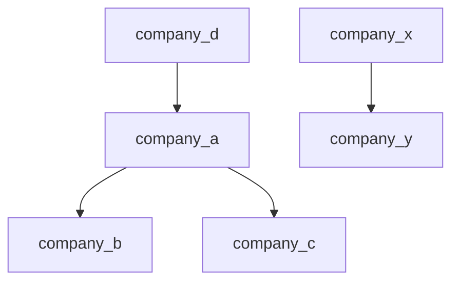

A loan names the merchant where it originated. A later transaction may name that merchant's parent or a sibling subsidiary. Comparing merchant strings directly misses a valid relationship. The task becomes easier after every company has one consistent identity: its top-level parent.

The solution has two parts: resolve the company hierarchy once, then index loans by the fields that determine a match. The request-processing methods remain small even when the surrounding interface contains many models and parsing classes.

## Problem

You receive a mapping from each parent company to its direct subsidiaries. A company appearing as a parent can itself be another company's subsidiary:

```text
company_a -> [company_b, company_c]
company_d -> [company_a]
company_x -> [company_y]
```

A loan request has fields `[loan_id, user_id, merchant, amount]`. A transaction request has the corresponding fields `[transaction_id, user_id, merchant, amount]`. Parsing is outside the algorithm; the implementations accept request objects.

1. Store each loan under the top-level company associated with its merchant.
2. For each transaction, return the loans that satisfy the matching rule.

The description leaves some business rules open. This article uses the following explicit contract:

- The hierarchy is a fixed forest: each company has at most one direct parent, and following parents eventually reaches a root. Repeated copies of the same parent-child relationship are harmless.
- A company absent from the hierarchy is an independent company whose root is itself. A company with no parent also maps to itself.
- A match requires the same user, the same top-level company, and exactly the same amount. Return all matching loans in insertion order.
- Matching is a read-only candidate lookup. It does not reserve, remove, or partially repay a loan. Repeating a transaction lookup returns the same candidates if no loan has been added.
- Loan IDs are unique across the processor. A repeated loan ID is rejected before changing stored state, including when its other fields are identical.
- Identifiers are nonempty, case-sensitive strings. Amounts are positive integers in one agreed unit and currency, such as cents, within the signed 64-bit range. Floating-point money is outside this contract.

A cycle or two different parents prevents the stated forest interpretation, so construction rejects it. If multiple owners are intentional, the task needs an additional rule about which group or groups determine a match. That is a different relationship model, discussed below.

## Example: different merchant names, one company group



Both `company_b` and `company_c` resolve to `company_d`. Their immediate parent, `company_a`, is only an intermediate step.

<div class="table-scroll" role="region" aria-label="Loans and their normalized matching keys" tabindex="0">

| Loan | User | Original merchant | Amount | Indexed key: user, root, amount |
| --- | --- | --- | ---: | --- |
| loan_1 | user_1 | company_b | 100 | user_1, company_d, 100 |
| loan_2 | user_1 | company_d | 200 | user_1, company_d, 200 |
| loan_3 | user_2 | company_c | 100 | user_2, company_d, 100 |
| loan_4 | user_1 | company_y | 300 | user_1, company_x, 300 |
| loan_5 | user_3 | independent_m | 50 | user_3, independent_m, 50 |
| loan_6 | user_1 | company_c | 100 | user_1, company_d, 100 |

</div>

Transaction `[txn_1, user_1, company_c, 100]` resolves to `(user_1, company_d, 100)`. Its candidates are `loan_1` and `loan_6`. `loan_3` shares the amount and company group, but belongs to another user. `loan_2` has the right user and group, but the wrong amount.

## Algorithm: precompute roots, then use an exact index

### 1. Reverse the hierarchy

The input supports moving from a parent to its children. Root lookup needs the opposite direction. Build `parent[child] = owner`, and collect every parent and child as a known company.

When a child already has a different parent, reject the hierarchy. Accepting the last parent encountered would make the result depend on map iteration order. An identical repeated edge leaves the parent unchanged.

### 2. Resolve every known company iteratively

Maintain `roots[company]`, containing only completed resolutions. For each unresolved company, follow parent pointers while recording the current path and its active members.

There are three possible stopping conditions:

- A company with no parent supplies its own root.
- A company already in `roots` supplies the previously computed root.
- A company encountered twice in the current path identifies a cycle.

After finding a root, assign it to every company on that path. Future traversals stop as soon as they meet that completed work. This is memoization of a fixed hierarchy. The original direct-parent map remains unchanged during resolution, which keeps its meaning clear.

For example, resolving `company_b` might visit `b -> a -> d`. Store all three resolutions as `company_d`. A later visit to `company_c` follows `c -> a`, sees that `a` is resolved, and finishes without walking to `d` again. The algorithm also validates disconnected components, including ones that no request happens to reference.

This iterative approach handles a deep chain without depending on the language's recursion limit. It does not need union-by-rank: an arbitrary disjoint-set representative would not necessarily be the actual top-level parent required by the problem.

### 3. Store and query the same composite key

For a loan, look up its merchant's root and append the immutable request to:

```text
index[(user_id, root_company, amount)] = loans with exactly this key
```

The original merchant stays in the request; normalization changes its index key. This preserves the supplied information for the caller.

For a transaction, build the same key and return a snapshot of that bucket. No match returns an empty list. Keep a separate set of loan IDs to detect duplicates across different buckets.

Use a structured key. Concatenating strings with `|` can create ambiguous keys when an identifier itself contains that character. Java uses an immutable record; Python uses a tuple. No sorting is needed because all matching fields use equality, and bucket insertion order supplies the output order.

## Why the algorithm is correct

Every root resolution follows actual parent links. A chain ending at a parentless company therefore reaches its top-level owner. A chain ending at a cached resolution reaches the same owner as that completed path. Assigning that root to the visited companies preserves this property. Active-path detection prevents a cycle from being treated as a completed resolution.

Each stored loan belongs to exactly the bucket described by its user, resolved root, and amount. A transaction returns only its own bucket, so every returned loan satisfies all three matching conditions. Conversely, any stored loan satisfying those conditions has the same key and is in that bucket. The lookup therefore returns every eligible loan and no ineligible one.

Appending loans preserves their insertion order. Copying the returned bucket prevents caller-side list changes from altering future results. Neither lookup nor its result consumes a loan.

## Java solution

Requires Java 17 or newer. Save as `LoanRequestProcessor.java`, then run `javac LoanRequestProcessor.java` and `java LoanRequestProcessor`.

Both loan and transaction inputs use the same immutable `Request` shape. Its `requestId` is the loan ID when adding a loan and the transaction ID when querying. The processor has a constructor and two request-processing methods; the root traversal stays together inside construction.

```java
import java.util.*;

public class LoanRequestProcessor {
    public record Request(String requestId, String userId, String merchant, long amount) {
        public Request {
            if (requestId == null || requestId.isEmpty()
                    || userId == null || userId.isEmpty()
                    || merchant == null || merchant.isEmpty() || amount <= 0) {
                throw new IllegalArgumentException("Expected nonempty IDs and a positive amount");
            }
        }
    }

    private record MatchKey(String userId, String root, long amount) {}

    private final Map<String, String> roots;
    private final Map<MatchKey, List<Request>> index = new HashMap<>();
    private final Set<String> loanIds = new HashSet<>();

    public LoanRequestProcessor(Map<String, List<String>> hierarchy) {
        if (hierarchy == null) {
            throw new IllegalArgumentException("Hierarchy cannot be null");
        }
        Map<String, String> parent = new HashMap<>();
        Set<String> companies = new HashSet<>();

        // Reverse and validate direct ownership, without changing the input.
        for (var entry : hierarchy.entrySet()) {
            String owner = entry.getKey();
            List<String> children = entry.getValue();
            if (owner == null || owner.isEmpty() || children == null) {
                throw new IllegalArgumentException("Invalid hierarchy entry");
            }
            companies.add(owner);
            for (String child : children) {
                if (child == null || child.isEmpty()) {
                    throw new IllegalArgumentException("Invalid child company");
                }
                companies.add(child);
                String previous = parent.putIfAbsent(child, owner);
                if (previous != null && !previous.equals(owner)) {
                    throw new IllegalArgumentException("A company has multiple parents");
                }
            }
        }

        // Resolve each node once; active nodes belong only to this traversal.
        Map<String, String> resolved = new HashMap<>();
        for (String company : companies) {
            List<String> path = new ArrayList<>();
            Set<String> active = new HashSet<>();
            String current = company;
            while (!resolved.containsKey(current)) {
                if (!active.add(current)) {
                    throw new IllegalArgumentException("Cycle in company hierarchy");
                }
                path.add(current);
                String next = parent.get(current);
                if (next == null) {
                    resolved.put(current, current);
                    break;
                }
                current = next;
            }
            String root = resolved.get(current);
            for (String node : path) {
                resolved.put(node, root);
            }
        }
        roots = Map.copyOf(resolved);
    }

    public void addLoan(Request loan) {
        if (loan == null || loanIds.contains(loan.requestId())) {
            throw new IllegalArgumentException("Null loan or duplicate loan ID");
        }
        String root = roots.getOrDefault(loan.merchant(), loan.merchant());
        MatchKey key = new MatchKey(loan.userId(), root, loan.amount());
        index.computeIfAbsent(key, ignored -> new ArrayList<>()).add(loan);
        loanIds.add(loan.requestId());
    }

    public List<Request> matchTransaction(Request transaction) {
        if (transaction == null) {
            throw new IllegalArgumentException("Transaction cannot be null");
        }
        String root = roots.getOrDefault(transaction.merchant(), transaction.merchant());
        MatchKey key = new MatchKey(transaction.userId(), root, transaction.amount());
        return List.copyOf(index.getOrDefault(key, List.of()));
    }

    public static void main(String[] args) {
        Map<String, List<String>> hierarchy = Map.of(
                "company_a", List.of("company_b", "company_c"),
                "company_d", List.of("company_a"),
                "company_x", List.of("company_y"));
        LoanRequestProcessor processor = new LoanRequestProcessor(hierarchy);

        // Test setup: multiple groups, users, amounts, and an independent merchant.
        List<Request> loans = List.of(
                new Request("loan_1", "user_1", "company_b", 100),
                new Request("loan_2", "user_1", "company_d", 200),
                new Request("loan_3", "user_2", "company_c", 100),
                new Request("loan_4", "user_1", "company_y", 300),
                new Request("loan_5", "user_3", "independent_m", 50),
                new Request("loan_6", "user_1", "company_c", 100));
        for (Request loan : loans) {
            processor.addLoan(loan);
        }

        List<Request> transactions = List.of(
                // Test 1: sibling merchants produce two candidates in insertion order.
                new Request("txn_1", "user_1", "company_c", 100),
                // Test 2: an intermediate parent resolves to the top-level parent.
                new Request("txn_2", "user_1", "company_a", 200),
                // Test 3: a different user matches only that user's loan.
                new Request("txn_3", "user_2", "company_d", 100),
                // Test 4: another tree remains a separate company group.
                new Request("txn_4", "user_1", "company_x", 300),
                // Test 5: an unknown merchant matches itself.
                new Request("txn_5", "user_3", "independent_m", 50),
                // Test 6: the amount must match exactly.
                new Request("txn_6", "user_1", "company_b", 999),
                // Test 7: the user must match exactly.
                new Request("txn_7", "missing_user", "company_c", 100),
                // Test 8: equal user and amount do not bridge different roots.
                new Request("txn_8", "user_1", "company_x", 100));
        for (Request transaction : transactions) {
            System.out.println(transaction.requestId() + " -> "
                    + processor.matchTransaction(transaction).stream()
                            .map(Request::requestId).toList());
        }

        // Test 9: lookup does not consume candidates.
        System.out.println("Repeat txn_1 -> " + processor.matchTransaction(transactions.get(0))
                .stream().map(Request::requestId).toList());

        // Test 10: a duplicate loan ID is rejected.
        try {
            processor.addLoan(loans.get(0));
        } catch (IllegalArgumentException expected) {
            System.out.println("Duplicate loan ID -> rejected");
        }

        // Test 11: a cycle has no top-level company under this contract.
        try {
            new LoanRequestProcessor(Map.of("a", List.of("b"), "b", List.of("a")));
        } catch (IllegalArgumentException expected) {
            System.out.println("Cycle -> rejected");
        }

        // Test 12: two distinct parents require a different ownership policy.
        try {
            new LoanRequestProcessor(Map.of("a", List.of("c"), "b", List.of("c")));
        } catch (IllegalArgumentException expected) {
            System.out.println("Multiple parents -> rejected");
        }
    }
}
```

## Python solution

Requires Python 3.9 or newer and only the standard library. Save as `loan_request_processor.py` and run `python loan_request_processor.py`.

The frozen request holds strings and an integer. Returned lists are independent copies; changing one cannot remove stored loans. The constructor copies hierarchy information and stores its completed root map privately.

```python
from collections.abc import Mapping
from dataclasses import dataclass


@dataclass(frozen=True)
class Request:
    request_id: str
    user_id: str
    merchant: str
    amount: int

    def __post_init__(self):
        if any(not isinstance(value, str) or not value
               for value in (self.request_id, self.user_id, self.merchant)):
            raise ValueError("Expected nonempty string IDs")
        if type(self.amount) is not int or not 0 < self.amount <= (1 << 63) - 1:
            raise ValueError("Amount must be a positive signed 64-bit integer")


class LoanRequestProcessor:
    def __init__(self, hierarchy):
        if not isinstance(hierarchy, Mapping):
            raise ValueError("Hierarchy must be a mapping")
        parent = {}
        companies = set()

        # Reverse and validate direct ownership, without changing the input.
        for owner, children in hierarchy.items():
            if (not isinstance(owner, str) or not owner
                    or not isinstance(children, (list, tuple))):
                raise ValueError("Invalid hierarchy entry")
            companies.add(owner)
            for child in children:
                if not isinstance(child, str) or not child:
                    raise ValueError("Invalid child company")
                companies.add(child)
                if child in parent and parent[child] != owner:
                    raise ValueError("A company has multiple parents")
                parent[child] = owner

        # Resolve each node once; active nodes belong only to this traversal.
        resolved = {}
        for company in companies:
            path = []
            active = set()
            current = company
            while current not in resolved:
                if current in active:
                    raise ValueError("Cycle in company hierarchy")
                active.add(current)
                path.append(current)
                if current not in parent:
                    resolved[current] = current
                    break
                current = parent[current]
            root = resolved[current]
            for node in path:
                resolved[node] = root

        self._roots = resolved
        self._index = {}
        self._loan_ids = set()

    def add_loan(self, loan):
        if not isinstance(loan, Request) or loan.request_id in self._loan_ids:
            raise ValueError("Invalid loan or duplicate loan ID")
        root = self._roots.get(loan.merchant, loan.merchant)
        key = (loan.user_id, root, loan.amount)
        self._index.setdefault(key, []).append(loan)
        self._loan_ids.add(loan.request_id)

    def match_transaction(self, transaction):
        if not isinstance(transaction, Request):
            raise ValueError("Invalid transaction")
        root = self._roots.get(transaction.merchant, transaction.merchant)
        key = (transaction.user_id, root, transaction.amount)
        return list(self._index.get(key, ()))


def main():
    hierarchy = {
        "company_a": ["company_b", "company_c"],
        "company_d": ["company_a"],
        "company_x": ["company_y"],
    }
    processor = LoanRequestProcessor(hierarchy)

    # Test setup: multiple groups, users, amounts, and an independent merchant.
    loans = [
        Request("loan_1", "user_1", "company_b", 100),
        Request("loan_2", "user_1", "company_d", 200),
        Request("loan_3", "user_2", "company_c", 100),
        Request("loan_4", "user_1", "company_y", 300),
        Request("loan_5", "user_3", "independent_m", 50),
        Request("loan_6", "user_1", "company_c", 100),
    ]
    for loan in loans:
        processor.add_loan(loan)

    transactions = [
        # Test 1: sibling merchants produce two candidates in insertion order.
        Request("txn_1", "user_1", "company_c", 100),
        # Test 2: an intermediate parent resolves to the top-level parent.
        Request("txn_2", "user_1", "company_a", 200),
        # Test 3: a different user matches only that user's loan.
        Request("txn_3", "user_2", "company_d", 100),
        # Test 4: another tree remains a separate company group.
        Request("txn_4", "user_1", "company_x", 300),
        # Test 5: an unknown merchant matches itself.
        Request("txn_5", "user_3", "independent_m", 50),
        # Test 6: the amount must match exactly.
        Request("txn_6", "user_1", "company_b", 999),
        # Test 7: the user must match exactly.
        Request("txn_7", "missing_user", "company_c", 100),
        # Test 8: equal user and amount do not bridge different roots.
        Request("txn_8", "user_1", "company_x", 100),
    ]
    for transaction in transactions:
        ids = ", ".join(loan.request_id for loan in processor.match_transaction(transaction))
        print(f"{transaction.request_id} -> [{ids}]")

    # Test 9: lookup does not consume candidates.
    ids = ", ".join(loan.request_id for loan in processor.match_transaction(transactions[0]))
    print(f"Repeat txn_1 -> [{ids}]")

    # Test 10: a duplicate loan ID is rejected.
    try:
        processor.add_loan(loans[0])
    except ValueError:
        print("Duplicate loan ID -> rejected")

    # Test 11: a cycle has no top-level company under this contract.
    try:
        LoanRequestProcessor({"a": ["b"], "b": ["a"]})
    except ValueError:
        print("Cycle -> rejected")

    # Test 12: two distinct parents require a different ownership policy.
    try:
        LoanRequestProcessor({"a": ["c"], "b": ["c"]})
    except ValueError:
        print("Multiple parents -> rejected")


if __name__ == "__main__":
    main()
```

## Expected output

Both programs were compiled or executed and produced the following output:

```text
txn_1 -> [loan_1, loan_6]
txn_2 -> [loan_2]
txn_3 -> [loan_3]
txn_4 -> [loan_4]
txn_5 -> [loan_5]
txn_6 -> []
txn_7 -> []
txn_8 -> []
Repeat txn_1 -> [loan_1, loan_6]
Duplicate loan ID -> rejected
Cycle -> rejected
Multiple parents -> rejected
```

## Complexity

Let `V` be the number of distinct companies in the supplied hierarchy, `E` the number of listed parent-child relationships including repeated entries, `L` the number of stored loans, and `K` the number of candidates returned by one query. Treat bounded-length identifiers and fixed-width amounts as constant-size keys.

<div class="table-scroll" role="region" aria-label="Hierarchy preprocessing and request matching complexity" tabindex="0">

| Operation | Expected time | Reason |
| --- | --- | --- |
| Construct processor | O(V + E) | Read all relationships; resolve each previously unresolved company once |
| Add one loan | Amortized O(1) | Resolve by cached lookup, check its ID, and append to one bucket |
| Match one transaction | O(1 + K) | Find one bucket and copy its K candidates |
| Persistent processor space | O(V + L) | Root map, loan-ID set, and indexed request references |
| One returned snapshot | O(K) | The result has its own list storage |

</div>

The temporary direct-parent map, path, and active set use O(V) space during construction. Each company enters an unresolved path at most once before being cached; already-resolved starts finish immediately. There is no repeated full-depth traversal for every request.

Across `Q` queries returning `T` candidates in total, building the processor, adding `L` loans, and answering them takes expected O(V + E + L + Q + T) time. This is output-sensitive: returning `K` references requires at least O(K) work. Reading and validating the hierarchy and processing every request also require work proportional to their input sizes.

Hash-table costs are expected bounds, not worst-case guarantees for every identifier distribution. [Java's HashMap documentation](https://docs.oracle.com/en/java/javase/17/docs/api/java.base/java/util/HashMap.html) states the hash-dispersion assumption. If string lengths are unbounded, also account for hashing, equality comparisons, and storage of their characters. Queries for unknown merchants do not add entries to the root map or create empty index buckets.

## Variants and implementation boundaries

**One loan per transaction.** If the rule means choosing and consuming the oldest eligible loan, use a queue in each exact-key bucket. Removing from the front of an array list costs linear time; Java's `ArrayDeque` or Python's `deque` supports efficient end operations. A consumed match also needs a transaction replay policy. Returning all candidates, selecting one, and performing a payment are separate operations.

**Partial or threshold amounts.** If a transaction can match a larger outstanding balance, exact amount hashing no longer expresses the rule. Specify whether to choose the smallest sufficient balance, split across loans, or follow creation order, then select an index supporting that query and its updates. No exact-match implementation can infer those choices from the request fields alone.

**Several parents or changing ownership.** A hierarchy with several owners may produce multiple possible roots or a separately defined canonical group. Agree on that policy before choosing the key. For changing ownership, rebuild the root map and reindex stored loans consistently; replacing only the parent map leaves existing buckets under old keys. This implementation deliberately has no hierarchy-reset method.

The processor is single-threaded and in-memory. A production service would need coordination around duplicate checks, insertion, and any consuming match, as well as persistence and an ownership-version policy. Those concerns do not change the interview algorithm's central operation: normalize both sides in the same way, then compare the complete matching key.

## Implementation references

- [Java HashMap](https://docs.oracle.com/en/java/javase/17/docs/api/java.base/java/util/HashMap.html) — Documents expected basic-operation cost and synchronization requirements.
- [Java List.copyOf](https://docs.oracle.com/en/java/javase/17/docs/api/java.base/java/util/List.html#copyOf(java.util.Collection)) — Returns an unmodifiable list snapshot; the request records themselves also contain immutable values.
- [Python dataclasses: frozen instances](https://docs.python.org/3.9/library/dataclasses.html#frozen-instances) — Explains the generated assignment restrictions used by the request model.
