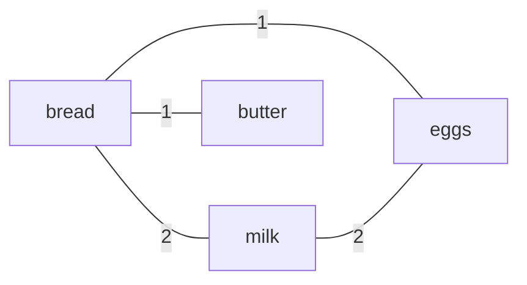

A shopping basket tells us which products appeared in one purchase. Given many baskets, find the product most frequently purchased alongside each item. The main work is counting pairs correctly; a heap is unnecessary when we need only one winner per product.

## Problem

Given a list of shopping baskets, return a mapping from every observed item to its most frequent companion. Two different items co-occur when they appear in the same basket.

Use these rules:

- Count a pair at most once per basket. Buying three cartons of milk in one order still contributes one observation for milk and bread.
- Count separate baskets separately, including identical baskets. The input contains purchases; it does not contain customer IDs for deduplicating people.
- An item cannot be its own companion.
- If several companions have the same highest count, choose the lexicographically smallest identifier.
- Include items that have never appeared with another item, with `null` in Java or `None` in Python. An unobserved, zero-count pairing is not a recommendation.
- Empty baskets are allowed. Empty input returns an empty mapping. Do not change the input.

Identifiers are nonempty strings. Comparison is case-sensitive, by Unicode code point, without locale rules or normalization. Both implementations use the same ordering. Null baskets and invalid identifiers are rejected.

For example:

```text
[milk, bread, eggs]
[milk, bread]
[bread, butter]
[milk, eggs]
```

The result is:

```text
bread -> milk
butter -> bread
eggs -> milk
milk -> bread
```

Milk appears with bread twice and with eggs twice. Bread wins that tie because `bread` comes before `eggs`.

## Algorithm: count distinct pairs, then choose each winner

Keep a nested hash map:

```text
counts[item][companion] = number of baskets containing both
```

For each basket, create a set to remove duplicates, then put its distinct items into a temporary list. For every pair of positions `i < j`, increment both directions. This visits each unordered pair once while giving each product its own neighbor map.

Initialize a neighbor map for every item, even when its basket has only one distinct product. This preserves products with no companion.

After processing all baskets, scan each item's neighbors. Keep the candidate with the largest count, breaking ties by identifier. A product with an empty neighbor map keeps the no-partner value.

The nested map is a weighted, undirected graph represented by symmetric adjacency maps. Products are vertices; pair counts are edge weights. A product's answer is its heaviest incident edge, with the agreed tie rule.

The example above produces this graph. Each line represents one pair; its label is the shared-basket count.



## Walkthrough

The four example baskets produce these nonzero unordered pair counts:

<div class="table-scroll" role="region" aria-label="Shopping basket pair counts" tabindex="0">

| Pair | Baskets containing both | Final count |
| --- | --- | --- |
| bread, milk | First and second | 2 |
| eggs, milk | First and fourth | 2 |
| bread, eggs | First | 1 |
| bread, butter | Third | 1 |

</div>

Bread chooses milk, whose edge has weight two. Eggs also chooses milk. Butter has only bread as a neighbor. Milk has two weight-two edges and chooses bread by the tie rule.

For a basket such as `[milk, milk, bread]`, deduplication produces two items and one pair. Without that step, the repeated milk could inflate the count or create a self-pair.

## Why it works

**The counts are exact.** After deduplication, each item appears once in the temporary list. The loops `i < j` visit each pair of different items exactly once. Updating both directions adds one to each product's view of that relationship. Across all baskets, the stored count therefore equals the number of baskets containing that pair.

**Every observed item is included.** Its neighbor map is created before pair enumeration. This also covers singleton baskets and baskets containing repeated copies of one item.

**The selected answer follows the rules.** During the final scan, the current winner has the greatest count among the neighbors examined so far, and the smallest identifier among tied candidates. Comparing the next neighbor preserves that property. After all neighbors have been examined, the winner is the required answer. Empty neighbor maps correctly produce no partner.

## Java solution

Save as `CoPurchaseAnalyzer.java`. This uses Java 17 or later. Counts use `long`; all state belongs to the method, so separate calls do not share purchase history.

Java's default `String.compareTo` compares UTF-16 code units. The small comparison helper below uses code points so ties match Python even for supplementary Unicode characters. For ASCII-only product IDs, `compareTo` would be sufficient. See the [Java String documentation](https://docs.oracle.com/en/java/javase/17/docs/api/java.base/java/lang/String.html).

```java
import java.util.*;

public class CoPurchaseAnalyzer {
    public Map<String, String> mostCoPurchased(List<List<String>> baskets) {
        Objects.requireNonNull(baskets, "Baskets must not be null");
        Map<String, Map<String, Long>> counts = new HashMap<>();

        // Count every distinct pair once per basket in both directions.
        for (List<String> basket : baskets) {
            Objects.requireNonNull(basket, "A basket must not be null");
            Set<String> unique = new HashSet<>();
            for (String item : basket) {
                if (item == null || item.isEmpty()) {
                    throw new IllegalArgumentException("Item IDs must be nonempty strings");
                }
                unique.add(item);
                counts.computeIfAbsent(item, key -> new HashMap<>());
            }
            List<String> items = new ArrayList<>(unique);
            for (int i = 0; i < items.size(); i++) {
                for (int j = i + 1; j < items.size(); j++) {
                    String a = items.get(i);
                    String b = items.get(j);
                    counts.get(a).merge(b, 1L, Long::sum);
                    counts.get(b).merge(a, 1L, Long::sum);
                }
            }
        }

        // Select the highest count, then the smallest identifier on a tie.
        Map<String, String> result = new HashMap<>();
        for (var entry : counts.entrySet()) {
            String best = null;
            long bestCount = -1;
            for (var neighbor : entry.getValue().entrySet()) {
                String candidate = neighbor.getKey();
                long count = neighbor.getValue();
                if (count > bestCount || (count == bestCount
                        && compareIds(candidate, best) < 0)) {
                    best = candidate;
                    bestCount = count;
                }
            }
            result.put(entry.getKey(), best);
        }
        return result;
    }

    private static int compareIds(String a, String b) {
        int i = 0, j = 0;
        while (i < a.length() && j < b.length()) {
            int left = a.codePointAt(i), right = b.codePointAt(j);
            if (left != right) {
                return Integer.compare(left, right);
            }
            i += Character.charCount(left);
            j += Character.charCount(right);
        }
        return Integer.compare(a.length() - i, b.length() - j);
    }

    public static void main(String[] args) {
        CoPurchaseAnalyzer analyzer = new CoPurchaseAnalyzer();
        record Example(String name, List<List<String>> baskets) {}
        List<Example> examples = List.of(
            // The original example includes a tie for milk.
            new Example("Original baskets", List.of(
                List.of("milk", "bread", "eggs"), List.of("milk", "bread"),
                List.of("bread", "butter"), List.of("milk", "eggs"))),
            // Repeated items count once; separate repeated baskets count again.
            new Example("Duplicates and repeated purchases", List.of(
                List.of("a", "a", "a", "b"), List.of("a", "c"), List.of("a", "c"))),
            // Empty and singleton baskets never create a zero-count partner.
            new Example("No companions", List.of(
                List.of(), List.of("solo", "solo"), List.of("other"))),
            // The last basket creates a tie after c previously led for a.
            new Example("A later tie", List.of(
                List.of("a", "b"), List.of("a", "c"),
                List.of("a", "c"), List.of("a", "b"))),
            // Separate groups do not create relationships across groups.
            new Example("Separate groups", List.of(List.of("a", "b"), List.of("c", "d"))),
            // No purchases means no observed products.
            new Example("Empty input", List.of())
        );
        for (Example example : examples) {
            System.out.println(example.name() + ":");
            Map<String, String> result = analyzer.mostCoPurchased(example.baskets());
            List<String> items = new ArrayList<>(result.keySet());
            items.sort(CoPurchaseAnalyzer::compareIds);
            for (String item : items) {
                String partner = result.get(item);
                System.out.println(item + " -> " + (partner == null ? "(none)" : partner));
            }
            if (result.isEmpty()) {
                System.out.println("(empty)");
            }
        }
    }
}
```

Run with `javac CoPurchaseAnalyzer.java` and `java CoPurchaseAnalyzer`.

## Python solution

Python sets remove duplicate identifiers, dictionaries store neighbor counts, and string comparison already uses Unicode code-point order. Neither implementation sorts baskets or modifies the caller's lists. The returned mapping's iteration order is unspecified; `main` sorts keys only to make the printed tests easy to compare.

```python
from __future__ import annotations


class CoPurchaseAnalyzer:
    def most_co_purchased(self, baskets: list[list[str]]) -> dict[str, str | None]:
        if baskets is None:
            raise ValueError("Baskets must not be None")
        counts: dict[str, dict[str, int]] = {}

        # Count every distinct pair once per basket in both directions.
        for basket in baskets:
            if basket is None:
                raise ValueError("A basket must not be None")
            unique = set()
            for item in basket:
                if not isinstance(item, str) or not item:
                    raise ValueError("Item IDs must be nonempty strings")
                unique.add(item)
                counts.setdefault(item, {})
            items = list(unique)
            for i in range(len(items)):
                for j in range(i + 1, len(items)):
                    a, b = items[i], items[j]
                    counts[a][b] = counts[a].get(b, 0) + 1
                    counts[b][a] = counts[b].get(a, 0) + 1

        # Select the highest count, then the smallest identifier on a tie.
        result: dict[str, str | None] = {}
        for item, neighbors in counts.items():
            best, best_count = None, -1
            for candidate, count in neighbors.items():
                if count > best_count or (count == best_count and candidate < best):
                    best, best_count = candidate, count
            result[item] = best
        return result


def main():
    analyzer = CoPurchaseAnalyzer()
    examples = [
        # The original example includes a tie for milk.
        ("Original baskets", [
            ["milk", "bread", "eggs"], ["milk", "bread"],
            ["bread", "butter"], ["milk", "eggs"]]),
        # Repeated items count once; separate repeated baskets count again.
        ("Duplicates and repeated purchases", [
            ["a", "a", "a", "b"], ["a", "c"], ["a", "c"]]),
        # Empty and singleton baskets never create a zero-count partner.
        ("No companions", [[], ["solo", "solo"], ["other"]]),
        # The last basket creates a tie after c previously led for a.
        ("A later tie", [["a", "b"], ["a", "c"], ["a", "c"], ["a", "b"]]),
        # Separate groups do not create relationships across groups.
        ("Separate groups", [["a", "b"], ["c", "d"]]),
        # No purchases means no observed products.
        ("Empty input", []),
    ]
    for name, baskets in examples:
        print(f"{name}:")
        result = analyzer.most_co_purchased(baskets)
        for item in sorted(result):
            partner = result[item]
            print(f"{item} -> {partner if partner is not None else '(none)'}")
        if not result:
            print("(empty)")


if __name__ == "__main__":
    main()
```

Run with Python 3.9 or later: `python3 co_purchase_analyzer.py`.

## Expected output

Both programs print:

```text
Original baskets:
bread -> milk
butter -> bread
eggs -> milk
milk -> bread
Duplicates and repeated purchases:
a -> c
b -> a
c -> a
No companions:
other -> (none)
solo -> (none)
A later tie:
a -> b
b -> a
c -> a
Separate groups:
a -> b
b -> a
c -> d
d -> c
Empty input:
(empty)
```

## Complexity

Let:

- `N` be the number of baskets, including empty ones.
- `R` be the total number of raw item entries, including duplicates.
- `m_i` be the number of distinct items in basket `i`.
- `P = Σ m_i(m_i - 1) / 2` be the total number of pair occurrences across baskets.
- `U` be the total number of distinct items, and `E` the number of distinct unordered pairs that appear together at least once.

**Expected time: `O(N + R + P + U + E)`, which simplifies to `O(N + R + P)`.** Deduplication reads all `R` entries. Pair enumeration performs two counter updates for each of the `P` pair occurrences. The final scan visits `U` products and `2E` neighbor entries. Since `U ≤ R` and `E ≤ P`, those scans do not change the bound. An equivalent expression is `O(N + R + Σ m_i²)`.

Including `R` matters: one basket containing a million copies of the same product has no pairs, but every entry must still be read. Including `N` covers an input consisting entirely of empty baskets.

**Auxiliary space: `O(U + E)` entries**, including the result. Each edge is stored twice, which is a constant factor. The current basket's temporary set and list need at most `O(U)` space and are replaced for the next basket. In a dense catalog graph, `E` can be quadratic in `U`, giving `O(U²)` worst-case space. Sparse baskets do not require allocating that dense table.

These bounds assume expected constant-time hash operations and bounded-length identifiers. Hash collisions can affect runtime; the [Java HashMap documentation](https://docs.oracle.com/en/java/javase/17/docs/api/java.base/java/util/HashMap.html) states the hashing assumption. If identifiers have maximum length `L`, hashing, equality, and tie comparisons can add an `O(L)` factor to the relevant operations. Python's [set and dictionary documentation](https://docs.python.org/3/library/stdtypes.html#set-types-set-frozenset) describes the containers used here. As usual, counters are treated as machine-sized values for this analysis; Python integers can grow beyond that size.

The demo's sorted printing adds `O(U log U)` identifier comparisons per test. Sorting is not part of the analysis method.

## What “optimal” means here

This is the standard exact, sparse pair-counting solution for an interview. It avoids rescanning all baskets separately for every product, stores only relationships that actually occur, and scans each neighbor once to choose the answer. Maintaining the winner during counter updates can remove the final scan, but does not improve the asymptotic bound.

The pair-enumeration cost is the cost of this counting strategy. It is not a universal lower bound for finding only the top companion. For example, if there is just one basket, every pair has count one: finding the two smallest identifiers is enough to assign every answer in linear time. Repeated identical baskets can also be grouped and their pair updates weighted by the number of copies. Avoid claiming that every possible exact algorithm must enumerate every pair in every basket.

For the general interview problem, the hash-map solution is a good starting point unless the interviewer supplies additional structure, memory limits, or workload requirements.

## Follow-ups

**Only one target product.** Read each basket once, check whether it contains the target, and count its distinct companions only when it does. This avoids enumerating pairs unrelated to the target and takes expected `O(N + R)` time with `O(U)` extra space.

**Top K companions.** Keep the pair counts, then select the best `K` neighbors per product with a bounded heap or sort its neighbors. Define the tie rule and what to return when fewer than `K` companions exist.

**Large input.** Map identifiers to integer IDs to reduce repeated string work. Pair counters can be partitioned by pair key and summed across workers. Very large baskets still produce many pairs; sampling or dropping common products changes the exact-count contract and must be agreed upon.

**Meaning of “best.”** This problem ranks raw shared-basket counts. It does not measure whether one product causes another purchase or whether a pairing is unusually strong after accounting for overall product popularity. Changing that goal requires a different scoring rule.
