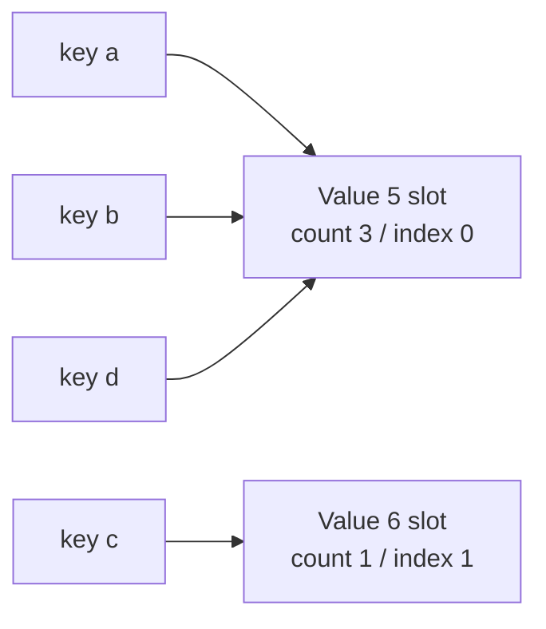

A dictionary contains `{a: 5, b: 5, c: 6, d: 5}`. Returning a random value can mean two different things. Sampling a stored key uniformly returns 5 three times as often as 6. Sampling a distinct value uniformly gives the two values equal probability.

The data structure must preserve the requested distribution while keys are inserted, overwritten, and deleted. A dense array makes sampling easy; the main challenge is keeping that array consistent after changes.

## Problem

Implement these operations:

- `put(key, value)`: insert a new key or replace its existing value.
- `delete(key)`: remove the key and return whether it existed.
- `get(key)`: return the value currently assigned to the key.
- `get_rand_val()`: return a random value from the current dictionary.

The original problem weights each value by its frequency among the current keys. The follow-up asks for equal probability among distinct values.

<div class="table-scroll" role="region" aria-label="Frequency-weighted and distinct-value sampling probabilities" tabindex="0">

| Sampling policy | Outcomes represented in the random pool | Probability of 5 | Probability of 6 |
| --- | --- | ---: | ---: |
| Original: frequency-weighted | `[5, 5, 6, 5]` | 3/4 | 1/4 |
| Follow-up: uniform distinct | `[5, 6]` | 1/2 | 1/2 |

</div>

Use value equality to define a distinct outcome. Updating an existing key replaces one occurrence; it does not add another key. Repeatedly assigning the same value must not increase its frequency. Values may be negative, strings, or other suitable value objects; the implementation does not depend on the example's numbers.

For a precise API, missing `get` calls raise `NoSuchElementException` in Java or `KeyError` in Python. Deleting a missing key returns `false` or `False`. Sampling an empty dictionary raises an exception. Null/`None` keys and values are rejected, so no sentinel value can be confused with a stored result.

Keys need stable hash and equality behavior. Distinct-mode values need that property as well; Python requires them to be hashable. Frequency mode does not hash values. Equal objects represent the same sampling outcome, while `get` preserves the value assigned to the individual key. The implementation is single-threaded.

## Start with uniform sampling over keys

Scanning a dictionary to locate a randomly chosen key takes linear time. Keeping only a list of distinct values produces the wrong distribution for the original problem. Keeping frequencies and scanning cumulative weights also makes a sample linear in the number of distinct values.

Instead, give every key one slot in a dense array. Choose a uniform index from zero through `size − 1` and return that slot's value. If a value occurs under `c` of the `n` keys, exactly `c` of the `n` equally likely slots return it. Its probability is therefore `c/n`.

An index array containing holes would need rejection or additional bookkeeping. Deleting from the middle and shifting the suffix costs linear time. Use **swap-with-last deletion**: fill the removed position with the last slot, update that slot's position, and pop the last array element. Slot order has no API meaning, so moving it does not affect correctness.

## One slot object makes moves cheap

Each slot stores its value, current array index, and reference count. A key's binding stores its assigned value and a reference to its slot. Keeping the assigned value separately preserves ordinary `get` behavior even when equal values share a sampling slot.

In frequency mode, every key has its own slot with count one. The key map and dense pool are sufficient. In distinct mode, all keys with an equal value share one slot, and an additional value map locates that slot. Its count is the number of keys referencing it.



*Distinct mode: four key bindings point to two sampling slots. The dense pool contains each slot once; the value map finds slots by value.*

When a slot moves, change its `index` field. Existing key bindings already reference that same object, so they observe the new index without a scan or a search for its owning key. This avoids the pitfall of storing only bare values and then losing track of which key's index needs repair.

For `put`, validate the input, remove the key's old binding if present, and attach the new binding. Reusing `delete` keeps occurrence accounting in one place and avoids another helper method. Even a same-value update is safe: removing and adding one reference leaves the dictionary's logical contents unchanged.

For `delete`, decrement the referenced slot's count. In distinct mode, another key may still use it; in that case the pool stays unchanged. Only a transition from count one to zero removes the slot and its value-map entry.

## Walk through updates and deletion

Starting from the four-key example, delete `b`. The remaining dictionary is `{a: 5, c: 6, d: 5}`. Frequency mode now returns 5 with probability `2/3`. Distinct mode still has two outcomes, each with probability `1/2`; removing one key did not remove value 5.

Next overwrite `a` with 6. There are still three keys, with two occurrences of 6 and one of 5. Frequency mode gives 6 probability `2/3`; distinct mode still gives it `1/2`.

Finally delete `d`. Value 5 disappears completely. Both modes now always return 6. Writing `put(a, 6)` again changes neither the key count nor these probabilities.

For a physical move, suppose distinct slots are `[10, 20, 30]` and the last key using 20 is deleted. Move the slot for 30 into index one, set its index to one, then pop the old final position. Deleting the last key using 30 afterward must use that repaired index. A stale index is a functional bug even if the first deletion appears to work.

## Java solution

The constructor fixes the policy: `false` for the original problem and `true` for the follow-up. The only four data-structure operations are `put`, `delete`, `get`, and `getRandVal`. The small record and slot class hold state; there is no chain of maintenance helpers.

Save this as `RandomValueDictionary.java`. It uses Java 17+ and only the standard library. The injectable random generator makes controlled testing possible.

```java
import java.util.ArrayList;
import java.util.HashMap;
import java.util.Map;
import java.util.NoSuchElementException;
import java.util.Objects;
import java.util.Random;
import java.util.Set;

public final class RandomValueDictionary<K, V> {
    private static final class Slot<V> {
        final V value;
        int index;
        int count;

        Slot(V value, int index) {
            this.value = value;
            this.index = index;
        }
    }

    private record Binding<V>(V value, Slot<V> slot) {}

    private final Map<K, Binding<V>> byKey = new HashMap<>();
    private final ArrayList<Slot<V>> pool = new ArrayList<>();
    private final Map<V, Slot<V>> byValue;
    private final Random random;

    public RandomValueDictionary(boolean uniformDistinct, Random random) {
        this.byValue = uniformDistinct ? new HashMap<>() : null;
        this.random = Objects.requireNonNull(random);
    }

    public void put(K key, V value) {
        Objects.requireNonNull(key);
        Objects.requireNonNull(value);
        delete(key);

        // Reuse a value slot only for the distinct-value policy.
        Slot<V> slot = byValue == null ? null : byValue.get(value);
        if (slot == null) {
            slot = new Slot<>(value, pool.size());
            pool.add(slot);
            if (byValue != null) byValue.put(value, slot);
        }
        slot.count++;
        byKey.put(key, new Binding<>(value, slot));
    }

    public boolean delete(K key) {
        Objects.requireNonNull(key);
        Binding<V> binding = byKey.remove(key);
        if (binding == null) return false;
        Slot<V> slot = binding.slot();
        if (--slot.count > 0) return true;

        // Move the last slot into the hole and repair its shared index.
        Slot<V> last = pool.remove(pool.size() - 1);
        if (slot.index < pool.size()) {
            pool.set(slot.index, last);
            last.index = slot.index;
        }
        if (byValue != null) byValue.remove(slot.value);
        return true;
    }

    public V get(K key) {
        Objects.requireNonNull(key);
        Binding<V> binding = byKey.get(key);
        if (binding == null) throw new NoSuchElementException("Missing key");
        return binding.value();
    }

    public V getRandVal() {
        if (pool.isEmpty()) throw new NoSuchElementException("Dictionary is empty");
        return pool.get(random.nextInt(pool.size())).value;
    }

    public static void main(String[] args) {
        // Test 1: Repeated values occupy separate slots in frequency mode.
        var weighted = new RandomValueDictionary<String, Integer>(false, new Random(7));
        weighted.put("a", 5);
        weighted.put("b", 5);
        weighted.put("c", 6);
        weighted.put("d", 5);
        System.out.println("get a: " + weighted.get("a"));
        System.out.println("frequency sample is current: "
            + Set.of(5, 6).contains(weighted.getRandVal()));

        // Test 2: Overwrites do not add keys, including a same-value update.
        weighted.put("a", 6);
        weighted.put("a", 6);
        System.out.println("overwrite a: " + weighted.get("a"));
        weighted.delete("a");
        weighted.delete("b");
        weighted.delete("d");
        System.out.println("delete missing: " + weighted.delete("missing"));
        System.out.println("frequency singleton: " + weighted.getRandVal());

        // Test 3: A shared value stays until its final key is removed.
        var distinct = new RandomValueDictionary<String, Integer>(true, new Random(9));
        distinct.put("x", 5);
        distinct.put("y", 5);
        distinct.put("z", 6);
        distinct.delete("x");
        System.out.println("shared value remains: " + distinct.get("y"));
        distinct.put("y", 6);
        distinct.put("y", 6);
        System.out.println("distinct after merge: " + distinct.getRandVal());

        // Test 4: Delete a middle slot, then the slot moved into its place.
        var moved = new RandomValueDictionary<String, Integer>(true, new Random(3));
        moved.put("x", 10);
        moved.put("y", 20);
        moved.put("z", 30);
        moved.delete("y");
        moved.delete("z");
        System.out.println("distinct after swap: " + moved.getRandVal());

        // Test 5: Keys and values are generic, with no fixed numeric domain.
        var generic = new RandomValueDictionary<Integer, String>(false, new Random(4));
        generic.put(101, "alpha");
        System.out.println("generic value: " + generic.getRandVal());

        // Test 6: Empty sampling and missing lookups fail explicitly.
        weighted.delete("c");
        try {
            weighted.getRandVal();
        } catch (NoSuchElementException expected) {
            System.out.println("empty random rejected: true");
        }
        try {
            weighted.get("c");
        } catch (NoSuchElementException expected) {
            System.out.println("missing get rejected: true");
        }
    }
}
```

## Python solution

The same representation uses a tuple `(assigned_value, slot)` for each key binding. It requires Python 3.9+ and no external packages. Invalid unhashable distinct values are checked before removing an existing binding.

```python
import random


class _Slot:
    __slots__ = ("value", "index", "count")

    def __init__(self, value, index):
        self.value = value
        self.index = index
        self.count = 0


class RandomValueDictionary:
    def __init__(self, uniform_distinct=False, rng=None):
        if not isinstance(uniform_distinct, bool):
            raise ValueError("Sampling policy must be a boolean")
        self._by_key = {}
        self._pool = []
        self._by_value = {} if uniform_distinct else None
        self._rng = random.Random() if rng is None else rng

    def put(self, key, value):
        if key is None or value is None:
            raise ValueError("Keys and values must not be None")
        if self._by_value is not None:
            hash(value)
        self.delete(key)

        # Reuse a value slot only for the distinct-value policy.
        slot = None if self._by_value is None else self._by_value.get(value)
        if slot is None:
            slot = _Slot(value, len(self._pool))
            self._pool.append(slot)
            if self._by_value is not None:
                self._by_value[value] = slot
        slot.count += 1
        self._by_key[key] = (value, slot)

    def delete(self, key):
        if key is None:
            raise ValueError("Key must not be None")
        binding = self._by_key.pop(key, None)
        if binding is None:
            return False
        slot = binding[1]
        slot.count -= 1
        if slot.count > 0:
            return True

        # Move the last slot into the hole and repair its shared index.
        last = self._pool.pop()
        if slot.index < len(self._pool):
            self._pool[slot.index] = last
            last.index = slot.index
        if self._by_value is not None:
            del self._by_value[slot.value]
        return True

    def get(self, key):
        if key is None:
            raise ValueError("Key must not be None")
        return self._by_key[key][0]

    def get_rand_val(self):
        if not self._pool:
            raise LookupError("Dictionary is empty")
        return self._pool[self._rng.randrange(len(self._pool))].value


def main():
    # Test 1: Repeated values occupy separate slots in frequency mode.
    weighted = RandomValueDictionary(False, random.Random(7))
    weighted.put("a", 5)
    weighted.put("b", 5)
    weighted.put("c", 6)
    weighted.put("d", 5)
    print("get a:", weighted.get("a"))
    print("frequency sample is current:",
          str(weighted.get_rand_val() in {5, 6}).lower())

    # Test 2: Overwrites do not add keys, including a same-value update.
    weighted.put("a", 6)
    weighted.put("a", 6)
    print("overwrite a:", weighted.get("a"))
    weighted.delete("a")
    weighted.delete("b")
    weighted.delete("d")
    print("delete missing:", str(weighted.delete("missing")).lower())
    print("frequency singleton:", weighted.get_rand_val())

    # Test 3: A shared value stays until its final key is removed.
    distinct = RandomValueDictionary(True, random.Random(9))
    distinct.put("x", 5)
    distinct.put("y", 5)
    distinct.put("z", 6)
    distinct.delete("x")
    print("shared value remains:", distinct.get("y"))
    distinct.put("y", 6)
    distinct.put("y", 6)
    print("distinct after merge:", distinct.get_rand_val())

    # Test 4: Delete a middle slot, then the slot moved into its place.
    moved = RandomValueDictionary(True, random.Random(3))
    moved.put("x", 10)
    moved.put("y", 20)
    moved.put("z", 30)
    moved.delete("y")
    moved.delete("z")
    print("distinct after swap:", moved.get_rand_val())

    # Test 5: Keys and values are generic, with no fixed numeric domain.
    generic = RandomValueDictionary(False, random.Random(4))
    generic.put(101, "alpha")
    print("generic value:", generic.get_rand_val())

    # Test 6: Empty sampling and missing lookups fail explicitly.
    weighted.delete("c")
    try:
        weighted.get_rand_val()
    except LookupError:
        print("empty random rejected: true")
    try:
        weighted.get("c")
    except KeyError:
        print("missing get rejected: true")


if __name__ == "__main__":
    main()
```

## Expected output

Both programs print the following output. Their random streams differ; the mixed-value test checks membership rather than demanding identical draws, while singleton pools have a deterministic result.

```text
get a: 5
frequency sample is current: true
overwrite a: 6
delete missing: false
frequency singleton: 6
shared value remains: 5
distinct after merge: 6
distinct after swap: 10
generic value: alpha
empty random rejected: true
missing get rejected: true
```

These examples exercise behavior, not a statistical proof. A few draws cannot establish the required probabilities. Tests can inject a generator that visits each valid index exactly once to verify the pool's multiplicities without random flakiness.

## Why it works

Maintain three invariants: each key has exactly one binding; each live slot appears once at its recorded index; and a slot's count equals the number of bindings referencing it. Distinct mode additionally has exactly one slot per value-equality class, indexed by the value map.

Inserting a binding increments exactly its slot's count. Overwriting first removes one old binding, so no historical assignment contributes another occurrence. Deletion keeps a shared slot while its count remains positive. When the count reaches zero, swap-with-last removes only that slot and repairs the moved slot's index. Because bindings reference slot objects, no key reference becomes stale after the move. These steps preserve all invariants.

Frequency mode therefore has `n` slots, one per key. A value occurring `c` times occupies `c` slots and is returned with probability `c/n`. Distinct mode has `d` slots, one per distinct value, so each value has probability `1/d`. This reasoning assumes the bounded-index generator is uniform and the dictionary is nonempty.

Use [Java's `Random.nextInt(bound)`](https://docs.oracle.com/en/java/javase/25/docs/api/java.base/java/util/Random.html#nextInt(int)) or [Python's `randrange(stop)`](https://docs.python.org/3/library/random.html#random.randrange). Avoid reducing an arbitrary random integer with `% size`, which can introduce modulo bias. The default generators are suitable for an interview exercise, not security-sensitive selection.

## Complexity

Let `n` be the current key count and `d` the distinct-value count, where `d ≤ n`. Assume well-behaved hashing and bounded-cost hashing and equality. Array growth and hash-table resizing require amortized analysis.

<div class="table-scroll" role="region" aria-label="Random dictionary operation time and live storage" tabindex="0">

| Operation or resource | Frequency mode | Distinct mode | Reason |
| --- | --- | --- | --- |
| `put` | Expected amortized O(1) | Expected amortized O(1) | A constant number of map operations and pool edits |
| `delete` | Expected amortized O(1) | Expected amortized O(1) | Update a count and perform at most one slot move |
| `get` | Expected O(1) | Expected O(1) | One key-map lookup |
| Random value | Expected O(1) | Expected O(1) | One bounded random index and array access |
| Logical live state | O(n) | O(n + d) = O(n) | Key bindings plus the active sampling slots and optional value map |

</div>

The bounds are not worst-case guarantees for arbitrary hashes, expensive value comparisons, or unbounded-cost random sources. [ArrayList documents amortized growth](https://docs.oracle.com/en/java/javase/25/docs/api/java.base/java/util/ArrayList.html), while [HashMap's lookup bounds assume suitable hashing](https://docs.oracle.com/en/java/javase/25/docs/api/java.base/java/util/HashMap.html). A particular insertion can trigger linear resizing. Bounded random generation can use rejection internally, so its usual bound is expected constant time.

Allocated capacity can remain above live size after deletions. In particular, Java's maps and array can retain earlier capacity; Python containers may also retain allocation. If `N` is the maximum live key count over the object's lifetime, O(N) describes retained peak-capacity storage, excluding caller-owned key and value payloads. Rebuilding or deliberate shrinking trades additional work for memory recovery.

The expected constant-time operation bounds are asymptotically optimal for this mutable sampling contract under these assumptions: each operation must perform at least constant work. A cumulative-frequency tree is useful for arbitrary numeric weights, but adds complexity and logarithmic updates that this occurrence-based problem does not require.
