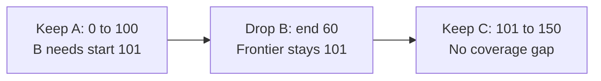

## Problem

Each shard has a unique ID and owns an inclusive integer range `[start, end]`. You are given a collection with these operations:

```text
Shards(limit)
add_shard(shard)
remove_shard(shard_id)
rebalance()
```

Implement `rebalance()`. At any key, at most `limit` shards may overlap. Fill gaps within the original overall span, from the smallest start to the largest end among the shards present when rebalancing begins.

For example:

```text
limit = 1
Before: A [0, 100], B [80, 180]
After:  A [0, 100], B [101, 180]
```

The endpoints are inclusive: both shards initially own key 100, so B must begin at 101.

### Specify ownership priority and allowed changes

The statement needs an ownership policy to determine one reproducible answer. This solution uses the following contract:

1. Sort the input by original start, then by ID to break ties. “Earlier” means this order, rather than insertion time.
2. Preserve earlier decisions. Keep every surviving shard's ID and end unchanged; adjust only the current shard's start.
3. Keep a legal overlap unchanged. If the overlap exceeds the limit, trim the current shard's prefix as little as possible.
4. Fill a gap by extending the next shard left, only as far as the first uncovered key.
5. Remove a shard if trimming leaves it empty. Never split a shard into several intervals.

`limit` is a positive integer and specifies a maximum, not a required replication factor. An empty collection stays empty. A single shard retains its original start, even if that start is negative or far from zero.

For a gap, the result under this contract is:

```text
Before: A [0, 100], B [130, 180]
After:  A [0, 100], B [101, 180]
```

If gaps are allowed instead, omit the gap-filling branch. If coverage must include a fixed external domain, accept its bounds as additional inputs; the current collection alone cannot tell you what was lost outside its span after a removal.

### What “minimum movement” means here

In the first example, trimming B removes 21 ownership positions. Shortening A to `[0, 79]` also removes 21. Preserving A is a deterministic priority rule; the example does not establish a universal reduction in transferred bytes.

The greedy objective here is to make the smallest required start adjustment for each shard, subject to the earlier decisions. Optimizing total bytes moved would require data sizes, migration costs, and potentially different allowed changes.

## Key insight: keep a heap and a forward-only position

Process shards in sorted order. Maintain three pieces of state:

- `active`: a min-heap of end coordinates for earlier surviving shards that cover the current scan position.
- `frontier`: the scan position. It never moves backward, including when a shard is removed.
- `coveredThrough`: the largest surviving end seen so far. Together with gap filling, this describes continuous coverage from the original minimum start.

The heap begins empty. An accepted shard contributes its end at the bottom of the loop. An expired shard leaves the heap when its end is **strictly less than** the candidate start. Removing an end from the heap does not remove its shard from the result.

At the candidate position, all heap entries have already started. If there are fewer than `limit` entries, adding the current shard is safe: earlier intervals can only end as we move farther right.

If there are exactly `limit` entries, let their smallest end be `e`. Every key from the candidate through `e` is full. The earliest feasible start is therefore `e + 1`. Expire entries ending before that new position, then add the current shard if it still has a nonempty range.

### Why the frontier must survive an empty shard

Consider:

```text
limit = 1
A [0, 100], B [50, 60], C [70, 150]
```

B cannot begin before 101, so it becomes empty. While moving to 101, the heap discards A's end, 100. The result still contains A.

When C arrives, use `max(70, frontier) = 101`. Returning to 70 with the now-empty heap would forget A's ownership of `[70, 100]`.



## Algorithm

For each shard in `(original start, ID)` order:

1. Set the candidate to `max(original start, frontier)`. For the first shard, use its original start.
2. If prior coverage exists and the candidate exceeds `coveredThrough + 1`, fill the gap by using `coveredThrough + 1`.
3. Remove heap ends smaller than the candidate.
4. If the heap is full, move to its smallest end plus one and expire all ends smaller than the new candidate.
5. Record the new frontier, even if the current interval becomes empty.
6. If `candidate <= end`, retain `[candidate, end]`, push its end, and update `coveredThrough`. Otherwise, discard the shard.

One full-heap jump is enough. At least one end expires, and all earlier accepted starts are at or before the frontier. There are no future starts among those earlier intervals that could create another conflict farther right.

Gap filling also preserves the forward-only scan: `coveredThrough + 1` is at least the previous frontier. It extends into uncovered space, where there are no earlier owners.

## Walkthrough with an overlap limit of two

```text
A [0, 100], B [80, 180], C [90, 150]
```

<div class="table-scroll" role="region" aria-label="Shard rebalancing walkthrough" tabindex="0">

| Shard | Candidate | Earlier active ends | Decision |
| --- | --- | --- | --- |
| A | 0 | None | Keep `[0, 100]`; push 100 |
| B | 80 | 100 | One owner is allowed; keep `[80, 180]` |
| C | 90 | 100, 180 | Two owners already exist; advance to 101, expire 100, keep `[101, 150]` |

</div>

Keys 80–100 have A and B. Keys 101–150 have B and C. Both regions respect the limit, and the overall span remains covered.

## Why the greedy choice is correct

The scan maintains four invariants:

- Earlier accepted starts are at or before the frontier.
- The heap contains exactly the earlier intervals covering that frontier after expired ends are removed.
- The accepted ranges cover a continuous prefix of the original overall span, with overlap at most `limit`.
- For the current original start, any positions skipped by previous capacity jumps are already full. A later shard cannot return to those positions.

When the heap is full, every active interval covers the entire segment through the minimum end. Keeping earlier decisions forces the current start past that segment. At `minimum end + 1`, at least one slot is free. Since earlier intervals have no starts beyond the frontier, their overlap count can only decrease farther right. This is the earliest feasible suffix of the current range.

If that start exceeds the current end, no nonempty suffix is feasible. Deleting the shard preserves coverage because every key removed from it already has `limit` earlier owners.

If a gap exists, extending to `coveredThrough + 1` fills it with the smallest leftward change. The extension cannot create an overlap because it lies beyond all earlier ends. The first shard initializes coverage instead of extending toward an arbitrary zero.

These choices preserve all four invariants. After the final shard, the entire original span is covered and no key exceeds the limit. Each retained start makes the smallest change allowed by the priority contract.

## Java solution

Save as `ShardRangeRebalancer.java` and run with Java 17 or newer:

```text
javac ShardRangeRebalancer.java
java ShardRangeRebalancer
```

The key type is a signed 32-bit integer. Successor calculations use `long`, so `Integer.MAX_VALUE + 1` is representable during trimming. A position is cast back only after confirming that it fits within the current interval.

The supplied add/remove operations are included for a runnable example. The algorithm is contained in one `rebalance` method; the getter returns a sorted copy. Immutable shard values keep a caller's old objects unchanged when a new result is built.

```java
import java.util.*;

public class ShardRangeRebalancer {
    public record Shard(String id, int start, int end) {
        public Shard {
            if (id == null || id.isEmpty() || start > end) {
                throw new IllegalArgumentException("Invalid shard");
            }
        }

        @Override
        public String toString() {
            return "(" + id + ", " + start + ", " + end + ")";
        }
    }

    public static class Shards {
        private final int limit;
        private Map<String, Shard> byId = new HashMap<>();

        public Shards(int limit) {
            if (limit < 1) {
                throw new IllegalArgumentException("limit must be positive");
            }
            this.limit = limit;
        }

        public void addShard(Shard shard) {
            Objects.requireNonNull(shard);
            if (byId.putIfAbsent(shard.id(), shard) != null) {
                throw new IllegalArgumentException("Duplicate shard ID");
            }
        }

        public void removeShard(String id) {
            byId.remove(id);
        }

        public void rebalance() {
            List<Shard> ordered = getShards();
            PriorityQueue<Integer> active = new PriorityQueue<>();
            Map<String, Shard> survivors = new HashMap<>();
            Long frontier = null;
            Long coveredThrough = null;

            for (Shard shard : ordered) {
                // Keep the scan forward-only and fill genuine gaps.
                long start = shard.start();
                if (frontier != null) start = Math.max(start, frontier);
                if (coveredThrough != null && start > coveredThrough + 1) {
                    start = coveredThrough + 1;
                }
                while (!active.isEmpty() && active.peek() < start) {
                    active.poll();
                }

                // A full heap forces the start beyond the earliest end.
                if (active.size() == limit) {
                    start = (long) active.poll() + 1;
                    while (!active.isEmpty() && active.peek() < start) {
                        active.poll();
                    }
                }

                // Remember progress even if this shard becomes empty.
                frontier = start;
                if (start > shard.end()) continue;

                Shard adjusted = new Shard(shard.id(), (int) start, shard.end());
                survivors.put(adjusted.id(), adjusted);
                active.offer(adjusted.end());
                coveredThrough = coveredThrough == null
                    ? (long) adjusted.end()
                    : Math.max(coveredThrough, adjusted.end());
            }
            byId = survivors;
        }

        public List<Shard> getShards() {
            List<Shard> result = new ArrayList<>(byId.values());
            result.sort(Comparator.comparingInt(Shard::start).thenComparing(Shard::id));
            return result;
        }
    }

    record Example(String name, int limit, List<Shard> input) {}

    public static void main(String[] args) {
        List<Example> examples = List.of(
            // Test 1: Trim the later range in the original example.
            new Example("Basic overlap", 1, List.of(
                new Shard("A", 0, 100), new Shard("B", 80, 180))),
            // Test 2: Extend the next range left to fill an internal gap.
            new Example("Fill gap", 1, List.of(
                new Shard("A", 0, 100), new Shard("B", 130, 180))),
            // Test 3: Two owners are allowed; trim only the third owner.
            new Example("Limit two", 2, List.of(
                new Shard("A", 0, 100), new Shard("B", 80, 180), new Shard("C", 90, 150))),
            // Test 4: An empty shard must not reset the scan position.
            new Example("Nested deletion", 1, List.of(
                new Shard("A", 0, 100), new Shard("B", 50, 60), new Shard("C", 70, 150))),
            // Test 5: Several delayed starts and a short redundant shard.
            new Example("Deferred starts", 2, List.of(
                new Shard("A", 0, 10), new Shard("B", 1, 30), new Shard("C", 2, 40),
                new Shard("D", 3, 50), new Shard("E", 4, 5), new Shard("F", 6, 60))),
            // Test 6: Input order is arbitrary; a later gap still gets filled.
            new Example("Unordered input", 1, List.of(
                new Shard("C", 200, 300), new Shard("A", 0, 100), new Shard("B", 80, 180))),
            // Test 7: IDs break ties between identical original starts.
            new Example("Same start", 1, List.of(
                new Shard("B", 0, 150), new Shard("A", 0, 100))),
            // Test 8: Leave overlaps that are already within the limit alone.
            new Example("Legal overlap", 3, List.of(
                new Shard("A", 0, 100), new Shard("B", 20, 120), new Shard("C", 40, 140))),
            // Test 9: Negative coordinates use the same successor rule.
            new Example("Negative keys", 1, List.of(
                new Shard("A", -5, -2), new Shard("B", -3, 1))),
            // Test 10: A shared endpoint counts as an overlap.
            new Example("Shared endpoint", 1, List.of(
                new Shard("A", -2, 0), new Shard("B", 0, 3))),
            // Test 11: Expire all entries with the same smallest end.
            new Example("Equal ends", 2, List.of(
                new Shard("A", 0, 10), new Shard("B", 0, 10), new Shard("C", 0, 20))),
            // Test 12: Preserve a lone range without extending toward zero.
            new Example("Single shard", 1, List.of(new Shard("A", 100, 200))),
            // Test 13: An empty collection stays empty.
            new Example("Empty collection", 1, List.of()),
            // Test 14: Computing a successor must not wrap to a negative key.
            new Example("Maximum endpoint", 1, List.of(
                new Shard("A", Integer.MAX_VALUE - 10, Integer.MAX_VALUE),
                new Shard("B", Integer.MAX_VALUE - 5, Integer.MAX_VALUE)))
        );

        for (Example example : examples) {
            Shards collection = new Shards(example.limit());
            for (Shard shard : example.input()) collection.addShard(shard);
            collection.rebalance();
            List<Shard> first = collection.getShards();
            // Every example also checks that a second call changes nothing.
            collection.rebalance();
            if (!first.equals(collection.getShards())) {
                throw new AssertionError("Rebalance must be idempotent");
            }
            System.out.println(example.name() + ": " + first);
        }

        // Test 15: The domain comes from shards still present after removal.
        Shards removed = new Shards(1);
        removed.addShard(new Shard("A", 0, 100));
        removed.addShard(new Shard("B", 80, 180));
        removed.removeShard("A");
        removed.rebalance();
        System.out.println("Removed shard: " + removed.getShards());
    }
}
```

## Python solution

This uses the same algorithm. `None` distinguishes “no earlier coverage” from a valid coordinate such as zero. Python integers also support coordinates beyond the Java example's key type.

```python
from dataclasses import dataclass
from heapq import heappop, heappush


@dataclass(frozen=True)
class Shard:
    id: str
    start: int
    end: int

    def __post_init__(self):
        if (not isinstance(self.id, str) or not self.id
                or type(self.start) is not int or type(self.end) is not int
                or self.start > self.end):
            raise ValueError("Invalid shard")

    def __repr__(self):
        return f"({self.id}, {self.start}, {self.end})"


class Shards:
    def __init__(self, limit: int):
        if type(limit) is not int or limit < 1:
            raise ValueError("limit must be a positive integer")
        self.limit = limit
        self._shards = {}

    def add_shard(self, shard: Shard):
        if shard.id in self._shards:
            raise ValueError("Duplicate shard ID")
        self._shards[shard.id] = shard

    def remove_shard(self, shard_id: str):
        self._shards.pop(shard_id, None)

    def rebalance(self):
        ordered = self.get_shards()
        active = []
        survivors = {}
        frontier = None
        covered_through = None

        for shard in ordered:
            # Keep the scan forward-only and fill genuine gaps.
            start = shard.start if frontier is None else max(shard.start, frontier)
            if covered_through is not None and start > covered_through + 1:
                start = covered_through + 1
            while active and active[0] < start:
                heappop(active)

            # A full heap forces the start beyond the earliest end.
            if len(active) == self.limit:
                start = heappop(active) + 1
                while active and active[0] < start:
                    heappop(active)

            # Remember progress even if this shard becomes empty.
            frontier = start
            if start > shard.end:
                continue

            adjusted = Shard(shard.id, start, shard.end)
            survivors[adjusted.id] = adjusted
            heappush(active, adjusted.end)
            covered_through = (adjusted.end if covered_through is None
                               else max(covered_through, adjusted.end))

        self._shards = survivors

    def get_shards(self):
        return sorted(self._shards.values(), key=lambda shard: (shard.start, shard.id))


def main():
    max_key = (1 << 31) - 1  # Match Java's key type for this boundary example.
    examples = [
        # Test 1: Trim the later range in the original example.
        ("Basic overlap", 1, [Shard("A", 0, 100), Shard("B", 80, 180)]),
        # Test 2: Extend the next range left to fill an internal gap.
        ("Fill gap", 1, [Shard("A", 0, 100), Shard("B", 130, 180)]),
        # Test 3: Two owners are allowed; trim only the third owner.
        ("Limit two", 2, [Shard("A", 0, 100), Shard("B", 80, 180), Shard("C", 90, 150)]),
        # Test 4: An empty shard must not reset the scan position.
        ("Nested deletion", 1, [Shard("A", 0, 100), Shard("B", 50, 60), Shard("C", 70, 150)]),
        # Test 5: Several delayed starts and a short redundant shard.
        ("Deferred starts", 2, [Shard("A", 0, 10), Shard("B", 1, 30), Shard("C", 2, 40),
                                Shard("D", 3, 50), Shard("E", 4, 5), Shard("F", 6, 60)]),
        # Test 6: Input order is arbitrary; a later gap still gets filled.
        ("Unordered input", 1, [Shard("C", 200, 300), Shard("A", 0, 100), Shard("B", 80, 180)]),
        # Test 7: IDs break ties between identical original starts.
        ("Same start", 1, [Shard("B", 0, 150), Shard("A", 0, 100)]),
        # Test 8: Leave overlaps that are already within the limit alone.
        ("Legal overlap", 3, [Shard("A", 0, 100), Shard("B", 20, 120), Shard("C", 40, 140)]),
        # Test 9: Negative coordinates use the same successor rule.
        ("Negative keys", 1, [Shard("A", -5, -2), Shard("B", -3, 1)]),
        # Test 10: A shared endpoint counts as an overlap.
        ("Shared endpoint", 1, [Shard("A", -2, 0), Shard("B", 0, 3)]),
        # Test 11: Expire all entries with the same smallest end.
        ("Equal ends", 2, [Shard("A", 0, 10), Shard("B", 0, 10), Shard("C", 0, 20)]),
        # Test 12: Preserve a lone range without extending toward zero.
        ("Single shard", 1, [Shard("A", 100, 200)]),
        # Test 13: An empty collection stays empty.
        ("Empty collection", 1, []),
        # Test 14: Computing a successor must not wrap to a negative key.
        ("Maximum endpoint", 1, [Shard("A", max_key - 10, max_key),
                                 Shard("B", max_key - 5, max_key)]),
    ]

    for name, limit, inputs in examples:
        collection = Shards(limit)
        for shard in inputs:
            collection.add_shard(shard)
        collection.rebalance()
        first = collection.get_shards()
        # Every example also checks that a second call changes nothing.
        collection.rebalance()
        assert first == collection.get_shards(), "Rebalance must be idempotent"
        print(f"{name}: {first}")

    # Test 15: The domain comes from shards still present after removal.
    removed = Shards(1)
    removed.add_shard(Shard("A", 0, 100))
    removed.add_shard(Shard("B", 80, 180))
    removed.remove_shard("A")
    removed.rebalance()
    print(f"Removed shard: {removed.get_shards()}")


if __name__ == "__main__":
    main()
```

## Expected output

Both programs print:

```text
Basic overlap: [(A, 0, 100), (B, 101, 180)]
Fill gap: [(A, 0, 100), (B, 101, 180)]
Limit two: [(A, 0, 100), (B, 80, 180), (C, 101, 150)]
Nested deletion: [(A, 0, 100), (C, 101, 150)]
Deferred starts: [(A, 0, 10), (B, 1, 30), (C, 11, 40), (D, 31, 50), (F, 41, 60)]
Unordered input: [(A, 0, 100), (B, 101, 180), (C, 181, 300)]
Same start: [(A, 0, 100), (B, 101, 150)]
Legal overlap: [(A, 0, 100), (B, 20, 120), (C, 40, 140)]
Negative keys: [(A, -5, -2), (B, -1, 1)]
Shared endpoint: [(A, -2, 0), (B, 1, 3)]
Equal ends: [(A, 0, 10), (B, 0, 10), (C, 11, 20)]
Single shard: [(A, 100, 200)]
Empty collection: []
Maximum endpoint: [(A, 2147483637, 2147483647)]
Removed shard: [(B, 80, 180)]
```

## Complexity

Let `n` be the number of input shards and `h = min(n, limit)`.

- **Time: O(n log n).** Sorting costs `O(n log n)`. Each surviving end enters and leaves the heap at most once, so the scan costs `O(n log(h + 1))`. There is no loop over individual keys. Both [Java's priority queue](https://docs.oracle.com/en/java/javase/17/docs/api/java.base/java/util/PriorityQueue.html) and [Python's heap operations](https://docs.python.org/3.11/library/heapq.html) support this heap-based scan.
- **Auxiliary space: O(n).** The sorted snapshot and survivor map contain at most `n` shards; the active heap holds at most `h` ends. The input map and returned collection also use linear storage.

These bounds assume constant-size keys and constant-time ID comparisons. Reporting arbitrary inputs in sorted key order has a comparison-sorting lower bound of `Ω(n log n)`. With already ordered input, the scan alone takes `O(n log(h + 1))`. For `limit = 1`, a single tracked end can replace the heap, giving a linear scan after sorting.

## Interview follow-ups

If the required coverage is exactly `limit` owners at every key, this algorithm's contract is insufficient: it fills zero-coverage gaps but does not create missing replicas. Specify whether new shard IDs and replicas may be created.

If splitting is allowed, an interval could retain useful sections on both sides of a full region. That needs a different output model and an event sweep or interval structure to track all relevant boundaries. If changing both endpoints is allowed, define the movement objective before choosing a greedy rule.

In an actual sharded service, the returned ranges describe a target ownership plan. Data copying, routing updates, concurrency, and safe handoff require a separate migration protocol. The interview algorithm makes no claim that updating these in-memory bounds transfers the underlying data.
