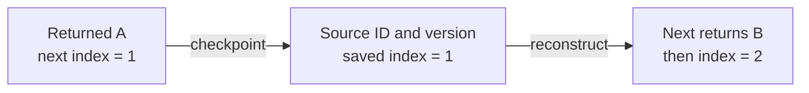

## Problem

Implement a resumable iterator: it returns items in order, exposes a checkpoint during execution, and can be reconstructed from that checkpoint after a process restart or on another machine.

The base problem iterates over a list. The follow-up returns one line at a time from a UTF-8 file. Restoring a checkpoint must continue at its next unread item without introducing an extra repeat or skip relative to that saved position.

Use these contracts:

- The source is an immutable snapshot with a stable source ID and version. Another machine must obtain that same snapshot independently; a checkpoint does not contain the data.
- `checkpoint()` describes the next item that `next()` would return. Taking a checkpoint does not advance iteration.
- A checkpoint at the end is valid and restores an exhausted iterator. Calling `next()` after exhaustion raises `NoSuchElementException` in Java or `StopIteration` in Python.
- Invalid positions and mismatched source IDs or versions are rejected. The iterators are single-consumer objects, without concurrent mutation or concurrent method calls.

For files, the source must be a seekable, uncompressed, immutable regular file. Lines end at LF (`\n`), with an immediately preceding CR removed for CRLF. A final line without LF is returned. A standalone CR remains content. A trailing LF terminates the previous line and does not create another line; a file containing only `\n` contains one empty line.

“Resume without repeats” is relative to the checkpoint that was saved. If the process returns more items after saving that checkpoint and then crashes, those later items will be returned again after recovery. The iterator cannot reconstruct progress that was never persisted.

## Write the tests before the implementation

The attachment asks for a test-first approach. Define observable behavior before choosing fields or file APIs. These are the acceptance tests used by the complete programs below and the repository's additional automated checks.

<div class="table-scroll" role="region" aria-label="Resumable iterator acceptance tests" tabindex="0">

| Case | Required result | Mistake it detects |
| --- | --- | --- |
| Start with `[A, B, C]` | First result is `A`; initial position is 0 | Advancing during construction |
| Consume `A`, checkpoint, reconstruct | Next result is `B` | Saving the last returned index |
| Take repeated checkpoints or call `hasNext()` repeatedly | Position stays unchanged | Observation accidentally consuming data |
| Save and reconstruct several times | Remaining items retain their order | Resume logic depending on the old object |
| Empty, single-item, and end checkpoints | Correct exhaustion with no extra result | Off-by-one boundaries |
| Negative or past-end position | Reject the checkpoint | Index or seek outside the source |
| Wrong source ID or version | Reject the checkpoint | Applying a cursor to a different snapshot |
| Multibyte UTF-8, CRLF, empty lines, final line without LF | Correct text and byte positions | Character counts, overly broad trimming, or dropped final data |
| File line spans multiple buffers | Return the complete line exactly once | Discarding buffered remainder or splitting a record |
| Persist a file checkpoint, close, reload, use another path | Resume at the same logical record | Saving a file handle, buffer, or machine-specific path |

</div>

For example, a tiny test can consume `A`, save state, discard the iterator, construct a new object, and assert that its first result is `B`. This already captures more of the recovery contract than a test that simply reads all items once.

## The algorithm: persist the next unread position

For a list snapshot `items` of length `n`, maintain a cursor `i` with this invariant:

```text
0 <= i <= n
items[0:i] has been returned by this traversal
items[i:n] remains unread
```

`next()` returns `items[i]` and increments `i` once. `checkpoint()` copies `i` together with the source ID and version. Reconstruction checks those fields and installs the saved index.

There is no need to remember the returned values, create a deduplication set, or copy the remaining suffix. Positions distinguish equal values: iterating over `[A, A, B]` must return both occurrences of `A`.



*The saved cursor is sufficient to reconstruct traversal over the same snapshot. No pointer to the old iterator is needed.*

Random access matters. Calling `get(i)` on a linked list is not generally constant time. The Java snapshot therefore copies the supplied list once into an array-backed list; Python stores a tuple. New iterators share that immutable sequence, so reconstruction does not copy it again. The copy freezes the sequence structure, not arbitrary mutable objects stored inside it; payloads must also obey the snapshot contract.

## The file follow-up: positions are byte offsets

Saving a line number requires reading and skipping the preceding lines during recovery. Saving a character count is also insufficient for a UTF-8 file: characters occupy different numbers of bytes, while ordinary file seeking uses byte positions.

Instead, store the byte offset immediately after the last successfully returned line, including its line terminator. Consider this file:

```text
cat\ncafé\r\n\nbird\r
```

Here the displayed escapes represent actual line-ending bytes. `cat\n` occupies 4 bytes. `café\r\n` occupies 7 bytes because `é` occupies 2 UTF-8 bytes. The empty line occupies 1 byte. `bird\r` occupies 5 bytes and has no LF. The checkpoints after each returned line are therefore **4, 11, 12, and 17**.

Scan raw bytes for LF, remove CR only when it precedes that LF, and decode the complete line as UTF-8. LF cannot occur inside a valid UTF-8 multibyte sequence. The implementations reject malformed UTF-8 and advance the logical cursor only after decoding succeeds.

### Buffering must preserve the logical cursor

A buffered stream can read bytes for several lines at once. Its underlying descriptor can be ahead of the item returned to the caller. Taking that descriptor's position as the checkpoint would skip buffered, unread lines after reconstruction. Java's [BufferedInputStream documentation](https://docs.oracle.com/en/java/javase/17/docs/api/java.base/java/io/BufferedInputStream.html) describes this read-ahead behavior.

The implementations below keep a separate logical offset. They retain one buffered stream between calls, so subsequent lines reuse the unread buffer contents. Reopening and discarding a buffer for every short line would introduce avoidable I/O amplification.

For this particular contract, the immutable file size is known. `hasNext()` can check `nextOffset < size` without reading a line, so no line lookahead cache is needed. On a source whose length is unknown, `hasNext()` may require lookahead; that variant must retain the prefetched item and leave the checkpoint at its starting offset until `next()` returns it.

Python opens the file in **binary mode**. Its buffered binary position is a byte position; text streams can expose opaque position cookies and perform newline translation. See Python's [I/O documentation](https://docs.python.org/3/library/io.html). Java tracks consumed bytes explicitly instead of asking the underlying channel for its post-read-ahead position. `RandomAccessFile.readLine()` is also unsuitable for general UTF-8 text because its documented byte-to-character conversion does not perform UTF-8 decoding; the [Java API](https://docs.oracle.com/en/java/javase/17/docs/api/java.base/java/io/RandomAccessFile.html#readLine()) explains that limitation.

### Validate identity without pretending size proves immutability

Each file checkpoint contains a logical source ID, immutable version, snapshot byte length, and next byte offset. The path is supplied again during reconstruction and can differ across machines. The application resolves the ID and version to the correct immutable file before constructing the iterator.

This contract is essential. A file size or modification timestamp cannot prove that arbitrary file content is unchanged. The examples check size as an additional sanity check, but do not hash the file on every resume. A same-size overwrite under a reused version violates the input contract and cannot be detected by these checks. Use immutable object versions or a trusted content manifest in a real storage layer. Computing and verifying a whole-file digest during reconstruction would add `O(S)` work for an `S`-byte file.

A restored offset must be 0, EOF, or immediately after LF. Checking the preceding byte rejects a cursor in the middle of a line or UTF-8 character without scanning the prefix. Checkpoints are application state; if untrusted parties supply them, add authentication and authorization at the API boundary.

## Java solution

Save as `ResumableIterators.java` and run with Java 17 or later. Both iterator classes have a constructor and three core operations: `hasNext`, `next`, and `checkpoint`. The file class adds `close` for resource management. There are no algorithm helper chains.

```java
import java.io.*;
import java.nio.ByteBuffer;
import java.nio.charset.CodingErrorAction;
import java.nio.charset.StandardCharsets;
import java.nio.file.*;
import java.util.*;

public class ResumableIterators {
    public record Snapshot<T>(String sourceId, String version, List<T> items) {
        public Snapshot {
            if (sourceId == null || sourceId.isBlank() || version == null || version.isBlank()) {
                throw new IllegalArgumentException("Source ID and version are required");
            }
            items = Collections.unmodifiableList(new ArrayList<>(Objects.requireNonNull(items)));
        }
    }

    public record ListState(String sourceId, String version, int nextIndex) {}
    public record FileState(String sourceId, String version, long size, long nextOffset) {}

    public static final class ResumableList<T> implements Iterator<T> {
        private final Snapshot<T> source;
        private int index;

        public ResumableList(Snapshot<T> source, ListState state) {
            this.source = Objects.requireNonNull(source);
            if (state != null && (!source.sourceId().equals(state.sourceId())
                    || !source.version().equals(state.version()))) {
                throw new IllegalArgumentException("Snapshot mismatch");
            }
            index = state == null ? 0 : state.nextIndex();
            if (index < 0 || index > source.items().size()) {
                throw new IllegalArgumentException("Invalid list position");
            }
        }

        public boolean hasNext() {
            return index < source.items().size();
        }

        public T next() {
            if (!hasNext()) throw new NoSuchElementException("List exhausted");
            T item = source.items().get(index);
            index++;
            return item;
        }

        public ListState checkpoint() {
            return new ListState(source.sourceId(), source.version(), index);
        }
    }

    public static final class Utf8Lines implements AutoCloseable {
        private final String sourceId, version;
        private final long size;
        private final BufferedInputStream input;
        private long nextOffset;
        private boolean closed, failed;

        public Utf8Lines(Path path, String sourceId, String version,
                         FileState state, int bufferSize) throws IOException {
            if (sourceId == null || sourceId.isBlank() || version == null || version.isBlank()
                    || bufferSize < 2) {
                throw new IllegalArgumentException("Invalid source or buffer size");
            }
            this.sourceId = sourceId;
            this.version = version;
            FileInputStream raw = new FileInputStream(path.toFile());
            try {
                size = raw.getChannel().size();
                if (state != null && (!sourceId.equals(state.sourceId())
                        || !version.equals(state.version()) || size != state.size())) {
                    throw new IllegalArgumentException("Snapshot mismatch");
                }
                nextOffset = state == null ? 0 : state.nextOffset();
                if (nextOffset < 0 || nextOffset > size) {
                    throw new IllegalArgumentException("Invalid byte position");
                }
                // Only line starts and EOF are valid recovery boundaries.
                if (nextOffset > 0 && nextOffset < size) {
                    raw.getChannel().position(nextOffset - 1);
                    if (raw.read() != '\n') throw new IllegalArgumentException("Not a line boundary");
                }
                raw.getChannel().position(nextOffset);
                input = new BufferedInputStream(raw, bufferSize);
            } catch (IOException | RuntimeException error) {
                try { raw.close(); } catch (IOException cleanup) { error.addSuppressed(cleanup); }
                throw error;
            }
        }

        public boolean hasNext() {
            if (closed || failed) throw new IllegalStateException("Close and reconstruct the iterator");
            return nextOffset < size;
        }

        public String next() throws IOException {
            if (!hasNext()) throw new NoSuchElementException("File exhausted");
            try {
                ByteArrayOutputStream line = new ByteArrayOutputStream();
                long position = nextOffset;
                boolean endedWithLf = false;
                while (position < size) {
                    int value = input.read();
                    if (value < 0) throw new EOFException("Snapshot was truncated");
                    position++;
                    if (value == '\n') { endedWithLf = true; break; }
                    line.write(value);
                }
                byte[] bytes = line.toByteArray();
                int length = bytes.length;
                if (endedWithLf && length > 0 && bytes[length - 1] == '\r') length--;
                String result = StandardCharsets.UTF_8.newDecoder()
                        .onMalformedInput(CodingErrorAction.REPORT)
                        .onUnmappableCharacter(CodingErrorAction.REPORT)
                        .decode(ByteBuffer.wrap(bytes, 0, length)).toString();
                // Commit progress only after a complete line decodes successfully.
                nextOffset = position;
                return result;
            } catch (IOException error) {
                failed = true;
                throw error;
            }
        }

        public FileState checkpoint() {
            return new FileState(sourceId, version, size, nextOffset);
        }

        public void close() throws IOException {
            closed = true;
            input.close();
        }
    }

    public static void main(String[] args) throws Exception {
        // Test 1: Repeated checkpoints do not consume the next unread item.
        Snapshot<String> source = new Snapshot<>("letters", "v1", List.of("A", "B", "C", "D"));
        ResumableList<String> first = new ResumableList<>(source, null);
        System.out.println("List first: " + first.next());
        ListState saved = first.checkpoint();
        System.out.println("List checkpoint: " + saved.nextIndex());
        System.out.println("List checkpoint stable: " + saved.equals(first.checkpoint()));

        // Test 2: New objects can resume repeatedly, including at the end.
        ResumableList<String> second = new ResumableList<>(source, saved);
        System.out.println("List resume: " + second.next());
        ResumableList<String> third = new ResumableList<>(source, second.checkpoint());
        System.out.println("List resume again: " + third.next() + "," + third.next());
        System.out.println("List exhausted: " + new ResumableList<>(source, third.checkpoint()).hasNext());
        try { third.next(); throw new AssertionError(); }
        catch (NoSuchElementException expected) { System.out.println("List exhausted next: rejected"); }

        // Test 3: Empty and single-element snapshots have the expected boundaries.
        System.out.println("Empty list: " + new ResumableList<>(new Snapshot<>("empty", "v1", List.of()), null).hasNext());
        ResumableList<String> single = new ResumableList<>(new Snapshot<>("single", "v1", List.of("only")), null);
        System.out.println("Single list: " + single.next() + "," + single.hasNext());

        // Test 4: Reject both out-of-range indices and a different version.
        for (int invalid : new int[]{-1, source.items().size() + 1}) {
            try { new ResumableList<>(source, new ListState("letters", "v1", invalid)); throw new AssertionError(); }
            catch (IllegalArgumentException expected) { }
        }
        System.out.println("Invalid list states: rejected");
        try { new ResumableList<>(source, new ListState("letters", "v2", 0)); throw new AssertionError(); }
        catch (IllegalArgumentException expected) { System.out.println("Wrong snapshot: rejected"); }

        Path directory = Files.createTempDirectory("resumable-iterator-");
        Path original = directory.resolve("source.txt"), replica = directory.resolve("replica.txt");
        Path statePath = directory.resolve("checkpoint.bin");
        int bufferSize = 7;
        try {
            // Test 5: UTF-8 byte offsets stay correct despite internal read-ahead.
            Files.writeString(original, "cat\ncaf\u00e9\r\n\nbird\r", StandardCharsets.UTF_8);
            FileState fileState;
            try (Utf8Lines lines = new Utf8Lines(original, "file", "v1", null, bufferSize)) {
                System.out.println("File first: " + lines.next());
                fileState = lines.checkpoint();
                lines.hasNext(); lines.hasNext();
                System.out.println("File checkpoint: " + fileState.nextOffset());
                System.out.println("File checkpoint stable: " + fileState.equals(lines.checkpoint()));
            }

            // Test 6: Persist the state, reload it, and use the same snapshot at another path.
            try (DataOutputStream out = new DataOutputStream(Files.newOutputStream(statePath))) {
                out.writeUTF(fileState.sourceId()); out.writeUTF(fileState.version());
                out.writeLong(fileState.size()); out.writeLong(fileState.nextOffset());
            }
            try (DataInputStream in = new DataInputStream(Files.newInputStream(statePath))) {
                fileState = new FileState(in.readUTF(), in.readUTF(), in.readLong(), in.readLong());
            }
            Files.copy(original, replica);
            FileState end;
            try (Utf8Lines lines = new Utf8Lines(replica, "file", "v1", fileState, bufferSize)) {
                System.out.println("File resume: " + lines.next());
                System.out.println("File next offset: " + lines.checkpoint().nextOffset());
                System.out.println("File empty line length: " + lines.next().length());
                System.out.println("File final: " + lines.next().replace("\r", "<CR>"));
                System.out.println("File exhausted: " + lines.hasNext());
                end = lines.checkpoint();
                try { lines.next(); throw new AssertionError(); }
                catch (NoSuchElementException expected) { System.out.println("File exhausted next: rejected"); }
            }
            try (Utf8Lines lines = new Utf8Lines(replica, "file", "v1", end, bufferSize)) {
                System.out.println("File EOF resume: " + lines.hasNext());
            }

            // Test 7: Reject wrong versions and cursors in the middle of a line.
            for (FileState invalid : List.of(new FileState("file", "v2", fileState.size(), 4),
                    new FileState("file", "v1", fileState.size(), 5))) {
                try (Utf8Lines ignored = new Utf8Lines(replica, "file", "v1", invalid, bufferSize)) {
                    throw new AssertionError();
                } catch (IllegalArgumentException expected) { }
            }
            System.out.println("Invalid file states: rejected");

            // Test 8: A changed length cannot reuse the old snapshot checkpoint.
            Files.writeString(replica, "extra", StandardOpenOption.APPEND);
            try (Utf8Lines ignored = new Utf8Lines(replica, "file", "v1", fileState, bufferSize)) {
                throw new AssertionError();
            } catch (IllegalArgumentException expected) { System.out.println("Changed file size: rejected"); }

            // Test 9: Empty input, one empty line, and lines spanning several buffers.
            Files.writeString(original, "");
            try (Utf8Lines lines = new Utf8Lines(original, "empty-file", "v1", null, bufferSize)) {
                System.out.println("Empty file: " + lines.hasNext());
            }
            Files.writeString(original, "\n");
            try (Utf8Lines lines = new Utf8Lines(original, "blank-file", "v1", null, bufferSize)) {
                System.out.println("Blank file: " + lines.next().length() + "," + lines.hasNext());
            }
            Files.writeString(original, "x".repeat(bufferSize * 5 + 3) + "\n");
            try (Utf8Lines lines = new Utf8Lines(original, "long-file", "v1", null, bufferSize)) {
                System.out.println("Long line length: " + lines.next().length());
            }
        } finally {
            Files.deleteIfExists(statePath); Files.deleteIfExists(replica);
            Files.deleteIfExists(original); Files.deleteIfExists(directory);
        }
    }
}
```

The `sourceId` and `version` identify a snapshot independently of its physical file path. The small buffer in `main` is deliberately a test input; the implementation accepts any buffer size of at least two bytes. An I/O or decoding failure leaves the logical checkpoint unchanged and marks the file iterator unusable for further reads. Close it and reconstruct from a saved checkpoint rather than continuing with a partially consumed buffer. A checkpoint can still be inspected after failure or closure.

The checkpoint serialization in this example demonstrates a disk round trip. Closing a stream alone is not a general power-loss durability guarantee. A durable checkpoint store needs a defined atomic replacement and persistence protocol, or storage with an appropriate durability contract.

## Python solution

Save as `resumable_iterators.py`. The API mirrors Java. The `next` method is also exposed through Python's iterator protocol, so ordinary `next(iterator)` and `for` loops work. Frozen dataclasses hold state records, and a tuple freezes the input sequence structure.

```python
from dataclasses import asdict, dataclass
import json
import os
from pathlib import Path
from tempfile import TemporaryDirectory
from typing import Generic, Tuple, TypeVar

T = TypeVar("T")


@dataclass(frozen=True)
class Snapshot(Generic[T]):
    source_id: str
    version: str
    items: Tuple[T, ...]

    def __post_init__(self):
        if not isinstance(self.source_id, str) or not self.source_id.strip():
            raise ValueError("Source ID is required")
        if not isinstance(self.version, str) or not self.version.strip():
            raise ValueError("Version is required")
        object.__setattr__(self, "items", tuple(self.items))


@dataclass(frozen=True)
class ListState:
    source_id: str
    version: str
    next_index: int


@dataclass(frozen=True)
class FileState:
    source_id: str
    version: str
    size: int
    next_offset: int


class ResumableList(Generic[T]):
    def __init__(self, source, state=None):
        if state is not None and (not isinstance(state, ListState)
                or state.source_id != source.source_id or state.version != source.version):
            raise ValueError("Snapshot mismatch")
        index = 0 if state is None else state.next_index
        if type(index) is not int or not 0 <= index <= len(source.items):
            raise ValueError("Invalid list position")
        self.source, self.index = source, index

    def has_next(self):
        return self.index < len(self.source.items)

    def next(self):
        if not self.has_next():
            raise StopIteration("List exhausted")
        item = self.source.items[self.index]
        self.index += 1
        return item

    def checkpoint(self):
        return ListState(self.source.source_id, self.source.version, self.index)

    def __iter__(self):
        return self

    __next__ = next


class Utf8Lines:
    def __init__(self, path, source_id, version, state=None, buffer_size=8192):
        if (not isinstance(source_id, str) or not source_id.strip()
                or not isinstance(version, str) or not version.strip()
                or type(buffer_size) is not int or buffer_size < 2):
            raise ValueError("Invalid source or buffer size")
        self.source_id, self.version = source_id, version
        self.failed = False
        self.file = open(path, "rb", buffering=buffer_size)
        try:
            self.size = os.fstat(self.file.fileno()).st_size
            if state is not None and (not isinstance(state, FileState)
                    or state.source_id != source_id or state.version != version
                    or type(state.size) is not int or state.size != self.size):
                raise ValueError("Snapshot mismatch")
            self.next_offset = 0 if state is None else state.next_offset
            if type(self.next_offset) is not int or not 0 <= self.next_offset <= self.size:
                raise ValueError("Invalid byte position")
            # Validate a boundary without reading all preceding lines.
            if 0 < self.next_offset < self.size:
                self.file.seek(self.next_offset - 1)
                if self.file.read(1) != b"\n":
                    raise ValueError("Not a line boundary")
            self.file.seek(self.next_offset)
        except Exception:
            self.file.close()
            raise

    def has_next(self):
        if self.file.closed or self.failed:
            raise ValueError("Close and reconstruct the iterator")
        return self.next_offset < self.size

    def next(self):
        if not self.has_next():
            raise StopIteration("File exhausted")
        try:
            raw = self.file.readline(self.size - self.next_offset)
            position = self.next_offset + len(raw)
            if not raw or (not raw.endswith(b"\n") and position < self.size):
                raise OSError("Snapshot was truncated")
            # Remove only the agreed line terminator; preserve a standalone CR.
            content = raw
            if raw.endswith(b"\n"):
                content = raw[:-1]
                if content.endswith(b"\r"):
                    content = content[:-1]
            result = content.decode("utf-8", errors="strict")
            self.next_offset = position
            return result
        except (OSError, UnicodeError):
            self.failed = True
            raise

    def checkpoint(self):
        return FileState(self.source_id, self.version, self.size, self.next_offset)

    def close(self):
        self.file.close()

    def __enter__(self):
        return self

    def __exit__(self, exc_type, exc_value, traceback):
        self.close()

    def __iter__(self):
        return self

    __next__ = next


def main():
    # Test 1: Repeated checkpoints do not consume the next unread item.
    source = Snapshot("letters", "v1", ("A", "B", "C", "D"))
    first = ResumableList(source)
    print("List first:", first.next())
    saved = first.checkpoint()
    print("List checkpoint:", saved.next_index)
    print("List checkpoint stable:", str(saved == first.checkpoint()).lower())

    # Test 2: New objects can resume repeatedly, including at the end.
    second = ResumableList(source, saved)
    print("List resume:", second.next())
    third = ResumableList(source, second.checkpoint())
    print("List resume again:", third.next() + "," + third.next())
    print("List exhausted:", str(ResumableList(source, third.checkpoint()).has_next()).lower())
    try:
        third.next()
        raise AssertionError("Expected exhaustion")
    except StopIteration:
        print("List exhausted next: rejected")

    # Test 3: Empty and single-element snapshots have the expected boundaries.
    print("Empty list:", str(ResumableList(Snapshot("empty", "v1", ())).has_next()).lower())
    single = ResumableList(Snapshot("single", "v1", ("only",)))
    print("Single list:", single.next() + "," + str(single.has_next()).lower())

    # Test 4: Reject both out-of-range indices and a different version.
    for invalid in (-1, len(source.items) + 1):
        try:
            ResumableList(source, ListState("letters", "v1", invalid))
            raise AssertionError("Expected rejection")
        except ValueError:
            pass
    print("Invalid list states: rejected")
    try:
        ResumableList(source, ListState("letters", "v2", 0))
        raise AssertionError("Expected rejection")
    except ValueError:
        print("Wrong snapshot: rejected")

    with TemporaryDirectory(prefix="resumable-iterator-") as directory:
        original, replica = Path(directory) / "source.txt", Path(directory) / "replica.txt"
        state_path = Path(directory) / "checkpoint.json"
        buffer_size = 7

        # Test 5: UTF-8 byte offsets stay correct despite internal read-ahead.
        original.write_bytes("cat\ncaf\u00e9\r\n\nbird\r".encode("utf-8"))
        with Utf8Lines(original, "file", "v1", buffer_size=buffer_size) as lines:
            print("File first:", lines.next())
            file_state = lines.checkpoint()
            lines.has_next()
            lines.has_next()
            print("File checkpoint:", file_state.next_offset)
            print("File checkpoint stable:", str(file_state == lines.checkpoint()).lower())

        # Test 6: Persist the state, reload it, and use the same snapshot at another path.
        state_path.write_text(json.dumps(asdict(file_state)), encoding="utf-8")
        file_state = FileState(**json.loads(state_path.read_text(encoding="utf-8")))
        replica.write_bytes(original.read_bytes())
        with Utf8Lines(replica, "file", "v1", file_state, buffer_size) as lines:
            print("File resume:", lines.next())
            print("File next offset:", lines.checkpoint().next_offset)
            print("File empty line length:", len(lines.next()))
            print("File final:", lines.next().replace("\r", "<CR>"))
            print("File exhausted:", str(lines.has_next()).lower())
            end = lines.checkpoint()
            try:
                lines.next()
                raise AssertionError("Expected exhaustion")
            except StopIteration:
                print("File exhausted next: rejected")
        with Utf8Lines(replica, "file", "v1", end, buffer_size) as lines:
            print("File EOF resume:", str(lines.has_next()).lower())

        # Test 7: Reject wrong versions and cursors in the middle of a line.
        for invalid in (FileState("file", "v2", file_state.size, 4),
                        FileState("file", "v1", file_state.size, 5)):
            try:
                with Utf8Lines(replica, "file", "v1", invalid, buffer_size):
                    raise AssertionError("Expected rejection")
            except ValueError:
                pass
        print("Invalid file states: rejected")

        # Test 8: A changed length cannot reuse the old snapshot checkpoint.
        with replica.open("ab") as output:
            output.write(b"extra")
        try:
            with Utf8Lines(replica, "file", "v1", file_state, buffer_size):
                raise AssertionError("Expected rejection")
        except ValueError:
            print("Changed file size: rejected")

        # Test 9: Empty input, one empty line, and lines spanning several buffers.
        original.write_bytes(b"")
        with Utf8Lines(original, "empty-file", "v1", buffer_size=buffer_size) as lines:
            print("Empty file:", str(lines.has_next()).lower())
        original.write_bytes(b"\n")
        with Utf8Lines(original, "blank-file", "v1", buffer_size=buffer_size) as lines:
            print("Blank file:", str(len(lines.next())) + "," + str(lines.has_next()).lower())
        original.write_bytes(b"x" * (buffer_size * 5 + 3) + b"\n")
        with Utf8Lines(original, "long-file", "v1", buffer_size=buffer_size) as lines:
            print("Long line length:", len(lines.next()))


if __name__ == "__main__":
    main()
```

The Java and Python checkpoint encodings above are independent examples, not a shared wire format. Both contain ordinary values rather than runtime objects. A service needing cross-language checkpoints should specify one versioned encoding and validate its fields on input.

## Expected output

Both complete programs print:

```text
List first: A
List checkpoint: 1
List checkpoint stable: true
List resume: B
List resume again: C,D
List exhausted: false
List exhausted next: rejected
Empty list: false
Single list: only,false
Invalid list states: rejected
Wrong snapshot: rejected
File first: cat
File checkpoint: 4
File checkpoint stable: true
File resume: café
File next offset: 11
File empty line length: 0
File final: bird<CR>
File exhausted: false
File exhausted next: rejected
File EOF resume: false
Invalid file states: rejected
Changed file size: rejected
Empty file: false
Blank file: 0,false
Long line length: 38
```

The temporary files demonstrate reconstruction after closing the old handle and reloading state from disk. They do not simulate power failure, remote storage outages, or the storage system's durability behavior.

## Why the cursor is correct

For the list, the initial cursor is 0. Assuming `i` points at the next unread item, a successful `next()` returns exactly `items[i]` and changes the cursor to `i + 1`. A checkpoint copies that cursor without changing it. Reconstruction installs the same index over the same version, preserving the invariant. At `i = n`, the unread suffix is empty and reconstruction remains exhausted.

For the file, the initial cursor is byte 0. Reading begins at that logical boundary and collects bytes through one LF, or through the snapshot's final byte. Only after the collected text decodes successfully does `next()` install the following byte offset. The persistent buffer supplies subsequent bytes in order, regardless of how far the underlying descriptor has read ahead. Reopening at the saved boundary therefore starts the same unread suffix.

The line-ending contract resolves several apparent ambiguities. `A\n` yields one line, `A`; `A\n\n` yields `A` and an empty line; `A\r\n` yields `A`; and `A\r` yields a line containing the terminal CR. Other applications can choose different rules, but both checkpointing and decoding must follow the same rules on every machine.

## Complexity

Let `n` be the list length, `S` the file size in bytes, `L` the bytes consumed for one returned line including its terminator, and `B` the configured read-buffer size. Assume bounded-size source metadata and the usual constant-time integer/index model.

<div class="table-scroll" role="region" aria-label="Resumable iterator complexity" tabindex="0">

| Operation | List snapshot | UTF-8 file snapshot |
| --- | --- | --- |
| Prepare the immutable source | `O(n)` time and sequence storage for the defensive copy | External responsibility; creating or hashing a snapshot can cost `O(S)` |
| Construct or reconstruct iterator | `O(1)` over an existing snapshot | `O(B)` buffer setup plus file-open, metadata, and seek costs; no prefix scan |
| `hasNext` / `has_next` | `O(1)` | `O(1)` because snapshot length is known |
| `next` | `O(1)` | `O(L)` byte processing, with buffered I/O amortized over the scan |
| `checkpoint` | `O(1)` | `O(1)` |
| Iterator working space | `O(1)`, excluding the shared source | `O(B + L)` for buffering and the current line |
| Checkpoint size | `O(1)` fields | `O(1)` fields |

</div>

Returning all file lines processes `O(S)` bytes. A cold buffer refill can transfer up to `B` bytes even for a short line; this cost is shared by later calls consuming the same buffer. Operating-system caching, short reads, and the storage device determine actual I/O latency. The file-opening and seeking operations are not claims of constant wall-clock latency. Java's [FileChannel API](https://docs.oracle.com/en/java/javase/17/docs/api/java.base/java/nio/channels/FileChannel.html) supplies positional access without requiring application code to rescan preceding records.

These bounds are optimal for the stated representation: returning a list item needs constant work, and materializing a line requires processing its bytes. A constant-size cursor avoids carrying data already available in the source. If arbitrarily long lines must fit a hard memory limit, change the API to return chunks or enforce a maximum line length; returning the whole line already requires space proportional to that line.

## Recovery boundaries to explain in an interview

A changed snapshot needs a changed version and a defined policy: reject the old checkpoint, reopen its old immutable version, or perform an application-specific migration. A numeric index cannot infer how inserts and deletions changed the meaning of a position. An append-only tailing reader also needs a different EOF and version contract from this fixed-snapshot iterator.

Compressed streams require another position scheme. An arbitrary byte offset into a gzip file generally does not contain the decoder state needed to resume. An indexed compression format, block boundary, or decoder-state checkpoint can change that trade-off. Similarly, fetching a remote object range is only safe when it refers to the same immutable object version.

Finally, distinguish traversal from downstream effects. With `process(item)` followed by `save(checkpoint)`, a crash between the two can replay an already processed item. Reversing the order can persist progress before processing finishes and skip the effect after recovery. Atomic commitment of progress and effects, or durable idempotency keyed by source version and record position, is needed to make repeated execution safe. An outbox or transaction is useful only when its actual transaction boundary covers the relevant progress and effect records.

The implementation's essential state remains small: the source version identifies which sequence is being read, and the cursor identifies where its unread suffix starts. Persistence and downstream processing supply the additional recovery guarantees required by the surrounding application.
