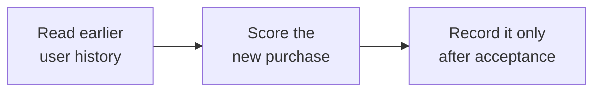

Two daily log files lead to two related tasks. First, identify users who appear on both days and use enough different order types. Then use each user's purchase history to score a new purchase. Both tasks fit an incremental hash map, but their state has different meanings: a report concerns selected days, while a new transaction can use all recorded history.

The key implementation detail is to score a transaction before recording it. Otherwise, the transaction supplies its own evidence of familiar behaviour.

## Problem

Each log entry contains `(date, userId, orderType, amount)`. File reading and parsing can feed entries directly into the algorithm; the examples use parsed records.

**Part 1.** Return each user who appears on every required day and has at least `minimumTypes` distinct order types across those days combined. The original task has two required days and `minimumTypes = 2`. Both are inputs below. Order types are arbitrary strings, not a fixed list of `phone`, `web`, and `app`.

The required date set must be nonempty and the threshold positive. Dates are already normalized to the reporting calendar; identifiers and type names use exact, case-sensitive matching.

For example:

```text
day 1: (u1, phone, 100), (u1, phone, 120), (u2, web, 50), (u3, app, 70)
day 2: (u1, web, 200), (u2, web, 80), (u4, phone, 60)
result: [u1]
```

Repeated `phone` entries contribute one distinct type. User `u2` appears on both days but has only `web`; `u3` and `u4` each miss a day. A user with `phone` and `web` on day 1 and only `phone` on day 2 also qualifies. The types need not differ between the days.

**Part 2.** Given `(userId, orderType, amount)` for a new purchase, return a transaction score:

* A previously seen order type earns `typePoints`, originally 50.
* An amount in the inclusive historical range `[minimum, maximum]` earns `amountPoints`, originally 50.
* An amount outside that range loses `pointsPerStep`, originally 10, for each started percentage band, originally 10%, measured against the exceeded boundary. The amount component stops at zero.

An existing user's history is available for scoring even if that user fails Part 1. The qualification result is not a filter on the scoring profiles.

## Make the scoring contract explicit

“Every 10%” can mean started bands or completed bands. This implementation uses **started bands**, so a 5% deviation incurs one deduction. With completed bands, that same deviation would incur none. Likewise, a 10% deviation incurs one deduction, while a deviation just above 10% incurs two under the chosen rule. The examples make this interpretation observable.

The reference amount is the nearest violated boundary: use the historical maximum above the range and the historical minimum below it. Do not divide by the new amount or the width of the range. A single historical purchase gives `minimum == maximum` and still works.

Amounts are positive integer minor units in one currency. For cents, 100.00 is represented by 10000. The parsing layer must convert decimal input exactly. Zero and negative amounts are rejected because this percentage rule would need additional definitions for refunds and a zero reference boundary. Unknown users receive zero. Scores are per purchase, not accumulated user balances.

Clamping the amount component is also an explicit policy choice. If negative scores are required, remove that floor and define the output range accordingly; the code implements the bounded version. The resulting score is a stipulated heuristic, not a calibrated probability.

## Algorithm: retain the information each query needs

Use a map from user ID to a profile. `record` updates two groups of state:

1. **All recorded history:** the exact set of seen order types and the minimum and maximum amounts. These support future scoring queries.
2. **The selected reporting days:** the required days seen and up to `minimumTypes` distinct types from those days. Entries outside the selected dates cannot make a user qualify.

The reporting type set can stop growing once the threshold is reached. The all-history type set must keep accepting new types, because a later scoring query may ask about any of them. For the original threshold of two, qualification alone could retain one initial type and a flag for seeing a different one. A capped set handles a general threshold with the same idea.

When a user first satisfies the report, add its ID to an insertion-ordered set. `qualifiedUsers` returns a copy of those IDs, in the order they first qualified. Duplicate records cannot increase a day's or type's distinct count, and they cannot duplicate an output ID. No sorting or full log retention is needed.

The required dates and threshold stay fixed for an analyzer instance. This matters for streaming: a later purchase may expand scoring history while leaving the earlier two-day report unchanged. Changing the report window requires rebuilding its report state or maintaining additional expiring state.

## Compute percentage bands without floating point

Let the configured band size be the rational fraction `stepNumerator / stepDenominator`. Ten percent is `1 / 10`; five percent is `1 / 20`. This avoids hardcoding a percentage or approximating it as a floating-point value.

Outside the historical range, let `boundary` be the violated endpoint and `difference` the positive distance from it:

```text
steps = ceil(difference * stepDenominator / (boundary * stepNumerator))
amountScore = max(0, amountPoints - steps * pointsPerStep)
score = typeScore + amountScore
```

For positive integers `a` and `b`, `ceil(a / b) = (a + b - 1) // b`. Java uses `BigInteger` for the intermediate products and division, so multiplying large valid `long` amounts cannot wrap. Python uses integer arithmetic throughout. The [Java BigInteger documentation](https://docs.oracle.com/en/java/javase/17/docs/api/java.base/java/math/BigInteger.html) and [Python numeric-type documentation](https://docs.python.org/3.11/library/stdtypes.html#numeric-types-int-float-complex) describe these representations.

For a user with historical types `{phone, web}` and amounts from 100.00 to 200.00:

<div class="table-scroll" role="region" aria-label="Purchase scoring examples with started percentage bands" tabindex="0">

| New type | New amount | Amount calculation | Total score |
| --- | ---: | --- | ---: |
| web | 180.00 | Within range: 50 | 100 |
| store | 180.00 | Within range: 50, type unseen | 50 |
| phone | 210.00 | 5% above maximum: one deduction | 90 |
| phone | 220.00 | Exactly 10% above: one deduction | 90 |
| phone | 220.01 | Just above 10%: two deductions | 80 |
| store | 250.00 | 25% above: three deductions, type unseen | 20 |
| phone | 80.00 | 20% below minimum: two deductions | 80 |

</div>

## Java solution

Save as `PurchaseAnalyzer.java`; Java 17 or later is sufficient. There are three main operations: `record`, `qualifiedUsers`, and `score`. Configuration and data classes keep their responsibilities explicit. The input amount type is a positive `long`; score weights are nonnegative integers whose sum fits `int`.

```java
import java.math.BigInteger;
import java.util.*;

public class PurchaseAnalyzer {
    public record LogEntry(String day, String userId, String orderType, long amount) {}

    public record ScoringPolicy(int typePoints, int amountPoints,
                                long stepNumerator, long stepDenominator,
                                int pointsPerStep) {
        public ScoringPolicy {
            if (typePoints < 0 || amountPoints < 0 || pointsPerStep <= 0
                    || stepNumerator <= 0 || stepDenominator <= 0
                    || (long) typePoints + amountPoints > Integer.MAX_VALUE) {
                throw new IllegalArgumentException("Invalid scoring policy");
            }
        }
    }

    private static class UserProfile {
        final Set<String> seenTypes = new HashSet<>();
        final Set<String> reportDays = new HashSet<>();
        final Set<String> reportTypes = new HashSet<>();
        long minimum;
        long maximum;

        UserProfile(long amount) {
            minimum = maximum = amount;
        }
    }

    private final Set<String> requiredDays;
    private final int minimumTypes;
    private final ScoringPolicy policy;
    private final Map<String, UserProfile> profiles = new HashMap<>();
    private final Set<String> qualified = new LinkedHashSet<>();

    public PurchaseAnalyzer(Set<String> requiredDays, int minimumTypes,
                            ScoringPolicy policy) {
        Objects.requireNonNull(requiredDays, "Required days must not be null");
        if (requiredDays.isEmpty() || minimumTypes <= 0
                || requiredDays.stream().anyMatch(d -> d == null || d.isBlank())) {
            throw new IllegalArgumentException("Invalid reporting configuration");
        }
        this.requiredDays = Set.copyOf(requiredDays);
        this.minimumTypes = minimumTypes;
        this.policy = Objects.requireNonNull(policy, "A scoring policy is required");
    }

    public void record(LogEntry entry) {
        Objects.requireNonNull(entry, "A log entry is required");
        if (entry.day() == null || entry.day().isBlank()
                || entry.userId() == null || entry.userId().isBlank()
                || entry.orderType() == null || entry.orderType().isBlank()
                || entry.amount() <= 0) {
            throw new IllegalArgumentException("Invalid log entry");
        }

        // Preserve exact all-history membership and amount endpoints.
        UserProfile profile = profiles.computeIfAbsent(
                entry.userId(), key -> new UserProfile(entry.amount()));
        profile.seenTypes.add(entry.orderType());
        profile.minimum = Math.min(profile.minimum, entry.amount());
        profile.maximum = Math.max(profile.maximum, entry.amount());

        // Only selected dates contribute to the fixed report.
        if (requiredDays.contains(entry.day())) {
            profile.reportDays.add(entry.day());
            if (profile.reportTypes.size() < minimumTypes) {
                profile.reportTypes.add(entry.orderType());
            }
            if (profile.reportDays.size() == requiredDays.size()
                    && profile.reportTypes.size() == minimumTypes) {
                qualified.add(entry.userId());
            }
        }
    }

    public List<String> qualifiedUsers() {
        return new ArrayList<>(qualified);
    }

    public int score(String userId, String orderType, long amount) {
        if (userId == null || userId.isBlank()
                || orderType == null || orderType.isBlank() || amount <= 0) {
            throw new IllegalArgumentException("Invalid purchase");
        }
        UserProfile profile = profiles.get(userId);
        if (profile == null) return 0;

        // Scoring reads history and never adds the current purchase.
        int typeScore = profile.seenTypes.contains(orderType) ? policy.typePoints() : 0;
        if (amount >= profile.minimum && amount <= profile.maximum) {
            return typeScore + policy.amountPoints();
        }

        long boundary = amount < profile.minimum ? profile.minimum : profile.maximum;
        long difference = amount < boundary ? boundary - amount : amount - boundary;
        BigInteger numerator = BigInteger.valueOf(difference)
                .multiply(BigInteger.valueOf(policy.stepDenominator()));
        BigInteger denominator = BigInteger.valueOf(boundary)
                .multiply(BigInteger.valueOf(policy.stepNumerator()));
        BigInteger steps = numerator.add(denominator).subtract(BigInteger.ONE)
                .divide(denominator);
        BigInteger deduction = steps.multiply(BigInteger.valueOf(policy.pointsPerStep()));
        int amountScore = deduction.compareTo(BigInteger.valueOf(policy.amountPoints())) >= 0
                ? 0 : policy.amountPoints() - deduction.intValueExact();
        return typeScore + amountScore;
    }

    public static void main(String[] args) {
        var policy = new ScoringPolicy(50, 50, 1, 10, 10);
        var analyzer = new PurchaseAnalyzer(Set.of("2026-11-15", "2026-11-16"), 2, policy);

        // Test 1: Two daily files, duplicate types, and users missing a day.
        var history = List.of(
                new LogEntry("2026-11-15", "u1", "phone", 10000),
                new LogEntry("2026-11-15", "u1", "phone", 12000),
                new LogEntry("2026-11-15", "u2", "web", 5000),
                new LogEntry("2026-11-15", "u3", "app", 7000),
                new LogEntry("2026-11-16", "u1", "web", 20000),
                new LogEntry("2026-11-16", "u2", "web", 8000),
                new LogEntry("2026-11-16", "u4", "phone", 6000));
        for (LogEntry entry : history) analyzer.record(entry);
        System.out.println("qualified: " + analyzer.qualifiedUsers());

        // Test 2: Familiar/unfamiliar types, both endpoints, and an unknown user.
        System.out.println("inside: " + analyzer.score("u1", "web", 18000));
        System.out.println("unseen type: " + analyzer.score("u1", "store", 18000));
        System.out.println("minimum: " + analyzer.score("u1", "phone", 10000));
        System.out.println("maximum: " + analyzer.score("u1", "web", 20000));
        System.out.println("unknown user: " + analyzer.score("new", "web", 10000));

        // Test 3: Partial/exact bands, one unit beyond a band, and the score floor.
        System.out.println("above 5 percent: " + analyzer.score("u1", "phone", 21000));
        System.out.println("above 10 percent: " + analyzer.score("u1", "phone", 22000));
        System.out.println("past 10 percent: " + analyzer.score("u1", "phone", 22001));
        System.out.println("unseen above 25 percent: " + analyzer.score("u1", "store", 25000));
        System.out.println("below 20 percent: " + analyzer.score("u1", "phone", 8000));
        System.out.println("amount floor: " + analyzer.score("u1", "phone", 80000));

        // Test 4: A singleton history still defines a valid inclusive interval.
        analyzer.record(new LogEntry("2026-11-15", "single", "web", 8000));
        System.out.println("singleton: " + analyzer.score("single", "web", 7000));

        // Test 5: Score first, then record an accepted later-day purchase.
        var incoming = new LogEntry("2026-11-17", "u2", "phone", 9000);
        System.out.println("stream before: " + analyzer.score("u2", "phone", 9000));
        analyzer.record(incoming);
        System.out.println("stream after: " + analyzer.score("u2", "phone", 9000));
        System.out.println("fixed report: " + analyzer.qualifiedUsers());

        // Test 6: Three dates, three types, and a different scoring policy.
        var custom = new PurchaseAnalyzer(Set.of("d1", "d2", "d3"), 3,
                new ScoringPolicy(20, 30, 1, 20, 7));
        custom.record(new LogEntry("d1", "sam", "phone", 10000));
        custom.record(new LogEntry("d2", "sam", "web", 10000));
        custom.record(new LogEntry("d3", "sam", "app", 10000));
        System.out.println("custom qualified: " + custom.qualifiedUsers());
        System.out.println("custom score: " + custom.score("sam", "web", 11000));

        // Test 7: Large amounts distinguish an exact boundary from its next unit.
        analyzer.record(new LogEntry("2026-11-15", "large", "web", 1000000000000000000L));
        analyzer.record(new LogEntry("2026-11-16", "large", "web", 2000000000000000000L));
        System.out.println("large exact: " + analyzer.score("large", "web", 2200000000000000000L));
        System.out.println("large next: " + analyzer.score("large", "web", 2200000000000000001L));

        // Test 8: Empty history and invalid amounts follow the explicit contract.
        var empty = new PurchaseAnalyzer(Set.of("d1"), 1, policy);
        System.out.println("empty qualified: " + empty.qualifiedUsers());
        try {
            analyzer.score("u1", "web", 0);
        } catch (IllegalArgumentException exception) {
            System.out.println("invalid amount: rejected");
        }
    }
}
```

## Python solution

Python 3.9 or later is sufficient. The three operations have the same semantics. A dictionary retains the order in which users first qualify; returning its keys as a new list protects internal state. Python accepts positive integer amounts, including values beyond Java's `long` range.

```python
from dataclasses import dataclass, field
from typing import Dict, Iterable, List, Set


@dataclass(frozen=True)
class LogEntry:
    day: str
    user_id: str
    order_type: str
    amount: int


@dataclass(frozen=True)
class ScoringPolicy:
    type_points: int
    amount_points: int
    step_numerator: int
    step_denominator: int
    points_per_step: int

    def __post_init__(self):
        values = (self.type_points, self.amount_points, self.step_numerator,
                  self.step_denominator, self.points_per_step)
        if (any(type(value) is not int for value in values)
                or self.type_points < 0 or self.amount_points < 0
                or self.step_numerator <= 0 or self.step_denominator <= 0
                or self.points_per_step <= 0):
            raise ValueError("Invalid scoring policy")


@dataclass
class UserProfile:
    minimum: int
    maximum: int
    seen_types: Set[str] = field(default_factory=set)
    report_days: Set[str] = field(default_factory=set)
    report_types: Set[str] = field(default_factory=set)


class PurchaseAnalyzer:
    def __init__(self, required_days: Iterable[str], minimum_types: int,
                 policy: ScoringPolicy):
        days = frozenset(required_days)
        if (not days or type(minimum_types) is not int or minimum_types <= 0
                or any(not isinstance(day, str) or not day.strip() for day in days)):
            raise ValueError("Invalid reporting configuration")
        if not isinstance(policy, ScoringPolicy):
            raise ValueError("A scoring policy is required")
        self._required_days = days
        self._minimum_types = minimum_types
        self._policy = policy
        self._profiles: Dict[str, UserProfile] = {}
        self._qualified: Dict[str, None] = {}

    def record(self, entry: LogEntry) -> None:
        if (not isinstance(entry, LogEntry)
                or any(not isinstance(value, str) or not value.strip()
                       for value in (entry.day, entry.user_id, entry.order_type))
                or type(entry.amount) is not int or entry.amount <= 0):
            raise ValueError("Invalid log entry")

        # Preserve exact all-history membership and amount endpoints.
        profile = self._profiles.get(entry.user_id)
        if profile is None:
            profile = UserProfile(entry.amount, entry.amount)
            self._profiles[entry.user_id] = profile
        profile.seen_types.add(entry.order_type)
        profile.minimum = min(profile.minimum, entry.amount)
        profile.maximum = max(profile.maximum, entry.amount)

        # Only selected dates contribute to the fixed report.
        if entry.day in self._required_days:
            profile.report_days.add(entry.day)
            if len(profile.report_types) < self._minimum_types:
                profile.report_types.add(entry.order_type)
            if (len(profile.report_days) == len(self._required_days)
                    and len(profile.report_types) == self._minimum_types):
                self._qualified[entry.user_id] = None

    def qualified_users(self) -> List[str]:
        return list(self._qualified)

    def score(self, user_id: str, order_type: str, amount: int) -> int:
        if (any(not isinstance(value, str) or not value.strip()
                for value in (user_id, order_type))
                or type(amount) is not int or amount <= 0):
            raise ValueError("Invalid purchase")
        profile = self._profiles.get(user_id)
        if profile is None:
            return 0

        # Scoring reads history and never adds the current purchase.
        policy = self._policy
        type_score = policy.type_points if order_type in profile.seen_types else 0
        if profile.minimum <= amount <= profile.maximum:
            return type_score + policy.amount_points

        boundary = profile.minimum if amount < profile.minimum else profile.maximum
        difference = abs(amount - boundary)
        numerator = difference * policy.step_denominator
        denominator = boundary * policy.step_numerator
        steps = (numerator + denominator - 1) // denominator
        amount_score = max(0, policy.amount_points - steps * policy.points_per_step)
        return type_score + amount_score


def main():
    policy = ScoringPolicy(50, 50, 1, 10, 10)
    analyzer = PurchaseAnalyzer({"2026-11-15", "2026-11-16"}, 2, policy)

    # Test 1: Two daily files, duplicate types, and users missing a day.
    history = [
        LogEntry("2026-11-15", "u1", "phone", 10000),
        LogEntry("2026-11-15", "u1", "phone", 12000),
        LogEntry("2026-11-15", "u2", "web", 5000),
        LogEntry("2026-11-15", "u3", "app", 7000),
        LogEntry("2026-11-16", "u1", "web", 20000),
        LogEntry("2026-11-16", "u2", "web", 8000),
        LogEntry("2026-11-16", "u4", "phone", 6000),
    ]
    for entry in history:
        analyzer.record(entry)
    print("qualified:", analyzer.qualified_users())

    # Test 2: Familiar/unfamiliar types, both endpoints, and an unknown user.
    print("inside:", analyzer.score("u1", "web", 18000))
    print("unseen type:", analyzer.score("u1", "store", 18000))
    print("minimum:", analyzer.score("u1", "phone", 10000))
    print("maximum:", analyzer.score("u1", "web", 20000))
    print("unknown user:", analyzer.score("new", "web", 10000))

    # Test 3: Partial/exact bands, one unit beyond a band, and the score floor.
    print("above 5 percent:", analyzer.score("u1", "phone", 21000))
    print("above 10 percent:", analyzer.score("u1", "phone", 22000))
    print("past 10 percent:", analyzer.score("u1", "phone", 22001))
    print("unseen above 25 percent:", analyzer.score("u1", "store", 25000))
    print("below 20 percent:", analyzer.score("u1", "phone", 8000))
    print("amount floor:", analyzer.score("u1", "phone", 80000))

    # Test 4: A singleton history still defines a valid inclusive interval.
    analyzer.record(LogEntry("2026-11-15", "single", "web", 8000))
    print("singleton:", analyzer.score("single", "web", 7000))

    # Test 5: Score first, then record an accepted later-day purchase.
    incoming = LogEntry("2026-11-17", "u2", "phone", 9000)
    print("stream before:", analyzer.score("u2", "phone", 9000))
    analyzer.record(incoming)
    print("stream after:", analyzer.score("u2", "phone", 9000))
    print("fixed report:", analyzer.qualified_users())

    # Test 6: Three dates, three types, and a different scoring policy.
    custom = PurchaseAnalyzer({"d1", "d2", "d3"}, 3, ScoringPolicy(20, 30, 1, 20, 7))
    custom.record(LogEntry("d1", "sam", "phone", 10000))
    custom.record(LogEntry("d2", "sam", "web", 10000))
    custom.record(LogEntry("d3", "sam", "app", 10000))
    print("custom qualified:", custom.qualified_users())
    print("custom score:", custom.score("sam", "web", 11000))

    # Test 7: Large amounts distinguish an exact boundary from its next unit.
    analyzer.record(LogEntry("2026-11-15", "large", "web", 1000000000000000000))
    analyzer.record(LogEntry("2026-11-16", "large", "web", 2000000000000000000))
    print("large exact:", analyzer.score("large", "web", 2200000000000000000))
    print("large next:", analyzer.score("large", "web", 2200000000000000001))

    # Test 8: Empty history and invalid amounts follow the explicit contract.
    empty = PurchaseAnalyzer({"d1"}, 1, policy)
    print("empty qualified:", empty.qualified_users())
    try:
        analyzer.score("u1", "web", 0)
    except ValueError:
        print("invalid amount: rejected")


if __name__ == "__main__":
    main()
```

## Expected output

Java prints user IDs without quotes; Python's list representation includes quotes. The values and ordering agree. Java prints:

```text
qualified: [u1]
inside: 100
unseen type: 50
minimum: 100
maximum: 100
unknown user: 0
above 5 percent: 90
above 10 percent: 90
past 10 percent: 80
unseen above 25 percent: 20
below 20 percent: 80
amount floor: 50
singleton: 80
stream before: 30
stream after: 100
fixed report: [u1]
custom qualified: [sam]
custom score: 36
large exact: 90
large next: 80
empty qualified: []
invalid amount: rejected
```

In the stream example, `u2` originally has only `web`, with amounts from 50.00 to 80.00. A new `phone` purchase for 90.00 earns no type points and loses two amount bands, producing 30. Recording it makes a later identical query score 100. Its date is outside the selected report, so `u2` still does not qualify for that earlier report.

## Why it works

After every recorded entry, each profile's all-history set contains exactly its recorded types, and its endpoints are the smallest and largest recorded amounts. Adding one entry preserves that invariant by set insertion and `min`/`max` updates. Therefore, `score` reads the required history for its type and amount components without changing it.

For the report, `reportDays` contains exactly the required dates on which the user has appeared. Since dates outside the report never enter it, reaching the required date count proves coverage of every required date. `reportTypes` retains the full distinct set until its size reaches the threshold, after which further values cannot change the eligibility decision. Both conditions are monotone for a fixed report and append-only input, so a qualifying ID can safely remain in the output set.

For scoring outside the range, the integer ceiling computes the exact number of started bands. Multiplication by the configured deduction and clamping then implement the stated amount rule. Positive amounts and positive band parameters keep the denominator nonzero.

## Time and space complexity

Let `N` be the number of recorded entries, `D` the number of required dates, `U` the number of users, `T` the number of distinct all-history `(user, type)` pairs, `P` the number of distinct `(user, required date)` pairs, and `Q` the number of qualified users.

* Construction costs `O(D)`. Each `record` uses expected `O(1)` hash operations. Processing the logs and returning one report costs expected `O(D + N + Q)`. Reading arbitrary unsorted records requires inspecting every entry in the worst case; producing the answer requires writing its IDs.
* Each `score` uses expected `O(1)` hash operations and a bounded number of arithmetic operations. It does not scan that user's history. For the Java input widths, intermediate integer bit lengths are bounded. Python's arithmetic cost grows with operand length when arbitrarily large integers are used; constant time here assumes bounded numeric precision and key lengths.
* Retained state is `O(D + U + T + P)`, where `P <= U * D`. The capped reporting type sets together contain at most `T` entries, and qualified IDs at most `U`. Returning the list adds `O(Q)` output space. For the original two required dates, the bound simplifies to `O(U + T)`, not `O(U)` when users can have arbitrarily many types.

If only Part 1 is required, omit scoring state: reporting type storage becomes `sum(min(K, C_u))`, where `K` is the threshold and `C_u` is each user's distinct type count in the selected days. If the type universe is a small fixed catalog, a bitset can represent membership. The generic implementation does not assume such a catalog.

## Streaming: preserve the order of decisions

Feed historical logs into `record` one entry at a time. A file does not need to become a full in-memory list. For a new purchase, call `score`, decide whether it is eligible to become history, and only then call `record`. The example accepts the new purchase; scoring itself remains read-only.



*Figure 1. The new purchase must not expand its own historical range or mark its own type as previously seen before scoring.*

The sample analyzer is single-threaded. Concurrent processing needs per-user serialization across the complete read, score, and accepted update sequence. A concurrent map alone does not make a mutable profile or that sequence atomic.

Replaying the same historical record leaves set membership and amount endpoints unchanged. **Replaying the scoring decision is different:** after the first accepted update, the repeated purchase may receive a different score. Stable retry results require an event ID and retained decision or another explicit deduplication policy; those fields are absent from this problem.

Late historical records eventually converge to the same aggregate membership and extrema, but a score already returned used only the history available at that moment. Event-time scoring needs a policy for waiting or revising decisions. A rolling window also needs type reference counts and expiring amount extrema; expiring an entire inactive user is not an exact sliding-window algorithm. Those additions change the state requirements of this append-only solution.
