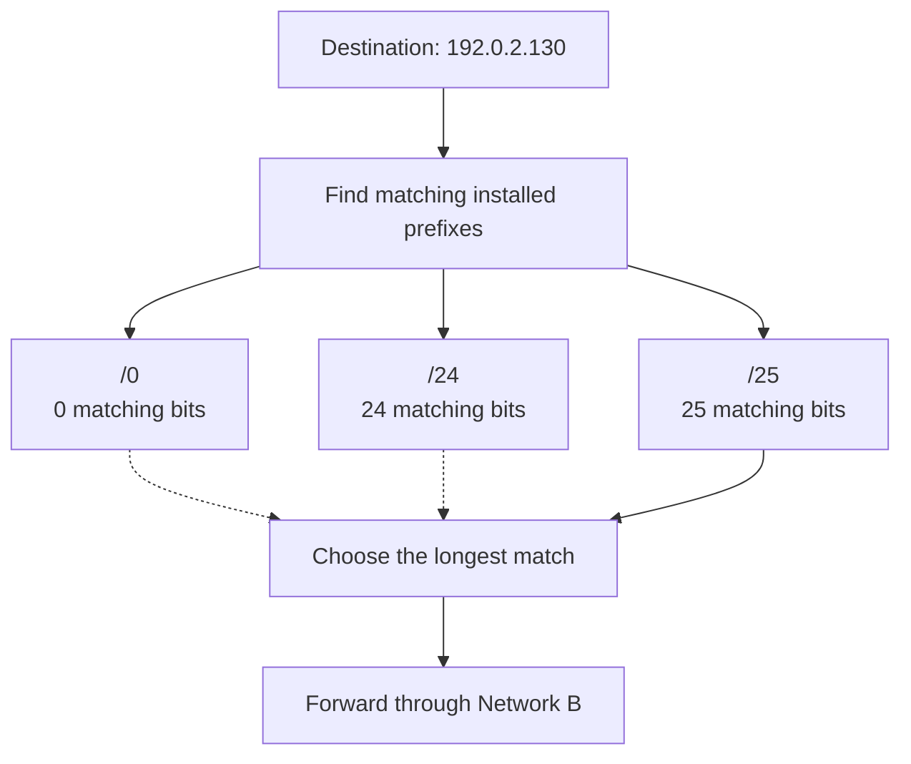
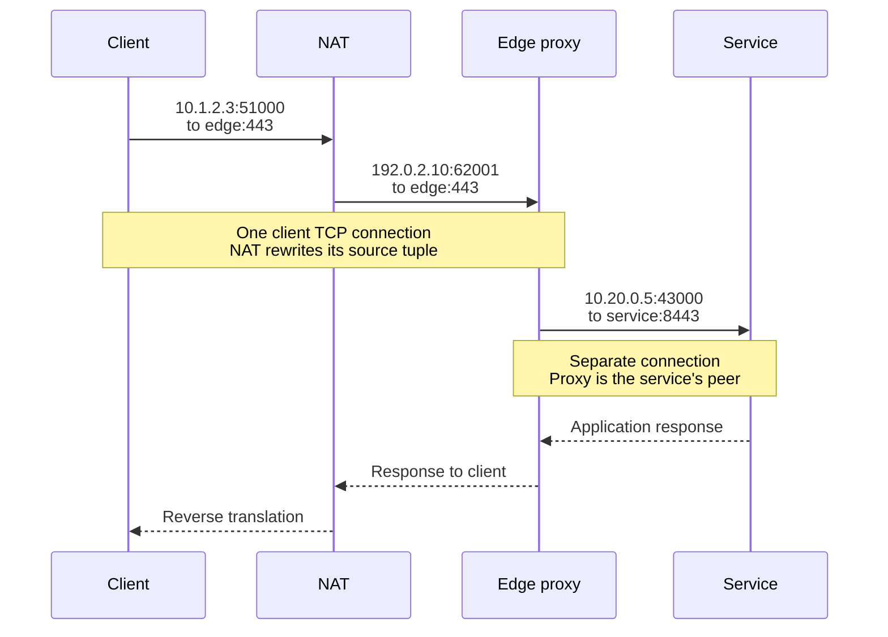
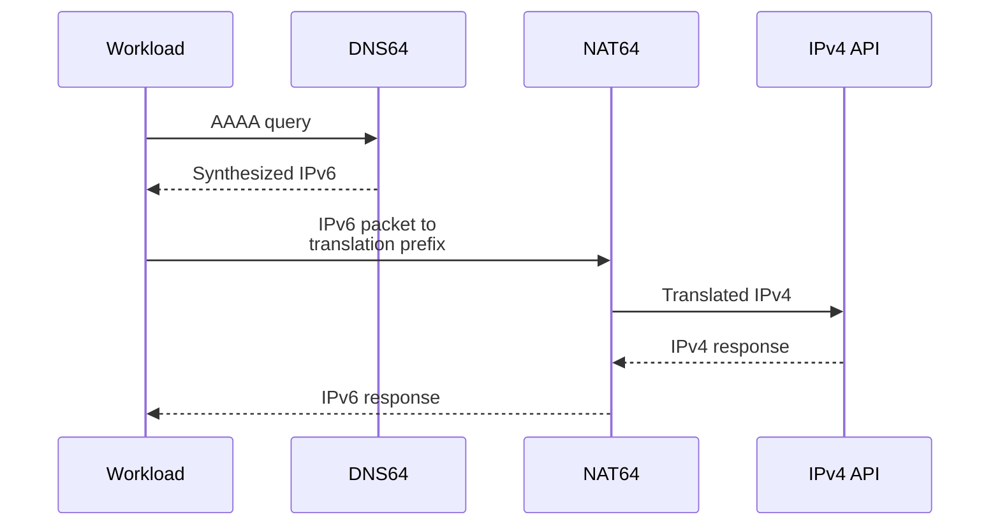

Two teams connect their cloud networks. Each has independently assigned `10.0.0.0/16` to its services. A request for `10.0.8.12` now has two possible destinations, and adding a route cannot tell the network which service the caller intended.

Elsewhere, thousands of healthy application instances lose access to one external API. CPU usage is low. Their shared outbound translator has run out of usable port mappings for that destination. Adding application instances creates more connections and makes the incident worse.

Both failures start with assumptions about IP addresses. An address participates in a particular routing context, has an allocation lifetime, and may change between observation points. Those properties affect connectivity, capacity, security policy, and incident recovery.

This article develops those properties from a single host to connected cloud networks. It continues the networking series introduced in [OSI and TCP/IP: How Real Networks Work](/field-notes/osi-tcp-ip-real-networks/). The developments section covers specific changes from 2021 through 2025; publication dates distinguish those changes from older protocol mechanisms.

## Start with a destination and a route

A program can connect directly to a configured server address. On one controlled network, assigning addresses manually and installing a default route can be enough. The operating system chooses an outgoing interface and next hop; the application uses a transport protocol and port to reach a process.

With more hosts, DHCP can automate IPv4 address assignment using leases rather than requiring a person to configure every interface. [RFC 2131](https://www.rfc-editor.org/rfc/rfc2131.html) defines the exchange. A lease associates an allocation with a lifetime; renewing it and avoiding conflicting assignments become infrastructure responsibilities. Routing and application access still need their own configuration.

Link-layer delivery reaches a neighbor on a particular link. IP supplies a common addressing and forwarding format across interconnected links, so applications do not need a separate destination scheme for every link technology.

An IP address supplies a network-layer destination or source. IPv4 uses 32 bits, conventionally written as four decimal octets such as `192.0.2.42`. Each octet represents eight bits and ranges from 0 to 255. IPv6 uses 128 bits, commonly written in hexadecimal groups such as `2001:db8:20::42`. IP delivery is best effort: packets can be lost or arrive out of order. Transport and application protocols supply additional guarantees where required. The base formats are defined in [RFC 791](https://www.rfc-editor.org/rfc/rfc791.html) and [RFC 4291](https://www.rfc-editor.org/rfc/rfc4291.html).

The examples here use documentation prefixes, private ranges, and other explicitly named special-purpose ranges. Documentation addresses illustrate packet paths; they are not endpoints to contact on the public Internet. The [IANA IPv4 special-purpose registry](https://www.iana.org/assignments/iana-ipv4-special-registry/iana-ipv4-special-registry.xhtml) and [IPv6 registry](https://www.iana.org/assignments/iana-ipv6-special-registry/iana-ipv6-special-registry.xhtml) record the relevant distinctions.

Hard-coded addresses become difficult to maintain when machines are replaced, services acquire replicas, or workloads move between networks. Naming and service discovery supply indirection. Routing supplies reachability. Authentication establishes the peer's identity. Each mechanism has a separate responsibility and its own failure modes.

One interface can have several addresses. One service can have several addresses or share a virtual address with other instances. The same numeric address can exist in isolated network namespaces or tenant routing tables. Consequently, an operational record often needs an address plus its network or tenant context and observation time.

## Prefixes let routers summarize destinations

A routing table containing one entry for every possible IPv4 address would have up to about 4.29 billion entries. IPv6 makes that approach even less practical. Networks group contiguous, aligned address blocks under prefixes so that one route can cover many destinations.

In `192.0.2.0/24`, the `/24` fixes the first 24 bits. The remaining eight bits vary, giving `2^(32 - 24) = 256` addresses from `192.0.2.0` through `192.0.2.255`. The equivalent IPv4 mask is `255.255.255.0`.

More generally, a prefix of length `p` in a `W`-bit address space contains `2^(W - p)` addresses. A longer prefix represents a smaller block. Membership can be checked by masking an address and comparing it with the prefix's network value:

```text
address AND mask == network

192.0.2.130 AND 255.255.255.128 == 192.0.2.128
```

The last octet of `.130` is binary `10000010`; masking it with `10000000` gives `10000000`, or `.128`. Therefore `.130` belongs to `192.0.2.128/25`, whose range is `.128` through `.255`.

Classless Inter-Domain Routing, or CIDR, replaced rigid address-class allocation with variable-length prefixes and route aggregation. A provider can advertise an aggregate while its internal network maintains more specific routes. [RFC 4632](https://www.rfc-editor.org/rfc/rfc4632.html) describes the allocation and forwarding rules.

### Longest prefix match chooses the most specific destination

Consider this simplified destination-based forwarding table:

<div class="table-scroll" role="region" aria-label="Longest prefix match example routes" tabindex="0">

| Installed prefix | Covered destinations | Forwarding action |
| --- | --- | --- |
| `0.0.0.0/0` | All IPv4 destinations | Default gateway |
| `192.0.2.0/24` | `192.0.2.0`–`192.0.2.255` | Network A |
| `192.0.2.128/25` | `192.0.2.128`–`192.0.2.255` | Network B |

</div>

All three entries match `192.0.2.130`. The `/25` wins because it fixes the most destination bits. A packet for `192.0.2.42` uses the `/24`. A packet for `198.51.100.7` uses the default route.



*Figure 1. The destination matches several prefixes. The most specific installed route determines this lookup's action.*

A basic implementation can scan `R` routes and track the longest match in `O(R)` work. A binary prefix trie follows destination bits, remembering the last matching route, in at most `W` bit steps. Practical forwarding engines use compressed or multi-bit tries, specialized hardware, and other structures with different memory and update costs. This is an algorithmic explanation, rather than a performance claim about a particular router.

The control plane learns and selects routes; the forwarding plane applies installed actions. A routing protocol's choice among paths for the same prefix and the forwarding lookup's choice among different prefix lengths are different decisions. Policy routing can also choose a table before the lookup, and equal-cost paths can require another selection step.

An apparently healthy default route cannot rescue traffic covered by a more specific blackhole route. The lookup keeps selecting the more specific entry until configuration or route state changes. This explains why inspecting only the default gateway misses some outages.

### Address count and assignable capacity are different

A conventional IPv4 broadcast subnet reserves its network and broadcast addresses, so a `/24` commonly has 254 host addresses. That subtraction is not universal: [RFC 3021](https://www.rfc-editor.org/rfc/rfc3021.html) permits both addresses of a `/31` on an appropriate point-to-point link, and a `/32` can identify a single host route.

Cloud platforms impose their own reservations. For ordinary AWS VPC IPv4 subnets, the first four addresses and the last address are reserved, leaving 251 assignable addresses in a `/24`. The [subnet documentation](https://docs.aws.amazon.com/vpc/latest/userguide/subnet-sizing.html) describes the rules and exceptions. Plan capacity against the allocator that actually assigns the addresses.

## Scope determines where an address has meaning

Private IPv4 space allows independent organizations to reuse addresses. [RFC 1918](https://www.rfc-editor.org/rfc/rfc1918.html) reserves `10.0.0.0/8`, `172.16.0.0/12`, and `192.168.0.0/16` for this purpose. These addresses require an explicit connectivity arrangement when crossing organizational boundaries.

Reuse works while routing contexts remain separate. Peering two networks with overlapping ranges creates ambiguity. A longer route might direct a subset to one side, but it cannot distinguish two intended destinations with the same address in one table. Renumbering removes the overlap. Translation, an application proxy, or separate routing domains can provide narrower connectivity while retaining additional state or restrictions.

<div class="table-scroll" role="region" aria-label="Address scopes and configuration meanings" tabindex="0">

| Address or prefix | Meaning | Consequence for application engineers |
| --- | --- | --- |
| `127.0.0.1`, `::1` | Loopback within the local network stack | Inside a container, this usually reaches that container's namespace |
| `0.0.0.0` in a listener configuration | IPv4 wildcard bind | Accept on eligible local IPv4 addresses, subject to OS and firewall rules |
| `0.0.0.0/0`, `::/0` in a route table | Default route for that address family | A fallback forwarding entry, separate from a listener bind |
| RFC 1918 IPv4 ranges | Private address space | Connectivity and access policy still need configuration |
| `fe80::/10` | IPv6 link-local space | Routers do not forward these packets between links |
| `fc00::/7` | IPv6 Unique Local Address space | Locally generated ULAs use `fd00::/8`; intended for local communication |
| Global unicast address | Address intended for global unicast use | Assignment alone does not install a route or authorize ingress |

</div>

IPv6's address and scope rules are specified in [RFC 4291](https://www.rfc-editor.org/rfc/rfc4291.html). A link-local destination such as `fe80::1` can exist on several interfaces; a zone identifier such as `%eth0` selects the local link in APIs that support that syntax. Zone identifiers are local context, as explained in [RFC 4007](https://www.rfc-editor.org/rfc/rfc4007.html).

[RFC 4193](https://www.rfc-editor.org/rfc/rfc4193.html) defines Unique Local Addresses with a randomly generated Global ID to reduce collision risk when independently numbered networks connect. That reduces the chance of accidental overlap; address inventory and checks are still necessary. Neither private addressing nor ULA allocation provides an authorization boundary. Route policy, firewalls, and authenticated application access supply that boundary.

## Follow a packet before following an identity

Suppose a client at `10.1.2.3` sends a TCP connection toward an edge proxy at `198.51.100.20:443`. Its local routing decision determines whether the destination is directly reachable on the link or requires a gateway. On an Ethernet network, ARP resolves the IPv4 next hop's link-layer address. IPv6 uses Neighbor Discovery for neighbor resolution and related functions.

A conventional router removes the incoming link framing, selects an outgoing route, decreases the IP TTL or Hop Limit, and transmits using the next link's framing. Ordinary routing preserves the IP endpoints. Translation or encapsulation changes what an observer sees at particular boundaries.

The sequence below includes both an outbound translator and an HTTP reverse proxy:



*Figure 2. Translation changes the address-port tuple of one connection. The reverse proxy creates another connection with separate transport state.*

The edge sees the translator's public source address. The service sees the proxy's internal source address. A user identifier, authenticated workload principal, and trace ID can stay meaningful across those connections, provided the system carries and verifies them appropriately.

A forwarded client-IP header is a claim from whoever supplied it. Accept it only through a defined trusted-proxy chain, and prevent direct access from bypassing that chain. Envoy documents [trusted proxy hops and original-IP handling](https://www.envoyproxy.io/docs/envoy/latest/configuration/http/http_conn_man/headers.html). Blindly taking the leftmost `X-Forwarded-For` entry lets a caller choose an apparent source address.

An IP-based rate limit can protect an ingress point, but shared NAT can place many unrelated users in one bucket. Address changes can also let one user appear in several buckets. Apply account or workload limits when those identities are available; retain network-level limits for their specific abuse-control role.

## NAT exchanges address consumption for mapping state

Basic NAT translates addresses. Network Address Port Translation, or NAPT, also translates transport identifiers so that many private endpoints can share public addresses. [RFC 3022](https://www.rfc-editor.org/rfc/rfc3022.html) describes these mechanisms.

For an outgoing TCP flow, the translator allocates a mapping between an internal tuple and an external tuple. Return traffic must encounter the corresponding mapping. Timeouts reclaim inactive entries; packets arriving after reclamation may no longer belong to a valid flow. Gateway replacement, an asymmetric return path, or lost state can interrupt connections even if a replacement gateway has the same public IP.

Port capacity depends on the mapping implementation, usable port range, destination tuples, and connection-tracking capacity. There is no universal 65,535-total-connections-per-public-IP rule. Port reuse across different destinations can be allowed, while heavy concentration on one destination can exhaust a smaller mapping pool.

For a concrete managed implementation, AWS documents up to 55,000 simultaneous connections **per assigned IPv4 address to each unique destination**, where the destination includes address, port, and protocol. These are service-specific limits, documented in [NAT gateway basics](https://docs.aws.amazon.com/vpc/latest/userguide/nat-gateway-basics.html), rather than a property of IP itself.

As an illustrative workload, 8,000 new connections per second, each occupying a mapping for an average of 10 seconds, requires about 80,000 concurrent mappings. The estimate uses `occupancy ≈ arrival rate × average holding time` and assumes a stable workload. Retention after application completion can increase the holding time. For traffic concentrated on one destination, one such AWS address would be insufficient even before adding operating headroom.

Connection reuse can reduce churn. More egress addresses or gateways can partition mappings, but require routing changes, capacity planning, and external allowlist updates. Retries need backoff and limits: an immediate retry loop increases demand on the exhausted resource. Native IPv6 can remove this particular IPv4 translation requirement when the entire path supports it; socket tables, firewalls, and application limits remain.

## IPv6 changes allocation and configuration

IPv6 provides `2^128` possible address values. A `/64` contains `2^64` values, but filling that range with hosts would exceed link and neighbor-table capacity long before exhausting the numbers. Address space, forwarding capacity, neighbor state, and workload capacity are separate resources.

Ordinary Stateless Address Autoconfiguration, or SLAAC, combines an advertised prefix with an interface identifier. Ethernet-style SLAAC deployments generally use `/64` prefixes. Treat that as a configuration requirement for that mechanism rather than a rule that every IPv6 route must have length 64. [RFC 4862](https://www.rfc-editor.org/rfc/rfc4862.html) describes autoconfiguration, address lifetimes, and Duplicate Address Detection.

Router Advertisements tell hosts about routers and advertised prefix properties. Neighbor Solicitation and Advertisement messages discover or check neighbors. A DHCPv6 lease alone does not establish the conventional IPv6 default-router information supplied through Router Advertisements. Blocking these messages can leave an assigned address without a usable path. These functions are described in [RFC 4861](https://www.rfc-editor.org/rfc/rfc4861.html).

Addresses also have lifetimes. A deprecated address can remain valid for existing communication while being avoided for new source selection; an invalid address cannot continue serving that role. Renumbering therefore needs a transition period, including DNS, routes, application listeners, firewall rules, and external dependencies.

### Parse addresses before comparing them

The strings `2001:0db8:0000:0000:0000:0000:0000:0042` and `2001:db8::42` represent the same value. Text equality can miss that equivalence. [RFC 5952](https://www.rfc-editor.org/rfc/rfc5952.html) defines a canonical text representation for consistent display and logging.

Use a maintained IP parser and store an address family plus the numeric value, or a database's native address type. Preserve a scope identifier separately where needed. An endpoint containing an IPv6 address and port needs unambiguous formatting, such as `[2001:db8::42]:443`; splitting a string at the first colon is insufficient.

Security filters need consistent treatment of IPv4-mapped IPv6 addresses, special-purpose ranges, and every address returned by DNS. An outbound-request service should validate the actual connected destination under its policy, including redirects and re-resolution. Checking one string at request submission leaves gaps when later connection decisions choose a different destination.

The [OWASP SSRF prevention guidance](https://cheatsheetseries.owasp.org/cheatsheets/Server_Side_Request_Forgery_Prevention_Cheat_Sheet.html) discusses address validation, redirects, and DNS-related bypasses. Apply an explicit destination policy and enforce egress restrictions in addition to parsing input.

## Choose a coexistence strategy by dependency support

IPv4 and IPv6 use different packet formats. Having an IPv6 address does not, by itself, let a host exchange packets with an IPv4-only server.

<div class="table-scroll" role="region" aria-label="IPv4 and IPv6 deployment tradeoffs" tabindex="0">

| Approach | Mechanism and useful setting | Costs and failure boundaries |
| --- | --- | --- |
| IPv4 with shared NAT | Reuse private space and translate outbound flows; useful for IPv4-only dependencies | Mapping capacity, public addresses, translation state, overlap during network integration |
| Dual stack | Assign IPv4 and IPv6 and select a reachable family; useful for gradual migration | Two sets of routes, security policies, telemetry, and connectivity tests |
| IPv6-only workloads with IPv4 translation | Use native IPv6 internally and translate at a boundary for remaining IPv4 destinations | Translation gateway and resolver dependencies, legacy address literals, application compatibility |
| Separate routing domains with explicit gateways | Retain independently managed address spaces and connect selected services | Gateway operation, limited transparent connectivity, context required in logs and policy |

</div>

DNS64 can synthesize an IPv6 AAAA answer from an IPv4 A record when an IPv6 answer is absent. A route sends packets for that translation prefix to NAT64, which translates between IPv6 and IPv4. DNS64 supplies an address; NAT64 supplies the packet translation. Both parts and the connecting route must work.



*Figure 3. Name synthesis and packet translation are separate steps. This path serves an IPv4-only destination; native IPv6 destinations can use a different route.*

AWS's [DNS64 and NAT64 configuration](https://docs.aws.amazon.com/vpc/latest/userguide/nat-gateway-nat64-dns64.html) illustrates this boundary with a DNS64 subnet setting and a route for `64:ff9b::/96` toward a NAT gateway. Its native IPv6 default route is configured separately. An application that only accepts an IPv4 literal or requires an IPv4 socket may need changes or an additional compatibility mechanism; DNS64 alone cannot intercept a DNS query that never happens.

Dual-stack clients also need failure handling. [Happy Eyeballs v2, RFC 8305](https://www.rfc-editor.org/rfc/rfc8305.html), coordinates address resolution and staggered connection attempts so a broken address family need not impose a full timeout before another path is tried. This is established behavior from 2017, rather than a recent IPv6 invention. Successful fallback can hide broken IPv6 from aggregate success metrics, so record which family wins and how long setup takes.

## Scaling requires allocation ownership

A small deployment can use one carefully managed subnet. Growing deployments need separate ranges for environments, availability zones, workloads, and service addresses. At larger scale, independent teams must allocate without accidentally overlapping networks that will eventually connect.

Suppose an illustrative organization controls `10.64.0.0/12`. Dividing it into `/16` regional blocks yields `2^(16 - 12) = 16` blocks. Each `/16` can contain 256 `/24` subnets. This arithmetic describes one hierarchy; actual reservations, provider constraints, and growth estimates determine whether it fits.

Allocate blocks to organizational and failure boundaries with room for expansion. A contiguous reservation can make aggregation possible, but an aggregate should only advertise destinations that the network can safely handle. A broad summary that attracts traffic for unavailable subranges can create blackholes.

An IP Address Management system, or IPAM, records parent prefixes, child allocations, owners, routing domains, and lifecycle state. Within a scope that requires uniqueness, concurrent allocators need an atomic claim or disjoint delegated pools. Repeated allocation requests need stable request identifiers so a retry returns the existing allocation instead of consuming another block.

Releasing an address requires care. DNS caches, old routes, neighbor state, firewall entries, and clients can retain references to a previous owner. An address must not become proof that the new workload has the previous workload's permissions. Delay reuse when needed, remove obsolete policy, and authenticate the current workload independently.

Existing flows can continue during some allocator outages, while new workload creation fails. A route-controller outage can leave stale forwarding state while address allocation still succeeds. Keep allocation, distribution, and forwarding health separately observable.

### Global reachability and connection state have different lifetimes

Unicast can direct an address toward a particular site. Anycast advertises the same service address from several locations, allowing routing to choose a destination according to its policies and metrics. This is useful for distributed entry points, but it does not guarantee geographic proximity or the lowest application latency.

[RFC 4786](https://www.rfc-editor.org/rfc/rfc4786.html) discusses anycast operation and transport considerations. If routing changes send an established flow to a server without its state, that connection can fail. Moving an IP advertisement cannot transfer TCP sequence state, a TLS session's live state, or application memory. Deployments need a defined combination of flow handling, draining, replicated application state, and bounded client recovery.

DNS-based steering places some selection in name resolution and caches. Anycast places selection in routing. A load balancer can select among backends at another boundary. Each option changes who stores selection state and how quickly a change takes effect. DNS TTL expiry only controls relevant cache reuse; it does not force existing connections to reconnect.

## Developments that changed deployment choices, 2021–2025

These examples are documented standards or released capabilities. Availability in a platform does not establish adoption by every operator or support in every service.

### Temporary IPv6 addresses received an updated standard in 2021

[RFC 8981](https://www.rfc-editor.org/rfc/rfc8981.html), published in February 2021, replaced RFC 4941's temporary-address specification. It describes temporary addresses with randomized interface identifiers and bounded lifetimes, reducing the time during which a stable address can directly correlate a host's activity.

The operational consequence is concrete: a client can use different source addresses over time without changing its account. Rate limits, audit records, and allowlists need a deliberate identity and aggregation policy. Temporary addresses reduce one correlation mechanism; they do not remove cookies, authenticated sessions, or every other tracking signal.

### IPv6-only cloud workloads gained a managed compatibility boundary

AWS [announced NAT64 and DNS64 support on November 24, 2021](https://aws.amazon.com/about-aws/whats-new/2021/11/aws-nat64-dns64-communication-ipv6-ipv4-services/). The protocols were older; the release supplied managed components for IPv6 workloads contacting IPv4 services.

This makes a gradual reduction of internal IPv4 allocation practical for compatible workloads. It also concentrates remaining IPv4 dependency traffic on a translation boundary. Resolver behavior, gateway capacity, failure recovery, and the application's use of address literals must be tested before removing IPv4 from a subnet.

### Kubernetes made address-family and Service allocation changes explicit

Kubernetes dual-stack IPv4/IPv6 networking reached general availability in [version 1.23 in December 2021](https://kubernetes.io/blog/2021/12/08/dual-stack-networking-ga/). Services can express single-stack or dual-stack policy. The cluster network, node setup, and application listeners still have to support the selected families.

In [version 1.33, released April 23, 2025](https://kubernetes.io/blog/2025/04/23/kubernetes-v1-33-release/), the `ServiceCIDR` and `IPAddress` APIs became stable as part of the newer Service allocator. Administrators can add Service CIDRs to increase available ClusterIP space.

That addresses Service allocation pressure. It does not automatically renumber existing Services, expand the Pod address pool, or repair an overlapping external route. The distinction matters during an incident: a pending Pod and a failed Service-IP allocation can be exhausting different pools.

### Public IPv4 became an explicit cost input in another major cloud

AWS [announced public IPv4 usage charges effective February 1, 2024](https://aws.amazon.com/blogs/aws/new-aws-public-ipv4-address-charge-public-ip-insights/). The historical change makes address inventory a cost-planning concern alongside capacity. Current pricing and allowances should be checked separately for a particular deployment.

Reducing public addresses through shared egress can add translation, transfer, and operations costs. IPv6 can reduce some IPv4 consumption where dependencies support it. Compare the complete packet path and its failure boundaries before treating fewer public addresses as an automatic saving.

The concrete direction across these releases is more flexible allocation and clearer translation boundaries. Prefix routing, finite forwarding state, and the need to identify communicating principals continue to apply.

## Failure scenarios and useful evidence

Address-related incidents often leave the application process healthy. Diagnose the boundary that failed before changing application capacity.

<div class="table-scroll" role="region" aria-label="IP addressing failure scenarios and mitigations" tabindex="0">

| Symptom | Mechanism to investigate | Evidence and mitigation |
| --- | --- | --- |
| Peering or VPN traffic reaches the wrong network | Overlapping CIDRs or a more specific route | Compare both routing contexts and selected prefixes; renumber or isolate and translate selected traffic |
| New instances or Pods cannot start | Allocator pool exhausted, fragmented reservations, or per-node allocation limit | Inspect each relevant pool and allocation errors; expand the correct pool or adjust its allocation unit |
| One external API fails while others work | Destination-concentrated NAT port demand | Correlate connection churn and port-allocation errors; reuse connections and partition egress capacity |
| Connections fail after gateway replacement | Translation or connection-tracking state lost | Compare old and new mappings and return paths; drain where possible and reconnect with bounded retries |
| Two hosts intermittently lose connectivity | Duplicate allocation or conflicting neighbor information | Inspect lease history, ARP/ND state, and duplicate-address alerts; remove the conflict and repair the allocator |
| IPv6 address exists but off-link traffic fails | Missing default router, blocked RA/ND, or wrong scope | Inspect router lifetimes, neighbor entries, interface scope, and ICMPv6 policy |
| Small requests work but large transfers stall | Path MTU discovery failure | Compare packet sizes, tunnel overhead, retransmission, and Packet Too Big messages; repair MTU and ICMP policy |
| Some clients become slow after adding AAAA | Broken IPv6 route or unequal family policy | Run IPv4 and IPv6 probes separately; repair that path and verify client fallback |
| A service's old address accepts unexpected traffic | Fast address reuse plus stale references or policy | Audit old DNS, routes, and permissions; remove inherited access and verify the new workload's identity |
| A region failure interrupts established sessions | Route withdrawal or steering reaches a different state owner | Measure convergence and reconnect behavior; plan draining, session recovery, and application retry semantics |

</div>

IPv6 routers do not fragment forwarded packets. Required packet-size feedback therefore deserves specific attention, as described in [RFC 8200](https://www.rfc-editor.org/rfc/rfc8200.html). Blocking all ICMPv6 discards protocol functions as well as diagnostic traffic. Permit the required types under a reviewed policy and test the actual encapsulated path.

For an allocator, monitor available addresses per pool, allocation failures, reservation growth, and time to allocate. Whole-network utilization can look healthy while one zone's subnet has no assignable addresses. Include peak replica count, deployment overlap, failover capacity, and allocator-specific reservations in forecasts.

For egress, monitor active mappings, allocation failures, packet drops, connection churn, and timeout behavior. AWS exposes a concrete `ErrorPortAllocation` signal described in its [NAT gateway metrics documentation](https://docs.aws.amazon.com/vpc/latest/userguide/metrics-dimensions-nat-gateway.html). Correlate gateway metrics with destination concentration rather than assuming bandwidth explains every failure.

For routing, retain configuration and selected-route changes, failed neighbor resolution, and active probes from the networks that use the service. A ping from a laptop cannot establish connectivity from a particular Pod namespace or translated production subnet. Record both address family and observation point in flow logs and traces.

## Migration should preserve a tested return path

Inventory dependencies before changing address families or prefixes: listeners, DNS records, outbound destinations, allowlists, certificates, proxy settings, agents, dashboards, and emergency access. Validate whether software accepts an IPv6 endpoint rather than merely whether the operating system has an IPv6 address.

For a dual-stack rollout, configure and test IPv6 routes and equivalent security policy before publishing AAAA records. Then expose a limited group of clients and compare setup latency, transfer success, and family-specific errors. Include large responses and long-lived connections; a short health check exercises little of the path.

During renumbering, old and new addresses may need to coexist. Plan DNS caching, connection draining, stale allowlists, and address-release timing together. A rollback must account for clients that already cached the new address. Keep enough of the new path working to serve or drain them while configuration changes propagate.

Treat an address plan as reviewed infrastructure with owners and automated overlap checks. Restrict who may allocate a prefix, attach a route, or expose a listener. Test source and return paths after each change, including the effects of stateful firewalls and translation. These checks are cheaper than discovering an ambiguous address plan during a regional failover.

## How experienced engineers frame the decision

A developer diagnosing one failed connection may begin with the destination address, listener, and local route. A senior engineer follows the entire path through proxies, translation, namespaces, both address families, and return routing. They separate successful address assignment from successful forwarding and successful authentication.

Staff-level decisions include who owns allocation across teams, which networks will need to connect later, which pool constrains failover capacity, and which state survives infrastructure replacement. The cost of a shared gateway includes its capacity and shared failure scope. The cost of dual stack includes keeping two paths observable and correctly restricted.

For a small isolated deployment, a managed subnet and stable service names can be sufficient. Multi-team allocation automation becomes useful when independent changes threaten uniqueness or growth. Anycast needs a concrete entry-point requirement and a session-recovery plan. An IPv6-only migration needs a verified dependency inventory. Each addition should solve a measured allocation, connectivity, or operational problem.

Keep four facts attached to every production address: its routing context, allocation owner, lifetime, and observation point. Then track the authenticated principal separately. Those records make a route change, a NAT failure, and a workload replacement distinguishable when application logs report the same timeout.

## Further reading

- [RFC 4632 — Classless Inter-Domain Routing](https://www.rfc-editor.org/rfc/rfc4632.html). Explains variable-length allocation, aggregation, and longest-match forwarding.
- [RFC 4291 — IPv6 Addressing Architecture](https://www.rfc-editor.org/rfc/rfc4291.html). Defines IPv6 address forms, interface assignment, and address types.
- [RFC 1918 — Address Allocation for Private Internets](https://www.rfc-editor.org/rfc/rfc1918.html). Describes private IPv4 space and the consequences of independent reuse.
- [RFC 3022 — Traditional IP Network Address Translator](https://www.rfc-editor.org/rfc/rfc3022.html). Explains address translation and transport-identifier translation.
- [RFC 4861 — Neighbor Discovery for IPv6](https://www.rfc-editor.org/rfc/rfc4861.html). Details router discovery, next-hop determination, and neighbor reachability.
- [RFC 4786 — Operation of Anycast Services](https://www.rfc-editor.org/rfc/rfc4786.html). Connects routing changes with service operation and transport behavior.
- [RFC 8305 — Happy Eyeballs Version 2](https://www.rfc-editor.org/rfc/rfc8305.html). Describes asynchronous resolution and staggered connection attempts across candidate addresses.
- [RFC 8981 — Temporary Address Extensions](https://www.rfc-editor.org/rfc/rfc8981.html). Explains address lifetimes and the privacy goals of temporary IPv6 interface identifiers.
- [AWS VPC — NAT gateway basics](https://docs.aws.amazon.com/vpc/latest/userguide/nat-gateway-basics.html). Provides a concrete example of destination-specific connection capacity and translation limits.
- [AWS VPC — DNS64 and NAT64](https://docs.aws.amazon.com/vpc/latest/userguide/nat-gateway-nat64-dns64.html). Shows how synthesized addresses and explicit routes connect IPv6 workloads to IPv4 destinations.
- [Kubernetes 1.23 — Dual-stack networking reaches GA](https://kubernetes.io/blog/2021/12/08/dual-stack-networking-ga/). Explains address-family policies and prerequisites for cluster dual stack.
- [Kubernetes 1.33 release](https://kubernetes.io/blog/2025/04/23/kubernetes-v1-33-release/). Documents the stable ServiceCIDR and IPAddress APIs used by the newer Service allocator.
