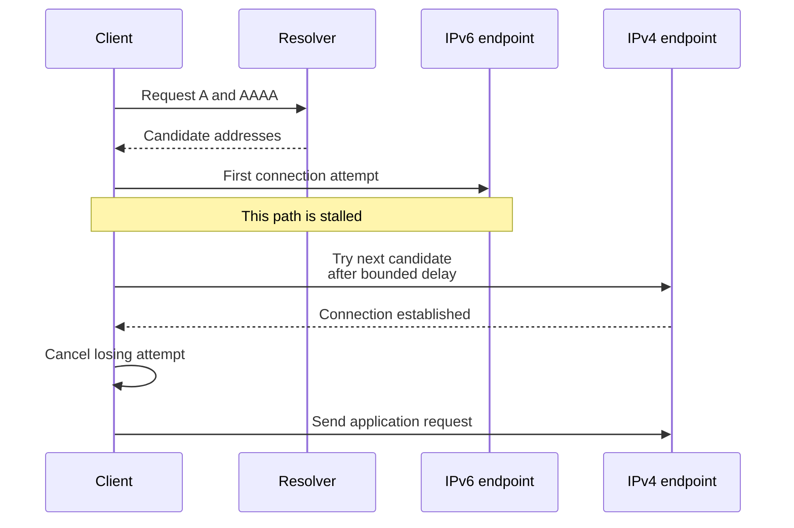
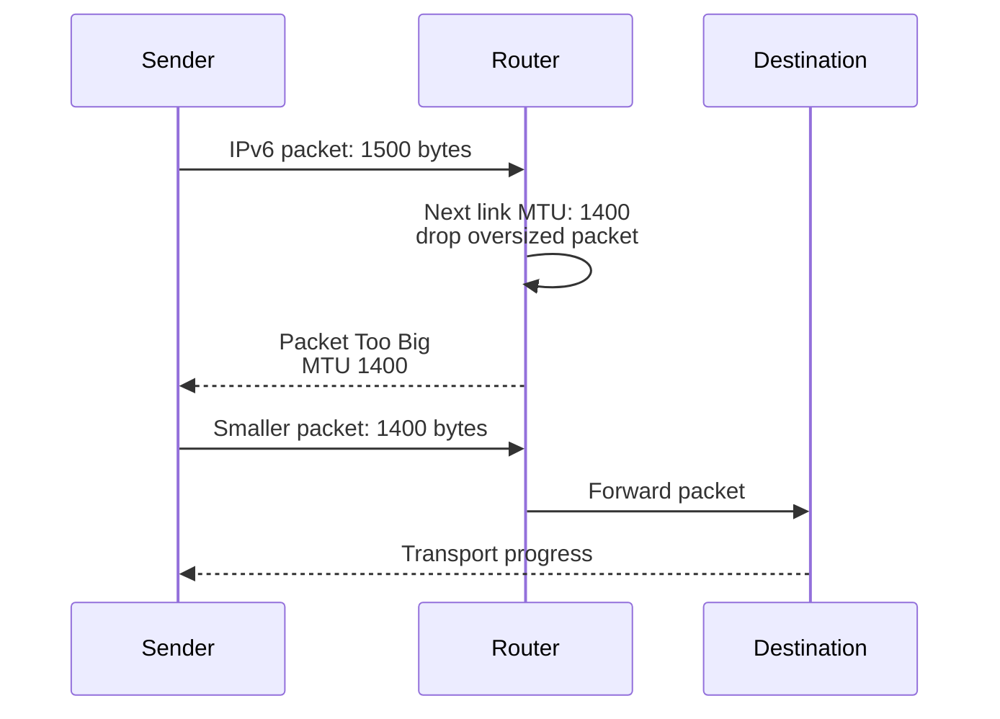
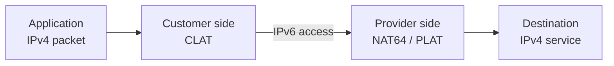

A team adds an AAAA record to a working service. Most users continue normally, a few wait longer before connecting, and some large responses stall after a successful handshake. The service dashboard still looks healthy because clients silently fall back to IPv4.

Adding the record exposed another packet path. That path has its own routes, firewall rules, neighbor discovery, packet-size constraints, and connection behavior. The application can receive a request over IPv6 while its load balancer still contacts the backend over IPv4.

IPv6 expands address space and changes several protocol mechanisms. Operating it requires following those mechanisms through every relevant hop. This article concentrates on protocol behavior and migration; [IP Addresses in Production](/field-notes/ip-addresses-in-production/) covers prefix arithmetic, routing contexts, address ownership, and IPAM in more detail.

## The pressure behind a second Internet protocol

IP gives interconnected networks a shared packet format and addressing scheme. A sender provides a destination address, and routers forward the packet through successive links. Delivery remains best effort: packet loss, reordering, and eventual failure are possible. Transport and application protocols define their additional guarantees.

IPv4 uses 32-bit addresses, giving `2^32 = 4,294,967,296` possible values before special-purpose reservations and allocation constraints. A small deployment can assign private IPv4 addresses and share public addresses through a translator. This remains useful when its dependencies and operational costs fit the workload.

Growth puts pressure on that arrangement. Independent networks can reuse overlapping private ranges. Shared egress needs translation state and port capacity. Public addresses require allocation and management. Translators can also complicate inbound connections and the interpretation of source addresses.

IPv6 uses 128-bit addresses, giving `2^128` possible values. Its larger allocation space allows networks to assign addresses without making shared IPv4 translation the normal requirement for every outbound flow. Address capacity alone does not provide a route, a firewall policy, application compatibility, or an operating team.

IPv4 and IPv6 have different wire formats. An IPv6-only host cannot directly exchange native IP packets with an IPv4-only server just because the server's address can be written inside a longer string. A compatible endpoint, proxy, tunnel arrangement, or translation mechanism must supply the missing path.

## Packet differences that affect production

The IPv4 specification, [RFC 791](https://www.rfc-editor.org/rfc/rfc791.html), describes a variable-length header beginning with a twenty-byte minimum. [RFC 8200](https://www.rfc-editor.org/rfc/rfc8200.html) defines IPv6's fixed forty-byte base header and extension-header model.

<div class="table-scroll" role="region" aria-label="IPv4 and IPv6 packet comparison" tabindex="0">

| Mechanism | IPv4 | IPv6 | Operational consequence |
| --- | --- | --- | --- |
| Source and destination addresses | 32 bits each | 128 bits each | Address parsers, storage, policy, and telemetry must accept both families |
| Base header | At least 20 bytes; options can extend it | Fixed 40 bytes; extensions follow it | Account for actual headers when calculating payload and parsing packets |
| Header error check | IPv4 header checksum | No IPv6 base-header checksum | Transport and link integrity mechanisms still matter |
| Forwarding lifetime | Time to Live, reduced during forwarding | Hop Limit, reduced during forwarding | Both limit packet circulation through routing loops |
| Router fragmentation | Possible when permitted by the packet's flags | Forwarding routers do not fragment | Packet-size discovery and feedback are important |
| Local delivery mechanisms | Includes broadcast and multicast | Uses multicast; no IPv6 broadcast | Discovery and firewall assumptions need review |

</div>

The absence of an IPv6 header checksum does not remove TCP or UDP integrity mechanisms. A larger address also does not make the path intrinsically faster. Route selection, packet processing, congestion, peering, translation, and endpoint software determine performance.

Extension headers form a chain selected through Next Header fields. A device examining transport ports may need to parse beyond the forty-byte base header. Packet filters, load balancers, and capture tools need explicit handling for the extension and fragmentation cases they support. An assumption that the TCP header always begins at a fixed offset is unsafe.

For an illustrative 1500-byte IP MTU, with minimum TCP headers and no IP options or extension headers:

```text
IPv4 TCP data budget: 1500 - 20 - 20 = 1460 bytes
IPv6 TCP data budget: 1500 - 40 - 20 = 1440 bytes
```

These are TCP payload budgets, not application-message sizes. TCP options, tunnels, encryption, and other encapsulation can reduce usable payload. Link-layer overhead affects wire utilization separately. Smaller payload per packet can increase packet-processing work at a fixed byte rate, but that arithmetic alone cannot predict application throughput.

Prefix forwarding remains familiar: select an appropriate routing table and use the longest matching destination prefix. IPv4 and IPv6 routes are separate entries with separate next hops. A healthy IPv4 default route says nothing about whether the IPv6 default route reaches the intended service.

## A host needs more than an assigned address

An IPv4 host commonly learns an address and other configuration through DHCP, then uses ARP to resolve an on-link next hop. Static configuration is also possible. IPv6 commonly combines Router Advertisements, Neighbor Discovery, and one or more address-assignment methods.

[RFC 4861](https://www.rfc-editor.org/rfc/rfc4861.html) describes IPv6 router discovery and neighbor reachability. Router Advertisements communicate router availability and prefix-related properties. Neighbor Solicitation and Advertisement messages resolve or test neighbors. These are control functions used by ordinary communication, beyond a troubleshooting ping.

Stateless Address Autoconfiguration, or SLAAC, constructs addresses using advertised information and interface identifiers, with address lifetimes and Duplicate Address Detection. [RFC 4862](https://www.rfc-editor.org/rfc/rfc4862.html) specifies that behavior. Ethernet-style SLAAC generally uses `/64` prefixes; that does not constrain every routed IPv6 prefix to length 64.

DHCPv6 can provide addresses or other configuration under the selected deployment model. A DHCPv6 lease alone does not supply the conventional default-router discovery provided through Router Advertisements. It is possible to have a valid address and no usable off-link route.

One interface may have link-local, stable, and temporary addresses simultaneously. Source selection has to choose an address appropriate for the destination and its scope. [RFC 6724](https://www.rfc-editor.org/rfc/rfc6724.html) defines default source and destination selection rules, including scope and policy considerations. The address shown first by an interface tool need not be the one used by an actual connection.

The number of address values is also unrelated to practical neighbor capacity. Placing too many active endpoints on one link, or sending traffic toward many nonexistent neighbors, can exhaust neighbor tables or control-plane resources long before a `/64` runs out of values. Partition links and monitor neighbor state according to real host and router limits.

## Dual stack creates a connection-selection problem

DNS A records contain IPv4 addresses. AAAA records contain IPv6 addresses, as defined by [RFC 3596](https://www.rfc-editor.org/rfc/rfc3596.html). The address family used to contact the DNS resolver is independent of the record type being requested. A client can obtain an AAAA answer over an IPv4 DNS connection.

Resolving a hostname to both families gives the client choices. It does not prove that both paths work. Waiting for a full timeout on each unavailable address can make a healthy alternative feel broken.

Happy Eyeballs v2, specified in [RFC 8305](https://www.rfc-editor.org/rfc/rfc8305.html), coordinates asynchronous resolution, address ordering, and staggered connection attempts. It can start another candidate before an earlier attempt times out, then cancel losing attempts after establishing a connection.



*Figure 1. Connection attempts can overlap. The diagram shows one illustrative ordering; implementations need not wait for all DNS answers before starting.*

For example, assume an unusable IPv6 path would otherwise consume a three-second timeout. If an IPv4 attempt starts after an illustrative 100 ms delay and takes 40 ms to connect, connection setup takes about **140 ms**, instead of **3040 ms** with serial waiting. These numbers are hypothetical. RFC 8305 recommends a 250 ms default Connection Attempt Delay, with other bounds and adaptation; implementations and network conditions differ.

This selection operates at connection setup. It does not guarantee recovery from a later large-transfer failure, and it does not authorize racing a state-changing business operation across two servers. A fallback connection also needs its own authentication and application completion semantics.

Successful fallback can hide one family's outage in an aggregate availability metric. Record connection attempts, setup latency, selected family, and fallback frequency. Run forced-family probes to expose the failure being hidden.

## Packet-size discovery explains partial connectivity

A TCP handshake exchanges small packets. A later response may need larger packets that do not fit a tunnel or another link along the route. This explains the otherwise puzzling combination of successful connection setup and stalled data transfer.

For IPv6, a router that cannot forward an oversized packet drops it and can return an ICMPv6 Packet Too Big message indicating the limiting size. The sender can reduce packet size for the path. [RFC 8201](https://www.rfc-editor.org/rfc/rfc8201.html) describes IPv6 Path MTU Discovery and the black holes caused when necessary feedback is blocked.



*Figure 2. A forwarding router reports the size constraint. It does not fragment the IPv6 packet on the sender's behalf.*

Under the same minimum-header assumptions, a 1400-byte IPv6 path leaves **1340 bytes** of TCP payload. The sender's application can still write a larger message; transport packetization handles its delivery across multiple packets.

Allowing required ICMPv6 types under a reviewed policy is part of connectivity. Blocking every ICMPv6 packet also interferes with discovery and error reporting. Packetization-layer discovery can probe successful packet sizes without depending entirely on returned ICMP feedback; [RFC 8899](https://www.rfc-editor.org/rfc/rfc8899.html) describes that approach for datagram transports. Check the actual implementation and path before assuming it is active.

IPv6 requires a minimum link MTU of 1280 bytes, with adaptation below the IP layer where necessary. Configuring every application to use tiny packets is a poor substitute for understanding tunnel overhead and feedback. IPv4 can suffer path-MTU black holes as well, particularly when fragmentation is disabled; this failure is not exclusive to IPv6.

## Coexistence mechanisms move different responsibilities

A migration can change the client-facing hop independently from the origin-facing hop. The choice depends on which endpoints, protocols, and operating teams can change.

<div class="table-scroll" role="region" aria-label="IPv4 IPv6 coexistence tradeoffs" tabindex="0">

| Approach | Mechanism | Useful setting | Cost and limitation |
| --- | --- | --- | --- |
| Dual stack | Hosts or service entry points support both native families | Incremental deployment with mixed clients | Two paths need compatible policy, capacity, and diagnostics |
| NAT64 with DNS64 | Synthesize an IPv6 destination for an IPv4 service, then translate packets | IPv6-only clients with suitable application behavior | Resolver, translator, routing, and legacy-application compatibility become dependencies |
| 464XLAT | A customer-side translator feeds an IPv6 path toward a provider-side translator | Some IPv4 APIs or literals must work over IPv6 access | Endpoint or access-device support plus translation infrastructure is required |
| Application proxy | Terminate one connection and establish another, potentially using another family | Supported application protocols and controlled service ingress | Proxy capacity, protocol coverage, authentication, and connection state |
| Tunnel | Encapsulate one IP packet inside another across a transit network | Connect compatible IP networks across an unsuitable underlay | Tunnel endpoints and routes are still needed; encapsulation reduces usable MTU |

</div>

### DNS64 supplies an address; NAT64 supplies translation

DNS64 can synthesize an AAAA answer from an IPv4 A record when the requested IPv6 answer is absent. The synthesized address belongs to a configured translation prefix. A route carries the resulting IPv6 packet to a translator, which obtains the IPv4 destination and forwards a corresponding IPv4 packet.

[RFC 6147](https://www.rfc-editor.org/rfc/rfc6147.html) defines DNS64. [RFC 6146](https://www.rfc-editor.org/rfc/rfc6146.html) describes stateful NAT64, including mappings required for traffic between IPv6 clients and IPv4 servers. Return packets need the corresponding translation state. Translator capacity and recovery are therefore part of the service path, even when the application contains no translation code.

DNS64 alone does not fix every IPv4 literal or an application that insists on an IPv4 socket. An operating system or application may provide additional synthesis or compatibility support, but it must be verified. DNS synthesis also needs an explicit policy where DNSSEC validation is involved; do not assume every resolver and validating client combination works identically.

### 464XLAT supports additional legacy application behavior

The [464XLAT architecture in RFC 6877](https://www.rfc-editor.org/rfc/rfc6877.html) combines a customer-side translator, or CLAT, with a provider-side translator, or PLAT. In the usual arrangement, the CLAT performs stateless IPv4/IPv6 translation, while the provider side supplies stateful NAT64.



*Figure 3. The application can use an IPv4 interface while the access path carries IPv6. Translation happens at specified boundaries.*

That can accommodate legacy behavior without assigning a normal IPv4 access-network address to every capable endpoint. It does not guarantee compatibility with every application protocol, VPN, or embedded address reference. The translator's supported traffic and the endpoint's implementation determine the result.

### A proxy establishes a new transport boundary

An HTTPS reverse proxy can accept an IPv6 client connection and contact an IPv4 origin through a separate connection. This differs from translating the client's IP packets. The proxy owns transport state, may terminate TLS, and must preserve the intended application and identity semantics.

Cloudflare's [IPv6 compatibility documentation](https://developers.cloudflare.com/network/ipv6-compatibility/) describes IPv6 access for proxied hostnames and notes that, when both origin address families are configured, it prefers IPv4 for the origin connection. The lesson is specific: client-family adoption does not prove that the backend path has migrated. These are independently configured legs.

A tunnel has another contract. It carries an inner packet through a network using an outer packet. An IPv6-over-IPv4 tunnel can connect IPv6-speaking endpoints across IPv4 transit, but it cannot by itself make an IPv4-only application server speak IPv6. Inspect the inner path, outer path, and packet-size budget separately.

## Applications and security policy must follow both paths

Use address-family-aware resolver and socket APIs rather than assuming every destination can be passed to an IPv4 socket. Review libraries, outbound proxies, health checks, database clients, log collectors, and emergency-access tools. A successful browser test exercises only a small part of a service's dependencies.

An IPv6 listener bound to `::` may accept IPv4-mapped connections in some operating-system configurations and reject them in others. Test the actual socket settings and platform. An address returned through an IPv4-mapped IPv6 API representation does not mean that native IPv4 packets became IPv6 packets on the network.

Store an address family and an appropriate numeric value, or use a native address type. Endpoint formatting must be unambiguous: `[2001:db8::20]:443` separates an IPv6 address from its port. The examples use documentation addresses, not live service endpoints. Include routing or interface scope where needed; a bare link-local address can be ambiguous on a multi-interface host.

Keep authorization separate from address syntax. Apply equivalent intended access controls to both families, and validate actual egress destinations for server-side fetches, including IPv4-mapped forms, redirects, and re-resolution. A deny rule for one IPv4 range does not automatically constrain an IPv6 route to the same internal service.

IPv6 does not encrypt application traffic automatically. TLS or another appropriate authenticated security mechanism remains necessary. Removing NAT also does not require allowing unsolicited inbound traffic: a stateful firewall can enforce ingress policy without changing addresses. Private addressing and translation are not substitutes for that policy.

Managed links need protections against unauthorized Router Advertisements, conflicting configuration, and neighbor-state exhaustion. Extension-header parsing and fragment handling should follow documented capabilities and tested policy. [RFC 9099](https://www.rfc-editor.org/rfc/rfc9099.html), published in August 2021, collects operational security considerations for managed IPv6 networks. Its recommendations depend on the operator understanding the network's trust and forwarding boundaries.

## Developments from 2021 through 2026

IPv6's foundational packet format is older than these developments. Recent work has changed deployment options and operational guidance, without removing the need for routing, address selection, and policy.

### Released cloud features separate public ingress from backend addressing

On May 16, 2024, AWS [announced Application Load Balancers without public IPv4 addresses for Internet clients](https://aws.amazon.com/about-aws/whats-new/2024/05/application-load-balancer-ipv6-internet-clients/). The public client path uses IPv6, while target communication can use IPv4 or IPv6 according to its configuration.

This is a released platform option, rather than evidence that all clients can use IPv6-only ingress. Removing the public IPv4 path removes direct native access for IPv4-only clients unless another fronting mechanism serves them. Also inspect dependencies: AWS's [current ALB documentation](https://docs.aws.amazon.com/elasticloadbalancing/latest/application/application-load-balancers.html) describes IPv4 requirements for ALB authentication's identity-provider connections. A listener migration can expose an outbound dependency that ordinary forwarding tests missed.

### NAT64 prefix discovery received clearer guidance in 2025

[RFC 9872](https://www.rfc-editor.org/rfc/rfc9872.html), published in September 2025 as an Informational RFC, recommends discovering the translation prefix through the Router Advertisement PREF64 option when available. It discusses fallback for older endpoints and constraints in mobile infrastructure.

The mechanism ties prefix discovery to the network configuration rather than depending entirely on a particular DNS64 resolver. That matters when a VPN changes DNS settings or an application chooses another resolver. Endpoint and router support must be checked before removing an older discovery path. This is operational guidance for translation deployments, not a change that makes every IPv6 network provide IPv4 compatibility automatically.

### IPv6-mostly operation remains an evolving deployment model

The [September 10, 2026 revision of the IPv6-mostly operations draft](https://www.ietf.org/archive/id/draft-ietf-v6ops-6mops-10.html) describes IPv6-only-capable and IPv4-enabled endpoints coexisting on one network segment. IPv4 is supplied to endpoints that still require it instead of being a universal assignment requirement. The cited revision is an **Internet-Draft, work in progress**, with intended Informational status; it is not a finalized RFC.

An older published building block, [RFC 8925 from October 2020](https://www.rfc-editor.org/rfc/rfc8925.html), defines an IPv6-Only Preferred option for DHCPv4. Capable endpoints can indicate willingness to defer IPv4 configuration under the specified conditions. This mechanism predates the recent draft. The deployment model needs functioning IPv6, suitable translation where IPv4 destinations remain, endpoint compatibility, and a rollback plan.

These examples support scoped migration: identify which leg or endpoint can operate without routine IPv4 configuration, then provide and measure remaining compatibility boundaries. They do not establish a universal migration deadline or prove that every network should use the same transition mechanism.

## Failures that an aggregate success rate can hide

<div class="table-scroll" role="region" aria-label="IPv4 IPv6 failure evidence and recovery" tabindex="0">

| Symptom | Likely boundary to inspect | Evidence and recovery |
| --- | --- | --- |
| AAAA publication makes some connections slow | IPv6 reachability or address selection | Compare forced-family setup latency and fallback attempts; repair routing and policy before expanding exposure |
| Handshake succeeds but large responses stall | MTU, encapsulation, or missing feedback | Capture Packet Too Big messages and packet sizes; test large transfers and correct the path's size budget |
| Address exists but off-link traffic fails | Router discovery or route installation | Inspect Router Advertisements, router lifetimes, selected routes, and neighbor state |
| IPv6 clients work while origins remain IPv4-only | Proxy's separate upstream leg | Record the family on both connections; test origin connectivity independently |
| DNS64 names work but an IPv4-only application fails | Literal handling, socket API, or missing CLAT | Test the actual application and translator support; supply a verified compatibility path or retain scoped IPv4 |
| Translation works until the gateway changes | Lost mappings or asymmetric return path | Inspect mapping capacity, drop counters, and routing; drain or recover state where supported and reconnect safely |
| One family bypasses intended restrictions | Policy configured for only one path | Compare access-control tests for both families and mapped address forms; repair policy before further rollout |
| Traffic share changes but total errors stay flat | Fallback masking or different client populations | Track family attempts and selected paths by client/network cohort, plus forced-family probes |
| A deployment cannot obtain new addresses despite low traffic | Subnet or per-node allocation pressure | Inspect the exhausted allocator and reservations; additional application replicas can worsen the pressure |
| Removing an A record fails to stop IPv4 traffic immediately | Cached DNS or existing connections | Observe TTL behavior and connection lifetimes; drain deliberately and preserve a rollback path |

</div>

Make telemetry identify the observation point. An ingress log's IPv6 source, an origin's IPv4 peer, and an egress gateway's translation tuple can all describe one application request. Connect them with authenticated workload context and request tracing, within the privacy and retention policy.

## Scale the migration around dependencies and failure scope

For a small service with IPv4-only dependencies, a managed IPv4 network and explicit egress policy may remain sufficient. Adding IPv6 can begin at a controlled ingress proxy while backend dependencies remain unchanged. That provides a limited operating scope and a clear place to compare behavior.

As workloads and private address allocations grow, dual stack can establish native IPv6 capability without requiring every dependency to migrate simultaneously. It also means maintaining two paths. Inventory whether each workload uses native IPv6, native IPv4, a proxy, or a translator for each important destination.

For a larger deployment, select bounded groups that can use IPv6-only infrastructure with a supported compatibility boundary. Keep independent gateway capacity and recovery plans for translated traffic. Reducing local IPv4 allocation does not remove a provider-side translator's public IPv4 demand or mapping limits.

Global deployment needs measurements from the client networks that actually reach each region. One region's successful IPv6 probes do not establish another region's routes, peering, or filtering. Cross-region failover must preserve compatible address families, policy, and translation capacity; additional application capacity alone cannot repair missing network reachability.

### Use a dependency test matrix before changing DNS

First, test listeners, routes, policy, and essential control traffic using the proposed configuration. Include authentication providers, certificate renewal, package access, monitoring, storage, and emergency access. Exercise both small and large transfers, connection reuse, application retries, and long-lived sessions.

Then expose a limited client or workload cohort. Measure DNS latency, connection attempts, setup p50/p95/p99, selected family, fallback rate, transfer completion, and failure by destination and network cohort. Monitor allocator pressure, neighbor-table state, conntrack or translation capacity, packet drops, and ICMP errors. A broad IPv6 traffic percentage cannot replace these measures.

During rollout, keep enough of the previous path available to serve cached addresses and established connections. Removing an AAAA record does not immediately disconnect clients that already resolved it. Restoring an A record does not instantly remove negative cache entries or force an application to reconnect. Define rollback conditions and observe the resulting connection behavior rather than assuming a DNS edit is immediate recovery.

Measure cost over the complete path: address allocation, gateway operation, transferred bytes, packet-processing capacity, monitoring, and engineering work. IPv6 can remove particular IPv4 constraints, while a translation or dual-stack arrangement introduces its own operating cost. Neither address length nor a single cloud billing line establishes the cheaper design.

## How experienced engineers evaluate the change

A developer may begin by replacing an IPv4 literal with a hostname and updating a socket call. A senior engineer verifies selection, discovery, MTU, security policy, and the actual family used on each dependency. They distinguish address assignment, packet reachability, transport establishment, and successful application completion.

Staff-level decisions concern the ownership and lifetime of the compatibility layer. Shared translation creates a capacity and failure boundary. A proxy narrows protocol coverage and owns connection state. Dual stack retains native alternatives while increasing configuration and diagnostic work. An IPv6-only segment reduces one allocation dependency but needs verified support from software, operations, and recovery tooling.

Keep a record for each critical hop: the address family selected, the route and policy required, the stateful intermediary involved, and the tested fallback. That record makes a migration review concrete and tells an incident responder which path to inspect when one family's success is concealing another family's failure.

## Further reading

- [RFC 791 — Internet Protocol](https://www.rfc-editor.org/rfc/rfc791.html). Defines IPv4's packet format and original delivery model.
- [RFC 8200 — IPv6 Specification](https://www.rfc-editor.org/rfc/rfc8200.html). Defines the IPv6 base header, extension headers, and forwarding behavior.
- [RFC 4861 — Neighbor Discovery](https://www.rfc-editor.org/rfc/rfc4861.html). Explains router discovery, neighbor resolution, and reachability state.
- [RFC 8305 — Happy Eyeballs Version 2](https://www.rfc-editor.org/rfc/rfc8305.html). Describes address ordering and staggered connection attempts.
- [RFC 8201 — IPv6 Path MTU Discovery](https://www.rfc-editor.org/rfc/rfc8201.html). Connects packet-size feedback to transfer reliability.
- [RFC 6146 — Stateful NAT64](https://www.rfc-editor.org/rfc/rfc6146.html). Details the translation state between IPv6 clients and IPv4 servers.
- [RFC 6877 — 464XLAT](https://www.rfc-editor.org/rfc/rfc6877.html). Explains customer-side and provider-side translation roles.
- [RFC 9099 — IPv6 Operational Security](https://www.rfc-editor.org/rfc/rfc9099.html). Discusses security choices for managed IPv6 networks.
- [RFC 9872 — NAT64 Prefix Discovery](https://www.rfc-editor.org/rfc/rfc9872.html). Provides 2025 guidance on learning a network's translation prefix.
- [AWS ALB IPv6 client support announcement](https://aws.amazon.com/about-aws/whats-new/2024/05/application-load-balancer-ipv6-internet-clients/). Documents the May 2024 option to remove public IPv4 from a specific ingress leg.
- [Cloudflare IPv6 compatibility](https://developers.cloudflare.com/network/ipv6-compatibility/). Illustrates independently configured client and origin address families at a proxy.
- [IPv6-mostly operations draft, revision 10](https://www.ietf.org/archive/id/draft-ietf-v6ops-6mops-10.html). Describes a September 2026 deployment proposal and should be read as work in progress.
