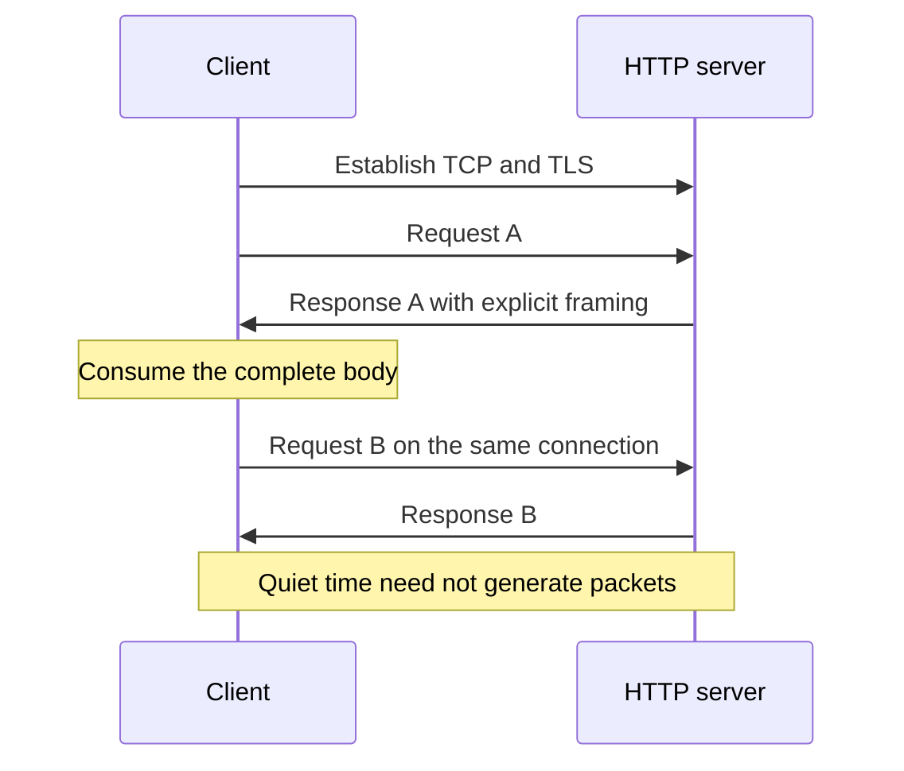
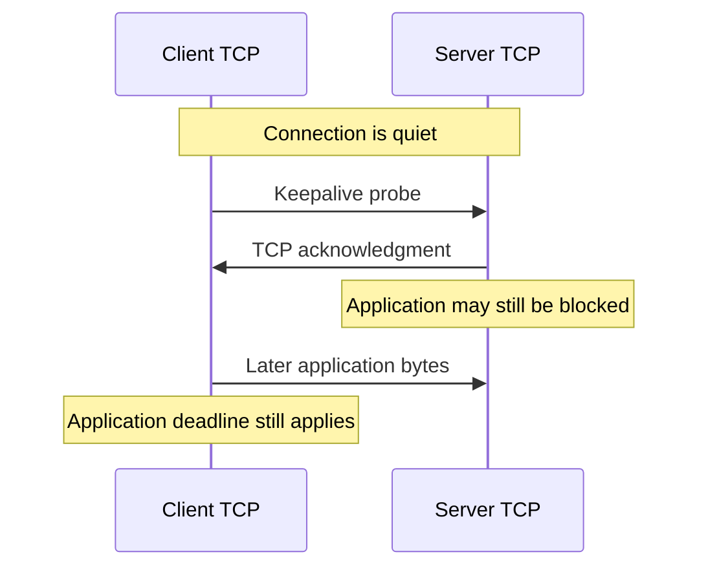
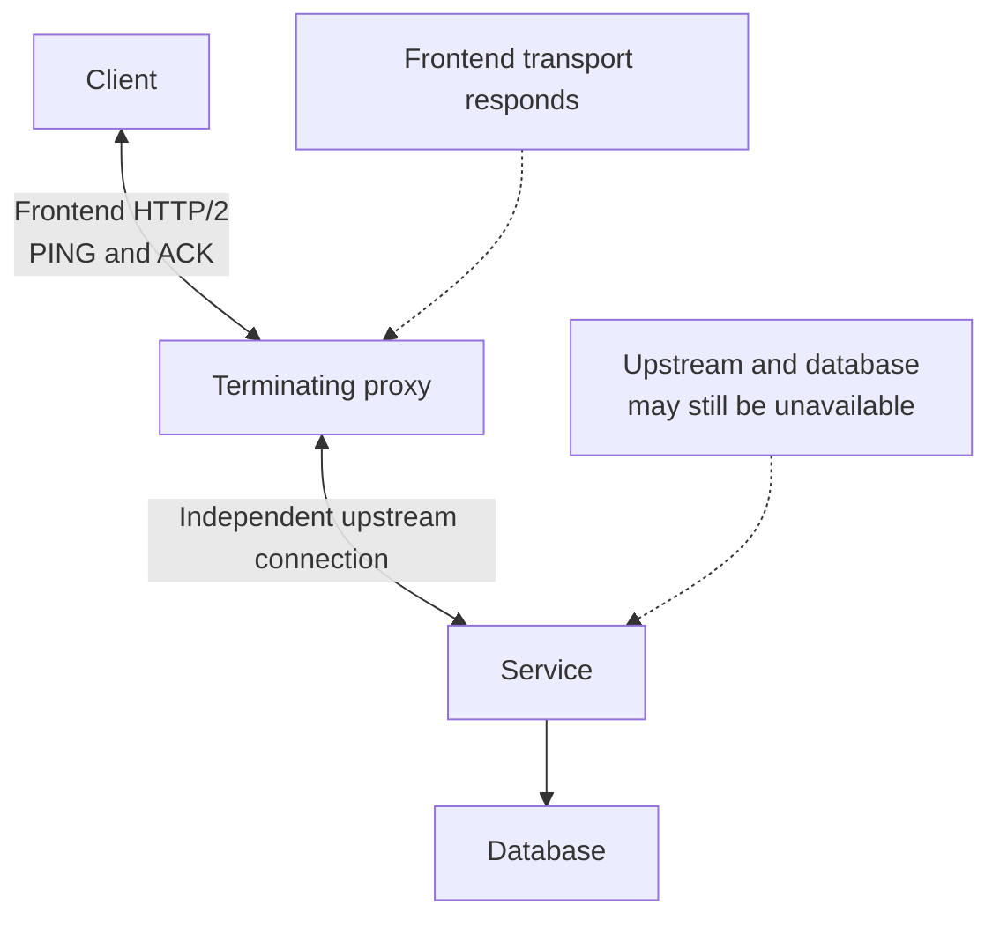
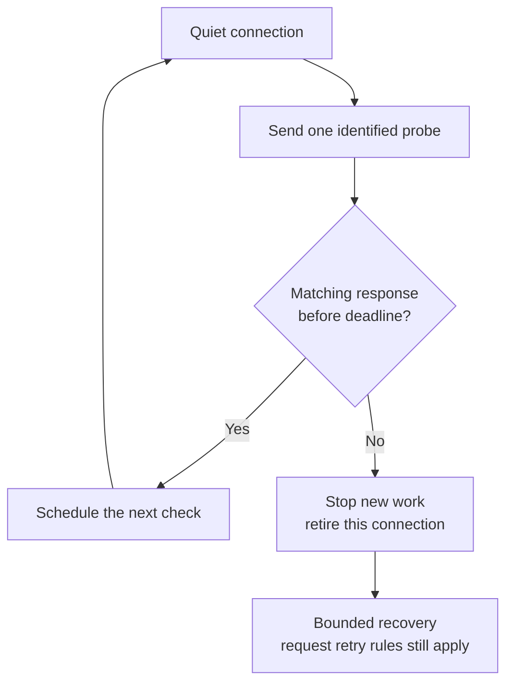

A client completes a request, puts the connection back into its pool, and waits. Five minutes later, the next request stalls. The operating system still reports an established socket, but a device on the path has discarded its connection state. Another client sends frequent PINGs and receives responses, while its business requests wait indefinitely for a database.

Both teams have enabled something called keep-alive. They have addressed different problems, and neither setting supplies a complete failure policy.

Keeping a connection available involves three decisions: whether to reuse it, what evidence to collect while it is quiet, and when to retire it. This article separates those decisions across HTTP, TCP, application protocols, proxies, and connection pools. Numerical examples are planning calculations, not measured product performance or suggested defaults.

## Reuse starts with the cost of reconnecting

The most direct client opens a connection for each operation, completes the exchange, and closes. Ownership is simple, and little idle application state remains afterward. At low request rates, this can be sufficient.

Repeated establishment becomes expensive as traffic grows. TCP synchronizes transport state; TLS establishes cryptographic state; some application protocols then authenticate a session. Reuse spreads that work across several requests. If a service receives 20,000 requests per second and each connection completes an average of 100 requests, the steady creation rate is roughly 200 connections per second, assuming no failed opens. Opening once per request would require 20,000.

The [connection-cost article](/field-notes/tcp-connection-costs/) develops those budgets. Here the next problem is the quiet interval between uses. Retaining a connection also retains memory, file descriptors, routing choices, and sometimes middlebox mappings. A local handle can outlive a remote process or an entry in a flow table. A reuse policy needs expiry and recovery behavior.

## Several mechanisms share the name

<div class="table-scroll" role="region" aria-label="Keep-alive mechanisms and the evidence they provide" tabindex="0">

| Mechanism | What it does | What success establishes |
| --- | --- | --- |
| HTTP persistent connection | Carries later exchanges on an existing connection | The connection was reusable for an exchange that completed |
| TCP keepalive | Probes an otherwise quiet transport and checks responses | The peer TCP endpoint and path responded at that time |
| HTTP/2 PING | Exchanges a connection-level frame and acknowledgment | The HTTP/2 peer processed that control exchange |
| Application heartbeat | Exercises a protocol-defined operation | Only the application work included in its response contract |
| Readiness or health check | Reports whether a service should receive work | The health criteria checked, within the freshness of that observation |

</div>

HTTP persistence does not inherently send periodic packets. TCP keepalive does not ask a database whether a transaction can commit. A heartbeat that runs on an independent control thread can succeed while request workers are exhausted. Choose the mechanism by the evidence needed.

An idle timeout is a separate decision to release resources after a kind of inactivity. Maximum connection age limits residence even when traffic continues. A request deadline bounds an operation's useful lifetime. All three can coexist with keepalive probes, and their clocks may begin and reset on different events.

## HTTP persistence depends on message boundaries

HTTP/1.1 normally permits persistent connections unless connection options or message framing require closure. A client does not need to add `Connection: keep-alive` to every HTTP/1.1 request. HTTP/1.0 had different persistence behavior, which explains some older examples still found in client code.

Reuse requires knowing where one message ends. A self-delimited response can use a valid Content-Length or chunked framing where applicable. A response whose end is indicated only by closing the connection cannot leave that connection available for another response. The client must consume the entire response body before ordinary HTTP/1.1 reuse; the server likewise must consume the request body or close. [RFC 9112](https://www.rfc-editor.org/rfc/rfc9112.html#section-9.3) specifies these rules.



*Figure 1. HTTP persistence permits reuse between complete exchanges. It does not itself schedule probes during the quiet interval.*

A response-body leak can keep a connection leased from the pool even when its socket is healthy. Conversely, discarding an unread HTTP/1.1 body and immediately returning the socket can leave the next parser reading bytes from the old response. Follow the client library's close, drain, and cancellation contract. HTTP/2 can often terminate an individual stream while preserving the transport, but that is protocol-specific handling.

The HTTP `Connection` field controls the immediate hop. [RFC 9110](https://www.rfc-editor.org/rfc/rfc9110.html#section-7.6.1) requires intermediaries to process connection-specific fields before forwarding. A `Keep-Alive` header is not a reservation for every proxy on the route. HTTP/2 prohibits connection-specific fields such as `Connection` and `Keep-Alive`; its own frames and stream rules govern connection use. Copying old HTTP/1.x headers into HTTP/2 does not create a heartbeat.

## TCP probes test a transport endpoint

A quiet TCP connection can remain established without sending traffic. If a machine loses power, the peer might receive no FIN or RST. TCP cannot immediately distinguish that silence from a healthy application that has nothing to say.

TCP keepalive adds a transport-level test. After sufficient quiet time, the endpoint sends a probe designed to elicit an acknowledgment from the peer's TCP stack. Classic probes use a sequence number just before the expected next position. A peer retaining the connection responds; a peer that has lost the state may reset it, while a blackholed path may return nothing. A probe does not require the business handler to run.



*Figure 2. A TCP acknowledgment gives evidence about transport state. It cannot establish that a request handler or its dependencies are ready.*

[RFC 1122](https://www.rfc-editor.org/rfc/rfc1122.html#section-4.2.3.6) requires keepalive to be optional per connection, default off, and tolerant of a lost probe response. Its specified default idle interval is at least two hours. Those conservative defaults are unsuitable for a requirement to discover a quiet broken connection within tens of seconds.

On Linux, `SO_KEEPALIVE` enables the mechanism. `TCP_KEEPIDLE`, `TCP_KEEPINTVL`, and `TCP_KEEPCNT` control the idle interval, retry spacing, and probe count where supported. System defaults affect enabled sockets; a sysctl value alone does not prove that a particular client library enabled probing. The [kernel parameter documentation](https://docs.kernel.org/networking/ip-sysctl.html) lists the defaults and controls. Other operating systems and managed runtimes expose different options.

When data is outstanding, retransmission and other transport timers matter. Linux `TCP_USER_TIMEOUT` bounds how long transmitted data can remain unacknowledged, or buffered data remain unsent because of a zero window. It also affects closure after keepalive failure when combined with `SO_KEEPALIVE`. It does not schedule probes or create a business-request deadline. The [Linux TCP manual](https://man7.org/linux/man-pages/man7/tcp.7.html) describes these distinctions.

## Protocol heartbeats can reach a different layer

HTTP/2 PING is a connection-level frame with stream ID zero and eight opaque payload bytes. Its acknowledgment returns the same payload, allowing correlation. It is not tied to the success of a particular request stream. The frame header and payload total 17 bytes before TLS, transport, and network overhead. [RFC 9113](https://www.rfc-editor.org/rfc/rfc9113.html#section-6.7) defines the exchange.

The frame travels through the same ordered TCP connection as other HTTP/2 traffic. Giving it processing priority cannot let its bytes bypass a missing TCP segment. Local write queues and event-loop scheduling also contribute to observed PING latency, so an unusually short timeout can mistake congestion or a pause for a failed peer.

gRPC uses HTTP/2 PING for its connection keepalive. Clients and servers must agree on permitted frequency and whether probes are allowed without active calls. An unacceptable policy can lead to a GOAWAY with `too_many_pings`. The [gRPC guide](https://grpc.io/docs/guides/keepalive/) cautions against unsolicited idle probing and client intervals much below one minute. Exact options and enforcement depend on the implementation; copying one language's channel arguments into another is insufficient.

For a long-lived stream, detecting a broken transport can release stuck resources and begin recovery. It does not restore the stream's application position. Persist cursors or sequence acknowledgments where replay matters, reconnect with bounded backoff, and define what can be resent.

An application heartbeat can include a stronger check, such as reaching the same event loop or worker queue that handles ordinary operations. Its result is still scoped to that check. Executing a database write on every heartbeat could turn a cheap connection test into a new load source. gRPC's [health-checking protocol](https://grpc.io/docs/guides/health-checking/) separately reports serving status; that state needs an explicit policy for dependencies and overload.

## Follow both sides of every terminating proxy



*Figure 3. A terminating proxy answers for its frontend connection. The upstream transport and business dependencies require their own observations and budgets.*

Map the path before selecting an interval. A client may connect through a stateful firewall to a proxy, which opens another connection through a load balancer to a service. Transport probes reach the TCP endpoint of their leg. Application-level PINGs reach the endpoint of their protocol connection. Forwarding devices can maintain state without becoming either endpoint.

Then record each timer's owner, start event, reset event, and closure behavior. Bytes on the wire may refresh a flow-based timer while leaving a request-based timer untouched. Envoy defines its HTTP connection idle timeout by the absence of active requests, so HTTP/2 PINGs do not prevent that idle closure. Its protocol options also expose PING settings independently. [Envoy's documentation](https://www.envoyproxy.io/docs/envoy/latest/api-v3/config/core/v3/protocol.proto.html) makes this separation explicit.

AWS Application Load Balancer documentation says that HTTP/2 PING frames do not reset its idle timeout. A healthy local gRPC PING policy therefore cannot be assumed to preserve an ALB connection. Inspect the actual protocol and deployment path, and use a supported policy rather than manufacturing application traffic solely to defeat intentional idle cleanup. [ALB attribute documentation](https://docs.aws.amazon.com/elasticloadbalancing/latest/application/edit-load-balancer-attributes.html) describes that behavior.

## Coordinate timers by their meaning

There is no single timeout ordering that applies to every leg and event definition. Start with the idle object whose ownership is being managed, then align the two participants that can retire it.

For a client pool borrowing from a server that closes inactive connections, retiring local idle entries earlier can reduce reuse of already-closed sockets. If both count the same quiet interval, an illustrative 45-second pool idle limit and 60-second server idle limit leave fifteen seconds of margin. Scheduling, last-use accounting, and close races still matter; this is not a guarantee that every checkout succeeds.

When a proxy owns an upstream pool, coordinate that pool's retirement with the backend's idle policy. A backend that keeps connections longer than the proxy expects to reuse them reduces that particular race. This concerns the proxy-to-backend leg. It does not imply that an external client's pool should keep sockets longer than the proxy's frontend limit.

If a required idle session must survive a flow timeout, qualifying traffic must arrive before that timeout with room for delay. Let `I` be the configured interval, `J` the maximum added jitter, `D` the permitted scheduling and delivery margin, and `T` the smallest relevant flow idle timeout. A planning condition is:

```math
I + J + D < T
```

This condition assumes the packet type resets every timer being considered. It cannot preserve a request-based idle policy that ignores the probe, and unbounded loss or scheduling pauses defeat the assumed delay margin. A configured maximum age can intentionally close a connection despite continuing traffic.

<div class="table-scroll" role="region" aria-label="Independent connection and request timers" tabindex="0">

| Timer | Begins or resets around | Intended response |
| --- | --- | --- |
| Pool idle limit | Client library's last release or activity definition | Remove an unused reusable entry |
| TCP keepalive idle interval | Transport activity according to the stack | Begin probing an otherwise quiet transport |
| Protocol PING timeout | An outstanding protocol probe | Stop relying on an unresponsive protocol connection |
| Request deadline | Operation creation or admission contract | Stop waiting for that operation and propagate cancellation |
| Stream idle limit | Activity defined for that stream | End a stream making insufficient progress |
| Maximum connection age | Establishment time | Drain or retire an aging connection |

</div>

A long-running RPC can keep an HTTP connection non-idle while making no useful progress. A PING may remain responsive. Preserve a request or stream-progress budget for that case. A short unary RPC usually reaches its own deadline before a background keepalive cycle would help.

## Treat a heartbeat timeout as a scoped failure decision

A missing response can indicate a dead peer, packet loss, a congested path, a paused process, or a local scheduler that did not run. Aggressive intervals and timeouts shorten detection but increase false suspicions and reconnect work. No heartbeat can distinguish every network partition from a failed machine.

For an illustrative application heartbeat sent every `I` seconds with timeout `H`, consider a blackhole that starts at a random phase between scheduled probes. With one outstanding probe and no other traffic, detection takes approximately the time until the next probe plus `H`, ranging from `H` to `I + H`. At `I = 30 s` and `H = 5 s`, that is roughly 5–35 seconds, with a twenty-second mean under a uniform phase assumption. This model is not the Linux TCP retry schedule or a promise about a particular gRPC runtime.



*Figure 4. A probe timeout removes confidence in one connection. Recovery is a separate policy with its own admission, deadline, and replay constraints.*

Use monotonic time for elapsed intervals, correlate responses with the current probe and connection generation, and cancel timers on retirement. A delayed response from an old connection must not mark its replacement healthy. Avoid building an unbounded queue of outstanding probes. Mature protocol libraries should own their protocol state machine.

Retiring a socket does not revoke the remote process's authority to commit a write. Leadership, locks, and exclusive ownership need their own lease or fencing protocol. Likewise, a lost response does not establish whether a payment or job submission executed. Retry according to application idempotency and durable receipts, with a finite attempt budget.

## Failure scenarios that survive a successful PING

<div class="table-scroll" role="region" aria-label="Keep-alive failure scenarios and recovery limits" tabindex="0">

| Situation | Observable behavior | Useful response |
| --- | --- | --- |
| Host loses power or path blackholes | Quiet socket may remain locally established | Transport or protocol detection plus operation deadlines |
| Process crashes and the stack closes sockets | FIN or RST may arrive before any probe | Observe close events and remove pool entries promptly |
| Proxy is healthy, upstream is stuck | Frontend probes succeed while requests stall | Separate upstream health, admission, and request deadlines |
| Runtime pause or local CPU saturation | Responses or timer callbacks arrive late | Observe scheduling delay; allow tested margin and bound reconnects |
| Middlebox forgets an idle flow | Next reuse fails or stalls | Retire earlier or use qualifying probes if idle preservation is required |
| Server rejects frequent gRPC PINGs | GOAWAY or repeated channel reconnects | Align client policy with server enforcement |
| Slow body consumer holds pool leases | Pool wait grows although probes succeed | Fix response lifecycle, concurrency limits, and slow-consumer handling |
| A region fails | Many connections fail together | Surviving-region handshake capacity and bounded recovery |

</div>

Health checks can fail during ordinary overload. Reconnecting every session can then add TCP, TLS, authentication, and subscription work to a saturated system. Use jittered backoff, concurrency caps, and recovery admission. Avoid restarting an entire healthy process merely because one dependency connection failed.

Connection reuse also has an asynchronous-close race that a pre-check cannot eliminate: the peer may close immediately after the check. Retain normal error handling even when an idle probe succeeded. Safe cleanup and replay rules handle that race more reliably than increasingly frequent checks.

## Scale the probes as well as the sockets

One million otherwise quiet connections probed once every thirty seconds produce about **33,333 probes per second**, plus roughly the same number of responses when healthy. If both ends independently initiate at that rate, those totals roughly double. Actual suppression during traffic and implementation policies can reduce the count.

For an illustrative measured aggregate of 200 wire bytes per probe-and-response cycle, one initiating side consumes about **6.67 MB/s**, or **576 GB/day** if sustained. The 200-byte value is an assumption; TLS records, packet headers, acknowledgments, coalescing, and packetization determine actual traffic. Small messages can be dominated by packet and wakeup processing rather than payload bandwidth.

Timers consume state, too. Use event-loop scheduling or an appropriate timer facility instead of one sleeping thread per socket. A timer heap generally has logarithmic scheduling work. Timing wheels can reduce amortized bookkeeping for suitable resolution, while a bucket with many simultaneous expirations can still create a burst. Randomize initial phases and subsequent scheduling within a bounded policy; include the longest interval in the idle-timeout budget.

At small scale, a shared reusable client and bounded pool may be enough. At service-fleet scale, inventory every pool owner, proxy leg, and server policy. At global scale, include reconnection capacity during regional evacuation. Fewer multiplexed transports reduce the number of probes but concentrate more streams behind each failed transport.

On mobile devices, frequent tiny packets can repeatedly wake the radio and consume battery. If the product does not need an always-ready session, allow idle closure and reconnect on demand. The lowest latency for the next operation can carry an unnecessary background cost for hours of inactivity.

## Keep draining separate from staying alive

Deployment needs a way to retire healthy connections. Stop assigning new work, allow eligible inflight work to finish, and enforce a drain deadline. HTTP/1.1 can signal closure for an exchange; HTTP/2 can send GOAWAY. Neither a successful probe nor continued request traffic should defeat an intended retirement policy.

Long-lived connections preserve earlier routing choices. Adding instances or changing DNS mostly influences new connections while existing sessions can remain concentrated on old targets. A bounded maximum age gradually refreshes distribution, at the cost of more establishment. Jitter age limits and warm replacements to avoid synchronized reconnects.

A draining connection and its replacement may coexist. Budget that overlap, TLS CPU, and any application replay. For streaming sessions, save enough application state to resume or explicitly report a discontinuity. Reconnecting TCP cannot reconstruct events the application never durably acknowledged.

## Recent changes make lifetime controls more explicit

The June 2022 HTTP specifications separate HTTP/1.1 persistence, HTTP/2 control frames, and HTTP/3 transport behavior. [HTTP/3](https://www.rfc-editor.org/rfc/rfc9114.html) uses QUIC rather than TCP. Consequently, TCP keepalive options do not control its connections.

QUIC has its own negotiated idle timeout and ack-eliciting PING frames. The effective advertised idle value is the minimum nonzero value from the endpoints, with protocol rules also accounting for probe timeout. Transport traffic can defer expiry, but middleboxes may expire earlier. The [QUIC specification](https://www.rfc-editor.org/rfc/rfc9000.html#section-10.1) describes those rules. Independent stream delivery changes transport behavior; it does not turn an acknowledgment into business readiness. QUIC connection migration also does not transfer application ownership to a replacement server process.

In **March 2024**, AWS added configurable ALB HTTP client keepalive duration. It controls the client connection's age independently of idle timeout. At expiry, ALB accepts one more request and then closes gracefully using HTTP/1.x closure signaling or HTTP/2 GOAWAY. Existing connections retain the duration assigned at establishment. The [launch announcement](https://aws.amazon.com/about-aws/whats-new/2024/03/application-load-balancer-http-keepalive-duration/) ties this control to deployments and availability-zone evacuation. Its [configuration documentation](https://docs.aws.amazon.com/elasticloadbalancing/latest/application/edit-load-balancer-attributes.html) distinguishes the two clocks.

In **September 2024**, AWS added configurable NLB TCP idle timeout, from 60 to 6,000 seconds, applying changes to new connections. [The engineering account](https://aws.amazon.com/blogs/networking-and-content-delivery/introducing-nlb-tcp-configurable-idle-timeout/) explains the trade-off between retaining flows and filling tracking tables. [Current listener documentation](https://docs.aws.amazon.com/elasticloadbalancing/latest/network/update-idle-timeout.html) distinguishes TCP from TLS listeners and warns about the target interface's separate tracking timeout. Raising one limit does not extend every state holder along the path.

Current Envoy protocol options include periodic PINGs, jitter, and probing an idle connection before creating a new stream. These are implementation choices to verify against the deployed release, not a new HTTP guarantee. They illustrate a useful direction: make reuse, observation, and retirement separately configurable, then measure their combined effects.

## Choose how much idle state the product needs

<div class="table-scroll" role="region" aria-label="Idle connection strategies and their trade-offs" tabindex="0">

| Strategy | Useful when | Cost or remaining limit |
| --- | --- | --- |
| Close after each operation | Sparse operations and simple ownership | Repeated establishment and retirement work |
| Reuse with bounded idle retention | Frequent requests and acceptable first-use recovery | State remains; a close race still exists |
| Preserve quiet sessions with probes | Long-lived sessions need timely transport detection | Packet, timer, battery, and false-suspicion costs |
| Probe before reuse after quiet time | An expensive operation benefits from a recent path check | Added first-use latency and a remaining check/use race |
| Application progress checks | Correctness depends on work beyond the transport peer | More expensive checks and a narrowly defined success contract |

</div>

A shorter interval is justified by a tighter detection requirement only when the server permits it and the fleet can afford it. A longer idle lifetime is justified by a useful reuse benefit only when retained state fits the resource budget. For rare operations, reconnecting can be cheaper than maintaining a quiet population indefinitely.

Enabling HTTP persistence does not enable TCP probes. A Keep-Alive header cannot negotiate every hop's lifetime. A PING acknowledgment cannot prove database health. Increasing every timeout can prolong stalls and retain unnecessary state. Each configuration should name its owner, trigger, evidence, and recovery action.

## Operate the policy through observable phases

Record connection creation and reuse, pool wait, live and idle populations, active streams, idle evictions, maximum-age drains, close reasons, and reconnect attempts. Measure handshake latency and CPU separately from operation latency. Track PING RTT, probe timeout count, server enforcement errors, and local event-loop delay by path and destination.

Inspect effective configuration, not just source configuration. On Linux, socket diagnostics such as `ss -to` can expose active timer information, while `ss -tinm` provides transport and memory details. Run diagnostics in the relevant network namespace. A packet capture or controlled packet-drop test can establish whether probes are emitted and which peer answers; inspect sensitive traffic under the environment's access rules.

Test four distinct cases before rollout: a quiet healthy connection, a blackholed transport, a responsive proxy with a blocked upstream, and a deployment drain. Add a paused runtime and conflicting client/server PING policy. Verify deadlines, recovery limits, pool cleanup, and stream resumption behavior. These tests establish more than a dashboard showing established sockets.

Change one layer on a small traffic slice. Observe saved handshakes together with retained memory, packet rate, idle failures, and retries. Some policies apply only to new connections, so a mixed old/new population is expected during rollout. Replace gradually rather than dropping the fleet to force immediate convergence.

## Evaluate the ownership and failure boundaries

An implementation review can establish whether the socket option or channel argument is set correctly. A broader design review follows what that setting reaches: the kernel, an HTTP peer, a proxy, a request worker, or a dependency. It also identifies which system pays when thousands of connections are declared unusable together.

For example, moving probes into a proxy can centralize policy and reduce application configuration. It can also leave applications trusting a healthy local proxy during an upstream incident. Shorter failure detection can improve stream recovery while increasing churn during scheduler pauses. A maximum age can improve traffic redistribution while increasing authentication and handshake demand.

Keep three records for every policy: **reuse** states which work may share a connection; **observation** states what response counts as evidence and for how long; **retirement** states who stops using the connection and how unfinished work recovers. A complete policy connects those records to a request deadline and the application's replay contract.

## Further reading

- [RFC 9112 on HTTP/1.1 persistence](https://www.rfc-editor.org/rfc/rfc9112.html#section-9.3) explains message boundaries, reuse, and asynchronous closure races.
- [RFC 1122 on TCP keepalive](https://www.rfc-editor.org/rfc/rfc1122.html#section-4.2.3.6) defines conservative defaults and the requirement to tolerate lost probe responses.
- [The Linux TCP manual](https://man7.org/linux/man-pages/man7/tcp.7.html) and [kernel IP parameters](https://docs.kernel.org/networking/ip-sysctl.html) explain per-socket controls, system defaults, and user timeout behavior.
- [RFC 9113 on HTTP/2 PING](https://www.rfc-editor.org/rfc/rfc9113.html#section-6.7) defines connection-level probing and its acknowledgment format.
- [gRPC keepalive guidance](https://grpc.io/docs/guides/keepalive/) explains client/server coordination, enforcement, and the effect of a failed connection on long-running calls.
- [gRPC health checking](https://grpc.io/docs/guides/health-checking/) describes service availability signaling that is separate from connection probing.
- [Envoy protocol options](https://www.envoyproxy.io/docs/envoy/latest/api-v3/config/core/v3/protocol.proto.html) separate request-based idle timeout, connection age, and PING scheduling.
- [ALB connection attributes](https://docs.aws.amazon.com/elasticloadbalancing/latest/application/edit-load-balancer-attributes.html) distinguish idle timeout from client connection age and document HTTP/2 PING behavior.
- [The March 2024 ALB announcement](https://aws.amazon.com/about-aws/whats-new/2024/03/application-load-balancer-http-keepalive-duration/) explains the operational motivation for configurable client connection duration.
- [The September 2024 NLB engineering account](https://aws.amazon.com/blogs/networking-and-content-delivery/introducing-nlb-tcp-configurable-idle-timeout/) relates flow retention to tracking capacity; [listener configuration](https://docs.aws.amazon.com/elasticloadbalancing/latest/network/update-idle-timeout.html) documents current scope.
- [RFC 9000 on QUIC idle timeout](https://www.rfc-editor.org/rfc/rfc9000.html#section-10.1) explains transport liveness and idle deferral over UDP.
- [RFC 9114 on HTTP/3](https://www.rfc-editor.org/rfc/rfc9114.html) shows how HTTP connection management maps onto QUIC.
