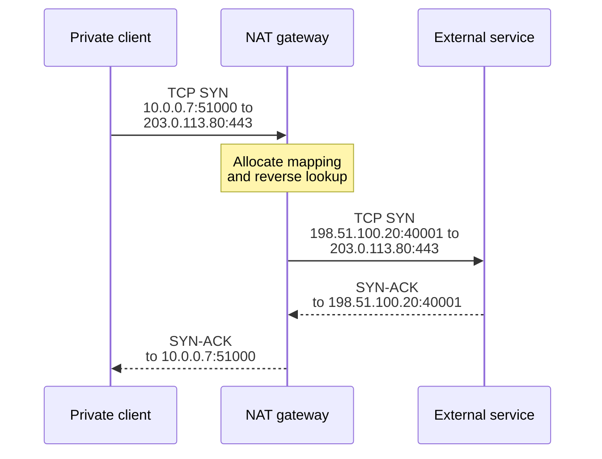
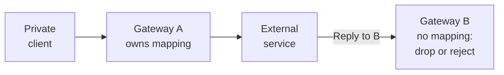
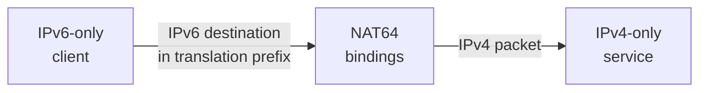

A service adds application replicas to handle a traffic spike. Existing connections to a payment API remain healthy, but new connections start timing out. The instances have spare CPU, and the outbound gateway is carrying little bandwidth. Adding more replicas makes the failure worse.

The shared translator has exhausted the source-port capacity available for that destination. Application scaling increased demand on a smaller, stateful resource. The public IP that looked like a network configuration detail became a connection-capacity and availability boundary.

Network Address Translation, or **NAT**, changes network addresses as packets cross an addressing boundary. The many-to-one form commonly used for outbound IPv4 also changes transport ports and remembers enough information to translate replies. Understanding that memory, its allocation rules, and the packet path explains many incidents that otherwise resemble random network failures.

This article continues [IP Addresses in Production](/field-notes/ip-addresses-in-production/) and [IPv4 and IPv6: Packets, Paths, and Production Migration](/field-notes/ipv4-ipv6-production-migration/). The examples use private ranges and documentation addresses; the external endpoints shown are not services to contact.

## Start with addressing and routing

A host can communicate without translation when both sides have usable addresses, routes, and access policy. Assigning every Internet-connected host a public IPv4 address is conceptually straightforward. Growth consumes public addresses and makes independent organizations' addressing choices harder to accommodate.

Private addressing allows separate networks to reuse ranges such as `10.0.0.0/8`. Routers inside each network can deliver those packets normally. The public Internet cannot interpret every organization's `10.0.0.7` as a different globally reachable endpoint. A default route does not change that addressing problem.

One approach gives each internal address a corresponding external address. That can bridge addressing domains, but still consumes an external address per mapped host. Sharing an external address among many hosts requires another discriminator. TCP and UDP already identify application endpoints with ports, so a translator can assign different external source ports to concurrent communications.

This is **Network Address Port Translation**, or NAPT, also commonly called PAT or simply NAT. [RFC 3022](https://www.rfc-editor.org/rfc/rfc3022.html), an Informational RFC from January 2001, distinguishes Basic NAT from NAPT. Their consequences differ: a fixed one-to-one mapping can sometimes be implemented without per-flow allocation, whereas shared dynamic port translation needs mapping and session management.

The translator does not create an Internet route, approve the destination, or authenticate the caller. Those remain separate responsibilities.

## Name the rewrite before discussing the device

**Source NAT**, or SNAT, changes the source address, often together with its port. **Destination NAT**, or DNAT, changes the destination. These names describe packet fields; they are not mutually exclusive deployment architectures. Translating a reply back to an internal client changes its destination even though the overall service is called outbound SNAT.

<div class="table-scroll" role="region" aria-label="NAT mechanisms and their state requirements" tabindex="0">

| Mechanism | What changes | Typical purpose | State consideration |
| --- | --- | --- | --- |
| Fixed one-to-one address translation | An address according to a configured mapping | Connect controlled addressing domains | The mapping may be sufficient for packet translation; a firewall can maintain separate flow state |
| Dynamic shared NAPT | Addresses and transport ports | Share external addresses across clients | Allocated mappings, reverse lookup, lifetimes, and session handling |
| Destination translation or port forwarding | An incoming destination endpoint | Expose a selected internal service | Static forwarding rules and any connection tracking must remain consistent |
| Stateful NAT64 | IPv6/IPv4 headers and endpoint representation | Let IPv6 clients reach IPv4 services | Cross-family mappings and protocol-aware return handling |

</div>

A static port-forwarding rule can deliberately admit an incoming connection. Outbound-only behavior therefore comes from the complete mapping and filtering policy. It is unsafe to infer that every device called a NAT gateway implements the same ingress contract.

## Follow one TCP connection through the translation

Suppose client `10.0.0.7:51000` connects to an HTTPS endpoint at `203.0.113.80:443`. The gateway assigns external endpoint `198.51.100.20:40001` for this flow.



*Figure 1. The TCP endpoints perform the handshake. The translator rewrites packets and retains the information needed to deliver the reply.*

The outbound packet arrives with a source endpoint, destination endpoint, and transport protocol. Together these form a **five-tuple**: source IP, source port, destination IP, destination port, and protocol. A routing or tenant context may also be required to distinguish overlapping internal addresses.

The gateway checks for an existing mapping. For a new permitted flow, it allocates a usable external endpoint under its mapping policy and installs forward and reverse lookup information. Two clients cannot simultaneously present the same translated TCP five-tuple to the same server: replies would become ambiguous.

<div class="table-scroll" role="region" aria-label="TCP endpoints before and after outbound and return translation" tabindex="0">

| Observation point | Source endpoint | Destination endpoint |
| --- | --- | --- |
| Client sends | `10.0.0.7:51000` | `203.0.113.80:443` |
| External service receives | `198.51.100.20:40001` | `203.0.113.80:443` |
| External service replies | `203.0.113.80:443` | `198.51.100.20:40001` |
| Client receives translated reply | `203.0.113.80:443` | `10.0.0.7:51000` |

</div>

For ordinary IPv4 NAPT, the rewrite changes IP address and port fields and adjusts the applicable checksums. TCP and UDP checksums cover a pseudo-header containing IP addresses as well as transport data. IPv4 also has its own header checksum. Special cases, such as IPv4 UDP's permitted zero checksum, require protocol-aware handling. RFC 3022 describes incremental checksum adjustment, avoiding a full payload scan for each ordinary rewrite.

Traditional packet translation does not terminate TCP or decrypt HTTPS. The client and server retain their transport relationship. An application proxy has a different contract: it accepts one connection and opens another, potentially terminating TLS when configured and authorized to do so.

ICMP errors can quote part of the packet that caused the error. Returning them correctly can require translating that embedded information. Noninitial IP fragments lack transport ports, so fragmentation needs additional association or reassembly handling. A translator that processes ordinary small TCP packets successfully may still mishandle these cases.

## Mapping, filtering, and lifetime are separate decisions

A typical stateful implementation maintains a forward index from an internal flow or mapping key to the external endpoint, a reverse index for replies, protocol/session metadata, and expiry information. The exact keys depend on the mapping behavior. Treating every implementation as one identical five-tuple hash table hides important differences.

With **endpoint-independent mapping**, the same internal address and port can retain the same external endpoint when communicating with different remote endpoints. Other mapping behaviors take the remote address, or remote address and port, into account. [RFC 4787](https://www.rfc-editor.org/rfc/rfc4787.html) defines this terminology for UDP and specifies behavioral requirements intended to improve interoperability.

Filtering answers a different question: which incoming remote packets may use a mapping that already exists. Endpoint-independent mapping does not imply permission for arbitrary senders to reach the client. Describing a device only as “symmetric NAT” or “cone NAT” is insufficient for diagnosing its allocation, filtering, and timeout behavior.

An implementation can separate reusable endpoint mappings from individual remote sessions. Connection counts, mapping counts, and reserved ports therefore need not be identical. A port reservation is capacity assigned to an instance or allocation block; it might not represent an active connection.

TCP has an explicit handshake and close signaling, but middleboxes can miss packets or lose state. A NAT also maintains its own timers. UDP supplies no transport-level connection close, so devices commonly infer inactivity from traffic and expire state. Expiring a mapping is different from the application deciding that its peer has gone away.

[RFC 5382](https://www.rfc-editor.org/rfc/rfc5382.html) specifies TCP NAT behavior, including state and timeout considerations. Actual managed services publish their own supported behavior and limits. Record the effective timers for the deployed path instead of assuming that a host's TCP keepalive defaults preserve the gateway's state.

Short timeouts can interrupt legitimately idle sessions; long timeouts retain resources after failed or abandoned connections. Keepalives can help when supported and configured appropriately, but consume packets, bandwidth, power, and state. They are an operating choice with a budget.

## Port capacity depends on the destination

A transport port is a 16-bit field, but that does not give a gateway 65,536 universally usable application connections. Reserved ranges, allocation blocks, reuse rules, protocol, destination concentration, and platform limits reduce or partition the usable budget.

For TCP, the translated endpoint and remote endpoint must uniquely identify simultaneous connections. A device may reuse an external source port across different destinations if its mapping and filtering design permits it. All connections to one remote IP and port lack that additional diversity. This makes a single popular API a common exhaustion point, even when total bandwidth is low.

Distinguish this gateway budget from the client's own ephemeral-port limits. Increasing an application's local port range does not create additional usable translated endpoints at a shared gateway. Conversely, adding gateway addresses will not fix exhaustion at an individual client's socket layer.

For a hypothetical workload concentrated on one destination, approximate occupied capacity using arrival rate and retention:

```math
C\approx\lambda(D+T).
```

Here `C` is the number of occupied flow slots, `λ` is new connections per second, `D` is average active lifetime in seconds, and `T` is effective additional retention before the relevant translated tuple can be reused. This steady-state estimate assumes each connection consumes one slot in the bottleneck pool. Real devices can have multiple timer and allocation stages.

With **2,000 connections per second**, a **20-second** active lifetime and **40 seconds** of additional retention, the estimate is `2,000 × (20 + 40) = 120,000` occupied slots. The retention is an illustrative assumption, not a recommended TCP timeout or a measured gateway behavior. Bursts, unsuccessful handshakes, and abandoned connections can change the requirement.

Assume each external address supplies `P = 50,000` usable slots for this destination. Reserving a fraction of capacity for headroom gives an address-budget estimate:

```math
A\geq\left\lceil\frac{C}{uP}\right\rceil.
```

`A` is the number of addresses and `u` is the maximum planned utilization fraction. The hard arithmetic minimum is three addresses: `ceil(120,000/50,000) = 3`. At `u = 0.75`, plan at least four: `ceil(120,000/37,500) = 4`. This does not establish gateway throughput, fair distribution, or failure tolerance. Several addresses on one gateway can disappear together during a failure.

State memory adds another dimension. At an assumed 256 bytes per entry, 120,000 entries occupy **30,720,000 bytes**, about **29.3 MiB**, before extra indexes, allocator overhead, counters, or replication. This is illustrative arithmetic; inspect the actual implementation rather than treating it as a measured per-flow cost.

Application connection pooling can reduce arrival rate and retained-state churn. HTTP multiplexing can also reduce connection demand when the protocol and peer support it. Bound pool size and lifetime, allow for downstream limits, and avoid turning a few shared connections into an unexamined failure or concurrency bottleneck.

## The return path must find the right state

Adding gateways creates a routing problem. Forward traffic may allocate state on gateway A, while a routing change delivers replies to gateway B. If B has no corresponding reverse mapping, having spare CPU and an identical configuration does not make the reply deliverable.



*Figure 2. This is an intentionally broken return path. A shared advertised egress range or a failover can deliver traffic to a translator that lacks the required state.*

Classical active/standby designs transfer an address and route to another machine. Preserving established sessions additionally requires the needed mapping state, compatible timers, and ownership rules that prevent conflicting allocations. Asynchronous replication can miss recent mappings during failure. Synchronous coordination adds work to connection establishment and creates another dependency.

Active/active systems can partition external addresses or ports among owners and direct traffic accordingly. Per-flow hashing can distribute processing, but membership changes must not silently send established flows to empty state. A deterministic allocation rule reduces some coordination; it does not necessarily reconstruct every filtering decision, protocol state, or expiry event.

For many services, retaining new-connection availability while allowing existing connections to reconnect is an acceptable recovery contract. State that contract explicitly. Retry logic must then distinguish a failed connection from an operation that the peer might already have committed. NAT recovery cannot provide application-level exactly-once execution.

## Traversal and protocol behavior change the options

An unsolicited inbound packet normally has no dynamically allocated reverse mapping to the desired client. Explicit forwarding, coordinated peer connection attempts, or a relay can supply different paths.

[STUN, specified in RFC 8489](https://www.rfc-editor.org/rfc/rfc8489.html), lets an endpoint observe the address and port visible to a server and supplies tools used by traversal protocols. That observation does not guarantee another peer can reach the same endpoint: mapping and filtering can depend on the destination. Coordinated UDP hole punching can work under suitable behavior, but it is not a universal bypass of policy.

[TURN, specified in RFC 8656](https://www.rfc-editor.org/rfc/rfc8656.html), provides a relay when a direct path is unavailable. Relaying adds bandwidth cost and another failure and latency boundary, while improving the set of networks through which an application can operate. Applications needing broad peer connectivity should budget for the relay path instead of assuming discovery guarantees direct delivery.

QUIC adds a different capability. Its connection identifiers and path-validation procedures can support continued transport operation after NAT rebinding changes a peer's observed address or port. [RFC 9000](https://www.rfc-editor.org/rfc/rfc9000.html), published in May 2021, defines the relevant behavior. Support depends on endpoint and routing implementation; a connection identifier does not recreate a dead NAT's state or remove a firewall decision. Ordinary TCP does not inherit this migration behavior.

Protocols that carry addresses inside application payloads introduce another difficulty. An address rewritten in an IP header can remain embedded in a message. Application-specific gateways can rewrite some protocols, but add parsing, version, and security complexity; encrypted payloads make transparent rewriting still less general. Prefer explicit application support or an appropriate proxy where the protocol requires it.

## NAT64 moves translation to an address-family boundary

Stateful NAT64 allows an IPv6 client to communicate with an IPv4 server by translating packet headers and maintaining the required bindings. [RFC 6146](https://www.rfc-editor.org/rfc/rfc6146.html) specifies this behavior. It still consumes IPv4-side translation capacity when external addresses are shared.



*Figure 3. DNS64 can supply a synthesized destination before this flow begins. The routed packet still needs a working translator and return state.*

DNS64 can synthesize an IPv6 destination from an IPv4 DNS record using a configured translation prefix. It does not perform packet translation. IPv4 literals, IPv4-only socket behavior, DNSSEC validation, and nonstandard protocols need explicit compatibility checks. [The earlier IPv6 article](/field-notes/ipv4-ipv6-production-migration/) covers DNS64 and 464XLAT in more detail.

Native end-to-end IPv6 can remove the need for shared IPv4 NAPT on a supported path. Stateful ingress policy, routing, monitoring, and application authentication remain necessary. An egress-only IPv6 filtering device can enforce connection policy without translating addresses.

## Failure scenarios to test before relying on the path

<div class="table-scroll" role="region" aria-label="NAT failure scenarios, observations, and mitigations" tabindex="0">

| Failure | Observable pattern | Investigation and mitigation |
| --- | --- | --- |
| Hot destination exhausts ports | Existing sessions work; new connections to one endpoint fail | Inspect destination-specific allocation and client pool churn; add suitable capacity or reduce connection creation |
| Idle mapping expires | First operation after a quiet period stalls or resets | Compare application, firewall, and NAT timers; validate pool eviction, keepalive, and safe reconnection |
| Reply reaches the wrong owner | Outbound packets leave; matching replies are dropped elsewhere | Capture both directions; restore state-aware routing or the documented failover path |
| Packet-processing or state-table limit | Many destinations fail despite available ports | Inspect packet rate, state occupancy, allocation failures, and gateway resource pressure |
| Fragment or ICMP handling fails | Small exchanges work while larger transfers stall | Inspect MTU, fragments, and quoted ICMP errors; test protocol handling through the full path |
| Egress identity changes | A partner rejects otherwise valid connections | Compare observed public sources with all allowlisted addresses; coordinate pool changes and draining |

</div>

A retry storm can amplify port exhaustion. Each application instance opens replacement connections, occupies additional state, times out, and retries together. Use bounded retries with backoff and jitter, shared connection budgets where appropriate, and admission control that prevents replicas from overwhelming the egress boundary. Test whether failures occur before connection establishment or after an application request was sent.

Packet loss and one slow dependency also lengthen connection lifetimes. Capacity demand can rise while request throughput falls. An autoscaler that adds callers in response to timeouts may intensify the original problem.

Restarting a gateway can clear a full table while disconnecting healthy sessions. It also destroys useful incident evidence and may leave clients retrying into another synchronized spike. Establish the failure mode, contain new demand, and apply the documented recovery procedure before choosing a disruptive reset.

## Scale the allocation and failure domains together

A small controlled environment may use one router with a simple translation table. As demand grows, increasing port capacity can require more external addresses; increasing packet-processing capacity can require more cores, accelerators, or gateway instances. These are different scaling axes.

Partitioning the data path across workers requires consistent ownership of mapping creation and reply processing. Concurrent allocations must avoid collisions, and expired entries must not be reused while a stale reverse entry still directs packets elsewhere. Batched packet processing or hardware assistance can reduce per-packet cost, but does not expand an address's usable endpoint space for one destination.

At the deployment level, distribute egress across zones or other failure domains when the availability requirement justifies it. [AWS's zonal NAT guidance](https://docs.aws.amazon.com/vpc/latest/userguide/nat-gateway-basics.html) recommends local gateways for workloads in multiple Availability Zones so one gateway's zone does not remove every zone's outbound path. That advice applies to the zonal deployment model; the regional mode discussed below changes how placement is managed.

Centralized egress can simplify inspection, partner allowlists, and audit policy. It also combines traffic, routing dependencies, packet-processing demand, and incident blast radius. Per-zone or per-workload gateways improve isolation at the cost of more addresses, configuration, minimum service charges, and allowlist management.

Multi-region services need complete regional egress capacity, partner permissions, DNS behavior, and recovery tests. Moving application traffic does not preserve old transport sessions or ensure that the destination accepts the new region's public source addresses.

Carrier-grade NAT can add another translation layer beyond a home or enterprise router. [RFC 6598](https://www.rfc-editor.org/rfc/rfc6598.html) reserves `100.64.0.0/10` as Shared Address Space for provider use, distinct from RFC 1918 private space. Multiple layers complicate inbound reachability, attribution, and troubleshooting. A single observed public source address can represent many users and devices.

## Operate the complete egress contract

Measure new-connection rate, established sessions, occupied and reserved ports, allocation failures, state expiry, packet drops, packet rate, and byte rate. Break down concentration by translated source and remote endpoint where telemetry supports it. Per-instance metrics can reveal one client exhausting its allocation while the gateway still has unused capacity elsewhere.

Include application connection-pool occupancy, connection-setup latency, TLS handshake failures, retries, and dependency response time. A TCP timeout, a TLS certificate failure, and an HTTP rejection implicate different layers. Correlate symptoms with translation and routing events instead of labeling them all “NAT errors.”

Capture the pre-translation source, translated source and port, remote endpoint, protocol, time interval, and relevant routing context when investigating a flow. A public IP alone is usually inadequate for attribution under sharing. Restrict access to these logs, minimize sensitive fields, and choose retention according to the actual operational and privacy requirements.

Use synthetic probes that exercise new connections and idle reuse through each egress domain. Test a concentrated destination as well as many destinations. Include the intended burst rate, connection lifetime distribution, long-idle sessions, maximum packet sizes, and zone or node failure. A large byte-transfer benchmark does not establish connection-allocation capacity.

For migration, establish the new routes and permitted egress addresses, coordinate partner allowlists, and canary a controlled workload. Drain old flows where possible. Changing a default route or removing an address may break established sessions even if every new connection succeeds. Rollback must account for both the current routes and the state already lost or created during the change.

Cost planning should include address charges, gateway charges, traffic processing, cross-zone movement, logging, relay or proxy traffic, and the operational work needed for policy and incidents. Verify the current billing model for the chosen service. A centralized path can save one category of cost while increasing another.

## Changes from 2023 through 2026

These examples show changes in allocation and operating responsibility. They do not remove the need for unique translated endpoints and correct return handling.

### More addresses per managed gateway

On **February 1, 2023**, [AWS announced multiple addresses per NAT gateway](https://aws.amazon.com/about-aws/whats-new/2023/02/amazon-nat-gateways-capacity-concurrent-connections-unique-destination/), increasing the documented single-destination capacity from 55,000 to as many as 440,000 connections with eight addresses. The destination is identified by IP, port, and protocol. This reduced the need to create separate gateways solely to obtain that port capacity.

Those figures describe that service and mode. Its [current basics documentation](https://docs.aws.amazon.com/vpc/latest/userguide/nat-gateway-basics.html) also records association quotas. They are not universal NAT limits, and additional addresses can expand the set that external partners must allowlist.

### Regional placement and address allocation

In **November 2025**, AWS introduced [Regional NAT Gateway](https://aws.amazon.com/blogs/networking-and-content-delivery/introducing-amazon-vpc-regional-nat-gateway/). The service manages expansion across Availability Zones and can allocate additional addresses as connection demand grows. This moves some placement and allocation work from the customer's route-and-gateway configuration into the managed service.

The launch write-up documents delayed expansion into a newly used zone and temporary cross-zone routing while that expansion completes. Its automatic and manual modes also assign different responsibilities to the operator. Treat those transitions as part of rollout and burst planning; automatic expansion is not an instantaneous promise of local capacity or unchanged egress identity. Check the current mode, regional availability, quotas, and connection-recovery contract before migration.

### Explicit egress replaces an implicit default

[Azure's current default-outbound guidance](https://learn.microsoft.com/en-us/azure/virtual-network/ip-services/default-outbound-access) describes a default change for the API version released after **March 31, 2026**: subnets in new virtual networks default to private, with `defaultOutboundAccess` set to `false`. Virtual machines needing public connectivity require an explicit outbound method. The portal already defaults to private subnets.

Existing virtual networks remain unchanged. Earlier API versions retain their earlier default behavior, so infrastructure configuration affects the result. The architectural lesson is to make routing, egress identity, and capacity an explicit dependency instead of discovering an implicit shared path during an incident. NAT is one option; a suitable firewall or other supported outbound method can satisfy different requirements.

### Allocation policy is part of the service contract

Google Cloud's [Public NAT documentation](https://docs.cloud.google.com/nat/docs/public-nat) separates endpoint mapping from filtering: endpoint-independent mapping is configurable and disabled by default for new gateways, while endpoint-dependent filtering remains enforced. The [port documentation](https://docs.cloud.google.com/nat/docs/ports-and-addresses) distinguishes reservations, connections, reuse, and conflicts.

Its [configuration guide](https://docs.cloud.google.com/nat/docs/tune-nat-configuration) requires endpoint-independent mapping to be disabled for dynamic port allocation and warns that allocation changes can disrupt connections. RFC 4787 requires endpoint-independent mapping for the UDP NAT behavior it specifies; a configurable product does not necessarily select that behavior by default. This is a concrete trade-off between allocation policy and supported behavior. Standards terminology provides a vocabulary for asking precise questions; a product name alone does not guarantee identical mapping behavior across platforms. These are current documented capabilities, without an asserted launch date.

Together, these changes make egress ownership and scaling more explicit or more automated. The amount of implementation managed by the platform grows, while applications still depend on the actual allocation limits, identity changes, and failure behavior.

## Compare the alternatives at the boundary they change

<div class="table-scroll" role="region" aria-label="Architectural alternatives to shared public IPv4 NAT" tabindex="0">

| Approach | Responsibility it changes | Useful when | Remaining cost or limitation |
| --- | --- | --- | --- |
| Shared IPv4 NAPT | Conserves externally usable IPv4 endpoints through port sharing | IPv4 dependencies and a shared egress identity are required | Stateful capacity, return routing, timers, and address-pool policy |
| Routed addressing with a firewall | Gives endpoints reachable addresses while filtering traffic | Address space and intended routes are available | Address management, policy, and endpoint exposure still need control |
| Native IPv6 with ingress filtering | Removes shared IPv4 translation on compatible paths | Both endpoints and the operating environment support IPv6 | IPv4-only dependencies still require another path |
| Application proxy or relay | Terminates or relays supported application/transport traffic | Protocol-specific control, authentication, or traversal is needed | Proxy capacity, protocol coverage, identity semantics, and extra hops |
| Private service connectivity | Keeps supported dependency access on a private path | The provider and service offer the required private endpoint | DNS, routes, policy, quotas, and private-path cost remain |

</div>

An IP allowlist constrains observed network origin. It does not identify one internal workload when many workloads share an address. Keep application authentication and authorization in place. Likewise, NAT does not encrypt traffic, and removing NAT does not require opening a stateful firewall to unsolicited connections.

Private service connectivity can remove particular dependencies from the public egress pool, but does not automatically cover every package repository, identity provider, update service, or external API. Inventory actual destinations before assuming the NAT can be removed.

## Make the decision at Senior and Staff scope

At the implementation level, the immediate work is identifying the translation key, mapping owner, timer, and exhausted resource. That explains a broken packet path. At broader scope, the decision includes which workloads share that resource, which partners accept its identity, and what failure or migration does to business operations.

Choose the scaling unit from observed demand. More source addresses address one category of port pressure. More processing capacity addresses packet work. A different partition boundary can isolate a noisy workload. Fewer newly created connections may be the least costly fix when the application is creating avoidable churn.

Do not centralize solely to make a diagram smaller, or distribute solely because the service spans several zones. Compare the acceptable connection-loss window, partner allowlist burden, inspection requirements, and the team's ability to operate the resulting paths. For a managed gateway, document which guarantees are supplied by the provider and which remain yours.

Retain headroom in the failure domain that must survive. A capacity spreadsheet that sums addresses across unrelated zones does not prove that any one surviving zone can handle failover traffic. Rehearse reconnection, downstream rate limits, and safe retries under the same failure.

## Remember four parts of the translation contract

A NAT path has an address-and-port allocation rule, state that enables replies, routing that reaches the state owner, and policy that permits the traffic. Capacity or failure in any one of these can stop communication while the other three appear healthy. Inspect all four before changing the application or buying more gateways.

## Design takeaways

- Count the demand on the actual destination-specific allocation pool and distinguish it from bandwidth and local socket capacity.
- Define whether recovery preserves existing connections or restores only the ability to create new ones, then design application retries accordingly.
- Treat egress addresses, return-path ownership, timers, and partner permissions as versioned operating configuration.
- Use routed connectivity, IPv6, private endpoints, or proxies where they remove a boundary the workload does not need.
- Verify the deployed platform's mapping, allocation, and failover behavior rather than importing assumptions from another NAT implementation.

## Further reading

- [RFC 3022: Traditional NAT](https://www.rfc-editor.org/rfc/rfc3022.html) explains Basic NAT, NAPT, packet rewrites, checksums, and limitations.
- [RFC 4787: NAT Behavioral Requirements for Unicast UDP](https://www.rfc-editor.org/rfc/rfc4787.html) supplies precise mapping, filtering, and timeout terminology.
- [RFC 5382: NAT Behavioral Requirements for TCP](https://www.rfc-editor.org/rfc/rfc5382.html) connects translation state to TCP behavior and connection lifetime.
- [RFC 6146: Stateful NAT64](https://www.rfc-editor.org/rfc/rfc6146.html) describes the bindings and packet processing that connect IPv6 clients to IPv4 servers.
- [RFC 9000: QUIC](https://www.rfc-editor.org/rfc/rfc9000.html) explains connection identifiers, path validation, and handling of NAT rebinding.
- [AWS: NAT gateway basics](https://docs.aws.amazon.com/vpc/latest/userguide/nat-gateway-basics.html) records zonal deployment considerations and service-specific capacity limits.
- [AWS: February 2023 concurrent-connection capacity announcement](https://aws.amazon.com/about-aws/whats-new/2023/02/amazon-nat-gateways-capacity-concurrent-connections-unique-destination/) dates the introduction of multiple-address capacity in the documented gateway mode.
- [AWS: Introducing Regional NAT Gateway](https://aws.amazon.com/blogs/networking-and-content-delivery/introducing-amazon-vpc-regional-nat-gateway/) explains regional placement, automatic address allocation, and expansion transitions.
- [Google Cloud: Public NAT](https://docs.cloud.google.com/nat/docs/public-nat) states the service's mapping, filtering, and supported connectivity behavior.
- [Google Cloud: IP addresses and ports](https://docs.cloud.google.com/nat/docs/ports-and-addresses) distinguishes port reservations, connection tuples, reuse, and allocation conflicts.
- [Google Cloud: Tune NAT configuration](https://docs.cloud.google.com/nat/docs/tune-nat-configuration) documents dynamic allocation prerequisites and changes that may interrupt flows.
- [Microsoft: Default outbound access](https://learn.microsoft.com/en-us/azure/virtual-network/ip-services/default-outbound-access) explains the scope and configuration-version dependencies of explicit egress defaults.
