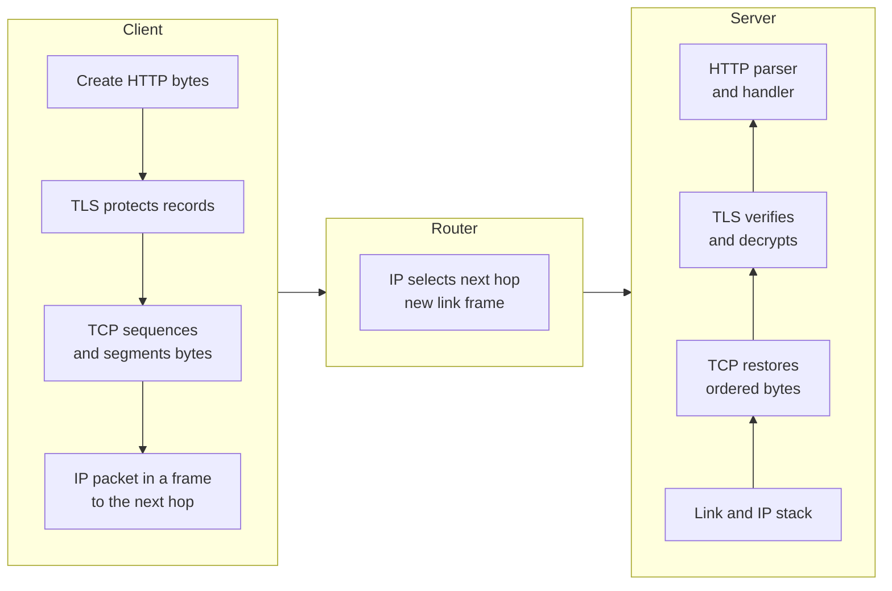
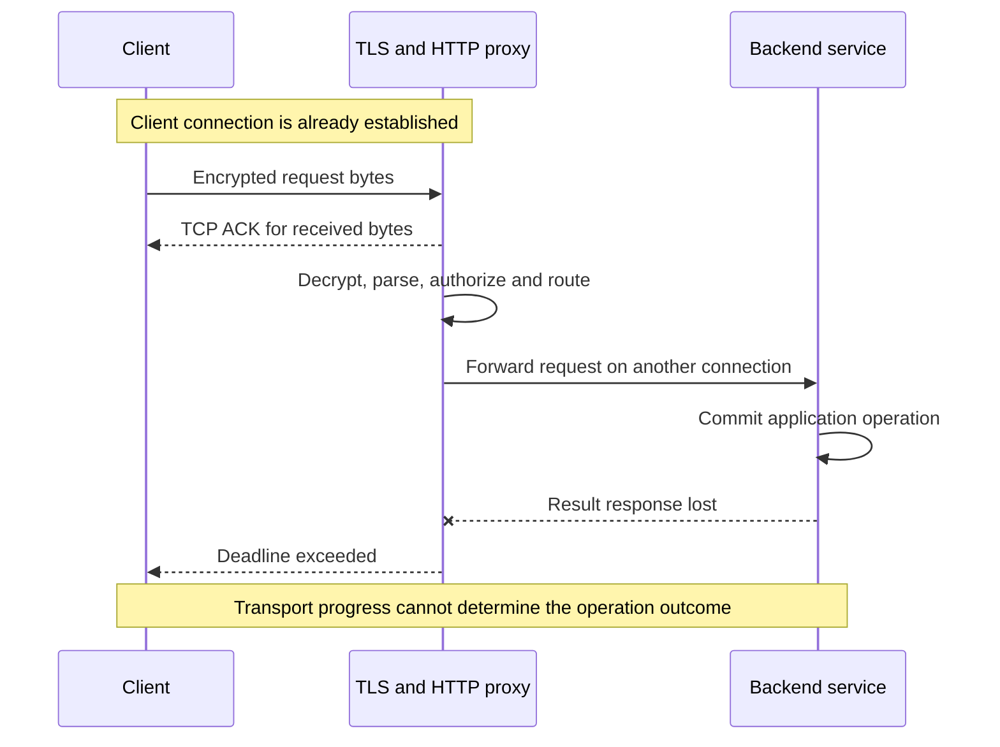
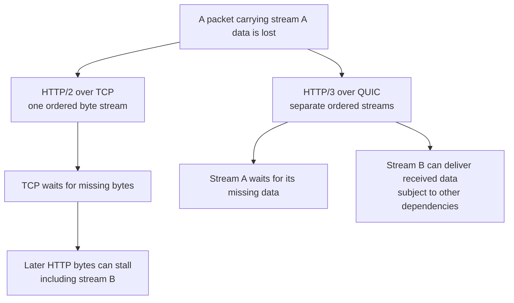

A service works on a developer's laptop. In production, small responses succeed, large responses stall, and a client occasionally retries an operation that the server already completed. The application logs contain a timeout, but they do not identify the failed boundary.

Several mechanisms could explain these symptoms. A tunnel might reduce the maximum packet size. A transport connection might be healthy while its application waits on a database. A proxy might receive the request, forward it on another connection, and lose the response after the operation commits.

OSI and TCP/IP provide a vocabulary for separating these responsibilities. Their practical value is in tracing a request through addressing, delivery, encryption, and application semantics. Each responsibility has different state, different evidence, and different failure behavior.

## Start with one socket and a remote process

The straightforward implementation connects a client to an IP address and port, writes a request, and reads a response. The operating system supplies a networking stack; the application defines the request format.

At small scale, one server and a stable route make this arrangement easy to inspect. A fixed address can avoid a naming dependency. Plaintext on a controlled test network can make messages visible. Neither choice describes the needs of an Internet-facing service.

Growth introduces several independent requirements. Names must survive address changes. Packets must cross networks with different link technologies. Several processes need to share a host. Some messages require reliable delivery, while others are useful only before a short deadline. Sensitive traffic needs authenticated encryption. Proxies add policy and routing, and applications still have to define successful completion.

Trying to put all those responsibilities into one custom protocol makes every application responsible for routing, retransmission, security, and compatibility. Layered protocols allow applications and network infrastructure to change independently, within documented interfaces. That separation has costs: extra headers, buffering, coordination, and occasionally duplicated work.

## Two models, one set of engineering responsibilities

The OSI reference model has seven named layers: physical, data link, network, transport, session, presentation, and application. The [ITU-T X.200 specification](https://www.itu.int/rec/T-REC-X.200-199407-I) describes a conceptual framework for interconnection. It does not require an implementation to contain seven separate processes.

The Internet suite commonly groups responsibilities into link, Internet, transport, and application layers, as introduced in [RFC 1122](https://www.rfc-editor.org/rfc/rfc1122.html). Teaching diagrams sometimes separate physical transmission from the link layer and show five layers. The grouping is a modeling choice.

<div class="table-scroll" role="region" aria-label="OSI and TCP IP responsibility mapping" tabindex="0">

| Responsibility | OSI vocabulary | Practical Internet examples |
| --- | --- | --- |
| Exchange signals and frames over an adjacent link | Physical + data link | Ethernet, Wi-Fi, virtual interfaces |
| Address and forward packets across networks | Network | IPv4/IPv6, routing, ICMP |
| Deliver data between transport endpoints | Transport | TCP, UDP, QUIC transport functions |
| Represent data, manage conversations, and define application behavior | Session + presentation + application | HTTP, DNS, encodings, application sessions; security protocols interact with these functions |

</div>

This table is an approximate comparison. TLS uses handshake and record protocols; QUIC integrates cryptographic and transport state; an HTTP proxy can maintain several connections. Giving each implementation one permanent OSI number often obscures its behavior.

A browser login session, a TCP connection, and a TLS resumption ticket are also different objects. Their names overlap, but their lifetimes and guarantees differ.

## Names, addresses, ports, and next hops

A hostname identifies a name the application intends to contact. DNS supplies records that help choose an address or service endpoint. DNS itself uses network communication and has caches, timeouts, and authentication or privacy choices.

An IP address is used for network-layer addressing. It is not a durable identity for a business service. A virtual service address can direct traffic toward several backends; anycast can advertise an address from several locations; NAT can rewrite addresses.

A port helps a transport endpoint select a listener or associate traffic with a socket. Port 443 does not prove that traffic is HTTP, and the same number can be used independently by TCP and UDP. A TCP connection is identified within its network context by protocol and local/remote address-port pairs. Namespace, routing, and translation state also matter.

A link-layer address, such as an Ethernet MAC address, identifies the next destination on that link. When an Ethernet host sends to a remote subnet, it usually resolves the local gateway's link-layer address, rather than the remote server's MAC address. IPv4 commonly uses ARP; IPv6 uses Neighbor Discovery.

At a conventional router, the ingress frame ends, an IP route chooses an egress next hop, and a new link-layer frame carries the forwarded packet. IP hop count changes; NAT or encapsulation can change other fields. An ordinary router does not have to parse the application's JSON to forward the packet.

## Follow an HTTPS request through the stack

Consider HTTP over TLS over TCP on an Ethernet path. The diagram represents logical transformations. Real implementations can batch, segment, or offload some of them.



*Figure 1. The link boundary changes at the router. The TCP and TLS endpoints in this simplified path remain the client and the destination server.*

HTTP supplies method, headers, and application framing. TLS protects records and authenticates the peer under the chosen trust policy. TCP tracks positions in an ordered byte stream. IP carries packets toward the destination, and each link supplies its own delivery mechanism.

These boundaries are not identical. One application write can span several TCP segments; a receiver can read a request in several pieces or read several messages together. TLS records and IP packets do not define the application's message boundaries. A length prefix, HTTP framing, or another application protocol is still required. The [Linux TCP interface documentation](https://man7.org/linux/man-pages/man7/tcp.7.html) describes this byte-stream interface.

A socket write that succeeds can mean the local stack accepted bytes into a buffer. It does not establish that the remote application processed them. A TCP acknowledgement establishes transport progress at the peer; a business acknowledgement needs a separately defined application response.

### Establishment consumes round trips

For an illustrative path with an 80 ms round-trip time, a conventional new TCP connection takes about one round trip to establish. A full TLS 1.3 handshake generally adds another before ordinary application data, and a request/first-response exchange adds roughly another. About 240 ms of network waiting can therefore precede useful response data, before DNS, processing, loss, and queueing are included.

This is a simplified baseline. Reused connections, resumption, early data, overlapping work, and protocol choices change it. It explains why connection reuse can matter more than saving a few microseconds in a handler.

[TLS 1.3](https://www.rfc-editor.org/rfc/rfc8446.html) also supports early data in some resumed connections, with replay risks. Permit early data only where the operation and its safeguards tolerate replay. Encryption and successful handshaking do not establish business authorization or exactly-once execution.

## Reliability, ordering, and throughput have specific scopes

TCP provides a reliable, ordered byte stream while the connection remains usable. Sequence numbers, acknowledgements, and retransmission recover missing bytes. It can eventually fail; it does not promise a response from a crashed application. The current base specification is [RFC 9293](https://www.rfc-editor.org/rfc/rfc9293.html), published in August 2022 as a consolidation of a much older protocol.

UDP preserves datagram boundaries and adds ports and a checksum mechanism, but supplies no built-in retransmission, ordering, or congestion control. An application can accept those properties, or build a transport protocol above UDP. QUIC takes the latter approach.

Flow control limits a sender according to receiver capacity. Congestion control limits traffic according to the path's estimated capacity and loss or delay signals. In a simplified TCP model, usable in-flight data is bounded by the smaller of the receive window and congestion window. [RFC 5681](https://www.rfc-editor.org/rfc/rfc5681.html) describes classical congestion-control mechanisms.

If only 1 MB can be in flight over an 80 ms RTT, a rough window-limited upper bound is 12.5 MB/s, or 100 Mb/s. A 1 Gb/s path with the same RTT has a bandwidth-delay product of about 10 MB. These decimal-unit calculations assume sustained transfer and ignore protocol overhead and other bottlenecks. They show why link speed alone cannot predict throughput.

Slow application reads can shrink the advertised receive window. Network congestion can shrink the congestion window. CPU saturation, encryption, copy costs, packet-processing limits, and socket queues can constrain throughput further. Each cause requires different evidence.

## A proxy creates another endpoint boundary

The labels L4 and L7 describe decisions and visibility. A packet-based L4 load balancer might translate or forward traffic without terminating the client TCP connection. A TCP proxy accepts one connection and opens another. Both are often called L4 load balancers, despite having different failure boundaries.

An HTTP L7 proxy parses application messages and can route by host, path, or headers. To inspect an HTTPS request, it generally terminates the relevant TLS connection, or receives traffic after another component has done so. An opaque TLS connection does not expose arbitrary HTTP headers.

<div class="table-scroll" role="region" aria-label="Forwarding and proxy boundaries" tabindex="0">

| Mechanism | State and decision | Operational cost |
| --- | --- | --- |
| Packet forwarding or address translation | Routes, packet headers, possibly per-flow translation | Return-path correctness, connection tracking, port capacity |
| TCP proxy | Downstream and upstream transport connections | Buffers, socket limits, independent connection failures |
| HTTP proxy | Parsed requests, streams, routing and policy | Parsing cost, configuration, retries, request-level queues |
| Service mesh | Workload identity plus selected transport/application policy | Certificates, proxy placement, added hops, control-plane operation |

</div>

[Envoy's architecture](https://www.envoyproxy.io/docs/envoy/latest/intro/what_is_envoy) separates network filters from HTTP filters. The mechanism illustrates why a proxy can accept transport connections while its HTTP routes, upstream pools, or authorization policies still prevent useful application work.



*Figure 2. The client's transport peer is the proxy. A timeout can follow a committed backend operation.*

An idempotency key, durable operation record, or status query can let a client reconcile that uncertain outcome. Packet delivery mechanisms cannot replace an application completion contract. Proxy retries also need an attempt budget and knowledge of which operations are safe to repeat.

## HTTP/2 and HTTP/3 move the ordering boundary

HTTP/1.1 commonly uses multiple connections for parallel work. HTTP/2 multiplexes request streams over one TCP connection, reducing the need for separate sockets. A gap in TCP's byte stream can nevertheless hold up delivery of later HTTP/2 bytes for otherwise unrelated requests.

HTTP/3 maps HTTP semantics onto QUIC. The June 2022 [HTTP/3 specification](https://www.rfc-editor.org/rfc/rfc9114.html) explains how stream multiplexing moves into the transport.



*Figure 3. QUIC separates stream delivery ordering. Streams still share connection resources and congestion control.*

QUIC uses UDP as its carrier but supplies reliable streams, loss recovery, congestion control, and connection state. [RFC 9000](https://www.rfc-editor.org/rfc/rfc9000.html), published in May 2021, specifies that transport. A UDP carrier therefore tells us little about the reliability of the complete protocol.

TLS participates directly in QUIC's handshake and packet protection, as specified by [RFC 9001](https://www.rfc-editor.org/rfc/rfc9001.html). Assigning TLS an isolated OSI box fails to describe that implementation.

Stream independence has limits. A packet can carry data for several streams. Streams share congestion control and connection-level flow control, and application scheduling or header-compression dependencies can introduce additional waits. HTTP/3 reduces a particular transport ordering dependency; it cannot remove every cause of latency.

QUIC connection IDs can preserve a connection through some address changes, such as a client's network change or NAT rebinding, after appropriate path validation. They do not preserve application state after its serving process disappears. UDP reachability, load-balancer connection-ID handling, transport CPU cost, and fallback behavior remain deployment concerns.

## Containers add another network inside the network

A container can have its own network namespace, interfaces, addresses, and routes. A service IP can be translated or mapped to a backend. The application may see one address while the physical network sees another.

An overlay can carry an inner workload packet inside an outer host-to-host packet. A simplified VXLAN stack includes outer IP and UDP headers, a tunnel header, and the inner Ethernet/IP/transport payload. The underlay routes the host packet; the inner packet describes the workload conversation.

[Cilium's routing documentation](https://docs.cilium.io/en/stable/network/concepts/routing/) compares encapsulation with native routing. Encapsulation needs ordinary host connectivity and hides workload addressing from the underlay. Native routing avoids that tunnel overhead but requires the network to route workload prefixes. The trade-off moves requirements between the host datapath and network infrastructure.

A 1500-byte underlay IP MTU with a basic IPv4 VXLAN encapsulation commonly leaves about 1450 bytes for an inner IP packet. Cilium documents this 50-byte overhead. Options, outer IPv6, encryption, and additional tunnels can change the budget.

Large packets can reveal a failure that small health checks miss. If a route's usable MTU is smaller than assumed and discovery fails, a transfer can stall after a successful handshake. IPv6 routers do not fragment forwarded packets, as specified in [RFC 8200](https://www.rfc-editor.org/rfc/rfc8200.html). Endpoints and their packet-size discovery mechanisms must accommodate the path.

Packetization-layer discovery can probe successful datagram delivery and adjust the usable size, described in [RFC 8899](https://www.rfc-editor.org/rfc/rfc8899.html). It provides an alternative to depending entirely on returned ICMP size errors. Inspect the exact tunnel and packet path before changing MTU or MSS globally.

## Meaningful developments from 2021 through 2026

The newer mechanisms change where work happens and what operators can observe. They retain the need for addressing, transport state, authentication, and application correctness.

### QUIC and HTTP/3 standardized a different transport arrangement

The 2021 QUIC and 2022 HTTP/3 standards established interoperable protocol contracts after earlier deployment work. HTTP/3 is a standardized option rather than a promise that every workload will improve. Test loss-sensitive latency, UDP filtering, resource consumption, and fallback across the paths that actual clients use.

For high fan-out APIs, an upstream hop can still use HTTP/2 or another protocol even when the client uses HTTP/3. Analyze each leg separately. Converting one leg does not change the ordering or congestion behavior of every dependency.

### eBPF changes packet processing placement

Cilium's [kube-proxy replacement documentation](https://docs.cilium.io/en/stable/network/kubernetes/kubeproxy-free/) describes service handling through eBPF, including socket-level load balancing in relevant configurations. Decisions can be made before the conventional packet path an operator expected to inspect.

This is an existing production implementation, not a requirement for every cluster. Kernel compatibility, map capacity, observability hooks, rollout, and return-path behavior still require testing. The practical lesson is to locate the configured processing hook before assuming that an iptables counter or one packet capture sees every decision.

### Ambient meshes separate transport security and HTTP processing

Istio announced ambient mode's general availability in [version 1.24 on November 7, 2024](https://istio.io/latest/news/releases/1.24.x/announcing-1.24/). Its [data-plane documentation](https://istio.io/latest/docs/ambient/architecture/data-plane/) describes per-node ztunnel proxies for transport security and L4 policy, with waypoint proxies providing selected L7 functions.

Splitting those functions can avoid a full application-aware sidecar beside every workload. It also changes the sharing and failure scope of proxies. Engineers must identify which hop handles workload identity, which handles HTTP policy, and which resources are shared across workloads. The protocol boundary survives a change in proxy placement.

### ECH changes passive handshake visibility

[TLS Encrypted Client Hello, RFC 9849](https://www.rfc-editor.org/rfc/rfc9849.html), was published in March 2026. It protects an inner ClientHello, including sensitive fields such as the requested server name, under the specified deployment conditions.

Packet inspection can no longer assume that the real requested name appears in a readable handshake. ECH does not conceal destination IPs, traffic timing, or every naming leak; its privacy depends on the broader deployment. Standardization does not establish universal deployment. Routing and debugging should use supported endpoint signals and authorized logs instead of depending on plaintext handshake fields.

## Failure scenarios and the evidence to collect

<div class="table-scroll" role="region" aria-label="Networking failures and diagnostic evidence" tabindex="0">

| Symptom | Plausible boundary | Evidence and response |
| --- | --- | --- |
| Name lookup fails while a known address works | DNS resolution or cache | Compare resolver answers, TTLs, negative caching, and resolver reachability |
| TCP connection times out | Routing, policy, listener, or congestion | Inspect SYN progress, routes, firewall/conntrack state, and listener queues |
| TCP connects but TLS fails | TLS endpoint or trust policy | Check certificates, identity, protocol negotiation, clocks, and termination hop |
| Small responses work but large ones stall | Path MTU or size-sensitive filtering | Inspect tunnel overhead, MSS, ICMP size errors, and packet-size probes |
| Transport is connected but first byte is slow | Proxy queue, server queue, or dependency | Correlate request traces with pool waits, saturation, and upstream timing |
| Existing connections work but new ones fail | Ports, connection tracking, backlog, or limits | Measure new-connection rate, state occupancy, timeouts, and file descriptors |
| A server commits but the client times out | Response path or deadline | Reconcile using application identity and operation records before retrying |
| One zone or network path fails | Routing and failure-domain placement | Isolate the path, preserve connection state where possible, and drain or fail over with tested semantics |

</div>

A successful ping proves only that a particular ICMP exchange succeeded. It does not test an HTTP route, a TLS certificate, a UDP path, or an overloaded listener. Some networks block probes while serving application traffic; others allow probes while blocking the application's port.

A TCP reset can come from a peer, a proxy, or a device along the path. A silent drop provides less evidence than an explicit rejection. Capture location, namespace, direction, and time are part of every observation.

Retries can turn a partial failure into overload. If 20,000 logical requests/s each cause two additional attempts, the system can receive 60,000 attempts/s. This illustrative calculation ignores timing and backoff, but exposes the amplification. Use operation-aware retries, backoff with jitter, deadlines, admission limits, and a shared understanding of who owns the retry budget.

## Scale the bottleneck that is actually present

One server mainly exposes listener capacity, socket state, and application execution. Adding servers requires a distribution mechanism and introduces connection draining during replacement.

At larger scale, request rate and connection rate become separate capacity dimensions. A service can handle many requests on reused connections but struggle with frequent TLS handshakes. An HTTP/2 connection can contain many active requests while consuming one transport connection. Pooling reduces establishment work but concentrates failures and can create queueing behind shared limits.

Multi-cluster deployment adds routing, tunnels, policy, and identity distribution. It creates more observation points and more shared components. Moving every network decision into a service mesh can be unnecessary if the required policy can be enforced at a smaller set of boundaries.

Global deployment introduces distance and independent regional failures. A nearby edge helps only the part of the path it actually serves. An edge that must synchronously wait for a distant origin still incurs that origin's round trip. Geographical routing does not by itself change database consistency or operation durability.

Connection state makes failover different from moving a stateless request. A new destination generally cannot inherit an old TCP connection merely because DNS points there. QUIC migration also requires a compatible endpoint retaining the required state. Preserve or drain established connections where the design supports it, and define how clients reconcile interrupted operations.

## Observe the complete request path

Record DNS, connection establishment, TLS, pool acquisition, first-byte, and total timing separately. Monitor retransmissions, RTT, bytes in flight, flow-control stalls, interface drops, packet rate, listener queues, connection-tracking occupancy, proxy errors, and dependency latency.

Correlate request IDs across proxy boundaries, but protect credentials and sensitive payloads. A packet capture of encrypted traffic supplies transport evidence, while authorized endpoint traces supply application context.

A small command can expose several client-side timing boundaries. Use an endpoint you own; the reserved example hostname below is a placeholder:

```bash
network_probe_url="https://service.example/health"
curl --http1.1 -sS -o /dev/null \
  -w 'dns=%{time_namelookup} connect=%{time_connect} tls=%{time_appconnect} first_byte=%{time_starttransfer} total=%{time_total}\n' \
  "$network_probe_url"
```

The [curl timing documentation](https://curl.se/docs/manpage.html) defines these values as elapsed timestamps from the start of the operation. For a straightforward fresh HTTPS connection without an intervening proxy, differences help estimate connection and TLS phases. The command reports total timings, not server CPU time. Resolution, multiple address attempts, proxy configuration, and reused connections can change the interpretation.

Host captures may also show large packets or apparent checksum problems caused by offloads. A capture before segmentation or checksum completion differs from bytes observed on the physical link. Verify the observation point before treating it as evidence of malformed wire traffic.

During a rollout, compare protocol versions, client networks, new and reused connections, and small and large payloads. Canary a datapath change across a limited failure domain. Keep a rollback plan that accounts for live connections, routing state, and certificate validity; replacing configuration does not rewind a committed application operation.

## Practical mistakes that layer labels can hide

“TLS is layer 6” can serve as a classroom association, but it does not identify the process that holds keys or the peer that is authenticated. “L4 load balancer” does not identify whether TCP terminates there. “UDP is unreliable” describes the carrier's missing guarantees while omitting protocols built above it.

Likewise, TCP reliability does not imply reliable business completion. Port numbers do not authenticate a service. A faster link does not eliminate congestion, flow-control limits, or distant acknowledgements. A healthy overlay says little about an origin's authorization or database queue.

Use labels to organize an investigation, then replace each label with the actual mechanism, state owner, and success condition.

## Choose boundaries before choosing tools

A senior engineer traces the failing operation and identifies the measurement that distinguishes competing causes. A Staff or Principal engineer also examines ownership, shared failure domains, migration, policy placement, and operational burden.

Before adopting a new proxy, tunnel, or transport, specify which requirement it satisfies. Estimate its added connection state and packet or handshake work. Identify how it fails, who can inspect it, and how a mixed-version rollout will behave. Test the real path under loss, constrained capacity, large payloads, and component replacement.

For each hop, write down the endpoint, address translation, state owner, and meaning of an acknowledgement. Separate the scope of confidentiality from the scope of transport reliability and the application's completion contract. During the next timeout, these recorded boundaries determine which evidence to collect and whether retrying can repeat an already completed operation.

## Further reading

- [ITU-T X.200: OSI basic reference model](https://www.itu.int/rec/T-REC-X.200-199407-I). The original reference framework explains why functional layers do not dictate an implementation's internal structure.
- [RFC 1122: Internet host communication layers](https://www.rfc-editor.org/rfc/rfc1122.html). The foundational Internet-suite model supplies the link, Internet, transport, and application vocabulary.
- [RFC 9293: TCP](https://www.rfc-editor.org/rfc/rfc9293.html). The consolidated TCP specification defines the transport's byte-stream and connection semantics.
- [RFC 8446: TLS 1.3](https://www.rfc-editor.org/rfc/rfc8446.html). Read the handshake, authentication, and early-data replay sections to understand the security boundary.
- [RFC 9000: QUIC](https://www.rfc-editor.org/rfc/rfc9000.html). This specifies stream delivery, loss recovery, flow control, and connection migration.
- [RFC 9114: HTTP/3](https://www.rfc-editor.org/rfc/rfc9114.html). The mapping of HTTP onto QUIC explains which responsibilities moved below HTTP framing.
- [RFC 8899: Datagram packetization-layer MTU discovery](https://www.rfc-editor.org/rfc/rfc8899.html). Its probing and black-hole handling provide concrete mechanisms for size-sensitive path failures.
- [Envoy architecture](https://www.envoyproxy.io/docs/envoy/latest/intro/what_is_envoy). Network and HTTP filters demonstrate distinct transport and application processing boundaries.
- [Cilium routing](https://docs.cilium.io/en/stable/network/concepts/routing/). The overlay/native-routing comparison makes underlay requirements and MTU overhead explicit.
- [Cilium kube-proxy replacement](https://docs.cilium.io/en/stable/network/kubernetes/kubeproxy-free/). This shows how service decisions can occur at eBPF hooks rather than the expected conventional packet path.
- [Istio ambient data plane](https://istio.io/latest/docs/ambient/architecture/data-plane/). Its transport-security and waypoint responsibilities illustrate a change in proxy placement.
- [RFC 9849: TLS Encrypted Client Hello](https://www.rfc-editor.org/rfc/rfc9849.html). The March 2026 standard explains what handshake information can be protected and the limits of that protection.

*Source review: October 13, 2026. Numerical scenarios are illustrative; dated releases and protocol claims are linked to primary sources.*
