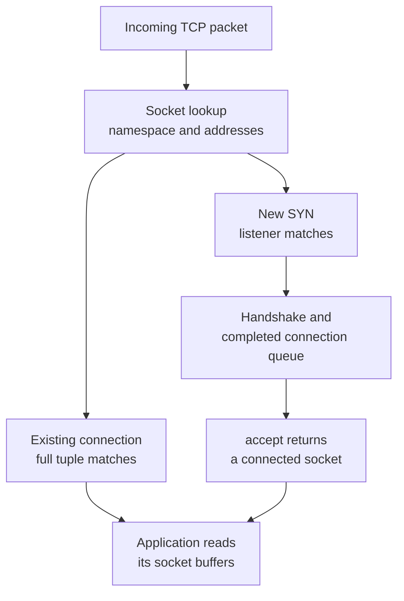
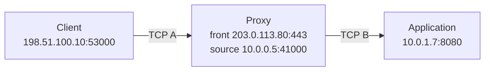
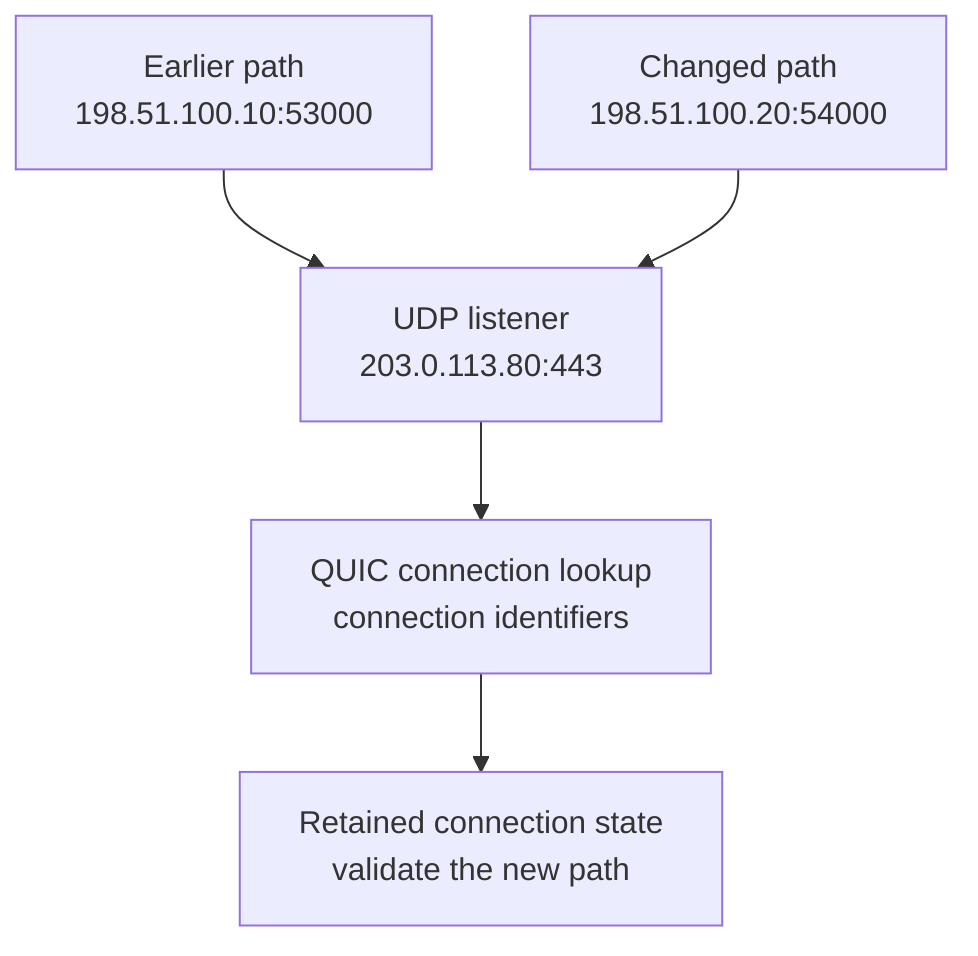

A server runs a website, a database, and a monitoring agent on one IP address. An arriving IP packet identifies the machine, but the machine still needs to deliver its contents to the right communication endpoint. Giving every application a separate machine would work, at a considerable cost. Giving every application its own IP address reduces the ambiguity but still couples application deployment to address allocation.

Transport ports let applications share an address. That small field also becomes part of connection identity, operating-system resource allocation, proxy behavior, and production capacity. A server can serve hundreds of thousands of TCP connections through one listening port, while an outbound proxy can run out of usable source ports with spare CPU and bandwidth. Both statements follow from the same rules.

This article builds on [IP Addresses in Production](/field-notes/ip-addresses-in-production/) and complements [NAT: Addresses, Ports, and Connection State](/field-notes/nat-addresses-ports-and-connection-state/). Examples use loopback, private addresses, and documentation ranges. The public-looking example addresses are not services to contact.

## From one IP address to several applications

TCP and UDP headers each carry a source port and a destination port. A port is a sixteen-bit number, giving 65,536 possible values from zero through 65,535. The receiving system uses transport information together with addressing and local socket state to decide where traffic belongs. IP routing gets a packet toward an address; transport demultiplexing distinguishes communication endpoints there.

A useful endpoint description includes the transport protocol, IP address, and port. `203.0.113.80:443/TCP` and `203.0.113.80:443/UDP` are different endpoints. Opening the TCP listener does not establish UDP service. HTTP over TCP and HTTP/3 over QUIC can therefore use the same numeric port while following different transport paths.

Port numbers have conventions rather than an intrinsic application meaning. The [IANA registry](https://www.iana.org/assignments/service-names-port-numbers/service-names-port-numbers) divides them into System Ports, 0–1023; User Ports, 1024–49151; and Dynamic/Private Ports, 49152–65535. These are registration categories. They do not force an operating system's temporary allocation range to match the dynamic/private category.

The registry also does not certify the traffic. A packet addressed to port 443 could contain something other than HTTPS. Encryption, peer identity, authentication, and authorization need their own checks. Moving an administrative service to an unusual number may reduce incidental noise, but does not make it private.

## The first implementation: bind and listen

The basic TCP server creates a socket, binds a local address and port, puts the socket into listening state, and accepts connections. A socket is an operating-system communication object. A file descriptor is a process's handle to that object. The integer descriptor and the transport port number serve different purposes.

An application binding `127.0.0.1:8080` is reachable through local loopback. Binding `0.0.0.0:8080` generally requests all local IPv4 addresses in that network namespace. That wider bind can accidentally expose an interface that the developer never tested. Firewall and routing policy still affect reachability.

Binding port zero asks the local socket API to choose a suitable port; the application reads the assigned address with `getsockname()`. This is useful for tests and dynamically registered services. It is not a request that clients connect to literal port zero. The [Linux IPv4 socket documentation](https://man7.org/linux/man-pages/man7/ip.7.html) describes these address and automatic-binding behaviors.

An outbound TCP client can usually call `connect()` without selecting its own source port. The kernel chooses a local address according to routing and an available ephemeral port according to its allocation rules. The destination remains the service's address and port. Clients consequently need temporary source-endpoint capacity as well as a route to the service.

Binding failures are meaningful. An address may already be in use, the requested source address may not exist in the namespace, or policy may deny a low-numbered port. On Linux, the privileged-port threshold is configurable per network namespace; do not assume every container uses the host's default threshold. Prefer a narrowly scoped capability or an unprivileged application port behind an approved front end over running the entire service with broad privileges.

## One listener, many TCP connections

Consider three connections arriving at one server:

<div class="table-scroll" role="region" aria-label="TCP connections sharing a listening port" tabindex="0">

| Connection | Client endpoint | Server endpoint |
| --- | --- | --- |
| A | `198.51.100.10:51000` | `203.0.113.80:443` |
| B | `198.51.100.10:51001` | `203.0.113.80:443` |
| C | `198.51.100.11:51000` | `203.0.113.80:443` |

</div>

The server's local endpoint is identical in all three rows. Their remote endpoints distinguish them. Within the relevant protocol, address-family, and network-namespace context, a TCP connection is identified by its local IP, local port, remote IP, and remote port: the four-tuple. Adding the transport protocol gives the familiar five-tuple used in many packet and flow tools.

[RFC 9293](https://www.rfc-editor.org/rfc/rfc9293.html), the TCP specification published in August 2022, describes connection identification and state. Accepting a connection does not allocate a new server port. The accepted socket keeps the listener's local endpoint and gains the particular remote endpoint and connection state. It has its own buffers, sequence-space tracking, timers, and congestion-control state.



*Figure 1. Listening and established sockets have different lookup roles. The diagram shows the conceptual dispatch path, rather than a promise about a particular kernel's exact lookup order.*

Implementations can maintain indexes for established connections and listeners instead of scanning every process. Listener matching considers binding scope; established lookup uses the connection identity. Kernel fast paths and programmable hooks can change where those lookups happen. There is no process ID in an ordinary TCP header.

Connection establishment and application acceptance are also separate. The kernel can complete a handshake before the process calls `accept()`. Conceptually, a server must handle incomplete handshakes and completed connections awaiting application acceptance. If the application stops accepting, successful handshakes can accumulate until queue policy causes delay or failure. An open listening socket does not establish that the application can process another request.

Closing only the listening socket does not itself close already accepted sockets. A process crash that closes its connected descriptors is a different event. Starting a replacement listener on the same number cannot recover the old application's in-memory request state.

### A small experiment with real sockets

This Python example uses only local loopback. It opens several client connections, accepts them, and prints their endpoints. Every accepted socket has the same local port as the listener. The remote ports differ. The operating system supplies all port numbers; the printed values change between runs.

```python
from contextlib import ExitStack
import socket


def main(connection_count=2):
    if connection_count <= 0:
        raise ValueError("connection_count must be positive")

    with ExitStack() as stack:
        listener = stack.enter_context(socket.socket(socket.AF_INET, socket.SOCK_STREAM))
        listener.settimeout(3)
        listener.bind(("127.0.0.1", 0))
        listener.listen(connection_count)
        address = listener.getsockname()

        # The kernel can complete handshakes before the application accepts.
        clients = [stack.enter_context(socket.create_connection(address, timeout=3))
                   for _ in range(connection_count)]
        accepted = [stack.enter_context(listener.accept()[0]) for _ in clients]

        print(f"Listener: {address}")
        for index, server_socket in enumerate(accepted, start=1):
            print(f"Connection {index}: local={server_socket.getsockname()}, "
                  f"remote={server_socket.getpeername()}")

        # Separate descriptors and connections share the listener's port.
        assert all(item.getsockname() == address for item in accepted)
        assert len({item.getpeername() for item in accepted}) == connection_count


if __name__ == "__main__":
    main()
```

The example is deliberately small. A production server needs bounded connection admission, error handling, and a concurrency model for servicing accepted connections. Increasing the count here is not a benchmark or a recommendation to accumulate connections without reading them.

## A port belongs to a networking context

One process can own multiple sockets, several processes can share a socket through inherited or transferred descriptors, and different sockets can participate in permitted address-sharing arrangements. The slogan “one port belongs to one process” loses those distinctions.

[Linux network namespaces](https://man7.org/linux/man-pages/man7/network_namespaces.7.html) isolate network interfaces, protocol stacks, routes, firewall rules, and socket port spaces. Two isolated namespaces can each run a service on local port 8080. They still need distinct reachable endpoints or an explicit forwarding rule when exposed through a common host.

Kubernetes containers in the same Pod normally [share its network namespace and IP address](https://kubernetes.io/docs/concepts/workloads/pods/#pod-networking). A sidecar and the main application cannot both create unrelated ordinary TCP listeners on the same overlapping local endpoint. Separate Pods can each listen on port 8080 because their Pod addresses and network contexts distinguish them. `hostNetwork` changes that isolation and brings host-level collisions back into consideration.

Address-family behavior can also surprise operators. An IPv6 wildcard listener may accept IPv4-mapped connections depending on its [`IPV6_V6ONLY` setting](https://man7.org/linux/man-pages/man7/ipv6.7.html) and platform configuration. A separate IPv4 listener may consequently collide with it. Check the effective bind addresses and family settings instead of diagnosing the number alone.

UDP has different socket behavior. A bound UDP socket can receive datagrams from many remote endpoints and can report each sender through `recvfrom()`. Calling `connect()` on a UDP socket selects a peer and affects local delivery behavior; it does not perform TCP's handshake. Multiple UDP sockets and reuse options need protocol-specific reasoning. TCP port-allocation assumptions cannot be copied unchanged into a UDP client.

## Ephemeral ports are a destination-sensitive resource

An ephemeral port is a locally selected temporary port, commonly used for an outbound connection. “Temporary” does not mean short-lived: an outbound connection can remain active for hours.

The [Linux IP sysctl documentation](https://www.kernel.org/doc/html/latest/networking/ip-sysctl.html) gives default `ip_local_port_range` endpoints of 32768 and 60999. That inclusive interval contains **28,232** values. Distribution settings, reserved ports, existing bindings, and allocation rules determine the usable set. Read the actual configuration in the application's namespace.

For ordinary unbound TCP `connect()`, a source IP and port can be shared across connections to different remote endpoints when the resulting four-tuples remain distinct and the kernel permits that allocation. Repeating the same source endpoint against the same remote IP and port cannot create a second simultaneous connection with an identical four-tuple.

This explains why outbound traffic concentrated on one dependency can exhaust source capacity before a more diverse workload does. It also explains why a server's inbound connection count is not capped at 65,535: accepted connections reuse its listening port and arrive from many remote endpoints. File descriptors, memory, queueing, processing, and the available tuple space still impose limits.

Suppose one source address repeatedly connects to one remote endpoint. For an illustrative steady-state calculation, let `λ` be new connections per second, `D` their mean active lifetime, and `T` the effective extra time their tuples remain unavailable for reuse:

```math
C \approx \lambda(D+T).
```

At **500 new connections/s**, **20 seconds** active, and **40 seconds** of additional retention, the estimate is **30,000 occupied slots**. This exceeds the illustrative 28,232-port interval even though only 10,000 connections are active at once. The retention is a workload assumption, not a recommended TCP timer. Different close directions, failures, and kernel reuse policies change the effective hold time.

At the same assumed sixty-second total hold time, reserving twenty-five percent of the interval for headroom gives an approximate planning ceiling:

```math
\lambda_{\mathrm{plan}} \leq \frac{0.75P}{D+T}.
```

With `P = 28,232`, this is about **353 new connections/s**. That calculation does not establish an operating system's measured throughput. It locates a possible capacity constraint and provides a reason to investigate connection churn.

Pooling changes the demand. At 10,000 requests/s, one connection per request creates 10,000 connection attempts/s. Reusing each connection for one hundred requests reduces that simplified rate to one hundred connections/s. Multiplexing can reduce demand further, subject to peer stream limits and application behavior. Long-lived connections retain memory and can concentrate failures, so bound pool size, idle lifetime, and reconnection rate.

Adding source addresses can expand a constrained allocation domain when routing and application configuration actually use them. Adding application replicas behind the same narrow source pool may only create more contention. A shared NAT introduces another allocation boundary; increasing the client's local range does not enlarge that translator's budget. [The NAT article](/field-notes/nat-addresses-ports-and-connection-state/) works through that separate state and return path.

## Binding policy can change the allocation limit

Cloudflare's [February 2, 2022 engineering article](https://blog.cloudflare.com/how-to-stop-running-out-of-ephemeral-ports-and-start-to-love-long-lived-connections/) examines a subtle production issue: selecting a source address with `bind(source_ip, 0)` before `connect()` can reserve the local address/port pair too early. That can remove the cross-destination sharing available to ordinary TCP `connect()`.

The application needed source-address selection, but the API call also changed port reservation. Linux's `IP_BIND_ADDRESS_NO_PORT` option can defer allocation until connection time while retaining source-address selection. The option predates the article: Cloudflare dates its introduction to 2015. This is an established mechanism examined in a recent operational account, rather than a newly invented 2022 feature.

The general lesson is to inspect what the binding API reserves. A wrapper library, proxy setting, or explicit source-address feature can change capacity without changing the remote services. The option is Linux-specific and is not a universal fix for UDP or a license to reuse an identical active TCP four-tuple.

## Sharing listeners and choosing a front end

The classical scaling choices include one listener with multiple accepting workers, an accepting process that distributes connected descriptors, and multiple listener sockets that share an endpoint under supported reuse rules. These arrangements distribute work within a host. None makes one application request cheaper to process.

On Linux, `SO_REUSEADDR` and `SO_REUSEPORT` have different contracts. The former adjusts address-reuse checks; it does not generally authorize unrelated live listeners on the same endpoint. The latter, available since Linux 3.9, supports a group of sockets bound to an identical endpoint when the required options and ownership checks are satisfied. The [socket documentation](https://man7.org/linux/man-pages/man7/socket.7.html) also describes BPF-assisted selection within a reuseport group.

This gives a server another way to distribute incoming work. Hash-based selection can still produce uneven application load, and existing connection ownership constrains rebalancing. A reuseport group does not copy a failed worker's protocol or application state into a replacement process. Custom selection introduces compatibility, testing, and observability work; shared-listener designs can remain easier to operate.

A reverse proxy changes the boundary more substantially. It accepts a client connection and opens or reuses a separate upstream connection:



*Figure 2. The front-end port can remain stable while backend placement changes. The upstream source port belongs to the proxy's own outbound capacity budget.*

The proxy can centralize TLS termination, routing, authentication integration, limits, and connection pooling. It also adds a hop, buffers, configuration, and another failure domain. TLS termination depends on configuration; simply forwarding a port does not imply decryption.

Destination NAT or a forwarding rule is a different mechanism: it can rewrite an endpoint while preserving one end-to-end transport connection. A listening-process proxy has two transport legs. Diagnosing the wrong model leads to incorrect assumptions about client addresses, idle timers, source-port pressure, and which component can drain a connection.

Multiple services can share a public HTTPS endpoint when an application-aware gateway routes by suitable metadata, such as an HTTP authority/path or supported TLS information. That requires the appropriate termination or inspection and policy. A generic TCP listener cannot discover the desired backend merely because several applications all prefer port 443.

## Kubernetes adds another port mapping layer

Kubernetes separates a stable Service endpoint from the Pod endpoint that currently serves it. An illustrative NodePort Service might expose:

```yaml
apiVersion: v1
kind: Service
metadata:
  name: catalog
spec:
  type: NodePort
  selector:
    app: catalog
  ports:
    - name: http
      protocol: TCP
      port: 443
      targetPort: 8080
      nodePort: 30443
```

Here `port: 443` names the Service port, `targetPort: 8080` selects the backend port, and `nodePort: 30443` requests a node-level exposure. These numbers do not turn the backend's protocol into HTTPS. The example needs actual matching Pods, a listening application, supported forwarding, and access policy before it serves traffic. Declaring `containerPort` in a Pod specification does not create that application's socket or automatically publish it outside the cluster.

The [Service documentation](https://kubernetes.io/docs/concepts/services-networking/service/) describes endpoint selection and port mapping. Depending on the datapath, a Service address can work without a user process listening on that virtual address in `ss`. Configuration state, packet processing, and application socket state are separate things.

Troubleshoot each boundary: client-to-Service reachability, selected endpoints, the Pod's actual listener, and the protocol the application expects. A Service selecting no ready endpoints cannot be repaired merely by changing its public port. A process bound only to Pod loopback will not necessarily accept traffic sent to the Pod IP.

Namespaces and virtual endpoints reduce accidental collisions and simplify placement, but they add indirection. Node-level exposure, host networking, sidecars, reserved ranges, and outbound SNAT can still share capacity or policy boundaries. Record the actual path before changing allocation settings.

## Failure scenarios: locate the failed allocation or lookup

<div class="table-scroll" role="region" aria-label="Port and socket failure scenarios" tabindex="0">

| Observation | Possible failure | Investigation and response |
| --- | --- | --- |
| `bind()` reports `EADDRINUSE` | Conflicting listener, wildcard/family overlap, or unavailable local endpoint | Inspect protocol, bind address, namespace, reuse settings, and socket state |
| A low-port bind is denied | Capability or configured privileged-port policy | Check the effective namespace policy and grant only the required access |
| New outbound TCP connects report `EADDRNOTAVAIL` | Unusable source address or exhausted tuple allocation | Verify source-address validity, destination concentration, ephemeral range, and churn |
| Socket creation or acceptance reports `EMFILE` | Process descriptor limit | Inspect descriptors and leaks; changing the port range will not resolve that limit |
| Connection is refused | No reachable listener or an explicit reject | Inspect the destination process and policy; a reset does not identify the application cause by itself |
| Connection times out | Dropped packets, routing failure, full queues, or an unresponsive path | Trace both directions and inspect queue and drop counters |
| Handshakes succeed while requests stall | Accept/read workers or downstream work are overloaded | Check accept delay, application queues, read progress, and dependency latency |
| Restarting the process breaks clients | Connected socket or application state disappeared | Drain traffic and define retry behavior; reusing the port does not restore a session |
| UDP packets disappear | No receiver, filtering, receive-buffer overflow, or return-path failure | Inspect datagram drops and both endpoint contexts; do not infer TCP-like liveness |

</div>

Error names here describe common Linux cases, not an exhaustive portable mapping. In particular, port exhaustion can surface differently for explicit binding, ordinary connection establishment, and UDP. A timeout also cannot prove that an application operation was never executed; retries still need the appropriate application-level idempotency contract.

`TIME_WAIT` is another frequent source of misdiagnosis. It is a normal TCP state associated with connection closing and protection against old traffic being mistaken for a new incarnation. The endpoint performing the active close commonly retains it; it need not be the client. High counts can reveal churn without indicating a leak. Identify the constrained tuples and close behavior before changing reuse or timer settings. Removing a safety check can trade a visible capacity problem for harder-to-diagnose correctness failures.

Deployment creates partial failures too. Updating a Service, load balancer, or firewall does not update every forwarding decision at the same instant. New connections may reach an old worker while the application is already shutting down. Coordinate readiness removal, propagation time, listener shutdown, and connected-session draining. Avoid killing every old pool connection at once, which can produce a synchronized reconnect spike against the next allocation boundary.

## Operate the endpoint, the queues, and the allocation pool

The first diagnostic step is to enter the right host or network namespace. A command run on the node can show different sockets and configuration from a command inside the Pod. Ownership information can also be hidden by permissions.

These read-only Linux commands illustrate the investigation; they are not instructions to change host configuration:

```sh
# TCP listeners and process information where permission allows.
ss -lntp

# UDP bound sockets and process information.
ss -lnup

# Connected TCP sockets and TIME_WAIT state.
ss -ntp state established
ss -nt state time-wait

# Kernel socket memory and connection counters.
ss -s

# Effective allocation and privilege settings in this namespace.
sysctl net.ipv4.ip_local_port_range
sysctl net.ipv4.ip_local_reserved_ports
sysctl net.ipv4.ip_unprivileged_port_start
```

The [`ss` manual](https://man7.org/linux/man-pages/man8/ss.8.html) explains filters and fields. Listener queue fields and connected-socket queue fields have different interpretations. A TCP socket reaching `ESTABLISHED` demonstrates transport progress; a separate application-level probe is needed for readiness.

Measure bind/connect/accept failures by operation and error, connection creation rate, connection lifetime, pool occupancy, accept delay, socket memory, retransmissions, receive drops, and pending handshakes. Break down outbound allocation pressure by source pool and high-volume destination. Total open-socket count alone cannot identify a hot-destination limit.

Bound telemetry cardinality. Per-client ephemeral ports generate a large number of short-lived labels. Keep full tuples in sampled traces or controlled diagnostics, and aggregate metrics by service, allocation domain, and an appropriate destination grouping. Captures and socket ownership data can expose sensitive infrastructure information, so restrict access and retention.

Change configuration with a baseline and a rollback plan. A larger ephemeral interval can overlap manually assigned application ports; account for reserved exclusions and forwarding policy. More accepted sockets consume memory and descriptors even when port identity is valid. At an illustrative 32 KiB of associated buffering per connection, one hundred thousand connections represent about 3.28 GB before other state. This is arithmetic for planning, not a measured kernel allocation size.

## Changes from 2021 through 2026

Several developments change where port-based decisions happen without increasing the width of the TCP or UDP port fields.

**QUIC and HTTP/3.** [RFC 9000, published in May 2021](https://www.rfc-editor.org/rfc/rfc9000.html), standardizes QUIC over UDP, with connection identifiers and path-validation mechanisms. [RFC 9114, published in June 2022](https://www.rfc-editor.org/rfc/rfc9114.html), specifies HTTP/3. One transport connection can carry multiple application streams. A single lost packet need not block delivery on an unrelated QUIC stream, although shared congestion control and resource limits still matter.

QUIC also separates connection continuity from a permanently fixed observed address/port tuple. Supported migration or NAT rebinding can change that tuple while connection identifiers help the endpoint find retained connection state. Validation and routing must still reach the correct owner; an arbitrary new source address is not automatically trusted.



*Figure 3. The two source endpoints illustrate a path change over time. They are not a promise that a connection survives a failed server or an unsupported migration.*

QUIC and HTTP/3 are published standards. Their deployment still requires UDP policy, endpoint support, and load-balancer behavior compatible with connection ownership. A TCP-only rule for port 443 does not provide UDP reachability. The connection identifier is additional protocol information, not a replacement for transport ports or access control.

**Kubernetes allocation policy.** The project documented its NodePort static/dynamic allocation split in [May 2023 for Kubernetes 1.27](https://kubernetes.io/blog/2023/05/11/nodeport-dynamic-and-static-allocation/). The current Service documentation describes two bands: dynamic allocation starts in the upper band, reducing collisions with deliberate assignments in the lower band. Exhaustion can still cause fallback into the lower band. For the default range, the documented lower band is 30000–30085. This is an allocator policy, not a change to transport connection identity or a guarantee that a chosen port is free.

**Programmable service lookup.** As documented in November 2026, [Cilium's socket load balancer](https://docs.cilium.io/en/stable/network/kubernetes/kubeproxy-free/) can select a backend at socket operations such as TCP `connect()`, so the kernel socket connects to the backend rather than requiring a later Service-address packet rewrite. The documentation also provides a bypass for paths needing the original virtual address, including some sidecar arrangements.

This is a concrete implementation choice, not a claim that socket-level service lookup originated in 2026. It changes where an engineer must observe the translation. A packet capture at only one location may miss the logical Service endpoint the application requested. BPF programs and maps add deployment and state-management responsibilities; removing a traditional proxy component does not remove service-selection state.

Cloudflare's 2022 investigation above supplies a complementary lesson: a well-established socket API can still become a production bottleneck under a changed workload. Custom BPF steering, alternative allocation policies, and aggressive timer tuning should be evaluated separately from protocol support. Test their failure behavior in the actual kernel, CNI, and deployment configuration instead of treating them as a universal next step.

## Compare the boundary each approach introduces

<div class="table-scroll" role="region" aria-label="Architectural choices for port sharing and connection capacity" tabindex="0">

| Approach | Main benefit | Cost or limitation | Suitable situation |
| --- | --- | --- | --- |
| Direct application listener | Few components and a short path | Application owns exposure, TLS integration, limits, and rollout behavior | A bounded service with manageable endpoint configuration |
| Shared listener or reuseport group | Several local workers can receive traffic | Queueing, selection skew, and worker state still need management | One host has an accepting or CPU-distribution bottleneck |
| Reverse proxy with upstream pools | Stable ingress, routing, and centralized policy | Another hop and an outbound allocation/memory budget | Several backends need a controlled public endpoint |
| Service virtual endpoint | Stable discovery across changing instances | Datapath and endpoint propagation add indirection | Orchestrated replicas need location-independent access |
| Persistent connections and multiplexing | Fewer new connections and handshakes | Shared connection failures, stream limits, and load distribution | Connection churn is the measured bottleneck |
| More source addresses or isolated pools | More allocation capacity or smaller failure domains | Routing, allowlists, cost, and downstream NAT limits | A confirmed source-allocation boundary is exhausted |

</div>

A local Unix-domain socket is another option when both participants live on the same machine and deployment model supports it. It avoids an IP transport port, but adds its own filesystem or namespace access rules and does not provide remote connectivity. A new distributed discovery system is unnecessary if a stable local endpoint already satisfies the requirement.

## How Senior and Staff engineers reason about the choice

The useful scaling unit depends on the failure. A listener-queue bottleneck suggests examining acceptance and request admission. A source-port bottleneck suggests examining new-connection rate, destination concentration, and binding policy. A descriptor or memory bottleneck suggests examining socket lifetime and per-connection resources. Adding replicas addresses these only when it expands the constrained domain.

At fleet scale, ownership and migration become central. A port change affects clients, discovery, proxies, health checks, policies, dashboards, and rollback compatibility. During a transition, serve or route both endpoints where appropriate, move consumers, verify old-connection drain, and retire the old endpoint deliberately. An arbitrary port change is not a neutral configuration edit when partner allowlists or embedded device clients depend on it.

Global traffic adds placement decisions. Geographic routing can choose a region for a new connection, but moving established TCP state between regions requires more than advertising the same IP and port. QUIC migration also depends on retained endpoint state and supported routing. State the recovery contract: preserved session, reconnect with application recovery, or a bounded interruption. Then test the intended failure domain.

Prefer the smallest mechanism that addresses the measured constraint. Shared listeners, additional ports, more addresses, a proxy, and application multiplexing change different parts of the system. Their operational burden is justified by a specific capacity, exposure, or ownership requirement.

## A working model

Treat a port as one coordinate of an endpoint. Follow that endpoint through its transport protocol, address, namespace, and any forwarding or proxy boundary. Then locate the socket and connection state that must exist for the next packet to be delivered.

Capacity comes from the number of usable identities, the time they remain occupied, and the resources held by each connection. Keeping those three quantities separate explains how one listener serves many clients, why a proxy can exhaust its outbound capacity, and why changing a port number alone rarely repairs a production failure.

## Further reading

- [IANA Service Name and Transport Protocol Port Number Registry](https://www.iana.org/assignments/service-names-port-numbers/service-names-port-numbers) explains assignment categories and the limits of inferring application behavior from a number.
- [RFC 9293: TCP](https://www.rfc-editor.org/rfc/rfc9293.html) specifies connection identity, state, and transport behavior.
- [Linux `socket(7)`](https://man7.org/linux/man-pages/man7/socket.7.html) documents socket operations, address-reuse options, and reuseport selection.
- [Linux `ip(7)`](https://man7.org/linux/man-pages/man7/ip.7.html) explains IPv4 socket addressing, wildcard binding, and automatic local endpoint selection.
- [Linux IP sysctl documentation](https://www.kernel.org/doc/html/latest/networking/ip-sysctl.html) describes configurable allocation ranges, exclusions, and privilege thresholds.
- [Linux network namespaces](https://man7.org/linux/man-pages/man7/network_namespaces.7.html) describes the networking resources isolated by a namespace.
- [Cloudflare: Ephemeral port exhaustion](https://blog.cloudflare.com/how-to-stop-running-out-of-ephemeral-ports-and-start-to-love-long-lived-connections/) examines production allocation failures and the effect of binding before connecting.
- [RFC 9000: QUIC](https://www.rfc-editor.org/rfc/rfc9000.html) specifies connection identifiers, UDP transport, migration, and path validation.
- [RFC 9114: HTTP/3](https://www.rfc-editor.org/rfc/rfc9114.html) explains how HTTP uses QUIC streams and connections.
- [Kubernetes Services](https://kubernetes.io/docs/concepts/services-networking/service/) documents Service ports, backend targeting, and NodePort exposure.
- [Kubernetes 1.27 NodePort allocation](https://kubernetes.io/blog/2023/05/11/nodeport-dynamic-and-static-allocation/) explains the motivation for separating static and dynamic allocation bands.
- [Cilium's kube-proxy replacement documentation](https://docs.cilium.io/en/stable/network/kubernetes/kubeproxy-free/) describes socket-level backend selection and configurations that require a different lookup path.
