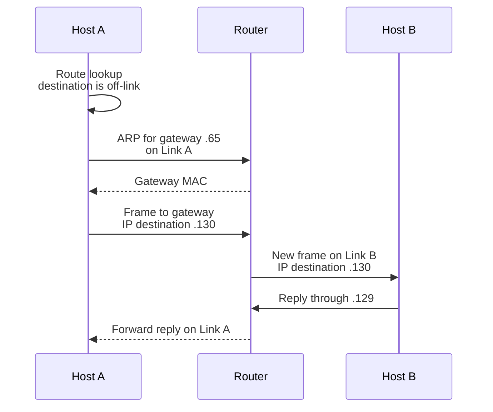
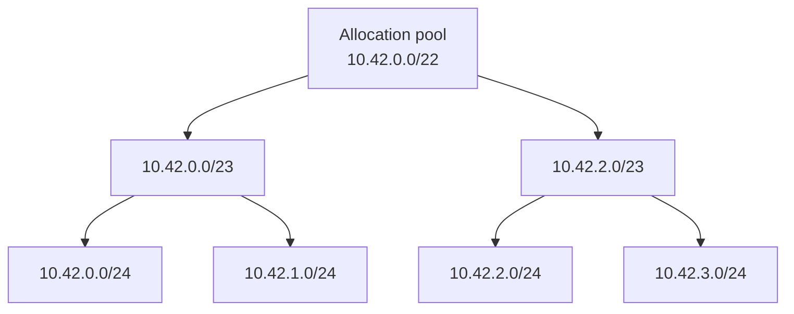
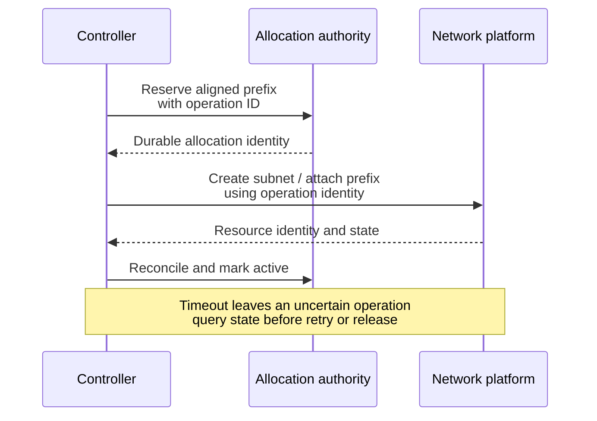

A deployment has spare CPU, enough memory, and healthy database connections. New application instances still cannot start. Their network allocator has no assignable addresses in the selected subnet. Another subnet has hundreds available, but it belongs to a different allocation or availability boundary.

Elsewhere, a server can receive a request but cannot return a response. Its subnet mask makes it search for the caller on its local Ethernet link, even though the caller lives behind a router. Restarting the application leaves the packet path unchanged.

Subnetting connects these two problems: how an address space is divided, and how that division participates in forwarding. Understanding the arithmetic is necessary. Operating the network also requires knowing which allocator owns the addresses, what the host considers on-link, and which policies govern traffic between endpoints.

This article develops those mechanisms from a small Ethernet network to cloud and Kubernetes deployments. It continues [IP Addresses in Production](/field-notes/ip-addresses-in-production/) and [IPv4 and IPv6: Packets, Paths, and Production Migration](/field-notes/ipv4-ipv6-production-migration/), with more detail on subdivision, allocation capacity, and changes to an existing address plan.

## Start with one network and a spreadsheet

A small team can put twenty machines on one Ethernet network, assign addresses from one IPv4 prefix, and configure a gateway for other destinations. A switch delivers local frames; the gateway routes traffic beyond that link. Static assignments and a spreadsheet can work when changes are infrequent and one person controls them.

Growth introduces several distinct pressures. Local broadcast and neighbor discovery affect more machines. Duplicate assignments become harder to prevent. Different workloads need different access policies. A failure or configuration change can disturb too many endpoints. The team also needs addresses for new instances during deployments, rather than only for the steady-state fleet.

Giving the whole organization a very large flat subnet increases the numerical supply without resolving all of those pressures. Splitting it into smaller prefixes creates manageable allocation units. Mapping them to separate links and routing boundaries can also limit local network scope. Firewall and workload policies still need explicit configuration.

Historically, fixed IPv4 address classes made allocation inflexible. Subnet masks allowed organizations to subdivide assigned space, and classless routing made prefix length explicit throughout allocation and forwarding. [RFC 4632](https://www.rfc-editor.org/rfc/rfc4632.html) describes CIDR and aggregation. A prefix length carries operational meaning that an old “Class A” or “Class C” label cannot supply.

## A subnet prefix is a bit boundary

IPv4 addresses contain 32 bits. The four decimal octets are a readable representation of those bits. In `192.0.2.64/26`, the first 26 bits are fixed and the remaining six bits vary. The block therefore contains `2^6 = 64` address values, from `192.0.2.64` through `192.0.2.127`.

The mask for `/26` is `255.255.255.192`. Its final octet is binary `11000000`. For a host configured as `192.0.2.77/26`:

```text
Last address octet:  77 = 01001101
Last mask octet:    192 = 11000000
Bitwise AND:        64 = 01000000

Network:            192.0.2.64/26
Last address:       192.0.2.127
Conventional IPv4 host range: 192.0.2.65 through 192.0.2.126
```

The conventional host range excludes the network and directed-broadcast addresses. Cloud allocators can reserve more addresses. These conventions do not change the number of values in the prefix.

For an address width `W` and prefix length `p`:

```text
block_size = 2^(W - p)
network    = address AND mask_with_p_leading_ones
last       = network + block_size - 1
```

An address belongs to a prefix when masking it produces that prefix's canonical network address. Use parsed numeric addresses and a maintained IP library. Lexicographic string comparisons, splitting IPv6 at colons, and signed 32-bit arithmetic introduce unrelated errors. A shift by the full integer width also needs care in languages whose shift operators mask the shift count.

A longer prefix represents a smaller block. Moving from `/24` to `/26` fixes two additional bits, creating four children with sixty-four values each. This is subdivision. Combining several blocks under a shorter covering prefix is aggregation. Aggregating routes does not physically merge their links or reconfigure their hosts.

## Prefixes, links, VLANs, and policies have separate roles

A **prefix** describes an aligned set of addresses. A **link** is a network over which neighbors can communicate without an intervening IP router. A **VLAN** is one mechanism for separating Ethernet forwarding domains. A **subnet** commonly associates an address prefix with a logical network and its configuration.

Those relationships depend on the network model. A traditional Ethernet subnet commonly uses one prefix on one VLAN. Multiple prefixes can share a link. Virtual networks can emulate neighbor behavior and forward packets through a software-defined fabric. A cloud subnet should not be assumed to be one physical switch or an unrestricted Ethernet broadcast domain.

Creating two prefixes on the same uncontrolled Layer 2 network does not establish a security boundary. Creating two VLANs separates ordinary Ethernet delivery, but an attached router can still route between them. Security requires explicit enforcement through router policy, firewalls, security groups, network policy, or authenticated application access.

A route prefix can also describe an entire site or one endpoint. A `/16` aggregate need not be an on-link subnet, and a `/32` route need not describe a multi-host LAN. An allocation hierarchy, a forwarding table, and a security-policy hierarchy may use similar CIDR notation while controlling different things.

## Follow the host's next-hop decision

Consider two Ethernet links joined by a router:

```text
Link A: 192.0.2.64/26
  Host A: 192.0.2.77
  Router interface: 192.0.2.65

Link B: 192.0.2.128/26
  Host B: 192.0.2.130
  Router interface: 192.0.2.129
```

A conventional host configuration installs a connected route for its subnet and a default route through its gateway. To send to `192.0.2.110`, Host A's connected route normally selects direct delivery on Link A. On Ethernet, it resolves that destination's MAC address with ARP, then sends a frame to the neighbor. If the mapping is missing, an ARP request is broadcast on that Ethernet link and the address holder replies. Cached mappings avoid rediscovery for every packet.

To send to `192.0.2.130`, the default route selects `192.0.2.65` as the next hop. Host A resolves the gateway's MAC address. The Ethernet destination is the gateway; the IP destination remains Host B.



*Figure 1. This is ordinary routed Ethernet delivery without NAT. Each routed hop changes link framing and reduces TTL; the IP source and destination addresses remain the endpoints.*

The host uses its actual routing configuration. A mask alone does not override a more specific route, policy routing rule, VPN route, or selected routing table. Within a selected destination-routing table, the longest matching prefix normally determines the forwarding entry. Routing protocols and route preferences select between candidate paths for the same prefix.

Changing only Host B's mask to `/24` creates a useful failure example. It now believes Host A is directly reachable on Link B. Host A's request can still arrive through the router, but B tries to ARP for A on the wrong link when replying. Without a mechanism such as proxy ARP, that resolution fails. An application timeout can therefore originate in a return-path subnet error.

Check `ip route get <destination>` on Linux, then inspect the selected interface, source address, gateway, and neighbor table. A source-side capture shows where the request went; a destination-side capture and route lookup explain whether the reply can return. ICMP filtering can make a failed ping inconclusive, so include a permitted transport-level probe.

## Divide space with alignment and growth in mind

A parent prefix of length `p` can be divided into `2^(q - p)` children of length `q`, provided `p <= q <= W`. Each child contains `2^(W - q)` values. Child `k` begins at:

```text
child_start = parent_start + k × child_block_size
0 <= k < number_of_children
```

The parent must be canonical and the child start must be aligned. `10.42.0.64/25` is not an aligned `/25` network: a parser that accepts it as a host/prefix pair can normalize it to `10.42.0.0/25`. Allocation tooling should reject unexpected host bits instead of silently approving a different block.

For example, `10.42.0.0/22` contains four `/24` children:



*Figure 2. Every split fixes one more bit. The diagram describes an allocation hierarchy; routers and links require their own configuration.*

Equal-sized children simplify automation, but can waste scarce IPv4 space when workloads differ substantially. Variable-length subnet masking assigns different prefix lengths within the parent. A conventional IPv4 `/24` can accommodate the following illustrative plan:

<div class="table-scroll" role="region" aria-label="Variable length subnet allocation example" tabindex="0">

| Workload requirement | Allocation | Address interval | Conventional host capacity |
| --- | --- | --- | --- |
| 100 hosts | `10.42.0.0/25` | `.0` through `.127` | 126 |
| 50 hosts | `10.42.0.128/26` | `.128` through `.191` | 62 |
| 20 hosts | `10.42.0.192/27` | `.192` through `.223` | 30 |
| Future allocation | `10.42.0.224/27` | `.224` through `.255` | 32 raw address values, still unallocated |

</div>

Assigning the largest requirements first makes this static plan easier to pack. It is a heuristic for these aligned power-of-two requests, not proof of an optimal plan under every growth, geography, or isolation constraint. Keep adjacent space available where expansion is likely, and keep enough ownership metadata to distinguish unallocated space from a deployed subnet with unused hosts.

Neighboring blocks can be aggregated only when their combined interval forms the shorter aligned prefix. Two adjacent `/24` blocks at `10.42.0.0` and `10.42.1.0` form `10.42.0.0/23`; the pair at `10.42.1.0` and `10.42.2.0` does not form one `/23`.

Aggregation reduces advertised routing entries while retaining internal specifics. [RFC 4632's aggregation rules](https://www.rfc-editor.org/rfc/rfc4632.html#section-5.1) also address destinations inside an aggregate that have no reachable more-specific route. A discard route for such holes prevents a default route from sending traffic back toward the provider and creating a forwarding loop. Advertising a summary is a reachability responsibility.

## Address count is only the first capacity calculation

For ordinary IPv4 broadcast subnets, the familiar host-capacity expression is `2^(32 - p) - 2`. It has explicit exceptions. [RFC 3021](https://www.rfc-editor.org/rfc/rfc3021.html) permits both addresses of an appropriate `/31` point-to-point link. A `/32` identifies one address and can be a host route. Neither should be sized by subtracting two and accepting a negative result.

Platform reservations are another rule set. For standard AWS VPC IPv4 subnets, the first four and final address are reserved, so a `/24` ordinarily supplies **251 assignable addresses**. [AWS's subnet sizing documentation](https://docs.aws.amazon.com/vpc/latest/userguide/subnet-sizing.html) also describes exceptions such as BYOIP. Use the rule for the allocator and resource type actually being deployed.

Subdivision can increase reservation overhead. One ordinary AWS `/22` has `1024 - 5 = 1019` assignable addresses. Four separately created `/24` subnets provide `4 × (256 - 5) = 1004`, a difference of fifteen. The extra boundaries may still be justified by placement and operational requirements.

Capacity also depends on what consumes an assignment. A VM may use several interface addresses. Container networking can allocate addresses to Pods, reserve warm pools, and retain assignments while old nodes drain. Managed endpoints and load balancer interfaces can consume additional capacity. An idle application process does not imply that its address has been released.

### Include failures and deployment overlap

Assume a workload normally consumes 240 active workload addresses in each of three zones. If one zone fails and the application redistributes evenly, each surviving zone needs 360. Suppose the plan also allows a 25% rollout surge, thirty-two warm addresses, and twenty infrastructure addresses per surviving zone:

```text
Total steady-state workload addresses: 3 × 240 = 720
After one zone is lost:                720 / 2 = 360 per surviving zone
Rollout overlap:                       25% × 360 = 90
Warm allocations:                      32
Infrastructure allocations:            20
Peak planned demand:                   360 + 90 + 32 + 20 = 502

Ordinary AWS /23 assignable capacity:   512 - 5 = 507
Remaining margin at planned peak:      507 - 502 = 5
Ordinary AWS /22 assignable capacity:   1024 - 5 = 1019
```

These are planning assumptions, not provider limits or measurements. A `/23` passes the arithmetic with only five addresses left. Additional interface assignments, slower draining, or a larger surge can exhaust it. A `/22` has more headroom, at the cost of committing a larger block from the parent pool.

Address capacity does not prove the failover works. The surviving zones also need compute, dependency capacity, compatible placement rules, and network paths. Verify how the scheduler actually redistributes workloads. A free address in a different zone or pool may be unusable by the request that is failing.

## Allocation needs an authority and a recovery procedure

A bitmap can track allocation within a bounded pool. One bit per address for an IPv4 `/16` consumes `65,536 / 8 = 8192 bytes`, before metadata. Finding a candidate free bit can be fast with word-level operations and a search cursor, but claiming it must still be atomic under concurrent requests. Ownership, lease state, and reconciliation cost more than the raw bitmap.

Prefix allocation has different constraints. A free-space trie or buddy-style allocator can split an available block into aligned halves until it reaches the requested length. On release, it can merge free siblings when both are available. Returning arbitrary neighboring fragments does not satisfy a contiguous-prefix request.

Consider an abstract pool before platform reservations, with sixteen aligned `/28` children of a `/24`. If one address in each child is occupied, **240 addresses remain free, but zero complete `/28` blocks are free**. That distinction matters to an allocator that delegates whole prefixes. Aggregate utilization can appear low while every new prefix request fails.

An address-management service should record network scope, prefix, owner, allocation identity, lifecycle state, and observed use. Prefix claims need an atomic overlap check and durable reservation within the relevant allocation scope. Rejecting identical CIDR strings alone misses an overlapping `/24` and `/25`. A serialized pool allocator or suitable transactional overlap constraint can protect that boundary. A parent pool intentionally contains its delegated children; the exclusion applies to conflicting allocations at the relevant delegation level and routing scope. Isolated routing domains may intentionally reuse space; connecting them later requires a separate overlap review.



*Figure 3. Allocation and network provisioning may have separate transaction boundaries. A timeout can leave a real resource behind even when the controller received no success response.*

Use idempotent provisioning operations and reconciliation. Reclaim a prefix only after its assignments, platform resources, and relevant routes have been removed or safely superseded. If a stale controller can continue programming the network, a database lease expiring does not make reuse safe. Fence the old controller and verify teardown before assigning the block to a new owner.

During an allocator outage, existing traffic may continue if its addresses and forwarding state remain valid. New provisioning may stop, and lease renewals or lifetimes may eventually affect existing endpoints. Expose allocation health separately from application request health so an infrastructure failure is visible before the next rollout.

## Cloud subnets add placement and routing contracts

An AWS VPC subnet resides in one Availability Zone, as documented in [Subnets for your VPC](https://docs.aws.amazon.com/vpc/latest/userguide/configure-subnets.html). Multi-zone availability therefore requires resources in several subnets and failure-aware capacity in the surviving zones. The association is a platform rule, not a universal definition of an IP subnet.

“Public” and “private” also describe a cloud routing arrangement, rather than a property encoded in the subnet's prefix bits. In AWS, a public subnet has a route to an internet gateway. IPv4 internet access additionally depends on suitable public addressing and the rest of the path and policy. A private IPv4 workload can use an outbound NAT path without accepting unsolicited inbound connections. IPv6 uses its own addressing and egress controls.

Two subnets may still communicate through the virtual network's local routing even if one is called private. Audit the actual route tables and enforcement points. Adding a new range to an allowlist can grant access to future occupants of that range; it does not identify a particular application.

At organization scale, allocate non-overlapping parent pools to routing domains and regions, then delegate smaller pools to zone or workload owners. Avoid encoding every organizational detail into a rigid hierarchy. Teams reorganize, workloads grow unevenly, and acquired networks may already occupy the planned space.

When connecting networks with overlapping prefixes, longest-prefix routing cannot distinguish two intended destinations with the same address in one routing context. Renumbering resolves the ambiguity. Separate routing domains, proxies, or translation can provide selected connectivity while adding operational state and restrictions. Record those exceptions before they turn into assumptions in every application.

## Kubernetes has several address pools

A cluster typically has node addresses, Pod addresses, and Service virtual addresses. Their allocation and forwarding mechanisms differ. A Service CIDR is not automatically an on-link Ethernet subnet, and extending it does not create more Pod addresses.

<div class="table-scroll" role="region" aria-label="Subnet and container networking approaches" tabindex="0">

| Approach | Allocation and forwarding mechanism | Useful setting | Operational cost |
| --- | --- | --- | --- |
| Traditional routed subnets | Hosts receive addresses from on-link prefixes; routers connect links | Small networks with explicit ownership and stable placement | Address coordination, router and link configuration, neighbor state |
| Cloud-native Pod addressing | Pods receive addresses usable in the cloud's routed network | Direct integration with cloud routing and interface policy | Subnet consumption, interface limits, allocation APIs, per-zone capacity |
| Routed Pod CIDRs | Nodes or routing infrastructure advertise reachability for Pod prefixes | Underlay can carry workload routes | Route distribution, aggregation, convergence, and route-table limits |
| Encapsulated Pod network | Inner workload packets travel through tunnels between nodes | Underlay primarily needs node-to-node connectivity | Tunnel state, packet overhead, MTU handling, and two address views |

</div>

[Cilium's routing documentation](https://docs.cilium.io/en/stable/network/concepts/routing/) makes the routing trade-off concrete. Encapsulation carries Pod traffic through node-to-node tunnels, so the underlying network need not route each Pod prefix. Native routing requires the network and node routing configuration to reach workload addresses. Both still need correct address allocation and policy. Tunnels add headers and reduce the available payload MTU unless the underlay budget accounts for them.

Cloud-native prefix delegation changes allocation granularity. The Amazon VPC CNI can assign an IPv4 `/28` prefix to an interface and allocate individual Pod addresses from it. The [EKS prefix-assignment guide](https://docs.aws.amazon.com/eks/latest/userguide/cni-increase-ip-addresses-procedure.html) requires sufficient contiguous blocks and documents `InsufficientCidrBlocks` failures caused by fragmentation. Interface slots and Pod limits still apply; delegating a prefix does not increase every networking limit.

This delegated `/28` is an allocation inside a parent subnet. Do not subtract a conventional LAN's network and broadcast reservations from each child as though it were a newly created independent subnet. Keep parent-subnet reservations, delegated-prefix rules, and CNI warm allocations as separate accounting categories. Tune warm capacity against startup latency and address consumption rather than maximizing it without a budget.

## IPv6 changes the sizing question

IPv6 has 128-bit addresses. A `/48` contains `2^(64 - 48) = 65,536` `/64` prefixes; a `/56` contains 256. For ordinary Ethernet-style SLAAC deployments, `/64` is the expected subnet boundary. [RFC 7421](https://www.rfc-editor.org/rfc/rfc7421.html) explains the protocol assumptions and compatibility implications behind that boundary. Using `/120` merely because only a few machines need addresses can break the intended autoconfiguration model.

This does not make every IPv6 route or every delegated allocation a `/64`. Larger routing aggregates, endpoint routes, specialized links, and platform-specific delegation have other roles. Nor should IPv4's subtract-two rule be copied into IPv6 sizing. IPv6 has no broadcast; protocol reservations and allocator restrictions still need review.

[RFC 5942](https://www.rfc-editor.org/rfc/rfc5942.html) separates IPv6 address assignment from on-link determination. Receiving an address does not by itself establish that every address sharing its apparent prefix is a direct neighbor. Router Advertisements can supply on-link prefix information; their on-link and autonomous-address-configuration flags have different purposes. A usable default router is another piece of state.

Operationally, check the address list, on-link prefix information, routes, and Neighbor Discovery behavior independently. A host may have a valid address while lacking a usable path. A `/64` also does not supply unlimited neighbor-table capacity or remove link congestion and policy limits. The numerical address supply is only one resource.

## What changed in production systems from 2024 to 2025

The following are documented shipped capabilities, with platform and version requirements. They change how operators manage address pools and expand existing deployments. The bit arithmetic and the need for correct routes remain the same. Feature presence also does not establish adoption across the industry.

### Subnet allocation moved into managed address planning

AWS's [January 29, 2024 IPAM engineering article](https://aws.amazon.com/blogs/networking-and-content-delivery/use-vpc-ip-address-manager-to-manage-subnet-cidrs/) describes subnet-level CIDR allocation from resource-planning pools, allocation rules, and utilization monitoring. The example extends address management below the VPC boundary and supports allocating subnet space at creation time.

The engineering benefit is a coordinated allocation workflow that application teams can consume without manually selecting every CIDR. It still needs pool ownership, reviewed constraints, and reconciliation with pre-existing resources. Moving a spreadsheet into an API does not automatically choose correct growth boundaries.

### Existing nodes gained additional eligible subnet choices

AWS introduced [Enhanced Subnet Discovery on April 4, 2024](https://aws.amazon.com/blogs/containers/amazon-vpc-cni-introduces-enhanced-subnet-discovery/). With the appropriate CNI configuration, nodes can use additional eligible subnets for secondary interfaces and Pod addresses.

The [current subnet-selection documentation](https://docs.aws.amazon.com/eks/latest/userguide/cni-subnet-selection.html) specifies the same VPC and Availability Zone constraint and documents version-dependent tagging behavior. Adding a subnet in another zone cannot supply an interface to a node that must remain in its current zone. Route tables, ACLs, and intended ownership also need validation before new addresses become useful.

This is additive allocation capacity. It does not resize the original subnet or renumber running Pods. Test the deployed CNI version's selection and exclusion rules before using tag changes as a rollout control; existing interfaces and newly created interfaces can be handled differently.

### Kubernetes gained stable Service range extension

Kubernetes v1.33, [released April 23, 2025](https://kubernetes.io/blog/2025/04/23/kubernetes-v1-33-release/), made multiple Service CIDR allocation stable. The [Service range extension documentation](https://kubernetes.io/docs/tasks/network/extend-service-ip-ranges/) describes adding `ServiceCIDR` resources to increase the available virtual-IP pool. Operators must still validate the control-plane and dataplane behavior of their deployed version.

This feature addresses Service address allocation. It does not enlarge cloud subnets, supply node interface slots, or increase a Pod IP pool. Existing Service addresses are not automatically renumbered by adding another range. Removing a range is constrained by allocations that still depend on its coverage.

These examples show a specific direction: allocation boundaries are increasingly represented as API resources with discovery, ownership, and reconciliation. Automatic pool expansion still requires approved space and policy. An unreviewed controller that selects any apparently free CIDR can create overlap or expand access beyond the intended boundary.

## Failure scenarios and their operational signals

<div class="table-scroll" role="region" aria-label="Subnet failure scenarios and recovery" tabindex="0">

| Failure | Observable symptom | Investigation and mitigation |
| --- | --- | --- |
| Wrong mask or missing connected route | Requests arrive but replies time out; repeated neighbor probes | Inspect route selection in both directions and correct host configuration |
| Exhausted eligible pool | New interfaces or Pods fail while existing traffic works | Measure per-pool allocations and release lag; add approved capacity or reduce rollout demand |
| Fragmented free space | Prefix allocation fails despite many free individual addresses | Count complete aligned blocks; reserve suitable ranges or move new allocations to a clean subnet |
| Duplicate address or overlapping ownership | Intermittent delivery, changing neighbor state, wrong endpoint | Find conflicting allocation records, fence competing allocators, and repair assignments |
| Partial provisioning after a timeout | Inventory says free while a real resource still exists | Reconcile operation identity and platform state before retrying or reusing the prefix |
| Incorrect aggregate or more-specific route | A destination subset fails while default routes look healthy | Inspect selected forwarding entries, aggregate holes, and route propagation |
| Tunnel MTU mismatch | Small requests work but larger transfers stall | Inspect both packet views, encapsulation overhead, and packet-size feedback |
| Zone outage | Surviving zones cannot allocate replacement workloads | Test per-zone failover demand, scheduler placement, and local allocation headroom |
| Stale ACL or route configuration during migration | Only new addresses fail, or new occupants receive unintended access | Stage policy and routing changes, compare old and new paths, retain rollback evidence |

</div>

Track assignable free addresses by network scope, subnet, zone, family, and workload pool. Track complete free blocks at the prefix lengths requested by the allocator. Neither a company-wide utilization percentage nor a raw free-address counter captures all allocation failures.

Measure allocation error rate, request latency, pending network attachments, API throttling, warm-pool occupancy, lease age, release lag, and failed cleanup operations. Correlate these with rollout surge and node draining. Monitor neighbor-table pressure, route-table size and churn, drops by reason, and permitted-path probes. Preserve prefix and resource identities in logs; an address without its routing context and allocation lifetime is ambiguous evidence.

For an illustrative pool with 800 eligible addresses remaining and net consumption of forty addresses per minute, simple exhaustion time is twenty minutes. That forecast assumes stable consumption and no releases. Provisioning, validation, and deployment can take longer, so alert on recovery lead time and pending demand as well as utilization percentage. A fragmented pool can fail its next prefix request immediately even while that forecast looks comfortable.

## Expand through migration rather than a mask shortcut

Changing `/24` to `/23` on one host does not claim the neighboring block or update the rest of the network. It can create incorrect on-link assumptions while DHCP, routes, and other hosts keep their previous configuration. Managed platforms can also make subnet IPv4 CIDRs immutable after creation.

A safer migration starts with a validated, non-overlapping new range. Prepare routing, security policy, observability, resolver dependencies, and eligible allocation rules. Launch a small replacement workload there and test local, cross-subnet, egress, and return paths. Then move capacity gradually while retaining enough space for old and new assignments to coexist.

Drain existing endpoints rather than assuming an address change preserves established connections. Update service discovery and external allowlists where applicable. Stop new allocations from the old pool, verify that attachments and active uses have disappeared, and remove old routes and permissions under a reviewed rollback plan. Release the old range only when reuse cannot collide with stale resources or controllers.

At small scale, one documented subnet and a simple allocator can satisfy the requirements. Additional links and prefixes become useful when policy, capacity, ownership, or neighbor state justify them. Large deployments need delegated pools and coordinated inventory because one central stream of manual requests cannot keep up. Connecting regions or organizations adds overlap and route-policy constraints; stretching one apparent subnet across failure domains can increase the recovery burden.

## Review the boundary before approving the next allocation

A developer adding capacity may start with the host-count calculation. A senior engineer also checks interface consumption, rollout overlap, fragmentation, and return paths. Staff-level review includes the allocation authority, zone and routing boundaries, the recovery time available, and the cost of the next migration. These are responsibilities that a team can share; job titles do not change the mechanism.

Keep a larger parent block when growth and renumbering cost justify the commitment. Use smaller allocations when isolation or scarce IPv4 space matters more, while accounting for platform reservations and extra configuration. Prefer a routed workload network when the surrounding infrastructure can carry its routes. Prefer encapsulation when node-to-node connectivity is the practical contract, and budget its MTU and diagnostic overhead. Avoid introducing an additional subnet solely because a diagram has another service box.

Treat the address plan as three connected records: the allocator's ownership map, the host and router forwarding state, and the policy that permits communication. Before changing a prefix, name the owner, trace a packet in both directions, calculate capacity during recovery, and identify how the old assignment will be retired. Those checks turn a CIDR calculation into an operable network change.

## Further reading

- [RFC 4632: Classless Inter-Domain Routing](https://www.rfc-editor.org/rfc/rfc4632.html) — explains prefix allocation, route aggregation, and responsibility for aggregate coverage.
- [RFC 3021: 31-bit IPv4 point-to-point prefixes](https://www.rfc-editor.org/rfc/rfc3021.html) — defines the important exception to conventional IPv4 host-capacity arithmetic.
- [RFC 5942: IPv6 Subnet Model](https://www.rfc-editor.org/rfc/rfc5942.html) — separates address assignment from the host's determination of on-link destinations.
- [RFC 7421: Analysis of the 64-bit Boundary in IPv6 Addressing](https://www.rfc-editor.org/rfc/rfc7421.html) — examines why ordinary IPv6 subnet sizing differs from IPv4 host-count optimization.
- [AWS VPC subnet CIDR blocks](https://docs.aws.amazon.com/vpc/latest/userguide/subnet-sizing.html) — documents platform-specific reservations, sizing constraints, and exceptions.
- [AWS VPC subnet basics](https://docs.aws.amazon.com/vpc/latest/userguide/configure-subnets.html) — describes zone placement, route-based subnet types, and network controls.
- [EKS prefix assignment](https://docs.aws.amazon.com/eks/latest/userguide/cni-increase-ip-addresses-procedure.html) — explains contiguous-prefix requirements and the failure caused by fragmented address availability.
- [Cilium routing concepts](https://docs.cilium.io/en/stable/network/concepts/routing/) — compares encapsulated, native, and cloud-integrated forwarding paths.
- [AWS: managing subnet CIDRs with IPAM, January 2024](https://aws.amazon.com/blogs/networking-and-content-delivery/use-vpc-ip-address-manager-to-manage-subnet-cidrs/) — illustrates managed subnet pools, allocation rules, and utilization monitoring.
- [AWS: Enhanced Subnet Discovery, April 2024](https://aws.amazon.com/blogs/containers/amazon-vpc-cni-introduces-enhanced-subnet-discovery/) — describes adding eligible Pod address capacity to an existing deployment.
- [EKS subnet-selection configuration](https://docs.aws.amazon.com/eks/latest/userguide/cni-subnet-selection.html) — specifies current eligibility constraints and version-dependent tag behavior.
- [Kubernetes: extending Service IP ranges](https://kubernetes.io/docs/tasks/network/extend-service-ip-ranges/) — documents stable Service CIDR expansion and its allocation-specific scope.
