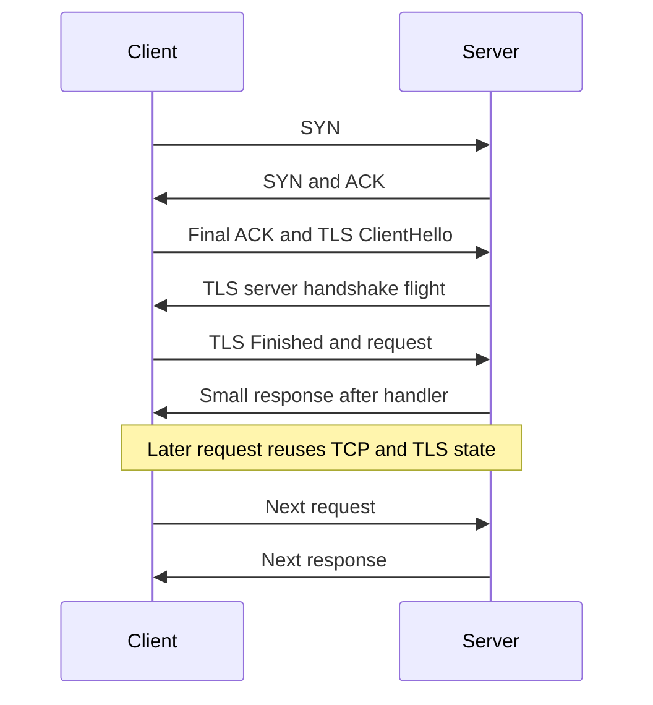
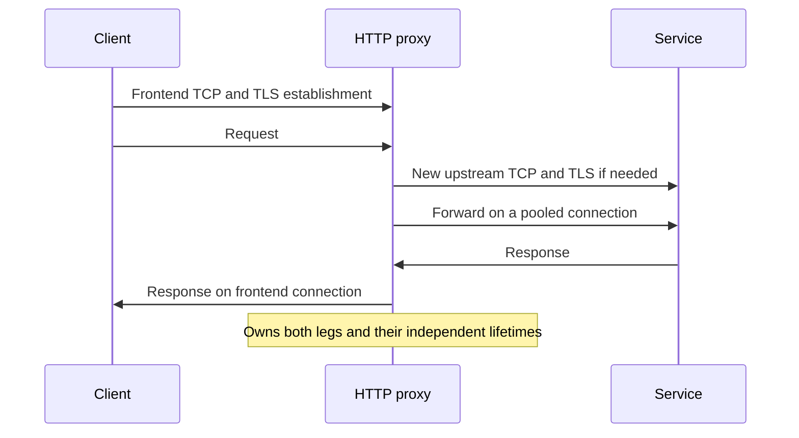
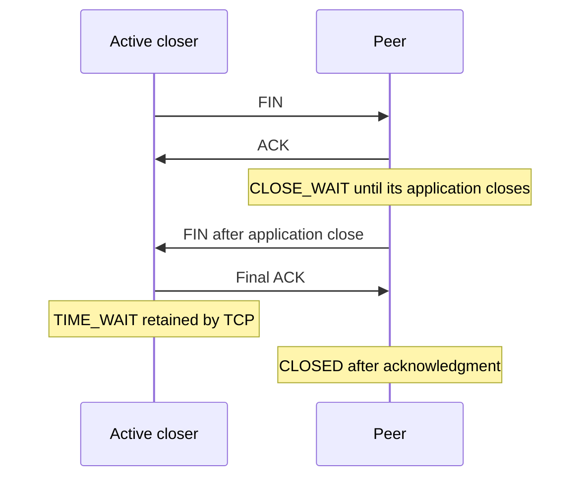
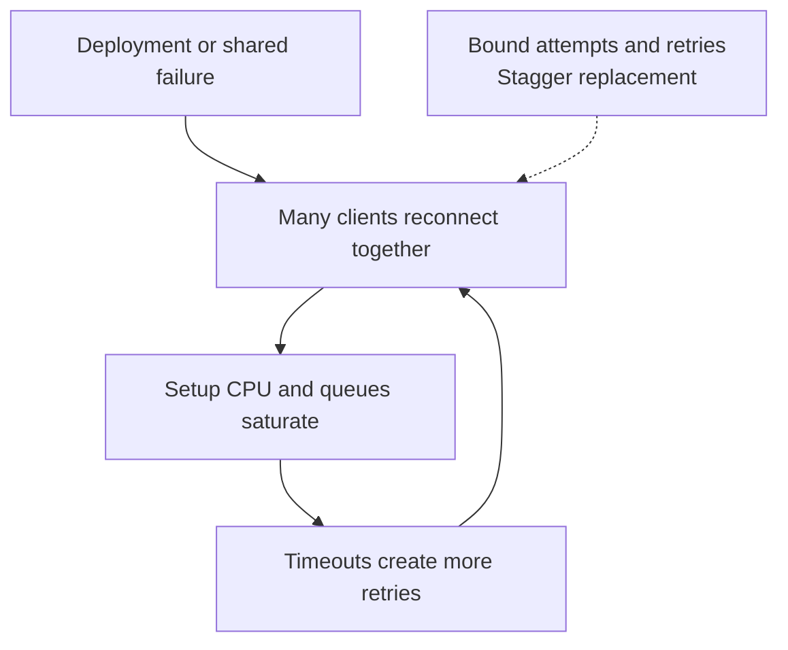

A service finishes its request handler in five milliseconds. A caller on a fifty millisecond network path opens a connection, negotiates TLS, sends one small request, reads the response, and closes. The caller pays for several network exchanges to obtain those five milliseconds of work. At forty thousand requests per second, the same design also asks the infrastructure to create and retire forty thousand connections every second.

Connection reuse changes that cost substantially. It also leaves sockets, buffers, credentials, and routing decisions alive between requests. A pool that saves handshake CPU can exhaust a downstream connection budget; a large population of idle sockets can survive locally after a firewall has forgotten their flows.

The useful accounting unit is the connection's lifecycle: creating it, keeping it useful, and retiring its state. Request rate, simultaneous connections, and connection creation rate are separate measurements. The numerical examples below are illustrative calculations, not benchmark results or recommended defaults.

## Begin with one request on one connection

TCP provides an ordered byte stream between two endpoints, with mechanisms for recovering lost data. Each endpoint remembers progress in that stream. The network does not reserve a dedicated wire or a fixed amount of bandwidth for the conversation. An application's socket handle refers to local state; a server accepts connections into sockets separate from its listening socket. The [Linux TCP interface](https://man7.org/linux/man-pages/man7/tcp.7.html) exposes these operations to applications.

Opening a socket for every request is easy to reason about. There is no shared pool, each caller owns its connection, and closing it ends that caller's use of the transport. This can be sufficient for an occasional administrative command or a low volume integration.

The design becomes expensive when setup repeats faster than useful application work. A fresh TCP connection synchronizes the endpoints. TLS then establishes the cryptographic context. A database or messaging protocol may add authentication, capability negotiation, or session initialization afterward. Calling all of this “TCP overhead” hides which work can be removed by a particular optimization.

Consider ordinary TCP followed by a full TLS 1.3 handshake and one small request and response. Assume cached DNS, no packet loss, negligible cryptographic processing and queueing, and messages that fit their expected flights. With a round trip time `R`, the client waits approximately one `R` for TCP, another for TLS, and another for the application exchange. A reused connection needs the application exchange alone.

At `R = 50 ms`, that gives roughly **155 ms for the cold exchange and 55 ms for the reused exchange**, including the handler's five milliseconds. These are simplified latency estimates. Loss, large handshake flights, certificate checks, additional proxies, and scheduling can change them.



*Figure 1. Logical flights for one ordinary cold exchange followed by reuse. TCP acknowledgments and TLS records can share packets; the drawing does not specify a fixed packet count.*

TLS resumption can save certificate and key establishment work while still creating a new TCP connection. Ordinary TLS 1.3 resumption without early data also retains a TLS round trip. Optional 0-RTT data has weaker replay protection and requires application rules for operations safe to repeat. It cannot be enabled merely because a latency chart looks better. [RFC 8446](https://www.rfc-editor.org/rfc/rfc8446.html#section-2) defines these distinct exchanges.

The [TCP handshake note](/field-notes/tcp-three-way-handshake/) explains the synchronization itself. Here, the question is how often the system pays for it and what resources remain afterward.

## Separate the budgets before adding capacity

At one endpoint, connection setup consumes CPU for packet handling, socket creation, protocol negotiation, and any TLS work performed there. A connection that remains open occupies kernel and application state. Traffic through it creates further work for encryption, copying, scheduling, and packet processing.

Some of those costs follow connection count, some follow bytes or packets, and some follow requests. Increasing the connection pool cannot repair a CPU bottleneck caused by application computation. Reducing handshakes will not remove the cost of encrypting the same application payload.

<div class="table-scroll" role="region" aria-label="Connection resource budgets and their accounting scopes" tabindex="0">

| Budget | Main driver | Evidence to collect |
| --- | --- | --- |
| Setup CPU | New connection attempts, TLS mode, authentication | Attempts per second, handshake CPU, full and resumed TLS counts |
| Endpoint memory | Live sockets, queued bytes, TLS and application buffers | Socket memory, kernel accounting, process memory under representative load |
| File descriptors | Application socket handles and other open resources | Process descriptor count, limits, allocation failures |
| Source tuples and middlebox state | Destination concentration, flow count, retention time | Port allocation errors, tracked flows, NAT allocation and rejection metrics |
| Application concurrency | Active requests or streams and their duration | Inflight work, pool wait, pending requests, deadline failures |
| Retirement capacity | Close rate, drain duration, retained TCP state | Active closes, draining sockets, CLOSE_WAIT and TIME_WAIT populations |

</div>

Specify the accounting boundary as well. A NAT maintains a mapping and tracking state. An HTTP proxy that terminates TCP owns transport state on both its frontend and upstream legs. It may terminate TLS on both, too. Thousands of frontend connections can share fewer upstream connections, so the counts need not match.



*Figure 2. A terminating proxy creates separate connection budgets. A NAT or forwarding device along a leg can retain additional flow state without becoming its TCP endpoint.*

A business request can cross several such boundaries. Count each terminating leg where it exists, while avoiding the assumption that every load balancer creates a new TCP connection. The [ports and sockets note](/field-notes/ports-sockets-connections-and-capacity/) and [NAT note](/field-notes/nat-addresses-ports-and-connection-state/) develop those distinctions.

## Creation rate explains the CPU bill

Let `k` be the mean number of completed requests served by an established connection. For a stable workload without failed opens, dividing the request rate by `k` estimates the required connection creation rate. Multiplying by measured setup CPU time estimates the CPU demand attributable to creation:

```math
\begin{aligned}
\lambda_{\mathrm{open}} &\approx \frac{\lambda_{\mathrm{request}}}{k} \\
\mathrm{CPU}_{\mathrm{setup}} &\approx \lambda_{\mathrm{open}}\,c_{\mathrm{open}}
\end{aligned}
```

For forty thousand requests per second, opening once per request produces forty thousand opens per second. Serving a mean of two hundred requests on each connection reduces that rate to two hundred opens per second.

Suppose a separate measurement on the endpoint finds a mean setup cost of two milliseconds of CPU time, including its TLS work. The corresponding demand is **80 CPU seconds per second** for the first design and **0.4 CPU seconds per second** for the second. These are core equivalents for that component under the stated assumptions. They exclude payload encryption, request processing, failed attempts, and other services on the machine. CPU time is different from handshake wall time spent waiting on the network.

Actual attempt rates also include failed connections, retries, and competing address attempts. Track those separately from successful establishments. Otherwise, a dashboard can report good reuse among successful requests while a failed destination consumes most of the dial budget.

A new flow also begins with a limited congestion allowance. TCP initially permits a bounded amount of data in flight, then uses acknowledgments and congestion signals to adjust it. During slow start, the allowance can grow rapidly as acknowledgments return. A large response may therefore need several network rounds to reach a useful transfer rate, even after setup completes. The receiver's advertised window independently limits what the receiver can accept.

Reuse can preserve useful transport history. That history is not a permanent promise of throughput: an idle flow may reduce its sending allowance, and path conditions can change. [RFC 5681](https://www.rfc-editor.org/rfc/rfc5681.html#section-4.1) discusses restarting after idle; the [TCP transport note](/field-notes/tcp-reliable-bytes-congestion-and-failure/) explains the controls in more detail.

## An idle socket has a memory cost without requiring a thread

A TCP endpoint retains sequence progress, acknowledgments, timers, window information, and other protocol state. It also has send and receive queues. Application runtimes may add connection objects, TLS buffers, parsers, and session data.

The queued data matters. A slow reader can allow receive buffers to grow; an application that keeps writing can accumulate unsent or unacknowledged data until limits and flow control intervene. Measuring only nearly empty idle sockets understates memory during a downstream slowdown.

TCP retains data needed for retransmission until it is acknowledged. A successful application write can therefore add to queued work without proving that the peer application has consumed it. Even an acknowledgment from the peer's TCP stack does not certify an application commit. Transport buffers and application completion need separate accounting.

Configured socket buffer limits are not a measurement of resident bytes. Linux can tune buffers, and memory reports distinguish allocated data, queued data, accounting limits, and cached allocations. The [`ss` manual](https://man7.org/linux/man-pages/man8/ss.8.html) describes those fields. Kernel socket memory also does not appear as an equivalent increase in the application's RSS, so process memory alone is insufficient.

For an illustrative endpoint budget, suppose incremental kernel, TLS, and application state averages 24 KiB across 200,000 live connections under the workload being planned. That is about **4.58 GiB** before unrelated process memory and further headroom. This is an assumed measured aggregate cost for the example, not a universal socket size. Measure the distribution again with active transfers and slow peers; do not multiply a configured receive limit and label the result actual consumption.

Large connection populations do not inherently require one operating system thread per connection. Event driven servers can wait for readiness notifications and handle many mostly idle sockets with fewer threads. Linux [`epoll`](https://man7.org/linux/man-pages/man7/epoll.7.html) maintains interest and readiness information. It changes how applications wait for work; socket state, packet processing, and TLS allocations still need resources.

## Source ports can fail before the server runs out of sockets

A TCP connection is distinguished by its local and remote address and port within the relevant network context. A server listening on port 443 can accept many connections. The listening port does not impose a 65,535 connection ceiling on that server.

An outbound client has a different constraint. With one source address and one fixed destination address and port, available ephemeral source ports bound the simultaneous distinct tuples. Across different destinations, the same source port can sometimes be shared because the full tuples remain different. The API used to create the socket affects whether that sharing is possible.

Cloudflare's **February 2022** account describes production port exhaustion aggravated by selecting a source address with `bind()` before `connect()`. Reserving the local address and port too early prevented sharing across destinations. On Linux, setting `IP_BIND_ADDRESS_NO_PORT` before binding a source IPv4 address with port zero postpones port reservation until `connect()`. The option predates the post; 2022 is the publication date of the production account. The lesson is to inspect allocation behavior before treating a local range as a universal protocol limit. [Cloudflare's port exhaustion analysis](https://blog.cloudflare.com/how-to-stop-running-out-of-ephemeral-ports-and-start-to-love-long-lived-connections/) explains the mechanism and its scope.

Shared egress creates another concentration point. AWS documents a NAT gateway limit of **55,000 simultaneous connections per assigned IPv4 address to each unique destination**, where destination includes address, port, and protocol. Adding application instances behind the same egress address can increase pressure on that budget. This is a specific managed NAT limit, distinct from a host's ephemeral range. [NAT gateway basics](https://docs.aws.amazon.com/vpc/latest/userguide/nat-gateway-basics.html) defines it.

Before adding machines, identify whether the exhausted resource belongs to the caller, a proxy, the egress path, or the destination. More caller instances help only if they also change the constrained resource or reduce its demand.

## Closing the application handle does not end every lifetime

TCP closes its two directions separately. In a usual orderly close, the endpoint that actively closes retains TIME_WAIT state after acknowledging the peer's FIN. This supports handling delayed traffic and retransmission of the final acknowledgment. Simultaneous close can put both ends into TIME_WAIT. The state machine and the protocol's lifetime rules are specified in [RFC 9293](https://www.rfc-editor.org/rfc/rfc9293.html#section-3.6.1).



*Figure 3. One ordinary closing sequence. The peer can combine its ACK and FIN. TIME_WAIT can outlive the application's file descriptor; CLOSE_WAIT means the receiving application still has its side to close.*

These states require different responses. A growing CLOSE_WAIT population can indicate that the application is not closing after EOF. TIME_WAIT growth can be the expected consequence of successful active closes. Its retained representation is not equivalent to a fully active application connection with all its buffers and TLS objects.

For a steady active close rate, the population of retained TIME_WAIT records is approximately:

```math
N_{\mathrm{TIME\_WAIT}} \approx \lambda_{\mathrm{active\ close}}\,T_{\mathrm{hold}}
```

Use the relevant platform's observed retention and reuse behavior. If an example endpoint actively closes forty thousand connections per second and records remain for an assumed sixty seconds, the demand is **2.4 million records**. At two hundred closes per second it is **12,000**. These are demands under stated assumptions, not a claim that a single source address can sustain either traffic pattern to any destination.

For example, an illustrative allocation range of twenty thousand ports, all targeting one fixed peer, supports an optimistic ceiling of about **333 new connections per second** if each closed tuple remains unavailable for sixty seconds and no earlier safe reuse occurs. Live connections consume additional tuples. The forty thousand opens per second design cannot fit that single-address budget; it will fail before reaching the hypothetical steady population.

Do not substitute an unrelated timeout into that calculation. Linux's `tcp_fin_timeout` concerns orphaned connections in FIN_WAIT_2. It is not the TIME_WAIT duration control. `tcp_tw_reuse` has protocol safety conditions and implementation scope; it is not a general way to make connection churn free. The [kernel parameter documentation](https://docs.kernel.org/networking/ip-sysctl.html) distinguishes these settings.

## Pools turn repeated setup into a bounded scheduling problem

A reusable client normally acquires a connection from a pool, sends work, consumes or closes the response according to the client library's contract, and releases the resource. Constructing a fresh client object with a fresh private pool for every request defeats this design. A leaked response body can keep a pooled resource occupied even when the server is healthy.

For HTTP/1.1 without pipelining, a connection usually carries one active exchange at a time. Concurrent requests therefore require multiple connections or wait for a free one. A pool needs a maximum population, a bounded pending queue, an acquisition deadline, and rules for retiring idle or old members.

HTTP/2 adds streams so several exchanges can share a TCP connection. It saves repeated transport and TLS setup while creating stream state and shared congestion and flow control constraints. The ordered TCP byte stream can still delay progress across HTTP streams when a segment is missing, as [RFC 9113](https://www.rfc-editor.org/rfc/rfc9113.html#section-1) explains. A reset of the underlying connection can affect many requests together.

The pool is consequently a scheduling boundary. Measure the work waiting there. A successful TCP dial does not mean a request has obtained a stream slot or reached an application handler.

For a stable interval, let `lambda` be admitted requests per second and `W` the mean time each request occupies an upstream slot, excluding pool wait. Little's law gives mean occupied slots. Dividing by usable simultaneous streams `S` per connection gives an idealized connection lower bound:

```math
\begin{aligned}
L_{\mathrm{request}} &= \lambda_{\mathrm{admitted}}\,W_{\mathrm{occupied}} \\
C_{\mathrm{ideal}} &\geq \left\lceil \frac{L_{\mathrm{request}}}{S} \right\rceil
\end{aligned}
```

At 20,000 admitted requests per second and 60 ms of mean occupancy, the mean is **1,200 inflight requests**. With one request per HTTP/1.1 connection, that already requires 1,200 occupied connections on average. A configured capacity of 1,600 would mean 75% mean occupancy under those assumptions, but it does not establish a P99 latency guarantee. Bursts, uneven routing, and service time variation still create queues.

If a multiplexed protocol could use fifty streams per connection effectively, the arithmetic lower bound would be twenty four connections. That is not a pool recommendation: endpoints, workers, peer limits, shared bandwidth, and failure isolation can require a different arrangement. If mean occupancy rises to 500 ms at the same admitted rate, mean outstanding work becomes **10,000**. Keeping the smaller limit means admission must fall or callers wait. Expanding the pool to admit that demand can worsen an already overloaded downstream.

Scope also multiplies capacity. Consider a client implementation with independent pools for every process worker and destination, each capped at four connections. Across 120 instances, eight workers, and ten destinations, the potential ceiling is **38,400 connections**. Actual allocation can be lower when pools open lazily. Idle minimums and eager warmup can bring it closer to the ceiling.

Envoy's documented pools are partitioned by upstream host, worker, and other compatibility properties. Its HTTP/1.1 and multiplexed pools therefore behave differently. [Envoy's pooling documentation](https://www.envoyproxy.io/docs/envoy/latest/intro/arch_overview/upstream/connection_pooling) illustrates the implementation concerns. The multiplication example above assumes independent per-pool caps; it must not be applied blindly to Envoy's cluster circuit breaker, which has a different scope and documented exceptions.

## Failures turn connection policy into an availability decision

An idle connection can remain ESTABLISHED at an endpoint after a middlebox has deleted its flow entry. A pool health check cannot eliminate the race between checking a socket and using it. When the next request fails, recovery needs both a new connection and a decision about whether retrying the operation is safe.

AWS documents an idle timeout of 350 seconds for its NAT gateway, with a reset sent when a resource behind it later tries to continue the expired connection. A longer application pool lifetime does not preserve the mapping. [The NAT troubleshooting guide](https://docs.aws.amazon.com/vpc/latest/userguide/nat-gateway-troubleshooting.html#nat-gateway-troubleshooting-timeout) describes this behavior.

Persistent HTTP reuse, TCP keepalive probes, and HTTP/2 PING are different mechanisms. A probe can refresh one device's transport inactivity timer while leaving an HTTP proxy's request-based idle timer unchanged. Successful probes also do not establish that the remote handler can process a request. Align the meaning of each timer before comparing its numeric value.

<div class="table-scroll" role="region" aria-label="Connection failure symptoms and scoped responses" tabindex="0">

| Failure | What becomes expensive | Response and its limit |
| --- | --- | --- |
| Lost SYN or overloaded listener | Connecting state, retries, setup latency | Bound dial duration and pending attempts; investigate loss and listener queues |
| Expired NAT or firewall flow | Stale pooled sockets and reconnects | Retire idle entries earlier or use suitable probes; retain safe request retry rules |
| Slow downstream or reader | Occupied slots, queued bytes, pool wait | Bound admitted work and buffering; adding connections can increase downstream pressure |
| Application misses close after EOF | Descriptors and CLOSE_WAIT sockets | Repair response and socket lifecycle handling; unrelated TCP timeout changes do not repair the leak |
| Proxy or endpoint crashes | Many request failures on shared connections | Isolate failures, constrain retries, and stagger replacement; the old TCP state cannot migrate to a fresh process |
| Deployment closes many pools | A burst of TCP, TLS, and authentication work | Drain progressively, retain replacement capacity, and jitter reconnects and maximum age |

</div>

Timeouts require separate budgets for pool acquisition, TCP establishment, TLS negotiation, and application completion within the caller's overall deadline. A connect timeout alone may leave later stages unbounded. Cancel and close abandoned attempts when their results are no longer useful.

A missing response does not establish that an operation failed before execution. Reconnecting and resending a write can duplicate an effect. Couple transport retries to application idempotency, remaining deadline, and a finite retry budget.



*Figure 4. A reconnect storm is a feedback loop. Request-handler capacity alone does not protect the connection establishment path.*

## Scale the lifecycle across a fleet

A small service can begin with a shared client, modest bounded pools, and a request deadline. As callers and dependencies multiply, compute fleet totals and apply admission control before requests accumulate in unbounded queues.

Envoy separates limits for connections, pending requests, outstanding requests, retries, and pool populations. Those controls budget different resources; a connection count is insufficient for multiplexed traffic. Its [circuit breaking documentation](https://www.envoyproxy.io/docs/envoy/latest/intro/arch_overview/upstream/circuit_breaking) also describes connection-limit exceptions, so a configured threshold should not be treated as an exact physical descriptor count. These are implementation-specific admission rules rather than a universally coordinated fleet quota.

Autoscaling callers can increase aggregate upstream connections during a downstream incident. Include terminating proxies, worker counts, dependency hosts, and overlap between old and new instances in the plan. Sharing a proxy pool may reduce redundant connections but introduces another process and scheduling boundary that must itself have limits and failure capacity.

Persistent connections also keep an old routing decision alive. Adding backend instances or changing DNS may affect new connections while existing traffic remains concentrated on earlier targets. A maximum connection age can gradually refresh that distribution. Retiring every connection at exactly the same age can synchronize the next burst, so combine age limits with jitter and controlled warmup.

During a deployment, stop assigning new work to retiring members, let eligible work finish, and enforce a finite drain deadline. HTTP/2 GOAWAY helps peers stop creating streams on a draining connection; it does not make an arbitrary application operation safe to replay. Old draining sockets and replacements can coexist, so account for peak overlap rather than only the steady population.

At regional scale, routing new clients to a surviving region does not restore failed TCP or TLS sessions. The destination must absorb reconnects, handshake CPU, credentials checks, and application recovery as well as steady request load. Failover rehearsals should include that arrival pattern.

## Changes from 2022 through 2026

The June 2022 HTTP specifications formalized a useful transport comparison. HTTP/2 retained multiplexing over one ordered TCP stream. HTTP/3, specified in [RFC 9114](https://www.rfc-editor.org/rfc/rfc9114.html), maps requests to QUIC streams with independent delivery progress. Loss affecting one stream need not hold up delivery on unrelated streams, although congestion capacity and some protocol dependencies remain shared.

QUIC combines transport establishment with TLS negotiation and can support early data on resumed connections. It still retains connection, cryptographic, flow control, and retransmission state. UDP transport does not remove NAT tracking or application deadlines. Full handshake latency can also be affected by address validation and Retry. This is a standardized alternative to compare on the actual path; selecting it does not establish a universal CPU or memory improvement. An HTTP/3 frontend leaves a terminating proxy's TCP upstream leg unchanged unless that leg is migrated separately. Deployment support and implementation performance need their own measurements.

In October 2023, Cloudflare documented **HTTP/2 Rapid Reset**. Rapid stream creation followed by cancellation could drive substantial server work while staying within a simultaneous-stream limit. Its mitigations included detecting abusive resets and improving frame processing, dispatch, and cancellation. The operational consequence for connection budgeting is precise: bound work arrival and retained request state as well as simultaneous sockets and streams. [Cloudflare's technical account](https://blog.cloudflare.com/technical-breakdown-http2-rapid-reset-ddos-attack/) explains the distinction. Multiplexing is established practice; susceptibility and mitigation depend on the implementation and its patches.

In September 2024, AWS introduced configurable NLB TCP listener idle timeouts, from 60 to 6,000 seconds, applying the new setting to new connections. Longer retention can reduce needless reconnects while consuming tracking capacity for longer. [The launch account](https://aws.amazon.com/blogs/networking-and-content-delivery/introducing-nlb-tcp-configurable-idle-timeout/) connects that trade-off to flow-table limits.

The [current configuration documentation](https://docs.aws.amazon.com/elasticloadbalancing/latest/network/update-idle-timeout.html) distinguishes TCP listeners from TLS listeners and warns about the target network interface's own tracking timeout. Raising one device's timeout does not extend every state holder along the path. These changes expose more lifecycle controls; they leave the underlying resource trade-off intact.

## Choose the reuse boundary that matches the workload

<div class="table-scroll" role="region" aria-label="Connection reuse strategies and their remaining costs" tabindex="0">

| Approach | What it saves or simplifies | Remaining cost or constraint |
| --- | --- | --- |
| New TCP connection per operation | Independent ownership and simple cleanup | Repeated setup, source tuple churn, and retirement state |
| Bounded persistent HTTP/1.1 pool | Amortized TCP, TLS, and session setup | One active exchange per connection without pipelining; acquisition queues and stale members |
| HTTP/2 over pooled TCP | Many streams share setup and transport state | Shared ordered delivery, per-stream work, peer limits, and correlated connection failures |
| HTTP/3 over QUIC | Integrated setup and independent stream delivery | Cryptographic and transport state, UDP path support, and implementation-specific resource costs |

</div>

Connections are not always interchangeable even within one protocol. A transaction can pin a database session; authentication or transport options can require separate pools. Reusing a connection across the wrong identity or session context can violate correctness. Define which callers can safely share before maximizing the reuse ratio.

The competing objectives are measurable. More connections can improve isolation and reduce waiting when the downstream has capacity. Fewer can reduce setup and idle state while concentrating failures. Longer lifetimes amortize setup and preserve routing choices; shorter lifetimes release state and refresh those choices while increasing churn. A suitable design keeps the expensive resource below saturation and keeps waiting within the request budget.

## Measure each phase and change one budget at a time

Instrument DNS where relevant, pool wait, TCP connect, TLS completion, first response byte, and full application completion separately. Compare P50, P95, and P99 by destination and request path. Keep connection attempts, successful opens, active connections, idle members, streams, and close reasons as distinct counters or gauges.

For capacity, combine setup CPU profiles, handshake and resumption rates, process descriptors, socket memory, queued bytes, and middlebox allocation failures. Sample close states by destination. Rising TIME_WAIT with a healthy reuse ratio can have a different explanation from rising CLOSE_WAIT or a growing pending queue.

On Linux, these read-only commands provide starting points. Run them in the relevant network namespace and interpret the fields using the installed tool and kernel versions:

```bash
# Overall socket counts and separate lifecycle states.
ss -s
ss -tan state established
ss -tan state time-wait
ss -tan state close-wait

# TCP internals and memory accounting for established sockets.
ss -tinm state established

# Local source allocation range and aggregate socket accounting.
cat /proc/sys/net/ipv4/ip_local_port_range
cat /proc/net/sockstat
```

An `ss` memory limit field and its allocated-byte field represent different things. Correlate them with host or container kernel accounting and application allocations rather than adding overlapping counters. At very large scale, collect summaries and samples instead of dumping every socket repeatedly. Managed NAT and load balancer metrics require their own telemetry; a process socket list cannot report their complete state.

For a rollout, establish a baseline and alter one lifetime or capacity control on a small fraction of traffic. Observe both the savings and displaced costs: fewer handshakes can mean more retained memory, while a smaller pool can mean more queueing. Rehearse a downstream slowdown, an idle-path expiry, and a controlled restart before expanding the change. Keep a way to revert the policy without forcing the entire fleet to reconnect together.

## How Senior and Staff engineers frame the decision

A local implementation review checks whether sockets close and pools reuse them. A broader review follows ownership across processes and network devices, then calculates who pays during a failure. Neither a lower handshake rate nor a higher reuse percentage is sufficient evidence of a better system.

For example, moving pooling into a shared proxy can reduce redundant upstream sessions while concentrating the next reconnect burst in that proxy. Increasing caller replicas can lower local CPU utilization while exceeding the destination's connection allowance. Introducing multiplexing can lower socket memory while placing more requests behind one failed transport.

Evaluate the scaling unit, the failure boundary, and the operator's ability to observe and drain it. A more elaborate connection manager earns its cost when it solves a measured setup, retention, scheduling, or recovery constraint. A bounded client pool can remain adequate when those constraints stay small.

## Keep three accounts

**Creation** records attempts and the CPU and network waiting they introduce. **Residence** records live state, queued bytes, and the work competing to use it. **Retirement** records draining and retained protocol or middlebox state after useful work ends.

Reuse reduces creation frequency by extending residence. Pool and stream limits decide where work waits. Drain and retry policies decide whether failure produces orderly replacement or a new burst. A connection budget is complete when it accounts for all three during the failure the service must survive.

## Further reading

- [RFC 9293 on TCP](https://www.rfc-editor.org/rfc/rfc9293.html). The consolidated specification defines endpoint state and orderly connection termination.
- [RFC 8446 on TLS 1.3](https://www.rfc-editor.org/rfc/rfc8446.html). Its handshake diagrams distinguish full establishment, resumption, and early data security properties.
- [Linux IP networking parameters](https://docs.kernel.org/networking/ip-sysctl.html). The implementation documentation separates socket memory controls, keepalive settings, and closing-state parameters.
- [The ss manual](https://man7.org/linux/man-pages/man8/ss.8.html). Its field definitions help separate queued or allocated memory from accounting limits.
- [Cloudflare on ephemeral port exhaustion](https://blog.cloudflare.com/how-to-stop-running-out-of-ephemeral-ports-and-start-to-love-long-lived-connections/). The February 2022 production account shows how socket allocation APIs can restrict source-port sharing.
- [Envoy connection pooling](https://www.envoyproxy.io/docs/envoy/latest/intro/arch_overview/upstream/connection_pooling). This explains protocol-specific scheduling and why workers and compatibility properties create separate pools.
- [Envoy circuit breaking](https://www.envoyproxy.io/docs/envoy/latest/intro/arch_overview/upstream/circuit_breaking). Its separate limits for requests, retries, pools, and connections illustrate admission control across different resources.
- [AWS NAT gateway characteristics](https://docs.aws.amazon.com/vpc/latest/userguide/nat-gateway-basics.html). This specifies the per-address and per-destination connection constraint used in egress planning.
- [AWS NAT gateway timeout troubleshooting](https://docs.aws.amazon.com/vpc/latest/userguide/nat-gateway-troubleshooting.html). The idle-flow example explains how an endpoint can retain a socket after a middlebox discards its state.
- [AWS NLB configurable TCP idle timeout](https://aws.amazon.com/blogs/networking-and-content-delivery/introducing-nlb-tcp-configurable-idle-timeout/). The September 2024 account connects longer connection retention with flow-table capacity and listener scope.
- [Cloudflare on HTTP/2 Rapid Reset](https://blog.cloudflare.com/technical-breakdown-http2-rapid-reset-ddos-attack/). This explains why a simultaneous-stream count does not bound stream creation and cancellation work.
- [RFC 9114 on HTTP/3](https://www.rfc-editor.org/rfc/rfc9114.html). Its stream model makes it possible to compare QUIC's delivery behavior with multiplexing over TCP.
