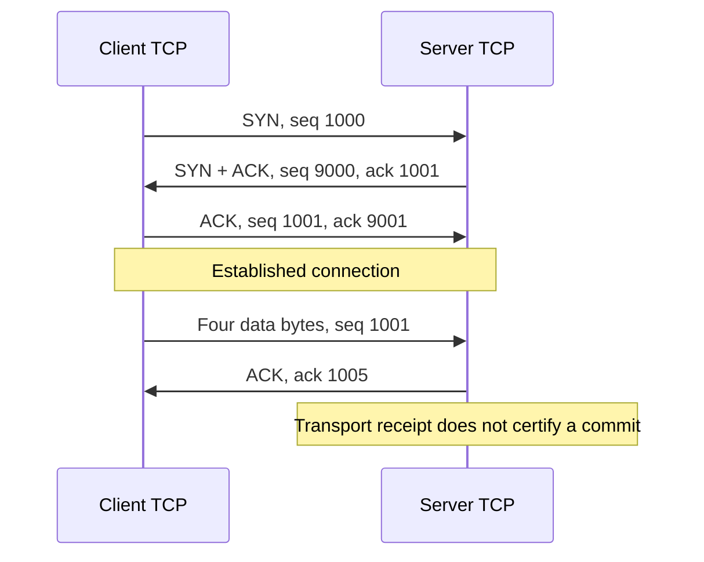
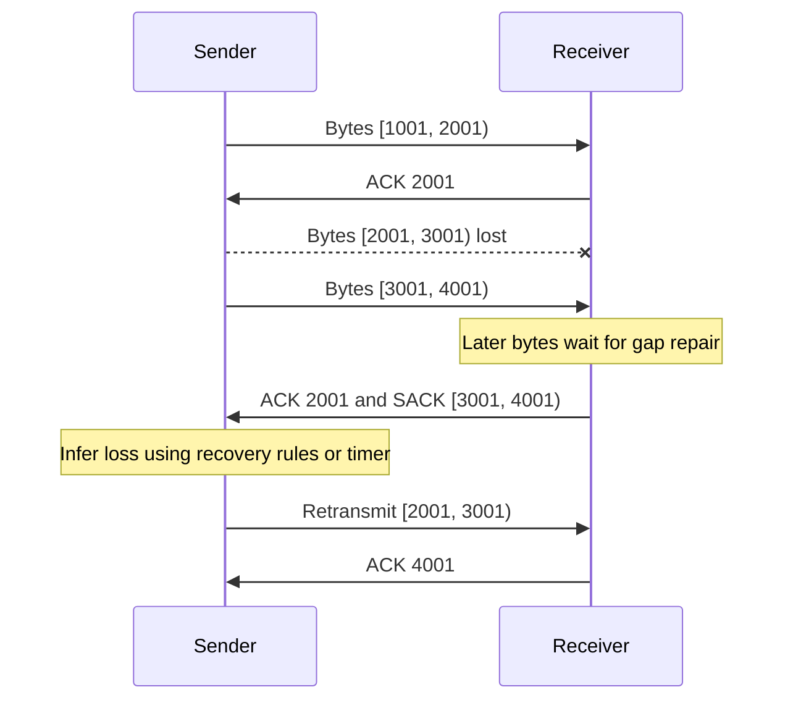
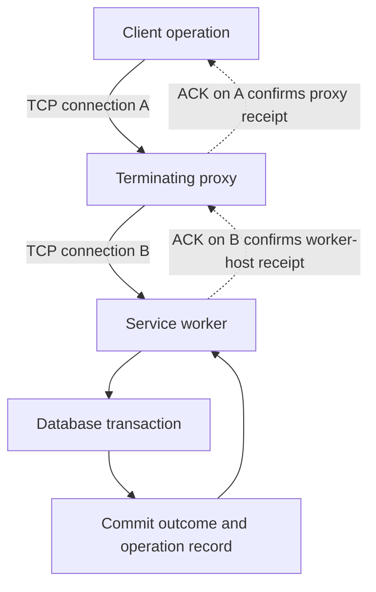

A client uploads a file to a service across an eighty-millisecond network path. Some packets disappear; others take different paths and arrive out of order. The server needs the original file, while the client needs to avoid overwhelming either the server or the network between them.

Sending the file once is insufficient. Sending it repeatedly wastes capacity and creates duplicates. Waiting for confirmation after every packet makes the application spend most of its time waiting. Adding many clients makes the problem harder: each sender sees its own traffic, while all of them may share one congested link.

TCP supplies an ordered byte stream and a distributed control loop for this setting. Its state includes what has been sent, what has been acknowledged, which bytes need recovery, how much the receiver can accept, and how much the network appears able to carry. Those mechanisms explain both its usefulness and its limits in production.

This article continues [Ports: Sockets, Connections, and Capacity](/field-notes/ports-sockets-connections-and-capacity/) and [NAT: Addresses, Ports, and Connection State](/field-notes/nat-addresses-ports-and-connection-state/). Examples and calculations are illustrative. The standards and implementation notes below were checked in November 2026.

## Start with a protocol that waits

A basic reliable sender can attach a number to each data block, send one block, and wait for an acknowledgment. If no acknowledgment arrives before a timer expires, it sends the block again. The receiver remembers which blocks it has accepted and discards duplicates. This **stop-and-wait** scheme limits outstanding work and recovers from some losses.

Its throughput is poor when propagation takes longer than transmission. With one 1,460-byte payload outstanding on an eighty-millisecond round trip, the idealized payload rate is `1,460 / 0.08 = 18,250 bytes/s`, about 146 kilobits/s. That calculation excludes headers, processing, and loss, and assumes the acknowledgment arrives one round trip later. A faster link alone cannot remove the wait.

Allowing several blocks to remain outstanding fills that idle time. The sender must then track a range of unacknowledged data, recognize partial progress, and recover gaps without duplicating the application-visible data. It also needs limits that adapt to receiver capacity and competition on the path. These requirements lead to TCP's windows, acknowledgments, timers, and congestion controller.

Implementing these mechanisms over UDP is possible, but it creates a transport protocol that must also handle reordering, stale traffic, resource exhaustion, and changing paths. For an ordinary service requiring an ordered stream, the operating system's TCP implementation already carries that burden.

## The contract: two ordered streams

A TCP connection carries two independent directions of bytes. Each direction has its own sequence space and sending state. TCP does not preserve application message boundaries: a write can be split across reads, and several writes can appear together in one read. An application protocol must define records, lengths, delimiters, or some other framing.

Within an established connection, TCP reassembles acceptable data by byte position and suppresses duplicate delivery of retransmitted bytes. A reset, timeout, or crash can still terminate the stream before all intended data arrives. Reliability is conditional on the connection continuing to make progress; it is not a promise to finish despite permanent failure.

The [base TCP specification, RFC 9293](https://www.rfc-editor.org/rfc/rfc9293.html), also separates transport delivery from application behavior. An acknowledgment establishes transport progress at the receiving endpoint. It does not certify that a handler read the bytes, that an authorization check passed, or that a database committed a transaction.

TCP's checksum detects some transmission corruption. It supplies neither cryptographic peer authentication nor confidentiality. Services requiring those properties normally add TLS and application authorization. A successful TCP handshake alone does not identify a trusted caller.

### Connection establishment synchronizes state

Within the relevant network and protocol context, a connection uses the local and remote address/port pairs. Each endpoint also needs to agree on the starting sequence numbers. In the usual three-way handshake, a client sends SYN, a server sends SYN plus ACK, and the client acknowledges that response.



*Figure 1. Each SYN consumes one sequence number. The four data bytes occupy positions 1001 through 1004. The acknowledgment names the next expected position.*

These small numbers are for explanation; actual initial sequence numbers have security requirements. Sequence numbers occupy a 32-bit, wrapping space, so implementations use modular comparisons rather than treating them as unlimited integers. The handshake helps distinguish a current connection from delayed traffic belonging to an earlier incarnation.

In the ordinary loss-free case, connection establishment contributes roughly one round trip before the client can send normal application data. TLS and application exchanges add their own timing. Reused connections avoid repeating setup for every request. Specialized early-data mechanisms have additional conditions; do not subtract setup time from a latency budget without checking the protocol actually negotiated.

## Sequence numbers make loss recoverable

Suppose a receiver expects byte 1001. The sender transmits three payload ranges, each one thousand bytes long. The first and third arrive, while the middle range is lost.



*Figure 2. Ranges are half-open: the upper endpoint is excluded. The figure assumes selective acknowledgment was negotiated; one repeated ACK alone does not imply immediate retransmission.*

A **cumulative acknowledgment** reports the next byte expected in order. ACK 2001 confirms the contiguous prefix ending at byte 2000. It cannot advance to 4001 while the gap remains. A **selective acknowledgment**, or SACK, reports additional received ranges, helping the sender avoid retransmitting everything after the hole.

The sender tracks outstanding ranges and recovery state, often described as a SACK scoreboard. A SACK report helps infer what to repair; it is not an application acknowledgment. Selectively acknowledged data must remain recoverable at the sender until cumulatively acknowledged because a receiver can discard buffered out-of-order data under permitted conditions.

After the missing range arrives, the receiver can advance its cumulative acknowledgment and release the now-contiguous bytes to the stream. The application does not receive two copies merely because the network or retransmission produced duplicates.

This ordering creates **head-of-line blocking**: later received bytes wait behind a missing earlier range. If an application multiplexes unrelated requests onto the same TCP connection, a transport gap can delay all of them. [HTTP/2's specification](https://www.rfc-editor.org/rfc/rfc9113.html#section-1) explicitly retains this TCP-level limitation even though it interleaves application streams.

## Recovery uses both evidence and time

The classical fast-retransmit approach uses repeated acknowledgments as evidence of a hole. A threshold of three duplicate ACKs is the familiar case. Recovery also adjusts sending behavior because loss may indicate congestion. The details depend on the negotiated options and algorithm; every loss does not produce the same fixed delay.

Tail loss is particularly awkward. If the last segment disappears and no later data arrives, the receiver may generate no new evidence of the gap. A retransmission timeout, abbreviated RTO, provides a fallback when acknowledgment feedback stops.

[RFC 6298](https://www.rfc-editor.org/rfc/rfc6298.html) computes the timer from a smoothed round-trip estimate and its variation:

```math
\mathrm{RTO}_{\mathrm{raw}}
=\mathrm{SRTT}+\max(G,4\,\mathrm{RTTVAR}).
```

All terms are durations. SRTT is the smoothed round-trip time; RTTVAR tracks variation; `G` represents clock granularity. For illustrative values of 80 ms, 10 ms, and 1 ms, the expression yields `80 + max(1, 40) = 120 ms`. This is the raw calculation: RFC 6298 recommends rounding computed RTOs below one second up to one second. Actual stacks can use different minimums and newer recovery mechanisms. A measured eighty-millisecond RTT does not imply an eighty-millisecond recovery deadline.

The timer backs off after repeated expiry. Retransmitted data also creates ambiguity about which transmission an ACK measured; RTT sampling rules avoid feeding that ambiguity into the estimator unless a mechanism resolves it.

[RACK-TLP, standardized in February 2021](https://www.rfc-editor.org/rfc/rfc8985.html), improves the evidence available before that fallback. RACK uses transmission times and acknowledgment information to infer that an earlier transmission has been lost after later transmissions are delivered, allowing for reordering. Tail Loss Probe sends limited probe traffic to elicit feedback near the end of a flight. Recovery still needs limits and timers; probing cannot repair a permanently unreachable peer.

## Two windows answer different questions

**Flow control** protects the receiver. It advertises a receive window, `rwnd`, describing how much sequence space the sender may use beyond the acknowledged prefix. If the application stops consuming data and buffers fill, this window can shrink to zero.

**Congestion control** protects the shared path. The sender maintains a congestion window, `cwnd`, and may pace packet transmission. A server with plenty of receive memory can still sit behind a saturated link. A clear network path can still lead to a stalled reader. Raising one window does not fix the other constraint.

A useful approximation for additional sending allowance is:

```math
\mathrm{allowance}\approx
\max\bigl(0,\min(\mathrm{cwnd},\mathrm{rwnd})-\mathrm{flight}\bigr).
```

Here all quantities are bytes, and `flight` approximates outstanding data. Actual recovery algorithms account for retransmissions and selectively acknowledged data more carefully than this expression. It is a planning model for identifying a limiting window, rather than an implementation of a TCP sender. Pacing and application data availability can impose tighter limits.

The data needed to fill a path is its **bandwidth-delay product**, or BDP:

```math
\mathrm{BDP}=B\times\mathrm{RTT},
\qquad
R\lesssim\min\left(B,\frac{W}{\mathrm{RTT}}\right).
```

`B` is bottleneck capacity in bytes/s, RTT is in seconds, `W` is a limiting effective window in bytes, and `R` is an idealized payload rate. A one-gigabit/s path is 125 million bytes/s. At 0.08 seconds, its BDP is ten million bytes, or 10 MB using decimal units. A 64 KiB window permits only `65,536 / 0.08 = 819,200 bytes/s`, about 6.55 megabits/s, before accounting for other costs.

This calculation explains why long-distance transfers can need larger windows. It does not justify reserving ten megabytes for every idle connection. TCP's header carries a sixteen-bit receive-window field. Window scaling, negotiated during the handshake, expands the range that field represents for later segments. Buffer policies and memory ceilings determine what the host can actually support. Size buffers for measured workloads and concurrency, including the cost of out-of-order data.

## Congestion control is an ongoing estimate

No endpoint knows the full changing state of the network. It observes acknowledgments, delivery rate, delay, loss, and, when supported, explicit congestion signals. Different controllers interpret those observations differently.

In the classical Reno family, slow start grows the congestion window rapidly while probing available capacity. Under favorable ACK behavior this is roughly exponential by round trip. Congestion avoidance grows more gradually, approximately one maximum-sized segment per RTT, while loss response reduces sending. [RFC 5681](https://www.rfc-editor.org/rfc/rfc5681.html) defines these interacting mechanisms. Real ACK patterns, startup rules, and implementation changes prevent a universal packet-by-packet growth formula.

CUBIC changes the growth function. After a congestion event, it uses elapsed time and a cubic curve around a prior operating window to search capacity on fast, long-distance paths. This avoids depending solely on Reno's slow linear window growth. It still has to coexist with competing flows and respond to congestion. Standards Track [RFC 9438, published in August 2023](https://www.rfc-editor.org/rfc/rfc9438.html), records implementation-driven refinements; CUBIC itself predates that publication.

BBR builds a model of delivery capacity and propagation delay, using it to set pacing and in-flight targets. This can reduce reliance on filling queues until losses reveal a limit. Estimation is difficult when the application has little to send, ACKs arrive in bursts, routes change, or competing controllers behave differently. Later BBR versions incorporate loss and ECN constraints; saying that BBR ignores loss is inaccurate for those versions.

**Explicit Congestion Notification**, or ECN, lets supporting network devices mark congestion instead of communicating it only through drops. Receivers feed that signal back to senders. An endpoint still needs a controller that responds appropriately, and devices must mark consistently with the intended scheme. Enabling a flag cannot manufacture support throughout a path.

Choose a controller through a bounded rollout across relevant RTTs, loss patterns, traffic sizes, and competitors. Compare completion-time distributions, retransmissions, queueing delay, CPU, and fairness. A bulk-transfer gain can coexist with worse short-request latency or a cost imposed on other traffic.

## The application still needs records and deadlines

Consider a protocol that sends a four-byte unsigned length followed by that many payload bytes. The receiver must read the entire header, validate the length, and then assemble the complete body. A single `recv()` is allowed to return fewer bytes than requested.

This Python 3.9+ example uses only the standard library and loopback TCP. It reads two frames even if their bytes are split or combined across socket reads. The monotonic deadline is shared across the header and body, preventing a slow sender from receiving a fresh full allowance after every partial read.

```python
import math
import socket
import time


def recv_exact(sock, size, deadline):
    buffer = bytearray()
    while len(buffer) < size:
        wait = deadline - time.monotonic()
        if wait <= 0:
            raise TimeoutError("Frame deadline expired")
        sock.settimeout(wait)
        chunk = sock.recv(size - len(buffer))
        if not chunk:
            raise EOFError("Stream ended before the frame was complete")
        buffer.extend(chunk)
    return bytes(buffer)


def read_frame(sock, max_payload, timeout_seconds):
    if not isinstance(max_payload, int) or max_payload < 0:
        raise ValueError("Maximum payload must be a nonnegative integer")
    if not math.isfinite(timeout_seconds) or timeout_seconds <= 0:
        raise ValueError("Timeout must be positive and finite")
    previous_timeout = sock.gettimeout()
    deadline = time.monotonic() + timeout_seconds
    try:
        length = int.from_bytes(recv_exact(sock, 4, deadline), "big")
        if length > max_payload:
            raise ValueError("Frame exceeds the configured size limit")
        return recv_exact(sock, length, deadline)
    finally:
        sock.settimeout(previous_timeout)


def main():
    payloads = [b"hello", b"TCP"]
    with socket.socket(socket.AF_INET, socket.SOCK_STREAM) as listener:
        listener.settimeout(2.0)
        listener.bind(("127.0.0.1", 0))
        listener.listen(1)
        with socket.create_connection(listener.getsockname(), timeout=2.0) as client:
            connection, _ = listener.accept()
            with connection:
                # Two records share one byte stream; no packet layout is assumed.
                wire = b"".join(len(p).to_bytes(4, "big") + p for p in payloads)
                client.sendall(wire)
                for _ in payloads:
                    frame = read_frame(connection, max_payload=1024, timeout_seconds=2.0)
                    print(frame.decode("utf-8"))


if __name__ == "__main__":
    main()
```

Verified output:

```text
hello
TCP
```

The example demonstrates framing, rather than forcing any particular packet segmentation. Separate tests exercise one-byte reads, combined frames, truncation, oversized lengths, and deadline expiry. Empty frames are permitted. An EOF during framing raises an exception; a real protocol may separately distinguish an orderly boundary close from a truncated record.

The size limit bounds one payload, while concurrent connections and queued records need additional memory budgets. Converting the accumulated buffer to bytes temporarily uses additional memory. A large-file protocol should stream bounded chunks to its consumer rather than assemble the whole file. The timeout is per frame and does not replace an overall request deadline. On a framing error or timeout, close this example's connection; continuing after consuming only part of a frame would require explicit recovery rules. Use exclusive ownership while changing socket timeouts and reading this synchronous stream.

## Failure scenarios that change application design

The difficult failures leave different layers with different evidence. A kernel can acknowledge bytes before a process crashes. A server can commit a change while its response is lost. An idle socket can remain apparently established after a firewall silently discards its mapping.

<div class="table-scroll" role="region" aria-label="TCP failure symptoms, ownership boundaries, and mitigations" tabindex="0">

| Situation | What TCP can establish | What the application must handle |
| --- | --- | --- |
| Missing data segment | Recover bytes using feedback and timers if the path recovers | Budget for tail latency and an overall deadline |
| Reader stops consuming | Advertised receive capacity can shrink to zero | Bound queues, shed load, and detect stalled work |
| Process crashes after transport ACK | Earlier bytes reached the receiving TCP endpoint | Recover application state and resolve operation status |
| Commit succeeds; response disappears | The client may see only a timeout or reset | Retry with a durable idempotency protocol or query status |
| Silent route or NAT failure | An idle connection may receive no prompt failure indication | Use suitable probes, deadlines, and reconnect policy |
| Some paths reject larger packets | Small exchanges may work while larger transfers stall | Investigate MTU discovery, ICMP policy, and packet sizes |
| Many clients reconnect together | Connection establishment itself consumes resources | Jitter retries, cap attempts, and control admission |
| Orderly close or abrupt reset | EOF and reset have different transport meanings | Validate complete records and transaction outcomes |

</div>

An **application-level retry** is a new operation attempt, possibly on another connection. TCP's duplicate-byte suppression cannot deduplicate that attempt. A durable idempotency key must cover the intended operation, result, and relevant transaction boundary. Recording the key separately from the side effect can itself leave a crash window.



*Figure 3. A TCP-terminating proxy owns one connection on each side. The diagram assumes termination; a packet-forwarding load balancer has different transport ownership. Neither connection's ACK proves the database transaction committed.*

### Close is a protocol, and silence is ambiguous

FIN closes one sending direction after its earlier bytes; the other direction can continue. A FIN consumes a sequence number. An application can intentionally half-close its sending side while reading a response. A reset aborts the connection, but still does not answer whether a previously submitted operation took effect.

TIME_WAIT retains state after normal close to handle delayed traffic and final acknowledgment behavior. It is not simply evidence of a leak. CLOSE_WAIT means the local TCP endpoint received the peer's FIN and the local application has not yet completed its close; persistent growth deserves investigation of application cleanup. The existing [Ports article](/field-notes/ports-sockets-connections-and-capacity/) covers how endpoint allocation and connection churn interact.

Keepalive probes are optional transport liveness checks. They can help find some dead paths, but do not establish that a live application is making useful progress. On Linux, [`TCP_USER_TIMEOUT`](https://man7.org/linux/man-pages/man7/tcp.7.html) bounds how long transmitted data can remain unacknowledged, or buffered data can remain blocked by a zero receive window. It does not by itself schedule keepalive probes or act as a general idle-request timer. Application deadlines are still necessary.

## Scale the state you actually own

For a small service, one listener and ordinary TCP sockets may be sufficient. Reuse connections where the application protocol permits it, bound pending requests, and measure setup separately from service work. Avoid opening a connection for every tiny request merely because it simplifies a call site.

As concurrency grows, socket state and buffers become a capacity concern. As an illustrative budget, 100,000 connections averaging 32 KiB of charged memory already account for about 3.28 GB in decimal units, before other costs. Actual accounting depends on the kernel, buffer use, queues, and TLS. Configured maxima are not the same as memory allocated to every connection.

Event-driven I/O avoids reserving a thread per idle socket. It does not remove per-connection memory, encryption work, packet processing, or application queues. Hardware offloads can reduce host work by combining segmentation or reception operations; packet captures taken on a host may therefore show units different from the packets on the wire. Investigate where a capture was taken before diagnosing oversized network packets from it.

At larger scale, front ends distribute **new** connections across workers. An established connection has sequence, retransmission, and congestion state owned by its endpoint. Sending its next packet to an unrelated replacement process cannot recreate that state. Ordinary deployments use connection draining, graceful protocol shutdown, bounded lifetimes, and reconnects; transparent failover requires additional mechanisms and matching application semantics.

A terminating proxy can place the client-side TCP endpoint closer to the user, own buffering, and reuse backend connections. It also adds queues, memory, failure modes, and a second set of transport metrics. Faster acknowledgment on the near side does not remove the propagation delay of obtaining an origin response.

Across regions, RTT and failure domains become architectural inputs. Place latency-sensitive interactions near their users when consistency and data placement permit it. TCP cannot shorten physical propagation or decide whether a cross-region write is safe to retry. A pool with hundreds of connections is also not guaranteed to deliver hundreds of times one connection's rate; it can merely increase contention at the same bottleneck.

## Operate TCP by separating the clocks and queues

Measure DNS resolution, connection setup, TLS setup, pool waiting, time to first application response, and total completion separately. A five-hundred-millisecond RPC can spend most of its budget waiting for a pool slot while the established TCP connection is healthy.

Track active connections, new connections/s, failed handshakes, retransmissions, RTT distributions, timeouts, resets, receive and send queue occupancy, accept pressure, file descriptors, and charged memory. Include request size and destination so a bulk transfer does not hide a latency-sensitive flow. An aggregate retransmission counter alone cannot distinguish persistent congestion, path reordering, host drops, and a faulty link.

On Linux, read-only inspection can start with:

```sh
ss -tin
ss -ltn
nstat -az
sysctl net.ipv4.tcp_available_congestion_control
sysctl net.ipv4.tcp_congestion_control
```

Treat these as diagnostic inputs. `ss` output varies with tool and kernel versions; a listening socket's queue fields have different meanings from an established socket's data queues. A send queue alone does not identify whether the application, receiver, or path is responsible for the stall. Combine endpoint observations with application traces and, when necessary, packet captures at both sides.

The [Linux IP sysctl documentation](https://docs.kernel.org/networking/ip-sysctl.html) distinguishes available congestion algorithms, the choice for new connections, and listener inheritance. Inspect the actual namespace and kernel used by a container or proxy. Do not assume a host setting describes every existing socket. Canary changes and create new comparison connections when evaluating a default change.

For small request/response exchanges, Nagle's algorithm and delayed acknowledgments can interact with an application that emits a request in tiny pieces and then waits. `TCP_NODELAY` can remove Nagle's batching delay, at a possible packet-rate cost. First assemble the request sensibly and measure the actual wait. No single delayed-ACK duration or universal setting applies to every operating system and workload.

Backlogs and SYN defenses address admission pressure. SYN cookies help under some handshake attacks, but do not provide unlimited capacity for accepted sockets, TLS, or handlers. A larger backlog can absorb a burst while increasing waiting time; it cannot make an overloaded application process work faster.

## Production lessons from Amazon and Google

Amazon's [Builders' Library discussion of timeouts and retries](https://aws.amazon.com/builders-library/timeouts-retries-and-backoff-with-jitter/) describes a service whose roughly twenty-millisecond timeout also covered establishing a new secure connection. Deployment introduced cold connections that exceeded the budget, even though reused connections had worked. Establishing those connections during startup removed that source of failures.

The engineering point is specific: measure the work inside the timeout, including cold setup. Connection reuse changes the latency distribution. The same article explains why retries need bounded backoff and jitter, and why a timeout does not imply side effects were absent. An application retry loop must account for load and operation semantics even when TCP already retransmits packets.

Google's [March 2024 IETF presentation](https://datatracker.ietf.org/meeting/119/materials/slides-119-ccwg-bbrv3-overview-and-google-deployment) reported TCP BBRv3 deployment for Google.com, YouTube public Internet traffic, and its internal WAN. The controller models path capacity while incorporating delay, loss, and ECN information. That is evidence of deployment in those stated environments at that date; it does not establish a default for unrelated kernels or prove universal superiority.

Google also publishes [BBRv3 source and testing material](https://github.com/google/bbr/blob/v3/README.md). A controller rollout belongs with workload testing and coexistence analysis. Copying an algorithm name from a company's presentation gives much less assurance than reproducing relevant failure and competing-traffic conditions on the target stack.

## What changed from 2021 through 2026

Several developments refined TCP without changing its ordered-stream contract. RFC 8985 documented RACK-TLP in February 2021. RFC 9293 consolidated the base specification in August 2022. RFC 9438 placed an updated CUBIC specification on the Standards Track in August 2023. These dates identify documents and refinements; they are not the invention dates of all the mechanisms they describe.

[RFC 9768, published in April 2026](https://www.rfc-editor.org/rfc/rfc9768.html), standardized more accurate ECN feedback, called AccECN. It communicates more detailed congestion information than the classic TCP feedback scheme and negotiates compatible behavior during connection establishment. This changes feedback precision. It does not prescribe one congestion controller or prove that routers on a particular path mark packets appropriately.

The current [Linux documentation](https://docs.kernel.org/networking/ip-sysctl.html), checked in November 2026, lists AccECN negotiation settings. Availability still depends on the deployed kernel and peer. Test middlebox behavior and fallback before changing a fleet. Standardization, implementation availability, and broad successful deployment are separate claims.

BBR's [November 2, 2026 working-group draft, version 07](https://datatracker.ietf.org/doc/html/draft-ietf-ccwg-bbr-07), remains an Internet-Draft with intended Experimental status. It is not a completed RFC. Production use and an evolving specification can coexist. Verify the particular BBR implementation and version rather than assuming every module named `bbr` contains the same algorithm.

The practical direction is better feedback, earlier loss diagnosis, explicit pacing, and workload-specific validation. These refinements improve how a connection shares a network. They leave record framing, durable operations, and request-level recovery with the application.

## TCP, UDP, and QUIC make different commitments

<div class="table-scroll" role="region" aria-label="Transport choices and their ordering, recovery, and operational tradeoffs" tabindex="0">

| Approach | Ordering and recovery boundary | Useful when | Costs and limitations |
| --- | --- | --- | --- |
| TCP | Ordered bytes in each direction of one connection | Existing stream protocols, broad compatibility, ordinary service calls | A missing byte stalls later bytes; framing and security need higher layers |
| UDP with an application protocol | Application chooses message handling and reliability | Timely updates where late data can be discarded | Congestion response, loss handling, security, and message sizing require deliberate design |
| QUIC | Independently ordered streams within a secured connection | Multiplexed traffic and environments needing supported path migration | UDP reachability, implementation CPU, shared congestion limits, and deployment tooling matter |

</div>

[QUIC, standardized in RFC 9000 in May 2021](https://www.rfc-editor.org/rfc/rfc9000.html), uses UDP as its substrate and implements transport behavior above it. Loss affecting one stream need not block unrelated stream delivery, although all streams still share connection resources and congestion limits. Bytes within one stream remain ordered. Application dependencies and shared flow-control limits can still create stalls.

QUIC connection identifiers and path validation support migration between supported paths, such as a mobile address change. TCP connections normally remain tied to their endpoint addresses and ports unless additional mechanisms intervene. Neither protocol supplies application-level exactly-once execution. Choose based on protocol support, traffic shape, compatibility, and operational capability; replacing a transport does not repair an unbounded application queue.

## How Senior and Staff engineers set the boundary

Implementation work begins with correct framing, partial reads and writes, cleanup, and timeouts. Broader design work asks which component owns each connection, which queues can grow, and which outcome survives a process failure.

A slow transfer calls for identifying a limiting resource before changing settings: a congestion window, receive window, pacing rate, disk reader, CPU, path capacity, or application dependency. More connections and larger buffers introduce costs that may land on a different team or tenant.

During migration, include long-lived connections, mixed kernel versions, proxy termination, retry amplification, and the ability to revert defaults. Define the blast radius of a controller change or a cold-start surge. An improvement should satisfy latency and error budgets across the intended traffic, with enough visibility to attribute a regression.

## A working model

TCP maintains a numbered stream, repairs gaps using evidence and timers, and regulates outstanding work against both receiver and path constraints. Its knowledge ends at transport state. Keep that boundary visible when interpreting an ACK, choosing a timeout, or deciding whether a retry is safe.

- Distinguish transport acknowledgment, application response, and durable commit in every request path.
- Use RTT and effective windows to explain transfer limits before buying bandwidth or enlarging buffers.
- Bound application queues and deadlines alongside TCP's own flow and congestion controls.
- Plan reconnection and operation recovery when replacing an endpoint that owns connection state.
- Evaluate controller and transport changes on the actual traffic mix, including competing flows and partial failures.

## Further reading

- [RFC 9293: Transmission Control Protocol](https://www.rfc-editor.org/rfc/rfc9293.html) — The consolidated base specification explains sequence spaces, connection states, and the stream contract.
- [RFC 5681: TCP Congestion Control](https://www.rfc-editor.org/rfc/rfc5681.html) — The classical slow-start, congestion-avoidance, and fast-recovery rules provide a foundation for comparing controllers.
- [RFC 6298: Computing TCP's Retransmission Timer](https://www.rfc-editor.org/rfc/rfc6298.html) — The estimator, timer bounds, and backoff rules explain why RTT alone does not determine recovery time.
- [RFC 8985: The RACK-TLP Loss Detection Algorithm for TCP](https://www.rfc-editor.org/rfc/rfc8985.html) — This specification explains time-based loss inference and probing near the end of a flight.
- [RFC 9438: CUBIC for Fast and Long-Distance Networks](https://www.rfc-editor.org/rfc/rfc9438.html) — Read how CUBIC's growth and congestion response developed through implementation experience.
- [RFC 9768: More Accurate ECN Feedback in TCP](https://www.rfc-editor.org/rfc/rfc9768.html) — The 2026 specification separates more precise feedback from the sender's congestion response.
- [BBR working-group draft, version 07](https://datatracker.ietf.org/doc/html/draft-ietf-ccwg-bbr-07) — This November 2026 draft documents BBR's path model and retains its work-in-progress status.
- [Google: BBRv3 overview and deployment, March 2024](https://datatracker.ietf.org/meeting/119/materials/slides-119-ccwg-bbrv3-overview-and-google-deployment) — The authors describe mechanisms and the deployment scope reported at that time.
- [Linux tcp(7)](https://man7.org/linux/man-pages/man7/tcp.7.html) — Socket options and implementation details help connect the protocol to host behavior.
- [Linux IP sysctl documentation](https://docs.kernel.org/networking/ip-sysctl.html) — Check the meaning, inheritance, and version-specific availability of transport controls before tuning a host.
- [Amazon: Timeouts, retries, and backoff with jitter](https://aws.amazon.com/builders-library/timeouts-retries-and-backoff-with-jitter/) — A concrete cold-connection incident shows why timeout scope and retry policy must be designed together.
- [RFC 9000: QUIC](https://www.rfc-editor.org/rfc/rfc9000.html) — QUIC's stream and path mechanisms clarify which TCP constraints a different transport can change.
