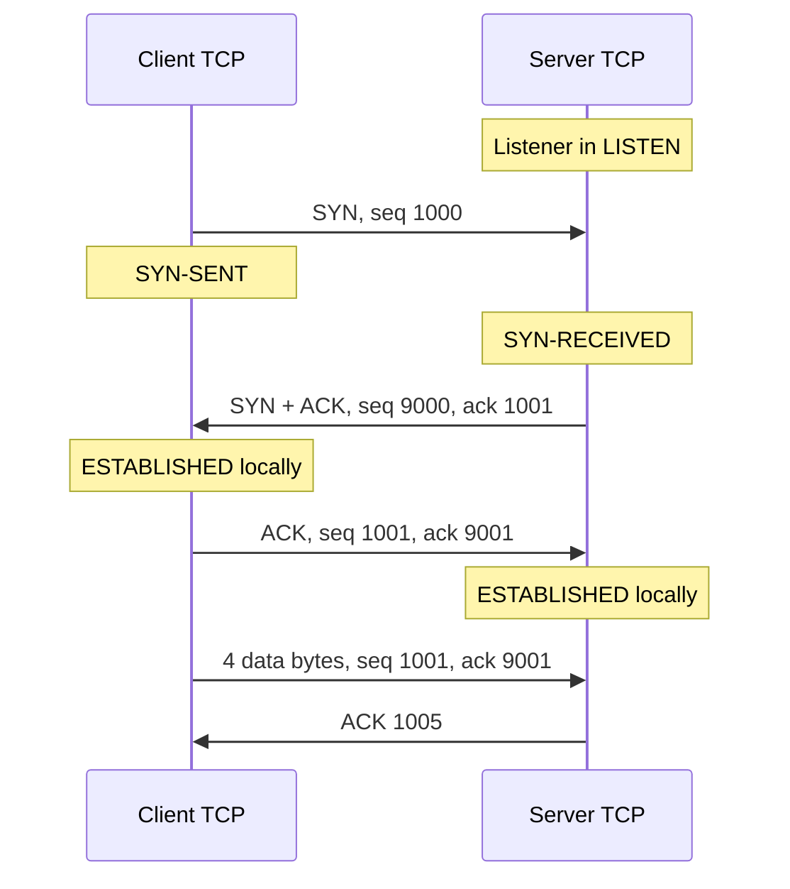
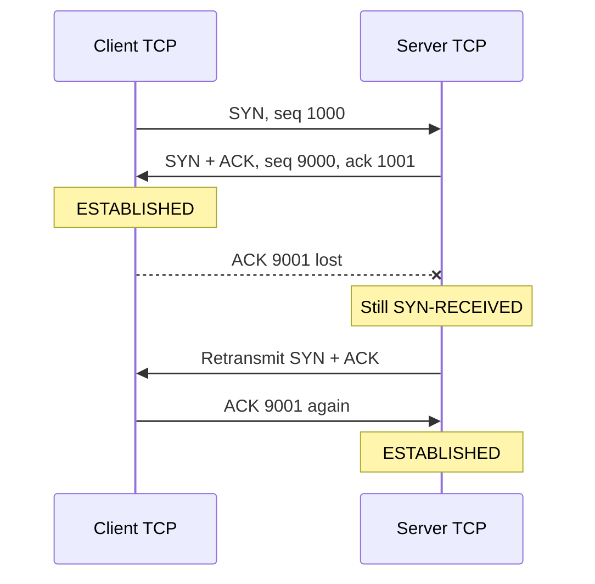
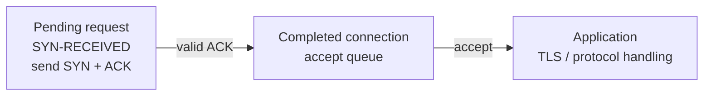
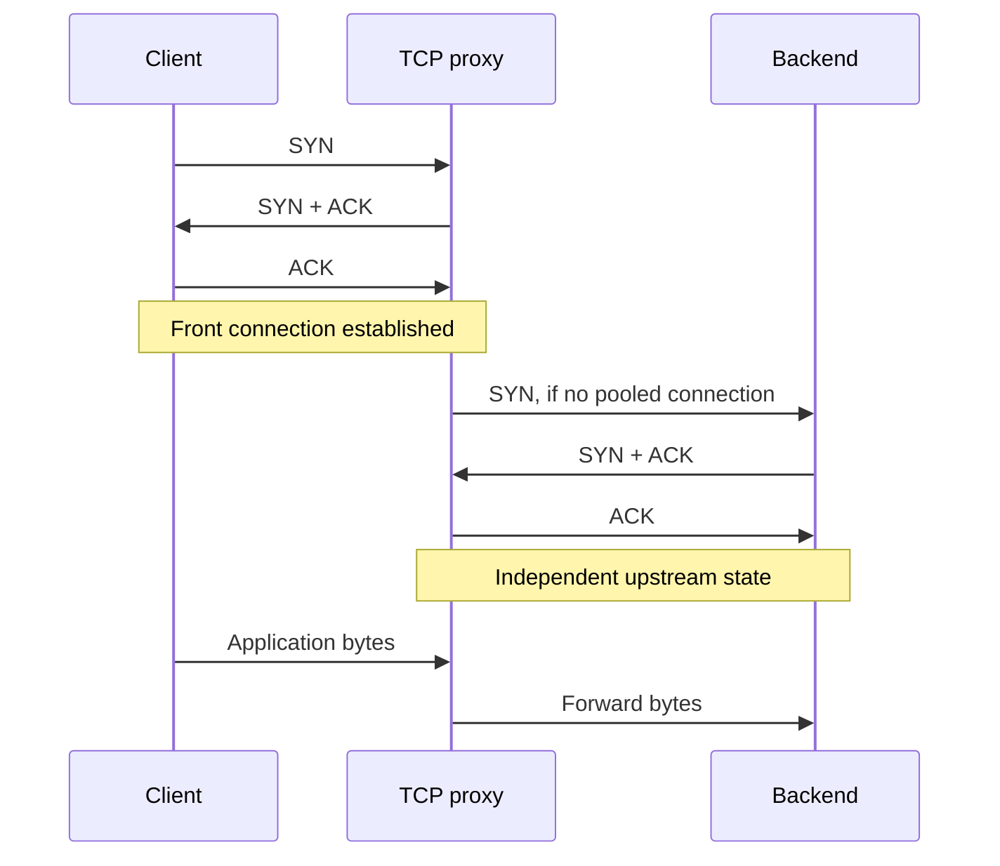

A service spends five milliseconds processing a request, yet a new client across an eighty-millisecond network path waits hundreds of milliseconds for its first response. Later requests on the same connection are much faster. During a deployment, that advantage disappears: thousands of clients reconnect together, and connection timeouts rise even though request-handler CPU remains low.

The TCP three-way handshake helps explain both observations. Before carrying an ordinary application exchange, the endpoints establish connection state and agree on where each direction of the byte stream begins. That work costs time and resources before an application handler sees a request.

This article examines connection establishment in detail. It continues [TCP: Reliable Bytes, Congestion, and Failure Boundaries](/field-notes/tcp-reliable-bytes-congestion-and-failure/) without repeating its treatment of congestion control and established-stream recovery. Examples use illustrative addresses, sequence numbers, and capacity assumptions. Standards and implementation references were checked in November 2026.

## Start with the state a new connection needs

An IP packet carries no permanent connection object through the network. Routers forward packets; the endpoints maintain the state needed to interpret them as one conversation. A packet may be delayed, duplicated, dropped, or delivered after an endpoint has restarted.

For a TCP conversation, each endpoint tracks the local and remote addresses and ports, along with sending and receiving progress. A destination port identifies a service endpoint. It does not by itself distinguish every client connection. The network namespace and protocol context also matter when identifying a socket.

Imagine a server receiving a request to begin a conversation. It needs a starting position for the client's bytes and a starting position for its own bytes. It also needs evidence that the peer received its response. Creating an application session immediately after seeing one packet would let delayed traffic and spoofed requests allocate state too easily.

A small internal application can avoid designing this machinery by using the operating system's TCP stack. Once connection churn or setup latency becomes significant, engineers still need to understand the machinery they have delegated.

## A two-message proposal leaves unfinished work

Consider a hypothetical protocol. The client sends `OPEN`, and the server replies `READY`. The server then declares the conversation established.

If `READY` disappears, the client is still waiting while the server believes the exchange finished. If an old `OPEN` arrives after a previous conversation ended, the server may create state for a client that is no longer trying to connect. An identifier helps, but the server still needs a way to confirm that a response reached the participant initiating this particular exchange.

TCP addresses this with an exchange of initial sequence numbers and acknowledgments. The third message confirms receipt of the server's starting sequence number. The [historical specification, RFC 793](https://www.rfc-editor.org/rfc/rfc793.html#section-3.4), explains establishment through delayed-duplicate examples. It has been superseded; [RFC 9293](https://www.rfc-editor.org/rfc/rfc9293.html#section-3.5) is the current base specification.

The third message can itself disappear. A finite handshake cannot give both participants permanent certainty about the other's knowledge or future availability. TCP combines a state machine with retransmission and timeout behavior so temporary uncertainty can resolve while failed attempts eventually release resources.

## Sequence numbers identify byte positions

TCP carries a byte stream in each direction. Each sender chooses an **initial sequence number**, abbreviated ISN. The SYN flag introduces that starting position. An acknowledgment number reports the next sequence position the receiver expects.

Use client ISN 1000 and server ISN 9000. A SYN consumes one sequence position, even when it contains no application bytes. Consequently, acknowledging the client's SYN produces ACK 1001, and acknowledging the server's SYN produces ACK 9001. A pure ACK with no payload consumes no sequence space.

The numbers in the example make arithmetic easy. Production ISNs need resistance to prediction and confusion with earlier connections. The construction described in [RFC 6528](https://www.rfc-editor.org/rfc/rfc6528.html), subsequently incorporated into RFC 9293, combines a time-dependent component with a secret-dependent function of the connection tuple. A predictable global counter is inadequate as an anti-injection defense.

Sequence arithmetic wraps modulo `2^32`; valid ordering comparisons account for that wrap. Selecting ISNs is also only part of handling old traffic. Packet-lifetime assumptions, sequence windows, timestamps where used, and safe connection reuse contribute to the protection. There is no globally unique connection UUID in the basic TCP header.

## Follow the three messages and the two state machines



*Figure 1. The usual active/passive open, without loss or early data. The client and server enter ESTABLISHED at different moments. The listening socket remains available for other connections.*

The client initiates an active open and records an outstanding SYN. The server's response both acknowledges that SYN and introduces the server's own ISN. These two logical operations fit in one SYN+ACK segment. The client validates the response and acknowledges the server's SYN.

The server can finish its ordinary establishment path after accepting that acknowledgment. The diagram's four data bytes then occupy client sequence positions 1001 through 1004. ACK 1005 names the next expected position.

The application API has its own timing. A successful client `connect()` normally indicates local transport establishment. It does not prove that the remote application called `accept()`, completed TLS, read a request, or committed a result. Nonblocking connection completion must also check the socket error result; writability alone is insufficient evidence of success.

The final handshake ACK may carry application data. There need not be a separate empty ACK followed by a separate data packet. Conversely, packet captures can contain retransmissions and auxiliary packets. “Three-way” describes the logical ordinary exchange, rather than promising exactly three packets in every trace.

### Why the server needs the last acknowledgment

Receiving the SYN+ACK tells the client that its SYN reached the responding endpoint. Receiving the final ACK tells the server that its own SYN reached a peer able to respond with an acceptable acknowledgment. This completes synchronization of the two sequence spaces.

An old duplicate SYN therefore need not create a completed connection: a peer that is not opening that connection will not supply the expected valid continuation. Neither this exchange nor a valid sequence number authenticates a human, account, or trusted service. An on-path attacker can observe traffic, and a malicious reachable client can complete handshakes.

A fourth standalone message is unnecessary for the ordinary exchange because the server combines its SYN with the acknowledgment of the client's SYN. Simultaneous open is another valid state-machine path: both endpoints can initiate, cross SYNs, and finish synchronization. The familiar client/server drawing covers the common case.

## The handshake also establishes transport capabilities

Inspect options as well as flags. MSS advertises a receiver's maximum TCP payload segment size; the two directions may advertise different values. A sender also accounts for path limits. This is separate from an application's record size.

Window scaling allows receive windows beyond the unscaled 16-bit field. [RFC 7323](https://www.rfc-editor.org/rfc/rfc7323.html#section-2) specifies its handshake negotiation: both peers must offer scaling, the shift factors are per direction, and the window fields in SYN-bearing segments remain unscaled. Timestamps support RTT measurement and protection against wrapped sequence numbers under the specified rules.

Other extensions include SACK permission and ECN negotiation. Their presence depends on the stack and path. A middlebox that alters or drops unfamiliar options can affect either connectivity or later throughput. Compare options from the two ends before concluding that an application change caused a network regression.

The handshake does not reserve bandwidth or determine how many concurrent requests a service can process. Receive windows, congestion control, TLS policy, and application admission control address different constraints after establishment.

## Loss creates temporary disagreement

If the initial SYN is lost, the server may have no record of the attempt. The client retries according to its timer and policy. If the SYN+ACK is lost, the server may retain a pending request while the client remains in SYN-SENT. Retransmission can repair either exchange.

Losing the third message is more subtle:



*Figure 2. One possible recovery when the final ACK disappears and no intervening data completes establishment. Later acceptable data carrying the needed ACK can also finish the server's handshake.*

A pure ACK has no independent retransmission timer. Recovery in this example comes from the server retransmitting its outstanding SYN+ACK, which elicits another acknowledgment. If the client sends data first, an acceptable acknowledgment in that segment may complete the server's handshake without waiting for the timer.

Transport retries are different from application retries. Retrying a SYN continues establishment; reconnecting and submitting an order again may create a second business operation. A transport acknowledgment cannot resolve whether a previous application attempt committed. Stable request identities and durable application results address that ambiguity.

[RFC 6298](https://www.rfc-editor.org/rfc/rfc6298.html#section-2) recommends an initial retransmission timeout of one second before an RTT measurement, while permitting a larger initial value. It also specifies backoff behavior. Stack versions and configuration affect actual SYN retry schedules. A “connect timeout” copied from one machine is not a protocol constant.

## Listener queues separate transport from application intake

A server can finish handshakes faster than its application accepts connections. Understanding the waiting stages prevents incorrect tuning.



*Figure 3. A conceptual Linux passive-open path. SYN cookies, TCP Fast Open, deferred accept, overflow handling, and kernel internals can alter the details; the two waiting responsibilities remain useful to distinguish.*

The [Linux `listen(2)` documentation](https://man7.org/linux/man-pages/man2/listen.2.html) distinguishes incomplete connection requests from completed connections awaiting `accept()`. Its backlog argument limits the latter and is capped by `somaxconn`. The SYN backlog concerns pending requests. A full accept queue can prevent a pending request from advancing successfully; these resources interact even though they serve different purposes.

When the event loop is blocked, connection intake may stall before ordinary request processing starts. Increasing a queue limit can absorb a brief pause. It cannot make a permanently slow accept loop consume work faster. Overflow behavior can include drops or resets, depending on the implementation and configuration; a client may see apparent connection success followed by a stall.

<div class="table-scroll" role="region" aria-label="Linux connection establishment controls and their scope" tabindex="0">

| Control | Scope | Operational interpretation |
| --- | --- | --- |
| `tcp_max_syn_backlog` | Remembered pending requests per listener | Investigate pending-state pressure and loss |
| Application `listen(backlog)` and `somaxconn` | Completed connections awaiting acceptance | Check application intake before increasing capacity |
| `tcp_syncookies` | Cookie handling when applicable | A defense path, separate from normal service sizing |
| `tcp_syn_retries` and `tcp_synack_retries` | Active and passive setup retries | Evaluate each side's failure and latency budget |
| Application connect deadline | How long this operation waits | Expiry should close or cancel the unused socket |

</div>

The [kernel sysctl reference](https://www.kernel.org/doc/html/latest/networking/ip-sysctl.html) documents these controls and warns against relying on SYN cookies to sustain legitimate overload. Read the documentation for the deployed kernel and network namespace before changing values. Container and host settings may belong to different scopes.

## Quantify setup latency and waiting state

Let the round-trip time be R. Ignoring processing and loss, a client receives the SYN+ACK after about R and can send its final ACK and ordinary data then. With symmetric one-way delay, the server sees that continuation around `1.5R` after the initial send. This does not imply a `1.5R` client-side `connect()` cost.

For a fresh TCP connection followed by a full TLS 1.3 handshake and one request/response exchange, an illustrative first-byte budget is:

```math
T_{\mathrm{first\ byte}}\approx 3R+T_{\mathrm{application}}.
```

The three round trips represent TCP setup, a normal TLS 1.3 exchange, and the request/first-response flight. This model excludes DNS, connection racing, retries, certificate work, TLS HelloRetryRequest, proxy stages, and transfer time. It assumes no early data. [TLS 1.3's specification](https://www.rfc-editor.org/rfc/rfc8446.html#section-2) defines the handshake exchanges and resumption cases.

At R = 80 ms with 5 ms of application work, the estimate is 245 ms. Reusing an already established secure connection reduces that illustrative path to roughly 85 ms. These are arithmetic examples, not benchmark results. They show why removing two milliseconds from a handler may matter less than avoiding a fresh connection.

Waiting state follows arrival rate and residence time. In a stable interval, Little's law gives:

```math
N_{\mathrm{pending}}\approx\lambda_{\mathrm{SYN}}\,W_{\mathrm{pending}}.
```

Here lambda counts attempts that create remembered pending state, rather than every retransmitted packet. At 20,000 attempts/s and an average 50 ms pending time, the mean is about 1,000 pending requests. If the average increases to two seconds, the estimate becomes 40,000. Under unstable overload or cookie handling, this particular stored-state model needs adjustment.

For the accept queue, suppose handshakes finish at 12,000/s while the application accepts 10,000/s:

```math
\Delta Q\approx\max(0,\lambda_{\mathrm{completed}}-\mu_{\mathrm{accept}})\,\Delta t.
```

The excess is 2,000/s. An initially empty queue with 4,096 available slots fills in about 2.05 seconds under that constant-load approximation. A larger queue buys time and memory; the sustained service-rate deficit remains. Burst distributions and uneven worker scheduling require additional headroom.

## Protect the pending-state boundary

A SYN flood targets work performed before peer reachability is established. Spoofed sources can cause a server to retain incomplete requests without receiving the final ACK. Larger queues and shorter retention change the resource budget but can also harm legitimate clients on lossy paths.

A SYN cache uses compact pending entries. A **SYN cookie** instead encodes verifiable information into the server's initial sequence number, allowing the final ACK to validate the exchange without retaining an ordinary per-request entry for that SYN. The cookie depends on a secret and a limited validity period. [RFC 4987](https://www.rfc-editor.org/rfc/rfc4987.html) explains these defenses and their trade-offs.

Encoding space constrains recoverable state and options; exact support varies by implementation. Cookies do not remove packet processing, response bandwidth, or later established-connection costs. Attackers that complete handshakes can still consume resources. Keep application authentication, connection limits, and request admission controls.

At larger scale, filtering or a SYN proxy can move early validation ahead of an origin's state allocation. This moves a failure boundary and creates another component to operate. It does not create unlimited network capacity or prove that a reachable peer is a legitimate user.

## Proxies create separate connections

A packet-forwarding load balancer can preserve a client-to-backend TCP connection while routing its packets. A TCP-terminating proxy creates independent transport state on its two sides. TLS termination is a further decision that must be described separately.



*Figure 4. An illustrative cold upstream path through a terminating proxy. Real proxies may open upstream connections earlier or reuse existing ones; the two handshakes need not always run serially.*

If the front connection succeeds while upstream setup fails, the client has reached the proxy. The backend may never have accepted a connection. “TCP is healthy” is therefore incomplete without identifying the two endpoints being measured.

This distinction matters during backend rollout. Established front connections can remain open while the proxy changes its upstream pool. Abruptly deleting both sides forces clients through fresh setup and increases the deployment's connection burst. Drain with explicit limits, maintain spare capacity, and spread reconnect attempts over time.

Routing must also preserve established state. Adding a backend does not move existing TCP state automatically. A route change that sends an established flow to a machine lacking that state can break it. Failover plans must distinguish new-connection routing from preservation of existing connections.

## Reduce repeated setup before tuning away safety

For a small service, ordinary TCP and bounded keep-alive reuse usually require less operational machinery than a custom transport. As traffic grows, track requests per connection, connection creation rate, idle occupancy, pool wait, and backend distribution separately.

[Envoy's connection-pooling documentation](https://www.envoyproxy.io/docs/envoy/latest/intro/arch_overview/upstream/connection_pooling) describes protocol-specific behavior: its HTTP/1.1 pool assigns requests to available connections without pipelining, while HTTP/2 multiplexes streams subject to limits and drains connections on events such as GOAWAY. Pool reuse avoids repeated setup, but a busy stream limit can still cause waiting or additional connections.

Pooling introduces its own costs. Idle sockets consume memory and file descriptors. A long-lived connection can concentrate traffic on one backend, and a connection failure can affect several multiplexed requests. Idle timeouts across clients, proxies, NAT, and servers must be compatible. Keep a bounded pool and a policy for checking or replacing stale connections.

Use connection-age limits and gradual draining when load balancing needs fresh assignments. Stagger expiration; forcing every connection to expire at the same age can recreate the burst the pool was meant to avoid. At global scale, terminating transport near users can shorten their setup path, but the edge-to-origin dependency still needs capacity and a latency budget.

## Failure scenarios and diagnostic evidence

<div class="table-scroll" role="region" aria-label="TCP establishment failures, evidence, and mitigations" tabindex="0">

| Symptom | Possible boundary | Useful evidence and response |
| --- | --- | --- |
| Repeated SYN, no SYN+ACK observed | Routing, filtering, loss, unavailable listener, or overload | Compare captures at both endpoints and inspect network policy |
| SYN+ACK leaves server, no final ACK returns | Reverse-path failure, client behavior, spoofing, or lost packets | Inspect both directions and pending-state pressure |
| Client reports connect success, server intake stalls | Lost final ACK, accept saturation, or later protocol failure | Correlate connection state, queue occupancy, and accept delay |
| Immediate reset | Closed port, rejected state, proxy policy, or injected reset | Identify the resetting hop before retrying blindly |
| Handshake succeeds, TLS fails | Certificate, protocol, TLS policy, or path issue after setup | Separate TLS timing and error classes from connect metrics |
| Reconnect surge during rollout | Draining policy, synchronized expiry, or retry amplification | Limit attempts, use jitter, and preserve compatible existing flows |
| One region's new connections fail | Regional path or endpoint failure | Test alternate endpoints and apply bounded regional failover |

</div>

A timeout is an observation about missing progress. It does not identify the broken machine or prove that a particular packet was dropped. A SYN-only capture at the client provides less evidence than synchronized captures at both ends.

Clock synchronization matters when comparing hosts. Prefer same-host monotonic durations for local latency and account for capture placement, sampling, and offload effects. Avoid interpreting small cross-host timestamp differences as precise one-way network delay. Protect packet captures: they may contain addresses, credentials, or application payload.

Bound the total connection-attempt deadline, close abandoned sockets, and limit simultaneous attempts. Backoff with jitter controls application retry amplification. Do not confuse that policy with the TCP stack's own retransmission timers. If a request may already have been transmitted, application retry safety needs its own decision.

## Meaningful changes from 2022 through 2024

**The specification was consolidated in August 2022.** RFC 9293 replaced RFC 793 and incorporated decades of updates. This provides a better current reference; it did not invent a replacement for the three-message exchange. Teaching only the 1981 text misses later requirements and clarifications.

**Linux changed active SYN backoff in May 2023.** The [upstream change introducing `tcp_syn_linear_timeouts`](https://git.zx2c4.com/wireguard-linux/commit/net/ipv4/sysctl_net_ipv4.c?id=ccce324dabfe2143519daf50ed8b1ef1d0c542f7) added configurable initial linear intervals before exponential backoff. Its default example starts with intervals of `1, 1, 1, 1, 1, 2, 4, …` seconds. The intent was faster recovery around link failures and rerouting. This applies to active SYN retries, not passive SYN+ACK retries. Kernel versions and distribution backports need checking before assuming that schedule. Faster retries exchange extra packets for another chance to use a repaired path.

**Production observability became more explicit about connection stages.** In [September 2024, Cloudflare described its Radar reset and timeout analysis](https://blog.cloudflare.com/tcp-resets-timeouts/), separating anomalies during the handshake from those immediately afterward and later in a connection. It also documented sampling and measurement limitations. The useful practice is to classify where progress stopped before grouping every symptom into a single timeout rate. Its published stages are measurement categories, rather than new TCP states.

**HTTP/3 standardized another setup path in June 2022.** [RFC 9114](https://www.rfc-editor.org/rfc/rfc9114.html) maps HTTP onto QUIC, whose transport specification appeared in May 2021. This changes transport implementation and security integration. Services using TCP databases, ordinary TCP sockets, or TCP-based HTTP still need to budget for their own connection establishment.

These developments have different maturity: TCP establishment is established practice, the Linux retry change is a concrete implementation change, and the Cloudflare report describes a deployed measurement approach. None establishes that one retry schedule or transport is appropriate for every fleet.

## Compare reuse, early data, and another transport

TCP Fast Open predates those recent changes. Its [Experimental RFC 7413, published in December 2014](https://www.rfc-editor.org/rfc/rfc7413.html), permits eligible data to be consumed during establishment, commonly using a previously obtained cookie. It can save a round trip for suitable exchanges. Compatibility and duplicate-delivery risks require explicit application review; enabling a knob does not make arbitrary operations safe for early execution.

TLS 1.3 resumption and 0-RTT have a separate contract. Resumption alone does not mean 0-RTT is enabled. TLS early data lacks the normal handshake's replay protection, and ordinary TCP establishment still exists underneath. Reject or constrain replay-sensitive operations rather than treating “encrypted” as equivalent to “safe to repeat.”

[QUIC](https://www.rfc-editor.org/rfc/rfc9000.html#section-8) integrates secure establishment over UDP and can support a one-RTT new connection or eligible resumed early data. Address validation and anti-amplification limits remain necessary; a Retry can add delay. UDP blocking, implementation cost, fallback, and application support affect deployment. It does not turn unreliable network paths into failure-free connections.

<div class="table-scroll" role="region" aria-label="Connection setup strategies and their trade-offs" tabindex="0">

| Approach | Setup benefit | Cost or constraint |
| --- | --- | --- |
| Fresh ordinary TCP | Broad compatibility and a defined establishment state machine | Repeated setup cost and pending connection state |
| Reuse an established connection | Avoid another handshake on that connection | Idle resources, stale state, and failure concentration |
| TCP Fast Open | Eligible data may execute before ordinary setup finishes | Replay tolerance, cookie policy, and path compatibility |
| TLS 1.3 early data over TCP | Earlier encrypted application data on eligible resumptions | TCP setup remains and early-data replay needs application policy |
| QUIC with HTTP/3 | Combined secure transport setup and multiplexed streams | Different transport stack, validation, support, and fallback requirements |

</div>

Measure connection churn before choosing an optimization. If nearly every request already reuses a healthy connection, a different cold-start protocol may barely affect steady-state latency. If clients send one short request per connection across a long path, setup can dominate. If the accept loop is blocked, neither faster packets nor a new encryption configuration fixes intake.

## Operate establishment as its own service boundary

Separate DNS resolution, pool waiting, TCP connect time, TLS time, time to first application byte, and full request duration. Report successful and failed attempts separately, alongside p50, p95, and p99. A fast-success histogram can hide a growing fraction of attempts that only end at the deadline.

On servers, correlate SYN arrival rate, completed establishment rate, SYN retransmissions, pending-state occupancy, accept-queue occupancy, accept latency, cookie activity, and listener overflows. Linux counter names and accounting vary by kernel; inspect counters such as `SyncookiesSent`, `ListenOverflows`, and `ListenDrops` in their implementation context. A cookie counter by itself does not distinguish attack traffic from legitimate overload.

At a proxy, keep downstream and upstream setup metrics separate, including pool creation, pending requests, and connection limits. Group evidence by endpoint, region, network family, and release version while controlling metric cardinality. A regional aggregate can conceal one overloaded listener or an IPv6-only path failure.

Configuration changes need a staged rollout. Compare success rate and latency across lossy and high-RTT clients before shortening deadlines or retry budgets. Exercise listener saturation in an authorized test environment, pause the accept loop briefly, and verify recovery without a synchronized reconnect storm. Test ordinary fallback paths before enabling early data.

## How Senior and Staff engineers evaluate the boundary

At the implementation level, verify the state transitions, sequence arithmetic, API error handling, and cleanup of abandoned sockets. At the service level, identify whether the dominant cost is cold connection creation, pool waiting, TLS work, application intake, or an unavailable network path.

At fleet scale, name the component that owns transport state and the unit that can fail. A terminating edge, a backend listener, and a NAT device have different capacity limits and recovery behavior. Adding request-handler replicas will not help a saturated shared proxy. Moving termination can change trust boundaries, connection lifetimes, and observability.

Treat migrations as connection-lifetime events. Account for old clients, mixed kernel versions, option handling, draining, and rollback. Set an acceptable blast radius and retain a compatible path. Additional networking components are justified when they address a measured constraint and the team can operate their failure modes.

## A working model

Track three checkpoints: local transport establishment, peer transport establishment, and the required application result. Record which checkpoint the available evidence supports.

For a slow or failing connection, identify the last valid exchange, the state retained at each endpoint, and the timer or incoming packet that can advance it. Then inspect the resource waiting at that stage: pending request, accept queue, TLS worker, connection pool, or application handler. This links packet behavior to a concrete latency and capacity budget.

## Further reading

- [RFC 9293: Transmission Control Protocol](https://www.rfc-editor.org/rfc/rfc9293.html) — The current base specification, including establishment, sequence selection, and state processing.
- [RFC 793: Historical TCP specification](https://www.rfc-editor.org/rfc/rfc793.html) — Its delayed-duplicate examples explain the original reasoning; use RFC 9293 for current requirements.
- [RFC 7323: TCP Extensions for High Performance](https://www.rfc-editor.org/rfc/rfc7323.html) — Explains window-scale and timestamp negotiation and their per-direction semantics.
- [RFC 6298: Computing TCP's Retransmission Timer](https://www.rfc-editor.org/rfc/rfc6298.html) — Defines the timer baseline and backoff rules against which implementation behavior can be compared.
- [Linux `listen(2)`](https://man7.org/linux/man-pages/man2/listen.2.html) — Distinguishes completed-connection backlog from incomplete requests and documents the backlog cap.
- [Linux IP sysctl documentation](https://www.kernel.org/doc/html/latest/networking/ip-sysctl.html) — Describes listener, cookie, and retry controls; check the deployed kernel's documentation before tuning.
- [RFC 4987: TCP SYN Flooding Attacks and Common Mitigations](https://www.rfc-editor.org/rfc/rfc4987.html) — Explains why pending state is vulnerable and compares defense mechanisms.
- [Envoy: Connection pooling](https://www.envoyproxy.io/docs/envoy/latest/intro/arch_overview/upstream/connection_pooling) — Shows how request dispatch and connection reuse depend on the upstream protocol.
- [Cloudflare: TCP resets and timeouts](https://blog.cloudflare.com/tcp-resets-timeouts/) — Demonstrates phase-based production measurement and documents limits on interpreting passive observations.
- [RFC 7413: TCP Fast Open](https://www.rfc-editor.org/rfc/rfc7413.html) — Describes the Experimental early-data mechanism and the duplicate-delivery conditions applications must tolerate.
- [RFC 8446: TLS 1.3](https://www.rfc-editor.org/rfc/rfc8446.html) — Separates normal handshake security from the replay risks of early data.
- [RFC 9000: QUIC](https://www.rfc-editor.org/rfc/rfc9000.html) — Describes secure transport establishment, address validation, and anti-amplification requirements for the alternative transport.
