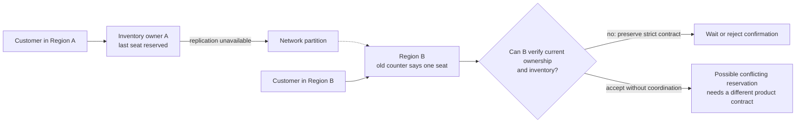
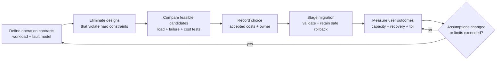

A team wants an API that responds in 20 milliseconds anywhere in the world, immediately reflects every update, stays writable through any regional outage, costs almost nothing at idle, and requires little operational work. Each request sounds reasonable in isolation. Together, they leave several important conditions unspecified: where the data lives, which failures the system must survive, how much coordination the operation requires, and who repairs it when automation fails.

Architecture becomes difficult when those conditions are made explicit. A remote acknowledgement consumes time. A locally available copy can lag. Extra replicas consume resources. A new service adds deployment and failure behavior that someone must understand.

There is also a less dramatic reason a design can be imperfect: the implementation may waste work. A better index can reduce latency and cost simultaneously. A deployment fix can improve reliability without introducing a new subsystem. The useful distinction is between **a real conflict among requirements and a problem we have not yet solved well**.

This article builds on [the trade-offs behind system design](/field-notes/the-trade-offs-behind-system-design/) by examining the decision itself: which designs are feasible, how to compare them, and what evidence should cause a team to change its choice.

## Start with one process and one database

Consider a small reservation service. One application process writes to one relational database. A transaction conditionally decrements an available-seat counter, inserts the reservation, and commits. The application returns success after the chosen durability acknowledgement. The database provides an obvious place to enforce the rule that confirmed reservations cannot exceed capacity.

At modest load, this is a sensible starting point. Calls stay within one location, related changes share a transaction, and engineers can trace a request without crossing ten services. Backups, restore tests, resource limits, and deployment safety still matter.

Suppose traffic rises from 100 to 5,000 requests per second. The right response depends on the measured bottleneck. If repeated scans dominate CPU and disk I/O, an index may be sufficient. If an expensive search endpoint interferes with reservation writes, resource isolation may help. If a single seat-inventory row attracts every update, additional application instances leave that contention point intact.

Now place customers on another continent. A nearby application instance shortens only part of the request. If confirming a reservation still requires a transaction at the original database, the network distance remains on the critical path. A local read replica can help browse available events, while a final reservation may still need coordination with the inventory owner.

Growth exposes different limits at different boundaries. An architecture label such as “microservices” cannot identify which limit is currently responsible for slow requests.

## Translate quality words into operation contracts

“Fast,” “available,” and “consistent” become useful when attached to a specific operation and measurement boundary. For the reservation example, a contract might require a confirmed reservation to survive one machine failure, prevent overselling, and complete below a specified p99 latency at the tested peak load. Browsing event descriptions can have a separate freshness target and failure policy.

Distinguish a hard constraint from a preference. A legal data-residency rule, a no-overselling invariant, or an agreed recovery point objective may disqualify a design. A lower monthly bill is usually something to optimize among designs that satisfy those constraints. A scoring spreadsheet cannot compensate for losing acknowledged customer data when the contract forbids that loss.

The [five constraints of system design](/field-notes/five-constraints-of-system-design/) provide a starting vocabulary. Add throughput distribution, recovery objectives, security boundaries, and team capacity. Also identify the conditions under which a promise holds: steady state, one host lost, one zone lost, a region unreachable, or a deployment in progress. Availability during a regional partition is a different requirement from availability while replacing an application process.

Sometimes the feasible set is empty. A strict mutable read that requires a remote authority cannot also be guaranteed to complete within five milliseconds when reaching that authority alone takes eighty milliseconds. The next step is to change locality, narrow the invariant, relax the latency target, or revise the failure policy. Buying more application instances leaves the conflicting assumptions in place.

## Physical limits, protocol limits, and engineering limits

### Distance and acknowledgement

An operation that waits for a remote response has a network-dependent lower bound. If the required remote round trip is 80 ms, a 20 ms end-to-end guarantee cannot include that round trip. Pipelining, batching, and faster processing may reduce other costs, but the required acknowledgement must still arrive.

This is why durability needs a named failure domain. A write acknowledged after local durable storage can survive some local failures. Surviving loss of the entire region may require an acknowledgement outside that region, or a replication scheme with explicitly accepted data loss. Synchronous and asynchronous replication provide different acknowledgement contracts.

### A partition separates knowledge

Suppose Regions A and B both hold a mutable inventory counter. The connection between them fails. A customer in A reserves the last seat. B cannot distinguish “A has not changed the counter” from “A changed it, but the message cannot reach B.”



The [Gilbert–Lynch proof of CAP](https://groups.csail.mit.edu/tds/papers/Gilbert/Brewer2.pdf) formalizes a conflict between linearizable operations and availability in an asynchronous network that can partition. Linearizability means an operation behaves as though it took effect at one point between invocation and response, respecting completed operations in real-time order. Availability in that model requires requests at non-failing nodes to receive responses satisfying the service specification.

Returning an error preserves neither a successful reservation nor that formal availability guarantee. A stale answer cannot satisfy an arbitrary linearizable mutable-read contract. CAP concerns this defined failure model; it does not imply a permanent choice of two letters for every operation in a system.

Some invariants can be decomposed. A platform could allocate disjoint seat rights to each region ahead of time. During a partition, each region sells only its own allocation. This can preserve the capacity invariant while allowing some local progress, but a region may reject requests even when unused rights exist elsewhere. The mechanism changes which operation needs coordination and which customers can succeed.

### Queueing consumes the latency budget

Every execution resource has finite service capacity. As demand approaches that capacity, requests spend more time waiting. A simple M/M/1 queue illustrates the shape: with Poisson arrivals, exponential service times, and one server, mean time in the system is `1 / (μ - λ)`, where `μ` is service capacity and `λ` is arrival rate, both per second.

At `μ = 1,000/s` and `λ = 800/s`, the model gives 5 ms average time. At `λ = 990/s`, it gives 100 ms, despite an unchanged one-ms average service time. Real systems violate these assumptions through burstiness, shared resources, and uneven request costs; p99 cannot be inferred from this mean. The example explains why capacity at saturation is a poor basis for a latency guarantee.

Fan-out adds another problem. If a request waits for 100 independent subrequests, each with a 1% chance of being slow, the probability that at least one is slow is `1 - 0.99^100`, about 63%. Actual dependencies may be correlated. [The Tail at Scale](https://research.google/pubs/the-tail-at-scale/) explains the production consequences of these rare delays. More parallel work can shorten average processing while making tail behavior harder to control.

### Many limits are contingent

An unbounded connection pool, a missing index, duplicated downstream calls, or an oversized transaction can make the current implementation worse on several dimensions at once. These are candidates for straightforward improvement. A claim that “everything is a trade-off” should never excuse them.

Hardware, software, and better algorithms also change the available designs. Physical distance and a stated consistency requirement still impose limits, while implementation costs can fall. Treat a measured bottleneck as evidence about the current system, rather than proof that every system must have it.

## Compare feasible designs without inventing a universal score

Suppose three candidates have passed the same correctness and recovery tests. A benchmark and cost exercise produces the following illustrative results at the same workload:

<div class="table-scroll" role="region" aria-label="Architecture candidate comparison" tabindex="0">

| Candidate | p99 latency | Monthly infrastructure cost | Operational burden under the agreed rubric |
| --- | --- | --- | --- |
| A | 120 ms | $1,000 | Low |
| B | 70 ms | $1,600 | Moderate |
| C | 150 ms | $1,300 | Low |

</div>

Under these assumptions, A *dominates* C: it is no worse on the listed dimensions and better on latency and cost. Removing C is justified only if the comparison includes the material requirements; an omitted compliance capability could change that result.

A and B are both candidates on a **Pareto frontier**: within this candidate set, improving one listed dimension requires accepting a worse value on another. If the hard p99 limit is 100 ms, only B is feasible. If the limit is 200 ms and the team cannot take on moderate operational burden, A is preferable. The numbers alone cannot determine the product's priorities.

Frontiers depend on workload, failure tests, prices, team skills, and the dimensions measured. A faster implementation might move the frontier. Introducing a managed service might change who performs operational work. Requiring regional recovery might eliminate all three candidates. One candidate may dominate every alternative tested; that superiority remains conditional on the scope of the comparison. The frontier describes the current evidence and changes when better implementations become available.

Weighted scores can summarize preferences after feasibility checks, but their weights, normalization, and uncertainty must be visible. Combining milliseconds, dollars, and a subjective maintenance rating into “architecture score: 91” hides assumptions unless readers can inspect the underlying evidence. Sensitivity analysis is often more informative: double traffic, increase write share, lose a zone, or remove one specialist from the on-call rotation, then compare again.

## Classical responses and the boundaries they change

Patterns recur because their mechanisms solve recurring problems. Their value depends on where they are applied.

<div class="table-scroll" role="region" aria-label="Architectural approaches and their costs" tabindex="0">

| Approach | Mechanism and useful conditions | Costs and failure behavior to examine |
| --- | --- | --- |
| Larger instance or better local execution | Adds local capacity or removes wasted work; often effective while one authority fits | Capacity ceiling, host failure, index-maintenance cost, and remaining lock contention |
| Cache or asynchronous read replica | Moves derived state toward readers and avoids repeated authoritative reads | Freshness, invalidation, cold-start load, and whether the operation may use derived state |
| Durable queue and workers | Records accepted work and processes it separately, absorbing bounded bursts | Completion delay, backlog, duplicate delivery, cancellation, and retry-safe effects |
| Partitioned state ownership | Gives different keys or tenants separate owners and resource budgets | Hot keys, cross-partition transactions, rebalancing, and recovery of ownership |
| Independently deployed services | Separates release and resource boundaries when responsibilities are stable | Network calls, partial failure, contract evolution, observability, and distributed transactions |
| Multi-region replication | Places copies and execution in additional fault domains | Quorum reachability, conflict policy, distance, failover safety, residency, and operating cost |

</div>

These approaches can be combined, but combinations multiply interactions. A queue behind a cache-dependent worker can stall during a cache outage. A regional service may still require a global identity service. A replica reduces read pressure only if the selected reads can tolerate its consistency contract. Inspect each operation's dependency graph before concluding that the whole system has become more independent.

## Scale changes the appropriate unit of design

A small team often benefits from one deployment with internal modules and a managed database. A growing workload can justify more application instances, indexing changes, read isolation, and bounded background processing. These transitions address specific limits while preserving a manageable authority boundary.

At larger scale, tenant isolation and partition ownership become central. Aggregate throughput may look healthy while one tenant consumes an entire shard. A scaling unit must carry its own resource accounting, failure behavior, and recovery protocol. Independent services become useful when separate teams or workloads need genuinely independent release and resource boundaries.

Global operation introduces locality, residency, and regional failure requirements. Decide which data has a home region, which reads may use replicas, and which operations require remote coordination. A global database can implement some of those decisions, but application-level invariants and latency budgets still need specification.

The sequence is conditional. A low-traffic regulated system may require regional disaster recovery before it needs a cache. A high-traffic single-region read service may scale far without global writes. Traffic volume alone cannot select the next architecture.

## Failure scenarios reveal the hidden price

Healthy-state benchmarks omit the periods when ownership, capacity, and information are uncertain. Exercise the following conditions before accepting a design:

<div class="table-scroll" role="region" aria-label="Failure scenarios and mitigation costs" tabindex="0">

| Scenario | What breaks | Mitigation and remaining cost |
| --- | --- | --- |
| Process crashes after a commit, before replying | The caller cannot tell whether retrying repeats the action | Stable idempotency keys, durable outcome lookup, and bounded key retention |
| Required dependency becomes slow | In-flight requests occupy threads, memory, and connection slots | End-to-end deadlines, admission limits, and an explicit degraded response |
| Clients retry at several layers | One logical operation produces many attempts | One designated retry layer where practical, backoff with jitter, retry budgets, and idempotent operations |
| Cache empties while the database is near capacity | Misses overload the authority and delay recovery | Coalesce equivalent misses, limit refill concurrency, and serve stale data only where the contract permits it |
| One key becomes hot | Adding shards leaves the same owner saturated | Per-key limits, workload redesign, or preallocated rights where the invariant allows them |
| Region becomes isolated | A surviving endpoint may lack an authoritative quorum or safe ownership | Defined read/write policy, fenced failover, and tested regional recovery |
| Disk or operator error damages data | Live replicas may reproduce the same damage | Independent backups, tested restores, and measured recovery objectives |
| Clock moves or its uncertainty grows | Time-based leases or ordering assumptions may stop holding | A protocol with explicit clock assumptions and conservative authority validation |

</div>

Retries deserve numerical scrutiny. If three layers each make up to three attempts, one request can generate up to 27 attempts at the deepest dependency. An overloaded service then receives extra work precisely when it has the least spare capacity. [Google SRE's overload guidance](https://sre.google/sre-book/handling-overload/) describes load shedding and admission control as tools for keeping useful work within capacity. Rejecting excess work is a measurable failure policy, and can be necessary for recovery.

A multi-region label also needs a dependency audit. DNS, authorization, secrets, deployment control, and backups may still share a vulnerable location. Test the actual fault domain claimed by the design, including the services required to recover from that fault.

## Production examples: the requirement determines the mechanism

### Strong transactions can span regions, with explicit machinery

The [2012 Spanner paper](https://www.usenix.org/conference/osdi12/technical-sessions/presentation/corbett) describes replicated state coordinated through Paxos, distributed transactions, and TrueTime's bounded clock uncertainty. Its commit-wait mechanism delays visibility until the chosen timestamp is safely in the past, supporting external consistency. Replication and transaction coordination still consume resources and depend on reachable participants.

This demonstrates that geographic scale and strong transactional semantics can coexist under a specified protocol and failure model. It also makes the implementation requirements concrete: time uncertainty, replication placement, coordination, and commit latency all affect the service the application receives.

### Request shape can matter as much as database choice

In [Discord's March 2023 account of message storage](https://discord.com/blog/how-discord-stores-trillions-of-messages), hot Cassandra partitions contributed to unpredictable latency and operational work. Its move to ScyllaDB was accompanied by data services that coalesced concurrent reads and routed channel requests consistently to make coalescing effective.

Coalescing lets multiple callers subscribe to one in-flight query for the same data. It reduces duplicate database work during a burst; it must still handle deadlines, errors, and the lifetime of that shared result. Discord described this upstream protection as helpful while hot-partition problems still remained. The general lesson is to evaluate the workload entering the storage system alongside the storage implementation. The report establishes a result for that workload, rather than a universal ranking of databases.

### Redundancy must include the dependencies used during recovery

[Cloudflare's November 2023 control-plane outage report](https://blog.cloudflare.com/post-mortem-on-cloudflare-control-plane-and-analytics-outage/) described services intended to remain available across three facilities. A power failure exposed dependencies on the failed facility and gaps in whole-facility testing. Network and security traffic continued while control-plane and analytics capabilities were impaired.

The case distinguishes continued traffic serving from the ability to change configuration or recover other services. Multiple facilities provided useful isolation, while untested shared dependencies weakened the broader availability claim. A review should trace both the ordinary request path and the recovery path through their complete fault domains.

## Recent developments: more choices, different responsibilities

One concrete development is [Aurora DSQL's general availability in May 2025](https://aws.amazon.com/blogs/aws/amazon-aurora-dsql-is-now-generally-available/), following its 2024 preview. Its architecture separates query processing, transaction adjudication, and durable logging into independently scaled components. This changes which infrastructure mechanisms an application team has to implement and operate.

Its [documented optimistic concurrency control](https://docs.aws.amazon.com/aurora-dsql/latest/userguide/working-with-concurrency-control.html) also illustrates the consequences at the application boundary. Transactions execute before conflicts are adjudicated at commit. Conflicting changes can produce serialization failures that require a transaction retry. A workload repeatedly updating the same row must account for aborts, safe retries, and additional work; a familiar SQL interface does not guarantee identical concurrency behavior to a single-instance database.

The Discord and Cloudflare reports from 2023 illustrate two other continuing directions: protecting storage by shaping concurrency at a service boundary, and validating availability against complete dependency graphs. Both apply established techniques to measured operational problems. Their reports document particular production outcomes; they do not establish how prevalent those designs are across the industry.

For the next design decision, distinguish shipped capabilities from claims about future benefits. Managed coordination is an available implementation choice. Automatic recovery deserves a fault test. AI-generated architecture recommendations can suggest candidates, but any correctness or recovery claim still needs an explicit contract and evidence. Predictions about autonomous architectural decisions remain speculative without that evidence.

As infrastructure exposes more automated scaling and recovery, application teams retain responsibility for invariant scope, contention, authorization, retry-safe effects, and dependency assumptions. Evaluate how a service changes those responsibilities before adopting it.

## The migration is part of the architecture

A candidate can look better in steady state and still be a poor next step. Moving state introduces a period with old and new readers, schemas, and deployment versions. Backfill consumes spare capacity, validation needs a defined consistency boundary, and a cutover must establish one authority for writes.

Suppose the new design saves $2,000/month and requires a $60,000 migration effort. Ignoring discounting, incident risk, and future operating differences, the simple payback period is thirty months. Those hypothetical figures may justify postponing the move for a short-lived product, while a compliance deadline or capacity ceiling could make it necessary immediately.

Use an expand–migrate–contract sequence when compatible changes permit it: add the new representation, transfer and validate data, move traffic in controlled stages, then remove the old representation after the rollback window. Plain dual writes can diverge after partial failure. A change log or transactional outbox can help carry committed changes, with duplicate handling and reconciliation included.

Read shadowing can compare results without granting the new path write authority. Shadowing commands with side effects requires a different safety plan. Rollback after accepting writes in the new system is a data problem as well as a routing problem; define how those writes return to the old authority or why rollback is no longer safe.

## Make decisions inspectable and revisable

An architecture decision record captures context, alternatives, a choice, and consequences. [AWS's ADR process](https://docs.aws.amazon.com/prescriptive-guidance/latest/architectural-decision-records/adr-process.html) preserves accepted decisions and uses a new record to supersede them when circumstances change. Recording the original assumptions makes an earlier choice understandable even after it stops fitting.

For this reservation service, a useful record could say:

```text
Decision: retain one authoritative inventory database
Workload: tested peak of 5,000 requests/s, including 500 writes/s
Hard constraint: no confirmed overselling
Allowed: event descriptions may lag by up to 60 seconds
Failure policy: reject confirmation when authority is unreachable
Alternatives: per-region rights; global transactional database
Evidence: load test, failover test, backup restore, hot-key test
Cost accepted: remote confirmation latency and regional write dependency
Owner: reservations team
Revisit trigger: accepted latency target fails at projected peak,
or the product requires confirmations during home-region loss
```

These values are illustrative. A production record should name the tests, measurement boundary, decision owner, and approved requirements. Conditions for reconsideration prevent endless redesign while avoiding an indefinite commitment to obsolete assumptions.



Operate the accepted contract through user-facing success and latency measures, saturation, queue age, replication freshness, contention, retry amplification, restore time, and paging burden. Measure a business operation's final outcome separately from the number of successful internal calls.

Error budgets connect reliability targets with release policy. [Google SRE's treatment of reliability and risk](https://sre.google/sre-book/embracing-risk/) describes using the allowed error budget to govern release velocity and reliability work. For a request-based 99.9% success SLO over one million eligible requests, the budget is 1,000 unsuccessful requests. A time-based SLO has a different denominator. Specify the window and exclusions before using the budget to decide whether a rollout is acceptable.

## Common mistakes in architecture reviews

“There are trade-offs, so all designs are valid” overlooks hard constraints and dominated alternatives. An unsafe failover cannot be justified by a low infrastructure bill.

“A famous company uses it” omits that company's workload, staffing, historical constraints, and failure policy. A published mechanism is evidence to examine, and its applicability must be tested.

“More replicas guarantee availability” omits placement, quorum requirements, and shared dependencies. “A managed service removes complexity” omits the new application contract and provider dependencies. “A benchmark proves the design” omits failures, skew, migration, and operational work.

“The simplest design is always best” omits the requirements it cannot satisfy. Choose simplicity among viable candidates, and count the incident handling or manual reconciliation caused by mechanisms the design leaves out.

## How experienced engineers judge the next change

A new engineer often begins with which component can implement the feature. With more experience, the analysis includes the state owner, critical path, unit of scale, and behavior after an ambiguous timeout. Senior and Staff-level responsibility also includes invariant scope, failure isolation, migration safety, and the team's ability to operate the result.

The investigation should be proportionate to the decision. Measure a suspected local bottleneck before commissioning a platform rewrite. Build a small load or fault experiment when it could invalidate a costly assumption. Avoid distributed coordination where independent ownership satisfies the product, while retaining coordination where the invariant requires it. Prefer reversible interfaces and staged changes when future workload is uncertain; abstraction itself has a maintenance cost.

A useful review can fit around five artifacts: the operation contract, ownership map, dependency graph, measured comparison, and migration plan. Together they identify what is promised, who decides state, what can fail together, why the choice is defensible, and how to reach it safely.

Keep one statement attached to every decision: **This design satisfies these requirements, under these conditions, at these accepted costs; we will revisit it when this evidence changes.**

That statement replaces an unreachable demand for universal superiority with a decision the team can test and maintain. Some improvements remove waste, some move the feasible frontier, and some require choosing between conflicting guarantees. Knowing which situation you face is the foundation of useful architecture work.

## Further reading

- [Gilbert and Lynch, *Brewer's Conjecture and the Feasibility of Consistent, Available, Partition-Tolerant Web Services*](https://groups.csail.mit.edu/tds/papers/Gilbert/Brewer2.pdf) — Defines the failure model and precise properties behind CAP.
- [Corbett et al., *Spanner: Google's Globally-Distributed Database*](https://www.usenix.org/conference/osdi12/technical-sessions/presentation/corbett) — Explains the coordination and time machinery behind geographically distributed transactions.
- [Dean and Barroso, *The Tail at Scale*](https://research.google/pubs/the-tail-at-scale/) — Connects rare slow operations with user-visible latency in fan-out systems.
- [Google SRE, *Handling Overload*](https://sre.google/sre-book/handling-overload/) — Describes admission and load-shedding policies that help systems recover under pressure.
- [Google SRE, reliability targets and error budgets](https://sre.google/sre-book/embracing-risk/) — Shows how a stated reliability target can guide release and operational decisions.
- [Discord, *How Discord Stores Trillions of Messages*](https://discord.com/blog/how-discord-stores-trillions-of-messages) — Documents database migration alongside request coalescing and routing changes.
- [Cloudflare, control-plane and analytics outage report](https://blog.cloudflare.com/post-mortem-on-cloudflare-control-plane-and-analytics-outage/) — Shows how hidden dependencies can defeat an intended availability design.
- [AWS, Aurora DSQL general availability announcement, May 2025](https://aws.amazon.com/blogs/aws/amazon-aurora-dsql-is-now-generally-available/) — Describes a shipped distributed SQL architecture with independently scaled components.
- [AWS, *Concurrency control in Aurora DSQL*](https://docs.aws.amazon.com/aurora-dsql/latest/userguide/working-with-concurrency-control.html) — Specifies commit-time conflict detection and its application retry requirements.
- [AWS, *Architectural decision record process*](https://docs.aws.amazon.com/prescriptive-guidance/latest/architectural-decision-records/adr-process.html) — Provides a process for documenting decisions and superseding them without erasing context.
