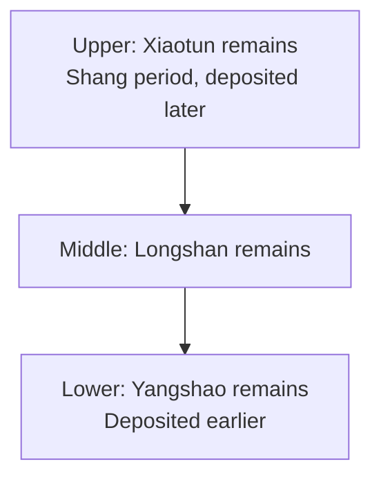
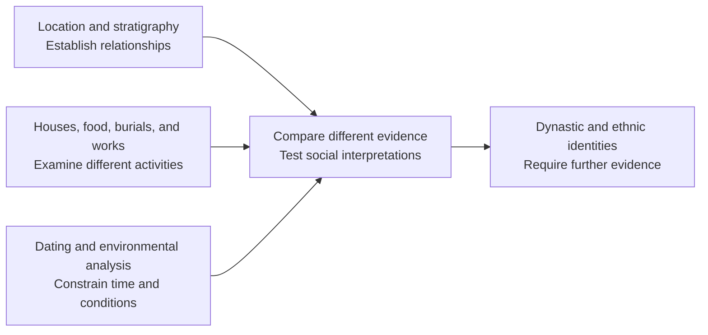

The discovery of prehistoric sites within present day China changed where its history could begin. People whose names never entered written records became subjects of historical inquiry through their houses, food, burials, and possessions. The explanatory value of these remains depends on where they were found, their chronological relationships, and records that other researchers can check.

In 1921, excavations at Yangshao village in Mianchi, Henan, brought painted pottery, stone tools, and traces of settlement into scholarly discussion. These finds did not tell researchers what the villagers called themselves. They supplied no dynastic chronology. Their combinations and environmental setting nevertheless required historians to reconsider life before written records.

Subsequent work at Zhoukoudian extended the timescale to hundreds of thousands of years. Layers at Hougang helped establish the sequence of different remains. Hemudu and Liangzhu brought rice cultivation, settlements, and large construction projects into the study of early society. Each discovery supported new interpretations and exposed limits in earlier ones. Together, they reveal how prehistory is reconstructed: material survives, researchers document its relationships, and different methods test the resulting explanations.

“Within China” refers here to a modern geographical area of study. Prehistoric communities did not inhabit the borders or ethnic classifications of modern states. This essay concerns the past preserved in these places and the methods through which it has become knowable.

Alternative titles for this essay

<ol>
<li>The Discovery and Archaeological Study of Prehistoric Sites in China</li>
<li>Where Does History Begin When There Are No Written Records?</li>
<li>When a Potsherd Enters History</li>
<li>From Yangshao to Liangzhu: Reconstructing Prehistoric China</li>
<li>Layers, Dates, and Settlements: Evidence for China's Prehistoric Past</li>
</ol>

## The past beyond the ancient texts

For centuries, transmitted texts provided the main framework for understanding China's remote past. The *Records of the Grand Historian*, or *Shiji*, begins with the Five Emperors and draws inherited memories from different sources into a general history. It preserves an important understanding of the past, but it cannot provide contemporary records for every ancient village. Sima Qian lived long after the figures described in those traditions. Readers must distinguish when a text was compiled, how its sources were transmitted, and when the events it describes might have occurred.

Traditional scholarship also studied physical objects. The study of bronze and stone inscriptions collected and catalogued artifacts, using their texts to investigate objects, institutions, and people. This work established a place for material evidence in historical inquiry. Yet an ancient object removed from its findspot, even one with a complete inscription, may reveal little about its relationship to nearby houses, burials, or other objects. The difficulty becomes greater in periods without decipherable writing.

Prehistoric research therefore faces a different set of problems. Without names or recorded years, researchers still need to establish how people lived, what they ate, how they treated their dead, and how settlements interacted. The surviving material is fragmentary and unevenly preserved. Stone tools can remain after wooden implements have decayed. Cave deposits may survive when floodwaters have washed away a settlement. Natural processes have already selected the evidence available for study.

A map of known sites consequently cannot serve directly as a map of ancient population. Areas that receive more survey work may produce more discoveries. Potsherds can become visible on eroding loess terraces, while settlements buried beneath alluvial plains remain difficult to locate. Researchers must consider both ancient activity and the later erosion, burial, movement, and destruction of its traces.

Modern geology introduced a useful understanding of time. Deposits form through processes, the ground surface changes repeatedly, and human activity accounts for only part of that history. Methods of prehistoric archaeology developed in nineteenth century Europe. In China, geological surveys, university teaching, museums, and research institutions provided conditions for related work. Sustained investigation became possible when these methods were applied to local material that could not readily be placed within a chronology drawn from texts.

## Geological surveys lead to Yangshao

In the early twentieth century, geological surveying in China involved the study of minerals, landforms, and fossils. Investigators travelled through villages, examined deposits, consulted residents familiar with the terrain, and brought collections back to institutions for comparison. These working connections allowed scattered stone tools and pottery fragments to enter specialist research.

Johan Gunnar Andersson was a Swedish geologist employed by the Chinese government. Yuan Fuli had trained in geology and possessed skills in surveying and field observation. Both participated in the 1921 excavation at Yangshao. The village lies in western Henan, among loess terraces, gullies, and water sources that shaped the setting of the site. Its pottery and tools did not appear automatically on a research map. Local knowledge, survey leads, and institutional support helped turn them into a discovery. [Tsinghua University's account of Yuan Fuli](https://www.tsinghua.edu.cn/info/1925/75835.htm) records his involvement.

Yangshao mattered because a place of prehistoric habitation became an object of sustained inquiry. Pottery of different functions, stone tools, and other remains pointed to patterns of past life. Selecting objects solely for their beauty would have obscured those patterns. Ordinary things, broken and discarded after use, could also reveal human activity.

The term “Yangshao culture” subsequently became an archaeological classification. In this usage, a culture is an analytical grouping based on recurring combinations of artifacts, production practices, and features within a particular span of time and space. The name alone cannot identify a polity with a known state name or establish an ancient ethnic identity.

Such classifications first make comparison possible. Similar pottery assemblages at different sites allow researchers to investigate connections. Persistent differences require explanations involving chronology, geography, function, or social relations. A similar decorative pattern, on its own, cannot demonstrate the migration of an entire population along a particular route.

Political instability made travel, funding, training, and the preservation of collections difficult. Excavation required cooperation under specific practical constraints. Attributing Yangshao entirely to one person's insight leaves out local knowledge, technical staff, and institutional arrangements. Describing it as the chance discovery of pottery also fails to explain how the initial clues became a sustained research question.

<figure>
  
  <figcaption>Figure 1: Excavation records connect objects with their surroundings. This AI generated illustration depicts generic modern archaeological work; it does not show a particular site or an actual excavation.</figcaption>
</figure>

## Xiyin and the conditions of a working discipline

Li Ji helped establish field excavation directed by Chinese scholars. Trained in anthropology, he taught at Tsinghua's Institute of Chinese Studies. In 1926, he and Yuan Fuli investigated and excavated Xiyin village in Xia County, Shanxi. Xiyin and Yangshao both belonged to the Yellow River basin, but their geographical settings and assemblages differed. Comparison could now extend beyond a single site.

The Xiyin project also left specific evidence about the organization of research. Cooperation between Tsinghua and the Freer Gallery of Art in the United States involved funding, publication, and custody of excavated objects. An account of the project records an agreement for reports in Chinese and English and for finds to remain in Chinese museum collections. These provisions show that scholarship had to address who paid, who recorded, who published, and who retained the material. [A study of Xiyin hosted by the Institute for the History of Natural Sciences, Chinese Academy of Sciences](https://agri-history.ihns.ac.cn/scholars/weisi/weisi41.htm) describes the arrangement.

Recording and publication determine whether a site can be studied beyond the experience of its excavators. Without drawings, specimen numbers, and location records, later researchers have little choice but to accept the field team's judgment. With these materials, they can reconsider classifications, compare objects, and challenge an interpretation. Excavation removes original deposits. Its records take on the responsibility of preserving their relationships.

Founded in 1928, Academia Sinica's Institute of History and Philology provided a more sustained institutional base. Fu Sinian helped establish and directed the institute; Li Ji, Liang Siyong, and others played important roles in its field research. Universities, research institutes, and museums gradually connected survey, excavation, analysis, and publication. The institute's [institutional history](https://www1.ihp.sinica.edu.tw/AboutIHP/History) describes its foundation.

These connections did not guarantee adequate funding or uninterrupted work. War and relocation could separate people from their collections. Once reports, drawings, and specimens formed a transferable record, however, knowledge no longer had to disappear when an individual researcher left. The continuity of Chinese prehistoric research depended on these developing working arrangements.

## Zhoukoudian extends the timescale

Yangshao and Xiyin opened up the study of Neolithic settlements. Zhoukoudian, southwest of Beijing, placed human history within a much deeper geological timescale. Deposits in caves and fissures contain human fossils, stone artifacts, and animal remains. Water, animal activity, and changes within the caves could also affect how those deposits formed.

The Cenozoic Research Laboratory was established in Beijing in 1929, with excavation at Zhoukoudian among its major activities. That December, Pei Wenzhong discovered the first Peking Man skullcap. Pei had a background in geology. Jia Lanpo later became another important researcher through sustained fieldwork. Discovery, cleaning, conservation, and comparison required collective effort that a single moment of finding a skull cannot adequately describe. The [history of the Institute of Vertebrate Paleontology and Paleoanthropology](https://ivpp.cas.cn/jggk/lsyg/) records this work and its institutional setting.

Human fossils could now be studied alongside stone tools. Artifacts offer evidence about manufacture and use; fossils provide a different object of observation; animal remains and sediments help reconstruct environmental conditions. Each requires its own checks. Marks on animal bones need an explanation of how they formed. Materials recovered at one locality must first be shown to occupy contexts that can meaningfully be compared.

Zhoukoudian also shows why the age of a familiar site need not remain fixed. A study published in 2009 used burial dating based on cosmogenic nuclides in quartz to estimate an age of about 770,000 years for part of the lower deposits at Locality 1. That estimate applies to the sampled deposits and the scope of the study. It cannot be assigned to every locality or fossil at Zhoukoudian. [The paper's information and abstract](https://www.nature.com/articles/nature07741) identify what was measured.

Place names, dates, and human populations must remain distinct. Zhoukoudian includes localities of different periods. Peking Man and the Upper Cave humans cannot be treated as a single research subject. Finding *Homo erectus* fossils also does not establish the ancestry of a modern ethnic group. Greater chronological distance requires more evidence to connect the populations being discussed.

War interrupted the work in 1937, and some researchers moved to southwestern China. Practical conditions constrained the discipline, giving conservation, repair, and documentation direct consequences. A specimen's continuing availability for research often depends on technical work that rarely occupies the centre of a discovery story.

## How the layers at Hougang established a sequence

Discovering sites with different characteristics still left the problem of chronological order. Painted pottery and black pottery differed, but their colour alone could not determine which came first. Production techniques could change, and separate regions could use different vessels at the same time. Turning differences into a sequence required another kind of evidence.

In 1928, Wu Jinding discovered Chengziya at Zhangqiu, Shandong. The site became an important starting point for research on Longshan culture. Excavations in 1930 and 1931 developed knowledge of its black pottery and other material. More discoveries also made it more important to establish their relationship to the already known Yangshao remains. [Shandong's local historical records](https://shandong-chorography.org/database/f063/section/31/article/95/) describe the discovery and excavations.

Liang Siyong played an important role in this problem. A son of Liang Qichao, he had studied archaeology at Harvard before joining the Institute of History and Philology. His field training helped place comparisons between objects within documented stratigraphic relationships.

Work at Hougang, near Anyang in Henan, provided clues in the spring of 1931. Excavation that autumn clearly identified superimposed remains: Xiaotun material associated with the Shang period above, Longshan material in the middle, and Yangshao material below. Hougang supplied relationships within one locality that constrained their chronological order. [The Institute of History and Philology museum's account of the three layers](https://museum.sinica.edu.tw/en/knowledge-base/item/92/) distinguishes the spring indications from the autumn confirmation.

Stratigraphy works because later deposits normally cover earlier ones. This principle has conditions. A later pit can cut through earlier layers; an early potsherd can be redeposited in later fill. Excavators therefore examine soil texture, colour, boundaries, and cuts to decide which materials retain their original positions. Depth below the surface alone can mislead: the bottom of a late pit may lie lower than a much earlier deposit.

Hougang established a clear local relative sequence. Researchers could then compare assemblages from secure contexts with material elsewhere and gradually build wider chronological relationships. This process cannot force every site in China into the same three layers or assume that every region experienced identical changes. Relative chronology draws its strength from repeated checks on specific relationships.

Figure 2: The local relative sequence established at Hougang. This schematic shows order alone; it is not an original section drawing and does not imply identical deposits throughout China.

## From relative order to elapsed time

An established relative sequence does not automatically produce calendar dates. Knowing that one object predates another is different from knowing whether it is five or six thousand years old. Dating through links between objects and texts faces particular limits in periods without writing. Laboratory methods introduced an independent timescale for such research.

In 1949, James Arnold and Willard Libby published a study testing radiocarbon dating against samples of known age. The method uses the decay of radioactive carbon after an organism dies to estimate the age of suitable material. It measures material containing carbon. Placing a stone tool in the apparatus will not directly reveal when someone shaped it. [The paper's publication record](https://pubmed.ncbi.nlm.nih.gov/15407879/) documents this early validation.

Dating begins with the relationship between a sample and an event. Charcoal may come from a tree that grew for a long time; its carbon can predate the burning of the wood. A nearby seed must be shown to belong to the activity under study rather than a later intrusion. Plant remains from organisms with short lifespans can help reduce such discrepancies, but contamination and redeposition still need consideration. [Historic England's dating guidance](https://historicengland.org.uk/images-books/publications/radiocarbon-dating-chronological-modelling/the-bayesian-process/) explains these relationships.

Dates also require calibration. The atmospheric proportion of radiocarbon has varied over time. A conventional radiocarbon age must be compared with a calibration curve to obtain a range of calendar dates. Uncertainty in the measurements and the curve means that results often take the form of one or more possible intervals. The [Oxford Radiocarbon Accelerator Unit's explanation](https://c14.arch.ox.ac.uk/calibration.html) describes the conversion.

In this literature, BP conventionally counts back from 1950 CE, regardless of when a reader opens a webpage. Cal BP indicates calibrated years before that reference year; cal BCE indicates calibrated calendar years before the Common Era. Simply subtracting an uncalibrated number from a calendar year creates an apparently precise date with the wrong meaning. The [IntCal20 Northern Hemisphere calibration curve](https://www.cambridge.org/core/journals/radiocarbon/article/intcal20-northern-hemisphere-radiocarbon-age-calibration-curve-055-cal-kbp/83257B63DC3AF9CFA6243F59D7503EFF), published in 2020, forms part of the continuing work of reconciling chronological evidence.

Dating can also alter the assumed order of changes in daily life. A study published in 2012 estimated an age of about 20,000 years for early pottery from Xianrendong Cave in Jiangxi. This example cautions against imposing a universal sequence on pottery production, crop cultivation, and sustained settlement. Pottery requires interpretation alongside use traces, animal and plant remains, and environmental evidence. [The paper's abstract](https://pubmed.ncbi.nlm.nih.gov/22745428/) describes its dating evidence.

## Hemudu brings food and environment into the account

Hemudu, in present day Yuyao, Zhejiang, was discovered and first excavated in 1973. The wet lowlands of the lower Yangtze preserved material differently from the loess terraces of western Henan. Wooden structural elements and plant remains survived in conditions where they would often have decayed elsewhere. Researchers could study houses, plant use, and production tools together. The [National Museum of China's account of rice remains from Hemudu](https://www.chnmuseum.cn/zp/zpml/kgfjp/202008/t20200824_247227.shtml) describes rice, wooden structures, and bone tools among the finds.

Geography influenced both ancient life and modern knowledge. Lowland residents dealt with standing water and damp conditions, which affected building practices. Waterlogged deposits also allow researchers to recover more organic material. Finding wood in one region and mainly stone in another cannot establish that the second region never used timber. Differences in preservation must first be separated from differences in past behaviour.

Rice finds likewise require several distinct interpretations. Using rice does not establish sustained cultivation. Cultivation does not establish that every trait associated with domestication had developed. The quantity recovered cannot, by itself, reveal rice's share of the diet. Each inference requires additional evidence; a handful of grains cannot carry every conclusion.

Wild rice tends to shed its grains naturally when mature. Sustained selection can gradually alter the traits involved. Studying features such as archaeological rice spikelet bases helps researchers investigate shattering and human selection. A lower Yangtze study published in 2016 used this material to examine domestication as a prolonged process. [Its abstract and publication information](https://pubmed.ncbi.nlm.nih.gov/27324699/) do not reduce that process to a single sudden event.

Sampling methods change what becomes visible. Tiny charred seeds can be overlooked during ordinary excavation. Flotation uses water to separate light material from sediment before sorting and identification. The recovered material needs records of sample location, sediment volume, and processing methods. Otherwise, different quantities at two sites may reflect field procedures. [Historic England's introduction to archaeobotany](https://historicengland.org.uk/research/methods/archaeology/archaeobotany/) describes these materials and processing facilities.

Plant microremains provide further clues. Phytoliths, for example, are minute silica structures formed in plant tissues that may survive in soil. Each method nevertheless has its own limits of identification and preservation. Identifying a plant, reconstructing its growing conditions, and inferring its use by people require separate arguments. Research at Hemudu and nearby sites has repeatedly encouraged more careful collection of easily missed remains. [An archaeological account published by the Chinese Social Sciences Network](https://www.cssn.cn/kgxc/kgxc_kgsb/202207/t20220728_5431157.shtml) discusses the area's abundant animal and plant evidence.

<figure>
  
  <figcaption>Figure 3: Small plant remains can contribute to historical interpretation. This AI generated illustration depicts generic archaeobotanical work. It is not a photograph of Hemudu, an identification plate for a particular species, or a presentation of research data.</figcaption>
</figure>

## Liangzhu's city and waterworks raise questions of organization

In 1936, Shi Xingeng, who worked at the West Lake Museum, began investigating and excavating the Liangzhu area. The region, near present day Hangzhou in Zhejiang, continued to yield new sites. The discovery and identification of Liangzhu's ancient city in 2007 directed further attention to the settlement as a whole. [A contemporary report from 2007](https://zjrb.zjol.com.cn/html/2007-11/30/content_486849.htm) records this development.

Liangzhu remains are generally placed within the period from about 3300 to 2300 BCE. The area lies in the lower Yangtze lowlands, where hills, rivers, and plains meet. Water provided resources and transport but also created problems requiring management. Understanding this society consequently requires examining the spatial relationships between settlements and waterways as well as individual jade objects. [UNESCO's account of the Archaeological Ruins of Liangzhu City](https://whc.unesco.org/en/list/1592/) identifies the linked evidence of the city, water management system, and cemeteries.

Large construction projects required sustained labour, decisions about location and sequence, supplies of materials, and maintenance. They allow researchers to discuss organization extending beyond a single household. Unequal burial sizes and distributions of grave goods provide another body of evidence for social differences. Comparing such patterns within an established chronological and geographical setting explains more than judging a society's development by the beauty of its artifacts.

Yet an engineering project cannot directly supply the names of administrative offices. Communities can organize collective work in different ways. Burial differences also require examination alongside age, sex, chronology, and funerary practices. Interpretations of Liangzhu as an early regional society or state with complex organization rest on relationships among several kinds of material. They cannot provide rulers' names, a list of officials, or a complete legal code.

The same caution applies to change. Water conditions mattered in these lowlands, but that does not establish that a single flood destroyed the whole society. Environmental records, settlement chronologies, and human activity must be checked for correspondence. Geography constrained people's options. How a particular society organized production, construction, and distribution remains a question to investigate through the evidence.

Liangzhu's ancient city entered the World Heritage List in 2019. For a general history, the important development in research is the expanding scale of inquiry: from excavated objects to an entire settlement, then to its resources, construction projects, and surrounding region. Social organization becomes a historical question that can be discussed and must be tested.

Figure 4: Interpretations of society require several kinds of evidence to constrain one another. Connecting settlement patterns to a named dynasty or ethnic group requires an additional argument.

## What a site can establish

Xu Xusheng discovered Erlitou during a survey in western Henan in 1959. Subsequent work revealed large buildings, roads, workshops, and high status remains, considerably enriching the study of early urban centres. Identifying a settlement with a central role and assigning it to a dynasty named in transmitted texts nevertheless remain separate judgments. [A research account marking the sixtieth anniversary of Erlitou's discovery](https://cssn.cn/kgxc/kgxc_kgsb/202207/t20220728_5431258.shtml) discusses the finds and their interpretation.

**[Historical evidence remains disputed]** Relating Erlitou to the Xia and Shang of transmitted accounts involves chronology, geography, cultural phases, and interpretation of the texts. Associating the principal Erlitou remains with Xia is an influential scholarly position. It should not be presented as an identification already confirmed by contemporary writing naming that dynasty at the site. Recognizing this limit does not diminish the material evidence for a large settlement and substantial social organization. The dispute concerns the connection between that evidence and a historical name. [An interview with scholars working on these questions](https://m.thepaper.cn/yidian_promDetail.jsp?contid=5218758&from=yidian) helps distinguish the issues.

General histories can too easily arrange all prehistoric remains along a single inevitable path towards later dynasties. That tidy sequence removes the differing circumstances in which people lived. River valley communities and coastal communities had access to different resources. The spread of a technology might reflect exchange, learning, marriage connections, or migration. Where the material cannot distinguish these processes, interpretation must retain its limits.

Yangshao, Zhoukoudian, Hougang, Hemudu, and Liangzhu expanded what can be known about China's past. Daily life before writing can receive an account supported by evidence. Reliable records gradually extend that account; new measurements and discoveries can still change its chronology and interpretation.

When visitors see a potsherd in a museum, a display label usually supplies its age and name. Field records preserve something else: where it lay, what was buried with it, and what happened to the surrounding earth. While those relationships remain open to examination, later researchers have a chance to understand the people who left it differently.

## A chronology of discovery and research

These dates mark modern discoveries and research, rather than the periods when prehistoric sites were occupied.

1. 1921 CE: Excavation at Yangshao brings prehistoric settlement remains into sustained research.
2. 1926 CE: Li Ji and Yuan Fuli investigate and excavate Xiyin.
3. 1928 CE: Wu Jinding discovers Chengziya; the Institute of History and Philology is established.
4. 1929 CE: The Cenozoic Research Laboratory is founded; Pei Wenzhong discovers the first Peking Man skullcap in December.
5. 1931 CE: Autumn excavations at Hougang clearly establish the superposition of Yangshao, Longshan, and Xiaotun remains.
6. 1936 CE: Shi Xingeng begins investigations and excavation in the Liangzhu area.
7. 1949 CE: Arnold and Libby publish a test of radiocarbon dating using samples of known age.
8. 1959 CE: Xu Xusheng discovers Erlitou during survey work.
9. 1973 CE: Hemudu is discovered and first excavated.
10. 2007 CE: The discovery and identification of Liangzhu's ancient city receive concentrated publication and discussion.
11. 2009 CE: Burial dating research on part of the lower deposits at Zhoukoudian Locality 1 is published.
12. 2012 CE: A dating study of early pottery at Xianrendong is published.
13. 2019 CE: The Archaeological Ruins of Liangzhu City enter the World Heritage List.
14. 2020 CE: The IntCal20 Northern Hemisphere radiocarbon calibration curve is published.

## People and institutions at a glance

Arrows indicate working connections. They do not all represent formal hierarchies or relationships between teachers and students.

* Geological survey work → Andersson and Yuan Fuli → Investigation and excavation at Yangshao.
* Cooperation between Tsinghua's Institute of Chinese Studies and the Freer Gallery → Li Ji and Yuan Fuli → Excavation, surveying, and reporting at Xiyin.
* Academia Sinica's Institute of History and Philology → Fu Sinian helps establish and directs it; Li Ji, Liang Siyong, and others undertake field research.
* Liang Siyong → Research at Hougang → Stratigraphic constraints on the cultural sequence.
* Cenozoic Research Laboratory → Pei Wenzhong, Jia Lanpo, and colleagues → Excavation and fossil research at Zhoukoudian.
* West Lake Museum → Shi Xingeng → Early investigation and excavation at Liangzhu.
* Xu Xusheng → Survey in western Henan → Discovery of Erlitou.

## Further reading

Links in the text identify the sources for individual discoveries and methods. The [institutional account of Hougang's three layers](https://museum.sinica.edu.tw/en/knowledge-base/item/92/) and [Oxford's explanation of radiocarbon calibration](https://c14.arch.ox.ac.uk/calibration.html) provide a useful comparison of relative sequence and calendar dating. The [World Heritage documentation for Liangzhu](https://whc.unesco.org/en/list/1592/) shows how a city, engineering works, and cemeteries contribute to a shared interpretation.
