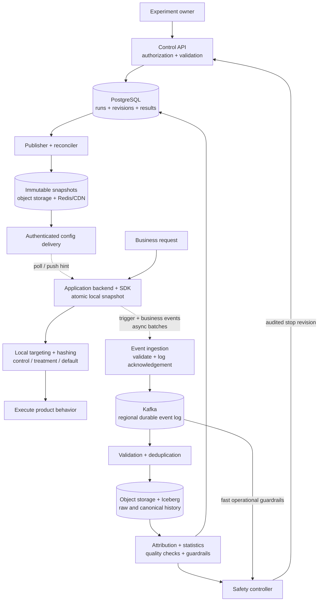
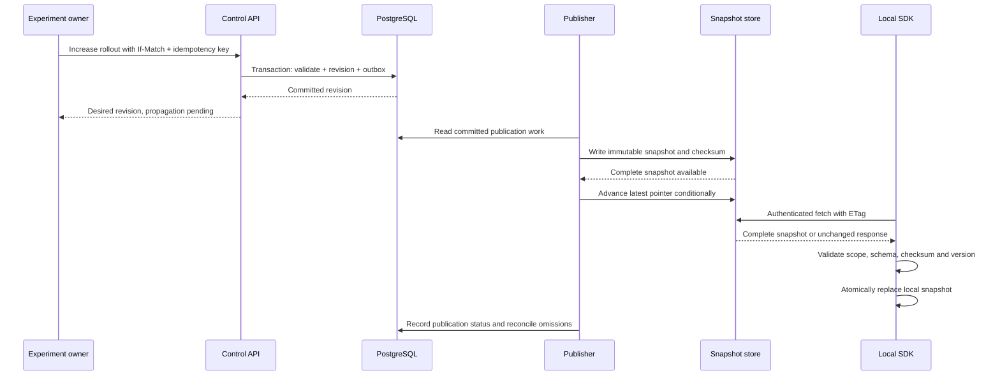
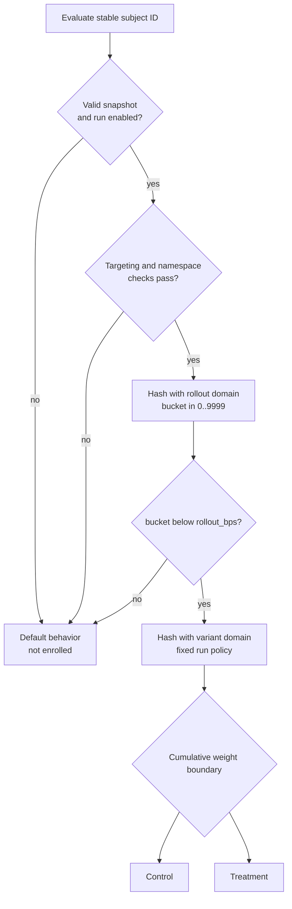
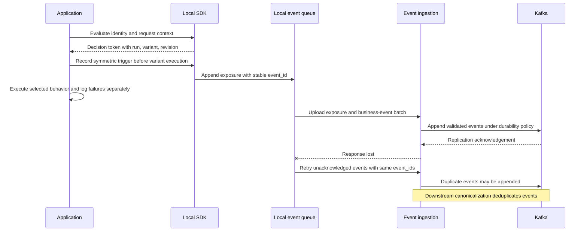
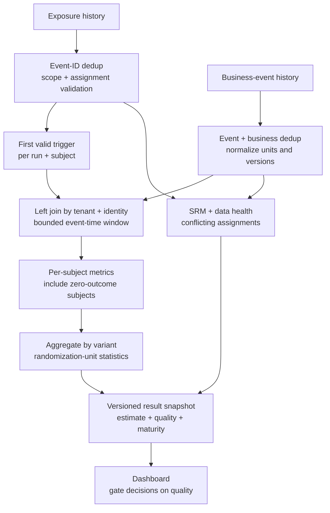

An A/B testing platform has two demanding jobs. It must choose a variant without slowing down a product request, and it must produce evidence that teams can use to judge the change. Randomly returning control or treatment solves only a small part of either job.

I would structure a Staff or Principal interview around three contracts: stable assignment, reliable measurement, and bounded rollout risk. The architecture separates local serving from asynchronous analysis. Configuration connects the two through explicit run IDs, immutable revisions, and a documented analysis plan.

## 1. Scope and operating targets

Build an internal, multi-tenant platform where teams create A/B or A/B/n experiments, choose eligible users, define metrics, gradually increase participation, stop treatments, and inspect results. Start with a server-side SDK. Web and mobile products obtain decisions through their own backends.

The initial randomization unit is a user. Device- or organization-level experiments can follow, but their identity and statistical units must be specified separately. A feature flag supplies a behavior switch; the experiment additionally needs randomized groups, measurement, attribution, and statistical interpretation.

The required capabilities are experiment management, deterministic assignment, exposure and metric collection, result computation, and gradual rollout with a kill switch. Targeting, mutually exclusive experiments, sample-ratio checks, and guardrail monitoring are the next priorities. Bandits, automated experiment design, and a general-purpose BI system are outside the first version.

| Path | Proposed target and contract |
| --- | --- |
| Local evaluation | p99 below 1 ms, measured in the business service; no remote call during a normal evaluation |
| Serving continuity | 99.99%+ target within the approved configuration-freshness policy |
| Configuration | Routine propagation in 30–60 seconds; track actual revision adoption |
| Analysis | Refresh result snapshots every 5–15 minutes; outcomes can remain immature for days |
| Event acceptance | Acknowledge after a replicated log append under the configured durability policy |
| Recovery | Retain canonical history and input versions so results can be recomputed |

These are design targets and assumptions, not measured guarantees of the chosen products. Configuration management uses authoritative SQL transactions. SDK copies are eventually consistent. Assignment is deterministic for the same identity, run, algorithm, and immutable allocation policy. Results are eventually updated, with enough provenance to reproduce each snapshot.

## 2. Estimate the workload

Assume five million daily active users, twenty evaluations and raw exposure reports per user per day, thirty metric events per user per day, 1,000 active experiments, and a ten-times peak-to-average multiplier.

All storage figures below use decimal units and an assumed average event payload of 800 bytes.

| Dimension | Estimate | Architectural consequence |
| --- | --- | --- |
| Evaluations | 100 million/day; about 1,160/s average and 12,000/s peak | Distribute evaluation across application instances |
| Exposure reports | 100 million/day before user-level deduplication | Repeated exposure reports cannot become independent samples |
| Metric events | 150 million/day | Reuse business events across appropriate experiments |
| Combined ingestion | 250 million/day; about 2,900 events/s average and 30,000/s peak | Partition ingestion and processing; batch uploads |
| Event payload | 200 GB/day; about 24 MB/s at the assumed peak | Plan network and storage beyond HTTP request count |
| Seven-day log retention | 200 GB × 7 × 3 replicas = 4.2 TB | Add indexes, segment overhead, headroom, and imbalance |
| Ninety-day raw history | 18 TB before compression | Object storage suits long retention and backfills |
| Illustrative compressed history | 3.6–6 TB at an assumed 3–5× compression | Benchmark actual schemas; exclude derived tables and extra copies |

At 50,000 application instances polling every minute, configuration delivery handles roughly 833 checks/s. Downloading a full 200 KB snapshot each time would consume about 167 MB/s before compression. Conditional GETs, application-scoped snapshots, compression, caching, and jittered polling reduce this fan-out.

Polling is periodic infrastructure traffic. The 100 million daily evaluations should remain local.

## 3. High-level architecture



*Figure 1. Configuration travels to local SDKs; product requests use local state. Events travel independently through the durable log and analysis pipeline. Owners read materialized result snapshots through the Control API.*

PostgreSQL owns experiment definitions, run policy, revision history, permissions, and published result pointers. Redis and a CDN accelerate delivery of compiled configuration. Object storage retains immutable snapshots as a recovery source.

Kafka buffers bursts, separates ingestion from warehouse availability, and supports replay within its retention. Iceberg stores raw history, canonical events, and derived subject-level metrics. Batch or microbatch jobs perform joins, compute statistics, and publish results. A safety controller can consume faster operational signals without waiting for a seven-day outcome metric to mature.

At much smaller volumes, direct ingestion into an analytical database can be sufficient. At this scale, buffering and replay have explicit uses. A ClickHouse serving layer becomes useful if dashboards need high-frequency interactive aggregation; minute-level snapshots do not require one initially.

## 4. Experiment, run, and revision are different records

An experiment is a named product question. A run is one randomization and analysis cycle. A revision changes operational configuration within that run.

| Record | Key and important fields |
| --- | --- |
| Experiment | `experiment_id`; tenant, app, environment, key, owner, lifecycle state, active run, current revision; unique tenant/app/environment/key |
| Run | `run_id`; experiment ID, randomization unit and identity version, bucketing algorithm and salt, frozen variant order/weights/payloads, metric versions, analysis plan, start/stop times |
| Revision | `(run_id, revision)`; rollout basis points, targeting policy, enabled state, publisher state, creator, creation/publication timestamps |
| Namespace allocation | Tenant/app/environment/namespace, run ID, reserved bucket range and allocation state |
| Metric definition | `(tenant_id, metric_key, metric_version)`; event name, aggregation, value/currency semantics, attribution window, correction policy |
| Result snapshot | `(run_id, analysis_version, snapshot_id)`; rows per metric/variant, sample size, estimates, confidence bounds, quality state, cohort maturity, source snapshots and watermarks |
| Publication outbox | Event ID, aggregate revision, destination scope, delivery state |

At launch, freeze the identity contract, salt, algorithm, ordered variants, and analysis definitions. Changes to these require a new run unless the platform explicitly supports persistent enrollment or a migration protocol.

Within a run, increasing rollout is permitted under the fixed allocation policy. Pause and stop are safety operations. Arbitrary targeting edits, payload changes, or variant-weight changes can alter the measured treatment or population, so the first version requires a new run for those changes.

Variant weights are integers summing to 10,000 basis points. Twenty-percent rollout with a 50/50 split gives expected population shares of 80% default behavior, 10% control, and 10% treatment. Default users are outside the enrolled experiment; they are not silently added to its control denominator.

## 5. Publish complete, monotonic configuration snapshots



*Figure 2. A management commit establishes desired configuration. Publication and SDK adoption are separate observable stages.*

Use a transaction to validate variant totals, metric references, targeting fields, ownership, and namespace allocation. Write the revision and an outbox record together. A crashed publisher can retry the same immutable revision; a periodic reconciler finds committed revisions that have not been published.

For an application environment, separate the snapshot's monotonically increasing version from each run's revision. Store each snapshot under a versioned key:

```text
config/{tenant}/{app}/{environment}/{snapshot_version}
```

Advance the latest pointer only after the complete artifact exists. Conditional advancement prevents an older publisher from replacing a newer latest pointer.

SDKs validate and atomically replace the whole snapshot. They reject version regression, mixed fragments, and unexpected scope. Rolling back treatment publishes a newer snapshot with safe content; it does not decrease the version number.

Use `If-Match` for concurrent edits. A stale administrator receives a conflict and must reread. An idempotency key is scoped to the tenant and operation; reusing it with a different payload is rejected.

### External APIs

<div class="table-scroll" role="region" aria-label="Experimentation API reference" tabindex="0">

| API | Contract |
| --- | --- |
| `POST /v1/experiments` | Create a validated draft; creation does not expose users |
| `POST /v1/experiments/{id}/launch` | Create a new run with frozen policy and a publication operation |
| `PATCH /v1/experiments/{id}/rollout` | Change participation with an expected revision and idempotency key |
| `POST /v1/experiments/{id}/stop` | Publish a disabled revision and report propagation state |
| `GET /v1/sdk/config?app_id=checkout&environment=prod` | Tenant-scoped snapshot; ETag/304 and authenticated freshness renewal |
| `POST /v1/events/batch` | Per-event durable-acceptance or rejection outcomes; bounded batches |
| `GET /v1/experiments/{id}/results?run_id=...` | Versioned result snapshot with quality, watermark, and maturity |

</div>

The launch and stop responses return the committed revision and operation state rather than claiming that every SDK has adopted it. SDK credentials bind tenant, application, and environment; server-only targeting rules remain behind the application backend. Results authorization uses the same tenant boundary.

## 6. Deterministic assignment without a per-user lookup

Two domain-separated hashes answer two independent allocation questions: whether a subject participates and which variant they receive.



*Figure 3. Increasing the participation threshold leaves the variant calculation unchanged.*

Here is an illustrative bucketing core after the SDK has checked snapshot freshness and namespace ownership:

```python
from hashlib import sha256


def bucket(tenant_id, app_id, run_id, salt, subject_id, domain, bucket_count=10000):
    # Canonical encoding: ordered UTF-8 fields with 4-byte unsigned lengths.
    fields = [tenant_id, app_id, run_id, salt, subject_id, domain]
    encoded = b"".join(
        len(value).to_bytes(4, "big") + value
        for value in (field.encode("utf-8") for field in fields)
    )
    digest = sha256(encoded).digest()
    return int.from_bytes(digest[:8], "big", signed=False) % bucket_count


def evaluate(config, subject_id, context):
    # The SDK has already checked snapshot freshness and namespace ownership.
    if not config["enabled"] or not subject_id:
        return "DEFAULT"
    if any(context.get(field) not in allowed
           for field, allowed in config["targeting_rules"].items()):
        return "DEFAULT"

    fields = (
        config["tenant_id"], config["app_id"], config["run_id"],
        config["bucketing_salt"], subject_id
    )
    if bucket(*fields, "rollout") >= config["rollout_bps"]:
        return "DEFAULT"

    variant_bucket = bucket(*fields, "variant")
    boundary = 0
    # The compiler freezes order and validates that weights sum to 10000.
    for variant in config["variants"]:
        boundary += variant["weight_bps"]
        if variant_bucket < boundary:
            return variant["key"]
    raise ValueError("Invalid compiled variant allocation")
```

The protocol specifies UTF-8 encoding, field order, length prefixes, SHA-256, the first eight digest bytes, unsigned big-endian conversion, and modulo 10,000. It also specifies the exact identity representation and stable variant order. SDKs in different languages share golden test vectors; a language's built-in string hash is unsuitable.

For the ordered fields `tenant_example`, `checkout`, `run_checkout_1`, `salt_v1`, and `user_456`, the `rollout` domain produces bucket 1542 and the `variant` domain produces 2342. With a frozen control-first 50/50 split, this subject is outside a 10% rollout and enters control at 20%. These values are a test vector for this specific protocol.

The configuration revision is deliberately absent from the hash. Moving from revision 42 to 43 solely to increase rollout must preserve existing assignments.

SDKs on different revisions can temporarily disagree about whether a newly added subject participates. With the same frozen variant policy, they still agree on the variant whenever both enroll that subject. If the product requires one decision across several services in the same request, propagate the evaluated decision token instead of independently reading different snapshots.

Increasing rollout from 1,000 to 2,000 includes all previously selected subjects plus the next bucket interval. The separate variant hash preserves their control/treatment assignment while frozen weights remain unchanged. Changing 50/50 weights to 20/80 moves bucket boundaries and reassigns some subjects, so it is not a safe equivalent operation.

[Unleash documents hash-based stickiness](https://docs.getunleash.io/concepts/stickiness), although this proposed SHA-256 protocol is our own explicit SDK contract. Deterministic hashing removes the need to store every ordinary assignment. Identity stitching, overrides, and preserving enrollment across dynamic weight changes can require durable subject-level state.

Stickiness holds for the same stable identity. An anonymous device ID and a logged-in user ID can hash to different variants. Decide whether the run uses users or devices before launch. If identity stitching is required, specify conflict handling and preserve contamination diagnostics instead of silently merging contradictory assignments.

## 7. Targeting and mutual exclusion

Targeting narrows the eligible population using a validated rule vocabulary and approved subject attributes. Avoid rules based on behavior already changed by treatment; they can select different populations in the two arms.

A namespace reserves disjoint half-open bucket ranges for experiments that must not overlap. Compute the namespace bucket from stable identity and namespace salt, without including the individual run ID. Including the run ID would give each experiment an unrelated namespace bucket and defeat exclusion.

For example, reserve `[0,3000)` for run A, `[3000,6000)` for run B, and `[6000,8000)` for run C. Apply a run's additional rollout threshold within its reserved population, and label the participation rate accordingly.

The database must reject overlapping active reservations in the same tenant/app/environment/namespace. A primary key does not establish non-overlap; PostgreSQL provides [range exclusion constraints](https://www.postgresql.org/docs/current/rangetypes.html#RANGETYPES-CONSTRAINT). Freeze namespace ownership during a run. Reusing a range requires old runs and accepted stale snapshots to expire; a correct database constraint alone cannot revoke configuration already held by an offline SDK.

Disjoint assignment prevents subjects from simultaneously entering the designated runs. It does not remove carryover effects after a subject moves to a later experiment; use a declared cooldown where the product requires one.

## 8. Assignment, exposure, and outcomes are separate events

An SDK evaluation chooses a variant. The application may never reach the feature. Conversely, recording exposure only after a successful render can exclude treatment failures and make a broken treatment appear successful.

Define a symmetric trigger at the point where the treatment can first affect the subject, before variant-specific execution can suppress its logging. Record render success, crashes, and delivery failures as separate diagnostics. A shared checkout-entry trigger, recorded by the backend before executing either checkout branch, is a practical contract.

This cohort measures the effect of entering the randomized checkout path, including its failures. Actual render visibility is a separate observation. Restricting the denominator to successful renders changes the analysis population and requires a validated selection design.

When a triggered cohort is used, its trigger must be valid in control and treatment. [Microsoft's SRM diagnosis guide](https://www.microsoft.com/en-us/research/articles/diagnosing-sample-ratio-mismatch-in-a-b-testing/) explains how filtering and missing counterfactual logging can bias such analysis. Keep enrollment diagnostics so an all-enrolled analysis can be compared with the triggered cohort.



*Figure 4. Asynchronous telemetry keeps the product path independent of ingestion. A lost acknowledgement can cause a safe retry and duplicate log entries.*

Each exposure includes tenant, experiment/run IDs, stable subject ID and identity version, variant key, configuration revision, trigger version, occurrence time, ingestion time, and selected context. A decision token binds these fields to one evaluated snapshot; a concurrent refresh must not rewrite an earlier decision's provenance.

Metric events are generic business facts: subject, event name, entity ID, value and currency/unit, occurrence time, schema version, and event ID. A purchase can be attributed separately to several compatible experiments. Business code should not enumerate every active experiment or guess its variant.

Authenticate SDKs by tenant/app/environment. Derive trusted scope from credentials and validate claimed run/variant values against historical configuration. Bound batch size, return per-event errors, and retry only uncertain or retryable events using their original IDs.

For this design, configure a three-replica Kafka topic with `acks=all`, an appropriate minimum in-sync replica policy such as two, and idempotent producers. An accepted response follows the broker acknowledgement; a failed or uncertain append produces a retryable outcome. The [Kafka topic configuration](https://kafka.apache.org/43/generated/topic_config.html) documents the interaction between acknowledgements and minimum in-sync replicas. Placement across failure domains and leader-election policy are also part of the durability contract.

Kafka's transactional processing boundary does not deduplicate a second HTTP upload or establish one transaction with every external sink. Canonicalization retains stable event IDs and coordinates sink commits with replayable source progress. [Kafka's delivery-semantics documentation](https://kafka.apache.org/41/design/design/#message-delivery-semantics) describes the additional cooperation needed for external destinations.

SDK queues are bounded and observable. A server-side disk spool can survive process restart; an in-memory queue or suddenly powered-off device can still lose unsent telemetry. For orders and revenue, use the business service's durable outbox or authoritative event stream where available. Report missing telemetry and avoid silently treating a broken feed as zero activity.

## 9. Attribute outcomes to the correct subject and run

The analytics pipeline maintains raw event history, canonical deduplicated events, a first-valid-exposure cohort, and subject-level metric rows.



*Figure 5. The cohort supplies the denominator. Business events supply the outcomes, including explicit zeros for eligible subjects with no observed outcome in a healthy, sufficiently complete feed.*

Deduplicate messages by `(tenant_id, event_id)`. Retain repeat exposures with different IDs as observations, then choose the first valid trigger per run and subject for the declared user-level analysis. Detect conflicting variants before selecting that first exposure; mark the run's quality problem and investigate it. Silently choosing one arm or dropping conflicting subjects can introduce further selection bias.

Purchase deduplication also uses the authoritative order identity and event type. New event IDs for the same completed purchase must not double revenue. Legitimate order updates and refunds need explicit version/correction semantics. A replay must reproduce the same canonical business records.

Join on tenant and the run's identity contract, using occurrence time. A purchase may arrive before its earlier exposure arrives at ingestion. Arrival order cannot decide whether the purchase was attributable.

The following illustrative SQL assumes canonical, assignment-consistent exposure rows and business-deduplicated purchase rows, pinned to declared input snapshots. It demonstrates a seven-day metric for one tenant and run:

```sql
WITH ranked_exposures AS (
    SELECT
        tenant_id, run_id, subject_id, variant_key, occurred_at,
        ROW_NUMBER() OVER (
            PARTITION BY tenant_id, run_id, subject_id
            ORDER BY occurred_at, event_id
        ) AS exposure_rank
    FROM canonical_exposure_events
    WHERE tenant_id = :tenant_id
      AND run_id = :run_id
),
first_exposure AS (
    SELECT
        tenant_id, run_id, subject_id, variant_key,
        occurred_at AS first_exposure_at
    FROM ranked_exposures
    WHERE exposure_rank = 1
),
mature_cohort AS (
    SELECT *
    FROM first_exposure
    WHERE first_exposure_at + INTERVAL '7' DAY <= :data_watermark
)
SELECT
    f.tenant_id,
    f.run_id,
    f.subject_id,
    f.variant_key,
    f.first_exposure_at,
    CASE WHEN COUNT(p.entity_id) > 0 THEN 1 ELSE 0 END AS converted,
    COALESCE(SUM(p.value), 0) AS revenue
FROM mature_cohort f
LEFT JOIN dedup_purchase_events p
    ON p.tenant_id = f.tenant_id
   AND p.subject_id = f.subject_id
   AND p.event_name = 'purchase'
   AND p.occurred_at >= f.first_exposure_at
   AND p.occurred_at < f.first_exposure_at + INTERVAL '7' DAY
GROUP BY
    f.tenant_id, f.run_id, f.subject_id,
    f.variant_key, f.first_exposure_at;
```

The left join preserves non-purchasers. The half-open window excludes events before exposure and at or after the seven-day endpoint. In production, restrict partitions to the relevant cohort and attribution ranges without discarding earlier first exposures for returning subjects.

Materialize a logical key of `(tenant_id, run_id, subject_id, metric_key, metric_version)`. For conversion, the row is zero or one regardless of order count. Revenue per user uses the attributed sum. For organization-level randomization, construct organization-level outcomes or use an approved clustered estimator; orders are not independent randomization units.

Iceberg table snapshots provide reproducible reads and atomic table commits, as described in its [reliability documentation](https://iceberg.apache.org/docs/latest/reliability/). They do not replace the job's business-key uniqueness checks. Record both exposure and metric input snapshot IDs together in an analysis manifest; independent table commits are not automatically one cross-table transaction.

## 10. Result freshness does not imply outcome maturity

A result computed ten minutes after exposure cannot contain a subject's complete seven-day conversion outcome. Mark such cohorts provisional. Either analyze mature cohorts or use a separately declared early-outcome metric; avoid comparing full windows in control with truncated windows in treatment.

Use an event-time completeness policy across both exposure and metric inputs, backed by source progress and feed-health checks. Its watermark is conservative across required partitions and sources, including a declared lateness allowance. An idle or unhealthy feed must not automatically be treated as complete.

Under the policy, a cohort matures when its outcome window is behind the watermark. Arbitrarily late events can still violate the policy. Track them and follow a documented correction or recomputation process; a watermark is not proof that no event can ever arrive later.

For backfills, pin run policy, metric and analysis versions, canonical input snapshots, identity mapping version, and source cutoffs. Compute into a new output version, validate totals, then atomically switch the published result pointer. A SQL result snapshot records its creation time, data watermark, cohort maturity, quality status, and provenance. The dashboard can explain why a corrected result differs from a previous one.

Stopping a run closes new enrollment and disables treatment according to the serving policy. It does not erase earlier exposures or automatically shorten their outcome windows. Continue collecting and processing the declared follow-up period, and record safety stops in the analysis history.

## 11. Statistical checks and guardrails

Suppose two mature, healthy cohorts each contain 100,000 users. Control has 10,000 conversions and treatment has 11,000. The illustrative rates are 10% and 11%: an absolute increase of one percentage point and a relative increase of 10%.

This arithmetic does not establish a ship decision. The analysis needs uncertainty, the declared stopping rule, sample-size assumptions, data quality, and guardrails. Revenue requires subject-level values and variance; heavy-tailed outcomes may require a prespecified estimator. Multiple variants, metrics, and exploratory segments require a documented multiple-comparison policy.

Repeatedly checking an ordinary fixed-horizon p-value and stopping when it falls below 0.05 inflates false positives. Choose a fixed analysis horizon and prespecified decision rule, or a statistically valid sequential method. [Johari and colleagues' work on always-valid inference](https://arxiv.org/abs/1512.04922) addresses this continuous-monitoring problem.

Sample ratio mismatch, or SRM, compares observed counts of randomization units with the configured variant proportions. Use a statistical test and a declared alerting policy; a raw 51/49 split is not equally suspicious at every sample size. Check enrollment and triggered populations separately, then inspect SDK, geography, identity, and revision breakdowns.

An SRM is evidence of a quality problem requiring investigation, not evidence that treatment won. [Microsoft's SRM taxonomy](https://www.microsoft.com/en-us/research/publication/diagnosing-sample-ratio-mismatch-in-online-controlled-experiments-a-taxonomy-and-rules-of-thumb-for-practitioners/) describes causes across assignment, execution, logging, and analysis. Block ordinary ship recommendations when quality checks fail.

Guardrails monitor error rate, crash rate, latency, and other safety measures. A rapid safety stop may use near-real-time operational telemetry with sustained thresholds, a minimum evidence requirement, and a predeclared alert policy. This is separate from claiming a statistically valid efficacy win. Missing telemetry is a health failure requiring a safe policy, not evidence of acceptable error rates.

Run A/A tests before broad adoption: identical behavior in both arms exercises allocation, triggers, attribution, result computation, and false-positive calibration without an intentional treatment difference.

## 12. Rollout, kill switches, and failure recovery

A rollout might increase from 1% to 5%, 10%, 25%, and 50% while the variant split stays fixed. Progression requires healthy configuration adoption, telemetry, and guardrails. Record cohort entry time and ramp stage so calendar effects can be inspected.

A stopped run publishes an authenticated, higher-version disabled snapshot. Push hints and prioritized polling speed delivery. A local SDK that is disconnected cannot observe the stop immediately.

Give configuration a bounded validity policy. Within that policy, use the last known valid snapshot during delivery outages; after it expires, return safe default behavior and a reason code. A successful authenticated unchanged response can renew a freshness lease without changing allocation content. Replaying an old artifact cannot renew that lease.

The kill bound includes detection, control-plane publication, transport delay, and the remaining accepted offline validity interval. Tighter bounds reduce offline serving availability. Treatments that cannot tolerate the delay need an independent business-system safety control or a more synchronous authorization path.

| Failure | Response and remaining limitation |
| --- | --- |
| PostgreSQL unavailable | Pause management changes; local serving continues only within its validity policy |
| Publisher fails after SQL commit | Retry committed outbox work and reconcile unpublished revisions |
| Old publisher finishes late | Conditional latest-pointer advancement and SDK version checks reject regression |
| Config delivery unavailable | Retain a valid local snapshot; expire to safe defaults when its freshness bound is reached |
| Broker append or HTTP acknowledgement is uncertain | Return a retryable outcome; retry original event IDs and deduplicate |
| Analytics unavailable | Buffer within log retention and retain raw history; label results stale |
| Metric source is delayed or broken | Halt maturity advancement and recommendations; do not count missing events as healthy zeros |
| SDK loses buffered telemetry | Surface loss metrics; use authoritative business events for critical outcomes |
| Conflicting assignments or SRM | Block standard decisions, preserve diagnostic records, investigate causes |
| Namespace range is reused too early | Keep ownership frozen until stale configurations expire; account for carryover |
| Attribution bug | Recompute a new version from retained canonical inputs and publish after validation |

Partition ingestion by tenant and stable subject hash where useful, while keeping event-time joins independent of physical arrival order. Ordering is only a property of a specific log partition; different topics or regional producers do not create one global timeline.

Scale ingestion by event throughput, processing by partition ownership and measured join cost, and configuration delivery by tenant/app/environment. Bound per-tenant quotas and replay resources so one backfill cannot starve current ingestion. Choose partition counts using measured throughput, recovery time, and consumer cost instead of copying a fixed interview number.

Protect experiment and result access with tenant-scoped authorization and audit trails. Subject IDs should be pseudonymous, but pseudonymization does not remove access, retention, or deletion requirements. Deletion and retention policies must cover raw events, canonical tables, derived metrics, and historical snapshots, and must be honored by later replays.

For a 50-minute interview, reserve five minutes for scope, four for scale, six for the high-level diagram, seven for durable state, three for APIs, twenty-one for assignment and data correctness, and four for failure cases. The concrete examples to defend are a stable user during a ramp, a dropped exposure acknowledgement, an outcome arriving before its exposure, a seven-day cohort that is still immature, and a disconnected SDK receiving a kill too late.
