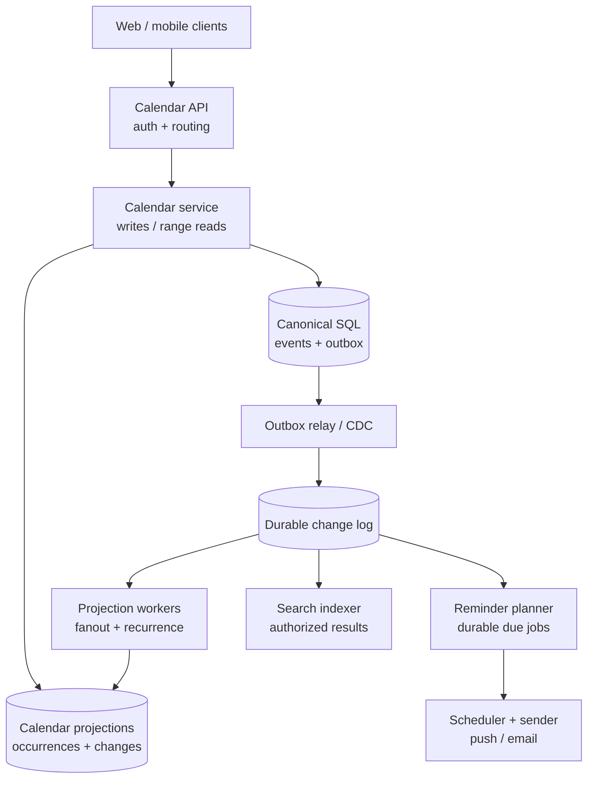
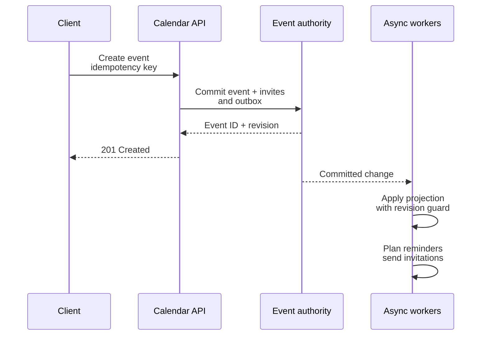
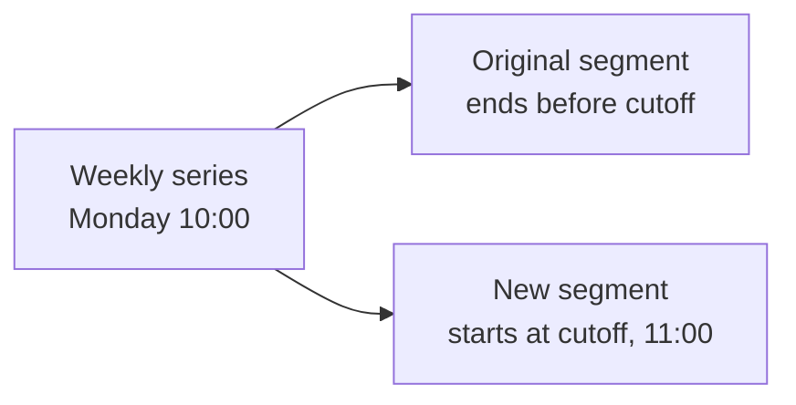
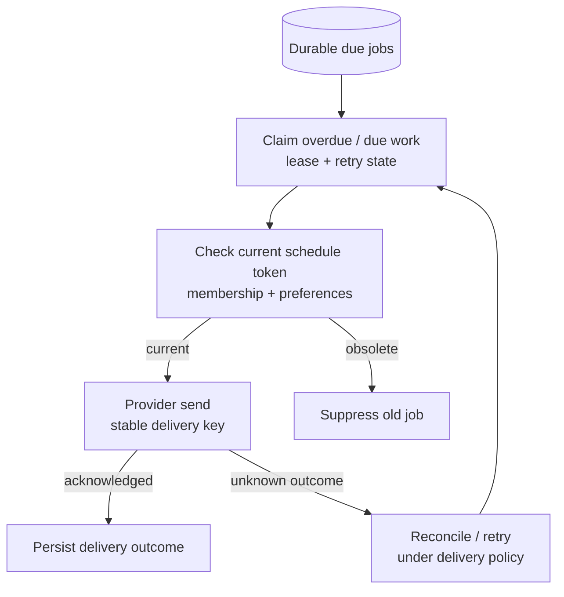
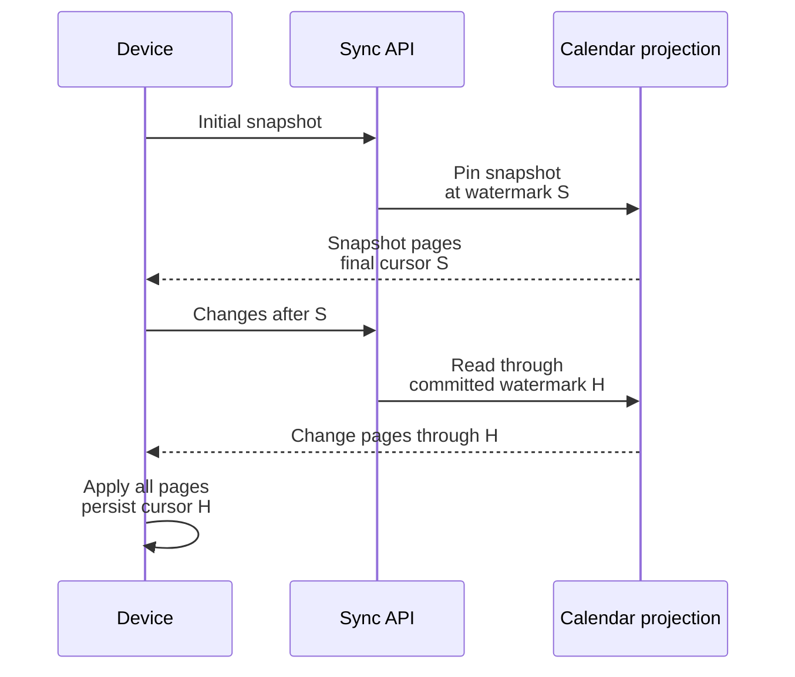

Moving a weekly design review from 10:00 to 11:00 changes several things at once. The organizer needs an immediate confirmation. Attendees need updated calendar tiles. One attendee may be offline. A reminder may already be queued. A single occurrence may have been moved to another day, and the series may cross a daylight-saving transition.

A calendar service has to give those changes clear ownership and ordering. I would keep shared meeting state in a transactional authority, maintain separate per-calendar read projections, and distribute committed changes asynchronously. Recurrence, reminder delivery, and device synchronization each need an explicit contract.

This is a proposed architecture for a Google Calendar-like product, rather than a description of Google's internal implementation.

## 1. Scope, guarantees, and capacity

The core product supports event creation, editing, cancellation, date-range reads, invitations, RSVP, recurring meetings, and time zones. Add free/busy queries, personal reminders, calendar sharing, and incremental device sync. Search, resource booking, and very large shared calendars are useful extensions. Video calls, attachments, natural-language input, and external calendar federation can remain outside the first interview pass.

<div class="table-scroll" role="region" aria-label="Calendar service contracts" tabindex="0">

| Area | Proposed contract |
| --- | --- |
| Week view | Target server p99 below 200 ms for bounded, paginated queries |
| Event mutation | Target server p99 below 300 ms for ordinary, bounded-size requests |
| Availability | Target 99.99% calendar-read availability, with stale and incomplete responses measured separately |
| Shared content | Acknowledged mutations are durably committed and ordered at the event authority |
| Attendee views | Normally converge within seconds; expose projection delay rather than promising immediate global visibility |
| Reminders | Target 99% dispatch within 30 seconds after the due time under normal operation; provider delivery is measured separately |
| Privacy | Check current authorization before exposing event details, busy intervals, attendee lists, or search results |

</div>

These are design targets, not measured results. A regional outage can make authoritative writes unavailable if the surviving deployment lacks a quorum. Cached reads can remain useful within a declared freshness policy, but cannot authorize a new edit or room reservation.

For an illustrative workload, assume 100 million daily active users, twenty calendar reads and two mutations per user per day:

```text
Reads:             100M × 20 = 2B/day
Average reads:     2B / 86,400 ≈ 23,148 requests/s
Illustrative peak: 10× average ≈ 231,481 requests/s

Mutations:         100M × 2 = 200M/day
Average mutations: 200M / 86,400 ≈ 2,315 requests/s
Illustrative peak: 10× average ≈ 23,148 requests/s
```

If every mutation changed shared content for four attendees, it would generate 800 million attendee-projection updates per day, approximately 9,259/s on average. Actual amplification depends on the mutation mix: changing one person's RSVP should not trigger the same work as moving the entire meeting. Measure those workloads separately.

A corpus of ten billion event records at an illustrative 1 KB each is about 10 TB before attendee rows, occurrence projections, history, indexes, and replication. A 30–100 TB planning range is plausible only after those factors are estimated. The stored corpus is an independent assumption; a mutation count includes updates and does not directly determine how many new events are created.

## 2. High-level architecture



*Figure 1. Synchronous writes commit at the event authority. Workers update calendar views, reminder schedules, and search independently. The service also computes bounded free/busy results from calendar projections.*

The canonical store and projection store are logical roles. A smaller deployment can use different tables in one SQL database. At larger scale, event ownership and per-calendar query locality lead to different partitioning schemes. The architecture must not depend on a distributed transaction across every attendee's calendar.

A cache can sit in front of range reads and event metadata. Use revision-aware keys and invalidate affected ranges after changes, with a short TTL as a recovery mechanism. Cache capacity, request coalescing, and database admission control matter when an outage sends a large read workload to storage. Cache state is disposable; authorization checks still apply on hits.

## 3. Define ownership before drawing tables

Shared content belongs to the event: title, organizer, location, time, recurrence, visibility, and cancellation. Each participant owns their response within the permissions of that invitation. Personal color, hidden state, and reminder preferences belong to the calendar user.

<div class="table-scroll" role="region" aria-label="Calendar authoritative records and projections" tabindex="0">

| Record | Key and important fields | Ownership and purpose |
| --- | --- | --- |
| `events` | `event_id`, organizer, content revision, schedule revision, status, timing definition, visibility | Authority for shared meeting content |
| `attendees` | `(event_id, principal_id)`, invitation revision, response, response revision | Authority for invitation membership and RSVP |
| `series_exceptions` | `(series_id, original_occurrence_key)`, override or cancellation, revision | Authority for a changed or removed instance |
| `calendar_acl` | `(calendar_id, principal_id)`, permission, ACL revision | Authority for sharing permissions |
| `calendar_preferences` | `(calendar_id, event_id, occurrence_scope)`, color, hidden state, reminder rule revision | User-owned settings, independent of projection rebuilds |
| `calendar_entries` | `(calendar_id, occurrence_id)`, start, end, event reference, component revisions, status | Rebuildable range-query projection |
| `calendar_changes` | `(calendar_id, committed_sequence)`, stable identity, upsert or tombstone | Durable device-sync feed |
| `reminder_jobs` | reminder identity, schedule token, fire time, shard, lease, delivery state | Durable scheduling and retry state |
| `outbox` | operation identity, aggregate identity, revision, payload or durable snapshot reference | Publish committed changes without a database/message dual-write gap |

</div>

An event has one logical authority even when its database has several replicas. Every participant's calendar references that authority. Projection rows may include a title and personal response for fast rendering, but they never become independent owners of shared content.

Keep personal preferences outside generated occurrence rows. Rebuilding ninety days of projections must not erase an attendee's custom reminder or hidden state. Similarly, canceling a meeting for everyone is an organizer operation; hiding it from one calendar is a personal operation.

Use separate revision domains. An organizer's content edit advances `content_revision`; a time or cancellation change advances the relevant scheduling generation. An attendee response advances that attendee's `response_revision`. These changes commit with their outbox records. Serializing every RSVP through one event-wide counter makes a large all-hands meeting a hot row and creates unnecessary reminder churn.

## 4. APIs, retries, and concurrent edits

The main client APIs can be compact:

```text
POST   /v1/calendars/{calendar_id}/events
GET    /v1/calendars/{calendar_id}/events?time_min=...&time_max=...&page_token=...
GET    /v1/events/{event_id}
PATCH  /v1/events/{event_id}
DELETE /v1/events/{event_id}
PUT    /v1/events/{event_id}/attendees/me/response
POST   /v1/freebusy
GET    /v1/calendars/{calendar_id}/changes?sync_token=...&page_token=...
```

An ordinary event-creation request has a bounded attendee list and an idempotency key scoped to the authenticated principal and operation. Store the request fingerprint and resulting event ID transactionally. Retrying the same key and payload returns the existing result; reusing it for different content is rejected. Retain the key long enough to cover the documented retry window.

For a recurring meeting, the JSON API might accept:

```json
{
  "title": "Design Review",
  "start_local": "2026-10-26T10:00:00",
  "end_local": "2026-10-26T11:00:00",
  "timezone": "America/Los_Angeles",
  "recurrence": "FREQ=WEEKLY;BYDAY=MO",
  "attendees": ["bob@example.com", "charlie@example.com"]
}
```

This is an application API, not an iCalendar wire document. Validate timing, recurrence limits, permissions, and attendee identity before committing. A client-supplied organizer ID cannot confer ownership.

Expose a strong ETag on the editable event representation. A patch carries `If-Match: "event-12"`, and the database update succeeds only if the corresponding revision is still current. A failed `If-Match` precondition returns **412 Precondition Failed**, following [HTTP conditional-request semantics](https://www.rfc-editor.org/rfc/rfc9110.html#section-13.1.1). A separate business conflict, such as a room already being booked, can use `409 Conflict`.

After a conflict, fetch the latest representation and let the user reapply their edit. Automatic merging requires retained base revisions and a field-level conflict policy. Sending `PATCH` by itself does not prove that two edits are independent: changing a time zone and changing a local start time can interact even when they touch different JSON fields.

## 5. Commit first, then distribute invitations

The mutation transaction writes the event, ordinary invitation membership, idempotency result, and outbox record. Only a successful durable commit permits a success response. A database outage returns a retryable failure rather than pretending the event exists.



*Figure 2. A process crash after the commit cannot erase the pending publication. It can cause a duplicate delivery, so consumers still need idempotency.*

A separate relay publishes committed outbox records, then records progress. A crash between publishing and recording progress causes a replay. The [transactional outbox pattern](https://docs.aws.amazon.com/prescriptive-guidance/latest/cloud-design-patterns/transactional-outbox.html) addresses the database/message dual-write gap; it does not make arbitrary downstream side effects exactly once.

For very large, explicitly addressed attendee lists, upload an immutable invitation manifest and create a durable import operation. The request returns an operation handle, with validation and membership installation progressing in bounded batches. An invitation is actionable only after the authoritative attendee membership is installed. This keeps a 100,000-person upload out of an ordinary sub-300-ms transaction without presenting unfinished work as complete.

Workers fan out in bounded batches, such as five hundred attendees per task, with resumable task progress. Meeting detail reads use the canonical event and an authorized, paginated attendee query. Do not copy the full attendee list into each attendee's calendar entry: that turns linear membership storage into quadratic duplication.

RSVP updates only the caller's authorized attendee record and emits an attendee-scoped change. Update that person's calendar and an organizer-facing aggregate or feed. Avoid rebroadcasting every response to all participants. A removal must invalidate the invitation generation so a delayed acceptance cannot restore membership.

### Out-of-order changes require more than a timestamp

Apply a newer event snapshot only when its content revision exceeds the projection's content revision. Check attendee and preference revisions independently. A newer organizer edit must not overwrite a newer RSVP with an older copied response.

Revision guards work for complete replacement snapshots within one revision domain. If messages contain deltas, dropping revision 10 after applying revision 11 can lose a change that revision 11 did not include. Use ordered delta application with gap recovery, or refetch the latest authoritative snapshot.

Cancellation, attendee removal, and time changes also require removals. When an occurrence moves between month buckets, delete or tombstone its old indexed position and insert the new one. Keep a durable per-occurrence revision marker, or equivalent generation control, so replaying an older insertion cannot resurrect the old position. A comparison against the destination row alone is insufficient when that row has already been deleted.

## 6. Answer a week-view query without missing spanning events

Use half-open windows `[query_start, query_end)`. An occurrence overlaps the window when:

```sql
SELECT occurrence_id, event_id, start_instant, end_instant
FROM calendar_entries
WHERE calendar_id = :calendar_id
  AND start_instant < :query_end
  AND end_instant > :query_start;
```

An index on `(calendar_id, start_instant)` supports ordered access, but does not make both inequalities selective. A meeting that started before the requested week can still overlap it. Scanning only rows whose start falls inside that week misses the meeting; scanning every earlier start becomes expensive for a long history.

Choose an explicit interval-index strategy. One option is a per-calendar interval index. Another is month-based coverage rows: put a reference in every month an occurrence overlaps, query the touched months, deduplicate by occurrence ID, and apply the exact overlap predicate. Cap ordinary event duration and handle exceptionally long spans separately so one event cannot create unbounded coverage rows. PostgreSQL also supports range-overlap indexes through [GiST and SP-GiST](https://www.postgresql.org/docs/current/rangetypes.html#RANGETYPES-INDEXING).

For a read, authorize the calendar, retrieve overlapping ordinary and materialized recurring occurrences, apply current visibility rules, and merge selected shared calendars. Bound the number of calendars, query span, and result count. A page token pins the query and a projection snapshot or watermark; live ordering alone can skip or duplicate entries while meetings move between pages.

The create response supplies the committed event and a revision receipt. The organizer can display that event immediately. For a follow-up range read, wait briefly for the organizer's projection to apply that receipt or overlay the committed mutation until it catches up. Reading authoritative details by event ID does not solve a missing range-index entry by itself.

## 7. Store recurrence definitions and stable occurrence identity

A recurring series stores a local start, time-zone ID, recurrence rule, duration semantics, and exceptions. Store one-off events as resolved instants with their display-zone metadata. All-day events use dates with an exclusive end date; they should not silently become fixed 24-hour UTC intervals.

The occurrence identity is based on the series and its **original scheduled slot**. Moving that occurrence changes its displayed start, but not its identity. Google's public API documents the same useful distinction through [`originalStartTime`](https://developers.google.com/workspace/calendar/api/guides/recurringevents): the original slot continues to identify a moved instance.

For a series such as Monday at 10:00, an exception can override the occurrence originally scheduled for November 9 at 10:00 and move it to November 10 at 14:00. A query for November 10 must find it even though its original slot lies outside the requested day. Index exception replacements by their effective interval, and suppress the corresponding original occurrence. Cancellation exceptions likewise suppress the original without creating a replacement.

### Materialize a bounded horizon

Precompute a rolling window, such as the next ninety days, rather than every possible future occurrence. Keep a per-calendar series-membership index to discover series outside that window; a time-range scan over already materialized entries cannot discover a still-unexpanded future meeting.

Track coverage explicitly: the window, series revision, time-zone rules version, and generation that were fully materialized. Queries outside complete coverage use bounded on-demand expansion, or return a clearly signaled retryable/incomplete response when the work budget is exhausted. Returning an empty calendar would hide missing computation.

For old or sparse series, do not always iterate from the original start date. Use recurrence-library support for window seeking or saved expansion checkpoints. Bound the query interval, generated occurrence count, and CPU time, including time spent seeking. Reject unsupported recurrence combinations at creation rather than accepting a rule the read path cannot process.

A series edit builds a new projection generation. For small windows, a transactional replacement can work. For large rebuilds, prepare a complete generation and atomically switch the coverage pointer. Readers must not observe half of the old weekly series and half of the new one. Return and sync a series invalidation so clients discard stale expanded occurrences, including instances that disappeared.

### One occurrence, the whole series, or this and following



*Figure 3. A “this and following” edit creates a new series segment. It does not create an override for every future Monday.*

For `THIS`, create an override or cancellation under the original occurrence key. For `THIS_AND_FUTURE`, atomically truncate the old segment before the selected original slot and create a new segment with a new identity. Reconcile exception mappings, reminder jobs, invitation membership, and finite recurrence counts. If the original series had ten occurrences and four precede the split, the new segment does not automatically receive ten more.

For `ALL`, define whether the operation changes the full series, including past displays, or whether the product offers a separate future-only action. Do not label a future-only edit “all” while silently preserving an incompatible historical definition. Retain audit history either way. Ambiguous exceptions after a rule change need a documented policy or user confirmation; matching them only by their new displayed time is unsafe.

## 8. Resolve local intent through time-zone rules

Monday at 10:00 in Los Angeles does not have a permanent UTC offset. Preserve the local recurrence definition and resolve each occurrence separately. Use an IANA zone such as `America/Los_Angeles`; a fixed offset or abbreviation cannot express the full rule history. The [IANA Time Zone Database](https://www.iana.org/time-zones) tracks changes to civil-time rules.

<div class="table-scroll" role="region" aria-label="Calendar daylight saving examples" tabindex="0">

| Scheduled local start | UTC start under the applicable zone rules | Design implication |
| --- | --- | --- |
| October 26, 2026, 10:00, Los Angeles | October 26, 17:00Z | Weekly meeting before the November transition |
| November 2, 2026, 10:00, Los Angeles | November 2, 18:00Z | Same local hour, different UTC start |
| March 8, 2026, 02:30, Los Angeles | Local time falls in a clock gap | A generated recurrence needs the specified gap policy |
| November 1, 2026, 01:30, Los Angeles | Two possible instants: 08:30Z and 09:30Z | An ambiguous local time needs an explicit resolution rule |

</div>

For standards-compatible recurrence generation, [RFC 5545](https://www.rfc-editor.org/rfc/rfc5545.html#section-3.3.10) excludes rule-generated invalid dates and nonexistent local times from the recurrence set. Its DATE-TIME rules select the first occurrence of an ambiguous local time. Explicitly supplied DATE-TIME values in a gap have separate interpretation rules; do not apply a library's default normalization to every case and assume equivalence.

For this product's interactive API, reject a nonexistent user-entered local time and request a valid selection; ask the user to disambiguate a repeated hour. Imported iCalendar data follows its declared standard semantics. Test those paths separately. Also define whether meeting length follows elapsed seconds or a local end-time rule across transitions.

Persist the time-zone rules version used by a materialized generation. When rules change, identify affected future windows, rebuild them, update reminder schedules, and publish sync invalidations. Preserve enough historical resolution data for audit. A time-zone update can change a future UTC instant even if the organizer never edits the event.

## 9. Build reminders as durable scheduled work

Store reminder rules separately from generated due jobs. A job identifies the user, occurrence, channel, rule, scheduled instant, and a scheduling token derived from the occurrence generation, time-zone resolution, and user's reminder-rule revision. Do not invalidate every reminder merely because somebody changes their RSVP.

Partition due jobs by time bucket and a hash shard. Poll owned partitions every few seconds, claim jobs with expiring leases, and enqueue dispatch work durably. Maintain a last-completed watermark and scan overdue unfinished work after outages. A narrow scan of only `now` through `now + 10 seconds` loses reminders during a five-minute scheduler outage.



*Figure 4. A stale or canceled reminder is suppressed before dispatch. A provider timeout is an unknown delivery outcome, not proof that nothing was sent.*

Use one stable notification identity for the intended occurrence/rule/user/channel delivery. Track its scheduling token separately. Rescheduling a job should not accidentally create a second email for an already delivered reminder unless the product explicitly calls for a new notification.

Before sending, verify the current scheduling token and eligibility against authoritative state or a source with the required consistency. If that check is unavailable, delay rather than send a known-unverified reminder. A successful check cannot retract a message when the organizer cancels immediately afterward; document the send-time race and avoid promising cancellation of an already in-flight provider request.

A unique local delivery record suppresses duplicate job creation. It cannot atomically commit with an arbitrary email provider. If the provider supports idempotency keys, reuse the stable key across retries; otherwise reconcile status where possible and document the remaining duplicate-versus-loss trade-off. Mobile clients can also deduplicate by notification identity. Keep retry deadlines and a stale-reminder policy so a recovered scheduler does not send yesterday's alerts in a burst.

Monitor dispatch lag separately from provider acceptance and user delivery. Notification-provider failure should not prevent event editing or week-view reads.

## 10. Synchronize devices from committed calendar changes

A phone returning after three hours offline should fetch changes, not ten years of calendar data. Maintain a per-calendar durable change feed with upserts, deletions, series invalidations, and permission-related invalidations.

Update a projection and append its change record in the same transaction. Assign a **commit-ordered** sequence per calendar, for example by locking that calendar's sequence row through commit, or using a partitioned log with equivalent visibility guarantees. Allocating increasing IDs outside commit order is unsafe: transaction 102 can become visible before 101, and a client that advances to 102 may skip the later commit of 101.



*Figure 5. The snapshot and its watermark describe one consistent boundary. A device advances its saved cursor only after applying the complete batch durably.*

Bind opaque authenticated tokens to the principal, calendar, query scope, permission generation, and retained history epoch. A paginated batch pins a high watermark `H`; page tokens keep that boundary stable as newer changes arrive. Clients apply changes idempotently and store data plus cursor atomically, or recover by replaying the batch.

Initial snapshots need the same discipline. Take a consistent snapshot tied to sequence `S`, then consume changes after `S`; an independently obtained timestamp is not a safe substitute. For expanded client caches, materialization and series-generation changes must appear in the feed. For master-based clients, send the changed masters and exceptions so they can discard affected expansions.

Retain tombstones and feed history for a documented window. An expired token returns `410 Gone` and triggers a new snapshot. Recheck authorization on every request; a revoked user may receive `403` and must clear the affected cache. Google's [incremental-sync guide](https://developers.google.com/workspace/calendar/api/guides/sync) documents deleted entries, pagination, and full resynchronization after invalid tokens. The commit-ordering mechanism above is a design choice for this service.

Push notifications or WebSocket messages can tell a device that changes are available. The durable feed remains the recovery source when those hints are missed.

## 11. Free/busy, privacy, and room reservations

Free/busy returns occupied intervals without event titles, locations, attendee identities, or private descriptions. Evaluate calendar ACLs and event visibility before building the response. Define whether tentative invitations block time; declined and canceled events normally do not, while a transparent event can remain visible without blocking time.

Clip each authorized busy interval to the requested window, sort by start, and merge overlapping or touching intervals. For `N` unsorted intervals, sorting takes `O(N log N)` and merging takes `O(N)`. If `C` calendars supply sorted streams, a heap-based merge takes `O(N log C)` plus output space. Subtract the merged busy union from the requested window to obtain common free intervals of sufficient duration.

A fifteen-minute bitmap can speed large-group candidate discovery. Its slot count depends on the requested instant range; a local civil day can have 23 or 25 hours, so ninety-six slots is not a universal day length. Marking every touched slot busy avoids false free time but can reject valid short gaps. Confirm candidate times against exact authorized intervals and a known projection watermark.

Room booking requires stronger semantics than an advisory free/busy query. Two clients can both observe a free room before either inserts a reservation. Enforce non-overlap at the authoritative reservation transaction. PostgreSQL can express this with an [exclusion constraint on a room and time range](https://www.postgresql.org/docs/current/rangetypes.html#RANGETYPES-CONSTRAINT).

If reservations and events share a transactional boundary, commit the room reservation, event change, and outbox together. If they have separate authorities, use an explicit pending/confirmed operation with an idempotent reservation request and recovery or compensation. Never present a room as confirmed merely because an asynchronous invitation was queued. Infinite recurring room reservations also need a declared booking horizon or another bounded conflict policy.

Search is a separate index fed by committed changes. Reauthorize every result and snippet before exposure; a delayed index must not keep a revoked event readable. Permission caches need revision-aware invalidation or bounded leases with a defined fail-closed policy. For immediate revocation, consult the authority or delay acknowledging revocation until outstanding authorization leases have expired or been revoked. A cached revision alone does not prove freshness; any weaker bounded-delay policy needs an explicit revocation limit. Revocation cannot erase information a device previously downloaded, but it must stop new authorized retrieval.

## 12. Scale large calendars and recover from failures

Partition canonical events by event identity or ownership group, with colocated normal attendee records. Keep large attendee sets in paginated or striped storage without introducing a single write bottleneck for every response. Partition calendar projections by calendar identity and bounded time coverage, with deduplication across coverage buckets. Reminder partitions follow due time and hash shards. Each store's key should reflect its access pattern.

Normal meetings use fanout-on-write to populate personal calendars. A company-wide calendar can use read-time merging because membership in the shared calendar is already discoverable through a directory or subscription table. Cap the number of shared feeds merged in one query, cache popular feeds, and issue per-feed cursors when needed. Group removal must invalidate access and client caches.

An arbitrary 100,000-person invitation does not automatically become a shared calendar that every participant can discover. It still needs durable membership and delivery tracking. A shared-feed optimization also needs a discoverable invalidation stream for subscribed devices; otherwise those events disappear from incremental sync even though they appear in online week views.

<div class="table-scroll" role="region" aria-label="Calendar failure and recovery plan" tabindex="0">

| Failure | User-visible behavior | Recovery and monitoring |
| --- | --- | --- |
| Event authority lacks quorum | Mutations fail or wait within a deadline; no false success | Fenced failover, replication monitoring, same-key retries |
| Change broker unavailable | Committed writes can continue only within an outbox backlog budget | Relay replay, oldest unpublished age, admission control before storage exhaustion |
| Projection worker crashes | Attendee views lag; organizer can use the committed receipt | Idempotent replay, retained revision markers, coverage and lag checks |
| Recurrence build fails midway | Prior complete generation remains visible under policy | Retry or bounded expansion; never mark partial coverage complete |
| Scheduler or provider unavailable | Reminders become delayed; core calendar remains usable | Overdue scan, lease recovery, delivery-status reconciliation, lateness cutoff |
| Sync history expires | Incremental recovery cannot continue | New consistent snapshot and cursor; keep authorization checks |
| Cache unavailable | Read latency and storage demand rise | Coalescing, rate limits, bounded database fallback |
| Permission freshness cannot be established | Sensitive results are withheld | Refresh the authority; fail closed for the affected data |

</div>

Reconciliation jobs compare projection component revisions, recurrence coverage, pending invitation operations, reminder generations, and outbox progress against authoritative records. Dead-letter queues need an owner and a replay procedure; moving a failed task into one does not repair an attendee's calendar.

In a fifty-minute interview, spend the first eight minutes on scope and traffic, the next twelve on ownership, APIs, and the architecture, then about twenty on invitation ordering and recurrence. Use the remaining time for reminder delivery, sync boundaries, and one failure scenario. A useful final test is concrete: move a recurring meeting while a device is offline and a reminder is due, then explain which committed revision controls each outcome.

## Further reading

- [RFC 5545: iCalendar data types and recurrence](https://www.rfc-editor.org/rfc/rfc5545.html) — interoperable date, time, and recurrence semantics.
- [IANA Time Zone Database](https://www.iana.org/time-zones) — civil-time rules and release information.
- [Google Calendar: recurring events](https://developers.google.com/workspace/calendar/api/guides/recurringevents) — instance identity and exceptions in a public API.
- [Google Calendar: incremental synchronization](https://developers.google.com/workspace/calendar/api/guides/sync) — deletion handling, paginated changes, and invalid-token recovery.
- [RFC 9110: If-Match](https://www.rfc-editor.org/rfc/rfc9110.html#section-13.1.1) — conditional mutations and precondition failures.
- [AWS Prescriptive Guidance: transactional outbox](https://docs.aws.amazon.com/prescriptive-guidance/latest/cloud-design-patterns/transactional-outbox.html) — durable publication across a database/message boundary.
- [PostgreSQL: range types](https://www.postgresql.org/docs/current/rangetypes.html) — interval indexing and exclusion constraints.
