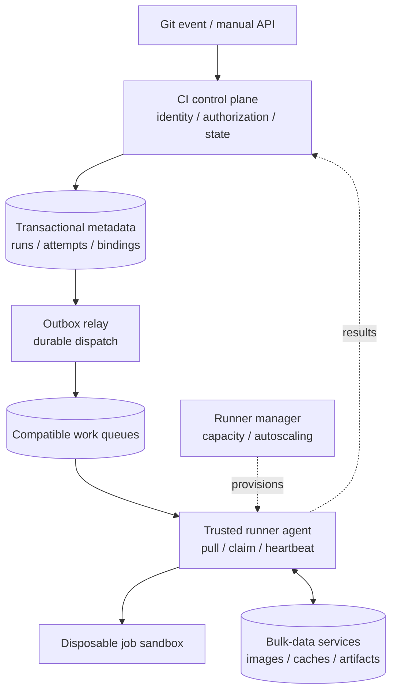
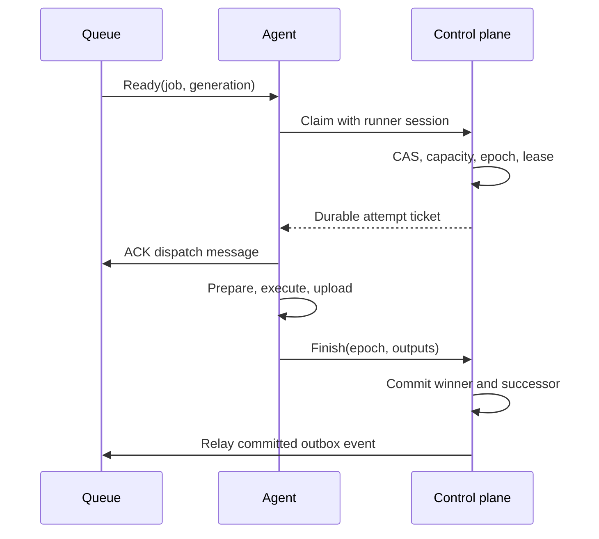
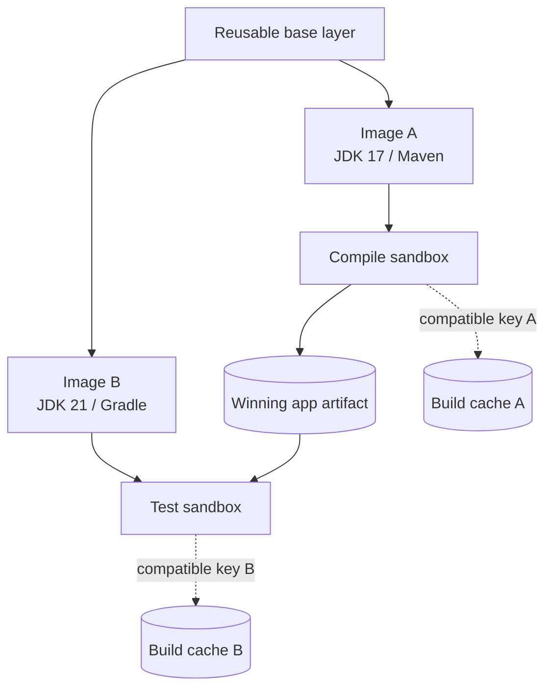
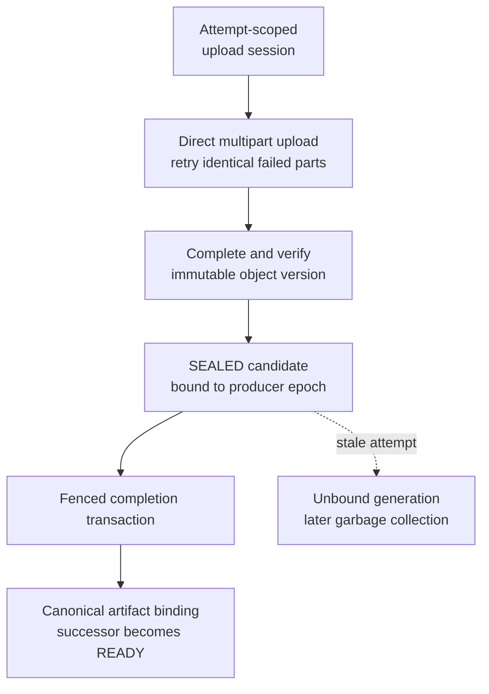
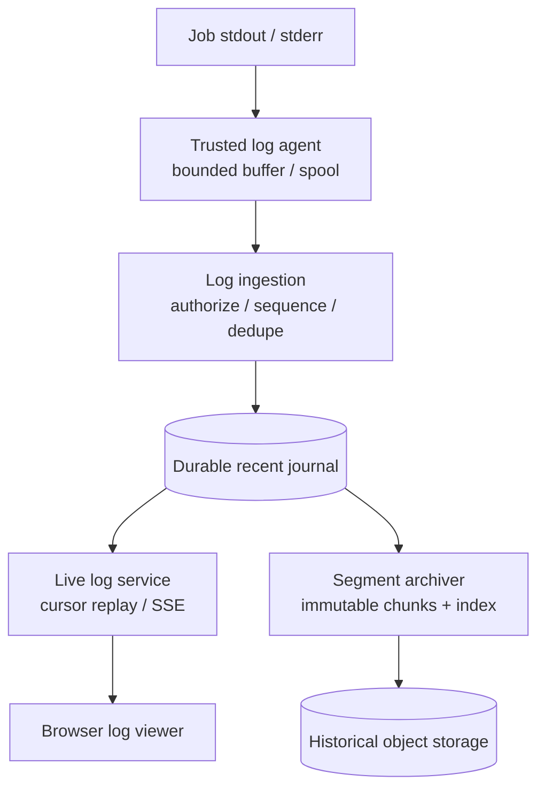

A developer pushes a commit. The first CI job compiles a JAR with Java 17, and the next job tests it with Java 21 on another machine. Halfway through uploading the JAR, the runner disappears. A replacement receives the same job, while the original runner briefly reconnects and reports success.

The platform needs to decide which attempt owns the job, which bytes the next job may consume, and which reusable data can safely be discarded. These decisions define the architecture more clearly than a list of services does.

This design covers a hosted CI platform with sequential YAML-defined jobs, custom execution images, reusable build caches, durable cross-job artifacts, and streaming logs. It is a proposed design, with illustrative capacity assumptions. It does not describe the internal implementation of a particular CI provider.

## 1. Separate three storage contracts

Build caches, execution images, and artifacts may all use object storage underneath. They need separate identities, access rules, retention policies, and failure behavior.

<div class="table-scroll" role="region" aria-label="Build caches, execution images, and artifacts" tabindex="0">

| Object | Purpose | Identity and lifetime | Effect of unavailability |
| --- | --- | --- | --- |
| Build cache | Reuse dependencies or intermediate build results | Repository/trust namespace plus compatible input fingerprint; may span runs | Rebuild from declared inputs; performance degrades |
| Execution image | Supply the job's operating environment and toolchain | Pinned image digest and platform; layers may be cached locally | Fetch verified missing layers; without a usable image, execution waits or fails |
| Artifact | Supply a specific producer job's required output | Run, producer job, winning attempt, and artifact name; retained for consumers | A required consumer cannot proceed successfully |

</div>

For a Maven build, downloaded dependencies can be cached, `target/app.jar` is an artifact, and the JDK/Maven image supplies the environment. Job two declares its own image and downloads the winning JAR explicitly. It must remain correct when it lands on a completely different runner.

A cache miss must have a correct rebuild path. That does not mean every cold build will meet the same timeout or that missing upstream dependencies become available automatically. Budget for cold execution, and distinguish a cache outage from a dependency repository outage.

## 2. Scope and service targets

The initial workflow is an ordered list: compile, test, then package. Only a successful predecessor with committed required outputs makes its successor eligible. General dependency graphs, matrix builds, deployment approvals, and release rollbacks can follow later.

Support Git push, pull-request, and manual API triggers; immutable source/workflow identity; retries, timeouts, cancellation, status, and logs. Users can select a registry image or a Dockerfile from the pinned source revision. Enforce tenant quotas, cache budgets, artifact retention, and a security policy for untrusted code.

Proposed targets are 99.99% control-plane availability, trigger persistence below one second, and p95 dispatch below ten seconds **when compatible capacity is available**. Report image preparation, capacity waiting, dispatch, command execution, and artifact finalization separately. A large image build cannot be hidden inside a dispatch target.

Metadata transitions and artifact bindings require authoritative transactional decisions. Cache lookup metadata can tolerate stale misses when authorization and content validation remain correct. Job commands may execute more than once; the platform publishes one winning attempt's result. It cannot promise exactly-once effects against an arbitrary external API.

## 3. Size the runner fleet and the transfer path

Assume 500,000 workflow runs/day, four jobs per run, and a mean execution time of six minutes per job. The table uses decimal storage units unless a binary unit is named.

<div class="table-scroll" role="region" aria-label="Illustrative CI capacity and storage estimates" tabindex="0">

| Dimension | Calculation | Consequence |
| --- | --- | --- |
| Job arrivals | 2 million / 86,400 ≈ 23.15/s average | Metadata QPS is modest relative to the compute fleet |
| Average execution concurrency | 2 million × 360 / 86,400 ≈ 8,333 | Thousands of disposable execution slots |
| Sustained rounded peak | 230 starts/s × 360 seconds = 82,800 active jobs | A 30,000-slot fleet cannot sustain this peak without queueing or shorter jobs |
| Artifact creation | 2 million × 30% × 200 MB = 120 TB/day | Upload bytes directly to object storage |
| Thirty-day artifact retention | 120 TB × 30 = 3.6 PB raw | Retention and tenant quotas materially affect cost |
| Potential cache restores | 2 million × 300 MB = 600 TB/day | Locality and transfer efficiency matter more than adding metadata replicas |
| Average cache-read bandwidth | 600 TB / 86,400 ≈ 6.94 GB/s | About 55.6 Gbps of aggregate payload before protocol overhead |
| Logs | 2 million × 1 MB = 2 TB/day | Batch ingestion and inexpensive historical storage |

</div>

Peak concurrency depends on burst duration and job duration, rather than only peak arrivals. Thirty thousand slots might absorb a short burst above the average load; they are not enough for a stable 230-start/s workload lasting many minutes. Measure the duration distribution and resource classes before choosing fleet size.

These are raw planning estimates, excluding replicas, indexes, failed attempts, and retained generations. Cache restores may hit node-local storage and never reach the remote service. A twenty-thousand-runner cold start against a 3 GB image would request **60 TB** of image data without reuse, illustrating another burst the metadata API cannot solve.

## 4. High-level architecture



*Figure 1. Metadata determines eligibility and ownership. Runner agents transfer large objects through the data services rather than through the CI control API. Log delivery has a separate path below.*

The control plane validates requests, snapshots workflow identity, records attempts, and advances jobs. A transactional database holds its authoritative state. An outbox relay delivers dispatch events to a durable work queue. Agents pull only when they can accept compatible work, providing backpressure.

The runner manager supplies execution capacity and warm pools. It does not need to consume every individual job and then introduce another ownership handoff. Registry, cache, artifact, and log services authorize transfers and own their respective metadata; object bytes bypass the control API. These are logical responsibilities and can initially share service deployments.

Use queues for hard compatibility classes such as OS, architecture, resource size, and isolation level. Image warmth is a locality preference within a compatible pool. Creating a queue for every image or tenant would make queue management follow unbounded user-controlled cardinality.

## 5. Freeze the run definition

Verify the webhook signature and repository authorization, check the event type, and deduplicate using a provider-scoped delivery identity. Persist acceptance before acknowledging the request. The [GitHub webhook guidance](https://docs.github.com/en/webhooks/using-webhooks/best-practices-for-using-webhooks) documents timely responses and stable delivery IDs across redelivery.

Fetch the workflow at an explicit commit SHA and store its hash, accepted inputs, repository identity, and trust policy in the run. A branch name remains descriptive metadata; it must not be reread later to select different source bytes. Parse YAML safely and bound its size, nesting, job count, and steps.

Webhooks are the primary path. Reconciliation detects missing accepted work and, where provider history permits, missed events. Polling only the latest branch tip cannot recover every intermediate push or pull-request event. State the product's trigger-retention contract and preserve a durable event cursor when every event matters.

An illustrative workflow could look like this; its scripts, image references, and cache paths belong to the example repository:

```yaml
version: 1
jobs:
  - name: compile
    image:
      ref: registry.example.com/ci/jdk17-maven:approved
    cache:
      kind: dependencies
      version: deps-v1
      inputs: [ci/dependencies.lock]
      paths: [/work/cache/maven]
    steps:
      - ./ci/build.sh
    artifacts:
      publish:
        - name: app
          path: target/app.jar
  - name: integration-test
    image:
      ref: registry.example.com/ci/jdk21-gradle:approved
    cache:
      kind: dependencies
      version: deps-v1
      inputs: [ci/dependencies.lock]
      paths: [/work/cache/gradle]
    artifacts:
      restore:
        - from_job: compile
          name: app
          path: inputs/app.jar
    steps:
      - ./ci/integration-test.sh inputs/app.jar
```

Resolve referenced tags to immutable digests during planning. Include the selected OS/architecture manifest when the reference is a multi-platform image index. For a Dockerfile, build from the pinned context in an isolated, metered operation; commit the selected image digest before user commands execute and reuse that committed digest on retry. Preparation failures belong to the current job and never unblock the next job.

The platform augments the user cache version with repository/trust scope, platform, image/toolchain identity, and input fingerprints. Merely using `deps-v1` as a global cache key would mix unrelated jobs.

## 6. APIs and authoritative records

Keep external APIs small:

```text
POST /v1/repos/{repo_id}/workflow-runs
GET  /v1/workflow-runs/{run_id}
POST /v1/workflow-runs/{run_id}/cancel
POST /v1/workflow-runs/{run_id}/retry
GET  /v1/jobs/{job_id}/logs/events
```

For a manual trigger, accept an idempotency key scoped to the caller and repository:

```json
{
  "workflow_path": ".ci/build.yaml",
  "commit_sha": "0123456789abcdef0123456789abcdef01234567",
  "inputs": {"test_suite": "integration"}
}
```

Bind the idempotency record to a request digest. The same key with a different body is a conflict, not permission to reuse an unrelated run. Return `202 Accepted` with a durable `run_id`; acceptance does not mean execution has started.

<div class="table-scroll" role="region" aria-label="CI metadata records and authoritative keys" tabindex="0">

| Record | Important fields | Constraint or purpose |
| --- | --- | --- |
| WorkflowRun | Repository, commit, workflow hash, inputs, trust policy, status, cancel version | Immutable execution definition; serialized cancellation and advancement |
| JobRun | Run, job index, status, dispatch generation, current attempt epoch, next_attempt_at, selected image | Unique `(run_id, job_index)` |
| Attempt | Job, epoch, runner session, lease deadline, phase, outcome | Unique `(job_id, epoch)`; distinguishes replacement execution |
| ArtifactGeneration | Producer attempt, name, upload session, object version, size, checksum, state | Staged bytes are never a canonical input by themselves |
| ArtifactBinding | Run, producer job, name, winning artifact generation | One authoritative binding for a successful producer |
| Outbox | Event ID, job, dispatch generation, publication progress | Makes committed readiness recoverably deliverable |
| CacheEntry | Authorized namespace, compatible key, immutable manifest digest, expiry | Optional reusable data; access rights remain authoritative |

</div>

A transactional SQL database is a reasonable starting point for runs, attempts, bindings, quota reservations, and outbox records. Partition by a stable run/tenant key as needed; avoid transactions spanning every tenant. Blob storage holds images, cache archives, artifacts, and archived logs. A KV store can serve cache metadata; an in-memory store can accelerate hot indexes without becoming the primary home for petabytes of blobs.

## 7. Dispatch with durable ownership

An SQS-like work queue fits independent, long-running jobs. [SQS Standard delivery](https://docs.aws.amazon.com/AWSSimpleQueueService/latest/SQSDeveloperGuide/standard-queues-at-least-once-delivery.html) can duplicate messages, so receiving one does not grant execution ownership. Kafka could also carry dispatch events, but independent completion requires bookkeeping beyond advancing one partition's committed offset. A work queue keeps the initial dispatcher smaller.

Choose one recovery authority. **This design uses durable database leases and acknowledges a dispatch message after a successful claim.** It does not depend on retaining that message throughout execution.



*Figure 2. The control plane includes the transactional database and outbox responsibility. Queue acknowledgement transfers recovery responsibility to durable attempt state.*

Claiming atomically checks that the run is active, the job is `READY`, the dispatch generation matches, its predecessor succeeded, and tenant/host capacity is available. It creates an attempt with a new epoch, owner session, and lease; reserves capacity; and changes the job to `RUNNING`. A claim request ID lets the same agent recover an acknowledgement lost after commit.

Duplicates for already claimed or terminal jobs can be acknowledged because the database owns recovery. A temporarily declined claim due to quota or capacity must remain retryable or be durably rescheduled; the agent must not silently discard eligible work. Agents independently enforce local admission and ticket validity.

Holding the queue message until completion is another valid design, but then visibility renewal and redelivery are part of execution recovery. [SQS visibility timeouts](https://docs.aws.amazon.com/AWSSimpleQueueService/latest/SQSDeveloperGuide/sqs-visibility-timeout.html) have their own limits, including a twelve-hour ceiling from receipt. Mixing an assumed early ACK with an assumed future redelivery leaves a recovery hole.

## 8. Retry execution without accepting stale results

Agents heartbeat against the current epoch using authoritative database time. A reconciler handles expired leases and durable `next_attempt_at` deadlines. Retryable infrastructure failures use bounded exponential backoff with jitter; compilation/test failures follow an explicit retry policy and normally fail the job. Retry budgets count attempts in the database, rather than treating transport delivery count as execution count.

A lease expiry does not prove that the old process stopped. The reconciler invalidates the old epoch before authorizing a replacement. Every heartbeat, output finalization, and result publication checks the current epoch. An old runner may continue consuming CPU or calling external services, but it cannot publish the winning result after being fenced out of metadata.

Stop the old sandbox where possible, quarantine unreachable host capacity, and retain physical resource accounting until termination or host fencing is established. A replacement needs its own admitted capacity. Arbitrary external side effects require a cooperating downstream idempotency key stable across attempts of the same logical operation, or manual reconciliation when the result is uncertain. An attempt-specific key would permit duplicate business effects on retry.

The [cloud sandbox design](/system-design/cloud-sandbox-platform/) discusses this distinction between ownership and physical execution in more detail. A runner's local filesystem is disposable; correctness must survive its loss.

## 9. Commit required outputs and job success together

Uploading a file creates a candidate artifact generation for a particular attempt. It does not make that generation the next job's input. The control plane binds required outputs only when it accepts that attempt's successful completion.

The completion protocol is conceptually:

```text
BEGIN authoritative transaction
  lock the run, then the current job
  require active run and unchanged cancellation version
  require current attempt epoch and an unexpired lease
  require trusted evidence of command success and sandbox termination
  require every declared required artifact to be SEALED for this attempt
  create immutable ArtifactBinding records for those generations
  mark the current job SUCCESS
  release verified attempt reservations once
  if a successor exists:
    mark successor READY and insert its dispatch event into the outbox
  else:
    mark the workflow SUCCESS
COMMIT
```

The artifact service freezes verified upload metadata before this transaction; the binding transaction references that immutable candidate. If control-plane and artifact metadata are separate deployments, they must still share an authoritative commit protocol for visibility. Two unrelated best-effort database updates do not provide this guarantee.

Success and readiness are delivered through the [transactional outbox pattern](https://docs.aws.amazon.com/prescriptive-guidance/latest/cloud-design-patterns/transactional-outbox.html). A relay crash after queue publication can cause another delivery; the claim protocol handles it. A crash before publication leaves a committed outbox event for another relay. Runners report the current attempt; orchestration decides when the successor is eligible.

Cancellation takes the same run lock, records a cancellation version, prevents further claims/publication, and requests sandbox termination. If completion commits first, cancellation observes that committed result. If cancellation commits first, a late completion is rejected. Keep a run `CANCELLING` while physical termination is unresolved; a timeout alone cannot certify that untrusted execution has ended.

The initial retry endpoint creates a new run with the same pinned definition and a parent-run reference. A future “retry from job N” feature must recreate all affected descendants and pin any reused successful prefix explicitly. Retaining an old downstream success against a newly built upstream artifact would invalidate the workflow's meaning.

## 10. Build caches need both compatibility and trust

A generic directory cache bundles selected paths. A dependency cache reuses package downloads; the package manager still resolves declared versions and verifies the content it consumes. An action cache reuses the output of a particular computation and therefore needs a more complete input identity.

For an action, an illustrative identity is:

```text
cache_key = hash(
  authorized namespace, cache format version,
  OS and architecture, toolchain/image digest,
  command and flags, relevant environment,
  declared input contents and transitive dependency identities
)
```

The [Bazel remote-cache model](https://bazel.build/remote/caching) separates action-result metadata from content-addressed output blobs. Its declared-input approach illustrates why a branch name or source-file hash alone is insufficient. Reads from undeclared network resources, mutable dependency sources, time, or randomness can invalidate reuse assumptions even when the hash function is perfect.

For the first version, expose explicit dependency-directory caching with platform/trust scoping and user-declared inputs. Introduce action caching only with an input-discovery and reproducibility contract. Prefix fallback can be acceptable for validated package downloads; it must not select arbitrary compiled outputs produced for different inputs.

Restore through node-local SSD, then a regional cache service and object storage. Authenticate the namespace, validate the manifest and digests, and unpack within a bounded sandbox directory. Reject path traversal, unsafe links, and decompression bombs. A failed or partial restore is removed before rebuilding from a clean baseline. A timeout, evicted object, or checksum mismatch becomes a miss, rather than a partially restored environment.

Publish a new immutable blob and conditionally bind its compatible key. First-writer-wins prevents overwriting readers; it does not prove that two writers produced equivalent results. Conflicting outputs under one action key indicate missing inputs, non-determinism, corruption, or an untrusted writer. Investigate and disable unsafe reuse instead of assuming immutability repaired the build.

Scope writes by tenant, repository, and trust level. Fork pull requests cannot populate a protected branch's cache namespace. Reading a trusted public cache may be allowed, but private cache access requires authorization. A valid checksum proves byte identity, not that the producer was authorized or its output is safe.

TTL, approximate LRU, size limits, and per-tenant quotas reclaim optional entries. Coalesce hot downloads or use regional mirrors without making every cold build wait behind a distributed cache lock. Measure time and bytes saved as well as hit rate: a large archive that costs more to transfer than rebuild is a poor hit.

## 11. Images supply environments; artifacts connect jobs

The [OCI image manifest](https://github.com/opencontainers/image-spec/blob/main/manifest.md) references configuration and layer content by digest. Different toolchains produce different image identities, while identical accessible layer blobs can be reused by registry and node storage. Do not assume global cross-tenant deduplication or access merely because two digests match.



*Figure 3. Common image content can reduce downloads. The JAR crosses jobs through an artifact binding; runtime caches remain separately keyed.*

A trusted host agent pulls missing verified layers and launches a fresh job environment. It never exposes the host's management socket or another job's writable cache directory to arbitrary code. Compatibility includes OS, architecture, resources, and the required isolation class. Warm image placement is useful only within that compatible set, with a queue-wait penalty to avoid waiting indefinitely for a warm host.

Dockerfile builds require the same isolation and secret policy as ordinary jobs. Pin the base image and dependency sources where reproducibility matters. An image digest identifies the selected bytes; it does not guarantee that rebuilding an unchanged Dockerfile later will produce the same bytes. [Docker's cache rules](https://docs.docker.com/build/cache/invalidation/) explain, for example, why a cached package-install instruction is not automatically refreshed when a remote repository changes.

Keep node-local layer stores behind trusted agents, with namespace-aware access and capacity limits. Prewarm popular authorized images and use regional registry mirrors to reduce pull storms. A verified local image may permit execution through a registry outage under policy; a missing layer still requires retrying preparation or failing the job. Failed digest checks cause eviction and refetching, not execution of unverified content.

For hostile multi-tenant jobs, use VM/microVM-class isolation or another evaluated boundary appropriate to the threat model. A container sharing a host kernel is not automatically sufficient. Bound CPU, memory, disk, process count, execution time, and egress. Reuse immutable image layers through a trusted cache while destroying the job's writable state and process tree.

## 12. Transfer large artifacts directly and publish them deliberately

After commands succeed, terminate job execution and freeze declared outputs into a read-only snapshot or local agent-owned spool before transferring them. Hashing a file and then uploading a concurrently changing version would break the manifest's identity. This local source is not promised to survive loss of the host.

The artifact service creates an attempt-scoped upload session after authorization, recording a fresh object key, expected size, checksum policy, and producer epoch. The trusted agent obtains narrowly scoped upload capabilities and sends bytes directly to object storage. The API server authorizes metadata operations; it does not relay a 20 GB JAR archive.



*Figure 4. Object completion establishes stored bytes. Only accepted job completion establishes the canonical artifact that a successor may read.*

[S3 multipart upload](https://docs.aws.amazon.com/AmazonS3/latest/userguide/mpuoverview.html) supports independently retried parts. A 100 GiB file split into 128 MiB parts has **800 parts**. Persist the upload ID and part numbers, checksums, and returned ETags. Replacing a part is safe only when retries send the same intended bytes for that upload and part number. A multipart ETag is not a general whole-file MD5 checksum.

Use a declared, supported object-store checksum mode and validate the complete size and content identity before sealing. Store the immutable object version/content reference in metadata. Fresh sessions use fresh keys; a guest has no permission to overwrite an already sealed canonical object. Expiring upload URLs alone are not immediate fencing, so old URLs must be limited to the old attempt's staging session.

Resuming an uploader process within the same still-authorized attempt is useful when the exact original file bytes remain available. **ListParts cannot reconstruct the missing bytes after a runner host is lost.** A replacement job attempt starts a fresh artifact generation; the initial design does not transfer an old upload session to a new owner. Never combine old parts and a newly generated suffix merely because the filenames match.

If completion succeeds in storage but its response is lost, an idempotent finalizer can inspect the exact expected object/session and verify length and checksums. A still-current authorized attempt may seal that candidate; a fenced generation remains unbound and can be abandoned. **HEAD plus a valid checksum does not authorize publishing a stale attempt's output.** Binding still requires the current epoch, live run, required output set, and the completion transaction.

Consumers resolve the producer's canonical binding, receive an authorized download capability, and verify the referenced content. Pin artifact generations through active consumers and retries. Retention expiry is independent of cache eviction; deleting a required live artifact breaks the workflow. Use metadata-aware garbage collection and retention holds, with object-store lifecycle rules for genuinely abandoned multipart sessions. Cleanup is not a visibility protocol.

## 13. Stream incremental logs with an explicit durability boundary

Stdout and stderr are byte streams captured through the runtime's output interfaces. The agent reads them continuously into bounded buffers, then sends incremental chunks over a long-lived authenticated gRPC stream or batched HTTPS requests. For example, flush at 64 KiB or two seconds, whichever comes first. These are configurable design values, not measured latency guarantees.



*Figure 5. Live delivery and archival consume durably accepted chunks. The agent's unacknowledged local tail has a separate loss boundary.*

A chunk's identity includes run, job, attempt epoch, stream, sequence, byte offset, length, and digest. Accept an identical retry idempotently; reject conflicting bytes for the same position. Track the highest contiguous committed position separately for stdout and stderr. Independent pipes do not provide a reliable global ordering of every write.

Ingestion acknowledges only after its declared durability boundary, such as a replicated recent journal, returning the highest contiguous committed offset. The live service reads that accepted sequence and replays from a cursor on reconnect. An archiver writes immutable segments and indexes into object storage. Within the promised retention period, keep acknowledged, unarchived data until archival succeeds. If journal capacity runs out, backpressure or reject new chunks instead of silently evicting that acknowledged data.

An authenticated same-origin SSE endpoint is sufficient for one-way browser delivery. The [SSE specification](https://html.spec.whatwg.org/multipage/server-sent-events.html) defines UTF-8 events and reconnect IDs; the application must implement the replay those IDs identify. Encode arbitrary log bytes safely, for example as base64 JSON payloads, and decode text incrementally across chunk boundaries. Render text without executing HTML or terminal-control content.

Distinguish `log.sealed` from a dropped connection. If the agent dies before uploading its local tail, report a truncated/gapped log rather than inventing a clean ending. This design allows job outcome publication with an explicit log-loss marker; a product promising fully archived logs before success would add that condition to completion.

Set log-size, byte-rate, and spool limits per attempt. Under a declared truncation policy, continue draining and discarding excess process output while recording the gap, so a full pipe does not hang the build forever. Do not acknowledge data that was never durably accepted. Host loss can erase unacknowledged bytes even if the usual flush interval is short.

## 14. Security applies to every reusable byte

Untrusted workflows must not receive production secrets. Grant short-lived, least-privilege checkout, registry, cache, and artifact capabilities scoped to the run's verified trust context. Separate the trusted agent's control credentials from anything exposed inside the guest. Secret masking in logs is a best-effort safeguard, not an exfiltration barrier; the [GitHub secure-use guidance](https://docs.github.com/en/actions/reference/security/secure-use) documents its limitations.

Never bake credentials into image layers or include them in reusable cache archives. Restrict cache paths and artifact uploads; validate archives and manifests before exposing their contents. Authorize status, log replay, and artifact downloads on every access, including reconnects and expired sharing links. Cache possession or knowledge of a content digest grants no access right by itself.

## 15. Failure behavior and operating signals

<div class="table-scroll" role="region" aria-label="CI platform failures and recovery behavior" tabindex="0">

| Failure | Correct response | Misleading shortcut |
| --- | --- | --- |
| Repeated webhook | Return the run bound to the same event/request identity | Start another run for each delivery |
| Relay crashes after publishing | Republish; conditional claiming absorbs duplicates | Assume outbox delivery is exactly once |
| Agent disappears after early queue ACK | Reconcile its durable lease and attempt state | Wait for a deleted queue message to return |
| Old agent reports after replacement | Reject stale publication and isolate its staging bytes | Accept whichever success response arrives last |
| Cache timeout, corruption, or eviction | Cleanly bypass and rebuild from declared inputs | Execute partially restored or incompatible outputs |
| Required artifact is missing | Retry finalization/transfer or fail explicitly | Substitute a cache entry or an older run's JAR |
| Host lost during multipart upload | Start a new attempt-scoped generation; resume only within a still-authorized surviving attempt/session | Infer recoverable remaining bytes from uploaded-part metadata |
| Database is unavailable | Pause authoritative claims and advancement | Guess success from queue or object-store state |
| Cancel races with success | Serialize through the run's cancellation/version checks | Treat lease age as proof that the process stopped |
| Log ingestion stalls | Bound spool/rate, mark loss under policy, preserve acknowledged data | Claim complete logs after dropping unacknowledged bytes |

</div>

Measure trigger persistence, oldest eligible-job age, dispatch latency, image preparation, command duration, publication latency, reconciler lag, retry rate, and stale-result rejection. Track reservations and actual physical occupancy separately. Queue depth alone cannot distinguish missing capacity, quota throttling, incompatible images, or a stuck current job.

For the data services, measure local/remote hit rates, bytes served, restore/save time, evictions, integrity failures, image pull latency, multipart retries, unbound-generation age, and archive lag. Budget retention, network transfer, and cold-start compute by tenant. Reserve a fair share of compatible capacity before aggressively pursuing image locality; bound the delay imposed by that preference.

Start with a transactional control store, durable work queues, isolated ephemeral runners, and object storage with explicit metadata publication. Add local SSD caching, regional mirrors, and finer scheduling shards when transfer and capacity measurements justify them. The critical test remains the same: each job can run on a fresh machine, consume the exact winning predecessor outputs, and publish only through its current authorized attempt.

## References consulted

- [GitHub: Webhook best practices](https://docs.github.com/en/webhooks/using-webhooks/best-practices-for-using-webhooks) — signature checks, asynchronous processing, and delivery identity.
- [AWS: Transactional outbox pattern](https://docs.aws.amazon.com/prescriptive-guidance/latest/cloud-design-patterns/transactional-outbox.html) — durable state/event coordination and duplicate delivery.
- [Amazon SQS: At-least-once delivery](https://docs.aws.amazon.com/AWSSimpleQueueService/latest/SQSDeveloperGuide/standard-queues-at-least-once-delivery.html) — duplicate-message handling requirements.
- [Amazon SQS: Visibility timeout](https://docs.aws.amazon.com/AWSSimpleQueueService/latest/SQSDeveloperGuide/sqs-visibility-timeout.html) — message renewal, redelivery, and the receipt-relative limit.
- [Bazel: Remote caching](https://bazel.build/remote/caching) — action-result metadata, content-addressed storage, and declared inputs.
- [OCI: Image manifest specification](https://github.com/opencontainers/image-spec/blob/main/manifest.md) — image configuration, layer descriptors, and platform identity.
- [Docker: Build cache invalidation](https://docs.docker.com/build/cache/invalidation/) — the scope of cached instruction reuse and dependency freshness.
- [Amazon S3: Multipart uploads](https://docs.aws.amazon.com/AmazonS3/latest/userguide/mpuoverview.html) — part retries, completion, upload metadata, and checksum semantics.
- [WHATWG: Server-sent events](https://html.spec.whatwg.org/multipage/server-sent-events.html) — event framing, UTF-8 decoding, and reconnect cursors.
- [GitHub: Secure use reference](https://docs.github.com/en/actions/reference/security/secure-use) — least-privilege workflow execution and secret-redaction limitations.
