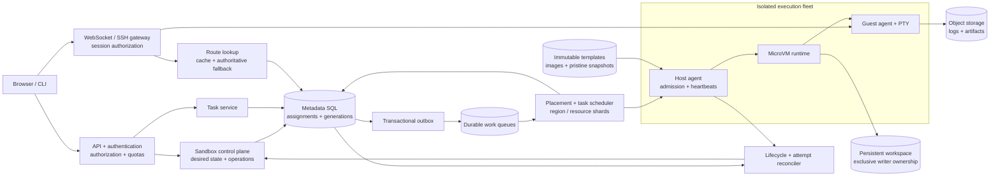
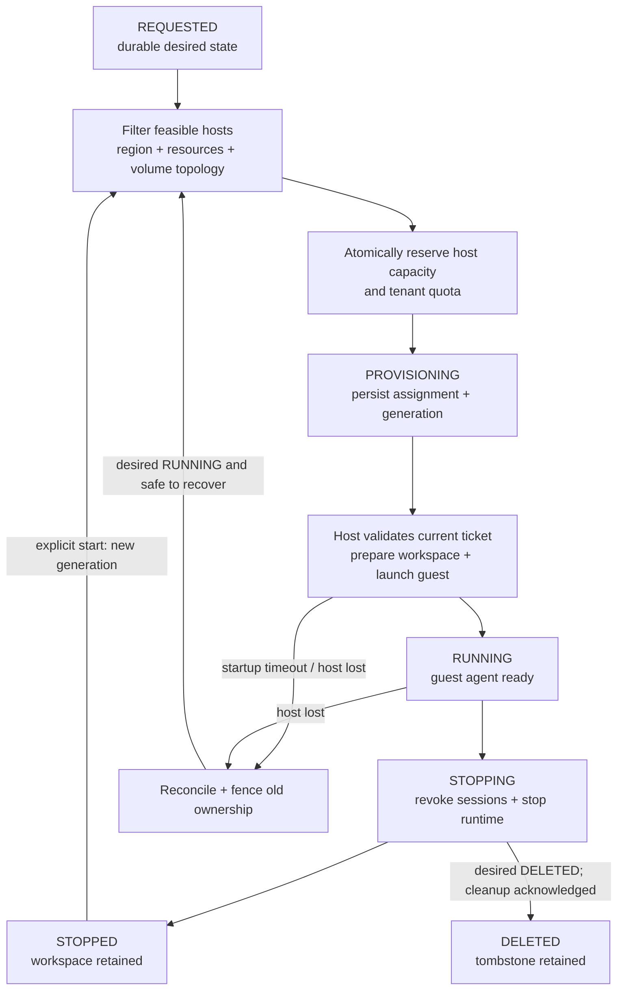
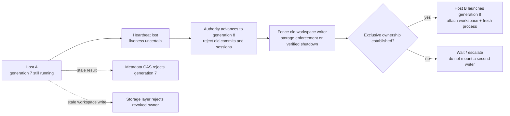
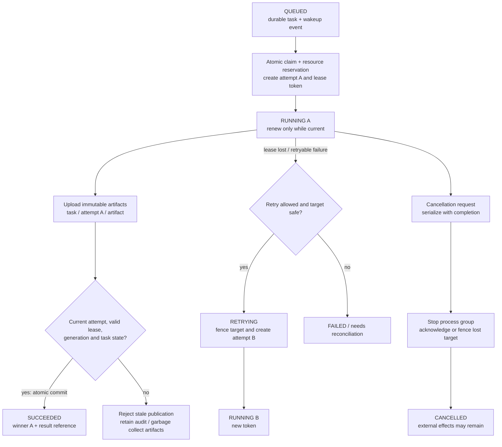

A cloud sandbox looks simple from the outside: choose a Python image, click **Create**, open a terminal, and run code. Inside the platform, that code might be hostile, the host might disappear halfway through startup, and a task might finish just as its lease expires.

The central design problem is **giving untrusted code temporary compute without losing durable user state or confusing old execution with current ownership**. I would organize the interview around four mechanisms: **placement, leases, fencing, and reconciliation**. Together, they explain how the platform starts work, detects lost owners, rejects stale operations, and converges after failures.

## 1. Define the product and its guarantees

The first version supports multi-tenant sandboxes with a versioned image or template, requested CPU and memory, a persistent workspace, and a region. Users can create, inspect, start, stop, and delete them; connect through a browser terminal or SSH; and submit asynchronous tasks with status, cancellation, logs, and results.

The browser IDE itself is out of scope. The platform must route an authenticated connection to the correct guest, not build a collaborative editor. Live migration, globally active-active sandboxes, and a full workflow DAG engine are also outside the initial scope.

Three contracts need explicit wording:

- **Isolation:** tenant code cannot access another tenant's files, the host management interface, or infrastructure credentials. Resource usage is bounded.
- **Durability:** a stopped or lost runtime does not erase the persistent workspace or already committed artifacts. Process memory and unuploaded logs are separate guarantees.
- **Task execution:** accepted tasks are durably recorded and scheduled with retries according to policy. Attempts may execute more than once; arbitrary user code does not receive exactly-once side-effect semantics.

Useful next-stage features include idle auto-stop, TTL cleanup, warm pools, quotas, tenant fairness, and preemption for explicitly eligible batch work. Scheduled jobs, authenticated preview ports, scoped secrets, and user snapshots can follow.

For discussion, set a control-plane availability target of 99.99%, warm startup p95 below five seconds, cold startup below thirty seconds, and task dispatch within two seconds **when compatible capacity is available**. These are proposed targets, not benchmark results. Measure startup through usable workspace and guest-agent readiness, not just VM boot. Terminal latency depends on client location and the selected region.

## 2. Estimate the fleet before selecting components

Suppose the platform serves 100,000 daily active users, with 25,000 peak running sandboxes, 15,000 concurrent interactive sessions, 300,000 creates/day, and ten million tasks/day. Assume peak submission reaches 2,000 tasks/s and 50 creates/s.

| Dimension | Illustrative calculation | Design consequence |
| --- | --- | --- |
| Compute | 25,000 × 2 vCPU = 50,000 vCPU | Placement must reserve capacity, not infer it from low CPU utilization. |
| Memory | 25,000 × 4 GB = 100 TB | Idle sandboxes still consume substantial memory. |
| Host count | 50,000 / 64 ≈ 782 hosts | This is a CPU-only lower bound before host overhead, headroom, and regional imbalance. |
| Task arrivals | 10 million / 86,400 ≈ 116/s average | Average traffic hides burst and resource-class contention. |
| Task metadata | 10 million × 1 KB = 10 GB/day | Attempts, indexes, and retention add to this baseline. |
| Logs | 10 million × 200 KB = 2 TB/day | Stream logs to object storage, not rows in the metadata database. |
| Workspace quota | 25,000 × 20 GB = 500 TB logical | Thin provisioning reduces initial allocation, not the need for physical-capacity controls. |
| Terminal traffic | 15,000 × 5 KB/s = 75 MB/s | About 600 Mbps of payload before protocol overhead and bursts. |

All sizes here use decimal units and are assumptions. With 64 vCPU and 256 GB per host, CPU dominates the simplified fleet estimate; actual usable capacity depends on allocations, runtime overhead, failure reserves, and workload measurements. Storage planning must also include replication, retained stopped workspaces, snapshots, and IOPS.

## 3. High-level architecture: separate control from execution



The **control plane** owns desired state, authorization, assignments, generations, task attempts, and recovery policy. The **data plane** runs guests and carries terminal traffic, filesystem I/O, logs, and artifacts. A route cache accelerates lookup but does not establish ownership.

The host agent launches and stops runtimes, reports capacity, and validates dispatch tickets. A separate guest agent manages terminal sessions and task processes inside the sandbox. Giving a guest control over the host runtime API would break the isolation boundary.

Healthy workloads should not be killed by every brief API outage. Existing sessions and compute may continue within a documented ownership-lease policy, while new admission pauses. However, an isolated host cannot renew authority indefinitely: once its ownership lease expires, it must stop protected work, and external storage and services must enforce the same boundary. Longer grace periods improve continuity but delay safe failover.

## 4. APIs and durable state

Use asynchronous lifecycle operations, with tenant-scoped idempotency keys:

```http
POST /v1/sandboxes
Idempotency-Key: create-workspace-42
Content-Type: application/json

{
  "template_id": "python-tools-v3",
  "resources": { "vcpu": 2, "memory_mb": 4096 },
  "workspace": { "size_gb": 20 },
  "region": "us-west"
}
```

Return `202 Accepted` with a sandbox ID and operation ID. The template resolves to an immutable digest. Retrying the same key and payload returns the original operation; reusing the key with different parameters is rejected.

Expose `GET /v1/sandboxes/{id}`, and start, stop, and delete operations. A stop preserves the workspace by default. A delete explicitly specifies workspace retention or deletion; destructive cleanup is a separate auditable operation. Record a deletion tombstone so delayed start messages cannot recreate a deleted sandbox.

For sessions, `POST /v1/sandboxes/{id}/sessions` issues a short-lived capability scoped to the user, tenant, sandbox, current generation, and allowed operation. For background execution:

```http
POST /v1/tasks
Idempotency-Key: run-test-suite-42
Content-Type: application/json

{
  "sandbox_id": "sb_example",
  "argv": ["python", "-m", "pytest"],
  "timeout_seconds": 600,
  "priority": "normal",
  "max_attempts": 2
}
```

An alternative request supplies a template and resources for an ephemeral task sandbox. Prefer an argument array to implicit shell parsing; shell execution can be an explicit mode. Retry settings are a user-visible contract, especially when a command modifies a workspace or calls external services.

Provide task status, cancellation, cursor-based logs, and a winning result reference. Core records are:

| Record | Important fields |
| --- | --- |
| Sandbox | Tenant, template digest, desired/observed state, host, workspace, generation, version |
| Task | Tenant, target, state, command reference, priority, current attempt, lease expiry, retry policy, winner |
| Attempt | Attempt ID, task ID, host, sandbox generation, ownership token, timestamps, failure reason |
| Assignment | Host and tenant reservations, resource amounts, ownership generation, lifecycle state |
| Host | Identity, region/zone, resource class, total capacity, health and drain state |
| Outbox | Event ID, aggregate ID, event type, publication status |

Write a task and its outbox event in the same SQL transaction. A relay publishes events and retries until acknowledged. A publish timeout can produce duplicates; consumers claim durable task state instead of assuming each queue message means a new execution. [SQS standard queues](https://docs.aws.amazon.com/AWSSimpleQueueService/latest/SQSDeveloperGuide/standard-queues-at-least-once-delivery.html) are one concrete example of duplicate delivery being an expected condition.

The queue provides wakeups, backpressure, and resource-class separation. SQL remains the authority. An early implementation can also use a SQL-backed queue with short `FOR UPDATE SKIP LOCKED` claim transactions; [PostgreSQL explicitly documents this queue-consumer use](https://www.postgresql.org/docs/current/sql-select.html). Do not hold the transaction open for the duration of a user command. Introduce a broker based on measured contention and operational needs, not because hundreds of submissions per second categorically require one.

## 5. Sandbox placement is a reservation protocol



First, filter by region, architecture, CPU, memory, accelerators, network policy, template compatibility, and workspace topology. Then score feasible hosts for packing efficiency, startup latency, failure-domain spread, and tenant concentration.

The important step is **reserving capacity atomically**. Two schedulers can both observe thirty free cores and assign twenty-core sandboxes. A cached capacity counter cannot prevent that race. In the initial design, commit host capacity, tenant quota, and the assignment through a serialized SQL transaction or compare-and-set protocol. At larger scale, use fenced shard owners with a durable reservation journal and a carefully defined quota-allocation protocol across shards.

Rebuild scheduler state from durable assignments after a restart; recent heartbeat utilization is supplemental information. Low observed CPU does not mean reserved CPU is available to another tenant. The host also checks local limits and rejects invalid or infeasible launch tickets.

A ticket binds the sandbox ID, host, generation, resources, expiry, and scheduler authority. Commands are idempotent for that assignment. A delayed `start` must be checked against current authorization or a bounded ownership lease, not merely against the last generation the host remembers.

Desired and observed state remain separate. An API request means “make it stopped,” not “it has already stopped.” Reconcilers consume events and perform indexed timeout sweeps for assignments that never became ready, hosts that disappeared, and cleanup that stalled. Shard these scans; do not repeatedly scan every historical sandbox.

## 6. A lease detects uncertainty; fencing protects state

Consider sandbox `sb_42` on Host A at generation 7. A network partition prevents heartbeats, but the guest is still running. Starting generation 8 on Host B introduces two potential writers.



The generation prevents old hosts from publishing current lifecycle state or task results. Gateways reject old routing capabilities. **Neither action physically stops an old process or automatically revokes its disk access.** A partitioned host may never learn about generation 8.

For a writable filesystem, require a storage-enforced exclusive ownership protocol or verified host shutdown before takeover. A single-writer access setting alone is not proof that a stale host has lost I/O access. If the storage provider cannot fence the uncertain writer, delay recovery. Availability is not worth silent filesystem corruption. [Kubernetes' node-shutdown documentation](https://kubernetes.io/docs/concepts/cluster-administration/node-shutdown/) likewise warns that force-detaching storage while an old workload may still run can corrupt data.

A host-side watchdog should stop runtimes when ownership expires, but storage fencing cannot depend exclusively on that host behaving correctly. Use authoritative lease time for decisions and conservative local deadlines; clock skew must not permit indefinite renewal. Stale host cleanup on reconnection is necessary, but is not the safety mechanism during the partition.

## 7. Durable task scheduling and one winning result

Separate a **task**, which represents user intent, from its **attempts**, which represent executions. Queue classes distinguish small CPU jobs, large-memory jobs, and accelerators. Select eligible tenants fairly, then select feasible work within a class.

In a short atomic claim, verify the task is runnable, allocate an attempt ID, reserve resources, and record the current lease token. Dispatch only after that claim is durable. The host validates the sandbox generation and deduplicates the attempt launch using a durable execution record. A replayed queue message must not start the same attempt again merely because an in-memory map was lost.



Lease renewal succeeds only for the current attempt and ownership token. When a lease expires, the platform may schedule another attempt under policy. The old process might still execute: leases are not magic process termination. For retries on the same mutable workspace, first establish safe target ownership and ensure the previous execution cannot keep modifying it; for independent batch tasks, a fresh sandbox can separate attempts more cleanly.

The successful completion path is deliberately ordered:

1. Execute the command.
2. Upload and verify artifacts under an immutable, attempt-specific namespace.
3. Atomically commit `SUCCEEDED`, the winning attempt ID, and its result reference only if the attempt, lease, sandbox generation, and task state are still valid.
4. Expose the winning reference to readers; garbage-collect losing artifacts later.

This gives **one winning platform result**, even if multiple attempts ran. A completion received after lease expiry can be rejected and retried, even when the command actually finished earlier. Define that behavior explicitly. A duplicate completion for an already accepted winner can return the recorded outcome without publishing another result.

Now suppose the command charged a credit card and crashed before reporting success. Another attempt cannot know whether the payment happened. Use a stable business-operation idempotency key with a cooperating downstream API, or disable automatic retries and reconcile the uncertain operation. Attempt IDs are unsuitable as payment keys because every retry gets a new one. [Amazon's guidance on idempotent APIs](https://aws.amazon.com/builders-library/making-retries-safe-with-idempotent-APIs/) explains this distinction between a retry and a new intent.

Cancellation races with completion through the same authoritative state transition. If success commits first, cancellation returns the completed outcome. If cancellation wins, later success cannot overwrite it. Persist the cancellation request, prevent new launches, and ask the agent to kill the process group. Distinguish “cancellation accepted” from “execution stopped”; a lost host may require fencing before the latter is established. External side effects already performed are not rolled back.

## 8. Browser and SSH access without exposing hosts

For a browser terminal, authenticate at the API, obtain a short-lived session capability, and connect to a WebSocket gateway. The gateway authorizes the requested operation, resolves the current assignment, and opens an authenticated internal channel to the guest agent. The agent attaches to a PTY, not a host shell.

For SSH, issue a short-lived certificate scoped to the sandbox and user, then route through an SSH gateway. The guest does not need a public IP, and infrastructure SSH is never exposed to tenants. Gateway-to-agent channels use service authentication such as mTLS.

Token expiry limits exposure but is not instant revocation. Revalidate authorization and generation when connecting and renewing sessions, and actively close connections on delete, ownership change, or permission revocation according to the documented revocation budget. Cached routes carry generations and expire; a stale route cannot authorize access by itself.

A gateway holds live socket state, so it is not literally stateless. It is horizontally replaceable: reconnect through another instance rather than persist every connection in SQL. A guest-side PTY supervisor or terminal multiplexer preserves a shell across network disconnects. A host failure is different—files can survive, but its shell, RAM, and sockets do not.

Authenticated preview ports use the same scoped routing approach. Serve user-controlled web content on an isolated origin, separate from control-plane cookies, so a sandbox preview cannot become script execution in the platform's trusted UI.

## 9. Isolation is a layered threat model

For arbitrary public user code, I would choose microVMs with a separate guest kernel as the default boundary. Ordinary containers share the host kernel; they may be appropriate for a trusted internal workload with a different threat model. A userspace-kernel runtime is another option, with compatibility and performance trade-offs to benchmark.

[Firecracker](https://firecracker-microvm.github.io/) is one implementation of a minimal microVM runtime with a companion jailer. Using it does not remove the need to secure the host. Keep device exposure small, patch the runtime and guest kernels, protect runtime sockets, and apply host process isolation and resource controls.

Enforce vCPU and memory budgets at the host/runtime layer, process limits inside guests, and disk, I/O, and bandwidth quotas at their respective boundaries. Block access to infrastructure metadata and management networks, including IPv6 and alternate network paths; do not rely on blocking just one familiar metadata IP address. Use default-deny rules and explicit egress policy where required.

Infrastructure credentials never enter guest images. User secrets are short-lived, scoped to tenant and task, and delivered only after guest identity is established. Audit issuance and avoid logging secret values. Dedicated hosts can reduce cross-tenant risk for stricter customers, at the cost of packing efficiency; they are not a replacement for hardening.

Warm pools contain **pristine, unassigned** runtimes, not previously used tenant sandboxes. Snapshot cloning can duplicate random state, identifiers, and tokens. Restore must establish fresh identity, keys, entropy handling, and network bindings before exposure; guest applications may need explicit reset logic beyond kernel reseeding. Authenticate and encrypt snapshots, and test CPU/runtime compatibility. These constraints are documented in [Firecracker's snapshot security guidance](https://github.com/firecracker-microvm/firecracker/blob/main/docs/snapshotting/snapshot-support.md#snapshot-security-and-uniqueness).

## 10. Workspaces survive hosts, not every failure domain

Use an immutable root image with a disposable writable overlay. Mount a persistent workspace separately, and store committed artifacts and log chunks outside the runtime host. The workspace has its own tenant authorization, encryption, quota, and exclusive ownership lifecycle.

Persistence does not imply unrestricted relocation. For example, [an EBS volume attaches within its Availability Zone](https://docs.aws.amazon.com/ebs/latest/userguide/ebs-attaching-volume.html). Placement must honor the selected storage backend's topology. Recovering across zones or regions requires an explicit replication or snapshot strategy with stated recovery point and recovery time objectives.

File durability depends on the storage acknowledgement and application flush contract. A snapshot taken without quiescing the application may be crash-consistent rather than application-consistent. Stopping a sandbox preserves durable files; it does not preserve RAM. Suspending with memory snapshots is optional: ten thousand four-GB guests already represent forty TB of memory snapshots before overhead, plus confidentiality and restore-compatibility concerns.

Logs use `(attempt_id, stream, sequence)` to order chunks and identify retries. Live output can travel through a bounded stream while durable chunks go to object storage. Expose cursors and attempt boundaries so clients do not silently mix retry output. If the object store is unavailable, buffer within a limit, then apply a stated backpressure or truncation policy. A host can lose its final unuploaded chunk; promise only the durability level the ingestion protocol actually implements.

## 11. Fairness, autoscaling, and operating the fleet

Shard scheduling by region and resource class. A shard has one fenced authority; failover rebuilds reservations before new admission. Use tenant concurrency and resource quotas, weighted fairness, and aging so a single tenant's burst does not consume the entire fleet. Separate interactive work from batch and accelerator queues, while permitting controlled capacity borrowing.

For mixed CPU- and memory-heavy workloads, [Dominant Resource Fairness](https://www.usenix.org/conference/nsdi11/dominant-resource-fairness-fair-allocation-multiple-resource-types) offers a useful model: compare each tenant's largest normalized resource share. Practical scheduling still needs handling for fragmentation, locality, large requests, and unknown runtime duration. Fairness is not solved by sorting a priority integer.

Autoscale from queued resource demand, oldest eligible task age, unschedulable reasons, and startup lead time. Low fleet CPU does not prove there is a suitable large-memory or GPU host. Maintain a demand-shaped warm pool for popular templates, pre-pull immutable images, and measure cold-path phases separately: image fetch, storage attach, guest boot, readiness, and session routing.

Bin packing lowers cost but concentrates failures and can worsen startup contention. Reserve failure headroom, limit tenant concentration per host, and spread important workloads across fault domains. Scale down by draining a host before eviction. Preempt only eligible batch work; checkpoints help only if they are durably written and restartable. Killing an interactive guest is not seamless suspension.

Cron jobs need a unique occurrence key such as `(job_id, scheduled_at)` so scheduler failover does not create duplicate logical tasks. Specify time zones, missed-run policy, and overlap rules; each occurrence still uses the same attempt and retry protocol.

Monitor startup p95/p99, queue age by tenant and resource class, reservation failures, lease-renewal failures, stale-commit rejections, workspace-fence duration, terminal reconnects, lost log chunks, and artifact publication latency. Audit lifecycle mutations and privileged host operations. A rising fencing delay is a user-visible recovery problem even when API latency looks healthy.

## 12. Failure behavior and interview trade-offs

| Failure | Expected behavior |
| --- | --- |
| API or metadata outage | Pause new authoritative mutations; existing execution follows the bounded ownership policy. |
| Scheduler fails after reserving capacity | A successor reconstructs the durable assignment; it does not allocate the same capacity again. |
| Host disappears during startup | Reconcile the incomplete assignment, fence uncertain ownership, then retry or fail by policy. |
| Host partitions while writing | Reject stale metadata and sessions; establish storage fencing before writable takeover. |
| Gateway restarts | Reconnect through a healthy gateway; preserve the guest PTY only if the guest remains alive. |
| Completion arrives from an old attempt | Reject publication; retain its audit evidence and clean up losing artifacts. |
| Log storage stalls | Bound buffering and apply the documented backpressure or truncation policy. |
| Region or storage failure | Recover according to workspace replication topology and its explicit RPO/RTO. |

Kubernetes can supply node lifecycle, scheduling primitives, and runtime integration. It does not by itself define the sandbox product's session permissions, retry safety, result publication, or workspace takeover guarantees. I would build on an existing orchestrator where it fits and keep those product protocols explicit.

The key trade-offs are microVM isolation versus density, persistent remote storage versus local-disk latency, warm startup versus idle cost, packing versus failure spread, and quick failover versus safe single-writer recovery. Strong ownership decisions belong in the authoritative path; cached routes, dashboards, and heartbeat summaries can be eventually consistent.

My closing explanation would be: **the sandbox is disposable compute; the workspace and task intent are durable state. Placement reserves resources, leases bound ownership, fencing prevents stale state changes, and reconciliation repairs incomplete transitions. Retries recover work, but exactly-once external effects require cooperation beyond the scheduler.**
