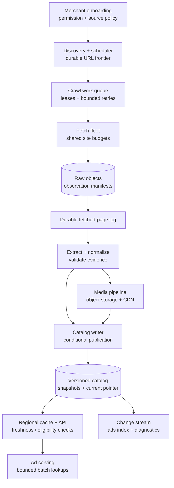
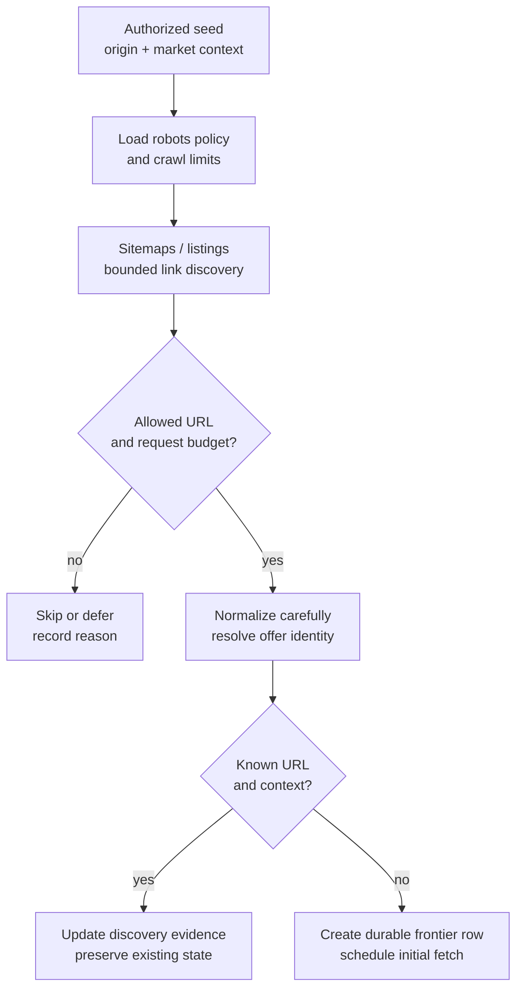
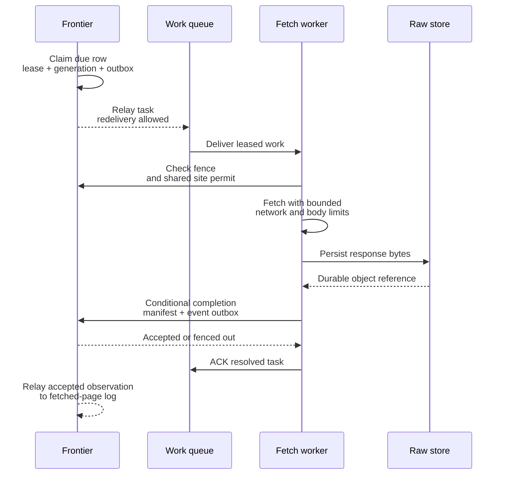
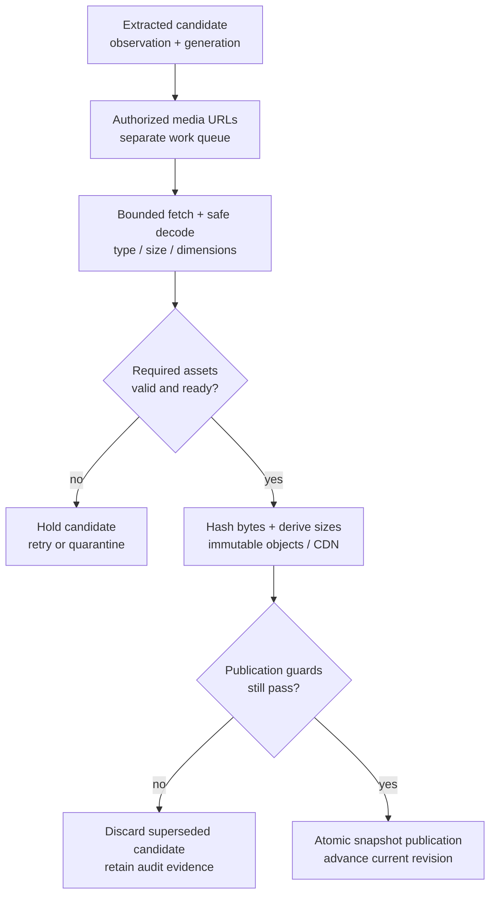
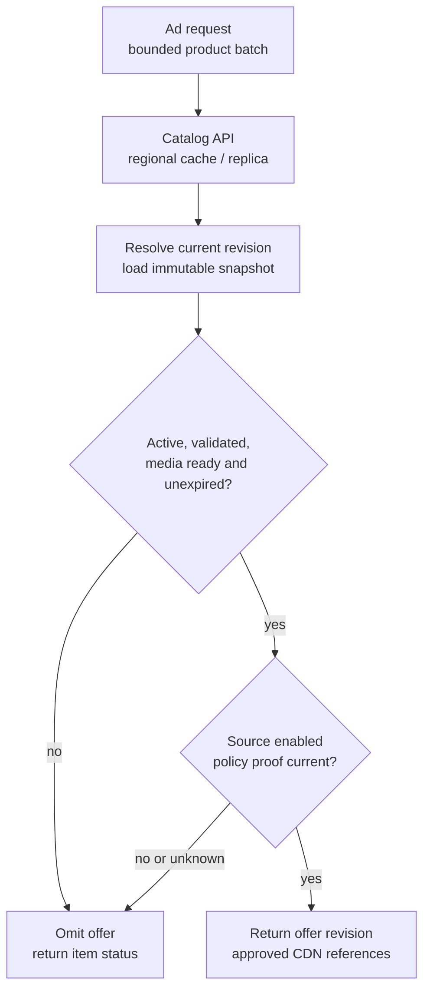

A merchant authorizes its storefront for advertising and gives us a domain and a starting URL. It sends no product feed. We have to discover the products, read their pages, identify the correct offers, acquire usable images, and keep the resulting catalog current enough to display in ads.

The catalog therefore needs two paths: an asynchronous construction pipeline and a low-latency serving API. A slow merchant, a broken parser, or a video download must not enter the ad request's critical path.

This design describes a proposed platform. The capacity figures and service targets below are planning assumptions, not measurements of an existing service.

## 1. Scope and the freshness contract

The first version supports merchant onboarding, URL discovery, distributed fetching, product extraction, image ingestion, adaptive refresh, and product lookup. It also needs quarantine, deletion detection, raw-response replay, and merchant-level diagnostics. Product video is optional and has a separate budget. Cross-merchant product matching and model-based enrichment can follow later.

The primary catalog record represents a **merchant offer for a particular variant and market**. Two stores selling the same shoe have different prices, inventory, landing pages, and permissions. They retain separate offer records even if a later entity-resolution service links them to the same physical product.

<div class="table-scroll" role="region" aria-label="Crawled catalog service contracts" tabindex="0">

| Area | Proposed contract |
| --- | --- |
| Catalog reads | 99.99% availability target for bounded requests; count unusable and expired responses separately |
| Read latency | Server p50 below 10 ms and p99 below 50 ms for bounded regional lookups under the planned cache mix |
| Refresh | Hot offers within 1 hour, warm within 6 hours, cold within 24 hours, subject to authorized site capacity |
| Publication | Atomically install one complete validated offer revision; never mix fields from different candidates |
| Freshness | Record the evidence time for each required field and enforce a maximum acceptable age at serving time |
| Site protection | Shared request-rate and concurrency budgets across workers, with robots policy, backoff, and bounded retries |
| Recovery | Durable frontier, at-least-once work delivery, conditional writes, and replayable observations |

</div>

A crawl observes a website at a point in time. It cannot guarantee that inventory remains unchanged until the next visit. Even one rendered page may combine HTML and API responses from different moments. Our atomicity guarantee covers the **published observation bundle**, not an atomic snapshot of the merchant's database. Record component evidence times and reject inconsistent or overly separated observations.

Authorization is an onboarding prerequisite. Verify control of the merchant source and obtain explicit crawling and media-use permission. Define allowed origins, markets, request headers, and storage terms. Robots rules are an additional crawl constraint; they do not grant access or media rights. Do not bypass login walls, CAPTCHAs, or access restrictions.

## 2. Estimate the workload before selecting storage

Assume 100,000 merchants and 500 million active offers, initially with one product-page fetch per scheduled refresh. Use decimal KB, GB, and TB throughout these estimates.

<div class="table-scroll" role="region" aria-label="Product refresh capacity estimates" tabindex="0">

| Refresh class | Offers | Interval | Fetches per day | Average fetches/s |
| --- | ---: | ---: | ---: | ---: |
| Hot, 5% | 25 million | 1 hour | 600 million | 6,944 |
| Warm, 25% | 125 million | 6 hours | 500 million | 5,787 |
| Cold, 70% | 350 million | 24 hours | 350 million | 4,051 |
| Total | 500 million | Mixed | 1.45 billion | 16,782 |

</div>

At five times the unrounded average, plan for about **83,912 page fetches/s**. At 250 KB per compressed response, the average is about **4.20 GB/s**, or **362.5 TB/day** if every fetch returns a full body. Discovery, retries, browser subrequests, and media downloads are additional traffic. Conditional requests reduce transferred bytes when supported, but still consume request capacity.

At 5 KB per offer, current metadata occupies about **2.5 TB** before indexes, history, and replicas. Three 250 KB images per offer require **375 TB** before deduplication and derived sizes. If 10% of offers have one useful 10 MB video, that adds **500 TB**. Media capacity can exceed metadata capacity by several orders of magnitude.

Ten billion offer lookups per day average about **115,741/s**; assume a 500,000/s peak measured in individual offer lookups. Batch requests reduce RPC count without eliminating those underlying item reads. At a 95% item-cache hit rate, roughly 25,000 peak item reads/s reach storage, before retries and other traffic.

Global fleet capacity does not establish per-site feasibility. A merchant with 500,000 URLs and a one-request/s budget needs approximately **5.8 days** for one pass, before discovery or retries. More workers cannot make that an hourly crawl. Admission control must identify this shortfall and negotiate permitted capacity, prioritize a subset, or lower the refresh commitment.

## 3. High-level architecture



*Figure 1. Construction is asynchronous. Ad serving reads only locally materialized catalog data and approved media. Merchant policy controls discovery, page requests, browser subrequests, and media requests.*

The work queue represents jobs that one worker should complete, with visibility timeouts and retry handling. The fetched-page log represents durable facts that several independent consumers may read and replay. A queue service and a partitioned event log are reasonable implementations of these different roles; deploying two systems is a cost to justify, not a requirement at small scale.

Use transactional SQL for merchant configuration. A partitioned transactional store or distributed key-value store can hold the large frontier and catalog, provided it supports the conditional updates and local transactions described below. Object storage holds raw responses and media. Search indexes support dashboards and debugging; they do not determine the current authoritative offer revision.

## 4. Discovery starts with permission and ends with a bounded frontier

Start with the authorized seed, robots policy, declared sitemaps, and permitted listing pages. Follow product links and bounded pagination. A sitemap offers useful discovery hints; absence from one does not prove that a product disappeared. Its optional modification time is a scheduling hint, separate from HTTP validators. See the [Sitemaps protocol](https://www.sitemaps.org/protocol.html).



*Figure 2. Discovery has its own limits. It cannot generate unlimited fetch work or delete products merely because a listing parser failed.*

Normalize hostnames and remove confirmed tracking parameters, but preserve parameters that select size, color, market, or other offer attributes. A canonical tag is evidence to evaluate, not permission to merge every variant into one row. Keep the original URL and context alongside the normalized identity. A hash speeds lookup; compare the full identity to handle collisions.

Limit URLs per source, listing depth, pagination range, and query combinations. Detect repeated content and calendars, faceted filters, or session parameters that create indefinitely many URLs. Use exact durable deduplication for accepted URLs. A probabilistic filter can reduce lookup work, but a false positive must not permanently exclude a real product.

Apply the [Robots Exclusion Protocol](https://www.rfc-editor.org/rfc/rfc9309.html). Its handling of an unavailable robots file differs from an unreachable one. For this service, an explicit policy also pauses on access denials and rate limits, and pauses new crawling on robots network/server failures rather than treating them as permission. Cache rules with a bounded lifetime and keep a stable crawler identity and contact address.

### Every discovered URL is untrusted input

Pages can point at internal services, cloud metadata endpoints, or hostile media. Enforce an origin allowlist, permitted schemes and ports, redirect validation, and a destination-IP policy that excludes private, loopback, link-local, and other prohibited IPv4/IPv6 destinations. Bind each connection to a validated address while preserving hostname and TLS verification. Rechecking DNS and then allowing an unchecked second resolution leaves a DNS-rebinding gap. See [OWASP's SSRF guidance](https://cheatsheetseries.owasp.org/cheatsheets/Server_Side_Request_Forgery_Prevention_Cheat_Sheet.html).

Enforce the same policy at the egress network boundary and on retries. Media CDN origins require explicit authorization. Browser subrequests also pass through the controlled egress path; allowing the initial page alone is insufficient. Run renderers without production credentials or internal network access, in isolated workers with CPU, memory, request-count, and execution-time limits.

## 5. Schedule due work without losing tasks

The frontier stores a durable next-fetch time rather than scanning the entire catalog for each scheduling tick. A due index can use:

```text
bucket = floor(next_fetch_at / bucket_duration)
shard  = hash(observation_key) mod schedule_shard_count
index key = (bucket, shard, next_fetch_at, observation_key)

observation_key = (merchant, offer identity, variant, market context)
```

Both bucket duration and shard count are configuration parameters. Maintain a last-completed scheduling watermark and recover overdue buckets after downtime. A scheduler that reads only the current minute silently abandons missed work.

The due index is a hint; claiming the authoritative frontier row requires a conditional update. In one transaction, install the lease, issue a new generation and fencing token, and create an outbox entry for the crawl task. Update the index transactionally where supported, or through an outbox plus reconciliation. Stale index entries are harmless when the claim checks current state.



*Figure 3. An object write alone does not complete the job. A durable manifest and transactional event outbox close the gap between storing bytes and publishing their existence.*

The worker acknowledges after successful durable completion, or after confirming that its task is obsolete. A crash before completion causes redelivery. If completion committed but the acknowledgment was lost, a retry sees the recorded outcome and avoids creating another logical observation. A crash after uploading a raw object can leave an orphan; lifecycle cleanup removes unreferenced objects after a safe grace period.

An outbox relay can publish twice. Consumers deduplicate by observation identity and use conditional writes. Content hashes avoid storing identical bytes repeatedly; they do not replace observation IDs, freshness evidence, or ordering guards.

### Site limits must be shared across the fleet

Assign each site-budget key to a fenced controller that enforces both a token bucket and a concurrency limit. Keys may cover an origin, a merchant's related origins, or a shared CDN agreement. Count redirects and browser/media requests against their applicable budgets. Lease grants must expire, and ownership transfer must account for outstanding permits before granting replacement capacity.

If the controller is unavailable, stop issuing new permits. Per-worker limits alone multiply allowed traffic by the worker count. Use weighted fair scheduling across merchants and reserve some capacity for new discovery and cold offers so advertising popularity does not permanently starve the rest of the catalog.

A [429 response](https://www.rfc-editor.org/rfc/rfc6585.html#section-4) can include `Retry-After`. Honor that delay, reduce the shared site rate, and add bounded exponential backoff with jitter. Schedule no earlier than the server's retry time. Cap retry attempts and quarantine persistent failures for investigation; a dead-letter queue does not repair the underlying source.

## 6. Extract an offer with evidence for every important field

Try structured product data first, then embedded application JSON and tested merchant-specific selectors. Metadata and generic DOM heuristics can fill gaps only under field-specific validation. Rendering is an expensive fallback for pages whose required data cannot be acquired through permitted ordinary requests. Do not execute a browser for every page by default.

[`Product` structured data](https://developers.google.com/search/docs/appearance/structured-data/product) can describe price and availability, while [`ProductGroup` and variant markup](https://developers.google.com/search/docs/appearance/structured-data/product-variants?hl=en) help distinguish individual sizes or colors. The existence of markup does not prove that it is correct or current. Resolve the selected variant and market, compare available evidence, and quarantine contradictions.

For a shoe, the visible page may contain a sale price, a crossed-out list price, shipping, and an installment payment. Store each accepted field with its extraction source, parser revision, response reference, evidence time, and validation result. A confidence label should describe tested extraction behavior; an arbitrary score such as `0.99` is not a measured probability.

Represent money as an exact decimal or integer minor units with a currency-specific exponent. Do not assume that every currency has two decimal places. Do not interpret an ambiguous `$` as a particular currency without market evidence. Unknown inventory stays unknown; missing price or availability must not silently become zero or in stock.

### A 304 response has a narrower meaning than “the product is unchanged”

Retain `ETag` or `Last-Modified` and send conditional requests for the same representation and request context. HTTP [304 semantics](https://www.rfc-editor.org/rfc/rfc9110.html#section-15.4.5) allow reuse of the stored representation. If the body needed for extraction is no longer retained, fetch it unconditionally.

An unchanged HTML shell does not validate a separate inventory API, personalized price response, or image URL. Refresh evidence times only for fields covered by the validated representation. Fetch other required components under their own validation and age rules. A parser replay preserves the original evidence time; processing old HTML today does not make its price current today.

## 7. Keep identity, observations, and publication separate

<div class="table-scroll" role="region" aria-label="Catalog authority and evidence records" tabindex="0">

| Record | Important fields | Responsibility |
| --- | --- | --- |
| Merchant source | Approved origins, market context, policy revision, source epoch, request/concurrency budgets | Authorization and operational control |
| URL locator | Merchant, full normalized URL/context, identity hash, offer ID, verified aliases | Resolve discovered pages without unsafe variant merging |
| Frontier | Observation key, next-fetch time, validators, generation, fence, lease, failure state | Order refresh attempts and recover work |
| Observation | Observation ID, generation, raw references, request context, component evidence times, parser revision | Immutable audit and replay input |
| Candidate | Offer/context, observation ID, normalized fields, media references, validation results | Complete proposed replacement, invisible to ad reads |
| Published offer | Offer/context, published revision, accepted generation, source epoch, status, field evidence, expiration, media IDs | Authoritative current pointer and immutable snapshot |
| Media object | Content hash, validated type, dimensions/duration, object key, rights/reference metadata | Approved immutable asset and controlled retention |

</div>

Keep generations in the authority that owns the offer/context. Known URL aliases share that authority and refresh sequence. Before an unknown URL can update an existing offer, reconcile its identity there; independent URL counters cannot safely order writes to the same offer. Merchant SKU and GTIN are useful evidence, but neither justifies merging unrelated variants or different merchants' offers.

The source epoch changes when a source is revoked or reconfigured in a way that invalidates outstanding work. A generation orders accepted crawl work within that epoch; a fencing token rejects a worker whose lease was replaced. A published revision is our catalog revision, not a merchant-supplied version.

For example, crawl generation 81 stalls. Its lease expires and generation 82 completes, producing a validated offer. A late result from 81 cannot overwrite 82, even if its processing timestamp is later. Use authority-issued ordering rather than comparing worker wall clocks.

At publication, transactionally check the source epoch, generation/fence, expected current revision, and any disable or tombstone fence. Install one complete candidate and advance the current pointer. Enforce this even when asynchronous media processing finishes much later. A conservative implementation rejects a candidate after a replacement generation has been authorized; it may temporarily reduce freshness but prevents superseded work from publishing.

Keep the source authorization check in the same transactional decision boundary, or use an equally strong serialized publication protocol. Reading a separate configuration row and writing an offer later leaves a revocation race. At this scale, the exact partition and transaction arrangement is a database-selection requirement.

## 8. Media processing gates publication

Subject to the merchant agreement, acquire required media into owned object storage and serve approved derivatives through a CDN. Hotlinking the merchant's mutable image URL makes ad latency and availability depend on that site and can display an image different from the one we validated.



*Figure 4. Media tasks belong to one candidate. Completion of an older image download cannot modify the current offer independently.*

Allow only required formats and enforce compressed-byte, decoded-pixel, duration, and processing limits. Validate actual file contents rather than trusting a filename or `Content-Type`. Run decoders and transcoders in isolated workers. These controls apply the same defensive principles described in [OWASP's file-handling guidance](https://cheatsheetseries.owasp.org/cheatsheets/File_Upload_Cheat_Sheet.html).

SHA-256 of identical validated bytes can identify a reusable object. Different image sizes usually have different bytes even if they depict the same scene; do not assume that two transformed URLs share a hash. Keep tenant rights and retention references separate from physical deduplication. A shared blob must not make one merchant's private or expired asset accessible to another.

An image-required ad format cannot use a candidate until that image is ready. Optional video failure need not block an image-only format. Keep metadata extraction and media downloading on separate queues and worker pools so a large video backlog does not stop ordinary catalog updates.

Garbage collection must respect current snapshots, retained history, and in-flight candidates. Use reference tracking with a grace period that covers publication and replication delays; otherwise an object can be deleted between validation and pointer installation.

## 9. Freshness, missing products, and revocation

Prioritize refresh using recent ad demand, observed change rate, inventory volatility, time since evidence, and merchant policy. Demand statistics arrive asynchronously; the scheduler does not call the ad platform for every decision. Budgeted minimum coverage protects low-traffic offers.

Measure freshness from the oldest required field evidence, not the last successful pipeline step. A product with a recently fetched image and yesterday's price still has yesterday's price. Set an explicit `eligible_until` bounded by each required field's maximum age, any source cache age, and policy constraints. A precomputed eligibility flag alone cannot expire itself.

Distinguish lifecycle state from ad eligibility. An out-of-stock offer can remain in the catalog but be excluded from purchase ads. A single 404 creates a suspected-missing observation and triggers a policy-controlled confirmation crawl. Repeated independent misses, corroborating evidence, and merchant policy can justify inactivation. A 410 is stronger absence evidence, but still passes anomaly and authority checks.

Do not treat 403, 429, timeouts, or 5xx responses as product deletion. If a merchant's missing-page rate suddenly jumps across the site, pause mass deletion and investigate an outage, block, or parser change. Keep old records for diagnostics while allowing their ad eligibility to expire. Preserving data does not require continuing to advertise stale prices.

Retain a tombstone and ordering fence for an inactive offer. An old raw-page replay cannot recreate it. Reactivation requires a newly authorized observation after the tombstone fence. Source revocation uses a separate monotone disable epoch; it must not wait for every offer to be recrawled.

## 10. Serve bounded batch reads with explicit eligibility checks

Expose APIs for source registration, product lookup, batch lookup, and cursor-paginated merchant diagnostics:

```text
POST /v1/merchants/{merchantId}/sources
GET  /v1/products/{productId}?market=US&currency=USD
POST /v1/products:batchGet
GET  /v1/merchants/{merchantId}/products?cursor=...&limit=...
```

Bound batch size, response bytes, and fanout. A batch response carries per-item status so one unavailable offer does not fail an entire ranking request. Distinguish missing, stale, disabled, invalid, and temporarily unavailable results. Authenticate callers and enforce merchant and market access on every path.



*Figure 5. Cache hits still pass expiration and source-policy checks. An unknown policy state cannot authorize an ad.*

Cache current-pointer lookups briefly and immutable snapshots by `(offer_id, market, published_revision)`. Apply pointer updates only when their published revision is newer, so reordered change events cannot move a cache backward. A lost invalidation can leave an old pointer until its bounded TTL. Check `eligible_until` on every returned snapshot, including hits, so a cache cannot extend the field-evidence lifetime.

Source disablement has a different contract from ordinary refresh. Distribute source epochs and short-lived enablement proofs to each serving region; stop using a proof when it expires or when a newer disable epoch arrives. This bounds revocation delay by the proof lifetime, replication, and clock-error allowance. Cached regional reads do not provide instant global revocation. If immediate acknowledged revocation is required, check an authoritative policy service or wait for regional barriers, and accept the resulting latency and outage behavior.

During a catalog database outage, caches can serve only snapshots that remain eligible with valid policy proof. Cap miss traffic, coalesce duplicate reads, and shed work before overwhelming storage. When usable cached coverage falls, omit offers rather than serving indefinitely old prices.

Keep regional serving replicas close to ad services. Give each site's crawler and rate controller one active, fenced owner; failover must not double its permitted traffic. Independently running the same crawl in every region wastes bandwidth and violates shared site budgets unless explicitly coordinated.

## 11. Replay, failure containment, and operating signals

Store raw bytes by content hash and retain immutable manifests with provenance. Retaining every full response in this workload would cost roughly 362.5 TB/day before replication. Use bounded retention, deduplication, selected changed snapshots, and longer-lived investigation samples. Protect the latest bodies needed for conditional reuse; once evicted, fetch unconditionally instead of assuming the body still exists.

Run a new parser against retained observations in shadow mode, compare field differences, sample by merchant template, and release gradually. A replay uses the original observation's generation and evidence times. It cannot overwrite newer evidence or a tombstone; even a same-observation correction needs an approved parser revision and a conditional current-pointer check. Never combine historical fields with a current candidate just because both share an offer ID.

<div class="table-scroll" role="region" aria-label="Crawled catalog failure handling" tabindex="0">

| Failure | Safe response | Signal to inspect |
| --- | --- | --- |
| Worker crashes or task repeats | Recover lease; deduplicate completion and outbox events | Oldest leased task, redelivery rate, orphan objects |
| Site throttles or fails | Shared cooldown, lower rate, circuit breaker; preserve records | Per-site 429/5xx rates, permitted versus attempted traffic |
| Discovery coverage collapses | Stop deletion inference; inspect listings and sitemap parsing | Known versus rediscovered offers by source/template |
| Parser extracts shipping as price | Quarantine candidate; pause rollout; replay retained evidence | Field conflicts, price-distribution shifts, parser revision |
| Old candidate or media finishes late | Reject through generation, epoch, and pointer guards | Fenced writes and superseded candidate age |
| Media backlog grows | Separate scaling and limits; hold image-required candidates | Bytes/s, decode failures, oldest required-asset task |
| Scheduler or event consumers fall behind | Recover overdue buckets; prioritize within site budgets | Scheduling watermark, event lag, required-field age |
| Regional cache or database fails | Bound fallback load; omit expired or unverified offers | Eligible-cache coverage, miss traffic, rejected stale results |

</div>

Track successful validated refreshes and eligible coverage alongside infrastructure uptime. A fetch fleet returning HTTP 200 for bot-block pages is not keeping the catalog healthy. Break metrics down by merchant, template, market, parser revision, refresh class, and required field. Alert when permitted capacity cannot meet a freshness commitment, even if the queue and workers are operating normally.

## 12. Present the design in a 50-minute interview

Spend the first five minutes agreeing on source authorization, offer identity, and freshness semantics. Use the next five for per-site and global capacity. Explain the architecture and records by minute twenty, then trace one discovered URL through a durable fetch, extraction, media approval, and conditional publication.

Use the deeper discussion for shared site limits, delayed work, evidence-aware refresh, and regional eligibility. Walk through three failures: a lease expires while a fetch is running, a merchant returns site-wide 404s, and the catalog database fails while an ad cache remains populated. For each, state which record is authoritative, which work can repeat, and when the system must stop displaying the offer.

For the advertising side of the platform, continue with [real-time ad accounting, budget, and pacing](/system-design/real-time-ad-budget-pacing/).

## Further reading

- [RFC 9309: Robots Exclusion Protocol](https://www.rfc-editor.org/rfc/rfc9309.html)
- [Sitemaps XML protocol](https://www.sitemaps.org/protocol.html)
- [RFC 9110: HTTP Semantics, including validators and 304 responses](https://www.rfc-editor.org/rfc/rfc9110.html)
- [RFC 6585: 429 Too Many Requests](https://www.rfc-editor.org/rfc/rfc6585.html#section-4)
- [Google Search Central: Product structured data](https://developers.google.com/search/docs/appearance/structured-data/product)
- [Google Search Central: Product variant structured data](https://developers.google.com/search/docs/appearance/structured-data/product-variants?hl=en)
- [OWASP: Server-Side Request Forgery Prevention](https://cheatsheetseries.owasp.org/cheatsheets/Server_Side_Request_Forgery_Prevention_Cheat_Sheet.html)
- [OWASP: File Upload Cheat Sheet](https://cheatsheetseries.owasp.org/cheatsheets/File_Upload_Cheat_Sheet.html)
