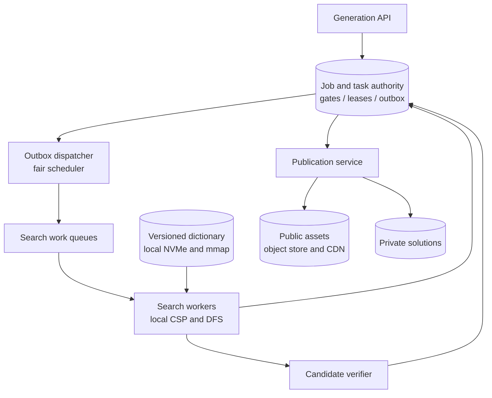
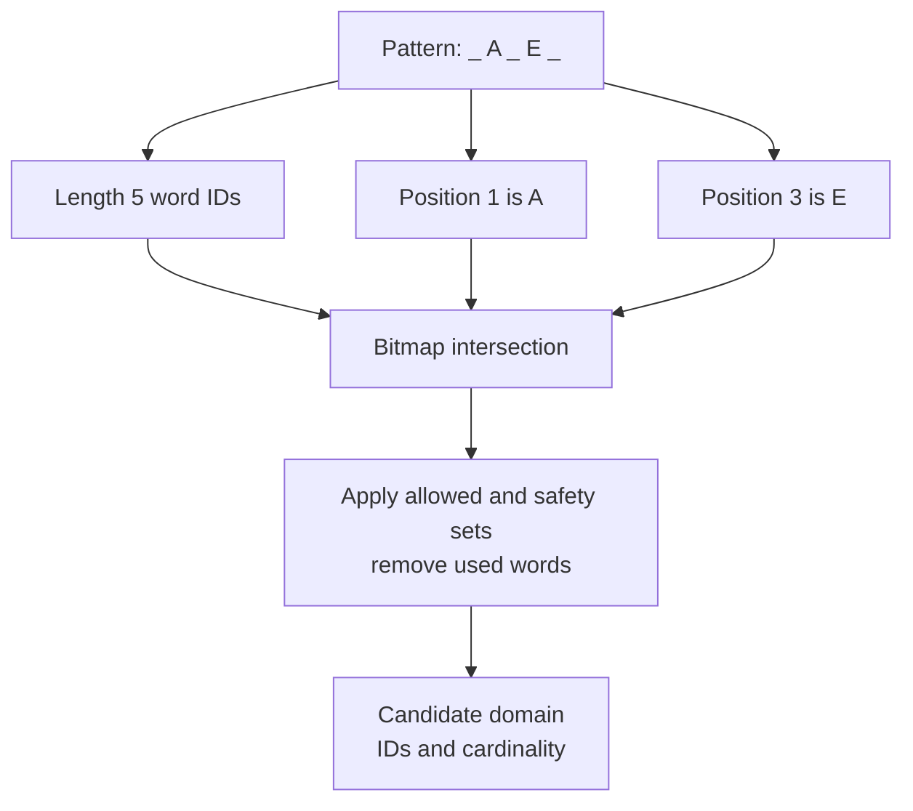
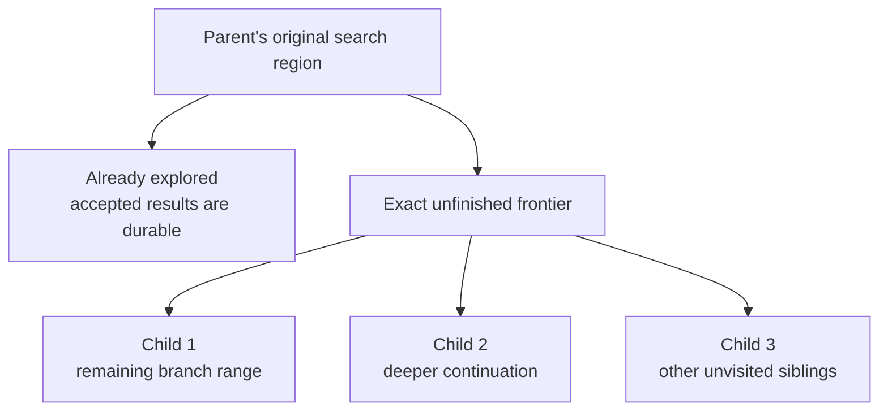
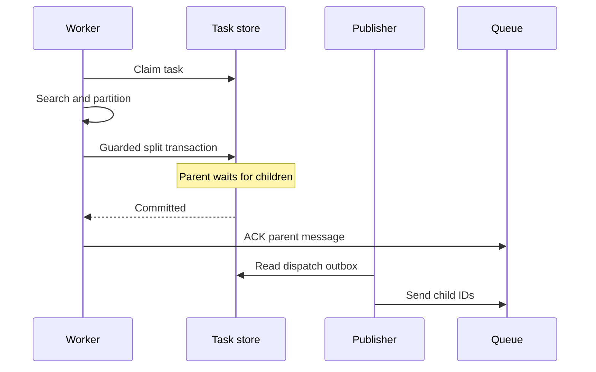
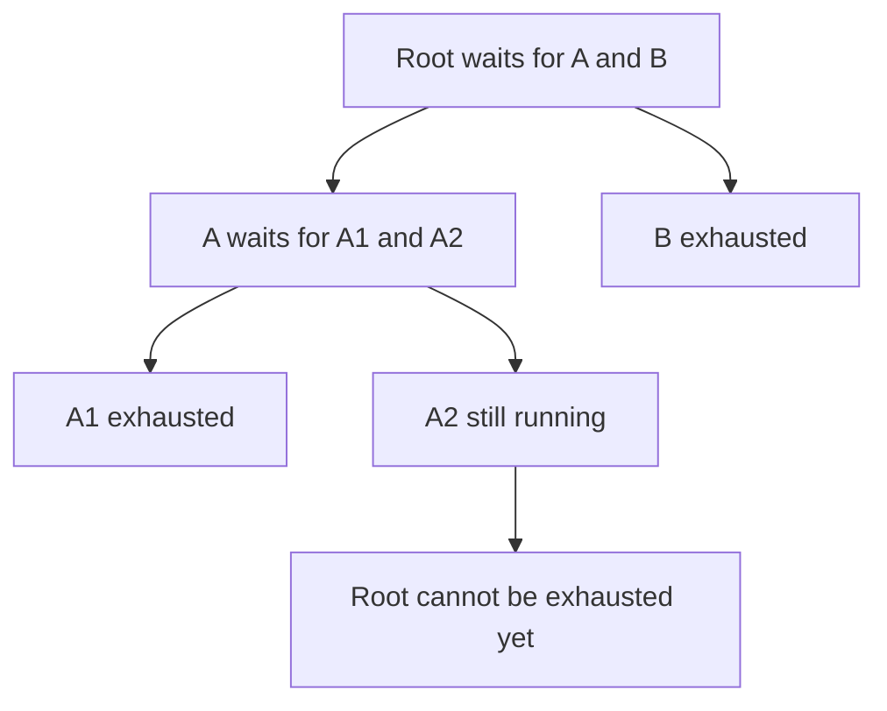

An editor submits a partially filled crossword and asks for five valid fills within thirty seconds. Most branches fail quickly. One branch keeps searching after every other worker has finished. A worker crashes while handing its remaining search to other machines, and the editor cancels just as a complete fill arrives.

The platform must preserve the unexplored search space, reject obsolete work, and report what it actually knows. Finding no answer before a deadline does not establish that the puzzle has no solution.

This design concentrates on generating word fills for a supplied grid. It combines local constraint solving with durable distributed task ownership. The capacity figures and timing budgets are planning assumptions, not measurements from an existing crossword service.

## 1. Define the generation contract

A request supplies grid dimensions, blocked cells, fixed letters, locale, an allowed dictionary, required and forbidden words, a solution limit, a search mode, and a deadline. Dimensions and limits are inputs; a 15 × 15 English grid with five requested fills and a thirty-second deadline is one example.

Compile open cells into across and down **slots**. Each slot has a length and a mapping from its positions to cells. Validate the grid rules, fixed-letter consistency, supported lengths, request size, and word normalization before accepting the job. Define a locale-specific tile representation: one displayed tile need not equal one Unicode code point. The initial English examples use one uppercase Latin letter per tile.

Every accepted fill must use permitted words, agree at crossings, respect fixed letters, avoid prohibited duplicates, and satisfy all required-word constraints. Required words need placement tracking; merely adding them to the allowed dictionary does not ensure they appear. Safety restrictions are hard filters. Preferences such as common vocabulary and thematic fit can contribute to a separate quality score.

Generation is an asynchronous, durable job. Users can inspect status, retrieve accepted candidates, cancel, and explicitly publish a candidate. Player reads should remain available when generation is saturated. Progress synchronization is useful but separate from the search engine. Automatic block placement and generated clues can be added after the fixed-grid fill system works.

Offer **first-K** and **best-K** as different contracts. First-K stops after enough distinct valid fills. Best-K seeks the highest scoring fills and reports whether their optimality was established. A hard deadline bounds effort, not the time required to solve every possible input. A regional puzzle-read P99 below 100 ms and typical generation within thirty seconds are example product targets that require workload validation.

## 2. Estimate the amplification behind a small job rate

Assume five million puzzle sessions and twenty thousand generation jobs per day. A session averages twenty progress saves. Use decimal bytes for the dictionary estimates.

<div class="table-scroll" role="region" aria-label="Crossword platform capacity assumptions" tabindex="0">

| Dimension | Illustrative calculation | Design consequence |
| --- | --- | --- |
| Puzzle-session starts | 5 million / 86,400 ≈ 58/s; about 580/s at 10× peak | Immutable public assets fit CDN delivery |
| Progress saves | 100 million/day ≈ 1,157/s; about 11,600/s at 10× peak | Scale progress storage independently |
| Job arrivals | 20,000 / 86,400 ≈ 0.23/s | API QPS understates generation cost |
| Subtree dispatches | 2,000 tasks/job gives about 463/s averaged over a day | Hard jobs and simultaneous arrivals create much larger bursts |
| Search CPU | 2,000 tasks/job × 1 CPU-second/task × 20,000 jobs/day | About 463 continuously busy cores, before retries and overhead |
| Canonical dictionary | 50 million entries × 40–60 bytes | 2–3 GB before indexes and richer metadata |

</div>

Fifty million entries describe a large aggregate lexical corpus, potentially including specialized vocabulary, inflections, and variants. They are not an estimate of familiar English crossword answers. The allowed set must still enforce editorial quality. A 20–40 GB indexed bundle is a sizing assumption to measure; bitmap density, metadata, and normalization can change it substantially.

A difficult job may consume a hundred thousand tasks while an easy one finishes locally. A burst of twenty thousand dispatches per second is therefore a separate stress scenario, not a consequence of the daily average. Size compute from CPU-seconds, usable core capacity, memory bandwidth, and deadlines. Adding queued tasks cannot manufacture capacity.

## 3. High-level architecture



*Figure 1. The API durably accepts work and returns immediately. Workers keep the search loop local; durable transitions govern task ownership, handoff, and accepted results. Public puzzle delivery has a separate capacity budget.*

The coordinator initializes jobs, observes task state, enforces deadlines, and finalizes outcomes. Root expansion runs on a dictionary-equipped worker. The coordinator does not participate in every recursive search step or load the entire dictionary merely to create a frontier.

Use a work queue with acknowledgments and visibility extension, such as SQS, for delivery. The task store is authoritative; queue depth is an operational metric. A ready task can exist before its message is published, and a running task can be invisible in the queue. [SQS visibility documentation](https://docs.aws.amazon.com/AWSSimpleQueueService/latest/SQSDeveloperGuide/sqs-visibility-timeout.html) explicitly allows duplicate delivery, including during a visibility interval.

For this proposal, job gates, task records, acceptance markers, and outbox entries share one regional transactional store, such as DynamoDB. PostgreSQL can hold query-friendly job and candidate projections. A SQL projection does not independently authorize cancellation or result acceptance. Choosing an authority here avoids relying on an atomic transaction across SQL and a separate task database.

## 4. Accept jobs once and pin their inputs

`POST /v1/generation-jobs` accepts an `Idempotency-Key` scoped to the authenticated tenant. Persist its request fingerprint and resulting job ID. A retry with the same key and equivalent normalized input returns the same job; a conflicting payload is rejected. Retain the mapping for the documented retry window.

```json
{
  "gridSpecUri": "grids/editor-42/template-v7.json",
  "locale": "en-US",
  "requiredWords": ["WATER"],
  "forbiddenWords": [],
  "maxSolutions": 5,
  "searchMode": "FIRST_K",
  "deadlineMs": 30000
}
```

Resolve an immutable grid object and dictionary version, then transact the idempotency mapping, job gate, initial root task, and dispatch outbox entry. Return `202 Accepted` with the job ID after commit. A crash before queue publication leaves recoverable work in the outbox. The root task remains unclaimable until admission permits the job to run.

Pin `dictionary_version`, `algorithm_version`, normalization rules, score version, random seed, and the grid content hash. Stable candidate ordering and tie rules help reproduce a subtree. A seed alone cannot reproduce the order of parallel arrivals, wall-clock cutoffs, or first-K results under a different schedule. A deterministic replay mode needs a recorded logical schedule or a fixed exploration policy.

<div class="table-scroll" role="region" aria-label="Crossword data ownership" tabindex="0">

| Record | Important fields | Authority and use |
| --- | --- | --- |
| Job gate | job ID, tenant, status, epoch, versions, deadline, root ID, accepted count | Transactional authority for all current-epoch transitions |
| Search task | task ID, parent, state, residual search specification, lease generation, lease owner, lease expiry | Distributed execution and completion obligations |
| Accepted candidate | job and epoch, canonical solution hash, score, private blob URI | Durable deduplication and validated acceptance |
| Outbox | stable event ID, payload reference, delivery state | Retryable dispatch and projection updates |
| Published puzzle | puzzle ID, version, source candidate, public and private URIs | Publication metadata; immutable versioned assets |
| Player progress | user ID, puzzle ID and version, filled cells, elapsed time, revision | Per-player mutable state with optimistic concurrency |

</div>

Hash task IDs across storage partitions. Do not put a million task records under a single physical job partition. Include job, epoch, parent, and canonical residual specification in the task identity, with collision checking against the stored specification. Compact secondary indexes or manifests support repair scans without placing hot execution records together.

Expose status and candidates through `GET /v1/generation-jobs/{id}` and `/candidates`. Cancellation uses `POST /v1/generation-jobs/{id}/cancel`; publication uses `POST /v1/candidates/{id}/publish`. Authenticate ownership on every operation. Report explored nodes, accepted candidates, elapsed time, and consumed budget. An exponential search does not justify an invented “73% complete.”

## 5. Query the dictionary by arbitrary positions

A slot pattern such as `_ A _ E _` asks for length-five words whose second tile is A and fourth tile is E. CATER, LATER, and WAVES all satisfy that pattern. Other crossings and job policies may eliminate them afterward.

For each locale and length, assign stable word IDs within the dictionary version. Build a length bitmap and positional bitmaps `B[length][position][tile]`, using zero-based positions. Store safety flags, vocabulary categories, frequency scores, and clue references separately. One query intersects the selective constraints and removes words already used in the current fill:

```text
base = Length[5] AND B[5][1]['A'] AND B[5][3]['E']
eligible = base AND AllowedWords AND HardPolicyFilters
candidates = eligible AND NOT UsedWords
```



*Figure 2. Positional indexes answer constraints in the middle of a word. Cardinality also supplies the domain size used by the search heuristic.*

Compressed bitmaps such as Roaring support intersection, difference, and cardinality operations. [CRoaring's API](https://roaringbitmap.github.io/CRoaring/dc/d56/roaring_8h.html) documents these primitives. Cost depends on the containers and words examined; it is not universally constant time. With uncompressed bitsets over `D` word IDs and machine word width `w`, intersecting `p` constraints scans roughly `O(pD/w)` machine words before enumerating matches. Compressed layouts can reduce work for suitable distributions.

A trie or DAWG is useful for compact storage and prefix queries. Arbitrary patterns can also be searched with wildcard traversal, but weak prefixes can force broad traversal. Positional indexes provide a direct fit for repeated interior-letter constraints. Measure their space and query costs against the actual corpus.

Build immutable bundles in object storage. Workers download the required locale and length shards to local NVMe, verify a manifest checksum, and map them into memory. Processes on one host can share the OS page cache. Page faults and cold reads remain real costs; `mmap` does not make storage latency disappear. Keep a compatible worker pool warm before routing jobs to a new version.

## 6. Solve each local subtree as a constraint problem

Model slots as variables, eligible words as domains, and matching crossing tiles as binary constraints. Add a global no-duplicate rule and required-word placement obligations. A complete grid is valid only if every constraint passes.

Choose the unassigned slot with the **minimum remaining values**, or MRV. A slot with eight candidates is usually more informative than one with two thousand. It can expose a contradiction earlier; it does not guarantee the smallest search tree. Candidate order can prefer high scoring words or values that remove fewer choices from neighboring slots. [Berkeley's CSP ordering material](https://inst.eecs.berkeley.edu/~cs188/textbook/csp/ordering.html) explains these heuristics.

After assignment, propagate the new crossing letters and remove the used word from other eligible domains. **Forward checking** rejects a branch as soon as a remaining domain becomes empty. It must cover the duplicate rule as well as immediate crossings; required-word feasibility also needs tracking. Stronger propagation can remove candidates that have no supporting value at a crossing and repeat until stable. That extra work is useful when it saves enough later search.

For example, CAT, CAR, and BAT all have A in position one. If they cross a length-three slot at its position zero, AXE has support while DOG does not. Removing DOG may then invalidate values in another neighboring slot. Arc consistency propagates such losses of support, although it does not by itself solve every global constraint.

```text
search(state):
    if all slots are assigned:
        verify all final constraints and submit a complete fill
        return
    slot = choose an unassigned slot with minimum domain size
    for word in stable candidate order for slot:
        mark = trail.size
        assign word and propagate affected constraints
        if no domain is empty and required words remain feasible:
            search(state)
        undo trail entries back to mark
```

Keep mutable local state and an undo trail for letters, domain changes, used IDs, and candidate counts. Deep-copying every grid and domain at every node increases allocation and memory traffic. A bounded pattern cache may store dictionary-derived domains, keyed by version, locale, length, pattern, and policy. Apply changing used-word and global constraints afterward; caching a domain from another partial state as final would be unsafe.

With `S` slots and at most `D` candidates per slot, a crude unpruned bound is `O(D^S)` search nodes, multiplied by per-node propagation cost. Parallelism and heuristics reduce elapsed time on some instances; they do not remove the exponential worst case. Each worker also needs dictionary pages, current domains, and an undo trail. Exporting a task should not serialize every domain.

## 7. Schedule subtrees with a bounded frontier

A distributed task owns a region of the search tree. It can execute hundreds of thousands of local decisions before contacting the control plane. Sending a queue message for each recursive call would put queue, storage, and network latency into the innermost loop.

The task specification contains pinned versions, a partial assignment, used word IDs when not derivable, the relevant fixed letters, and an exact residual branch specification. Recompute domains from local indexes when the task begins. This trades local bitmap work for much smaller durable records and transfers.

A partial grid alone is insufficient when a worker has already explored some siblings. Include the remaining branch ranges or continuation frames, with stable candidate order and any bound assumptions. Otherwise migration can repeatedly revisit completed regions or omit unfinished ones. A completed region discarded by valid pruning needs a durable justification if later used in an optimality claim.

Maintain a **global** ready-backlog target and separate per-job frontier and running-task limits. For 1,000 execution slots, 5,000–20,000 ready tasks across all jobs could be an initial experiment. It is not a target for every job. Per-job values come from fairness and cost policy. When splitting lacks permits, the worker continues local search, subject to cancellation and budget checks.

Choose a task slice by measured overhead. If dispatch and durable handoff cost 10 ms and useful local work costs 1 ms, most elapsed time is administrative. CPU slices of hundreds of milliseconds to several seconds are plausible starting experiments. Long slices worsen load balance and crash recovery; very short slices increase coordination cost. Deadline-aware admission can reject work that is unlikely to start usefully.

## 8. Split the exact unfinished work

Search trees are uneven. Two tasks may finish in fifty milliseconds while a third runs for minutes. Dynamic splitting exposes the heavy task's remaining frontier to other workers.

At a safe point, stop local exploration, flush accepted candidate submissions, and partition all unfinished continuation frames into a bounded set of disjoint child specifications. Each child may describe a union of branch ranges. The union of children must equal the parent's unfinished search space. Already exhausted branches are excluded. An active deeper branch and unvisited ancestors' siblings must both be represented.



*Figure 3. Splitting transfers responsibility for every unfinished branch. Children cover disjoint regions; their combined obligation replaces the parent's remaining local work.*

Derive child IDs from the job epoch, parent identity, and canonical child specification. A retry of the same committed handoff observes the same children. If an earlier attempt never committed, a new lease may choose another valid partition; it must not install a second child set after the first one is durable.

Bound child count, serialized size, and outbox entries so a handoff fits one transaction. [DynamoDB transaction limits](https://docs.aws.amazon.com/amazondynamodb/latest/developerguide/Constraints.html) include 100 distinct items and 4 MB. A split into eight children still needs room for the parent, gate check, dispatch records, and accounting. Larger frontiers must be grouped or split recursively, rather than partly committed.

## 9. Give each attempt revocable authority

Queue receipt does not grant ownership. A worker conditionally claims a PENDING task, or reclaims a RUNNING task whose lease is eligible for expiry. The task store records the owner, lease expiry, and a monotonically increasing `lease_generation`. Serialize claims with conditional writes.

Maintain two distinct fencing values. `search_epoch` fences the entire job run, including cancel and restart. `lease_generation` fences one task attempt. A worker with generation seven must be rejected after generation eight is installed, even if both use the same job epoch.

Heartbeat the task lease and extend message visibility while computing. Use a consistent time policy and allow for clock error when deciding expiry. Lease duration helps recovery timing; generation checks provide the decisive protection against an old attempt. A repair process can redispatch durable ready tasks and expired leases if queue messages disappear or enter a dead-letter queue.

Every authority-changing mutation validates the active job gate and the current task generation **inside the same storage transaction**. A cached epoch check followed by an unconditional write leaves a cancellation race. The final candidate acceptance transaction must enforce the same boundary. Cancellation polling in workers reduces wasted CPU; it does not authorize commits.

## 10. Make splitting an atomic handoff



*Figure 4. The durable handoff precedes queue acknowledgment. A crash can repeat publication or computation, but cannot leave a completed parent with missing children.*

The transaction changes the current RUNNING parent to WAIT_CHILDREN, installs its immutable child set and remaining-child count, and creates children plus dispatch outbox records. It checks the job's RUNNING epoch, the task's owner and generation, and the absence of a prior split. Reserve split permits through an idempotent admission protocol before committing; abandoned reservations need expiry and reconciliation.

After commit, the parent worker no longer explores that residual region. If the acknowledgment is lost, another delivery finds WAIT_CHILDREN and does not claim it for computation. Outbox publication can repeat because a successful send may lose its acknowledgment. The child's conditional claim handles those duplicates.

In a DynamoDB implementation, attach conditions to the parent update itself. Its API does not allow a separate `ConditionCheck` and an `Update` on the same item in one transaction. Related items can be condition-checked or written in the same regional transaction. [The transaction API documentation](https://docs.aws.amazon.com/amazondynamodb/latest/developerguide/transaction-apis.html) defines these boundaries. A different database must supply equivalent atomic behavior; selecting Cassandra does not automatically supply this transaction.

## 11. Detect completion through durable obligations

For a modest job, an outstanding-task counter can work if every transition updates it transactionally. A split into `m` children changes the count by `m - 1`; exhaustion changes it by minus one. A crash or duplicate completion must not apply either change twice.

For large jobs, use a hierarchical completion tree to avoid one globally updated counter. Each task either finishes its local obligation or becomes a parent waiting for a fixed child set. An exhausted leaf becomes EXHAUSTED only after its candidate submissions have durable outcomes.



*Figure 5. Completion follows ownership of remaining work. An empty delivery queue cannot replace the missing completion of A2.*

A completion relay atomically marks a terminal child's parent-credit as delivered and decrements its parent's remaining-child count. A duplicate relay sees that durable marker and cannot decrement twice. When the count reaches zero, a conditional transition closes that parent and emits its own completion event. A recoverable outbox propagates the acknowledgment upward. Bounded fanout limits contention at each parent; the root sees only its direct children's completion credits.

Preserve why a region closed: EXHAUSTED means it was fully explored, while BOUND_CLOSED carries a valid quality-pruning certificate. Aggregate those reasons upward. A bound-closed tree can prove best-K without enumerating every fill; it must not be labeled exhaustive enumeration.

A subtree that suffered an unresolved error is not exhausted. Retry it, fail the job, or return partial candidates with an explicit failure reason. On recovery, replay undelivered completion credits from durable records. Only after root exhaustion, all result submissions resolved, and a valid gate transition can the job claim exhaustive completion.

Retain active tasks, completion markers, and undelivered outbox entries until their obligations are resolved. Apply garbage collection only after terminalization and the supported replay window; expiring a waiting parent or deduplication marker early can lose work or permit double credit. Keep published candidate references independently of disposable search history.

Striped counters need equal care. Individually strong reads of several moving counters do not automatically form a coherent snapshot, especially when splits transfer obligations between stripes. Use a transactional snapshot or a proven quiescence protocol if choosing that design. A dashboard sum is not sufficient evidence for NO_SOLUTION.

## 12. Separate cancellation, deadlines, and proof of absence

Cancel conditionally changes the authoritative gate to CANCELLED and advances its epoch. The endpoint returns `202` once logical cancellation is durable; physical workers stop asynchronously. Finalization and cancellation compete on that same gate. A result accepted before cancellation remains a historical candidate; one attempting acceptance afterward is rejected. Restart creates a new epoch and root obligation, leaving old receipts outside the new run.

Workers check deadlines and cancellation every bounded interval of nodes or time. Use service-controlled clocks to stop admission and trigger the deadline gate transition. Define the requested deadline as a stop target with a documented enforcement delay; a result racing that target is accepted only if its guarded commit precedes the terminal gate transition. A worker's claim that it found the fill earlier does not override a closed gate. A client-supplied timestamp comparison is not an atomic database-clock condition. Tighter timing requires bounded clock error, timer and commit delays, and conservative admission near the boundary. Report actual stop time and budget overshoot.

<div class="table-scroll" role="region" aria-label="Crossword job terminal outcomes" tabindex="0">

| Outcome | Required evidence | What the client may infer |
| --- | --- | --- |
| SUCCEEDED, FIRST_K | Enough distinct validated candidates accepted | Requested quantity found; quality optimum may be unknown |
| SUCCEEDED, EXHAUSTED | Root exhausted with one or more accepted fills | All valid fills were explored, even if fewer than requested exist |
| SUCCEEDED, BOUND_PROVEN | K verified fills and every remaining region exhausted or validly bound-closed | Best-K is established under the pinned score and tie rules |
| NO_SOLUTION | Exhaustive completion with zero accepted fills | No fill exists under the pinned inputs and hard constraints |
| PARTIAL | Deadline, CPU budget, or unrecovered failure with accepted fills | Usable candidates exist; quantity or quality search is incomplete |
| TIMED_OUT | Time or effort budget ended with no accepted fill | The unexplored region may still contain a solution |
| CANCELLED | User cancellation won the gate transition | Execution is being stopped; retained earlier candidates are explicit |
| FAILED | System failure prevented completion and no usable fill remains | Retry or operator action may help; this is not proof of infeasibility |

</div>

Return `stopReason`, `searchExhausted`, `optimalityProven`, pinned versions, and accepted candidate count alongside status. First-K and bound-proven best-K can succeed without exhaustive enumeration. A coordinator finalizes the stored outcome and dispatches stop notifications; notification delivery does not decide the outcome.

## 13. Verify fills before using their scores

A separate verifier reconstructs each completed grid against the pinned dictionary and policies. It checks every slot, crossing, fixed tile, duplicate rule, and required word. Recompute the canonical solution hash and score; a worker's reported score is not authority.

Store the immutable solution privately, then transact its acceptance marker and projection outbox under the current job epoch and task generation. Use a unique `(job, epoch, solution_hash)` identity to collapse duplicate computation. Unreferenced uploaded blobs are garbage-collected later. Candidate submissions must be resolved before a task records exhaustion or hands off; an acknowledgment lost during acceptance is reconciled by the durable identity.

The accepted count and bounded result set remain authoritative in the task store. SQL and search views may lag. A status response must not infer zero results from an empty projection or finalize before accepted results are retrievable from their authoritative references.

For a decomposable score, branch and bound can upper-bound a subtree by adding the current score to optimistic maxima for unassigned slots. Bound every bonus, including interactions; underestimating the achievable score can discard a better fill. If a partial fill scores 200 and ten remaining slots contribute at most 20 each, its bound is 400. A verified current Kth score of 450 makes that region uncompetitive.

A stale lower Kth threshold within the same run only reduces pruning. A threshold from another epoch, score version, or unverified candidate can be unsafe. Do not use a Kth threshold before K distinct valid candidates exist. Keep tie-breaking in the bound comparison if an exact ordered top-K is promised. Record pruning certificates and threshold provenance so a residual specification or completion proof remains interpretable.

First-K terminates once its count condition commits. Best-K terminates when all remaining regions are exhausted or certified unable to improve the retained set; otherwise a deadline returns best-so-far with `optimalityProven: false`. A high score alone does not prove a global optimum.

## 14. Roll out dictionaries without changing running searches

An offline builder normalizes entries, deduplicates words, validates flags, builds positional indexes, and uploads immutable objects plus a checksummed manifest. A version becomes eligible for new jobs only after enough compatible workers are ready. Existing jobs continue using their pinned version until their retention and replay requirements expire.

Partition by locale and relevant length ranges, while ensuring a worker can access every shard needed by its assigned grid. An English 15 × 15 grid need not map every language. An oversized working set still creates page-cache misses and NVMe reads, so admission should include dictionary residency and warmup capacity.

For a small custom vocabulary, build a per-job overlay with a disjoint word-ID namespace and compatible positional lookup. Union overlay matches with global matches, then apply hard policies and used-word filtering to both. A small upload should not trigger a rebuild of a multi-gigabyte global bundle.

Version pinning preserves search semantics, not permission to publish newly prohibited content forever. Maintain a separate publication safety gate. If a later policy blocks a word, refuse publication or require regeneration under a new policy; do not silently mutate the running job's domains and retain its old completeness claim.

## 15. Make compute admission fair

Use weighted tenant or service-class scheduling, per-job running and frontier caps, and CPU budgets. Reserve enough service for lower-priority classes rather than letting a stream of editorial work starve them. Weights and limits are configuration inputs, supported by observed demand.

Meter CPU-seconds independently of wall time and task count. A worker can issue renewable budget slices, return unused credit, and stop when its allocation expires. Bound unreported overshoot by slice size and concurrency; a budget implemented only as an occasionally updated dashboard counter is not a hard cap. Track retry CPU as real cost.

Workers with compatible dictionary versions can take available tasks from shared queues. Cached version affinity reduces cold starts. Claimed work must be handed off through the same split or lease protocol before another worker owns it. Cost hints from domain sizes can guide scheduling, but exponential search makes them estimates.

This workload often stresses CPU and memory bandwidth. Begin with CPU workers, sufficient RAM, and local NVMe, then profile. Specialized acceleration needs an actual batched operation and benchmark; distributing the work or buying GPUs does not establish that either will help.

## 16. Publish immutable puzzles without exposing answers

Publication validates the selected candidate and current editorial policy, creates a puzzle version, writes assets, and conditionally publishes a ready metadata pointer. Readers must not see a version before all required assets are durable. Retry using a stable publication identity.

Separate three representations. The public asset contains dimensions, blocked cells, numbering, clues, and display metadata. A private solution contains answer tiles and words. Player progress contains that user's entered cells and revision. Public CDN objects must never embed the solution, and private solutions must not be reachable through the public bucket or cache behavior.

`GET /v1/puzzles/{id}` returns only public data. Authenticated check or submit operations access private answers server-side and follow product rate limits. Progress storage can use `(user_id, puzzle_id)` with puzzle version and optimistic revision checks. A stale device fetches, merges according to a defined conflict policy, and retries; eventual replication alone does not resolve two conflicting edits.

Automatic block placement becomes an outer layout search that feeds this fill engine, with symmetry, connectivity, and slot-length rules. Clue selection or generation runs after a fill, with editorial review and answer-leakage checks. Neither extension needs to enter the per-node dictionary-query loop.

## 17. Exercise the failure boundaries

<div class="table-scroll" role="region" aria-label="Crossword recovery scenarios" tabindex="0">

| Failure | Durable recovery rule |
| --- | --- |
| API dies after accepting a job | Root and outbox were committed with the gate; dispatch retries |
| Queue delivers twice | Conditional claim grants one current task generation |
| Worker pauses and a replacement takes over | Old generation cannot accept a result, finish, or split |
| Worker dies before split commit | Parent obligation remains; a new attempt reconstructs it |
| Worker dies after split commit | Children remain authoritative; repeated parent delivery does not rerun the handoff |
| Child dispatch or completion relay is lost | Durable outbox and reconciliation resume delivery |
| Candidate projection is delayed | Authoritative acceptance and private references remain readable |
| Coordinator restarts | Recover the gate and task tree; do not infer completion from queue emptiness |
| Dictionary checksum fails | Reject the bundle and remove worker readiness; retry on a valid host |
| One region is unavailable | Resume only after fencing the old authority and recovering a consistent ledger; otherwise fail safely |

</div>

Keep the execution authority within one transaction-capable region and replicate across availability zones there. Cross-region recovery requires an explicit consistency and fencing design. DynamoDB's regional transaction guarantees do not make partially replicated global-table writes an atomic cross-region handoff. A simpler initial product can pause affected generation while public CDN reads continue.

Test the residual partitioner on small enumerated search trees: its child regions must be disjoint and cover every unfinished leaf. Inject crashes before and after each durable transition, repeat messages, race cancel with acceptance, and lose completion notifications. Include cases that are satisfiable but time out, genuinely impossible grids, duplicate required words, and a failed subtree that must never become a no-solution proof.

## 18. Measure the search engine and its coordination cost

Track CPU-seconds per accepted fill and per published puzzle, explored nodes per second, pruning ratio, domain lookup latency, task duration percentiles, split rate, and bytes per handoff. Separate useful search from repeated work after lease expiry. A higher task completion rate can simply mean the tasks became too small.

Operational metrics include ready age, running obligations, lease reclaims, rejected stale writes, outbox delay, undelivered completion credits, admission denials, and per-tenant CPU. Dictionary metrics include page faults, NVMe latency, bundle-load time, warm-version coverage, and pattern-cache hit rate. Public delivery and progress storage retain their own latency and availability objectives.

In a fifty-minute interview, spend about five minutes on the contract, three on sizing, seven on architecture and data, ten on indexing and local search, thirteen on splitting and completion, six on cancellation and recovery, and six on scheduling, metrics, and trade-offs. Compress player features when the interviewer wants the distributed-search details.

The decisive invariant is ownership of every unfinished region. Local propagation makes those regions smaller. Coarse tasks make coordination affordable. Atomic handoffs and durable completion credits make the search result interpretable after retries, crashes, and cancellation.

## Further reading

- [Berkeley CS 188 on CSP ordering](https://inst.eecs.berkeley.edu/~cs188/textbook/csp/ordering.html) explains MRV and value-ordering heuristics; its [filtering material](https://inst.eecs.berkeley.edu/~cs188/textbook/csp/filtering.html) covers forward checking and consistency propagation.
- [CRoaring API reference](https://roaringbitmap.github.io/CRoaring/dc/d56/roaring_8h.html) documents the bitmap set and cardinality primitives used in positional lookup.
- [SQS visibility timeout](https://docs.aws.amazon.com/AWSSimpleQueueService/latest/SQSDeveloperGuide/sqs-visibility-timeout.html) describes delivery, retries, and visibility extension without promising exclusive application ownership.
- [DynamoDB transaction APIs](https://docs.aws.amazon.com/amazondynamodb/latest/developerguide/transaction-apis.html) define conditional multi-item commits and regional isolation boundaries.
- [DynamoDB constraints](https://docs.aws.amazon.com/amazondynamodb/latest/developerguide/Constraints.html) list transaction limits that bound a single subtree handoff.
