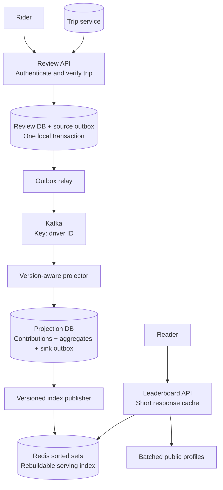
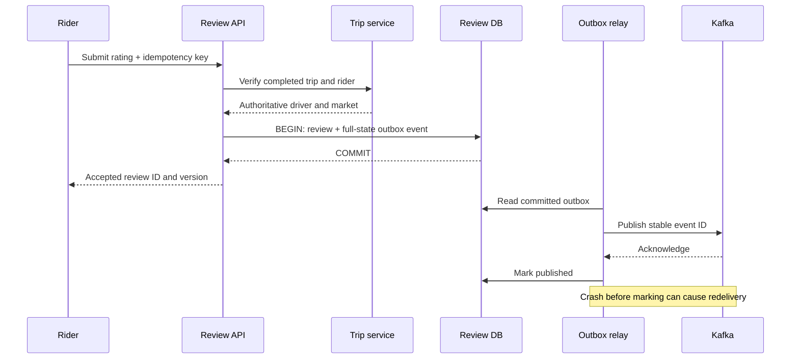
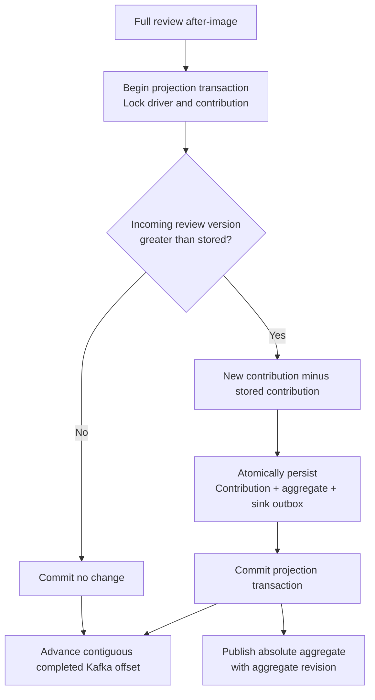
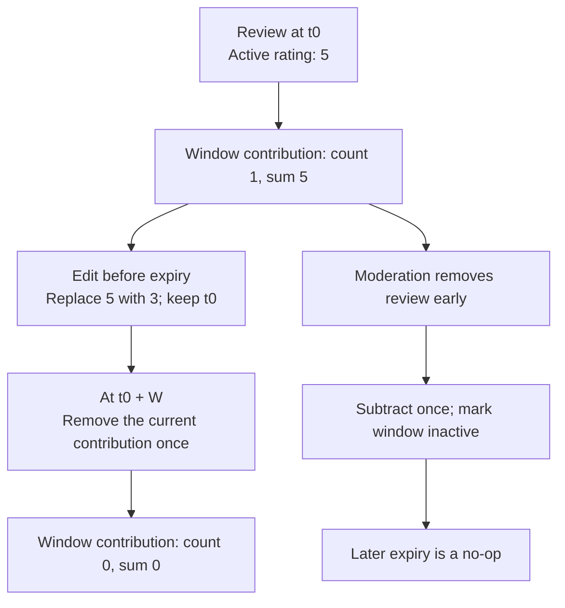
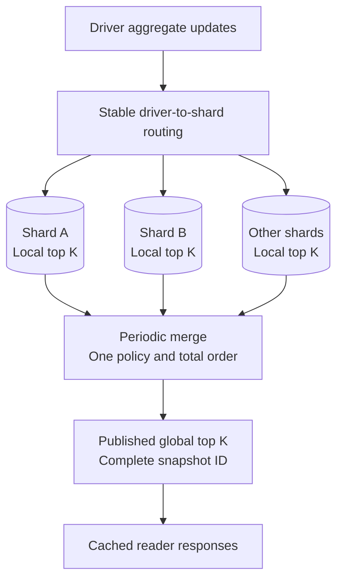
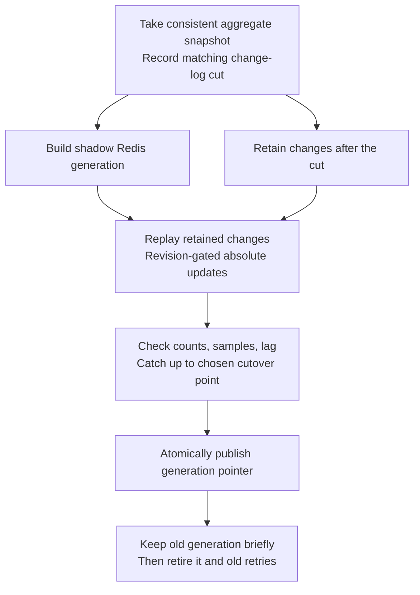

A driver has one five-star review. Another has ten thousand reviews averaging 4.99 stars. Sorting by the average puts the first driver ahead. Then a rider edits a rating, the event is delivered twice, and an old update arrives after a moderation removal. A fast leaderboard can still give the wrong answer.

The design needs three separate contracts: which reviews count, how those reviews become a score, and how that score becomes a position. **Keep reviews as transactional facts, maintain aggregates from versioned changes, and serve rankings from a rebuildable index.**

This is a fifty-minute interview design for a ride-hailing service. The traffic, storage, and latency figures below are planning assumptions. The scoring policy is an example that would need product evaluation; it does not establish a driver's safety or eliminate review bias.

## 1. Define what a position means

Start with a market-level, all-time leaderboard. A rider can review the driver of a completed trip once, revise that review, and withdraw it. Moderation can exclude or restore a review through the same write path. Readers request the top K eligible drivers, and a driver can ask for their own current position.

The server resolves the rider, driver, and market from the trip record. A client-supplied driver ID cannot establish eligibility. Keep the review's original trip market fixed, so a later driver transfer does not silently rewrite historical attribution. If the product ranks only currently active local drivers, model that eligibility separately and publish its changes too.

<div class="table-scroll" role="region" aria-label="Leaderboard product contract" tabindex="0">

| Decision | Initial contract | Extension |
| --- | --- | --- |
| Valid input | Integer rating from 1 to 5, verified completed trip | Review-quality signals and appeals |
| Uniqueness | One logical review per trip and rider | Revisions keep the same review ID |
| Ranked population | Eligible drivers in the trip market | Explicit current-market eligibility |
| Evidence | Active, non-excluded reviews | Seven-day and thirty-day windows |
| Freshness | Healthy-pipeline target of 30–60 seconds | Published historical snapshots |
| Ordering | Quantized score descending, stable driver key descending | A separately specified secondary count rule |

</div>

Return the score policy version and observation times. A successful review submission means that the review transaction committed. It does not mean the new position is already visible. “Not ranked” can mean insufficient evidence, explicit ineligibility, or missing projection data; these need different response reasons.

Example targets are P99 below 300 ms for review submission and below 150 ms for a regional leaderboard read, with 99.9% write and 99.99% read availability. Define whether a clearly labeled stale board counts as an available read. These targets must be tested under failover and backlog, not inferred from a component's advertised availability.

## 2. Size the changes and the retained state

Assume ten million active drivers, one hundred million completed trips per day, and a 40% review rate. That produces forty million new reviews per day, about 463 per second on average. A tenfold peak is roughly 4,630 per second; provision an initial review-ingestion envelope around 5,000 per second, then add measured headroom for edits and moderation.

<div class="table-scroll" role="region" aria-label="Traffic and storage estimates" tabindex="0">

| Quantity | Example estimate | Design implication |
| --- | --- | --- |
| New reviews | 40 million/day | Incremental processing avoids repeated full scans |
| Leaderboard reads | 100 million/day, about 1,157/second average | Cache popular serialized responses |
| Read peak | Approximately 10,000/second | Batch profile lookups and bound K |
| Structured review record | 500 bytes | About 20 GB/day or 7.3 TB/year, before overhead |
| Projector contribution rows | One per retained logical review | Deduplication state can exceed aggregate state |
| Driver aggregates | One per driver, scope, and window | Size separately from the raw review history |

</div>

The 500-byte estimate excludes large comments, indexes, replicas, historical events, backups, and projection rows. At a 1 KB average event size, a day-long backlog contains about 40 GB of event payload before replication and overhead. Retention and catch-up capacity must cover the repair horizon. Neither “Kafka is fast” nor “Redis fits ten million members” is a capacity plan.

## 3. Separate the write contract from leaderboard serving



*Figure 1. Review acceptance ends at the source transaction. Two durable outboxes carry changes across the later storage boundaries.*

Use SQL for the review store, with a unique constraint and optimistic concurrency for edits. The projection store is a separate durable database: contributions, aggregates, and the sink outbox must support a local atomic transaction. A relational implementation sharded by driver ID makes that boundary explicit. A transactional key-value implementation is another option if its item placement, contention, and transaction limits fit the workload.

Redis holds the ordered serving view. Losing it should leave both the original reviews and durable aggregates intact. A smaller service could begin with an indexed aggregate table and `ORDER BY score LIMIT K`; introduce Redis when measured reads, updates, or rank queries justify it.

## 4. Make one review a durable, revisioned fact

The source schema needs `review_id`, `trip_id`, `rider_id`, `driver_id`, `market_id`, `rating`, `status`, `review_version`, `created_at`, and `updated_at`. Enforce `UNIQUE(trip_id, rider_id)` on the owning shard. If sharding is necessary, route deterministically by trip ID so competing creates reach that same constraint. Random review-ID sharding alone cannot enforce this uniqueness across shards.

The source outbox stores a stable event ID and the **complete after-image** of each committed review revision, including inactive status. The event also carries its schema version, original review time, and immutable attribution. Comments need not enter the ranking stream.



*Figure 2. A relay crash can duplicate an event, so the consumer still needs an idempotent state transition.*

Use an idempotency key scoped to the rider and operation, with a request fingerprint. Reusing a key with different input returns a conflict. The database uniqueness rule remains necessary when a client changes its key. Edits and removals carry an expected review version; concurrent stale edits fail rather than silently overwrite one another. Serialize moderation decisions through this same revision authority.

The [transactional outbox pattern](https://microservices.io/patterns/data/transactional-outbox.html) addresses the commit-versus-publish gap. Its relay can publish twice. Returning success before the source commit, or assuming an outbox produces exactly one delivery, would weaken the contract.

## 5. Deduplicate before changing the aggregate

An absolute Redis update prevents a repeated sink write from adding points twice. It cannot repair an aggregate that already counted a duplicated input event twice. These are two separate idempotency boundaries.

For every review, the projector retains the last applied review version and its contribution. An active review with rating r contributes `(1, r)`; an inactive review contributes `(0, 0)`. For the initial all-time board:

```math
\Delta n = n_{\mathrm{new}} - n_{\mathrm{stored}},\qquad
\Delta s = s_{\mathrm{new}} - s_{\mathrm{stored}}
```

Process an event in a transaction on the driver's projection shard. Lock or conditionally update the driver's aggregate row and the contribution row, creating missing rows with uniqueness protection. If the incoming review version is at most the stored version, do nothing. Otherwise compute the delta from the **stored contribution**, update the count and sum, replace the contribution, increment the aggregate revision, and insert a complete aggregate snapshot into the sink outbox. Commit these changes together.



*Figure 3. Review versions protect the calculation; aggregate revisions protect the later Redis projection.*

Consider a driver with 100 active reviews totaling 480 stars. Review R currently contributes five stars at version 1. Version 2 changes it to three, version 3 changes it to four, and version 4 removes it.

<div class="table-scroll" role="region" aria-label="Duplicate and reordered review example" tabindex="0">

| Arrival | Stored contribution afterward | Driver count | Driver sum |
| --- | --- | --- | --- |
| Starting state: R version 1, five stars | Version 1, `(1, 5)` | 100 | 480 |
| Version 3 arrives before version 2 | Version 3, `(1, 4)` | 100 | 479 |
| Version 2 arrives late | Unchanged | 100 | 479 |
| Version 3 is delivered again | Unchanged | 100 | 479 |
| Version 4 excludes R | Version 4, `(0, 0)` | 99 | 475 |
| Old version 1 is replayed | Unchanged | 99 | 475 |

</div>

A full after-image allows version 3 to replace version 1 directly. Applying version 3's original “three to four” delta to a stored five-star contribution would be wrong. Keep the inactive contribution's version as a tombstone so old active events cannot resurrect it. Garbage collection needs a proven replay boundary or a fenced replacement generation; an arbitrary short TTL is insufficient.

Key Kafka records by driver ID to distribute work and keep a driver's records in one partition. Partition ordering describes the log's arrival order; it does not reconstruct source commit order across relays. Versions still matter. Commit consumer offsets only after durable projection commits, and only through a contiguous completed prefix if processing a partition concurrently. A crash after the database commit causes harmless reprocessing. Kafka's own [delivery-semantics discussion](https://kafka.apache.org/41/design/design/) explains why external storage needs additional coordination.

## 6. Choose a score that acknowledges limited evidence

Store the integer sum and count, not just the average. Let n be valid review count, s the rating sum, C a market baseline, and m the number of prior-equivalent reviews:

```math
\mathrm{score} = \frac{s + mC}{n + m}
= \frac{n}{n+m}\,\bar{r} + \frac{m}{n+m}\,C
```

With C = 4.7 and m = 50, one five-star review gives about 4.705882. Ten thousand reviews averaging 4.99 give about 4.988557. The first driver's position is less sensitive to a tiny sample. Separately require at least twenty active reviews for eligibility; twenty is a product threshold, while fifty controls shrinkage.

For another example, twenty five-star reviews yield about 4.785714, while two hundred reviews averaging 4.9 yield 4.86. The policy deliberately allows the larger body of slightly lower ratings to rank higher. That trade-off needs evaluation for new-driver treatment, market differences, and reviewer behavior.

Pin C, m, the eligibility threshold, and quantization rules to a **score policy version**. Updating a live market baseline after every review would invalidate every member's score. Estimate a new baseline offline and build a complete new policy generation before switching readers. For a global board, use a common score policy or explicitly validate comparability across market-specific policies.

For this design, round the score to an integer number of millionths using a specified decimal rounding rule. Compare those integers, then compare fixed-format ASCII driver keys in descending byte order. The ID resolves ties deterministically without implying a quality difference. Counts remain visible evidence, but are not a secondary ranking rule here. If product requires count-descending and ID-ascending ties, implement that complete order explicitly rather than silently relying on Redis's default.

## 7. Publish and read one coherent Redis view

An aggregate snapshot includes the driver ID, scope, count, sum, quantized score, eligibility, policy version, aggregate revision, and source-processing metadata. The publisher performs a short Redis script: reject a non-newer revision; otherwise replace that driver's rank entry, metadata, and stored revision together. An ineligible driver is removed from the sorted set, but its revision fence remains.

Keep the sorted set, metadata hash, and revision hash in the same cluster slot, for example with the shared tag `{SEA:ALL:p3:g8}`. Use separate fields per driver. Handle large revisions with a comparison representation that preserves integer order, such as fixed-width decimal strings; do not convert an unbounded 64-bit revision to a floating-point Lua number. A lost Redis instance or failover rollback requires catch-up and reconciliation before advertising the index as current.

Redis documents [atomic script execution](https://redis.io/docs/latest/develop/programmability/eval-intro/) and [cluster hash tags](https://redis.io/docs/latest/operate/oss_and_stack/reference/cluster-spec/). Bound script work and validate key types and arguments before mutation: atomic execution does not provide transactional rollback after a script error.

The underlying ranking operations are:

```text
ZADD lb:{SEA:ALL:p3:g8}:rank 4860000 D000088
ZRANGE lb:{SEA:ALL:p3:g8}:rank 0 99 REV WITHSCORES
ZREVRANK lb:{SEA:ALL:p3:g8}:rank D000088
```

For D ranked drivers, a single [ZADD](https://redis.io/docs/latest/commands/zadd/) is O(log D), [ZRANGE](https://redis.io/docs/latest/commands/zrange/) for K results is O(log D + K), and [ZREVRANK](https://redis.io/docs/latest/commands/zrevrank/) is O(log D). Reverse range ordering also reverses the lexicographic order of equal-score members, matching the tie policy chosen here. Add one to the zero-based rank for display.

For a coherent row, execute the bounded top-K lookup and its rank metadata retrieval inside one read script. Separate range and metadata calls can mix revisions during an update. Enrich those rows with one batched public-profile request. Profile freshness is a separate contract from rating freshness. Missing photos should not silently remove ranked drivers.

Cache popular complete responses for five to ten seconds, with request coalescing and bounded stale serving. Include that cache time in the freshness budget. Return `generated_at`, `policy_version`, `window`, `population`, and pipeline lag information. A recent response timestamp alone does not establish that its input events are current.

## 8. Define small APIs with explicit stale-state behavior

```text
POST   /v1/trips/{trip_id}/driver-review
PATCH  /v1/reviews/{review_id}
DELETE /v1/reviews/{review_id}

GET /v1/leaderboards/drivers?market_id=SEA&window=ALL&limit=100
GET /v1/leaderboards/drivers/me?market_id=SEA&window=ALL
```

Create requests carry the rating, optional comment, and idempotency key. Patch and delete requests carry the expected review version. Mutation responses return the durable review ID and new version, with no promise of immediate ranking visibility. GET limits, supported windows, market IDs, and snapshot cursors are validated and bounded.

The own-position response contains the observation time, score policy, evidence count, and rank or a specific unranked reason. Scope it to the authenticated driver or an explicitly permitted public view. Avoid exposing rider identities, individual trip details, fraud signals, or private profile fields through the leaderboard API.

## 9. Treat rolling windows as contributions that expire

Choose the time axis before choosing a streaming framework. Here a review belongs to a window by its original server-recorded submission time, t₀. Editing the rating does not reset that time. At observation time t, a W-length rolling window includes reviews with `t − W < t₀ ≤ t`. A trip-completion-based policy is also possible, but must be named separately. Do not trust a client's arbitrary wall clock.



*Figure 4. An expiry removes the currently applied contribution, so an edit or earlier removal cannot cause a second subtraction.*

An exact implementation keeps per-review window membership and durable expiry work. Events, edits, removals, and timers use the same driver transaction. A timer loads the current contribution, verifies its deadline and membership, subtracts it once, and records that it is inactive. It must not subtract a rating copied into an old timer payload. A late active event already outside the window records its revision but contributes zero.

Timers must run even when no reviews arrive. After downtime, drain overdue expiries before marking the board fresh. “Exact” describes membership at a stated processing cut; readers still observe the asynchronous projection and its lag. If using an event-time framework, specify watermarks, idle partitions, allowed lateness, and corrections, rather than assuming a window API solves all expiry semantics.

Daily buckets are simpler for **calendar-day** rankings: sum the requested days and refresh the index periodically. They do not implement an exact last-168-hours window at noon. A bucket method also needs revision-aware corrections when an old review is edited or excluded. Recompute the Bayesian score from window-specific sums and counts; never average bucket averages or subtract a previously calculated score.

## 10. Scale a global leaderboard without a single hot key

Market keys distribute different markets, but one sorted-set key still belongs to one cluster slot. Putting all ten million drivers into `GLOBAL:ALL` does not spread its updates over the cluster. For a hot global board, assign each driver to one of S stable virtual shards and retain a local sorted set in each.



*Figure 5. Merge local top-K lists periodically, then serve the published result instead of fanning out on every request.*

The global top K is contained in the union of each shard's local top K. If a driver were below position K locally, at least K drivers would already precede it globally. The proof requires the same total order and exactly one shard membership per driver.

With 64 shards and K = 100, the merge considers at most 6,400 candidates. For already ordered lists, a heap merge emits K rows in O(S + K log S) merge CPU after receiving the lists, with up to O(SK) transfer. These bounds exclude shard queries and profile enrichment. A cached read still transmits O(K) output bytes; it is not literally constant work regardless of response size.

Live shard reads occur at different instants. Their union is exact for those collected shard views, not necessarily for any single instant of the whole system. A complete periodic snapshot provides stable pagination; a true common-cut snapshot additionally needs coordinated partition offsets or another consistent checkpoint. State which guarantee the product needs.

Own-rank queries change too. `ZREVRANK` on one shard yields a local rank only. Exact global rank requires counting all drivers that precede the target across shards under the complete tie rule, or a separately built rank snapshot. Top-K merge alone cannot answer that query. Defer exact live global rank if market rank meets the initial requirement.

## 11. Keep pagination and score changes on named generations

Offset pagination over a changing board can repeat or skip drivers. If users only need the top hundred, return a bounded complete list. For deeper stable browsing, publish an immutable ordered snapshot and return a cursor containing its ID and position. Sign or validate the cursor, bind it to its market, window, and policy, and expire it explicitly.

A policy change follows the same generation approach. Build every member under the new baseline and scoring rules, catch up changes, validate, and atomically switch a small active-generation pointer. Route a reader's entire request through its selected generation. A new generation name also prevents old sink retries from contaminating the replacement index.

## 12. Make recovery a protocol, not an optimistic scan

There are two rebuilds. Redis loss requires copying durable aggregates and catching up their sink updates. A faulty aggregation rule requires recomputing contributions from canonical review state or a complete retained history. Replaying a partial log cannot reconstruct reviews whose earlier events have expired.



*Figure 6. A snapshot needs a matching change boundary, retained updates, and a controlled generation switch.*

Establish the consistent database snapshot and its change-log position together, using database-supported snapshot/CDC coordination or an equivalent fenced procedure. An ordinary scan followed by “consume the latest events” can miss changes made during the scan. Version gates alone do not repair an event that was never retained.

While building, retain all post-cut changes and apply them to the shadow generation. Apply deletion and ineligibility tombstones as well as positive scores. Catch up, check coverage and drift, then switch. Keep forwarding changes to any generation still serving in-flight readers during the grace period. Only advertise an acceptable freshness state after catching up to the defined cutover point. Restore time is a measured function of members, write rate, network, and backlog, not an assumed few minutes.

For reconciliation, compare at matching source/projection cuts. Sample drivers frequently and sweep partitions over time. Daily buckets can speed diagnosis, but comparing two structures built by the same faulty code is not independent evidence. Periodically recompute sampled sums and counts from canonical reviews. Repairs go through versioned projection writes or a new generation; ad hoc Redis increments would create another untracked writer.

## 13. Explain the failure behavior and operating signals

<div class="table-scroll" role="region" aria-label="Failure behavior and recovery" tabindex="0">

| Failure | User-visible effect | Response |
| --- | --- | --- |
| Source DB unavailable | Review cannot be durably accepted | Fail honestly; retry with the same key |
| API crashes after commit | Client does not know whether submit succeeded | Idempotency lookup and unique review identity |
| Kafka or source relay unavailable | Accepted reviews wait for projection | Bounded outbox backlog; alarm before storage exhaustion |
| Projection DB unavailable | Ranking falls behind | Pause consumption; retain and replay input |
| Duplicate or reordered event | No extra contribution | Review-version transaction, then sink revision gate |
| Redis unavailable or rolled back | Read fails or serves labeled stale data | Failover, retained sink replay, reconciliation or rebuild |
| Rank policy or projector bug | Scores may be systematically wrong | Stop publication, rebuild a validated generation |
| Hot market or global shard | Tail latency and publishing lag rise | Coalesce reads, rebalance stable virtual shards |

</div>

Use replication across failure zones and tested backups for both durable stores. A single write authority per source shard keeps review revisions ordered; another region requires a fenced failover plan before accepting writes there. Read availability can use cached snapshots, subject to a maximum stale age. Once that age is exceeded, return an explicit unavailable response rather than a fresh-looking old rank.

Watch oldest unpublished outbox age, Kafka lag, source-to-projection age, sink backlog age, overdue expiry count, reconciliation drift, and the fraction of unranked drivers by reason. Propagate safe correlation IDs across stages. A sink's last successful write timestamp is insufficient if an upstream partition is stuck.

Protect reviews with rate limits, trip ownership checks, restricted audit access, and a documented retention policy. Asynchronous fraud detection can find coordinated reviewing and emit a moderation command; the authoritative review revision then drives the normal projector. Minimum counts and shrinkage reduce small-sample volatility, but do not establish authenticity or remove demographic and market bias. Provide an appeal path if ranks affect rewards or access to work.

## 14. Use the interview time to prove the boundaries

Spend the first five minutes on eligible reviews, market scope, ranking policy, and freshness. Use the next four for load and retained-state estimates, then eight for the architecture and write transaction. Reserve roughly fifteen minutes for the versioned projector, score, and Redis publication, ten for windows and global ranking, and six for recovery and failures. Leave two minutes to walk one review through the complete system.

For that final walkthrough, accept a verified five-star review, commit its full-state outbox event, and deliver it twice. Show that the contribution transaction changes the driver's sum once. Revise the review to three stars, then exclude it, and replay an older event. Follow the resulting absolute snapshot into the ranking index and demonstrate a Redis rebuild into a shadow generation. Those transitions establish what the system can preserve when components retry, fail, or fall behind.
