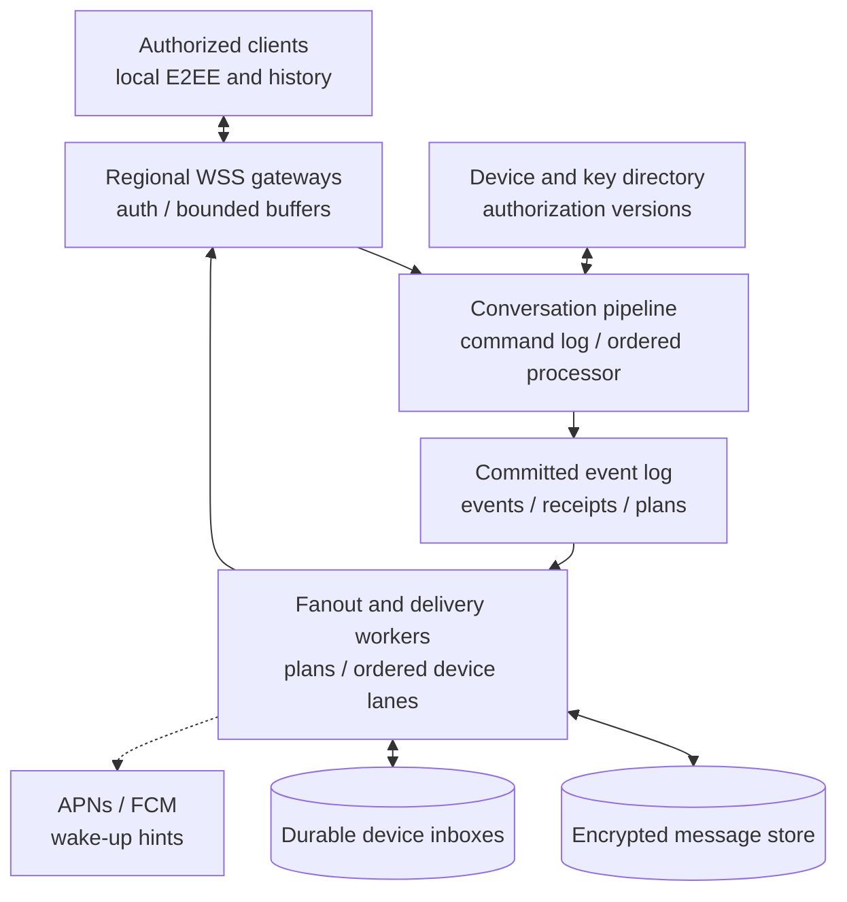
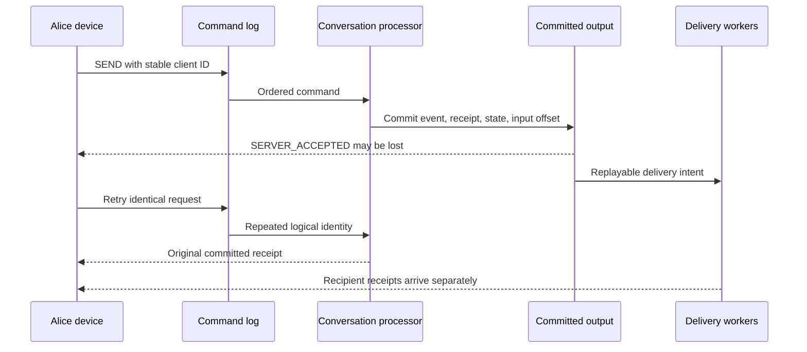
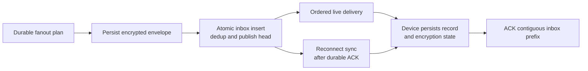
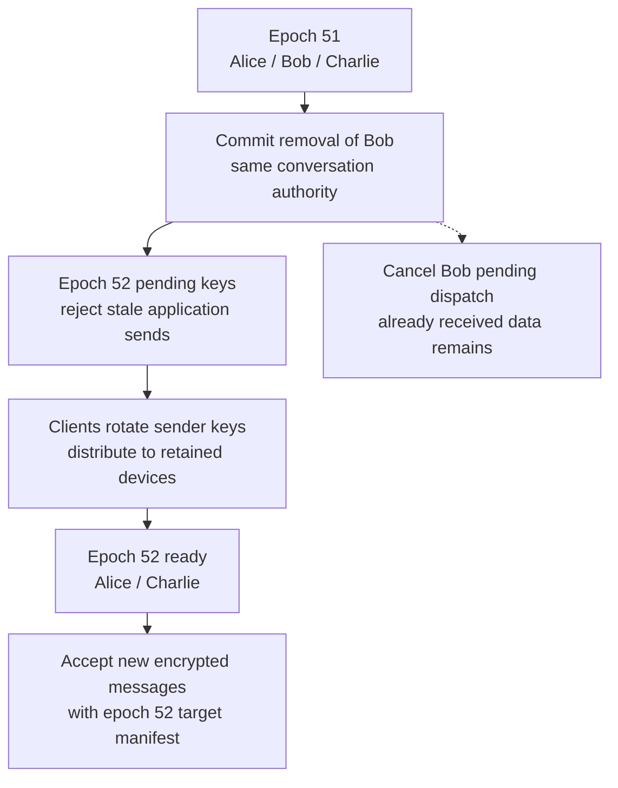
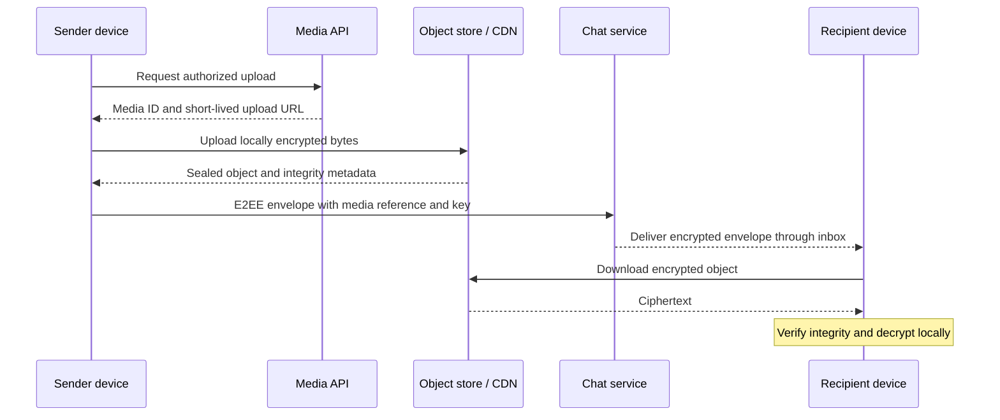

Alice sends a message while Bob's phone is offline. His laptop is connected, a group administrator is removing another member, and Alice's connection drops before she receives confirmation. The system must decide which message was accepted, who was entitled to receive it, and how each device can recover later.

This is a proposed architecture for a WhatsApp-like product. It does not describe WhatsApp's internal implementation. The workload figures, retention periods, and latency targets are planning assumptions. The server handles ciphertext and routing metadata; encryption and decryption happen on authorized client devices.

## 1. Set the messaging contract

Start with one-to-one text messages, bounded-size groups, multiple devices per account, offline delivery, and end-to-end encryption (E2EE). A successful send means the authorized message and its recovery information have committed to replicated durable storage. It does not mean every recipient is online or has read it.

Retries can repeat packets and processing. Stable message identities, durable deduplication, and a unique constraint in each client's local database produce one visible message within the supported retry and retention contract. Do not promise exactly-once network delivery or recovery after unlimited offline time.

Within a conversation, participants agree on the same committed event order. Different conversations have no shared order. Local optimistic messages can appear as pending until the server supplies the canonical position. Phone clocks never decide that position.

<div class="table-scroll" role="region" aria-label="Messaging scope and consistency contract" tabindex="0">

| Priority | Capability | Contract |
| --- | --- | --- |
| P0 | Send, retry, reconnect | Durable acceptance, idempotent retries, bounded offline recovery |
| P0 | Group membership and message order | One conversation authority serializes both |
| P0 | Devices and encryption | Independently authorized devices, client-held private keys |
| P1 | Delivery and read receipts | Persist before delivery ACK, eventual receipt propagation |
| P1 | Media, presence, typing | Separate encrypted uploads, expiring presence, disposable typing events |
| P2 | Edits, reactions, history transfer | Ordered events and authenticated encrypted transfer |
| Outside initial scope | Calls, public channels, payments | Separate requirements and capacity models |

</div>

Use a regional send-acceptance target of p99 below 200 ms and typical online delivery below 500 ms, then measure cross-region routes separately. Target 99.99% availability while identifying the failure domains covered. Synchronous cross-region durability can exceed the regional latency budget; a target cannot remove that trade-off.

## 2. Estimate sends, deliveries, and connections separately

Assume two billion daily active users, 50 logical sends per user per day, and a five-times peak multiplier. A logical message may create several device deliveries, including group recipients and the sender's companion devices. Use decimal KB, TB, and PB below.

<div class="table-scroll" role="region" aria-label="Encrypted messaging capacity assumptions" tabindex="0">

| Dimension | Calculation | Design consequence |
| --- | --- | --- |
| Logical sends | 2 billion × 50 = 100 billion/day | About 1.16 million/s average and 5.79 million/s peak |
| Device deliveries | 100 billion × 2.5 = 250 billion/day | About 2.89 million/s average and 14.47 million/s peak |
| Gateway baseline | 500 million connections / 100,000 per node = 5,000 nodes | Add deployment and failure headroom after load testing |
| Connection memory | 500 million × 10 KB = 5 TB | Raw connection state only, before other process costs |
| Encrypted envelopes | 100 billion × 1 KB = 100 TB/day | A full 30-day window is 3 PB before replication and indexes |
| Encrypted media | 5 billion objects × 300 KB = 1.5 PB/day | Keep media bytes outside the messaging service and log |
| Presence refreshes | 500 million / 10 seconds = 50 million/s | Aggregate locally and partition by region |

</div>

The 2.5 delivery multiplier is a workload average, not an upper bound. One 1,000-member group message at 1.5 target devices per member creates roughly 1,500 delivery intents, with the exact count depending on sender-device exclusions. Plan for heavy-tailed fanout and reconnect bursts rather than sizing every queue from the average.

A shared group ciphertext plus 1,500 illustrative 50-byte pointers uses about 75 KB of pointer payload. Real rows also contain keys, indexes, replication, and device-specific encryption metadata. One-to-one sessions may require different encrypted envelopes per device, so “one ciphertext for every recipient” is not a general storage assumption.

## 3. High-level architecture



*Figure 1. Durable conversation processing and per-device delivery are separate stages. Media takes the independent path shown in Figure 5.*

Gateways are connection-stateful: they hold sockets, authenticated sessions, heartbeat state, and outbound buffers. They hold no unique durable copy of message history, membership, or pending deliveries. A gateway crash costs connections; clients reconnect and replay their durable inboxes.

The command log partitions by `conversation_id` through an explicit shard directory. The conversation processor validates commands against its committed membership state and produces canonical events. Its output contains enough encrypted content, target information, and receipt state to reconstruct downstream delivery.

The message store answers conversation and envelope lookups. The inbox answers which deliveries a particular device still needs. Kafka is the internal processing log; billions of phones do not become independent Kafka consumer groups.

## 4. Define the acceptance transaction

A broker acknowledging an unvalidated command is insufficient for `SERVER_ACCEPTED`. A membership removal could be ahead of that command, or the command could be a duplicate. An optional `RECEIVED` response only means the request reached ingress; it must not appear as a successful send.

For a concrete implementation, use a partitioned Kafka command topic and an ordered processor with durable state. Membership commands use the same conversation partition as messages. In one Kafka transaction, the processor writes the accepted event, its stable receipt, the deduplication-state changelog, any membership-state change, and its consumed input offset. Consumers that drive acceptance responses and fanout use `read_committed`. Kafka Streams' [processing guarantee configuration](https://kafka.apache.org/41/configuration/kafka-streams-configs/#processing.guarantee) provides a basis for this internal transaction boundary.

```text
authenticate the sender device and bind its identity to the request
route to the fixed conversation command partition
process the next command in that partition's committed input order
    resolve an existing receipt for the same logical message identity
    reject a conflicting payload or a request outside the retry contract
    validate current membership, group epoch, and device revision policy
    stage event, receipt, target manifest, and recoverable state updates
    commit those outputs and the consumed input offset together
publish SERVER_ACCEPTED from the committed receipt
materialize message storage and device inboxes asynchronously
```

Configure replication across three availability zones, `acks=all`, a suitable `min.insync.replicas` such as two, and no unclean leader election. Those settings have explicit failure limits; `acks=all` alone does not require every assigned replica to be healthy. See Kafka's [minimum in-sync replica configuration](https://kafka.apache.org/41/configuration/topic-configs/#min.insync.replicas).

Processor ownership and transactions must fence an old worker after reassignment. A replacement restores committed state before accepting work. Kafka transactions do not atomically commit arbitrary message-store or inbox writes; those sinks still need their own idempotent operations. The [Kafka design documentation](https://kafka.apache.org/41/design/design/#message-delivery-semantics) makes that boundary explicit.

The extra processing stage adds latency. Keep transaction batches and queueing within the send budget, and stop accepting new work when storage or processing lag threatens the recovery window. A smaller deployment can implement the same acceptance invariants with a sharded transactional SQL journal and outbox.

## 5. Make retries resolve to one accepted result

Use a logical identity scoped to the authenticated sender device and conversation: `(sender_device_id, conversation_id, client_message_id)`. The client generates the final component once and preserves it across transport retries. The server assigns one stable `message_id` and preserves the first accepted `order_key`.

An accepted receipt also stores a fingerprint of the immutable request. Reusing the identity with different ciphertext or a different target manifest returns `ID_CONFLICT`. Ciphertext retransmissions reuse the original bytes; they do not advance the encryption ratchet again. If a stale group or device revision is rejected before acceptance, the client may refresh and re-encrypt. An ambiguous timeout must first resolve the existing receipt, because it may already have committed.

```json
{
  "type": "SEND_MESSAGE",
  "conversation_id": "C123",
  "client_message_id": "62f0fcdb-215a-4b30-ae4b-10e25eeb9a0c",
  "membership_version": 52,
  "group_key_epoch": 52,
  "target_device_versions": {"bob": 11},
  "encrypted_payload": "<ciphertext and authenticated envelope metadata>"
}
```

This is a shortened group-message example; authentication supplies the sender identity. Device versions cover the intended target accounts, including required companion devices. One-to-one messages carry the appropriate per-device encrypted envelopes. The server validates recipients against authoritative membership and authorization, rather than trusting a client-provided recipient list.

```json
{
  "type": "SERVER_ACCEPTED",
  "conversation_id": "C123",
  "client_message_id": "62f0fcdb-215a-4b30-ae4b-10e25eeb9a0c",
  "message_id": "M789",
  "order_key": {"epoch": 4, "offset": 918273}
}
```



*Figure 2. A retry retrieves the original accepted result. Fanout and recipient acknowledgments do not delay sender acceptance.*

Choose a bounded retry horizon, for example seven days, backed by retained receipts or tombstones. Use server-issued send generations or equivalent server-verifiable expiry so an ancient identifier cannot silently become a new message after dedup state expires. Return `RESULT_EXPIRED` when the contract cannot resolve it. A client database keeps `UNIQUE(message_id)` and durable ratchet state together with its received record, so replay cannot create a second visible message or accidentally reapply a ratchet transition.

## 6. Order conversations without wall-clock timestamps

One authority assigns each accepted conversation event an `order_key = (conversation_epoch, input_log_offset)`. The offset is that of its first accepted command in the fixed input partition. Rejected commands, retries, and other conversations create gaps. `(4, 918273)` followed by `(4, 918280)` does not imply six missing messages.

Order-key comparisons are valid only within the same conversation. Receipt cursors, message IDs, and inbox sequence numbers have different jobs. A client timestamp is display metadata and cannot establish a cross-device total order.

Increasing a topic's partition count and hashing the key again can move a conversation unexpectedly. Keep the logical shard mapping stable. For a planned move, fence new writes to the old route, drain and seal its final accepted position, transfer membership and dedup state, install a higher conversation epoch, and only then open the new route. The old owner must remain unable to commit. An epoch field by itself does not fence anything or recover a lost log suffix.

## 7. Separate message storage from delivery state

<div class="table-scroll" role="region" aria-label="Messaging storage records and ownership" tabindex="0">

| Record | Key and main fields | Owner and purpose |
| --- | --- | --- |
| Conversation state | `conversation_id`; home, epoch, membership version, key epoch | Ordered authority; membership changes and send authorization |
| Device registry | `(user_id, device_id)`; status, public keys, device-list version | Strong authorization service; no decryption private keys |
| Accepted receipt | Logical identity; fingerprint, message ID, first order key, expiry | Recoverable processor state; retry resolution |
| Message envelope | `(conversation_id, time_bucket, order_key)`; ciphertext variants, expiry | Replayable message-store sink; range and envelope lookup |
| Fanout plan | `message_id`; immutable target manifest, chunks, completion | Durable workers; resume partial fanout without changing recipients |
| Device inbox | `(device_id, bucket, inbox_seq)`; message reference, variant, expiry | Device-sharded durable store; pending delivery |
| Inbox head and ACK | `device_id`; published sequence, acknowledged sequence, generation | Transactional device partition; no skipped unpublished rows |
| Member receipt | `(conversation_id, user_id, membership_interval)`; delivered/read position | Eventual read model; user-visible receipt aggregation |
| Connection directory | `(user_id, device_id)`; gateway, connection generation, TTL | Disposable regional routing cache |

</div>

Time buckets bound message and inbox partitions. Maintain a bucket index or an opaque continuation token so sync traverses older buckets as well as the current one. Cassandra-, ScyllaDB-, or DynamoDB-style storage can fit the envelope access pattern. The inbox needs a stronger, specific primitive: atomically insert an idempotency key, its row, and the updated device head in a device-sharded transactional store. An eventually consistent counter followed by an unrelated insert is insufficient.

Materialize the encrypted envelope before exposing an inbox reference. Commit a sink's source position only after its required writes or durable continuation task succeed. On a crash, replay performs conditional upserts keyed by the same message and target device. A plain “insert if absent” followed by an unprotected head increment would still allow duplicate rows or holes.

## 8. Recover offline devices without cursor gaps

Give each device its own monotonic `inbox_seq`, assigned when its row and head commit together. Different devices can number the same message differently. A durable published prefix means every earlier position is either a committed row or an explicit terminal marker. Never expose a reserved high number while an earlier insert is still pending.



*Figure 3. Live delivery and offline recovery use the same durable inbox. The device acknowledges local persistence, rather than receipt of network bytes.*

For a page, capture a published head `H`, read after the durable cursor through `H`, and return a bounded batch plus a continuation token. Read consistently enough to avoid advancing past a row hidden by replica lag. The recipient persists the records and encryption state, then ACKs its highest contiguous completed prefix. Retries can repeat rows safely.

If inbox positions 501 and 503 are locally durable but 502 is unresolved, the device cannot ACK through 503. If a position has expired or was canceled by revocation, return an explicit terminal marker or an authenticated range-expiry response. A cursor older than retained history yields `SYNC_RANGE_EXPIRED`, not an unexplained empty success. A full resync can recover only still-retained messages or a separately available encrypted backup.

Per-device assignment order also preserves each conversation's accepted order. For the baseline, a conversation's fanout plan has a completion barrier: recipient chunks run in parallel, but the next message's plan cannot overtake unfinished inbox writes from the previous plan. Unrelated conversations proceed independently. Deliver through the ordered device lane; do not bypass it with an unordered “online-only” fast path. Very hot groups may need stable ordered recipient lanes instead of this per-message barrier.

Inbox ACKs are transport progress across conversations. Conversation delivery/read cursors describe eligible messages within one membership interval. Because conversation offsets are sparse, advance such a cursor only after the server's delivery plan and the client's persisted prefix establish completeness. Taking the largest observed order key is unsafe.

## 9. Fan out groups against a fixed membership epoch

For bounded groups, choose fanout-on-write: reconnect reads one device inbox instead of querying every group the user belongs to. The cost is proportional to target devices. Split a large plan into idempotent chunks and store completion state durably. Replaying a half-finished plan must neither omit a chunk nor recompute recipients from a newer membership list.

Membership commands and message commands share the conversation's ordered authority. Removing Bob advances membership version 51 to 52 and closes acceptance of epoch-51 messages. A send processed after that removal with version 51 is rejected before acceptance. A message accepted before removal remains a pre-removal event; the product must define whether pending pre-removal deliveries are canceled. This design cancels them for the removed member at dispatch, without claiming to retract content already received.



*Figure 4. Membership removal changes routing and cryptographic access. New application messages wait for the required client-side key transition.*

Bind key distribution and application ciphertext to the authenticated group epoch. With a sender-key approach, each active sender must rotate its sending state and securely distribute new key material to the remaining authorized devices before its next application send. Do not share a static group key indefinitely. [MLS, specified in RFC 9420](https://www.rfc-editor.org/rfc/rfc9420.html), is another protocol family to evaluate for group key changes; it is not interchangeable with a hand-written sender-key scheme.

The server can validate declared epochs and target authorization, but cannot prove that an authorized client used a fresh secret inside opaque ciphertext. Protocol implementations on the clients enforce that property. A remaining member can also disclose plaintext to a removed member; E2EE cannot prevent that.

## 10. Encrypt for authorized devices

Each device owns its private identity and session keys. The directory publishes authenticated public key bundles, prekeys, and device-list revisions. Use an audited protocol implementation for asynchronous key agreement and ratcheting. Signal's [PQXDH specification](https://signal.org/docs/specifications/pqxdh/) describes an asynchronous key-establishment protocol; its [Sesame specification](https://signal.org/docs/specifications/sesame/) addresses multi-device session management. These are protocol references, not a claim that a few database columns implement their security properties.

In one-to-one chat, the sending client prepares the encrypted variants needed by recipient devices and its own companion devices, excluding the originating device where appropriate. Store a common logical message identity with the required ciphertext variants or encrypted key wrappers. A new device cannot decrypt old ciphertext merely because an inbox reference exists. Use authenticated device-to-device history transfer or an optional encrypted backup.

Device-list validation covers the recipient accounts, not only the sender's own list. If Bob's list changes from version 10 to 11 before a new send is accepted, return `DEVICE_LIST_CHANGED` and refresh before encryption. A send already accepted against the old authorized snapshot does not automatically acquire a new target afterward.

Account-wide revocation requires coordination beyond a conversation partition. The authorization service fences the revoked device, invalidates active sessions and revision grants, and checks authorization again before dispatch. If the API promises revocation has taken effect across acceptors, it must wait for an invalidation barrier or use equivalent fenced validation; a cache TTL cannot supply that promise. When authoritative authorization is unavailable, fail closed for new sends or dispatch that require it.

Revocation cannot erase private keys or plaintext already on a lost device. Future group access also requires the group-key transition from Section 9. Verify device identities through an authenticated linking process and user-verifiable identity checks or an audited key-transparency mechanism. TLS and server-side disk encryption alone do not provide E2EE. The service still sees routing metadata, timing, approximate sizes, and device relationships, so protect and minimize their retention separately.

## 11. Keep media bytes outside the message path

The sender creates a random media key and encrypts the file locally with an authenticated encryption construction. A media API authorizes a bounded upload and returns a short-lived object-store URL. The ciphertext goes directly to object storage; the eventual chat envelope carries the media reference and encrypted decryption material.



*Figure 5. The message carries decryption material inside E2EE. The CDN caches ciphertext and never receives the plaintext media key.*

Finalize and verify the uploaded object's size and integrity metadata before accepting a reference to it. Reserve the sealed object against orphan collection while the send is in flight; finalize its message reference from the committed event. Garbage collection must reconcile that reservation and the event log before deletion. “Delete everything unreferenced after 24 hours” can otherwise race a delayed accepted-message sink.

Use authenticated, short-lived download grants, quotas, and a retention policy aligned with the referring messages. Expiring an object-store URL does not revoke a key or a ciphertext copy already downloaded. Large files never pass through the conversation log, message processor, or gateway output buffer.

## 12. Receipts, presence, and slow consumers

Track `SERVER_ACCEPTED`, `DELIVERED`, and `READ` separately. Define the user-level receipt policy: for example, delivered after at least one authorized recipient device durably stores the message, and read after an authorized device reports reading it. Per-device ACKs remain necessary for cleanup even when the UI aggregates them. Read receipts may be optional for privacy.

Coalesce monotonic receipt updates and propagate them asynchronously. A group read-by query examines the group's eligible member cursors, including membership intervals where relevant. It does not scan the global message database or permanently allocate one receipt row for every message-recipient pair.

Presence and typing use regional ephemeral stores. A gateway aggregates heartbeats, periodically refreshes TTL-based presence, and publishes disposable typing events. Choose heartbeat intervals, batching, and TTLs together; a longer TTL alone does not reduce heartbeat traffic. A gateway failure lets its presence records expire without a synchronous deletion storm.

Each connection has a bounded outbound queue. When it fills, stop live push and require durable inbox sync. APNs and FCM provide wake-up hints rather than the authoritative message body. Firebase's [message-lifespan documentation](https://firebase.google.com/docs/cloud-messaging/customize-messages/setting-message-lifespan) describes delayed and expiring delivery, so a successful push submission cannot count as chat delivery.

## 13. Bound retention and preserve recovery

Choose an absolute server expiry, for example 30 days after acceptance, and apply it consistently to message variants, inbox references, fanout tasks, and terminal markers. Offline recovery is promised only within that window and subject to the stated device and membership policy. Long-term history remains on clients or in optional encrypted backups.

For the baseline, retain envelopes through their promised window even if some devices ACK early. Early collection is allowed only after the complete target plan is terminal and a grace period has passed. An incomplete fanout plan can still create references, so a temporary zero reference count is insufficient evidence for deletion.

The processing log must retain everything needed to recover an accepted event until all required sinks have committed, or an independent durable archive must cover the missing range. Alert on oldest unmaterialized acceptance age and projected retention exhaustion. Backpressure new sends before that safety margin disappears; the log cannot buffer a database outage indefinitely. Cryptographic deletion and disappearing messages cannot erase screenshots or other copies made by a recipient.

## 14. Cross-region operation and failure recovery

Clients connect to a nearby regional gateway. Each conversation has one home authority, reached over the internal network, and committed delivery intents route toward the recipients' current regions. This adds backbone latency but avoids independent regions assigning incompatible orders to the same conversation.

Synchronous replication across availability zones covers the configured regional failure model. Asynchronous replication to a standby region can lose an accepted suffix if the entire home region is destroyed. Increasing the conversation epoch does not restore that suffix. Zero accepted-message loss for that disaster model requires a synchronous cross-region durability boundary before acceptance, with corresponding latency and partition-availability costs.

Failover must recover a consistent set of accepted events, dedup receipts, membership state, fanout progress, and inbox heads. Fence the old authority, identify the recoverable committed boundary, install the new epoch, and resume from that boundary. If the chosen disaster policy loses acknowledged data, expose the recovery limitation explicitly rather than silently assigning a new identity to an old send.

<div class="table-scroll" role="region" aria-label="Messaging failure handling and recovery boundaries" tabindex="0">

| Failure | Required behavior |
| --- | --- |
| Sender loses acceptance response | Retry identical logical identity and return the original committed result |
| Gateway or connection directory fails | Reconnect, authenticate, rebuild routing, sync durable inbox |
| Processor restarts or is reassigned | Fence old transactions, restore committed state, replay uncommitted input |
| Fanout crashes after some recipients | Resume the immutable plan and idempotent chunks |
| Inbox insertion or local persistence is incomplete | Keep the ACK behind the unresolved prefix |
| Member removal races a send | Use conversation command order and enforce key-epoch transition |
| Device authorization is unavailable | Do not substitute stale cache state for a required security decision |
| Message store is unavailable | Retain replayable intent, bound backlog, stop admission before retention risk |
| Push provider is unavailable | Preserve inbox delivery; push remains optional |
| Whole home region is lost | Apply the declared RPO and fenced failover procedure |

</div>

## 15. Spend interview time on the boundaries

<div class="table-scroll" role="region" aria-label="Fifty minute encrypted messaging interview plan" tabindex="0">

| Minutes | Discussion |
| --- | --- |
| 0–5 | Scope, E2EE, delivery contract, offline retention |
| 5–9 | Logical sends, device fanout, persistent connections |
| 9–16 | Architecture and durable acceptance boundary |
| 16–21 | APIs, message store, device inbox, independent cursors |
| 21–31 | Retry identity, ordering, replay, contiguous ACKs |
| 31–38 | Group membership, partial fanout, hot groups |
| 38–43 | Device authorization, key epochs, encrypted history transfer |
| 43–47 | Media, receipts, presence, backpressure |
| 47–50 | Regional disaster policy, metrics, explicit trade-offs |

</div>

At ordinary group sizes, bound message rates, envelope sizes, device counts, and fanout concurrency. A million-subscriber channel needs a separate broadcast design, such as hierarchical regional fanout or fanout-on-read. Adding recipients to the same hot conversation cannot remove its serialization requirement.

Measure accepted-send latency, commit ambiguity, retry conflicts, fanout age, inbox publication lag, reconnect duration, expired sync ranges, slow-connection fallbacks, and stale-epoch rejection. Rehearse a lost ACK, a partially completed group plan, a membership removal during retries, device revocation, and recovery close to the retention limit. Each exercise should identify the durable record that lets the next process continue.

## References consulted

- [Apache Kafka design](https://kafka.apache.org/41/design/design/#message-delivery-semantics): partition ordering, transaction scope, and external-sink cooperation.
- [Kafka topic configuration](https://kafka.apache.org/41/configuration/topic-configs/#min.insync.replicas): minimum in-sync replicas and acknowledgment policy.
- [Kafka Streams configuration](https://kafka.apache.org/41/configuration/kafka-streams-configs/#processing.guarantee): internal processing guarantees and committed state.
- [Signal Sesame](https://signal.org/docs/specifications/sesame/): asynchronous multi-device session management.
- [Signal PQXDH](https://signal.org/docs/specifications/pqxdh/): asynchronous authenticated key establishment.
- [RFC 9420: MLS](https://www.rfc-editor.org/rfc/rfc9420.html): group epochs and cryptographic membership changes.
- [Firebase Cloud Messaging message lifespan](https://firebase.google.com/docs/cloud-messaging/customize-messages/setting-message-lifespan): push delivery lifetime and expiry.
