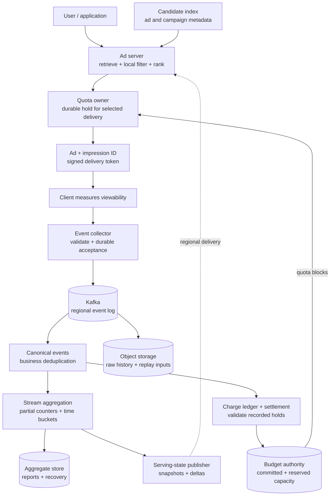
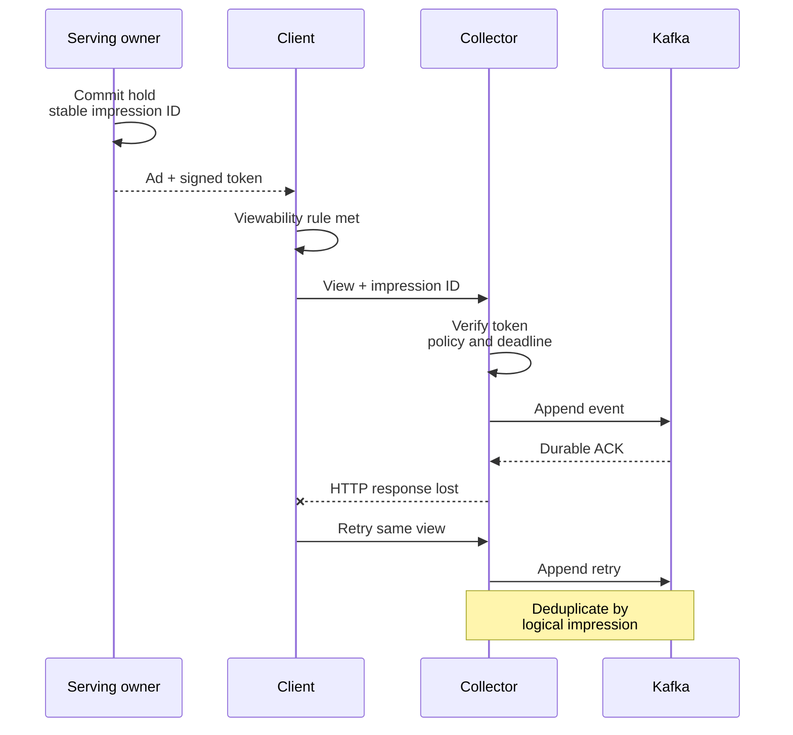
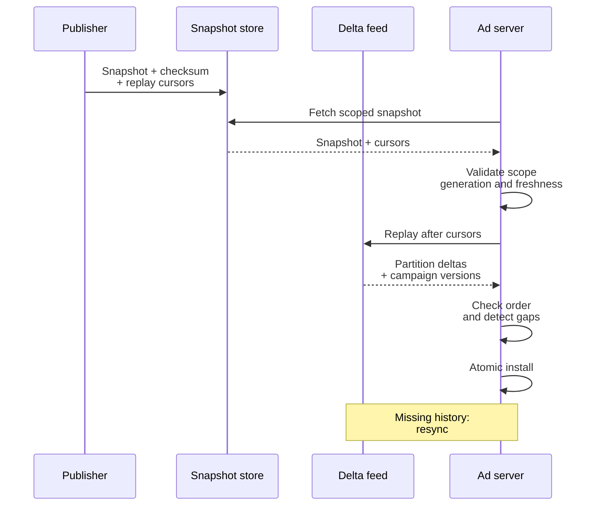
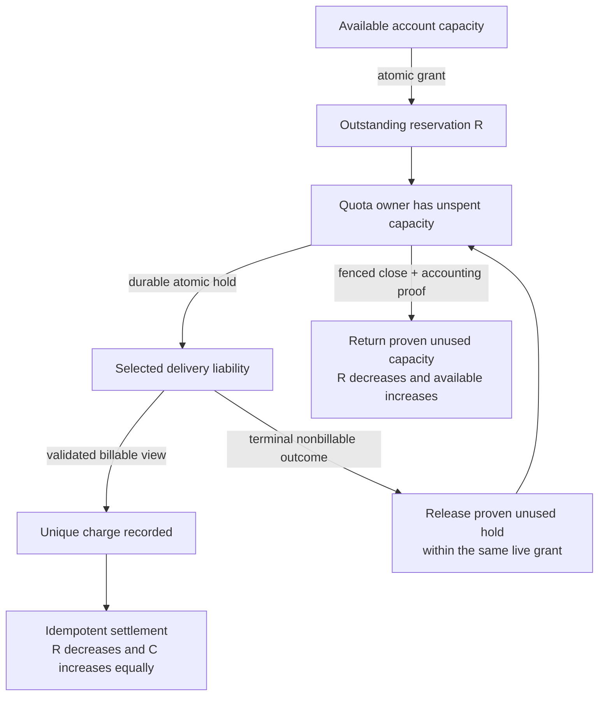
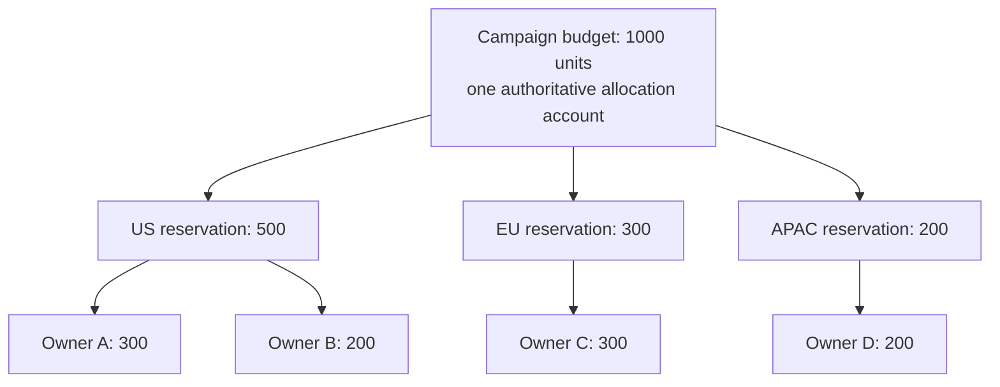

An ad request retrieves 10,000 candidates. Before ranking them, the server needs to know which campaigns are active, whether pacing allows another opportunity, and whether a selected delivery can still be paid for. Meanwhile, a separate pipeline receives impression reports, updates spend, and serves advertiser reporting.

The difficult part is the connection between those paths. A counter that is three seconds late might be acceptable for a dashboard. At a spend rate of $10,000 per second, that same delay can authorize roughly $30,000 of additional delivery if it is the only budget guard.

I would separate local eligibility checks, asynchronous accounting, and authoritative spending capacity. Compact state makes candidate filtering fast. Reserved quota makes the budget contract explicit. The design below assumes impression-based billing with a server-known maximum charge per selected delivery.

## 1. Scope and contracts

Record served, rendered, and viewed events separately. A response containing an ad does not establish that someone saw it. Define a billable view through a versioned product policy; visibility thresholds and duration belong to that policy. A client beacon is evidence under the policy, not proof against a malicious client or a complete fraud detector.

The first version supports hourly and daily impressions and spend by ad, campaign, and advertiser; campaign daily budgets; pacing; replay; and local serving state. Attribution, auction design, invoices, and fraud models are separate systems with explicit interfaces.

<div class="table-scroll" role="region" aria-label="Advertising system contracts" tabindex="0">

| Concern | Proposed contract |
| --- | --- |
| Candidate filtering | Target 1–5 ms for the local eligibility stage; benchmark separately from retrieval, ranking, and durable winner authorization |
| Event acceptance | Acknowledge after durable replicated-log acceptance under the configured failure policy |
| Operational aggregates | Target 1–5 seconds of freshness in normal operation; expose lag |
| Serving continuity | Aim for 99.99% request availability; a successful response may contain no paid ad when safe capacity is unavailable |
| Spending authority | Never authorize an uncovered billable delivery under the strict-cap policy |
| Financial records | Idempotent charges, retained provenance, corrections, and reconciliation |

</div>

These are design targets, not measured product guarantees. Near-real-time counters and pacing state can be eventually consistent. Allocating shared budget requires an authoritative serialization point for each campaign-period account.

## 2. Estimate amplification before selecting databases

Assume 500 million daily active users, forty ad opportunities per user per day, and a 75% billable-impression rate. This gives twenty billion opportunities and fifteen billion billable impressions per day: approximately 231,000 requests/s and 174,000 impressions/s on average. Independently provision for bursts near one million requests and one million impression reports per second.

With 250 bytes per event before compression:

```text
15 billion events/day × 250 bytes = 3.75 TB/day
1 million events/s × 250 bytes = 250 MB/s at peak
7 days × 3.75 TB/day × 3 replicas = 78.75 TB of log payload
30 days × 3.75 TB/day = 112.5 TB of raw archive payload
```

These decimal-unit estimates exclude served/rendered events, retries, indexes, checkpoints, and headroom. Compression must be measured on actual records. Object storage fits long retention; the replicated log supplies a shorter replay buffer. Archive lag must not silently exceed log retention.

The larger multiplier is candidate evaluation:

```text
1 million requests/s × 10,000 candidates = 10 billion checks/s
```

That is fleet-wide CPU work even with local memory. Remote reads add prohibitive fan-out. At an assumed sixteen-byte state record, reading 10,000 records transfers 160 KB per request before request keys and protocol overhead. Even at 100,000 requests/s, that is 16 GB/s of response payload. A remote multi-get reduces round trips but leaves that bandwidth cost.

## 3. High-level architecture



*Figure 1. Candidate checks use local state. Only selected deliveries need a durable quota hold. View accounting proceeds asynchronously. Budget allocation and settlement have stronger contracts than the reporting counters.*

The quota owner can be colocated with a serving shard or reached through one bounded request after ranking. It serializes consumption of its assigned capacity and durably records holds before an ad response is returned. This cost is separate from the 10,000 eligibility checks; the system does not claim every operation is an unlogged memory decrement.

Start with campaign-sharded transactional storage for budget accounts and quota grants. A distributed SQL system or a correctly scoped conditional-transaction store can supply this boundary. Keep per-impression records in partitioned owner journals and charge-ledger storage; do not route all fifteen billion daily charges through one campaign row.

Kafka and Flink handle buffered event processing. A partitioned key-value store serves aggregate snapshots. Immutable raw history supports reconstruction. Local memory serves eligibility. Each storage choice follows a workload and a failure contract.

## 4. Records and APIs

Use integer monetary units and a currency code. A field named `charge_micros` means millionths of that currency unit; choose sufficient precision for the pricing contract, define rounding centrally, and check arithmetic overflow. The aggregator sums validated charges rather than reconstructing auction economics.

<div class="table-scroll" role="region" aria-label="Advertising accounting records" tabindex="0">

| Record | Key and important fields |
| --- | --- |
| Budget account | `(tenant_id, campaign_id, period_id, currency)`; cap, committed amount, outstanding reservations, account revision |
| Quota grant | `lease_id`; account key, idempotency request ID, owner and epoch, granted amount, settled amount, released amount, issuance deadline, lifecycle state |
| Delivery hold | Tenant-scoped `impression_id`; lease ID, owner epoch, reserved maximum, actual price metadata, period ID, view/report deadlines, terminal state |
| Raw event | Event ID, impression ID, type, validated event time, receive time, ad/campaign/advertiser IDs, token reference, region |
| Partial aggregate | `(generation, dimension_id, period_or_bucket, logical_shard)`; cumulative impressions, cumulative spend, output sequence |
| Serving state | Campaign ID, active/control revision, eligibility, pacing factor, state version, freshness deadline; separate reference to local quota ownership |
| Charge entry | Unique business charge identity, hold reference, accepted amount/currency, ledger sequence, adjustment references |

</div>

`POST /v1/ad-requests` returns selected creatives with impression IDs and signed tokens. `POST /v1/ad-events` accepts view reports and returns `202 Accepted` only after durable acceptance. It does not promise that every aggregate is already updated.

Internal APIs allocate quota with a stable grant-request ID, publish or fetch scoped state snapshots, and settle cumulative lease usage with a monotonic settlement sequence. Retries must return the original operation's result rather than allocate or charge again. Persist that business identity for the required lifetime. For example, [DynamoDB's transaction client-token window is ten minutes](https://docs.aws.amazon.com/amazondynamodb/latest/developerguide/transaction-apis.html); it cannot by itself cover a multi-day financial retry policy.

Budget periods have explicit advertiser timezones, UTC boundaries, and policy versions. A calendar day can differ from twenty-four hours. In this design, a delivery token pins the reserved budget period at issuance; reporting still groups views by validated event time. A policy that bills strictly by the view's calendar day needs a reservation in that day's account before accepting its charge.

## 5. Collect a view without inventing a second charge

The server signs or references authoritative metadata: impression ID, campaign, creative, currency, maximum charge, hold and lease IDs, budget period, policy version, deadlines, and signing-key ID. A client cannot choose a different price by editing its beacon. The collector validates the token and timestamps, rate-limits abuse, and preserves both accepted records and rejected-event diagnostics under the privacy policy.



*Figure 2. Transport retries can create distinct records for one logical impression. Durable acceptance, business uniqueness, and eventual aggregation are separate stages.*

Use a tenant-scoped impression identity for the single billable view, rather than trusting a new client event ID on every attempt. If a product bills several event types, define separate allowed charge identities instead of deduplicating all event types indiscriminately.

Kafka producer idempotence protects applicable producer retries. [Kafka's delivery-semantics documentation](https://kafka.apache.org/41/design/design/#message-delivery-semantics) also describes the coordination required for external output systems. Neither identifies two independent HTTP requests as the same business operation. Persist the uniqueness decision with its charge effect in the financial path.

A client that never sends a report cannot be recovered by collector retries. Monitor viewed-to-served ratios by SDK, region, and app version. Signed metadata prevents some tampering but does not independently establish that a human saw the ad.

## 6. Aggregate at scale and preserve replay semantics

First canonicalize events under `(tenant_id, impression_id, billable_event_type)`. Partition this work by stable identity so duplicates meet the same logical state. Restore deduplication state together with input progress. [Flink's state and checkpoint model](https://nightlies.apache.org/flink/flink-docs-stable/docs/concepts/stateful-stream-processing/) explains recovery of stateful processing; external writes still need compatible transactions or idempotent replacement semantics.

A finite operational deduplication TTL must cover the defined acceptance/retry window and supported delivery delay. At fifteen billion IDs per day, an illustrative 32-byte entry consumes 480 GB per day before storage-engine overhead; three days require 1.44 TB across the state fleet before replicas and checkpoints. This is a partitioned state problem, not a small global set.

The financial ledger keeps durable charge uniqueness and closed-period rules beyond that cache window. A replay older than the operational TTL must rebuild canonical state in isolation or use authoritative retained identities. Expiring a stream entry never authorizes a second bill.

After canonicalization, compute ad, campaign, and advertiser aggregates. A large campaign can dominate one partition, so split it into a configurable number of logical shards using stable impression hashes and a routing version. Perform local combining, then merge periodically published partial totals. A thirty-two-shard example can reduce 100,000 raw events/s to roughly thirty-two partial snapshots/s at one snapshot per shard per second; it does not reduce the work of initially reading those events.

Publish cumulative partial values with a generation and output sequence. The receiver replaces an older partial and derives totals from the latest value per shard. Summing every retried partial message would count the same spend repeatedly. Fence abandoned writers during recovery; coordinate resharding and dedup-state migration instead of treating a partition-count change as harmless.

Use validated event time for reporting buckets. [Flink watermarks](https://nightlies.apache.org/flink/flink-docs-stable/docs/concepts/time/) express progress assumptions for event-time computation; they do not prove that an offline phone has no future report. Define allowed lateness, provisional results, and a correction path for later accepted events. Preserve the signed budget-period attribution separately from the reporting hour.

## 7. Make the 10,000 checks local

Candidates carry their campaign IDs. Group by distinct campaign where useful, apply targeting, and inspect a compact local state record for active status, freshness, and pacing. A local quota availability hint can reject obviously exhausted campaigns, but the final selected delivery still requires an atomic hold.

If one request contains 10,000 ads from 2,000 campaigns and fifty campaign records are missing, resolve only those fifty through one or a few bounded regional batch reads. Impose a miss budget and deadline; skip unresolved candidates when the deadline expires. Do not turn an L2 outage into thousands of synchronous retries.

A first version can use a map. At larger scale, benchmark flat hash tables, primitive arrays, and dense campaign indices. Install the ID mapping and its state array as one generation; reusing an index while older requests still reference it can attach state to the wrong campaign. Bitmaps help bulk eligibility filtering but cannot replace atomic monetary holds.

Apply pacing once per request–campaign opportunity. Sampling separately for each ad lets a campaign with many candidates receive many chances to pass. A stable server-controlled hash for that opportunity also avoids inconsistent results on internal retries.

The candidate index can remove inactive or exhausted campaigns early. Treat this as a work-saving filter: delayed index updates do not enforce the budget.

### Distribute snapshots with a recoverable delta position



*Figure 3. The snapshot and feed positions describe one recovery boundary. Fetching a snapshot and subscribing only to future updates can miss changes between those two operations.*

Use per-partition cursors or an explicitly ordered scoped feed; a global sequence is not implied across Kafka partitions. Retain enough updates to catch up. Reject incompatible mappings, wrong-tenant records, stale revisions, and missing deltas. Keep authoritative pause/control revisions distinct from reporting progress so a late counter update cannot re-enable a paused campaign.

The publisher distributes eligibility and pacing. It does not overwrite the quota owner's mutable remaining balance with a cached spend estimate. If state passes its freshness deadline, use the documented conservative policy and eventually stop affected paid delivery. A disconnected server cannot learn an immediate remote cancellation.

## 8. Protect the budget through reserved capacity

For one campaign-period account, define:

```text
B = authorized budget
C = committed charges recognized by the budget authority
R = outstanding reserved capacity, including unsettled delivery liability

C + R <= B
available = B - C - R
```

Granting `q` moves capacity from available to `R` in an authoritative transaction. Two owners requesting $800 each from $1,000 of available capacity cannot both succeed. A row lock or conditional transaction serializes the decision; the grant record and account mutation commit together. [PostgreSQL row locking](https://www.postgresql.org/docs/current/explicit-locking.html#LOCKING-ROWS) is one implementation mechanism for that decision, within an appropriately replicated and sharded service.

The grant-request ID makes an uncertain retry idempotent. Reusing an ID with different account, amount, or owner parameters is rejected. A snapshot of `remaining_budget` is not an allocation record.

Within a grant, the quota owner atomically creates a durable hold for the selected delivery's maximum possible charge. Concurrent workers cannot all spend the same last unit. An owner crash must recover the consumption journal; it must not reset a surviving lease to its original balance. Owner fencing and the durable log prevent two process incarnations from independently consuming the same capacity.

The signed response is issued only after the hold is durable. A charge must refer to that recorded hold, satisfy the billing policy, and remain within its maximum. If price is not bounded before delivery, this strict-cap construction needs a conservative upper reservation, a capped advertiser charge, or a separately authorized risk allowance.



*Figure 4. Granting and holding happen before delivery. Settlement transfers already reserved capacity to committed spend. Releasing capacity requires evidence that it cannot also fund an outstanding valid charge.*

If every charge is covered and settled exactly once, `C + R <= B` protects the original cap despite delayed reporting. One hundred owners holding $100 each have $10,000 of reserved exposure already deducted from availability. **Reserved exposure is not automatically overspend.**

Large blocks reduce authority traffic but strand more capacity in slow or failed owners and weaken the speed of budget cuts or cancellation. Smaller blocks improve allocation responsiveness. As an illustrative workload, one million billable deliveries/s with one thousand deliveries per grant needs about one thousand grants/s, plus settlement and recovery work. Durable per-delivery journaling and financial uniqueness still exist; batching only amortizes the shared-account boundary.

Shrink grants near exhaustion, cap total outstanding capacity, and adapt to consumption rate and refill latency. If the product deliberately permits unreserved credit `E`, it has a different contract, such as `C + R <= B + E`, with the allowance coordinated across all issuers. Unbounded unknown charges or duplicate grants invalidate any claimed numerical overspend bound.

## 9. Settle late views without recycling their money twice

Lease expiry stops new issuance. Owners enforce deadlines under documented clock-error bounds and stop issuing when they cannot establish validity. **Expiry alone is not evidence that money is unused.** An ad returned before expiry can produce a valid view later; an already accepted view can also sit in a processing backlog.

Retain that liability while fencing further issuance. Recover the owner's journal, identify terminal charge or nonbillable outcomes, and return only capacity proven unused. For a lost owner with uncertain state, keep its unresolved reservation unavailable. Availability and utilization suffer while ownership is uncertain; allocating the same money elsewhere would abandon the strict-cap contract.

Define finite view and report-acceptance windows in the signed policy. Closing a period also requires a durable ingestion boundary and processing completion for reports already accepted by that boundary. A wall-clock deadline or an event-time watermark alone cannot erase those accepted claims. Fencing a retired owner prevents new holds, while previously recorded valid holds remain liabilities until resolved.

Settlement uses durable charge identities and lease-specific cumulative progress or idempotent batches. Moving charge `c` to the authoritative committed balance decreases the corresponding reservation by `c`; it does not also reduce availability a second time. Unused parts of a maximum-charge hold are released only after its accepted outcome is final. A terminal nonbillable outcome cannot later become a new charge without a fresh authorized decision.

Positive billing adjustments need covered capacity or an explicit loss policy. Refunds and reversals are auditable ledger entries, not arbitrary edits to a serving counter. Specify whether a refund restores delivery capacity; an invoice credit does not automatically refill a campaign. Replaying reporting history must not replay quota grants or financial side effects.

A budget decrease below `C + R` cannot be promised immediately. First reclaim acknowledged unused capacity or reject/defer the requested reduction. An emergency reduction with live grants needs a disclosed residual-liability policy. Cached `active = false` accelerates stopping but does not revoke a disconnected owner's capacity instantaneously.

## 10. Pace toward a target without confusing it with the cap

Pacing allocates delivery over time. A $24,000 daily budget might target $12,000 by noon under an illustrative uniform schedule. Actual traffic, conversion goals, and the advertiser's schedule can require a different target curve.

The controller compares the target with recent spend and estimates the billable portion of already issued holds. It smooths error, limits changes, and applies hysteresis so reporting delay does not cause full-open/full-closed oscillation. Unspent quota blocks are available capacity, not spend, and should not all be counted as pending impressions.

Publish a pacing probability or a bid multiplier, with its revision and validity period. Choose one policy for the initial design; changing effective bids changes auction behavior. Any eligible winner must still obtain a hold regardless of the pacing factor.

A failed controller can leave the last valid factor in service for a bounded period. A stalled accounting pipeline should restrict new grants once freshness and unsettled-liability thresholds are crossed. The authority never recreates capacity merely because delayed charges are missing from a reporting counter.

## 11. Split regional authority without duplicating it



*Figure 5. Regional reservations partition the shared capacity. Child allocations are contained within their parent's reservation; adding every level together would double-count the same liability.*

A region can split its assigned amount among owners using the same conservation rule. Move capacity between regions only after the source has acknowledged a safe release and the authority records the destination grant. A partition cannot give both sides the entire campaign balance.

On failover, preserve account history, idempotency records, epochs, and unresolved reservations. Use a consistent replicated authority or a single authoritative home with explicitly limited availability; asynchronously replicating balances does not make concurrent multi-region allocation safe. A region disconnected from the authority can consume its existing safe allotment, then must stop acquiring new paid-delivery capacity.

## 12. Replay and reconcile in separate generations

Keep immutable raw events, validated canonical records, schemas, price/policy versions, input ranges, and processing-code versions. Reconciliation compares operational totals against deduplicated accepted charges and records corrections with a reason.

A backfill writes replacement aggregate shards into a new generation. Catch that generation up to a declared input boundary, validate it, and atomically switch the serving/reporting pointer under fencing. Continuing live writes to the old generation must not become mixed with the replacement. Replaying into live `+=` counters would double-count existing history.

Reporting, pacing, and financial accounting have different completion points. An advertiser invoice can wait for accepted late events, fraud decisions, and audited adjustments even while delivery uses a recent provisional spend estimate. Provisional reporting must be labeled, rather than implying that a fresh counter is a finalized financial record.

## 13. Failures and operational evidence

<div class="table-scroll" role="region" aria-label="Advertising failure response" tabindex="0">

| Failure | Response | Evidence to monitor |
| --- | --- | --- |
| Collector cannot durably append | Bound buffering and return failure for client retry; do not acknowledge an in-memory-only event | Acceptance errors, retry volume, oldest buffered event |
| Stream processor restarts | Restore state/progress and repeat only idempotent outputs | Checkpoint age, restart time, duplicate rates |
| Mega campaign saturates a partition | Split logical aggregation and combine partials | Partition skew, hot-key lag, flush volume |
| Aggregate store is unavailable | Retry with recoverable progress; existing local state and safe quota provide limited continuity | Sink backlog and retention headroom |
| Snapshot or delta delivery breaks | Detect gaps, resynchronize, expire stale state conservatively | Revision adoption, state age, resync rate |
| Quota owner crashes | Fence replacement, recover holds; retain uncertain liability | Journal recovery, outstanding age, stranded capacity |
| Budget authority loses quorum | Deny new grants; consume only existing safe allocations | Grant latency, quorum state, remaining regional capacity |
| Delayed or duplicated billable report | Check policy, hold, and durable charge identity | Accepted lateness, duplicate suppression, pending hold age |

</div>

Track event-to-aggregate latency, aggregate-to-serving latency, local hit rate, batched-miss fan-out, selected-delivery hold latency, quota refill failures, and `C + R` headroom. Alert on discrepancies between operational spend and reconciled charges, and on holds that remain unresolved near retention or period-close boundaries.

Test an acknowledgement lost after a successful grant, concurrent last-unit holds, a restart with an old lease, reordered state updates, an expired lease with an accepted queued view, a daily-boundary report, and a backfill running beside live processing. Those cases exercise different correctness boundaries; a high-throughput happy-path benchmark cannot substitute for them.

For a fifty-minute interview, spend the deepest discussion on three mechanisms: collecting a logical view once, checking thousands of candidates locally, and preserving spending capacity through reservation and settlement. The resulting design has a clear request path, an auditable accounting path, and explicit behavior when its assumptions stop holding.

## References

- [Apache Kafka: delivery semantics](https://kafka.apache.org/41/design/design/#message-delivery-semantics) describes producer idempotence, transactional processing, and external-system boundaries.
- [Apache Flink: stateful stream processing](https://nightlies.apache.org/flink/flink-docs-stable/docs/concepts/stateful-stream-processing/) explains keyed state and checkpoint-based recovery.
- [Apache Flink: event time and watermarks](https://nightlies.apache.org/flink/flink-docs-stable/docs/concepts/time/) defines stream-time progress and late-data considerations.
- [PostgreSQL: row-level locks](https://www.postgresql.org/docs/current/explicit-locking.html#LOCKING-ROWS) documents a transactional mechanism for serializing conflicting account updates.
- [DynamoDB: transaction idempotency](https://docs.aws.amazon.com/amazondynamodb/latest/developerguide/transaction-apis.html) specifies the finite client-token window and retry behavior.

*Design assumptions and primary documentation reviewed October 17, 2026. Capacity figures are illustrative. The budget bound depends on exclusive durable quota ownership, covered maximum charges, idempotent settlement, and conservative handling of unresolved liability.*
