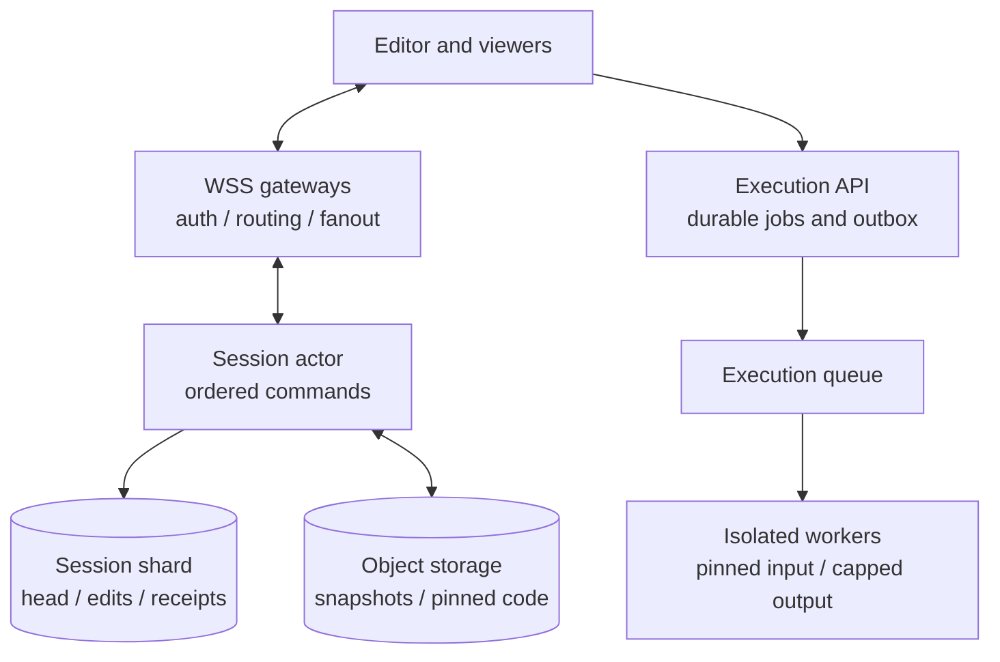
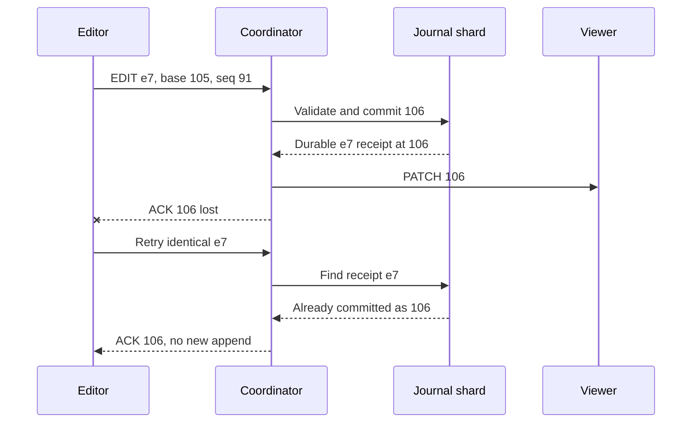
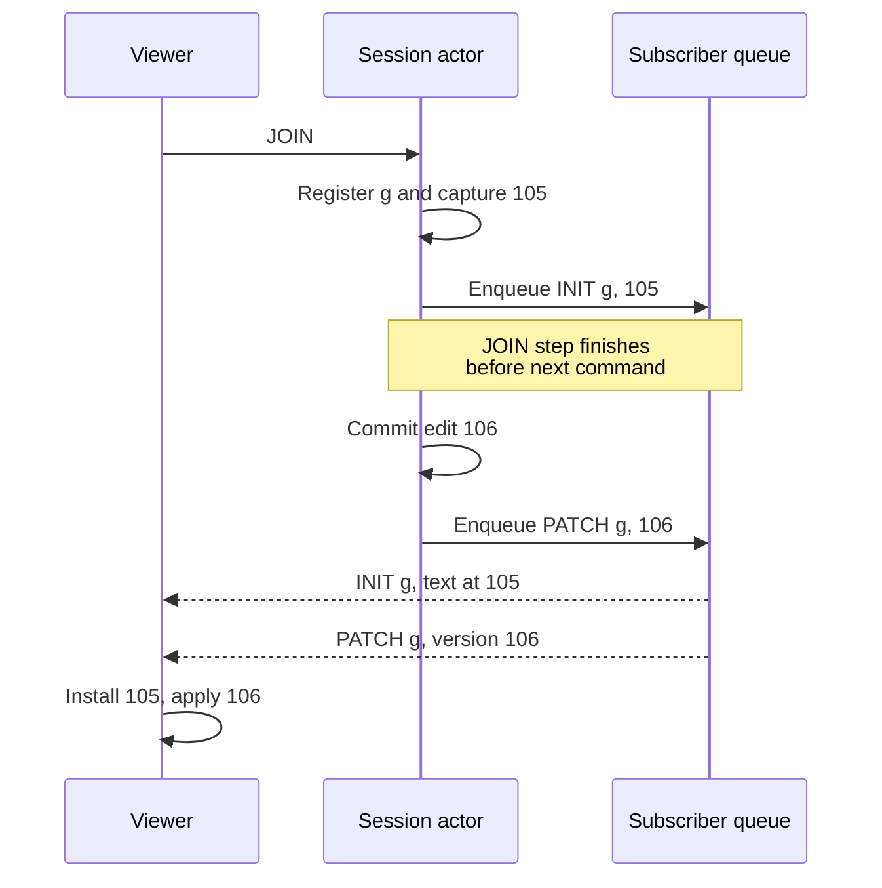
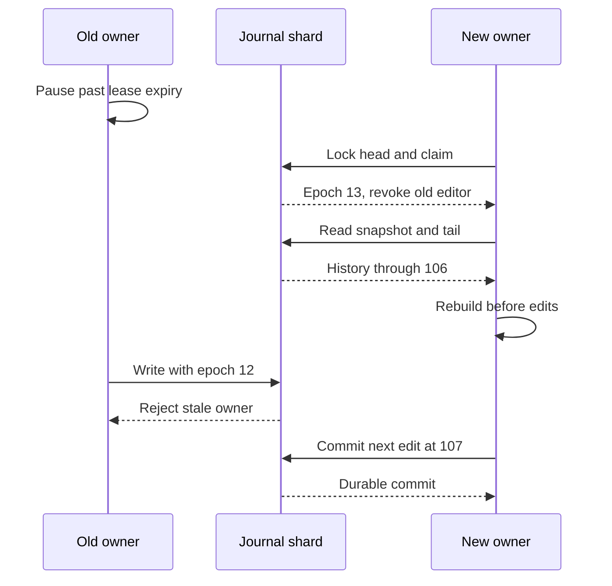
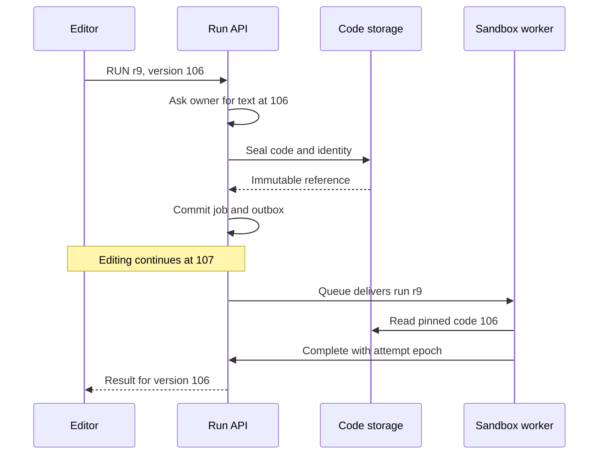

An interviewer opens a coding session, shares its URL, and watches a candidate type. The candidate loses their connection just after submitting an edit. A second browser tab requests editing control, and the session coordinator restarts while another viewer is joining.

Every participant needs to converge on the same committed code. Retrying the edit must not insert it twice. The new tab must not create a second writer. The joining viewer must receive a complete document followed by every subsequent change.

This design supports **one active editor connection per session**, multiple read-only viewers, and optional execution in an isolated sandbox. It is a proposed architecture for this product category, rather than a description of CoderPad's implementation. Capacity figures and latency targets below are planning assumptions.

## 1. Define the collaboration contract

Users create sessions, join through authorized links, edit code, observe changes, reconnect, run code, and close sessions. A participant with permission can explicitly transfer editing control. Presence and cursors are useful but do not decide document state or permissions.

“One editor account” is insufficient: that account can have several tabs and devices. Grant editing control to a particular authenticated connection, with a monotonically increasing `editor_epoch`. A second connection remains read-only until a transfer or lease-expiry procedure grants it control.

Within a session, all committed edits have consecutive versions. A viewer applies version 106 only after version 105. A reconnecting client either replays a contiguous missing suffix or installs a new complete document. Different sessions do not require a shared version order.

Suggested regional targets are immediate optimistic local typing, remote-update p50 below 100 ms and p95 below 200 ms, and a sub-second join for small documents. Allow several seconds for coordinator recovery and target 99.9% session availability. Cross-region backhaul, large pastes, and cold sandbox starts need separate budgets. These are targets to validate under load.

General multi-writer editing, offline branch merging, video calls, and a full IDE are outside the initial scope. With a single valid writer, an ordered patch protocol is sufficient. Adding concurrent writers later would require a different conflict model, such as OT or a CRDT, plus new product semantics.

## 2. Estimate edits and deliveries separately

Assume 100,000 connected participants, five participants per session, one editor and four viewers. An active editor produces an average of two network edit batches per second. Use decimal bytes for these estimates.

<div class="table-scroll" role="region" aria-label="Coding session capacity assumptions" tabindex="0">

| Dimension | Calculation | Architectural consequence |
| --- | --- | --- |
| Concurrent sessions | 100,000 / 5 = 20,000 | Partition ownership by session ID |
| Accepted edit batches | 20,000 × 2 = 40,000/s | Scale the journal across session shards |
| Viewer deliveries | 40,000 × 4 = 160,000/s | Fanout capacity exceeds edit ingress |
| Patch payload | 200 bytes × 40,000 = 8 MB/s | About 32 MB/s delivered to viewers, excluding overhead |
| Current documents | 20,000 × 50 KB = 1 GB | Raw text only, before runtime and connection overhead |
| Forty-five-minute session | 2 × 2,700 = 5,400 edits | About 1.08 MB of raw patch payload per session |
| Thirty-second replay window | 2 × 30 × 200 = 12 KB/session | About 240 MB across 20,000 sessions, before indexes |

</div>

Sending a full 50 KB document for every edit would create 2 GB/s of ingress payload at this assumed rate, compared with 8 MB/s of patches. Persist periodic full snapshots and send deltas between them. If the peak persisted for an entire day, raw journal payload alone would reach 691.2 GB; replication, indexes, and retention add to that figure.

Flushing keystrokes every 50–100 ms does not imply two batches per second. That is a workload assumption. At ten batches per second per editor, ingress becomes 200,000 batches/s, with 800,000 viewer deliveries/s and 160 MB/s of raw viewer payload. Test sustained typing, large pastes, reconnect storms, and unusually large sessions separately.

A 1 MiB maximum document is a configurable example limit. Browser buffers, snapshots in flight, parsed strings, TLS buffers, and subscriber queues can exceed the raw-text estimate. Admit sessions according to measured memory and CPU budgets.

## 3. High-level architecture



*Figure 1. Document commits and execution have separate ownership and resource budgets. Gateways hold connections, while durable session state lives in the authoritative shard.*

Each session has one logical coordinator that orders commands. Multiple session actors share a process, and processes are distributed across a worker pool. A directory routes a session to its current owner; a stale routing entry triggers a refresh rather than granting authority.

The gateway authenticates, checks join permissions, and forwards messages. Its socket buffers and routing cache are disposable. The coordinator holds current text, the committed version, recent edits, and subscriber state. Those are recoverable from the journal and snapshots.

Use WebSockets for bidirectional edits, acknowledgments, control changes, and presence. The [WebSocket protocol](https://www.rfc-editor.org/rfc/rfc6455.html) provides a connection transport; application versions and durable receipts provide recovery across connections. Polling all 100,000 clients twice per second would produce 200,000 mostly unproductive requests per second.

## 4. Choose an authority that can reject old owners

There are two independent ownership boundaries:

- `owner_epoch` identifies the coordinator generation allowed to change durable session state.
- `editor_epoch` identifies the connection generation allowed to submit new edits.

A coordinator lease alone cannot stop a paused process from waking up. The storage system must validate the current epoch during each mutation. An in-memory epoch check followed by an unconditional append leaves a race.

For a concrete baseline, use a strongly consistent transactional journal, sharded by `session_id`. A SQL shard can implement this using a locked session-head row and a transaction that inserts the edit, its receipt, and the updated version together. PostgreSQL documents the serialization behavior of conflicting [row-level locks](https://www.postgresql.org/docs/current/explicit-locking.html#LOCKING-ROWS).

This deliberately writes a head row per committed batch. At the assumed two batches/s per session, a single session is not a database hotspot. The fleet-wide write rate still requires capacity testing and sharding. High-frequency individual sessions need separate admission limits.

<div class="table-scroll" role="region" aria-label="Authoritative coding session records" tabindex="0">

| Record | Key and important fields | Safety responsibility |
| --- | --- | --- |
| Session head | Session ID; lifecycle; current version; owner epoch and lease; editor connection, epoch, and lease; client sequence watermark | Serialize ownership, control transfers, closure, and new edits |
| Edit journal | Session ID and version; edit ID; base version; ordered changes; payload digest | Recover one contiguous committed history |
| Edit receipt | Session ID and edit ID; submitting principal and editor stream; client sequence; request digest; committed version | Resolve retries without appending again |
| Snapshot manifest | Session ID; snapshot version; immutable object key; checksum; schema version | Locate a verified recovery starting point |
| Execution job | Session ID and run ID; committed version; code hash; runtime digest; attempt epoch | Execute the selected bytes and publish one authorized result |

</div>

Kafka remains useful for downstream distribution. However, `key=session_id` orders records within a partition, and [`acks=all`](https://kafka.apache.org/41/configuration/producer-configs/) controls acknowledgment from in-sync replicas. Neither checks an application's session-owner epoch or atomically allocates a document version. Producer idempotence also does not identify a browser's retry after coordinator replacement. A Kafka-based authoritative design needs an explicit ownership and deduplication protocol with those properties.

Declare the durability envelope. For the SQL baseline, acknowledge after the primary and required synchronous replicas have persisted the commit, and fail over only to a replica meeting that guarantee. [PostgreSQL synchronous replication](https://www.postgresql.org/docs/current/warm-standby.html#SYNCHRONOUS-REPLICATION) distinguishes durable flush from weaker remote-write acknowledgment. Losing the required replicas may stop commits. Asynchronous disaster recovery in another region can lose an acknowledged tail after a whole-region failure; it does not provide zero RPO.

## 5. Define patches before implementing the editor adapter

Send an edit envelope such as:

```json
{
  "type": "EDIT",
  "session_id": "session-42",
  "edit_id": "c93fb286-6ef2-40c4-b4e0-55a0acf1d63a",
  "editor_epoch": 7,
  "client_seq": 91,
  "base_version": 105,
  "changes": [
    { "position": 6, "delete_count": 5, "insert": "coderpad" }
  ]
}
```

If version 105 contains `hello world`, this edit produces version 106 containing `hello coderpad`. The server derives participant identity from authentication and connection identity from the gateway. It does not trust a client-supplied role or owner epoch.

Define positions as UTF-16 code-unit offsets, matching the [ECMAScript string representation](https://tc39.es/ecma262/multipage/ecmascript-data-types-and-values.html#sec-ecmascript-language-types-string-type). Require well-formed Unicode and reject changes that split a surrogate pair. Document-size limits measured in UTF-8 bytes are separate from indexing units.

Changes within one batch apply sequentially: each position refers to the document produced by the preceding change. The complete batch commits atomically. An editor-library adapter must convert its native change events to this contract; some APIs express all changes against the same original document.

Validate message bytes, splice count, positions, deletion bounds, inserted text, and final document size. Apply candidate changes to a staged immutable document before committing. Do not update canonical in-memory text and then attempt persistence.

The browser may render optimistic edits immediately. For the baseline protocol, allow **one unacknowledged wire batch per editor**, while additional typing accumulates in a bounded local pending buffer. After acknowledgment, send the next batch against the new committed version. Sending several positional batches with the same base version would create avoidable conflicts.

An acknowledgment and an echoed patch may describe the same edit. Track edit identity so the editor does not apply its own change twice. If a reconnect reveals that another editor has taken control, preserve the local draft, install authoritative state, and request an explicit resolution rather than replaying stale positional changes blindly.

## 6. Make acceptance one atomic decision

The session actor stages a valid result against its committed version. The authoritative transaction then follows this order:

```text
lock session head
authenticate the caller's right to access this session
look up receipt by edit_id
if an identical authorized request already committed:
    return its original committed version
if edit_id exists with different request bytes:
    reject ID_REUSED
check current owner epoch and live owner lease
check ACTIVE lifecycle and session expiry
check editor connection, editor epoch, and live editor lease
check base_version == current_version
check client_seq == accepted_client_seq + 1
insert edit at current_version + 1 and its durable receipt
advance head version and client sequence
commit with the configured synchronous durability policy
install staged text, then enqueue ACK and viewer updates
```

The stored request digest covers the canonical edit envelope and its authenticated stream identity. Enforce uniqueness for both edit ID and client-stream sequence. A retry with an existing receipt can return its original result even when its old base version or editor lease would now fail a new edit. It still needs authorization to inspect that result.

Control transfers, owner claims, session closure, and edits use the same head-row serialization. Check lease times using a fresh authoritative storage clock after acquiring the lock. A transaction-start timestamp captured before a long lock wait is unsuitable for deciding whether a lease is still live.



*Figure 2. A stable edit ID resolves a lost acknowledgment. Receipt lookup precedes rejection of a retry's old base version.*

If a commit times out, its outcome is unknown. Freeze that session's edit lane until the receipt or authoritative head resolves the result, or hand recovery to a new owner. Do not reuse the version or report a definite rejection while the transaction may have committed.

Commit acknowledgment and viewer delivery are different events. A crash after commit but before fanout leaves a durable update awaiting recovery. Periodic authoritative head-version announcements let viewers detect even a missing final patch when no later edit arrives. A durable outbox, committed with the journal entry, can improve automatic fanout recovery where the delivery target requires it.

## 7. Join without a snapshot-to-stream gap

The dangerous sequence is “read text, subscribe later.” An edit between those steps disappears from the new viewer's history. Subscribing first and sending an unversioned snapshot can instead overwrite changes already received.

Serialize `JOIN` and `EDIT` in the same session actor. In one actor step, register a subscriber generation, capture an immutable text reference at version V, and place `INIT(V)` at the front of that subscriber's ordered queue. Later committed edits enter the same queue behind it. Network writes happen asynchronously outside the actor step.



*Figure 3. Capturing the document and reserving the ordered stream share one serialization point. Slow network delivery does not hold the session actor.*

The captured document must stay unchanged while it is being sent. A persistent text structure can retain an immutable root; a mutable buffer needs a copy. Capturing a pointer to a buffer that continues changing is not a snapshot.

For larger documents, mark the subscriber `SYNCING`, pin snapshot V, and buffer later patches. The client downloads the snapshot, verifies its hash, and acknowledges installation before receiving the buffered suffix. Bound the buffer by bytes, entry count, and time. On overflow, invalidate that subscription generation and restart with a newer snapshot. Never silently drop a patch and continue.

Every `INIT` and `PATCH` includes its subscription generation and document version. Ignore messages from an abandoned generation. Apply only the next version, ignore a verified duplicate, and resync on a gap or conflicting hash.

## 8. Reconnect and recover from different kinds of state

A viewer sends `resume_from_version`, meaning the last version successfully applied to its current local document. It is unrelated to the server's most recent snapshot version. If a browser persists a local document, persist its version with it atomically. A version number alone after a page reload cannot reconstruct missing text.

The coordinator can keep a small ring of recent committed patches. If it contains every version after the client's version, replay the suffix. Otherwise send a fresh `INIT`. The ring is a latency optimization and may disappear during failover.

An editor first resolves its in-flight edit ID. If it committed, the receipt identifies the version; otherwise the new owner decides whether the original envelope is still valid. An expired editor grant must not become valid merely because the same account reconnected.



*Figure 4. Both ownership claims and edits validate the authoritative head. The old process can remain alive without being able to commit another edit.*

Takeover increases the owner epoch durably and invalidates the previous editor connection grant. The client can obtain a new editor grant through the authorized recovery or transfer policy. This is a brief interruption, with a clear boundary between old and new control.

A recovered owner installs the latest verified snapshot and replays a contiguous journal tail through the current head. It must not serve edits against a partially recovered document. If the tail is missing, stop and repair or declare the session unavailable; creating a new branch at the same version would corrupt history.

An old coordinator may still deliver a previously committed prefix. Clients handle matching duplicates by version and hash. Gateways refresh ownership routes and subscription generations, while storage rejects any new write from the old epoch.

## 9. Snapshot and retention are part of correctness

Create a snapshot after a time or edit-count threshold, such as 30 seconds or 500 committed edits, whichever occurs first. These are configurable bounds on recovery work, rather than universal settings.

Capture immutable text at committed version V, upload it with a checksum and schema version, and wait for a successful durable object write. Then conditionally install its manifest under the current owner epoch, requiring that the snapshot version does not go backward or exceed the committed head. A failed metadata update leaves an orphan object for later collection.

[S3's consistency guarantees](https://docs.aws.amazon.com/AmazonS3/latest/userguide/Welcome.html#ConsistencyModel) cover completed object operations. They do not make an object upload and a SQL update one transaction. Publishing the pointer only after the object exists avoids a manifest that references incomplete bytes.

Truncate old patch history only when a verified installed snapshot covers it and recovery readers, active synchronization attempts, and execution pins no longer need that range. Keep durable edit receipts independently of the truncated patch tail. Otherwise a lost-ACK retry after compaction could be applied again.

Retain receipts for the declared retry horizon, and retain stream sequence or epoch rejection markers after detailed receipts expire. Return `RESULT_EXPIRED` for an old request whose result can no longer be recovered; never reinterpret it as a new edit. Closed-session tombstones and session IDs must also prevent an old request from reaching a newly created session.

If Kafka carries recovery patches in an alternative implementation, retention operates on shared partitions rather than an individual session's snapshot schedule. Log compaction keyed only by session ID would also remove intermediate patches required for replay. Those choices need a different record model or external checkpoint policy.

## 10. Keep slow readers away from the commit path

The commit lane enqueues deliveries and moves on. It never waits for every viewer to acknowledge receipt. Each gateway and subscriber has bounded queues, with count and byte limits. Disconnect or resynchronize slow subscribers explicitly.

The browser [WebSocket API lacks built-in backpressure](https://developer.mozilla.org/en-US/docs/Web/API/WebSocket). Monitor pending bytes and application-level progress rather than assuming a successful `send` means the receiver applied the patch. Rate-limit cursors and presence, coalesce their older updates, and keep them separate from loss-sensitive document patches.

For a session with thousands of viewers, introduce fanout relays and broadcast one ordered committed stream to each relay. Preserve a single document sequencer. Viewer count should increase delivery capacity, not the number of independent writers.

Redis Pub/Sub can distribute live hints, but its documented [at-most-once delivery](https://redis.io/docs/latest/develop/pubsub/) cannot replace replayable document history. After reconnect or a delivery gap, recover from the authoritative versioned source.

## 11. Execute exactly the selected code version

A run request must identify an explicit committed document version. If the user wants to execute what is currently visible, first finish acknowledgment of pending edits. A request labeled only “run latest” can execute different code depending on queue delay.

For a current-version run, freeze the actor's immutable text. Reconstruct an older version only when retained history or a pinned object permits it; otherwise return `VERSION_UNAVAILABLE`. Do not substitute the latest text.



*Figure 5. Execution consumes a pinned code object. Subsequent editing and queue delays cannot change the job's input.*

Deduplicate run creation by a stable request ID. Include code hash, document version, language, runtime image digest, limits, and authorization context in the job. Create the durable job and its dispatch outbox only after the code object is sealed and retained for execution.

Queue delivery may repeat. Each worker attempt claims an epoch, and only the current attempt can publish a terminal result through a conditional state transition. Lease expiry alone does not prove the previous process stopped consuming resources: terminate or isolate that attempt before releasing its reserved execution capacity. Repeated computation remains possible, so arbitrary external side effects cannot be promised exactly once.

Apply CPU, memory, process-count, wall-clock, disk, and output limits. Deny network egress and secrets by default. Use an isolation boundary appropriate for hostile code, such as a userspace kernel or a microVM, together with host hardening and patching. The [gVisor security model](https://gvisor.dev/docs/architecture_guide/security/) describes an additional boundary rather than eliminating the need for surrounding controls. The site's [sandbox platform design](/system-design/cloud-sandbox-platform/) covers lifecycle and isolation in more detail.

Stream stdout and stderr with per-stream sequence numbers and capped buffers. Render output as text, never executable HTML. Output backpressure, a runaway program, or a full execution queue must not block editing.

## 12. Failure behavior and operational checks

<div class="table-scroll" role="region" aria-label="Coding session failures and recovery behavior" tabindex="0">

| Event | Required behavior | Signal to monitor |
| --- | --- | --- |
| Commit succeeded, ACK lost | Resolve the durable edit receipt and return its version | Retry rate and ambiguous-commit resolution time |
| Viewer misses an update | Detect a version gap or head mismatch, then replay or replace state | Version lag and resync frequency |
| Coordinator pauses or dies | Fence its epoch, recover contiguous history, issue a new editor grant | Takeover duration and stale-write rejections |
| Journal loses required replicas | Stop acknowledging new edits until safe commits are possible | Commit latency and synchronous-replica health |
| Subscriber queue exceeds its limit | End that generation and restart or disconnect the subscriber | Buffered bytes, slow-reader count, and resets |
| Snapshot upload fails | Keep the previous manifest and required journal tail | Snapshot age and recovery-tail length |
| Worker dies or reports late success | Retry within budget and reject stale-attempt completion | Queue age, active attempts, and fenced results |
| Entire home region is unavailable | Follow the declared regional recovery and RPO policy | Replication lag and recovery eligibility |

</div>

Session expiry and explicit closure are durable lifecycle transitions that invalidate editing control. Recheck permissions for existing connections after revocation; a successful join is not permanent authorization. Keep presence eventual and never use it to authorize an edit.

Use WSS, validate browser origins, authenticate connections, and authorize individual message types. Bound message sizes and connection rates, protect invitation tokens, and keep raw source code out of routine logs. The [OWASP WebSocket security guidance](https://cheatsheetseries.owasp.org/cheatsheets/WebSocket_Security_Cheat_Sheet.html) provides concrete checks for these boundaries.

Assign each session a home region. Regional gateways can terminate connections near users and backhaul to that owner. Moving ownership across regions requires access to the complete authoritative committed history. With asynchronous regional replication, block a zero-loss transfer until the destination has the required tail, or apply an explicit disaster-recovery policy that acknowledges possible loss.

Before rollout, inject failures at the boundaries: after journal commit but before ACK, after ACK but before delivery, between JOIN capture and network send, during snapshot-manifest publication, and while an old owner resumes after takeover. Verify version convergence and receipt behavior in each case. Also test a missing final patch with no subsequent edits, Unicode boundary edits, pending local text during control transfer, a slow viewer, and execution queued while the document changes.

The acceptance criterion is concrete: every acknowledged edit appears once in the authoritative history within the declared durability envelope; viewers can reconstruct that history; only the current editor and owner generations can extend it; and every execution result identifies the exact code it ran.

## References consulted

- [RFC 6455: The WebSocket Protocol](https://www.rfc-editor.org/rfc/rfc6455.html)
- [PostgreSQL: Row-level locks](https://www.postgresql.org/docs/current/explicit-locking.html#LOCKING-ROWS)
- [PostgreSQL: Synchronous replication](https://www.postgresql.org/docs/current/warm-standby.html#SYNCHRONOUS-REPLICATION)
- [Apache Kafka: Producer configuration](https://kafka.apache.org/41/configuration/producer-configs/)
- [ECMAScript: The String type](https://tc39.es/ecma262/multipage/ecmascript-data-types-and-values.html#sec-ecmascript-language-types-string-type)
- [Amazon S3: Data consistency model](https://docs.aws.amazon.com/AmazonS3/latest/userguide/Welcome.html#ConsistencyModel)
- [MDN: WebSocket API and backpressure](https://developer.mozilla.org/en-US/docs/Web/API/WebSocket)
- [Redis: Pub/Sub delivery semantics](https://redis.io/docs/latest/develop/pubsub/)
- [gVisor: Security model](https://gvisor.dev/docs/architecture_guide/security/)
- [OWASP: WebSocket Security Cheat Sheet](https://cheatsheetseries.owasp.org/cheatsheets/WebSocket_Security_Cheat_Sheet.html)
