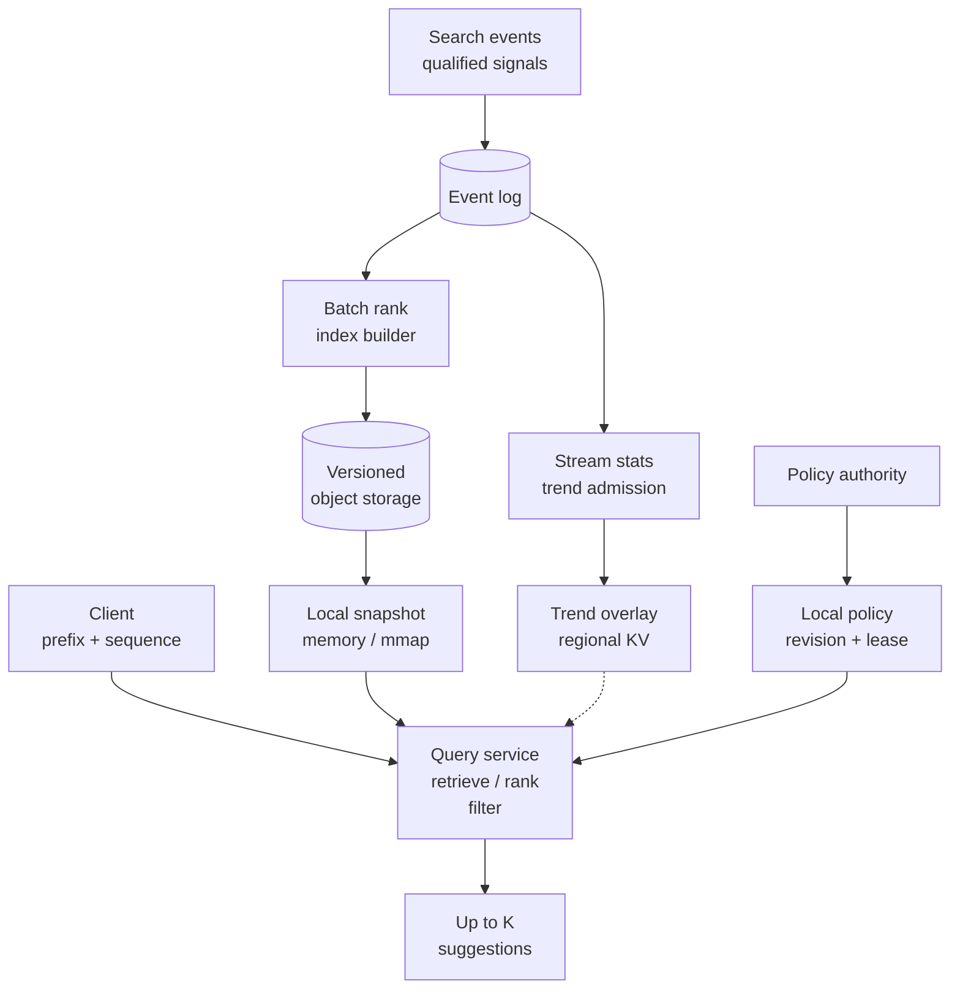
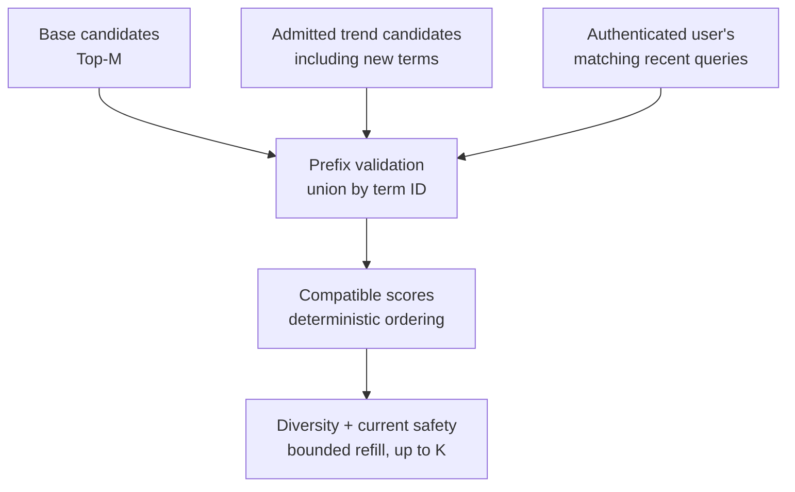
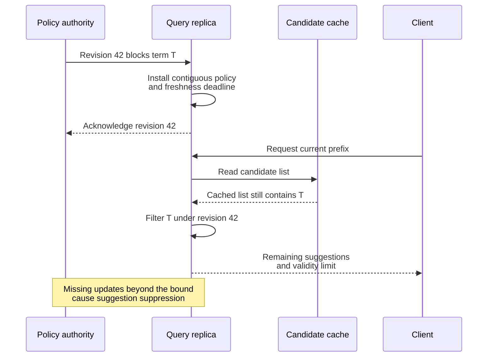
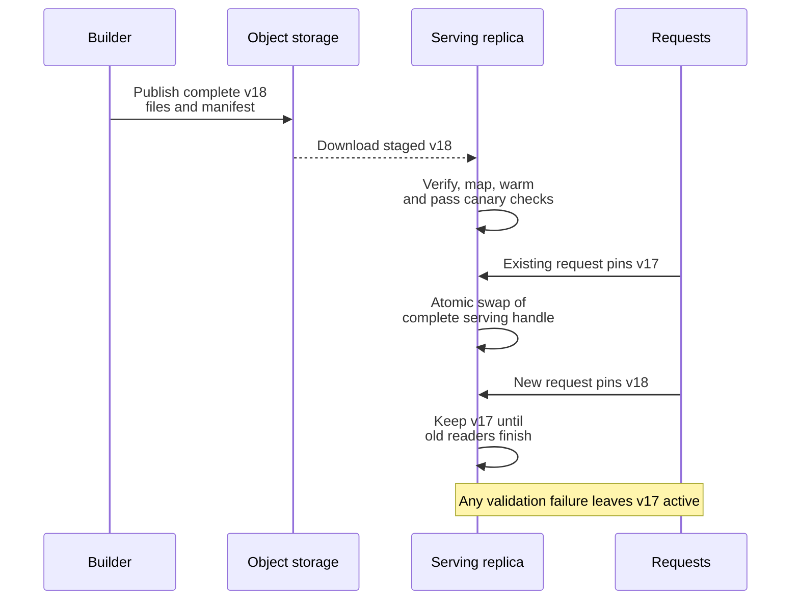

A user types `san f`. The service should quickly suggest `san francisco`, `san francisco weather`, and other relevant completions. It must do this for short prefixes that match millions of queries, absorb a breaking news trend before the next batch build, and remove a prohibited suggestion without waiting for a new index.

These requirements change at different rates. A stable popularity index can be hours old. A trend feature may need updates every few seconds. An emergency removal needs its own distribution and enforcement path.

I would build a read-heavy serving system around a versioned local index, a small trend overlay, and independently refreshed local policy. Retrieval and ranking remain bounded per request. Event aggregation, index construction, and snapshot distribution happen asynchronously.

## 1. Scope and service contracts

The core API performs whole-query prefix matching after a versioned normalization step. `san f` can match `san francisco`; it does not match `francisco san`. Start with public query suggestions, deterministic ranking, locale support, and emergency removal. Personal history and typo tolerance are optional extensions with separate budgets.

Return **up to K eligible suggestions**, with an initial product default of ten and a configured maximum. The final order is deterministic for the same pinned index, feature, model, and policy versions: score descending, then stable term ID ascending. Live features can change between requests, so determinism does not mean permanent ordering.

<div class="table-scroll" role="region" aria-label="Autocomplete service contracts" tabindex="0">

| Concern | Initial design target or contract |
| --- | --- |
| Traffic | Approximately 50,000 peak requests/s, with horizontal growth |
| Latency | Aim for server p99 below 30–50 ms and client-visible completion below 100 ms on supported network paths |
| Availability | Aim for 99.99% request availability, with explicitly measured degraded responses |
| Base popularity | Hourly or daily snapshots, depending on build cost and product needs |
| Trends | Target 5–30 seconds of update freshness under normal operation |
| Emergency removal | Target seconds-level enforcement, with a defined bound for disconnected replicas |
| Retrieval quality | Exact normalized prefix eligibility; approximate final Top-K over bounded candidate sources |
| Safety | Fewer results, including an empty list, are acceptable when safe eligibility cannot be established |

</div>

These are proposed targets, not benchmark results. Measure keystroke-to-render separately from dispatch-to-response: debounce, network transit, server work, and rendering all consume the user-visible budget. Availability dashboards must distinguish full suggestions, base-only responses, safety suppression, and transport errors. Counting every empty response as fully useful hides degradation.

## 2. Estimate requests, events, and index memory separately

Assume ten million daily active users, ten completed searches per user per day, and twenty autocomplete requests per search:

```text
Completed searches:       10M × 10 = 100M/day
Autocomplete requests:    100M × 20 = 2B/day
Average serving rate:     2B / 86,400 ≈ 23,148 requests/s
Illustrative 2× peak:     ≈ 46,296 requests/s
Initial capacity target:  round up to 50,000 requests/s
```

The twenty-request multiplier is an assumption to validate with telemetry. Bounded debounce, cancellation, and reusing an in-flight identical request can reduce it. The client also needs request sequence numbers: a delayed response for `san` must not replace a newer response for `san f`. Handle input-method composition before treating every keyboard event as a completed prefix change.

Serving traffic should not automatically become popularity traffic. Typing `a`, `ap`, `app`, and `apple` generates several fetches but usually one submitted search. Use a canonical `SEARCH_SUBMIT` event for search frequency. A suggestion-selection event supplies engagement evidence; if selection also submits the search, link the two so that one search is not counted twice.

At 200 bytes per submitted-search event, 100 million events produce **20 GB/day** before compression, replication, and indexes. Sampling 5% of two billion impression records at the same illustrative size adds another 20 GB/day. Retain sampling probabilities and request/position attribution if these records feed engagement estimates. Raw prefix logging should be minimized and access-controlled.

Now assume fifty million approved candidate queries averaging twenty UTF-8 bytes. Raw strings alone occupy **1 GB**. That number does not predict the total index size. As an illustrative upper-cost scenario:

```text
100M materialized prefixes × 50 candidates × (8-byte ID + 4-byte score)
= 60 GB of candidate payload
```

Offsets, counts, strings, index topology, alignment, and rollout overlap add more. Compression of the prefix structure does not automatically compress all candidate lists. The main memory decision is how much ranking information to materialize for each prefix.

## 3. High-level architecture



*Figure 1. The synchronous path reads bounded local structures and optional fresh features. The event pipelines build ranking state independently of keystroke traffic.*

The query service performs normalization, candidate retrieval, in-memory merging, scoring, and policy enforcement. Optional profile data should already be cached near the session or fetched under a short deadline. An overlay or profile timeout must not stall the base path.

Object storage holds complete immutable releases. A small transactional control-plane database records manifests, shard assignments, activation state, and rollout progress. It is appropriate for control metadata; it is not traversed for every prefix character. Redis or another regional KV can hold bounded hot-prefix overlays, rather than the complete dictionary by default.

The service is stateless with respect to user sessions, but its local files, caches, policy revisions, and warm working set are operational state. A new replica is not ready merely because its process started.

## 4. Make the serving index an explicit artifact

Start with a logical dictionary mapping stable, non-reused `term_id` values to normalized text, display text, language, and admission metadata. Ranking candidates refer to those IDs. A release packages the lookup structure, candidate lists, and dictionary together.

<div class="table-scroll" role="region" aria-label="Autocomplete index and overlay artifacts" tabindex="0">

| Artifact | Contents and purpose |
| --- | --- |
| `manifest.json` | Snapshot ID, locale/segment, normalization and ranking versions, term-ID namespace, input cutoffs, shard map, file lengths, checksums |
| `prefixes.fst` | Materialized normalized prefix keys mapped to candidate-list references |
| `candidates.bin` | Packed `(term_id, base_score)` lists plus offset/count metadata |
| `terms.dict` | Locally readable text, term-level base scores, and metadata for snapshot terms |
| Cold-prefix structure | Compact term trie or another index with bounded candidate traversal |
| Trend generation | Compatible base/model versions, feature timestamp, expiry, candidate IDs, boosts, and admitted metadata for new terms |
| Policy revision | Exact denials and rules, monotonically ordered revision, validity information, and distribution acknowledgements |

</div>

For a hot prefix, a finite-state transducer can encode a key-to-output map: look up the complete prefix key, obtain a candidate-list offset, and read that bounded list. A compact trie with explicit prefix metadata is another implementation option.

**A minimized FST state is not automatically a unique prefix ID.** Shared states and accumulated path outputs matter. Do not attach arbitrary prefix-specific lists to a bare shared state and assume every input path has the same list. Lucene's [FST API](https://lucene.apache.org/core/10_3_1/core/org/apache/lucene/util/fst/FST.html) models typed outputs, and its [lookup utilities](https://lucene.apache.org/core/10_3_1/core/org/apache/lucene/util/fst/Util.html) retrieve outputs for input keys. This design's materialized map returns list references through that key/output contract.


*Figure 2. The lookup result identifies the materialized candidate list. Its meaning is defined by the complete key and output contract.*

For high-traffic prefixes, store perhaps fifty or a hundred candidates. Ordinary prefixes may need only ten or twenty. A compressed trie can share an unchanged candidate list across an edge whose intermediate prefixes have the same completions. Cold prefixes can use a best-first term traversal with subtree score bounds, subject to a strict visit and time budget. When that budget expires, return the eligible candidates found so far.

Pruning materialized lists must not make every long prefix unqueryable. Prefix matching still needs a defined cold path. Its complexity includes the number of visited states; the fast path's bounds do not describe that fallback. A term that was never admitted to the public dictionary may legitimately have no public suggestions.

Build and serving must use identical normalization rules, including locale handling, whitespace, and a chosen Unicode normalization form. Version the rules and preserve display text separately. [Unicode Standard Annex #15](https://unicode.org/reports/tr15/) defines normalization forms; normalization alone does not settle case folding, tokenization, or product-specific language rules. Avoid changes that silently alter matching across releases.

## 5. Retrieve Top-M, then select Top-K

Retrieve a bounded base list, add a bounded compatible trend list, and optionally add a small private-history list. Validate the normalized prefix for every source and deduplicate by stable term ID, then suppress equivalent display suggestions across source namespaces. A private term still requires its own metadata, text validation, and safety checks; it must not become public merely because one user searched for it.



*Figure 3. Personalization can introduce matching candidates outside the global Top-M list. Every source passes the same final eligibility boundary.*

A user's frequent `san francisco airport` query might rank below the global top fifty for `san`. Reranking only that global list cannot recover it. Scan a small recent-history set, such as the last fifty admitted records, locally check prefix matches, and add eligible matches before scoring. Authenticate the user through session context; a request parameter must not select someone else's history.

An illustrative score is:

```text
base_score = a × log(1 + qualified_searches_7d)
           + b × log(1 + qualified_unique_users_7d)
           + c × smoothed_engagement
           + d × recency_feature

final_score = base_score + trend_boost + personal_boost
tie_breaker = term_id ascending
```

Weights and feature transformations belong to a versioned model. Raw weekly counts and raw one-minute counts are not directly comparable scores. Trend boosts need clipping, calibration, and a compatible baseline. New public terms receive a specified base prior until a snapshot includes their historical features. Engagement needs position and sampling context; a high click rate on a rarely exposed first-position suggestion is weak evidence by itself.

For a materialized prefix of encoded length `L`, `M` merged candidates, and display limit `K`, a compact lookup can require `O(L)` transitions under its transition-access model, followed by `O(M)` retrieval/filtering and `O(M log K + K log K)` heap selection and ordered output. Diversity checks, text bytes, and cold traversal add their own bounded work. The entire operation is not an `O(1)` dictionary read.

Top-M truncation makes final ranking approximate. A highly personalized term outside all candidate sources remains invisible. Filtering or diversity can also leave fewer than K results. Oversampling and bounded refill improve recall, but **M greater than K does not guarantee K safe results**. Never restore a blocked candidate just to fill a row, and never scan an unbounded subtree to meet a display count.

## 6. Build stable popularity and trends from qualified events

The collector validates event IDs, submission/selection relationships, schema versions, locale, and bounded text. Search event processing suppresses retries using the canonical search identity. Late replays outside a short operational deduplication window must not silently become new searches in a historical rebuild; preserve the identities needed by that rebuild's aggregation policy.

Batch processing aggregates admitted terms, computes base features, and builds immutable artifacts. The streaming path maintains event-time windows, distinct-user estimates, and trend features for a much smaller changing set. Publish changed hot-prefix lists in microbatches rather than issuing one remote write for every prefix of every event.

Define allowed lateness, corrections, and replay behavior. A watermark is an event-time progress signal under the pipeline's lateness policy, not proof that no older event can ever arrive. Flink's [event-time documentation](https://nightlies.apache.org/flink/flink-docs-stable/docs/concepts/time/) describes both watermarks and late elements. An event timestamp alone is insufficient to identify exactly which records entered a snapshot; retain reproducible source cutoffs such as partition-offset vectors as well.

### Keep overlay features compatible with the pinned base

An overlay record carries its generation, feature time, expiry, term-ID namespace, normalization version, and the base/model versions with which its scores are compatible. A request uses one pinned base handle and either a compatible overlay generation or no overlay.

Do not add a cumulative overlay count to a base count that already contains those events. The score above uses a separately defined trend feature, rather than blindly summing two overlapping frequency totals. When the base or calibration baseline changes, rebuild or rebase the feature generation against the recorded cutoffs. Support both generations briefly during rollout, or temporarily serve base-only on replicas without a compatible overlay. Repeated delivery replaces an overlay revision idempotently; it must not apply the same boost twice.

An unseen trend term needs more than an ID. Its admitted overlay record must include normalized text, display text, language, a defined base prior, and policy-related metadata, or point to an already available compatible local dictionary extension. Otherwise the query service cannot display a term absent from `terms.dict`. New term admission must finish before public materialization; raw user strings never bypass that process.

### Ranking needs poisoning controls

Cap contribution per principal/session and time window, filter known automation, require minimum independent support and observation duration, and compare bursts against a stable baseline. Unique-user estimates are a signal rather than proof: an attacker can create accounts or sessions. Prevent a single prolific source from dominating the trend score, and keep a switch that disables a suspicious trend generation without taking base serving offline.

Run these checks in event admission and ranking pipelines. Request rate limiting still belongs at ingress, and every response still needs safety enforcement. Expensive reputation computation need not execute for every keystroke.

## 7. Emergency removal has a separate freshness contract

A prohibited term can already exist in a base file, an overlay, private history, and a cache. Removing a trie node during the next build cannot enforce a prompt takedown across those copies.

Distribute versioned policy to every serving replica and apply it after all candidate sources merge, including cache hits and bounded refill. Use exact term IDs, canonical-text denials, and reviewed pattern rules. Canonical-text denials also cover a phrase that receives a different ID in another source. A Bloom filter can reduce exact lookups, but a probabilistic membership result is not an authoritative allow decision.



*Figure 4. Cached candidates are inputs to enforcement. They cannot bypass the current policy revision.*

Maintain a contiguous revision sequence and detect gaps. A freshness lease or equivalent bounded-staleness mechanism must be tied to an installed authoritative policy head; a healthy TCP connection or an unrelated heartbeat does not prove that updates were applied. Replicas acknowledge installation, expose their applied revision and age, and stop serving suggestions when the configured freshness bound cannot be established. Account for clock uncertainty and in-flight response deadlines when defining that bound.

For example, a product can target enforcement within five seconds of an accepted takedown by budgeting distribution, replica expiry, request processing, and client display validity inside that interval. The lease and response lifetimes must be configured and tested together. This is a bounded guarantee under stated timing and client assumptions; a partitioned replica cannot learn an unreceived removal instantaneously.

**An old base snapshot is not a safety fallback when policy freshness expires.** Suppress suggestions, or serve only a separately governed set whose current certification satisfies the same policy contract. Disabling the overlay alone is insufficient because the blocked phrase may also be in the base.

Return browser-facing results with `Cache-Control: no-store` in this design. A five-second browser cache can already consume an entire five-second removal budget. Internal caches retain candidate lists and reapply current policy. [RFC 9111](https://www.rfc-editor.org/rfc/rfc9111.html) specifies HTTP cache directives; application-managed storage and already displayed UI still need explicit rules. The official client rejects obsolete request sequences, hides expired suggestions, and does not restore old cached results after a newer response. No protocol can erase a screenshot or force an arbitrary third-party client to forget received text.

## 8. Publish complete snapshots without interrupting readers

A release includes its entire set of files and compatibility metadata. Build into a new immutable version directory, verify checksums and cross-file references, run ranking and prefix-match tests, and only then stage it for serving.



*Figure 5. Activation is atomic within a replica. Requests retain the complete version they pinned; fleet rollout can contain multiple supported versions.*

The serving handle owns the prefix map, candidate arrays, dictionary, model/normalizer metadata, and routing compatibility. Swapping only `prefixes.fst` while leaving an old dictionary creates incorrect ID or offset interpretation. Retain the old handle until all readers release it, using reference counting or another explicit reader-lifetime mechanism. Roll back to a verified last-good release independently of current safety policy.

Memory mapping exposes file contents through virtual memory. It does not load every mapped byte into RAM immediately. The OS page cache brings accessed pages into memory, so cold faults and a working set larger than available RAM can still dominate p99. Allocate disk and warm-memory headroom for overlapping releases. Never truncate or overwrite an actively mapped file; the [Linux mmap manual](https://man7.org/linux/man-pages/man2/mmap.2.html) documents mapping behavior and invalid accesses beyond a file's end.

Stage downloads and warm hot prefixes before admitting full traffic. A fleet of 1,000 replicas downloading a 20 GB release transfers **20 TB** before retries and overlap. Use regional distribution caches, rollout waves, jitter, checksums, and concurrency limits. Differential artifacts can reduce transfer when their patching and rollback semantics are tested; they do not justify mutating an active mapping.

## 9. Route by index ownership and measured traffic

At moderate dictionary size, replicate the complete local index across serving nodes. This simplifies requests and avoids prefix fan-out. Shard when measured index footprint, working set, or release cost makes full replication unsuitable.

For term-dictionary shards, use locale and normalized key ranges, splitting by traffic and memory rather than equal alphabet intervals. A short prefix may span several ranges; replicate materialized hot-prefix candidates on all relevant frontends so common requests do not scatter across the fleet. For longer prefixes that cross a boundary, use a bounded set of owners and merge their candidates under one request budget.

Hashing complete **terms** across shards makes prefix lookup fan out unless an additional prefix index supplies routing. Hashing complete **prefix keys** is valid when those keys already map to precomputed candidate lists; it sacrifices some locality and still needs a hot-key strategy. It is not inherently incorrect merely because consecutive keystrokes route differently.

For an alphabet of 26 lowercase letters, length-one and length-two combinations total `26 + 26² = 702`. That is a toy sizing example. Unicode, locale rules, spaces, and arbitrary bytes invalidate a universal 702-entry assumption. Replicate observed hot normalized prefixes under a memory budget instead of enumerating every short string for every language.

A request pins a routing epoch together with its index version. During a range split, keep old and new ownership valid for their supported epochs until old requests drain. Do not let a gateway send a new-epoch shard request to a replica whose files describe only the old ranges.

For illustrative capacity planning, suppose a benchmark establishes 5,000 requests/s per replica for the actual candidate and policy workload. At a 70% operating target, 24 replicas across three equal zones provide:

```text
Normal target capacity:       24 × 5,000 × 0.70 = 84,000 requests/s
After losing one zone:        16 × 5,000 × 0.70 = 56,000 requests/s
Initial peak requirement:                              50,000 requests/s
```

This is an example calculation, not a measured capacity recommendation. Validate skew, cold starts, rollout overlap, CPU, and memory. Regional failover requires its own capacity plan; surviving one zone does not establish survival of an entire region.

## 10. API, caches, and private history

Use a bounded request body so prefixes need not appear in URL query logs:

```http
POST /v1/autocomplete
Content-Type: application/json
Authorization: Bearer <session-token>
```

```json
{
  "prefix": "san f",
  "limit": 10,
  "locale": "en-US",
  "surface": "web-search",
  "request_sequence": 27
}
```

The server derives identity from authentication, validates supported segments, caps input bytes and result counts, and handles empty input through an explicit product rule. A response contains display text, term IDs, request sequence, snapshot and policy revisions, optional feature generation, and a short display-validity limit. These version fields make mixed-release and stale-response incidents diagnosable.

Cache base candidate lists by normalized prefix, segment/surface, snapshot, and normalization/model versions. Because these lists contain no user's private features, replicas can share them. Avoid caching personalized final responses in shared keys. Profile-derived candidates remain scoped to the authenticated owner, and cached text still passes final prefix and safety checks.

Hashing a user identifier does not make a query history anonymous. Use purpose-limited pseudonyms, restricted retention, encryption, access controls, and deletion handling. Never feed an individual's private-history suggestions directly into public popularity without the agreed aggregation and admission rules. A missing or timed-out profile returns global suggestions under current policy.

Locale fallback must be explicit: for example, a supported regional locale can use its language base plus a regional delta. Each source must use compatible normalization and the correct policy scope. An arbitrary fallback to another locale must not bypass jurisdictional or language-specific restrictions. Large locales may justify independent base files; low-traffic segments can share a base with small deltas.

## 11. Failure behavior and operations

<div class="table-scroll" role="region" aria-label="Autocomplete failures and safe degradation" tabindex="0">

| Failure | Serving behavior | Evidence and recovery |
| --- | --- | --- |
| Overlay KV timeout or expired generation | Base-only candidates with current safety | Overlay age, timeout rate, compatible-generation hit rate; bypass optional reads with a circuit breaker |
| Private profile timeout | Global results with current safety | Profile deadline misses; prefetch per session and bound the history set |
| Corrupt or incomplete new snapshot | Keep the verified previous snapshot | Checksums, format and reference validation, canary quality, activation revision |
| Missing local base or failed mapping | Remove replica from readiness | Failed local probes and page-fault/I/O metrics; warm another replica rather than launching a SQL scan fallback |
| Policy gap, invalid signature, or expired freshness bound | Suppress suggestions | Applied/head revision difference, acknowledgement latency, lease age, synthetic takedown probes |
| Event-processing backlog | Trends and new base builds become stale | Event age, checkpoint age, consumer lag, archive completeness; serving remains independent while policy is fresh |
| Poisoned trend candidates | Disable that generation and block affected terms | Independent-support metrics, suspicious concentration, emergency-removal propagation |
| Hot prefix or cache expiry burst | Local replicas, request coalescing, bounded recomputation | Per-prefix load, CPU, cache churn; add jitter without bypassing policy checks |
| Range migration mismatch | Route only to a compatible owner/version | Routing epoch and snapshot telemetry; retain overlapping ownership until drain |
| Safe candidates exhausted | Return fewer than K, possibly none | Underfill after policy/diversity, refill budget use, eligible-candidate recall |

</div>

Monitor p50/p95/p99 latency by segment and degradation mode, candidate counts at each stage, policy-removal attempts, deadline exhaustion, page faults, resident working set, index load failures, and serving-version distribution. Track suggestion acceptance and quality alongside empty-result rates. A drop in latency caused by silently disabling all personalization is a different outcome from a faster full path.

Test failures deliberately: pause an overlay, reject a malformed manifest, lose a policy update, expire a replica's freshness lease, and switch snapshots while requests are in flight. Seed a blocked term in every source and in a warm cache; verify that none of those paths bypass final enforcement. Load-test long prefixes and large candidate records as well as the popular one-letter cases.

## 12. Alternatives and extensions

A database prefix-range query can be a reasonable first implementation when traffic and matching sets are small. An index can locate the range, while ranking a large short-prefix range remains expensive unless the schema or materialization supplies the required score ordering. Moving that work offline is the central optimization here.

A managed search engine can also be the appropriate starting point. Elasticsearch's [completion suggester](https://www.elastic.co/docs/reference/elasticsearch/rest-apis/search-suggesters#completion-suggester) provides completion structures, weights, context, and fuzzy options. Its [search-as-you-type field](https://www.elastic.co/docs/reference/elasticsearch/mapping-reference/search-as-you-type) supports prefix and infix use cases through analyzed subfields. Configure and test matching semantics: a token-prefix query that accepts reordered terms may not satisfy a strict whole-query prefix contract.

A custom local index offers control over candidate layout, residency, distribution, and dependency budgets, while adding builder, rollout, debugging, and compatibility responsibilities. Fifty thousand QPS alone does not prove a managed engine is unsuitable or a custom FST is cheaper. Compare measured tail latency, footprint, team capacity, and release cost.

Typo tolerance can query a separate bounded spelling index only after exact retrieval underfills, with limits on prefix length, edit distance, visited states, and time. Clearly label this as a different matching mode; corrected suggestions do not necessarily begin with the literal typed prefix. On timeout, retain exact results. Entity diversity and multi-token analysis also need explicit eligibility rules and versioned evaluation sets.

For a fifty-minute interview, establish requirements and estimates first, then finish the serving and update paths before describing index compression. Spend the remaining time on one or two decisive boundaries: materialized ranking memory, generation compatibility, or emergency-removal enforcement. The architecture is credible when an optional component can fail without stopping base retrieval, and when safety remains enforced even while ranking data is deliberately stale.

## Further reading

- [Lucene FST API](https://lucene.apache.org/core/10_3_1/core/org/apache/lucene/util/fst/FST.html). Describes the transducer representation and typed outputs behind compact key lookup.
- [Lucene FST lookup utilities](https://lucene.apache.org/core/10_3_1/core/org/apache/lucene/util/fst/Util.html). Shows the input-to-output lookup interface relevant to materialized prefix maps.
- [Elasticsearch suggester examples](https://www.elastic.co/docs/reference/elasticsearch/rest-apis/search-suggesters). Documents completion, context, and fuzzy options for a managed-engine implementation.
- [Elasticsearch search-as-you-type mapping](https://www.elastic.co/docs/reference/elasticsearch/mapping-reference/search-as-you-type). Explains analyzed subfields and their matching semantics.
- [Unicode normalization](https://unicode.org/reports/tr15/). Defines the normalization forms that a versioned text-processing policy can select.
- [Flink event time and watermarks](https://nightlies.apache.org/flink/flink-docs-stable/docs/concepts/time/). Explains progress and lateness in the trend pipeline.
- [Linux mmap interface](https://man7.org/linux/man-pages/man2/mmap.2.html). Describes file mapping, residency-related behavior, and mapping hazards.
- [RFC 9111: HTTP Caching](https://www.rfc-editor.org/rfc/rfc9111.html). Defines cache directives used at the browser and intermediary boundary.
