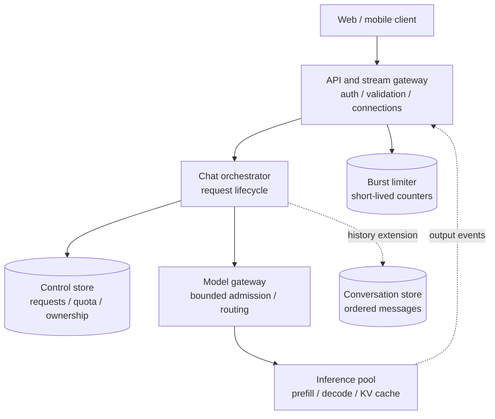
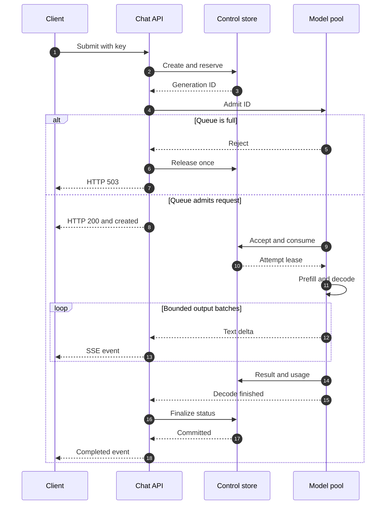
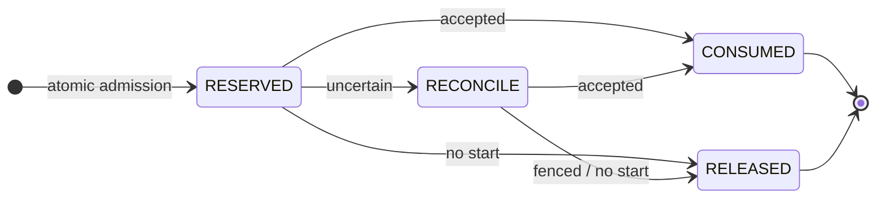
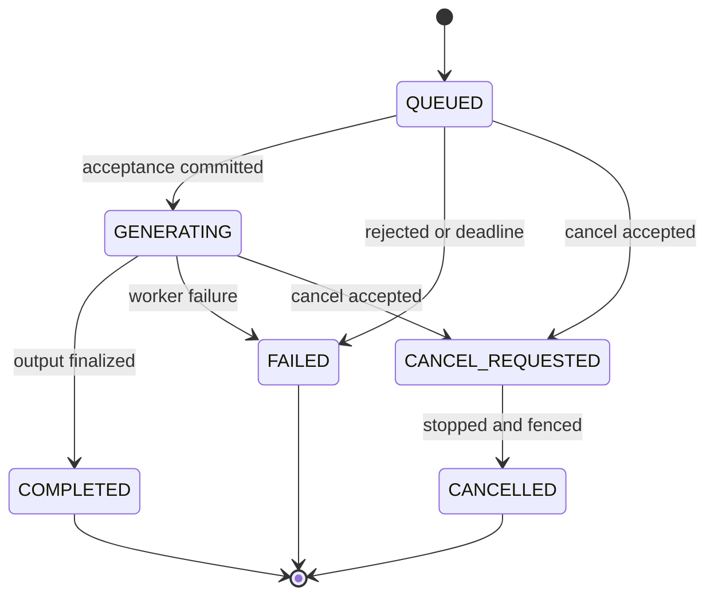
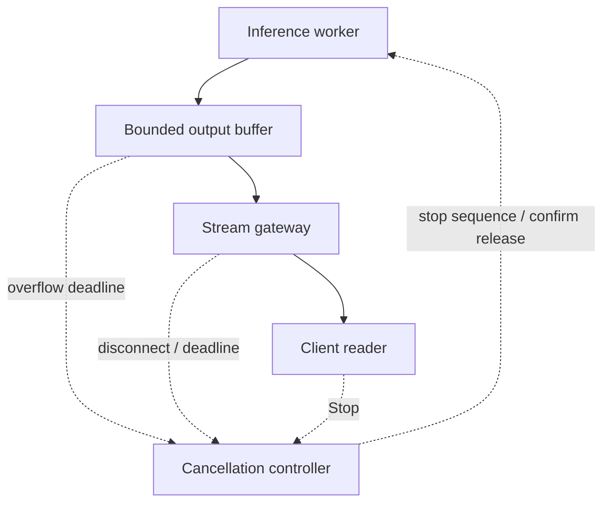

A user submits a prompt, sees the first words of an answer, then clicks Stop. Meanwhile, their phone retries the same request after a timeout. The model worker has already accepted it, but the quota service has not received the acknowledgement. The system must decide whether to keep generating, whether to allow another request, and whether the user has spent one message or two.

Those decisions shape an AI chat service as much as model throughput does. I would begin with an online inference API that supports streaming, bounded admission, message quotas, cancellation, and explicit failure semantics. Conversation history can be added once the request lifecycle is defined.

This is a proposed architecture for a ChatGPT-like text product. It does not describe any provider's internal implementation or API. Model training, retrieval, tools, voice, and image generation are outside the initial scope.

## 1. Scope and service contracts

The first version accepts authenticated prompts and client-supplied conversation context, then returns either a stream or one complete JSON response. It does not retain conversation content for later history reads. It still needs authoritative operational state for quota, request identity, and generation ownership. **No conversation history does not mean no durable control state.**

Separate three admission controls:

<div class="table-scroll" role="region" aria-label="AI chat admission controls" tabindex="0">

| Control | Illustrative policy | Purpose |
| --- | --- | --- |
| Product quota | 40 accepted generations per user per three-hour window | Bound free-tier entitlement and model cost |
| Burst rate limit | Token bucket with capacity 20 and refill of one request token every three seconds | Absorb bursts and control retry storms |
| Concurrent generation limit | Two active generations per user | Prevent one account from holding too many inference slots |

</div>

These are configurable examples. The token bucket permits an initial burst of twenty and a sustained twenty requests per minute; it does not enforce a strict rolling limit of twenty in every sixty-second interval. Apply additional IP, account-risk, prompt-size, and aggregate token budgets where appropriate.

For this design, the message quota uses **UTC-aligned fixed three-hour windows**. That policy can allow forty accepted requests just before a boundary and forty just after it. If the product promises a rolling window, use timestamped admissions or an equivalent exact rolling calculation; relabeling a fixed counter does not provide that guarantee. Keep reservations attached to their original window, even if generation finishes after the boundary.

Define consumption explicitly: a message is consumed when the worker's acceptance is durably committed. Requests rejected before that point release their reservation. A later cancellation or model failure keeps the message consumed under this example policy; a customer-credit policy would be a separate, idempotent adjustment. Generated-token usage is recorded independently.

Conversation history, server-built context, user conversation lists, and deletion are the next stage. Regeneration and resumable event replay can follow. The initial version should already bound input tokens, output tokens, request bytes, generation duration, and queue time.

## 2. Estimate connections, tokens, and storage separately

Suppose five million daily active users submit ten prompts each day:

```text
Generations per day:       5M × 10 = 50M
Average arrival rate:      50M / 86,400 ≈ 579/s
Illustrative peak:         rounded to 6,000 new generations/s
Mean generation duration:  30 seconds
Mean input size:           1,000 tokens
Mean output size:          600 tokens
```

At a sustained, stable peak, Little's Law gives the approximate number of active generations:

```math
C = \lambda W = 6{,}000 \times 30 = 180{,}000
```

If all of those clients stream, plan for about **180,000 concurrent streams**, plus queued connections and reconnect overhead. Different streaming adoption and durations change this estimate. An event-driven gateway avoids dedicating a blocking thread to each connection, but still consumes sockets, TLS state, buffers, and network capacity.

The same workload demands **6 million input tokens/s** and **3.6 million output tokens/s**. Across 180,000 active sequences, the latter corresponds to an average of twenty output tokens per second per sequence. These are workload assumptions, not a serving benchmark. Determine GPU count through measured model, hardware, precision, context-length, batching, and latency behavior; HTTP QPS cannot supply that number.

A 64 KiB per-stream buffer ceiling across 180,000 streams represents roughly **11.8 GB** of potential buffer memory before connection overhead. Allocate buffers on demand and set aggregate memory limits as well. At an illustrative six bytes per output token, raw text is about 21.6 MB/s; JSON framing, event frequency, TLS, and retransmission add traffic.

If history is later retained, fifty million turns per day at 6 KB for each prompt/response pair plus metadata gives **300 GB/day**, or **109.5 TB/year** raw. That is roughly one hundred million message rows per day when each turn has one user and one assistant message. Three copies take 328.5 TB/year before indexes and other records. The first version avoids that content corpus, but operational ledgers still require storage and retention limits.

## 3. High-level architecture



*Figure 1. The control store exists from the first version. Conversation content storage is optional. Arrows show logical responsibilities; token delivery still follows the authorized generation lifecycle.*

The gateway handles authentication, request-size checks, rate limiting, proxy timeouts, and asynchronous connections. The orchestrator owns request identity, quota reservation, generation status, cancellation, and finalization. It installs trusted system instructions itself; client-supplied messages cannot grant privileges or bypass model access policy. Prompt and output safety checks belong at their relevant policy boundaries.

The model gateway admits work into a bounded queue, selects a compatible serving replica, and routes cancellation to the generation owner. The inference pool performs prefill and autoregressive decode. A running attempt normally stays with its worker or coordinated worker group because that placement holds its active KV cache.

Gateway replicas have no exclusive durable ownership of user data, but each live socket has local connection state. Losing a gateway breaks its streams. Horizontal replication does not make an individual TCP connection survive an instance crash.

## 4. One generation pipeline, two response modes

Use a small application-specific API surface:

```text
POST /v1/generations
GET  /v1/generations/{generation_id}
POST /v1/generations/{generation_id}/cancel
```

The submit request includes an authenticated principal, an `Idempotency-Key` header, a model alias, and bounded content:

```json
{
  "model": "fast-text-model",
  "messages": [
    {"role": "user", "content": "Explain TCP congestion control."}
  ],
  "stream": true,
  "max_output_tokens": 1000
}
```

Resolve the alias to a model version and store that resolution with the logical request. Retries of the same request must not silently switch to a new model version. Later, a `conversation_id` and expected conversation revision let the server build context. Authenticate and authorize every status, cancel, and history read against its owner.

For streaming, return `Content-Type: text/event-stream` and `Cache-Control: no-store` after validation, quota reservation, and successful queue admission. Use a POST through `fetch` with a streaming response reader when a JSON body and bearer header are needed. The browser's native `EventSource` interface does not provide this POST/body/header interface. An alternative is POST-to-create followed by a separate authenticated GET event endpoint.

The [WHATWG event-stream format](https://html.spec.whatwg.org/multipage/server-sent-events.html) defines UTF-8 text, named events, and blank-line framing. A reader must handle UTF-8 characters and event frames split across network chunks. One network read is not necessarily one event. The following event names and payloads are our application contract. Examples abbreviate content and intermediate events; usage totals describe the hypothetical full generation.

```text
event: generation.created
data: {"generation_id":"gen_123","sequence":0,"status":"queued"}

event: generation.text.delta
data: {"generation_id":"gen_123","sequence":1,"index":0,"delta":"TCP"}

event: generation.text.delta
data: {"generation_id":"gen_123","sequence":2,"index":0,"delta":" congestion control"}

event: generation.completed
data: {"generation_id":"gen_123","sequence":200,"usage":{"input_tokens":1024,"output_tokens":531}}

```

Treat the deltas as incremental text. Do not resend the entire accumulated answer on every event. The sequence number can detect duplicate delivery within a retained session; it does not by itself provide reconnect or durable replay. Future event types can carry structured output or status without forcing every event to be interpreted as text.

With `stream: false`, consume the same internal generation events into a bounded result buffer and return one JSON document:

```json
{
  "id": "gen_123",
  "status": "completed",
  "output": [
    {"type": "text", "text": "TCP congestion control adjusts the sender's transmission rate..."}
  ],
  "usage": {"input_tokens": 1024, "output_tokens": 531}
}
```

Output-token and response-byte caps bound that buffer. Both response modes share admission, ownership, quota, and cancellation logic. Non-streaming clients also need deadlines long enough for the supported generation duration.



*Figure 2. A queue admission precedes the streaming headers. The worker commits its acceptance before starting inference. Failures after headers require stream events when the connection remains writable.*

## 5. Errors must tell the client what to do

The same HTTP status can represent different product outcomes. Return stable machine-readable codes rather than asking clients to parse human-readable messages. HTTP 429 and `Retry-After` have standard semantics; the distinction between quota and burst limiting is part of our API. See [RFC 6585](https://www.rfc-editor.org/rfc/rfc6585.html#section-4) and [RFC 9110](https://www.rfc-editor.org/rfc/rfc9110.html#section-10.2.3).

<div class="table-scroll" role="region" aria-label="AI chat errors and retry behavior" tabindex="0">

| Before streaming headers | Code | Client action |
| --- | --- | --- |
| 400 | `invalid_request` | Fix the payload; do not retry unchanged |
| 401 / 403 | `unauthorized` / `model_not_allowed` | Authenticate or change the permitted request |
| 409 | `idempotency_conflict` | The same key was used with different content |
| 409 | `generation_in_progress` | Inspect the existing generation; do not start a duplicate |
| 410 | `result_unavailable` | The known generation's content has expired; regeneration needs an explicit new request |
| 429 | `quota_exhausted` | Stop automatic retries and show the window reset time |
| 429 | `rate_limited` / `concurrency_limited` | Wait for the advised interval or an active generation to finish |
| 503 | `capacity_exhausted` | Use bounded backoff, jitter, and the same logical request identity |
| 503 | `quota_service_unavailable` | Explain temporary admission failure; avoid a retry storm |
| 502 / 504 | `model_backend_error` / `generation_timeout` | Inspect request state before considering a new inference attempt |

</div>

For example:

```json
{
  "error": {
    "code": "quota_exhausted",
    "message": "Your current message allowance has been used.",
    "retryable": false,
    "request_id": "req_abc",
    "details": {
      "limit": 40,
      "remaining": 0,
      "reset_at": "2026-11-06T18:00:00Z"
    }
  }
}
```

Here `retryable: false` means no automatic retry in the current quota window. A new submission after reset needs a new key; a retained key continues to identify the old operation. Honor the server's retry delay as a minimum, then add jitter and an overall retry budget. A fresh attempt to deliver an unaccepted request can reuse its key under the documented state-transition rules; a terminal generation is never restarted by replaying its key.

After HTTP 200 has been sent, a worker crash cannot turn that response into HTTP 500. Send an application event if possible:

```text
event: generation.error
data: {"generation_id":"gen_123","sequence":3,"code":"model_backend_error","action":"manual_regenerate","partial":true}

```

The client recognizes `generation.completed`, `generation.cancelled`, or `generation.error` as terminal events. **EOF without a terminal event means interrupted output.** Preserve partial text, mark it incomplete, and offer explicit regeneration. Regeneration uses a new key and a new quota decision. Do not append a new stochastic answer to an old partial answer.

## 6. Couple idempotency and quota before dispatch

A plain `GET used` followed by `SET used + 1` allows two requests to spend the same last message. Instead, conditionally reserve against `used + reserved < limit` and create the logical request in the same authoritative transaction.

For example, use a regionally authoritative transactional store, partitioned around user identity. A sharded relational database can support these operations; DynamoDB transactions are another option. Large scale alone does not disqualify SQL. The required property is atomic conditional state change across the relevant request, reservation, and counter records. [DynamoDB's transaction documentation](https://docs.aws.amazon.com/amazondynamodb/latest/developerguide/transaction-apis.html) describes regional atomic writes; its built-in client-token window is ten minutes, so an application promising longer idempotency needs its own retained request records.

<div class="table-scroll" role="region" aria-label="AI chat control records" tabindex="0">

| Record | Key and fields | Correctness role |
| --- | --- | --- |
| Request | `(user_id, idempotency_key)`, request fingerprint, generation ID, resolved model version, status, attempt epoch, terminal time | One logical generation within the documented retention window |
| Quota window | `(user_id, window_start)`, limit, used, reserved, window end | Enforce `used + reserved <= limit` atomically |
| Reservation | generation ID, original quota window, state, acceptance evidence, reconcile deadline | Consume or release at most once |
| Worker ownership | generation ID, attempt epoch, owner, lease deadline, cancel intent | Authorize one current attempt and reject stale actions |
| Concurrency slots | user ID, slot identities, generation owners, lease state | Bound in-flight work across quota-window boundaries |
| Usage record | generation ID and attempt, actual input/output counts, terminal reason, metering revision | Deduplicate reporting without confusing computation with message entitlement |

</div>

The request fingerprint covers normalized semantic inputs and generation parameters. Compute it without persisting raw prompts in general-purpose logs. A fingerprint is still sensitive operational metadata and needs an access and deletion policy. Acquire a per-user concurrency slot in the same admission workflow; this design conservatively counts queued work against that limit too. Keep slots independent of quota windows and release them only under the confirmed-stop rules below.

The admission transaction conceptually does this:

```text
If (user_id, key) already exists:
    compare the request fingerprint and return its existing identity/state
Otherwise, atomically:
    require used + reserved < limit
    create request with its generation_id
    create reservation in RESERVED state
    increment reserved
    acquire an available user concurrency slot
```

A competing transaction with the same key loses the uniqueness condition and reads the winner. A different key still has to pass the counter condition. When the worker's acceptance is committed, atomically move that reservation from `RESERVED` to `CONSUMED`, decrement `reserved`, increment `used`, and record the authorized attempt. Repeating the transition is a no-op. A proven pre-acceptance rejection moves it to `RELEASED` and decrements `reserved` once.



*Figure 3. Expiration initiates reconciliation. It does not establish that a worker never accepted the generation.*

**A reservation timeout is a reconciliation trigger, not permission to refund.** If dispatch may have succeeded, retain the reservation until acceptance is found or the old attempt is fenced and proven unable to start. Do not send work before the reservation transaction commits. A worker cannot begin merely because an old queue entry arrived; it must validate current ownership and commit acceptance first.

Storage TTL is only a cleanup mechanism. In particular, [DynamoDB TTL deletion is asynchronous](https://docs.aws.amazon.com/amazondynamodb/latest/developerguide/TTL.html), generally occurring within days. A reaper uses application deadlines and conditional transitions; deleting a reservation row must never substitute for decrementing its counter correctly. Retain an old window's counter while unresolved reservations still reference it.

Keep request deduplication records for a declared interval, such as twenty-four hours after terminal state, and never expire active records just because their creation time is old. During that interval, an in-progress retry returns the existing generation ID and status. A completed request can return its cached result if content remains available; if the temporary output has expired, return `result_unavailable` without rerunning inference. The metadata can outlive the content. Outside the retention contract, clients must not assume the service can recognize an old key forever.

If admission fails before any model dispatch, the request can remain in an explicit retryable admission state. A later same-key attempt acquires a fresh reservation transactionally and under the current window policy; it does not revive a terminal generation. Store that distinction rather than making a client guess from a timeout.

## 7. Worker ownership, retries, and cancellation

**No first token does not prove no inference started.** A lost acknowledgement can hide a running prefill or decode. Transport retries reuse the generation ID. The serving side deduplicates dispatch, and a new attempt needs authoritative evidence that the previous attempt never started or has stopped and cannot continue under its old epoch.

Use generation-scoped leases and monotonically increasing attempt epochs. Validate them before accepting work, publishing output, and committing usage or terminal state. Workers enforce lease expiry locally and check cancellation between decode iterations. When ownership cannot be renewed, stop work. Fence stale output and accounting even if an old process later reconnects. Already executing device work may take time to stop; measure that residual work rather than claiming an instantaneous global guarantee against duplicate computation.

A provider endpoint that cannot deduplicate a generation or confirm its cancellation leaves an ambiguous-outcome problem at that boundary. Do not automatically issue a second paid inference call merely because the first call timed out. The design's ownership guarantee depends on cooperation from the serving system.



*Figure 4. Cancellation intent and confirmed cancellation are different states. Terminal transitions are conditional and cannot be overwritten by delayed events.*

`POST /cancel` is idempotent. If the request is running, return **202 with `cancel_requested`**, then propagate the signal through the orchestrator and model gateway. Report `cancelled` only after the serving side has stopped or been fenced so it cannot continue. If completion committed before the cancel transition, return the existing completed state. Late deltas cannot move a terminal generation back to running.

For a client disconnect, the first version cancels after a short, bounded grace period because no durable content reader is waiting for the result. Later, a background-generation product can continue and persist output under a separate contract. Stopping only the browser's render loop leaves the GPU working.

Cancelling an RPC is also insufficient unless the handler stops its application work. The [gRPC cancellation guide](https://grpc.io/docs/guides/cancellation/) explicitly makes handler cooperation part of cancellation. Remove the sequence from decode scheduling, release its KV-cache allocation, and acknowledge the stop. Release concurrency capacity only after that acknowledgement or an enforced lease-expiry bound, not merely after closing the client socket.

## 8. Bound streaming buffers and queueing



*Figure 5. A slow consumer has a bounded effect on memory and model work. Cancellation is a separate control signal.*

The gateway drains output asynchronously. Brief buffering absorbs network variation; a persistently slow reader reaches a byte or age limit and triggers cancellation. Do not block the entire GPU batch on one socket. Stop production or remove that sequence while other sequences continue. Non-streaming requests have their own bounded aggregation buffer under the same output caps.

Test the complete proxy path for incremental delivery. Disable response buffering where required, use appropriate idle and total timeouts, and send SSE comment heartbeats such as `: keep-alive` followed by a blank line. A heartbeat is transport liveness, not a generated token and not evidence that useful output is progressing. Queue and generation deadlines still apply.

Before inference, maintain bounded queues and capacity-aware rejection. Estimate work from input tokens, the maximum output budget, active sequences, queue age, KV-cache pressure, model compatibility, and measured service times. A short prompt and a hundred-thousand-token prompt should not count as equal work.

Prefill and decode compete for resources, so long prefills can affect other users' token latency. Serving systems may use iteration-level scheduling, chunked prefill where supported, and continuous batching. [Orca](https://www.usenix.org/conference/osdi22/presentation/yu) presents iteration-level scheduling; [PagedAttention](https://arxiv.org/abs/2309.06180) addresses KV-cache memory management. Their results motivate measurements; they do not establish a GPU count for this workload.

Use configurable weighted scheduling and a minimum service share so paid and free queues have an explicit policy. Reject work that cannot meet its queue budget with `capacity_exhausted`. A fifteen-second maximum queue wait is a hard stop, not permission for normal queueing to consume fifteen seconds when the p95 first-token target is two seconds. Keep warm model capacity and scale with token load and queue latency; loading weights and warming a replica may be too slow for reactive scaling alone.

## 9. Add conversation history without changing generation ownership

When history becomes a requirement, add an append-oriented message store with bounded range reads. A conversation partition can contain `(conversation_id, sequence)` messages and response-status records. A separate `(user_id, updated_at, conversation_id)` index supports the sidebar. Pagination and retention remain necessary even within one conversation.

The server authorizes the conversation, reads its authoritative committed revision, and appends the new user turn conditionally against that revision. Concurrent sends from two devices either serialize, conflict, or branch under an explicit product rule. A sidebar index can be eventually consistent; the context for the next turn must not silently omit the user's just-committed message.

Build context by tokens, with the output term representing reserved generation space:

```math
\begin{aligned}
T_{\mathrm{input}} &= T_{\mathrm{system}} + T_{\mathrm{history}} + T_{\mathrm{prompt}} \\
T_{\mathrm{input}} + T_{\mathrm{output}} + T_{\mathrm{overhead}} &\le T_{\mathrm{limit}}
\end{aligned}
```

The model-specific tokenizer must include role framing and other overhead. Reserve output space before selecting recent history or a versioned summary. A fixed count such as the last twenty messages cannot bound context size.

Persist assistant output in bounded chunks or at finalization rather than writing a database row for every token. To promise that a completed answer survives refresh, commit its final content and completion marker before sending `generation.completed`. Model decoding can finish before this product-level completion. Already delivered deltas remain provisional until that acknowledgement. If persistence fails after generation, retain a pending-persistence state and retry the durable write from a recoverable spool; do not claim durable completion while the only copy is gateway memory.

Usage is accumulated at the worker and reported with a generation/attempt identity. Record actual generated tokens on cancellation, plus any bounded lost-ack reconciliation policy. Tokenization and billing rules are product-specific, so distinguish requested output limits, generated tokens, delivered text, and billable usage. They are not interchangeable counters.

## 10. Failure domains and regional recovery

<div class="table-scroll" role="region" aria-label="AI chat failure handling" tabindex="0">

| Failure | Required behavior |
| --- | --- |
| Gateway loses the connection | Mark incomplete output; cancel orphan work under the disconnect policy; no implied stream replay |
| Worker acceptance acknowledgement is lost | Inspect the same logical request; retain uncertain reservation; do not start another attempt blindly |
| Worker fails during generation | Preserve partial text and surface interruption; restart requires a new explicit generation after terminal resolution |
| Quota authority is unavailable | Fail closed for free-tier admission, or spend only preallocated, bounded emergency allowance |
| Finalization acknowledgement is lost | Repeat the conditional finalization by generation ID; never consume or release the reservation twice |
| Conversation store is unavailable | Fail affected history reads; offer a clearly separate stateless session only if product policy permits |
| Region ownership is uncertain | Stop new authoritative admissions until the old owner is fenced or the transfer is safely established |

</div>

Multi-zone replication protects the operational ledger within a region. Burst limiting can use Redis with a conservative local fallback; exact quota admission still depends on its authority. A local rate limiter per replica is not a global bound, so size fallback allowances against the fleet or use preallocated shares.

Regional routing alone does not transfer quota or generation authority. An asynchronous cross-region replica can lag behind accepted reservations and idempotency records. Allowing a new region to admit against that stale copy can duplicate work and exceed quota. Choose a single fenced regional owner with a controlled failover pause, synchronous quorum-backed authority with its latency and availability costs, or disjoint regional allocations whose sum is bounded. Do not promise exact global quota from independent counters that reconcile later.

History can have a different recovery objective. A product may accept temporary unavailability or a declared recovery-point loss for conversation content while maintaining stricter quota ownership. Specify the trade-off rather than applying one consistency policy to every store.

During gateway deployment, stop accepting new streams, allow existing streams to drain, then cancel any remaining work at a bounded drain deadline. Coordinate load-balancer behavior with the termination grace period. [Kubernetes pod termination](https://kubernetes.io/docs/concepts/workloads/pods/pod-lifecycle/#pod-termination-flow) supplies lifecycle mechanisms, but application-level stream draining still needs implementation and testing.

## 11. Measure a usable service, not just an HTTP response

The following are proposed objectives for discussion, not measured performance:

<div class="table-scroll" role="region" aria-label="AI chat service objectives" tabindex="0">

| Indicator | Proposed target or definition | Important qualification |
| --- | --- | --- |
| Admission response contract | 99.95% of bounded valid requests get a typed decision within 500 ms | A quick 503 satisfies this protocol metric but does not mean generation capacity is available |
| Eligible admission availability | At least 99.9% admitted under the agreed demand envelope | Measure capacity and quota-service rejections; exclude genuine entitlement exhaustion and invalid requests |
| Time to first text token | p95 below two seconds at supported load | Include admission, queueing, and prefill; a created event or heartbeat is not a text token |
| Accepted generation completion | At least 99.5% of accepted, non-user-cancelled generations complete | Exclude only explicit user cancellations; disconnect cleanup, deadlines, and worker failures remain visible failures |

</div>

Track client-observed first-token time separately from server-edge timing so network delay is visible. Also record queue age, inter-token latency, generation duration, input/output tokens per second, active sequences, GPU memory, KV-cache pressure, batch composition, and slow-consumer cancellations. High GPU utilization with a growing queue is an overload signal.

Quota correctness needs its own signals: reservation age, unresolved dispatches, duplicate-consume attempts, over-admission, and consumed messages with no successful output. Keep `quota_exhausted`, `rate_limited`, and `capacity_exhausted` separate in dashboards. A global HTTP 429 count hides the action a client or operator needs to take.

Trace requests through admission, ownership, inference, cancellation, and accounting using opaque IDs. Avoid recording prompt content, bearer credentials, or generated private text in ordinary infrastructure logs. Deletion and retention policies must cover temporary event buffers, content spools, and derived indexes as well as the main history table.

## 12. A 50-minute interview sequence

Spend the first five minutes agreeing on text chat, response modes, quota policy, and content retention. Use the next five for stream and token estimates. Draw Figure 1, then explain the request/event contract and what the client does after a partial stream.

Use the central twenty minutes for atomic reservation, idempotency, worker acceptance, and cancellation. Walk through a lost acknowledgement and a worker crash. Then add history, token-bounded context, and regional ownership. Reserve the final minutes for capacity rejection, stream draining, and the separate protocol, admission, and completion objectives.

The design should make three questions answerable from authoritative state: which logical generation this request identifies, which attempt may still compute, and whether its message reservation is held, consumed, or released.

## Further reading

- [WHATWG: Server-sent events](https://html.spec.whatwg.org/multipage/server-sent-events.html) — framing, event types, UTF-8, and reconnection fields.
- [RFC 6585, section 4](https://www.rfc-editor.org/rfc/rfc6585.html#section-4) — HTTP 429.
- [RFC 9110, Retry-After](https://www.rfc-editor.org/rfc/rfc9110.html#section-10.2.3) — retry-delay semantics.
- [DynamoDB transactions](https://docs.aws.amazon.com/amazondynamodb/latest/developerguide/transaction-apis.html) — atomic operations and the service's own idempotency window.
- [DynamoDB TTL](https://docs.aws.amazon.com/amazondynamodb/latest/developerguide/TTL.html) — asynchronous deletion behavior.
- [Orca, OSDI 2022](https://www.usenix.org/conference/osdi22/presentation/yu) — iteration-level scheduling for generative serving.
- [PagedAttention, SOSP 2023](https://arxiv.org/abs/2309.06180) — KV-cache memory management in LLM serving.
- [gRPC cancellation](https://grpc.io/docs/guides/cancellation/) — cancellation propagation and handler cooperation.
- [Kubernetes pod termination](https://kubernetes.io/docs/concepts/workloads/pods/pod-lifecycle/#pod-termination-flow) — shutdown behavior and traffic draining.
